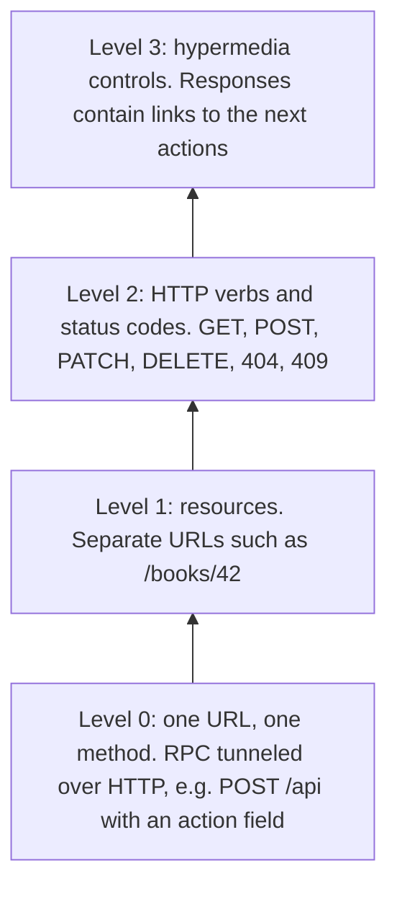
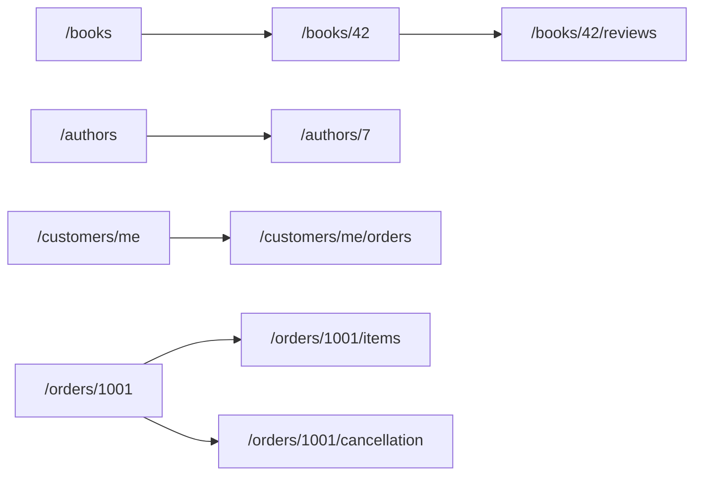
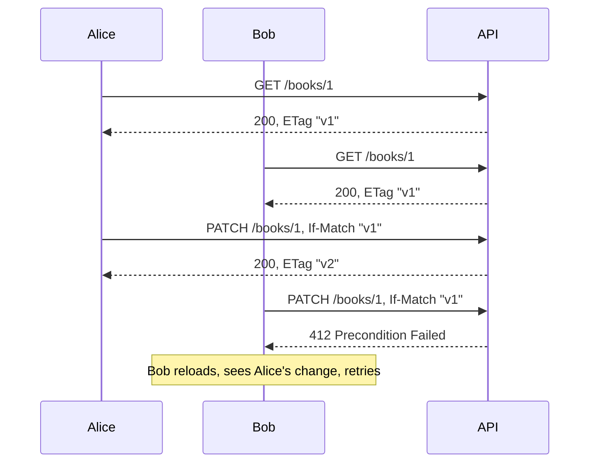

# REST API Design

## Introduction

REST is the most common style for APIs on the web. When a mobile app loads your product catalog, when a partner system creates an order, or when your frontend saves a user's profile, there is a good chance it uses an HTTP API in a REST style.

The term comes from Roy Fielding's 2000 doctoral dissertation, which described **Re**presentational **S**tate **T**ransfer as the architectural style behind the web itself. Its core ideas are:

- Everything important is a **resource** with a stable address (a URL).
- Clients work with **representations** of resources, usually JSON today.
- A **uniform interface** (the standard HTTP methods, status codes and headers) works the same way for every resource.
- Requests are **stateless**: each request carries everything the server needs.
- Responses say whether they are **cacheable**.

Most APIs called "REST" in practice follow some of these ideas and not others. That is fine. The goal of this page is not purity. It is an API that is **predictable**: a developer who has used two of your endpoints should be able to guess how the third works.

Think of a good REST API like a well-organized library. Every book has a shelf location (URL). The rules for borrowing, returning and renewing (methods) are the same for every book. And the librarian gives standard answers ("checked out", "not found", "overdue") instead of inventing a new phrase for each book.

## The Richardson Maturity Model

Martin Fowler's article on Leonard Richardson's maturity model is a useful way to see how "RESTful" an API is:



Most successful public APIs (GitHub, Stripe and many others) live at **Level 2**. Level 3 (hypermedia, often called HATEOAS) has real benefits for long-lived, loosely coupled clients, but few client developers use the links in practice. Aim for a solid Level 2 and add links where they help, such as pagination links.

## Modeling Resources

Start from the domain, not from your database tables or your functions. For an online bookstore:



Guidelines that keep URLs predictable:

- **Use plural nouns for collections**: `/books`, `/orders`. A single item is `/books/42`.
- **Let the method carry the verb**: `POST /orders`, not `POST /createOrder`.
- **Nest only for real ownership, and only one level deep**: `/books/42/reviews` is clear. `/authors/7/books/42/reviews/3/comments` is not. Give important things their own top-level URL.
- **Model actions that do not fit CRUD as resources**: cancelling an order can be `POST /orders/1001/cancellation`, which creates a cancellation. Some teams prefer `POST /orders/1001:cancel` (Google's API design guide uses this custom-method style). Pick one convention and use it everywhere.
- **Use opaque, stable IDs**: clients should not have to parse or construct them.
- **Pick one naming case for JSON fields** (`snake_case` or `camelCase`) and never mix them.

## HTTP Methods: Safe and Idempotent

HTTP semantics are defined in RFC 9110. Two properties matter a lot in distributed systems:

- **Safe**: the request does not change server state (from the client's point of view). Caches and crawlers may send it freely.
- **Idempotent**: sending the request twice has the same effect as sending it once. Clients and proxies can retry it after a timeout.

| Method | Typical use | Safe | Idempotent | Typical success status |
| --- | --- | --- | --- | --- |
| GET | Read a resource or collection | Yes | Yes | 200 OK |
| HEAD | Like GET, headers only | Yes | Yes | 200 OK |
| POST | Create a sub-resource, or start a process | No | No | 201 Created (with `Location`) or 202 Accepted |
| PUT | Replace a resource completely | No | Yes | 200 OK or 204 No Content |
| PATCH | Partially update a resource | No | Not guaranteed | 200 OK |
| DELETE | Remove a resource | No | Yes | 204 No Content |

POST is the method that hurts when retried. If a client sends `POST /orders`, times out, and retries, did the customer just order twice? We will fix that with an idempotency key below.

## Status Codes Worth Knowing

You do not need all of them. You do need to use these consistently:

| Code | Meaning | When to use |
| --- | --- | --- |
| 200 OK | Success with a body | Reads and updates |
| 201 Created | A resource was created | POST that creates; include a `Location` header |
| 202 Accepted | Work was accepted, not done yet | Long-running jobs (see [async request-reply](./0-arch-communication-styles.mdx)) |
| 204 No Content | Success, nothing to return | DELETE, some PUTs |
| 400 Bad Request | Malformed request | Unparseable JSON, wrong types |
| 401 Unauthorized | Not authenticated | Missing or invalid credentials |
| 403 Forbidden | Authenticated but not allowed | Wrong role or tenant |
| 404 Not Found | No such resource | Also useful to hide resources the caller may not see |
| 409 Conflict | Conflicts with current state | Cancelling an order that has shipped |
| 412 Precondition Failed | A conditional header did not match | Stale `If-Match` ETag |
| 422 Unprocessable Content | Well-formed but semantically invalid | Validation errors (FastAPI uses this by default) |
| 428 Precondition Required | You require a conditional request | Updates without `If-Match` |
| 429 Too Many Requests | Rate limit hit | Include `Retry-After` |
| 500 / 503 | Server error / temporarily unavailable | Never for client mistakes |

## A Small Bookstore API

Let's build the pieces in Python with FastAPI. Install with `pip install fastapi httpx2` (`httpx2` is what recent Starlette versions use for `TestClient`; older versions use `httpx`). Everything below goes in one file, `bookstore_api.py`. It uses an in-memory dictionary so you can run it without a database.

### Resources and errors in one format

When something goes wrong, clients need a machine-readable error. **RFC 9457, Problem Details for HTTP APIs** (which replaced RFC 7807 in 2023) defines a standard JSON shape with the media type `application/problem+json`. Using it means clients can handle errors from all your endpoints the same way.

```python
import base64
import hashlib
import json
from dataclasses import dataclass, asdict

from fastapi import FastAPI, Header, Request, Response
from fastapi.responses import JSONResponse
from pydantic import BaseModel, Field

app = FastAPI(title="Bookstore API")


@dataclass
class Book:
    id: int
    title: str
    author: str
    price_cents: int


BOOKS: dict[int, Book] = {
    i: Book(i, f"Book {i}", "Various", 1000 + i) for i in range(1, 8)
}


class BookIn(BaseModel):
    title: str = Field(min_length=1)
    author: str = Field(min_length=1)
    price_cents: int = Field(gt=0)


# --- Errors: RFC 9457 Problem Details ---------------------------------------
class ProblemError(Exception):
    def __init__(self, status: int, title: str, detail: str, type_: str) -> None:
        self.status, self.title, self.detail, self.type_ = status, title, detail, type_


@app.exception_handler(ProblemError)
def problem_handler(request: Request, exc: ProblemError) -> JSONResponse:
    body = {
        "type": f"https://api.example.com/problems/{exc.type_}",
        "title": exc.title,
        "status": exc.status,
        "detail": exc.detail,
        "instance": str(request.url.path),
    }
    return JSONResponse(body, status_code=exc.status, media_type="application/problem+json")


def get_or_404(book_id: int) -> Book:
    if book_id not in BOOKS:
        raise ProblemError(404, "Book not found", f"No book with id {book_id}.", "not-found")
    return BOOKS[book_id]


def etag_of(book: Book) -> str:
    digest = hashlib.sha256(json.dumps(asdict(book), sort_keys=True).encode()).hexdigest()
    return f'"{digest[:16]}"'
```

Money is stored as an integer number of cents (`price_cents`). Floating-point numbers cannot represent most decimal amounts exactly, so APIs that handle money usually send integers in the smallest currency unit, or decimal strings.

### Pagination: cursors over offsets

Never return an unbounded collection. The two common approaches are:

- **Offset pagination** (`?offset=40&limit=20`): simple and allows "jump to page 5". But it gets slow on large tables, because the database still walks past the skipped rows. It also skips or repeats items when rows are inserted while someone is paging.
- **Cursor pagination** (`?cursor=...&limit=20`): the server returns an opaque token that encodes "continue after this item". It stays fast and stable while data changes, but you cannot jump to an arbitrary page.

```python
# --- Collection with cursor pagination --------------------------------------
def encode_cursor(last_id: int) -> str:
    return base64.urlsafe_b64encode(json.dumps({"after": last_id}).encode()).decode()


def decode_cursor(cursor: str) -> int:
    return json.loads(base64.urlsafe_b64decode(cursor.encode()))["after"]


@app.get("/books")
def list_books(limit: int = 3, cursor: str | None = None) -> dict:
    after = decode_cursor(cursor) if cursor else 0
    ids = sorted(i for i in BOOKS if i > after)[:limit]
    items = [asdict(BOOKS[i]) for i in ids]
    has_more = bool(ids) and any(i > ids[-1] for i in BOOKS)
    return {"items": items, "next_cursor": encode_cursor(ids[-1]) if has_more else None}


# --- Single resource with ETag ----------------------------------------------
@app.get("/books/{book_id}")
def get_book(book_id: int, response: Response) -> dict:
    book = get_or_404(book_id)
    response.headers["ETag"] = etag_of(book)
    return asdict(book)
```

The cursor is base64-encoded so clients treat it as opaque. That leaves you free to change what is inside later, for example to sort by date. In production, cap `limit` (for example at 100) and consider signing or encrypting cursors.

Try it from a second file, `demo.py`:

```python
from fastapi.testclient import TestClient
from bookstore_api import app

client = TestClient(app)

page1 = client.get("/books", params={"limit": 3}).json()
print([b["id"] for b in page1["items"]], page1["next_cursor"])
page2 = client.get("/books", params={"limit": 3, "cursor": page1["next_cursor"]}).json()
print([b["id"] for b in page2["items"]])

r = client.get("/books/999")
print(r.status_code, r.headers["content-type"])
print(r.json())
```

Output:

```text
[1, 2, 3] eyJhZnRlciI6IDN9
[4, 5, 6]
404 application/problem+json
{'type': 'https://api.example.com/problems/not-found', 'title': 'Book not found', 'status': 404, 'detail': 'No book with id 999.', 'instance': '/books/999'}
```

### Safe retries for POST: the Idempotency-Key header

A mobile app sends `POST /books` and the connection drops before the response arrives. Did the server create the book? The client cannot know. Retrying might create a duplicate, and not retrying might lose the request.

The common fix, popularized by Stripe, is an **`Idempotency-Key` header**. The client generates a unique key (usually a UUID) per logical operation and sends the same key on every retry. The server stores the first response under that key and replays it for repeats. The IETF HTTPAPI working group has an Internet-Draft for this header, but it is not an RFC as of this writing, so treat the exact semantics as a widely used convention. The [Idempotency](../9-arch-distributed-systems/7-arch-idempotency.mdx) page covers the storage side in depth.

```python
# --- Create, with Idempotency-Key -------------------------------------------
IDEMPOTENCY: dict[str, tuple[int, dict]] = {}


@app.post("/books", status_code=201)
def create_book(
    payload: BookIn,
    response: Response,
    idempotency_key: str | None = Header(default=None),
) -> dict:
    if idempotency_key and idempotency_key in IDEMPOTENCY:
        stored_id, body = IDEMPOTENCY[idempotency_key]
        response.headers["Location"] = f"/books/{stored_id}"
        return body  # same response as the first time, no second book
    new_id = max(BOOKS) + 1
    BOOKS[new_id] = Book(new_id, **payload.model_dump())
    body = asdict(BOOKS[new_id])
    if idempotency_key:
        IDEMPOTENCY[idempotency_key] = (new_id, body)
    response.headers["Location"] = f"/books/{new_id}"
    return body
```

`demo2.py` simulates a retry after a network blip:

```python
from fastapi.testclient import TestClient
from bookstore_api import app

client = TestClient(app)
new_book = {"title": "Designing APIs", "author": "A. Writer", "price_cents": 3999}
headers = {"Idempotency-Key": "7c1f3a52-order-form-1"}

first = client.post("/books", json=new_book, headers=headers)
retry = client.post("/books", json=new_book, headers=headers)  # network blip, client retries
print(first.status_code, first.headers["location"], first.json()["id"])
print(retry.status_code, retry.headers["location"], retry.json()["id"])
print("books in store:", len(client.get("/books", params={"limit": 100}).json()["items"]))
```

Output:

```text
201 /books/8 8
201 /books/8 8
books in store: 8
```

A production version also stores a hash of the request body and rejects a reused key with a **different** body (Stripe returns an error in that case), expires keys after a while, and handles two requests with the same key arriving at the same time.

### Lost updates: ETags and If-Match

Two staff members open the edit page for the same book. Alice changes the price and saves. Bob, still looking at the old data, changes the title and saves, silently overwriting Alice's price with the old value. This is the **lost update** problem.

HTTP solves it with **conditional requests** (RFC 9110). The server sends an `ETag`, a version tag, with each representation. The client sends it back in `If-Match` when updating. If the resource changed in between, the tags differ and the server answers `412 Precondition Failed`.



```python
# --- Partial update with optimistic concurrency -----------------------------
class BookPatch(BaseModel):
    title: str | None = None
    price_cents: int | None = Field(default=None, gt=0)


@app.patch("/books/{book_id}")
def update_book(
    book_id: int,
    patch: BookPatch,
    response: Response,
    if_match: str | None = Header(default=None),
) -> dict:
    book = get_or_404(book_id)
    if if_match is None:
        raise ProblemError(428, "Precondition required", "Send If-Match with the ETag you read.", "precondition-required")
    if if_match != etag_of(book):
        raise ProblemError(412, "Precondition failed", "The book changed since you read it.", "stale-etag")
    for field, value in patch.model_dump(exclude_none=True).items():
        setattr(book, field, value)
    response.headers["ETag"] = etag_of(book)
    return asdict(book)


@app.delete("/books/{book_id}", status_code=204)
def delete_book(book_id: int) -> Response:
    get_or_404(book_id)
    del BOOKS[book_id]
    return Response(status_code=204)
```

`demo3.py`:

```python
from fastapi.testclient import TestClient
from bookstore_api import app

client = TestClient(app)

# Alice and Bob both open the edit form for book 1.
etag = client.get("/books/1").headers["etag"]

alice = client.patch("/books/1", json={"price_cents": 1299}, headers={"If-Match": etag})
print("Alice:", alice.status_code, alice.json()["price_cents"])

bob = client.patch("/books/1", json={"price_cents": 999}, headers={"If-Match": etag})
print("Bob:  ", bob.status_code, bob.json()["title"])
```

Output:

```text
Alice: 200 1299
Bob:   412 Precondition failed
```

This is **optimistic concurrency**: no locks are held while people think, and conflicts are detected at write time. The same ETags also enable cheap cache revalidation with `If-None-Match` on GET, which returns `304 Not Modified` when nothing changed. Here the ETag is a hash of the content. With a database, a version column or `updated_at` timestamp is cheaper.

## Describe the Contract with OpenAPI

An API is a contract, so write it down in a machine-readable form. **OpenAPI** is the standard description format for HTTP APIs. FastAPI generates an OpenAPI 3.1 document automatically at `/openapi.json`, and serves interactive docs at `/docs`. Version 3.2 of the specification was published in September 2025. Tool support for new versions arrives gradually, so check that your generators and gateways support the version you target.

Two workflows exist:

- **Code-first**: write the server and generate the spec (what FastAPI does). Fast for one team.
- **Design-first**: write the spec, review it with consumers, then generate stubs, mocks and SDKs. Better when several teams or external partners depend on the API, because the contract is agreed before code exists.

Either way, run a linter such as Spectral on the spec in CI to enforce your style guide (naming, pagination, error format).

## Real-World Scenario

Your bookstore is opening an API to partner bookshops so they can list your catalog and place orders on behalf of customers. Partners will write clients in many languages, and you will not be able to make them upgrade quickly. Today, internal endpoints look like this: `POST /api/getBooks`, `POST /api/orderCreate`, errors returned as `200 OK` with `{"success": false}`, and lists that return every row.

You redesign the public surface:

1. **Resources**: `/books`, `/books/{id}`, `/orders`, `/orders/{id}`, `/orders/{id}/cancellation`.
2. **Methods and status codes** used as HTTP defines them, so partners' HTTP libraries, proxies and retry logic behave correctly.
3. **Problem Details** for every error, with stable `type` URIs that link to documentation.
4. **Cursor pagination** on every collection, with a maximum `limit`.
5. **Idempotency-Key required** on `POST /orders`, because partner networks are flaky and a duplicate order costs real money.
6. **ETags** on orders, so a partner cannot overwrite a change made by your customer service team.
7. **An OpenAPI document**, reviewed with two pilot partners before launch, and published with generated SDKs.
8. **Versioning and deprecation rules** from day one (see [API Versioning and Evolution](./6-arch-api-versioning.mdx)).

**Why this approach fits:** partners are many, external and slow to change. A conventional REST design means they can use standard HTTP tooling, caching works out of the box, and your error and retry semantics are documented by HTTP itself rather than by you.

**When to use REST / when not to:**

- Use it for public and partner APIs, CRUD-heavy resources, cacheable reads, and anything a browser or `curl` should be able to call.
- Consider [GraphQL](./2-arch-graphql.mdx) when many different clients need different shapes of deeply related data.
- Consider [gRPC](./3-arch-grpc.mdx) for high-volume internal service-to-service calls where you control both sides.
- Consider [messaging](./5-arch-messaging-patterns.mdx) when the caller does not need an immediate answer.

**Alternatives and trade-offs:**

| Approach | Pros | Cons | Best for |
| --- | --- | --- | --- |
| REST (Level 2) | Universal tooling, HTTP caching, easy to explore | Over- and under-fetching, many round trips for nested data | Public APIs, CRUD, web clients |
| GraphQL | Clients choose fields, one round trip, strong schema | Caching and rate limiting are harder, query cost control | Many clients with varied data needs |
| gRPC | Compact binary format, streaming, generated clients | Weak browser support, harder to debug by hand | Internal service-to-service calls |
| RPC over HTTP (JSON-RPC style) | Simple mapping to functions | Ignores HTTP semantics, poor caching | Internal tools, quick prototypes |

## Common Mistakes

1. **Verbs in URLs** (`/getBook`, `/deleteOrder`). Let the HTTP method be the verb.
2. **`200 OK` with an error in the body.** Clients, proxies, monitoring and retry logic all rely on status codes. Return a 4xx or 5xx code with a Problem Details body.
3. **Unbounded lists.** A collection that is small today will not stay small. Paginate from the first version, because adding it later is a breaking change.
4. **Leaking the database schema.** Column names, internal IDs and join tables in the API couple every client to your storage. Design representations for consumers.
5. **Non-idempotent retries.** Retrying a POST without an idempotency key can charge a card twice.
6. **Inconsistent conventions.** `created_at` in one endpoint and `creationDate` in another, different error formats, different pagination styles. Write an API style guide and lint for it.
7. **Using floats for money** or local times without a time zone. Use integer minor units or decimal strings, and RFC 3339 timestamps in UTC.
8. **Chatty APIs.** If a screen needs ten calls to render, consider a composite resource, a `?expand=` parameter, a [Backend for Frontend](./4-arch-api-gateway.mdx), or GraphQL.

## Summary

- REST models your domain as **resources** with stable URLs, manipulated through the **uniform interface** of HTTP methods, status codes and headers.
- Aim for a consistent **Richardson Level 2** API. Hypermedia is optional.
- Know which methods are **safe** and **idempotent**, because retries depend on it. Use an **Idempotency-Key** for POSTs that must not repeat.
- Return errors as **Problem Details** (RFC 9457) with correct status codes.
- Paginate every collection. **Cursors** are stable and fast, while **offsets** are simple and allow jumping to a page.
- Use **ETags with If-Match** to prevent lost updates.
- Publish an **OpenAPI** description and lint it.

## Exercises

1. Add `?sort=price_cents` support to `GET /books` with cursor pagination. What must the cursor contain now that the sort key is not unique?
2. Extend the idempotency store so it rejects a reused key with a different request body. Return a Problem Details response with an appropriate status code.
3. Add `If-None-Match` support to `GET /books/{id}` so it returns `304 Not Modified` when the ETag matches.
4. Take an API you use often (for example GitHub's REST API) and identify its conventions for pagination, errors and rate limiting.

### Related pages

- [Synchronous vs Asynchronous Communication](./0-arch-communication-styles.mdx)
- [API Versioning and Evolution](./6-arch-api-versioning.mdx)
- [Idempotency](../9-arch-distributed-systems/7-arch-idempotency.mdx)
- [Security by Design](../12-arch-quality-and-operations/4-arch-security-by-design.mdx)
- The site's [FastAPI tutorial](/docs/framework/fastapi) for more on building Python APIs
- References: RFC 9110 (HTTP Semantics), RFC 9457 (Problem Details), Martin Fowler's "Richardson Maturity Model" article, and the OpenAPI Specification at [spec.openapis.org](https://spec.openapis.org/)
