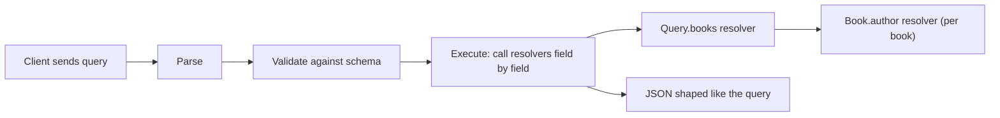
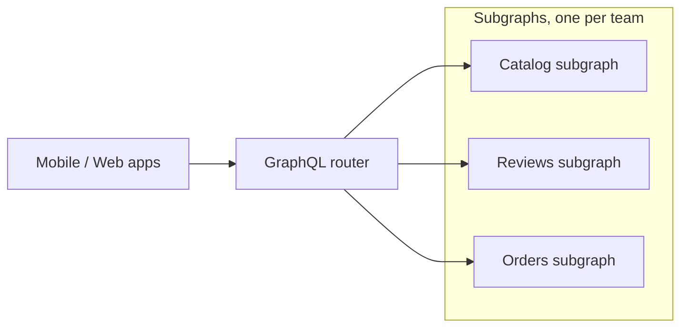

# GraphQL

## Introduction

GraphQL is a query language for APIs and a runtime for answering those queries. Instead of the server deciding what each endpoint returns, the **client** sends a query that describes exactly the fields it wants, and the server returns JSON in the same shape.

Facebook built GraphQL in 2012 for its mobile apps and open-sourced it in 2015. It is now maintained by the GraphQL Foundation under the Linux Foundation. The specification is published at spec.graphql.org. Its most recent edition, September 2025, was the first new edition since 2021, and added features such as OneOf input objects and schema coordinates.

An analogy: a REST API is like a set menu. Each endpoint is a fixed plate, and if you want the soup from one menu and the dessert from another, you order both and leave half the food. GraphQL is ordering à la carte from one waiter: you list exactly what you want, and it all arrives on one tray.

That flexibility is powerful, and it moves real costs to the server. This page shows both sides.

## The Problem: Over-fetching and Under-fetching

Imagine the home screen of your bookstore's mobile app. For each featured book it shows the title, the author's name, and the price. With a typical REST API, the app does this:

```text
GET /books?featured=true          -> 20 books, each with 25 fields (description, ISBN, dimensions...)
GET /authors/1                    -> full author record, only "name" is used
GET /authors/2
...                               -> one request per distinct author
```

Two problems:

- **Over-fetching**: each response carries fields the screen never shows. That wastes bandwidth on a phone network.
- **Under-fetching**: the first response does not contain author names, so the app makes **N more round trips**. On a slow connection, each one adds noticeable delay.

You could add `GET /home-screen` that returns exactly what the app needs. That works, but now the web app wants a slightly different home screen, the tablet app another, and the partner widget a fourth. Each needs a new endpoint, and backend teams become a bottleneck for frontend changes.

GraphQL lets the client ask for exactly this, in one request:

```graphql
query MobileHome {
  books(first: 4) {
    title
    priceCents
    author { name }
  }
}
```

And the response mirrors the query:

```json
{
  "data": {
    "books": [
      { "title": "A Wizard of Earthsea", "priceCents": 1299, "author": { "name": "Ursula K. Le Guin" } },
      { "title": "Kindred", "priceCents": 1499, "author": { "name": "Octavia E. Butler" } }
    ]
  }
}
```

## Core Concepts



- **Schema**: a strongly typed description of everything clients can ask for, written in the Schema Definition Language (SDL). It is the contract between client and server.
- **Query**: a read operation.
- **Mutation**: a write operation. Mutations at the top level run one after another, in order.
- **Subscription**: a long-lived operation where the server pushes results, usually over WebSockets or server-sent events.
- **Resolver**: a function that produces the value for one field. The engine walks the query and calls a resolver for each field.
- **Introspection**: clients can query the schema itself, which powers tools like GraphiQL, code generators and editor autocomplete.

Here is the schema for our example, in SDL:

```graphql
type Author {
  id: ID!
  name: String!
  books: [Book!]!
}

type Book {
  id: ID!
  title: String!
  priceCents: Int!
  author: Author!
}

type Query {
  books(first: Int! = 10): [Book!]!
}

input AddBookInput {
  title: String!
  authorId: Int!
  priceCents: Int!
}

type Mutation {
  addBook(input: AddBookInput!): Book!
}
```

The `!` means non-null. `[Book!]!` is a non-null list of non-null books.

## Building It in Python with Strawberry

[Strawberry](https://strawberry.rocks) is a code-first GraphQL library for Python. You write type-annotated classes, and it generates the schema. FastAPI's documentation recommends it, because both rely on type hints. Install it with `pip install "strawberry-graphql[fastapi]"`.

### First version: correct, but slow

```python
import asyncio
import strawberry

# A tiny fake database that counts queries.
AUTHORS = {1: "Ursula K. Le Guin", 2: "Octavia E. Butler", 3: "Terry Pratchett"}
BOOKS = [
    {"id": 1, "title": "A Wizard of Earthsea", "author_id": 1, "price_cents": 1299},
    {"id": 2, "title": "Kindred", "author_id": 2, "price_cents": 1499},
    {"id": 3, "title": "Guards! Guards!", "author_id": 3, "price_cents": 1099},
    {"id": 4, "title": "The Dispossessed", "author_id": 1, "price_cents": 1399},
]
QUERY_LOG: list[str] = []


async def db_author(author_id: int) -> str:
    QUERY_LOG.append(f"SELECT name FROM authors WHERE id = {author_id}")
    return AUTHORS[author_id]


@strawberry.type
class Author:
    id: strawberry.ID
    name: str


@strawberry.type
class Book:
    id: strawberry.ID
    title: str
    price_cents: int
    author_id: strawberry.Private[int]  # not exposed in the schema

    @strawberry.field
    async def author(self) -> Author:
        return Author(id=strawberry.ID(str(self.author_id)), name=await db_author(self.author_id))


@strawberry.type
class Query:
    @strawberry.field
    def books(self, first: int = 10) -> list[Book]:
        QUERY_LOG.append("SELECT * FROM books")
        return [
            Book(id=strawberry.ID(str(b["id"])), title=b["title"],
                 price_cents=b["price_cents"], author_id=b["author_id"])
            for b in BOOKS[:first]
        ]


schema = strawberry.Schema(query=Query)

if __name__ == "__main__":
    query = """
      query MobileHome {
        books(first: 4) {
          title
          author { name }
        }
      }
    """
    result = asyncio.run(schema.execute(query))
    print(result.data)
    print(f"{len(QUERY_LOG)} database queries:")
    for q in QUERY_LOG:
        print("  ", q)
```

Output:

```text
{'books': [{'title': 'A Wizard of Earthsea', 'author': {'name': 'Ursula K. Le Guin'}}, {'title': 'Kindred', 'author': {'name': 'Octavia E. Butler'}}, {'title': 'Guards! Guards!', 'author': {'name': 'Terry Pratchett'}}, {'title': 'The Dispossessed', 'author': {'name': 'Ursula K. Le Guin'}}]}
5 database queries:
   SELECT * FROM books
   SELECT name FROM authors WHERE id = 1
   SELECT name FROM authors WHERE id = 2
   SELECT name FROM authors WHERE id = 3
   SELECT name FROM authors WHERE id = 1
```

Strawberry converts `price_cents` to `priceCents` in the schema, following GraphQL naming conventions.

### The N+1 problem

The client made one request, but the server ran **one query for the books plus one query per book** for its author, and even fetched author 1 twice. With 100 books, that is 101 queries. This is the **N+1 problem**, and it is the most common GraphQL performance trap. It happens because each resolver only knows about its own field.

### The fix: DataLoader

A **DataLoader** (a pattern that started in Facebook's JavaScript `dataloader` library) collects all the `load(id)` calls made during one tick of the event loop, removes duplicates, and calls your batch function **once** with the full list of keys.

Save this improved version as `schema_loader.py`. The later examples import from it.

```python
import asyncio
import strawberry
from strawberry.dataloader import DataLoader
from strawberry.extensions import QueryDepthLimiter
from strawberry.types import Info

AUTHORS = {1: "Ursula K. Le Guin", 2: "Octavia E. Butler", 3: "Terry Pratchett"}
BOOKS = [
    {"id": 1, "title": "A Wizard of Earthsea", "author_id": 1, "price_cents": 1299},
    {"id": 2, "title": "Kindred", "author_id": 2, "price_cents": 1499},
    {"id": 3, "title": "Guards! Guards!", "author_id": 3, "price_cents": 1099},
    {"id": 4, "title": "The Dispossessed", "author_id": 1, "price_cents": 1399},
]
QUERY_LOG: list[str] = []


async def batch_load_authors(ids: list[int]) -> list[str]:
    """Called once per tick with ALL the author ids requested so far."""
    QUERY_LOG.append(f"SELECT id, name FROM authors WHERE id IN {tuple(ids)}")
    return [AUTHORS[i] for i in ids]  # must return results in the same order as ids


@strawberry.type
class Author:
    id: strawberry.ID
    name: str

    @strawberry.field
    def books(self) -> list["Book"]:
        return [to_book(b) for b in BOOKS if str(b["author_id"]) == self.id]


@strawberry.type
class Book:
    id: strawberry.ID
    title: str
    price_cents: int
    author_id: strawberry.Private[int]

    @strawberry.field
    async def author(self, info: Info) -> Author:
        name = await info.context["author_loader"].load(self.author_id)
        return Author(id=strawberry.ID(str(self.author_id)), name=name)


def to_book(b: dict) -> Book:
    return Book(id=strawberry.ID(str(b["id"])), title=b["title"],
                price_cents=b["price_cents"], author_id=b["author_id"])


@strawberry.type
class Query:
    @strawberry.field
    def books(self, first: int = 10) -> list[Book]:
        QUERY_LOG.append("SELECT * FROM books")
        return [to_book(b) for b in BOOKS[:first]]


@strawberry.input
class AddBookInput:
    title: str
    author_id: int
    price_cents: int


@strawberry.type
class Mutation:
    @strawberry.mutation
    def add_book(self, input: AddBookInput) -> Book:
        if input.price_cents <= 0:
            raise ValueError("price_cents must be positive")
        row = {"id": len(BOOKS) + 1, "title": input.title,
               "author_id": input.author_id, "price_cents": input.price_cents}
        BOOKS.append(row)
        return to_book(row)


schema = strawberry.Schema(
    query=Query,
    mutation=Mutation,
    extensions=[lambda: QueryDepthLimiter(max_depth=4)],
)


def new_context() -> dict:
    # A fresh loader per request, so cached values never leak between users.
    return {"author_loader": DataLoader(load_fn=batch_load_authors)}


if __name__ == "__main__":
    query = "{ books(first: 4) { title author { name } } }"
    result = asyncio.run(schema.execute(query, context_value=new_context()))
    print(f"{len(result.data['books'])} books, {len(QUERY_LOG)} database queries:")
    for q in QUERY_LOG:
        print("  ", q)
```

Output:

```text
4 books, 2 database queries:
   SELECT * FROM books
   SELECT id, name FROM authors WHERE id IN (1, 2, 3)
```

Two queries no matter how many books. Note that the loader is created **per request** in `new_context()`. A DataLoader also caches results, and a global loader would serve one user's cached data to another and never see updates. The file also adds an `Author.books` field, a mutation and a depth limit, which we use next. Recent Strawberry versions want extensions passed as a class or factory (the `lambda`) rather than an instance, so each request gets a fresh one.

### Mutations and errors

GraphQL reports errors differently from REST. A response can contain **both** `data` and an `errors` array, and each error has a `path` showing which field failed. Over HTTP, servers traditionally answer `200 OK` even when some fields failed.

```python
import asyncio
from schema_loader import schema, new_context

mutation = """
  mutation AddBook($input: AddBookInput!) {
    addBook(input: $input) { id title priceCents }
  }
"""
ok = asyncio.run(schema.execute(
    mutation,
    variable_values={"input": {"title": "Parable of the Sower", "authorId": 2, "priceCents": 1599}},
    context_value=new_context(),
))
print("data:", ok.data, "errors:", ok.errors)

bad = asyncio.run(schema.execute(
    mutation,
    variable_values={"input": {"title": "Free Book", "authorId": 2, "priceCents": 0}},
    context_value=new_context(),
))
print("data:", bad.data)
print("errors:", [e.message for e in bad.errors], [e.path for e in bad.errors])
```

Output (Strawberry also logs the exception traceback to stderr):

```text
data: {'addBook': {'id': '5', 'title': 'Parable of the Sower', 'priceCents': 1599}} errors: None
data: None
errors: ['price_cents must be positive'] [['addBook']]
```

Always pass user input through **variables** (`$input`) instead of building query strings. Variables are typed and validated, and they keep queries constant, which helps caching and allow-listing.

For expected business failures ("out of stock", "coupon expired"), many teams return them as part of the schema, for example a union `AddBookResult = Book | ValidationError`, instead of throwing. Clients then handle them with the type system, and the `errors` array stays for unexpected failures.

### Serving it over HTTP

```python
from fastapi import FastAPI
from strawberry.fastapi import GraphQLRouter

from schema_loader import schema, new_context


async def get_context() -> dict:
    return new_context()  # called once per HTTP request


graphql_app = GraphQLRouter(schema, context_getter=get_context)

app = FastAPI()
app.include_router(graphql_app, prefix="/graphql")
```

Run it with `fastapi dev app.py` (or `uvicorn app:app --reload`) and open `http://127.0.0.1:8000/graphql` for the interactive GraphiQL explorer. A client sends a POST with a JSON body:

```python
from fastapi.testclient import TestClient
from app import app

client = TestClient(app)
resp = client.post("/graphql", json={
    "query": "query Cheap($max: Int!) { books(first: $max) { title priceCents } }",
    "variables": {"max": 2},
})
print(resp.status_code, resp.json())
```

Output:

```text
200 {'data': {'books': [{'title': 'A Wizard of Earthsea', 'priceCents': 1299}, {'title': 'Kindred', 'priceCents': 1499}]}}
```

## Protecting a GraphQL Server

With REST, the server decides how expensive each endpoint is. With GraphQL, **the client writes the query**, so a single request can ask for a huge amount of work. Our schema has a cycle (`Book.author` and `Author.books`), so a client can nest it as deep as they like:

```python
import asyncio
from schema_loader import schema, new_context

normal = "{ books { title author { name books { title } } } }"
result = asyncio.run(schema.execute(normal, context_value=new_context()))
print("normal query ok:", result.errors is None)

# A malicious client can nest the cycle Book -> Author -> Book ... forever.
abusive = "{ books { author { books { author { books { author { name } } } } } } }"
result = asyncio.run(schema.execute(abusive, context_value=new_context()))
print([e.message for e in result.errors])

typo = "{ books { title isbn } }"
result = asyncio.run(schema.execute(typo, context_value=new_context()))
print([e.message for e in result.errors])
```

Output:

```text
normal query ok: True
["'anonymous' exceeds maximum operation depth of 4"]
["Cannot query field 'isbn' on type 'Book'."]
```

The depth limiter rejected the abusive query before running any resolver. Schema validation also catches typos before execution. Real servers combine several defenses:

| Defense | What it does |
| --- | --- |
| Depth limit | Rejects deeply nested queries |
| Cost or complexity analysis | Gives each field a cost and multiplies by list sizes; rejects queries over a budget |
| Pagination limits | Every list field takes a bounded `first` or `limit` argument |
| Trusted documents (persisted queries) | Only queries registered at build time can run; clients send a hash instead of the text |
| Timeouts and rate limits | Limits by cost per client, not just by request count |
| Field-level authorization | Checks permissions in resolvers or the domain layer, because any field can be reached from many paths |
| Introspection policy | Many teams disable introspection for public production endpoints that serve only their own apps |

**Trusted documents** deserve special mention. If only your own apps call the API, register their queries at build time and reject everything else. You get REST-like control over cost, and clients still enjoy GraphQL's developer experience.

## Caching and Other Trade-offs

- **HTTP caching is harder.** Queries are usually sent as POST to one URL, so CDNs and browser caches cannot help by default. Persisted queries sent with GET restore some of this. Client libraries such as Apollo Client, Relay and urql keep a **normalized cache** in the browser instead.
- **Monitoring changes.** Every request hits `/graphql`, so "requests per endpoint" dashboards are useless. Track by operation name and resolver timings.
- **File uploads, streaming results** (`@defer`, `@stream`) and subscriptions are not covered uniformly by the core spec. Support varies by server and client, so check your libraries.
- **Schema evolution is easier.** Clients only receive the fields they ask for, so you can add fields freely and mark old ones `@deprecated(reason: "...")`. Many GraphQL APIs never version at all (see [API Versioning and Evolution](./6-arch-api-versioning.mdx)).

### Federation: one graph, many teams

As an organization grows, one team cannot own the whole schema. **Federation** lets each team own a **subgraph** (books, reviews, orders), and a **router** composes them into one supergraph that clients query. Apollo Federation is the most widely used implementation, and the GraphQL Foundation has a working group on a vendor-neutral "composite schemas" specification. Federation is powerful but adds a distributed system of its own. Treat it as a scaling step, not a starting point.



## Real-World Scenario

Your bookstore has a web store, iOS and Android apps, and an in-store kiosk. Each screen combines catalog data, prices, stock, reviews and the customer's wishlist, which live in four backend services. Frontend teams keep filing tickets for "one more field on the home endpoint", and the mobile team complains about slow screens on cellular networks.

You introduce a GraphQL layer in front of the existing services:

1. The schema models the **client's view** of the domain (`Book`, `Author`, `Review`, `Wishlist`), not the services' internal tables.
2. Resolvers call the existing REST and gRPC services, with **DataLoaders** for every relationship to avoid N+1 calls downstream.
3. Your own apps use **trusted documents**: queries are extracted at build time and registered, and the production endpoint rejects anything else.
4. Every list takes `first` with a maximum, and a **cost limit** blocks expensive operations.
5. Resolver timings and operation names go to your tracing system.

**Why this approach fits:** many clients need different slices of the same connected data, and they change faster than the backend. GraphQL lets them change their queries without backend tickets, while trusted documents keep the server in control of cost.

**When to use GraphQL / when not to:**

- Use it when you have several client types with different data needs, deeply related data, and frontend teams that want autonomy. It also works well as an aggregation layer, similar to a [Backend for Frontend](./4-arch-api-gateway.mdx).
- Avoid it for simple CRUD services with one client, for public APIs where you need strong HTTP caching and very simple onboarding, for file-heavy or streaming workloads, and for internal service-to-service calls where [gRPC](./3-arch-grpc.mdx) or [REST](./1-arch-rest-api-design.mdx) is simpler. If your team has no capacity to learn query cost control, a few well-designed REST endpoints may serve you better.

**Alternatives and trade-offs:**

| Approach | Pros | Cons | Best for |
| --- | --- | --- | --- |
| GraphQL | Clients pick fields, one round trip, typed schema, easy evolution | N+1 risk, cost control, harder HTTP caching | Many clients with varied, related data needs |
| REST with `?fields=` and `?expand=` | Keeps HTTP caching and simplicity | Ad hoc, grows complicated | Public APIs that need a little flexibility |
| Backend for Frontend (REST) | Each client gets a tailored API | One backend per client to maintain | A few client types with distinct needs |
| gRPC | Fast, streaming, strongly typed | Poor browser fit, no field selection | Internal service calls |

## Common Mistakes

1. **No DataLoaders.** The N+1 problem is invisible in development with ten rows and painful in production. Batch every relationship.
2. **Sharing a DataLoader across requests.** Its cache leaks data between users and serves stale values. Create loaders per request.
3. **No cost control.** Without depth limits, cost analysis or trusted documents, one query can take down the server.
4. **Authorization only at the top level.** Fields are reachable through many paths (`order.customer.addresses`). Enforce access where the data is loaded, ideally in the domain layer.
5. **Mirroring the database schema.** Exposing every table and column makes the graph hard to change. Design it around what clients need.
6. **Building strings instead of using variables.** That invites injection and defeats caching and allow-listing.
7. **Choosing GraphQL for its popularity.** If you have one client and simple resources, you take on GraphQL's operational costs without its benefits.

## Summary

- GraphQL lets clients request **exactly the fields they need** from a **typed schema**, usually in one round trip.
- Resolvers run per field, which makes the **N+1 problem** easy to create. **DataLoaders** batch and deduplicate loads, and must be created per request.
- Errors come back in an `errors` array alongside partial `data`. Model expected business failures in the schema.
- Protect the server with **depth limits, cost analysis, pagination limits, trusted documents** and field-level authorization.
- HTTP caching is harder, and monitoring must use operation names. Schema evolution is easier.
- **Federation** splits a large graph across teams, at the cost of running a router and composing schemas.

## Exercises

1. Add a `reviews` field to `Book` backed by a new fake table, and write a DataLoader for it. Confirm with `QUERY_LOG` that a query for ten books runs a constant number of queries.
2. Change `addBook` to return a union of `Book` and a `ValidationError` type instead of raising. How does the client query change?
3. Add a `first` argument with a maximum of 50 to `Author.books`, and reject larger values.
4. Look at the public GitHub GraphQL API documentation and find how it limits query cost. Compare it with GitHub's REST API rate limits.

### Related pages

- [REST API Design](./1-arch-rest-api-design.mdx)
- [API Gateway and Backend for Frontend](./4-arch-api-gateway.mdx)
- [Frontend Architecture Patterns](../7-arch-clean-architecture/5-arch-frontend-architecture.mdx)
- References: [graphql.org/learn](https://graphql.org/learn/), the specification at [spec.graphql.org](https://spec.graphql.org/), and the [Strawberry documentation](https://strawberry.rocks/docs)
