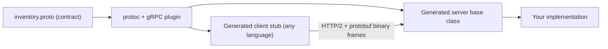
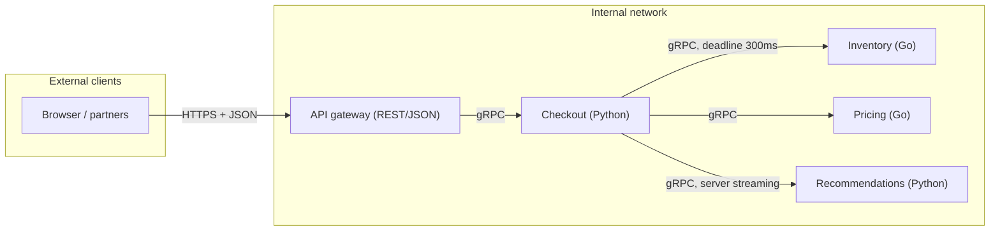

# gRPC

## Introduction

gRPC is a framework for **remote procedure calls** (RPC). You define a service and its methods in a contract file, generate client and server code from it, and then call remote methods almost as if they were local functions. Under the hood, gRPC sends compact binary messages, encoded with **Protocol Buffers** (protobuf), over **HTTP/2**.

Google created gRPC as an open-source successor to its internal RPC system, Stubby, and released it in 2015. It is now a Cloud Native Computing Foundation (CNCF) project with official libraries for many languages, including Python, Java, Go, C#, C++, Node.js, Kotlin and Swift.

An analogy: a REST API is like sending letters in plain English. Anyone can read them, and you can write one by hand. gRPC is like two offices that agreed on a printed order form. Each box on the form has a number and a type, so forms are quick to fill in, quick to check, and nobody misreads them. The catch is that you need the form to read one.

gRPC shines for **internal service-to-service communication**, where you control both sides and care about performance, strict contracts and streaming. It is a weaker fit for public APIs and browsers. This page shows why.

## How gRPC Works



1. You write a `.proto` file describing **messages** (data) and **services** (methods).
2. The protobuf compiler `protoc` generates code: message classes, a client **stub**, and a server base class.
3. The client calls a method on the stub. gRPC serializes the request, sends it over an HTTP/2 connection, and the server's generated code calls your implementation.

Because both sides are generated from the same contract, a Python client and a Go server agree on every field and type. Mismatches show up at build time, not as a `KeyError` in production.

## The Four Kinds of RPC

| Kind | Shape | Example |
| --- | --- | --- |
| Unary | One request, one response | `GetStock(isbn)` |
| Server streaming | One request, a stream of responses | `WatchStock(isbns)` pushes updates |
| Client streaming | A stream of requests, one response | Upload many scan events, get one summary |
| Bidirectional streaming | Both sides stream independently | Chat, live collaborative editing |

Streaming works over a single HTTP/2 connection, which also multiplexes many concurrent calls. That is something plain HTTP/1.1 REST cannot do without WebSockets or server-sent events.

## Defining the Contract

Here is an inventory service for our online bookstore. Save it as `inventory.proto`:

```protobuf
syntax = "proto3";

package bookstore.inventory.v1;

service InventoryService {
  // Unary: one request, one response.
  rpc GetStock(GetStockRequest) returns (GetStockResponse);

  // Server streaming: one request, a stream of responses.
  rpc WatchStock(WatchStockRequest) returns (stream StockChanged);
}

message GetStockRequest {
  string isbn = 1;
}

message GetStockResponse {
  string isbn = 1;
  int32 quantity = 2;
  string warehouse = 3;
}

message WatchStockRequest {
  repeated string isbns = 1;
}

message StockChanged {
  string isbn = 1;
  int32 quantity = 2;
}
```

Notice:

- The **field numbers** (`= 1`, `= 2`) identify fields on the wire. Names are not sent at all. That is why protobuf is compact, and why you must **never change or reuse a field number** once it is in use.
- The package name includes a version (`v1`). That is a common convention for evolving gRPC APIs (see [API Versioning and Evolution](./6-arch-api-versioning.mdx)).
- `repeated` means a list.

:::note proto3 and editions
This example uses `syntax = "proto3"`, which is still the most common form. Newer protobuf releases also support **editions** (for example `edition = "2023"`), which replace the proto2/proto3 split with per-feature settings. Both work with gRPC. Check the [protobuf documentation](https://protobuf.dev/) for what your toolchain supports.
:::

## Generating Code and Running a Service in Python

Install the runtime and the code generator:

```bash
pip install grpcio grpcio-tools
python -m grpc_tools.protoc -I. --python_out=. --pyi_out=. --grpc_python_out=. inventory.proto
ls
```

Output:

```text
inventory.proto
inventory_pb2.py
inventory_pb2.pyi
inventory_pb2_grpc.py
```

`inventory_pb2.py` contains the message classes, `inventory_pb2.pyi` gives your editor and type checker the type information, and `inventory_pb2_grpc.py` contains the client stub and server base class. In real projects, generate these files in your build step rather than editing them by hand.

### The server

```python
from concurrent import futures
import time

import grpc

import inventory_pb2
import inventory_pb2_grpc

STOCK = {"9780547773742": 12, "9780807083697": 0, "9780062225740": 5}


class InventoryService(inventory_pb2_grpc.InventoryServiceServicer):
    def GetStock(self, request, context):
        if request.isbn not in STOCK:
            context.abort(grpc.StatusCode.NOT_FOUND, f"unknown ISBN {request.isbn}")
        return inventory_pb2.GetStockResponse(
            isbn=request.isbn, quantity=STOCK[request.isbn], warehouse="DUB-1"
        )

    def WatchStock(self, request, context):
        # Pretend three sales happen, one every 0.2 s.
        for isbn in request.isbns[:3]:
            if not context.is_active():  # client cancelled or deadline passed
                return
            time.sleep(0.2)
            STOCK[isbn] = max(0, STOCK.get(isbn, 0) - 1)
            yield inventory_pb2.StockChanged(isbn=isbn, quantity=STOCK[isbn])


def serve() -> grpc.Server:
    server = grpc.server(futures.ThreadPoolExecutor(max_workers=10))
    inventory_pb2_grpc.add_InventoryServiceServicer_to_server(InventoryService(), server)
    server.add_insecure_port("localhost:50051")  # use TLS credentials in production
    server.start()
    return server


if __name__ == "__main__":
    serve().wait_for_termination()
```

Save it as `server.py`. A streaming method is just a Python generator: each `yield` sends one message to the client. `context.abort` ends the call with a gRPC status code.

### The client

```python
import grpc

import inventory_pb2
import inventory_pb2_grpc
from server import serve


def main() -> None:
    with grpc.insecure_channel("localhost:50051") as channel:
        stub = inventory_pb2_grpc.InventoryServiceStub(channel)

        # Unary call, with a deadline of 1 second.
        reply = stub.GetStock(inventory_pb2.GetStockRequest(isbn="9780547773742"), timeout=1.0)
        print(f"unary: {reply.isbn} -> {reply.quantity} in {reply.warehouse}")

        # Errors arrive as status codes, not HTTP codes.
        try:
            stub.GetStock(inventory_pb2.GetStockRequest(isbn="0000"), timeout=1.0)
        except grpc.RpcError as err:
            print(f"error: {err.code().name}: {err.details()}")

        # Server streaming.
        request = inventory_pb2.WatchStockRequest(isbns=["9780547773742", "9780062225740"])
        for change in stub.WatchStock(request, timeout=5.0):
            print(f"stream: {change.isbn} now {change.quantity}")

        # A deadline that is too short.
        try:
            for _ in stub.WatchStock(request, timeout=0.1):
                pass
        except grpc.RpcError as err:
            print(f"error: {err.code().name}")


if __name__ == "__main__":
    server = serve()  # start the server in the same process for the demo
    try:
        main()
    finally:
        server.stop(grace=None)
```

Run `python client.py`. Output:

```text
unary: 9780547773742 -> 12 in DUB-1
error: NOT_FOUND: unknown ISBN 0000
stream: 9780547773742 now 11
stream: 9780062225740 now 4
error: DEADLINE_EXCEEDED
```

For asyncio applications, the same package offers `grpc.aio` with `async` servers and stubs.

## Deadlines, Status Codes and Metadata

### Always set a deadline

A **deadline** is the point in time after which the client no longer wants the answer. gRPC sends it to the server, which can check `context.is_active()` or the remaining time and stop working. When service A calls B with a 1-second deadline and B calls C, B can pass the **remaining** time along. The whole chain then gives up together, instead of C doing work nobody is waiting for.

In Python a call has no deadline unless you pass `timeout=`. The gRPC documentation recommends always setting one. This connects directly to [Circuit Breaker, Retry and Timeout](../9-arch-distributed-systems/8-arch-circuit-breaker.mdx).

### Status codes

gRPC has its own set of status codes. Some of the most useful:

| gRPC status | Roughly like HTTP | Meaning |
| --- | --- | --- |
| `OK` | 200 | Success |
| `INVALID_ARGUMENT` | 400 | Bad input, do not retry |
| `NOT_FOUND` | 404 | No such entity |
| `ALREADY_EXISTS` | 409 | Create conflicted with an existing entity |
| `FAILED_PRECONDITION` | 400 or 409 | System is not in the required state |
| `PERMISSION_DENIED` | 403 | Not allowed |
| `UNAUTHENTICATED` | 401 | Missing or invalid credentials |
| `RESOURCE_EXHAUSTED` | 429 | Quota or rate limit hit |
| `DEADLINE_EXCEEDED` | 504 | Took longer than the deadline |
| `UNAVAILABLE` | 503 | Transient failure, usually safe to retry with backoff |
| `INTERNAL` | 500 | Server bug |

Using the right code matters, because client libraries, service meshes and retry policies decide what to retry based on it.

### Metadata and interceptors

**Metadata** is gRPC's version of HTTP headers: key-value pairs for authentication tokens, trace IDs and tenant IDs. **Interceptors** are middleware that run around every call on the client or the server. They are the right place for logging, authentication, metrics and tracing. This is the [Chain of Responsibility](../4-arch-behavioral-patterns/5-arch-chain-of-responsibility.mdx) pattern again.

## Why Protobuf Is Compact, and How It Evolves

```python
import json

import inventory_pb2

msg = inventory_pb2.GetStockResponse(isbn="9780547773742", quantity=12, warehouse="DUB-1")
as_proto = msg.SerializeToString()
as_json = json.dumps({"isbn": "9780547773742", "quantity": 12, "warehouse": "DUB-1"}).encode()

print(f"protobuf: {len(as_proto)} bytes -> {as_proto!r}")
print(f"json:     {len(as_json)} bytes -> {as_json!r}")

# Bytes from an older sender that only knew field 1: missing fields get defaults.
old = inventory_pb2.GetStockResponse.FromString(b"\n\r9780547773742")
print(old.isbn, old.quantity, repr(old.warehouse))
```

Output:

```text
protobuf: 24 bytes -> b'\n\r9780547773742\x10\x0c\x1a\x05DUB-1'
json:     63 bytes -> b'{"isbn": "9780547773742", "quantity": 12, "warehouse": "DUB-1"}'
9780547773742 0 ''
```

Protobuf sends field numbers and compact values instead of field names, so this message is less than half the size of the JSON. Size differences vary a lot with the data, and compression narrows the gap, so measure your own payloads before using size as a reason to switch.

The last line shows the rule that makes protobuf **evolvable**: a reader fills in default values for fields that are missing, and skips fields it does not know. So you can safely:

- **Add** new fields with new numbers. Old clients ignore them, and new clients see defaults from old servers.
- **Remove** a field, as long as you mark its number and name as `reserved` so nobody reuses them.

```protobuf
message GetStockResponse {
  reserved 3;
  reserved "warehouse";
  string isbn = 1;
  int32 quantity = 2;
  string location_code = 4;
}
```

You must not change a field's number or its type to an incompatible one, or reuse a number. The default value trap matters too: in proto3, a `quantity` of `0` and a missing `quantity` look the same unless you declare the field `optional`. Tools such as `buf breaking` detect breaking changes in CI by comparing your `.proto` files with the previous version.

## Operational Gotchas

### Load balancing long-lived connections

HTTP/2 keeps **one long-lived connection** and sends many calls over it. A classic layer-4 (TCP) load balancer balances **connections**, not calls. So a client that opens one connection sends all its traffic to one backend, while other replicas sit idle. Fixes:

- An **L7 proxy** that understands HTTP/2 and balances per request (Envoy, many cloud load balancers, a [service mesh](./8-arch-service-mesh.mdx)).
- **Client-side load balancing**: the gRPC client resolves all backend addresses (for example through DNS or a Kubernetes headless Service) and spreads calls itself, using a policy such as `round_robin`.

See [Service Discovery and Load Balancing](../9-arch-distributed-systems/10-arch-service-discovery.mdx).

### Browsers and humans

- Browsers cannot speak native gRPC directly, because their APIs do not expose the HTTP/2 framing gRPC needs. **gRPC-Web** works around this, usually with a proxy such as Envoy translating to gRPC. **Connect** (connectrpc.com, also a CNCF project) is a protocol and set of libraries that serve gRPC, gRPC-Web and a simple JSON-over-HTTP variant from the same handlers.
- **gRPC-JSON transcoding** (via annotations like `google.api.http`, supported by Envoy and several API gateways) exposes the same service as a REST/JSON API for external clients.
- Binary payloads are not human-readable. Tools such as `grpcurl` and Postman can call services, especially when the server enables the **reflection** service.

## Real-World Scenario

Your bookstore's checkout service calls inventory, pricing and recommendations for every cart page view. These are internal calls written by different teams in Python and Go. The JSON/REST contracts have drifted: the Go team renamed a field, the Python client silently received `None`, and carts showed wrong stock for a day. During sales, the inventory service also spends a noticeable part of its CPU on JSON parsing.

You move the internal calls to gRPC:

1. Each team publishes its `.proto` files to a shared repository. `buf lint` and `buf breaking` run in CI, so a renamed or renumbered field fails the build.
2. Client stubs are generated for both languages in the build.
3. Every call has a deadline, derived from the incoming request's remaining budget.
4. Traffic goes through the service mesh, which balances per request and adds mTLS.
5. The **public** catalog API stays REST, because partners and browsers need it. An API gateway translates where needed.



**Why this approach fits:** both sides are owned by your organization, contracts must be strict across languages, call volume is high, and streaming is useful for recommendations. The weak points of gRPC (browsers, human readability) do not apply to internal calls.

**When to use gRPC / when not to:**

- Use it for internal, high-volume, low-latency calls between services, polyglot environments that need generated clients, and streaming between services or to mobile apps that use gRPC libraries.
- Avoid it for public APIs consumed by unknown clients, browser-first products without a gRPC-Web or Connect setup, simple CRUD where REST is good enough, and teams without the tooling to manage `.proto` files.

**Alternatives and trade-offs:**

| Approach | Pros | Cons | Best for |
| --- | --- | --- | --- |
| gRPC | Strict contracts, generated clients, streaming, compact payloads | Browser support needs a proxy or Connect, binary is harder to debug, L7 load balancing needed | Internal service-to-service calls |
| REST/JSON | Universal, human-readable, HTTP caching | Looser contracts unless you use OpenAPI, no native streaming | Public APIs, web clients |
| GraphQL | Client-selected fields, one round trip | Server cost control, harder caching | Client-facing aggregation |
| Connect protocol | gRPC-compatible, also plain HTTP/JSON, works in browsers | Smaller ecosystem than gRPC itself | Teams wanting gRPC contracts with browser reach |
| Messaging | Decoupled in time | No immediate answer | Work that does not need a reply |

## Common Mistakes

1. **No deadlines.** A call without a deadline can wait forever and hold resources. Always pass `timeout=` (or the equivalent), and propagate the remaining budget.
2. **Reusing or renumbering fields.** Old clients will decode new data into the wrong fields. Reserve removed numbers and names.
3. **Relying on L4 load balancing.** All traffic ends up on a few backends. Use an L7 proxy or client-side balancing.
4. **Using `UNKNOWN` or `INTERNAL` for everything.** Clients cannot decide whether to retry. Use precise status codes.
5. **Exposing gRPC directly to the public internet without a plan for browsers and partners.** Provide REST, gRPC-Web or Connect at the edge.
6. **Huge messages.** gRPC has default message size limits (4 MB for received messages in many implementations). Stream large data in chunks, or put files in object storage and send a link.
7. **Treating generated stubs as your domain model.** Map protobuf messages to domain objects at the boundary, as an [Adapter](../3-arch-structural-patterns/0-arch-adapter.mdx), so your core logic is not tied to the wire format.

## Summary

- gRPC is a contract-first RPC framework: `.proto` files define messages and services, and code is generated for each language.
- It uses **protobuf** over **HTTP/2**, supports **unary and three streaming modes**, and multiplexes calls on one connection.
- **Deadlines** and precise **status codes** are core features. Use them on every call.
- Protobuf evolves safely by adding fields and **reserving** removed ones. Never reuse field numbers.
- Plan for **L7 or client-side load balancing**, and for **browser access** via gRPC-Web, Connect or REST transcoding.
- It is a strong default for **internal** service-to-service APIs, and usually not the right choice for public web APIs.

## Exercises

1. Add a client-streaming RPC `RecordSales(stream Sale) returns (SalesSummary)` to the contract, regenerate, and implement it.
2. Write a server interceptor that logs the method name and duration of every call. Hint: subclass `grpc.ServerInterceptor`.
3. Remove the `warehouse` field from `GetStockResponse` correctly using `reserved`, then add a new field. Explain what an old client sees.
4. Compare the protobuf and JSON sizes for a message with a list of 100 books. How much does gzip change the comparison?

### Related pages

- [Synchronous vs Asynchronous Communication](./0-arch-communication-styles.mdx)
- [API Gateway and Backend for Frontend](./4-arch-api-gateway.mdx)
- [Service Mesh and Sidecars](./8-arch-service-mesh.mdx)
- References: [grpc.io documentation](https://grpc.io/docs/), [protobuf.dev](https://protobuf.dev/), and [connectrpc.com](https://connectrpc.com/)
