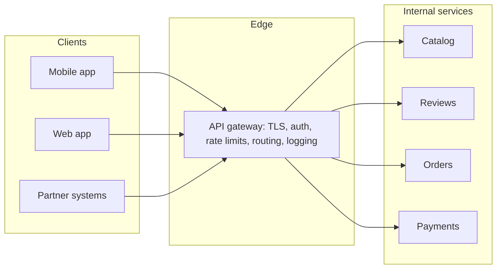
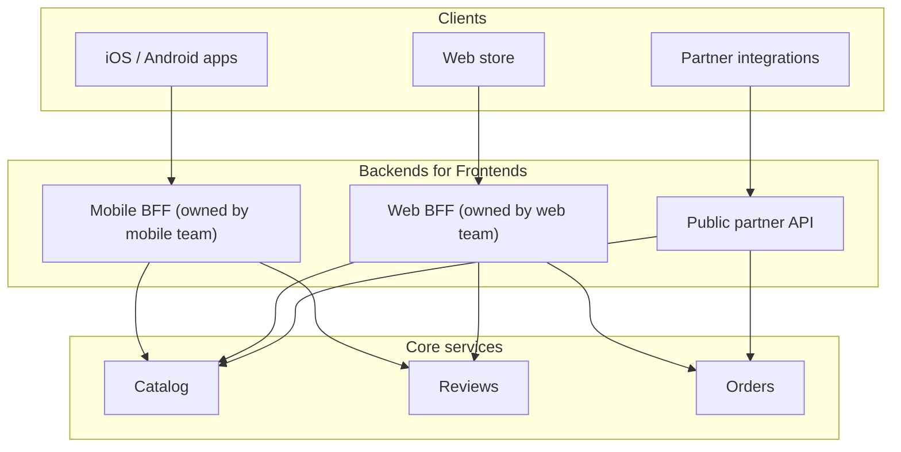
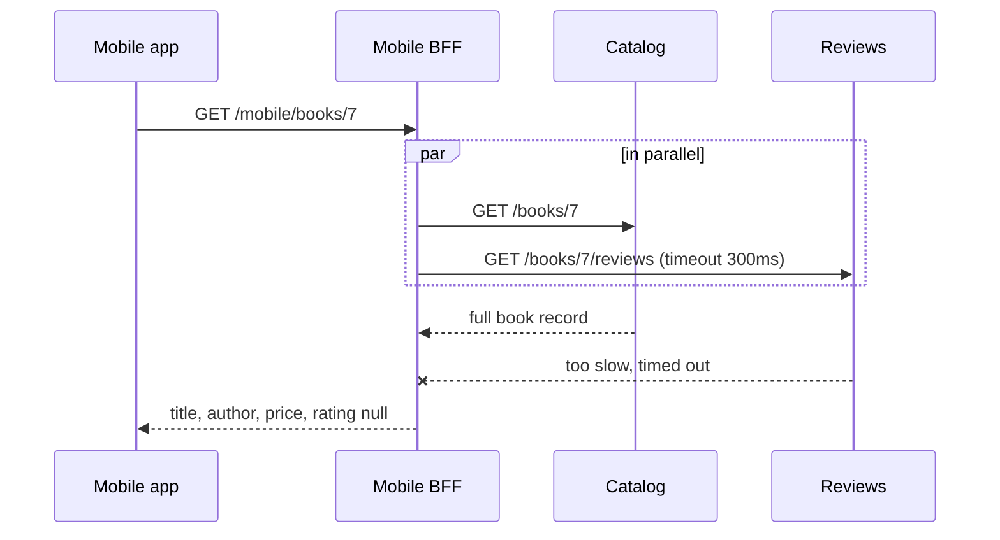

# API Gateway and Backend for Frontend

## Introduction

Once a system is split into several services, clients face an awkward question: **which service do I call?** Should the mobile app know the addresses of the catalog, reviews, orders and payments services? Should each of those services implement its own authentication, rate limiting, TLS and logging?

An **API gateway** answers both questions. It is a single entry point that sits between clients and your services. Clients talk to the gateway, and the gateway routes each request to the right service, applying shared policies on the way.

A hotel front desk is a good analogy. Guests do not wander into the kitchen, the laundry or the accounts office. They go to the front desk, which checks who they are, sends requests to the right department, and gives back the answer. The front desk does not cook the food, though. A gateway that starts cooking, by running business logic, becomes a problem, as we will see.

A **Backend for Frontend (BFF)** is a related idea: a small server-side component built for **one specific client experience**, such as the mobile app, which shapes data from several services into exactly what that client's screens need.

This page covers both, with a small runnable implementation, and explains how to stop them from growing into a new monolith.

## What an API Gateway Does

The Azure Architecture Center describes three gateway patterns, which together cover most of what gateways do:

| Pattern | What it means | Examples |
| --- | --- | --- |
| **Gateway Routing** | Route requests to services based on path, host, header or method | `/api/catalog/*` goes to catalog, `/api/orders/*` goes to orders |
| **Gateway Offloading** | Move shared cross-cutting concerns out of every service | TLS termination, authentication, rate limiting, CORS, request IDs, logging |
| **Gateway Aggregation** | Combine several backend calls into one client request | One call returns a book with its reviews and stock |



Benefits:

- **Clients have one stable address.** You can split, merge, move or rename services behind the gateway without breaking clients. This is what makes the [Strangler Fig](../9-arch-distributed-systems/11-arch-strangler-fig.mdx) migration possible.
- **Shared policies live in one place** instead of being re-implemented, slightly differently, in every service.
- **Internal services are not exposed** to the internet at all.

Costs:

- **An extra network hop** on every request.
- **A critical component**: if the gateway is down, everything is down. It needs redundancy, capacity planning and careful change management.
- **A potential bottleneck for teams**, if every route change needs a ticket to a central gateway team.

## Building a Tiny Gateway

Real gateways are products (see the comparison below), not code you write. But building a small one shows clearly what they do. This example uses FastAPI and `httpx` (`pip install fastapi httpx httpx2`). To keep it runnable on one machine, the "backend services" are FastAPI apps called in-process through `httpx.ASGITransport`. In production they would be separate deployments reached by URL.

First, two backend services, in `backends.py`:

```python
import asyncio
from fastapi import FastAPI

catalog = FastAPI()
reviews = FastAPI()
REVIEWS_SLOW = {"on": False}


@catalog.get("/books/{book_id}")
def get_book(book_id: int) -> dict:
    return {"id": book_id, "title": "Kindred", "author": "Octavia E. Butler",
            "price_cents": 1499, "isbn": "9780807083697", "page_count": 264,
            "description": "A long description the phone does not need..."}


@reviews.get("/books/{book_id}/reviews")
async def get_reviews(book_id: int) -> dict:
    if REVIEWS_SLOW["on"]:
        await asyncio.sleep(2)  # simulate an overloaded service
    return {"book_id": book_id, "average": 4.7, "count": 1832,
            "top": [{"user": "sam", "stars": 5, "text": "Unforgettable."}]}
```

Now the gateway, in `gateway.py`. The middleware does **offloading** (API key authentication, a token-bucket rate limit, request IDs), and the route does **routing**:

```python
import asyncio
import time
import uuid

import httpx
from fastapi import FastAPI, Request, Response
from fastapi.responses import JSONResponse

from backends import catalog, reviews

# In production these are URLs such as http://catalog.internal:8080.
# Here ASGITransport routes requests to in-process apps so the demo runs anywhere.
UPSTREAMS = {
    "catalog": httpx.AsyncClient(transport=httpx.ASGITransport(app=catalog), base_url="http://catalog"),
    "reviews": httpx.AsyncClient(transport=httpx.ASGITransport(app=reviews), base_url="http://reviews"),
}
API_KEYS = {"key-mobile-123": "mobile-app", "key-partner-456": "partner-shop"}

gateway = FastAPI()


# --- Cross-cutting concerns (gateway offloading) ----------------------------
class TokenBucket:
    def __init__(self, rate_per_s: float, burst: int) -> None:
        self.rate, self.capacity = rate_per_s, burst
        self.tokens, self.updated = float(burst), time.monotonic()

    def allow(self) -> bool:
        now = time.monotonic()
        self.tokens = min(self.capacity, self.tokens + (now - self.updated) * self.rate)
        self.updated = now
        if self.tokens >= 1:
            self.tokens -= 1
            return True
        return False


BUCKETS: dict[str, TokenBucket] = {}


@gateway.middleware("http")
async def edge_policies(request: Request, call_next):
    client = API_KEYS.get(request.headers.get("x-api-key", ""))
    if client is None:
        return JSONResponse({"title": "Unauthorized"}, status_code=401)
    bucket = BUCKETS.setdefault(client, TokenBucket(rate_per_s=1, burst=3))
    if not bucket.allow():
        return JSONResponse({"title": "Too many requests"}, status_code=429,
                            headers={"Retry-After": "1"})
    request.state.client = client
    request.state.request_id = request.headers.get("x-request-id", str(uuid.uuid4()))
    response: Response = await call_next(request)
    response.headers["x-request-id"] = request.state.request_id
    return response


# --- Gateway routing: /api/<service>/<path> -> upstream ---------------------
@gateway.get("/api/{service}/{path:path}")
async def route(service: str, path: str, request: Request) -> Response:
    upstream = UPSTREAMS.get(service)
    if upstream is None:
        return JSONResponse({"title": "No such service"}, status_code=404)
    resp = await upstream.get(f"/{path}", headers={
        "x-request-id": request.state.request_id,
        "x-client-id": request.state.client,  # upstreams trust the gateway, not the caller
    })
    return Response(resp.content, status_code=resp.status_code,
                    media_type=resp.headers.get("content-type"))
```

Try it with `demo_gateway.py`:

```python
from fastapi.testclient import TestClient
from gateway import gateway

client = TestClient(gateway)

print(client.get("/api/catalog/books/7").status_code, "(no API key)")

headers = {"x-api-key": "key-partner-456"}
r = client.get("/api/catalog/books/7", headers=headers)
print(r.status_code, r.json()["title"], "request id:", r.headers["x-request-id"][:8])

codes = [client.get("/api/reviews/books/7/reviews", headers=headers).status_code for _ in range(4)]
print("burst of 4 more:", codes)
```

Example output (the request ID is random):

```text
401 (no API key)
200 Kindred request id: e5eba5c8
burst of 4 more: [200, 200, 429, 429]
```

The catalog and reviews services contain no authentication or rate-limiting code at all. They trust the `x-client-id` header because only the gateway can reach them. That trust must be enforced by the network (private subnets, network policies or mutual TLS), or anyone inside the network could forge the header.

The rate limiter here lives in one process's memory. Real gateways with several replicas share counters through something like Redis, or accept approximate per-node limits. [Bulkheads, Rate Limiting and Backpressure](../9-arch-distributed-systems/9-arch-bulkhead-and-rate-limiting.mdx) covers the algorithms.

## Backend for Frontend (BFF)

A general-purpose gateway serves all clients the same API. But clients differ:

- The **mobile app** wants small payloads, few round trips, and fields formatted for display.
- The **web app** shows more detail and can make more calls.
- **Partners** want stable, documented, versioned resources and nothing UI-specific.

If one API tries to serve all of them, it either grows a mess of client-specific options or forces every client to over-fetch and stitch data together. The **Backend for Frontend** pattern, described by Sam Newman and first used at SoundCloud, gives each client experience its **own** thin backend, usually owned by the team that builds that client.



The BFF does **aggregation** and **shaping**: it calls several services, in parallel where possible, keeps only the fields the screen needs, formats them, and degrades gracefully if a non-essential service is slow. Here is a mobile BFF endpoint for the book screen, in `bff.py`:

```python
import asyncio

from fastapi import FastAPI

from gateway import UPSTREAMS

mobile_bff = FastAPI()


@mobile_bff.get("/mobile/books/{book_id}")
async def book_screen(book_id: int) -> dict:
    """Everything the phone's book screen needs, in one small response."""
    book_call = UPSTREAMS["catalog"].get(f"/books/{book_id}")
    reviews_call = UPSTREAMS["reviews"].get(f"/books/{book_id}/reviews")
    book_resp, reviews_result = await asyncio.gather(
        book_call,
        asyncio.wait_for(reviews_call, timeout=0.3),
        return_exceptions=True,
    )
    if isinstance(book_resp, Exception):
        raise book_resp  # the screen is useless without the book itself
    book = book_resp.json()
    screen = {
        "title": book["title"],
        "author": book["author"],
        "price": f"${book['price_cents'] / 100:.2f}",
    }
    if isinstance(reviews_result, Exception):
        screen["rating"] = None  # degrade gracefully: show the page without stars
    else:
        r = reviews_result.json()
        screen["rating"] = {"stars": r["average"], "count": r["count"]}
    return screen
```

And `demo_bff.py`, which also simulates an overloaded reviews service:

```python
from fastapi.testclient import TestClient
from backends import REVIEWS_SLOW
from bff import mobile_bff

client = TestClient(mobile_bff)
print(client.get("/mobile/books/7").json())

REVIEWS_SLOW["on"] = True
print(client.get("/mobile/books/7").json())
```

Output:

```text
{'title': 'Kindred', 'author': 'Octavia E. Butler', 'price': '$14.99', 'rating': {'stars': 4.7, 'count': 1832}}
{'title': 'Kindred', 'author': 'Octavia E. Butler', 'price': '$14.99', 'rating': None}
```

The phone gets one small response instead of two large ones. When reviews are slow, the screen still loads, just without stars. That decision ("the page is useful without reviews, but not without the book") is a **product decision for this screen**, which is exactly why it belongs in a BFF owned by the client team rather than in a shared gateway.



### Gateway vs BFF: where does logic go?

| Concern | API gateway | BFF | Core service |
| --- | --- | --- | --- |
| TLS, authentication, rate limits | Yes | No (relies on gateway) | No |
| Routing and load balancing | Yes | No | No |
| Aggregating calls for one screen | Simple cases only | Yes | No |
| Formatting for one client | No | Yes | No |
| Business rules (pricing, stock, discounts) | **Never** | **Never** | Yes |

Business rules belong in the services that own the data. If a discount rule lives in the mobile BFF, the web store will soon calculate a different price.

## Gateway Products

You rarely build the gateway yourself. Common options (features and pricing change, so check the official documentation):

| Product | Type | Notes |
| --- | --- | --- |
| Kong Gateway | Open-source core plus enterprise edition | Plugin-based, built on NGINX/OpenResty. See the site's [Kong tutorial](/docs/middleware/kong) |
| NGINX | Reverse proxy used as a gateway | Very common, configuration-driven. See the [NGINX tutorial](/docs/middleware/nginx) |
| Envoy / Envoy Gateway | Open-source L7 proxy, CNCF | Data plane for many gateways and meshes; Envoy Gateway implements the Kubernetes Gateway API |
| AWS API Gateway | Managed | Offers REST APIs, HTTP APIs and WebSocket APIs with different feature sets |
| Azure API Management | Managed | Gateway plus developer portal, products and subscriptions |
| Google Cloud Apigee / API Gateway | Managed | Apigee targets full API management and monetization |

On Kubernetes, the **Gateway API** (resources such as `Gateway`, `HTTPRoute` and `GRPCRoute`) is now the recommended way to configure ingress traffic, and many products above implement it. The widely used community **ingress-nginx** controller was retired in March 2026 and no longer receives updates. If you still run it, plan a migration (the Kubernetes project points to Gateway API implementations). The older `Ingress` API itself still exists but is feature-frozen.

A minimal Gateway API route looks like this:

```yaml
apiVersion: gateway.networking.k8s.io/v1
kind: HTTPRoute
metadata:
  name: bookstore-api
spec:
  parentRefs:
    - name: public-gateway
  hostnames:
    - api.bookstore.example
  rules:
    - matches:
        - path:
            type: PathPrefix
            value: /api/catalog
      backendRefs:
        - name: catalog
          port: 8080
    - matches:
        - path:
            type: PathPrefix
            value: /api/reviews
      backendRefs:
        - name: reviews
          port: 8080
```

## Real-World Scenario

Your bookstore has grown from a monolith to eight services. Today the mobile app calls four services directly, each with its own authentication code. The book screen makes five requests over cellular, and every API change needs a coordinated mobile release. Meanwhile, a partner reported that one service accepted expired tokens because its JWT library was configured differently from the others.

You introduce two layers:

1. **A managed or Kubernetes-native API gateway** at the edge. It terminates TLS, validates JWTs in one place, applies per-client rate limits, adds request IDs, and routes `/api/*` paths to services. Services are moved to private networking, so the gateway is the only way in.
2. **A mobile BFF**, owned by the mobile team, deployed behind the gateway. It exposes screen-shaped endpoints such as `/mobile/home` and `/mobile/books/{id}`, aggregates in parallel, applies per-screen timeouts and fallbacks, and lets the mobile team ship backend changes without waiting for other teams.
3. The **web store** keeps calling the general APIs for now. It gets its own BFF only if it develops the same pains.
4. **Partners** get a separately versioned public API, documented with OpenAPI.

**Why this approach fits:** authentication and rate limiting must be consistent and are a security risk when duplicated. The mobile client has distinct needs (small payloads, few round trips, independent releases) that justify a dedicated backend.

**When to use / when not to:**

- Use a **gateway** as soon as more than one service is exposed to clients, or when you need consistent edge security and a stable public address during migrations.
- Use a **BFF** when client experiences differ significantly and a client team is slowed down by a shared API. One BFF per **experience** (mobile, web, kiosk) is the usual split, not one per operating system.
- Skip both when you have a **single application** or a [modular monolith](../6-arch-architectural-styles/3-arch-modular-monolith.mdx): a load balancer and good middleware in the app are enough. Skip the BFF when one client dominates, or when [GraphQL](./2-arch-graphql.mdx) already gives clients the flexibility they need.

**Alternatives and trade-offs:**

| Approach | Pros | Cons | Best for |
| --- | --- | --- | --- |
| Clients call services directly | No extra hop, nothing to run | Duplicated auth, exposed internals, chatty clients | One or two services, internal tools |
| Single API gateway | Central policies, stable address | Critical component, risk of central bottleneck | Most multi-service systems |
| Gateway + BFF per experience | Tailored APIs, client team autonomy | More deployables, duplicated aggregation code | Several distinct client experiences |
| GraphQL gateway | One flexible API for all clients | Query cost control, caching complexity | Many clients with varied data needs |
| Service mesh only | Strong service-to-service policies | Does not address external clients by itself | East-west traffic inside the cluster |

## Common Mistakes

1. **Business logic in the gateway.** Discount rules, stock checks or workflow steps in gateway plugins create a hidden, hard-to-test monolith at the edge. This is how the "enterprise service bus" problems of the 2000s returned. Keep the gateway "dumb pipes".
2. **One giant shared BFF.** A BFF that serves every client becomes the general-purpose API you were trying to escape. Keep each BFF tied to one experience and one owning team.
3. **Trusting headers from the outside.** If services trust `x-user-id` from the gateway, make sure external requests cannot set that header, and that services cannot be reached around the gateway.
4. **Single instance, no capacity plan.** The gateway is on every request's path. Run several replicas, autoscale them, and load-test them.
5. **No timeouts in aggregation.** An aggregating endpoint is as slow as its slowest call unless you set per-call timeouts and decide which data is optional.
6. **Route changes need a central ticket.** Let teams manage their own routes as code (for example `HTTPRoute` resources in their own namespaces), reviewed through normal pull requests.
7. **Staying on retired software.** Edge components face the internet. Track the support status of your gateway or ingress controller, as the ingress-nginx retirement showed.

## Summary

- An **API gateway** is the single entry point for clients. It does **routing**, **offloading** of cross-cutting concerns, and simple **aggregation**.
- A **Backend for Frontend** is a thin backend for one client experience, owned by that client's team, which aggregates and shapes data for its screens.
- Neither should contain **business rules**. Those stay in the services that own the data.
- Gateways are critical infrastructure: run them redundantly, enforce that services cannot be bypassed, and set timeouts.
- On Kubernetes, use the **Gateway API**. The ingress-nginx controller was retired in March 2026.
- For a single application, you probably need neither.

## Exercises

1. Add a `/mobile/home` endpoint to the BFF that returns three featured books with ratings, using `asyncio.gather` for all calls. What is the response time if one reviews call is slow?
2. Change the gateway so that partners get 10 requests per second and the mobile app gets 50. Where should this configuration live?
3. Add a simple circuit breaker to the BFF's reviews call so that after three timeouts it skips reviews for 30 seconds.
4. Draw the gateway, BFF and service boundaries for a system you know. Which logic currently sits in the wrong layer?

### Related pages

- [REST API Design](./1-arch-rest-api-design.mdx)
- [GraphQL](./2-arch-graphql.mdx)
- [Service Mesh and Sidecars](./8-arch-service-mesh.mdx)
- [Security by Design](../12-arch-quality-and-operations/4-arch-security-by-design.mdx)
- [Facade Pattern](../3-arch-structural-patterns/4-arch-facade.mdx): a BFF is a facade over many services
- References: Azure Architecture Center patterns "Gateway Routing", "Gateway Offloading", "Gateway Aggregation" and "Backends for Frontends" at [learn.microsoft.com/azure/architecture/patterns](https://learn.microsoft.com/azure/architecture/patterns/); Sam Newman's article on the BFF pattern at [samnewman.io](https://samnewman.io/patterns/architectural/bff/); the [Kubernetes Gateway API](https://gateway-api.sigs.k8s.io/) documentation
