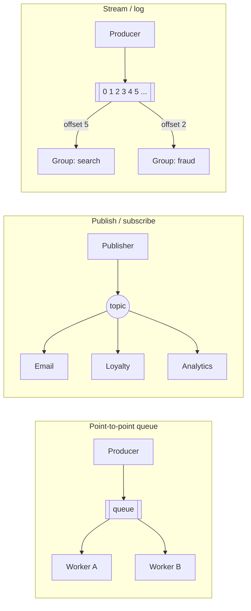
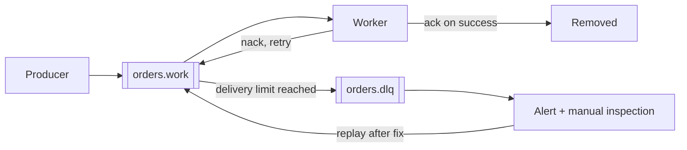

# Messaging Patterns: Queues, Pub/Sub and Streams

## Introduction

In [Synchronous vs Asynchronous Communication](./0-arch-communication-styles.mdx) you saw why services sometimes hand work to a broker instead of calling each other directly. This page looks inside that box. "Use a message broker" is not one decision but several, and the three main messaging models behave very differently:

- A **queue** is like a **to-do list shared by a team**. Each task is picked up by exactly one person, and crossed off when done.
- **Publish/subscribe** is like a **newsletter**. Every subscriber gets their own copy of each issue.
- A **stream** (or log) is like a **ship's logbook**. Entries are appended in order and never torn out. Anyone can read it at their own pace, and can go back and re-read old pages.

Choosing the wrong model leads to painful surprises: events that only one service ever sees, work that gets done twice, or data you cannot replay when you need to rebuild a read model. This page explains each model, the delivery guarantees you can and cannot get, and how popular brokers map onto them.

## The Three Models



| Model | Who gets a message | After it is consumed | Typical use |
| --- | --- | --- | --- |
| Queue (point-to-point) | Exactly one consumer among many competing consumers | Deleted | Background jobs, commands, load leveling |
| Publish/subscribe | Every subscriber gets a copy | Each copy is deleted when that subscriber is done | Notifying several services that something happened |
| Stream / log | Every consumer **group**; within a group, one consumer per partition | **Kept** for a retention period; consumers track offsets | Event streaming, replay, analytics, change data capture |

### Seeing the difference in code

This simulation uses only the standard library. It is not a broker, but it makes the semantics concrete.

```python
from collections import defaultdict, deque
from dataclasses import dataclass, field
from itertools import cycle
from zlib import crc32


# 1. Point-to-point queue: each message goes to exactly ONE consumer.
class WorkQueue:
    def __init__(self) -> None:
        self.messages: deque[str] = deque()

    def send(self, msg: str) -> None:
        self.messages.append(msg)

    def drain(self, consumers: list[str]) -> None:
        turn = cycle(consumers)  # brokers spread messages across competing consumers
        while self.messages:
            print(f"  {next(turn)} handles {self.messages.popleft()}")


# 2. Publish/subscribe: each message is copied to EVERY subscriber.
class Topic:
    def __init__(self) -> None:
        self.subscribers: dict[str, deque[str]] = {}

    def subscribe(self, name: str) -> None:
        self.subscribers[name] = deque()  # each subscriber gets its own queue

    def publish(self, msg: str) -> None:
        for inbox in self.subscribers.values():
            inbox.append(msg)


# 3. Stream (log): messages are appended and KEPT; readers track an offset.
@dataclass
class Log:
    partitions: int = 2
    data: list[list[str]] = field(default_factory=list)
    offsets: dict[tuple[str, int], int] = field(default_factory=lambda: defaultdict(int))

    def __post_init__(self) -> None:
        self.data = [[] for _ in range(self.partitions)]

    def append(self, key: str, msg: str) -> int:
        p = crc32(key.encode()) % self.partitions  # same key -> same partition -> ordered
        self.data[p].append(msg)
        return p

    def poll(self, group: str, partition: int) -> list[str]:
        start = self.offsets[(group, partition)]
        batch = self.data[partition][start:]
        self.offsets[(group, partition)] = len(self.data[partition])  # commit
        return batch

    def rewind(self, group: str, partition: int, to: int = 0) -> None:
        self.offsets[(group, partition)] = to


print("1) Work queue with competing consumers")
q = WorkQueue()
for n in range(1, 5):
    q.send(f"resize-cover-{n}")
q.drain(["worker-A", "worker-B"])

print("2) Pub/sub fan-out")
t = Topic()
for s in ["email", "loyalty", "analytics"]:
    t.subscribe(s)
t.publish("OrderPlaced#1001")
for name, inbox in t.subscribers.items():
    print(f"  {name} received {list(inbox)}")

print("3) Stream with partitions, offsets and replay")
log = Log()
for event in ["created", "paid", "shipped"]:
    p = log.append(key="order-1001", msg=f"order-1001 {event}")
q2 = log.append(key="order-2004", msg="order-2004 created")
print(f"  order-2004 lives in partition {q2}: {log.data[q2]}")
print(f"  order-1001 lives in partition {p}: {log.data[p]}")
print("  search-indexer reads:", log.poll("search-indexer", p))
print("  search-indexer reads again:", log.poll("search-indexer", p))
print("  fraud-model (new group) reads:", log.poll("fraud-model", p))
log.rewind("search-indexer", p)
print("  search-indexer after rewind:", log.poll("search-indexer", p))
```

Output:

```text
1) Work queue with competing consumers
  worker-A handles resize-cover-1
  worker-B handles resize-cover-2
  worker-A handles resize-cover-3
  worker-B handles resize-cover-4
2) Pub/sub fan-out
  email received ['OrderPlaced#1001']
  loyalty received ['OrderPlaced#1001']
  analytics received ['OrderPlaced#1001']
3) Stream with partitions, offsets and replay
  order-2004 lives in partition 0: ['order-2004 created']
  order-1001 lives in partition 1: ['order-1001 created', 'order-1001 paid', 'order-1001 shipped']
  search-indexer reads: ['order-1001 created', 'order-1001 paid', 'order-1001 shipped']
  search-indexer reads again: []
  fraud-model (new group) reads: ['order-1001 created', 'order-1001 paid', 'order-1001 shipped']
  search-indexer after rewind: ['order-1001 created', 'order-1001 paid', 'order-1001 shipped']
```

Three things to notice:

1. In the **queue**, the two workers split the work. Adding workers increases throughput. This is the **Competing Consumers** pattern.
2. In **pub/sub**, every subscriber got its own copy. The publisher does not know or care how many subscribers exist.
3. In the **stream**, reading did not delete anything. A **new consumer group** (`fraud-model`) that starts months later can still read history, and an existing group can **rewind** to reprocess. All events for `order-1001` landed in the same partition, so they stay in order.

## Queues in Depth

Queues are the workhorse for **commands** and **background jobs**: resize this image, send this email, generate this invoice.

- **Load leveling**: a queue absorbs bursts. If 10,000 orders arrive in a minute, workers process them at their own steady rate instead of being overwhelmed.
- **Scaling**: add consumers to process faster. Autoscalers (for example KEDA on Kubernetes) can scale workers on queue length.
- **Acknowledgements**: the broker only deletes a message after the consumer **acks** it. If a consumer crashes mid-task, the message is redelivered to another consumer.
- **Prefetch**: limit how many unacknowledged messages each consumer holds, so one slow worker does not hoard work.

A RabbitMQ worker in Python with the `pika` client:

```python
# pip install pika   (needs a RabbitMQ broker, e.g. docker run -p 5672:5672 rabbitmq:4)
import json

import pika

conn = pika.BlockingConnection(pika.ConnectionParameters("localhost"))
channel = conn.channel()

# A durable quorum queue survives broker restarts and is replicated in a cluster.
channel.queue_declare(
    queue="cover-resize",
    durable=True,
    arguments={"x-queue-type": "quorum", "x-delivery-limit": 5},
)
channel.basic_qos(prefetch_count=10)  # at most 10 unacked messages per consumer


def handle(ch, method, properties, body: bytes) -> None:
    job = json.loads(body)
    try:
        print("resizing cover for", job["isbn"])
        ch.basic_ack(delivery_tag=method.delivery_tag)  # ack only AFTER the work is done
    except Exception:
        ch.basic_nack(delivery_tag=method.delivery_tag, requeue=True)


channel.basic_consume(queue="cover-resize", on_message_callback=handle)
channel.start_consuming()
```

**Quorum queues** are RabbitMQ's replicated, durable queue type, and the recommended choice for data you care about. Classic queue mirroring was removed in RabbitMQ 4.0. Quorum queues also count redeliveries. Since 4.0 they default to a delivery limit of 20, after which the message is dropped or dead-lettered. Here we lower it to 5. The site's [RabbitMQ tutorial](/docs/middleware/rabbitmq) covers exchanges, routing and clustering in detail.

### Poison messages and dead-letter queues

A **poison message** is one that always fails, for example because its JSON is malformed or it references a deleted book. With naive `requeue=True`, it fails forever and blocks or slows the queue. The standard fix:

1. Count delivery attempts (the broker can do this, as quorum queues do).
2. After N failures, move the message to a **dead-letter queue (DLQ)**.
3. Alert on DLQ depth, inspect the messages, fix the bug, and **replay** them.



## Publish/Subscribe in Depth

Use pub/sub for **events**: facts about something that happened (`OrderPlaced`, `BookPriceChanged`). The publisher does not know who reacts, so you can add a new subscriber (say, a recommendation service) without changing the publisher. That is the core benefit of [Event-Driven Architecture](../6-arch-architectural-styles/5-arch-event-driven.mdx).

How brokers implement it:

- **RabbitMQ**: the publisher sends to a **fanout** or **topic exchange**. Each subscribing service binds **its own queue** to the exchange. Within one service, several instances compete on that service's queue. So pub/sub between services, competing consumers within a service.
- **Amazon SNS + SQS**: an SNS topic fans out to one SQS queue per subscribing service.
- **Google Cloud Pub/Sub**: each subscription receives every message, and multiple subscribers on one subscription share the load.
- **Redis Pub/Sub**: fire-and-forget. If a subscriber is offline, it misses the message. Fine for live notifications, not for business events. (Redis **Streams** are the durable alternative.)

The weakness of classic pub/sub is that each subscription only sees messages published **after** it was created. A new service cannot catch up on last year's orders. That is the gap streams fill.

## Streams in Depth

A stream is an **append-only, ordered, durable log**. Apache Kafka popularized the model. Others include Amazon Kinesis, Azure Event Hubs, Redpanda, Apache Pulsar, RabbitMQ Streams and Redis Streams.

- **Retention, not deletion**: messages are kept for a configured time or size, or forever with log compaction (which keeps the latest value per key).
- **Offsets**: each consumer group stores its position. Consuming is just reading, so a hundred groups can read the same data independently.
- **Partitions** give parallelism. Within a group, each partition is read by one consumer at a time. Ordering is guaranteed **only within a partition**, so choose the **key** (for example `order_id`) so that events that must stay in order share a partition.
- **Replay**: rewind a group to rebuild a projection, backfill a new service, or recover from a bug. This is what makes streams a good backbone for [CQRS](../9-arch-distributed-systems/3-arch-cqrs.mdx) read models and [Change Data Capture](../11-arch-data-architecture/5-arch-change-data-capture.mdx).

A Kafka producer and consumer with the `confluent-kafka` client:

```python
# pip install confluent-kafka   (needs a Kafka broker)
import json

from confluent_kafka import Producer

producer = Producer({
    "bootstrap.servers": "localhost:9092",
    "enable.idempotence": True,  # no duplicates from producer retries
    "acks": "all",               # wait until in-sync replicas have the write
})


def on_delivery(err, msg) -> None:
    if err:
        print("delivery failed:", err)
    else:
        print(f"stored in {msg.topic()}[{msg.partition()}] at offset {msg.offset()}")


event = {"type": "OrderPlaced", "order_id": "1001", "total_cents": 2798}
producer.produce(
    "orders",
    key=event["order_id"],  # same key -> same partition -> per-order ordering
    value=json.dumps(event).encode(),
    on_delivery=on_delivery,
)
producer.flush()
```

Example output (partition and offset depend on your cluster):

```text
stored in orders[2] at offset 0
```

```python
# pip install confluent-kafka
import json

from confluent_kafka import Consumer

consumer = Consumer({
    "bootstrap.servers": "localhost:9092",
    "group.id": "loyalty-service",      # each group gets every event once
    "auto.offset.reset": "earliest",    # a brand-new group starts from the beginning
    "enable.auto.commit": False,        # commit only after processing
})
consumer.subscribe(["orders"])

try:
    while True:
        msg = consumer.poll(1.0)
        if msg is None or msg.error():
            continue
        event = json.loads(msg.value())
        print("award points for order", event["order_id"])
        consumer.commit(message=msg, asynchronous=False)
finally:
    consumer.close()
```

:::info Recent changes in Kafka
Apache Kafka 4.0 (2025) removed ZooKeeper entirely; clusters now run in **KRaft** mode. Kafka 4.2 (early 2026) declared **share groups** ("Queues for Kafka", KIP-932) production-ready. Share groups let several consumers cooperatively read the same partition with per-message acknowledgement, which gives Kafka queue-like semantics. Check the [Kafka documentation](https://kafka.apache.org/documentation/) for the current status in your version and client library.
:::

## Delivery Guarantees

Every messaging system makes a trade-off about what happens when something fails between "sent" and "processed":

| Guarantee | What it means | How you get it | Risk |
| --- | --- | --- | --- |
| At most once | A message is processed zero or one times | Ack before processing, no retries | Lost messages |
| At least once | A message is processed one or more times | Ack after processing, retry on failure | Duplicates |
| Exactly once (effectively) | The **effect** happens once | At-least-once delivery plus idempotent processing or transactions | Complexity; usually scoped to one system |

The practical default is **at-least-once delivery plus idempotent consumers**. Kafka offers exactly-once semantics for read-process-write pipelines **inside Kafka** (idempotent producers and transactions). As soon as your consumer calls an external system such as an email API or a payment provider, you are back to making that step idempotent yourself. See [Idempotency](../9-arch-distributed-systems/7-arch-idempotency.mdx) and the [Transactional Outbox](../9-arch-distributed-systems/6-arch-outbox.mdx) for reliable publishing.

### Ordering

- Queues with competing consumers **do not preserve order** across consumers: message 2 may finish before message 1.
- Streams preserve order **per partition**, so pick keys deliberately. A "hot" key (one huge customer) can overload one partition.
- Many workflows do not need global order. Ask what really must be ordered, usually "events for the same entity", and design for that.

### Message design

- Include a unique **message ID**, a **type**, a **timestamp**, a **correlation ID** for tracing, and a **schema version**.
- The CNCF **CloudEvents** specification standardizes these envelope attributes, which helps when events cross team or company boundaries.
- Decide between **thin events** ("order 1001 changed", consumer calls back for details) and **fat events** (the full order state). Fat events avoid callbacks and coupling at read time, but make the event schema a bigger contract.
- Manage schemas, for example with a schema registry and Avro, Protobuf or JSON Schema, and evolve them compatibly (see [Schema Evolution and Data Migrations](../11-arch-data-architecture/7-arch-data-migrations.mdx)).

## Real-World Scenario

Your bookstore needs three asynchronous flows:

1. **Cover image processing**: when a publisher uploads a cover, generate five thumbnail sizes. The work is CPU-heavy, and uploads arrive in bursts when catalogs are imported.
2. **Order notifications**: when an order is placed, email, loyalty and fulfillment services must react, and more services will be added later.
3. **Analytics and search**: the data team wants every order and price change, including history, to build dashboards and a recommendation model. Search needs to rebuild its index from scratch when the mapping changes.

| Flow | Model | Why |
| --- | --- | --- |
| Cover processing | **Queue** with competing consumers and a DLQ | Each job must be done once by any worker; bursts are absorbed; workers autoscale on queue depth |
| Order notifications | **Pub/sub** (or a stream with one group per service) | Every interested service needs its own copy; publisher stays unaware of subscribers |
| Analytics and search | **Stream** keyed by entity ID, with long retention | New consumers must read history; search must be able to replay |

A team that already runs RabbitMQ might use it for the first two, and RabbitMQ Streams or Kafka for the third. A team that already runs Kafka might use topics for all three, with share groups or a separate partition-per-worker design for the job queue. On AWS, SQS (jobs), SNS + SQS (notifications) and Kinesis or Amazon MSK (streams) are managed equivalents.

**Why this approach fits:** each flow gets the semantics it needs, instead of forcing all three into one model. Jobs need "exactly one worker", notifications need "everyone gets a copy", and analytics needs "keep history".

**When to use messaging / when not to:**

- Use it when the producer does not need an immediate answer, when load is bursty, and when several consumers react to the same fact.
- Avoid it for request/response interactions the user is waiting on, for very small systems where a database table plus a polling worker is enough, and when your team cannot yet operate a broker. A managed service often removes that last concern.

**Alternatives and trade-offs:**

| Approach | Pros | Cons | Best for |
| --- | --- | --- | --- |
| Traditional broker (RabbitMQ, ActiveMQ) | Flexible routing, per-message acks, mature | Limited replay (except RabbitMQ Streams) | Job queues, commands, routing-heavy flows |
| Log-based stream (Kafka, Kinesis, Pulsar, Redpanda) | Replay, very high throughput, many independent readers | Partition planning, ordering only per partition | Event backbones, analytics, CDC |
| Cloud queue/topic (SQS, SNS, Pub/Sub, Service Bus) | No servers to run, scales automatically | Vendor-specific APIs and limits | Teams on one cloud |
| Database table as queue | No new infrastructure, transactional with your data | Polling load, limited scale | Small systems, outbox relays |
| Redis Pub/Sub | Very simple, low latency | No durability; offline subscribers miss messages | Live, disposable notifications |

## Common Mistakes

1. **Using a queue when you needed pub/sub.** Two services consuming from the same queue **split** the messages between them instead of each getting all of them.
2. **Acknowledging before processing.** If the consumer crashes after the ack, the message is gone. Ack after the work is done.
3. **Non-idempotent consumers.** At-least-once delivery means duplicates will happen. Deduplicate by message ID or make the operation naturally idempotent.
4. **No dead-letter queue.** One poison message can block a queue or burn CPU forever. Limit retries and dead-letter.
5. **Expecting global ordering.** Only per-partition (or per-queue, single-consumer) ordering is realistic. Choose partition keys by entity.
6. **Events as remote procedure calls.** An event named `SendWelcomeEmail` is a command in disguise. Events describe facts (`CustomerRegistered`). Commands target a single owner.
7. **Unmanaged schemas.** Changing a field name breaks every consumer silently. Version and validate message schemas.
8. **Ignoring consumer lag.** Monitor queue depth, consumer lag and DLQ size, and alert on them. They are the main health signals of an asynchronous system.

## Summary

- **Queues** deliver each message to one of many competing consumers. Use them for jobs and commands.
- **Pub/sub** delivers a copy to every subscriber. Use it for events that several services react to.
- **Streams** keep an ordered, replayable log. Consumer groups track their own offsets, and order holds per partition.
- Default to **at-least-once delivery with idempotent consumers**. "Exactly once" is about effects, and usually needs your help.
- Plan for **poison messages** with delivery limits and dead-letter queues.
- RabbitMQ 4.x recommends **quorum queues** (mirroring is gone). Kafka 4.x runs on **KRaft**, and 4.2 made **share groups** production-ready.

## Exercises

1. Extend the `WorkQueue` simulation with acknowledgements: a consumer that "crashes" on a message leaves it unacked, and the message is redelivered. Add a delivery limit and a dead-letter list.
2. In the `Log` simulation, add a second consumer to the `search-indexer` group and assign partitions between the two consumers. What happens when there are more consumers than partitions?
3. For each of these, choose queue, pub/sub or stream and justify it: password reset emails, stock level changes for 12 services, nightly invoice generation, clickstream events for machine learning.
4. Design a CloudEvents-style envelope for `OrderPlaced`. Which fields belong in the envelope, and which in the data?

### Related pages

- [Synchronous vs Asynchronous Communication](./0-arch-communication-styles.mdx)
- [Event-Driven Architecture](../6-arch-architectural-styles/5-arch-event-driven.mdx)
- [Domain Events](../8-arch-domain-driven-design/5-arch-domain-events.mdx)
- [Saga Pattern](../9-arch-distributed-systems/5-arch-saga.mdx)
- The site's [RabbitMQ](/docs/middleware/rabbitmq) and [Redis](/docs/middleware/redis) tutorials
- References: Enterprise Integration Patterns (Hohpe and Woolf) at [enterpriseintegrationpatterns.com](https://www.enterpriseintegrationpatterns.com/); Azure patterns "Competing Consumers", "Publisher-Subscriber" and "Queue-Based Load Leveling"; [RabbitMQ quorum queues](https://www.rabbitmq.com/docs/quorum-queues); [Apache Kafka documentation](https://kafka.apache.org/documentation/); [cloudevents.io](https://cloudevents.io/)
