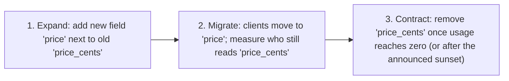
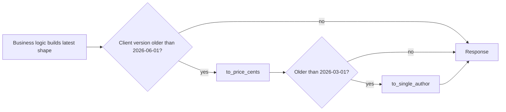
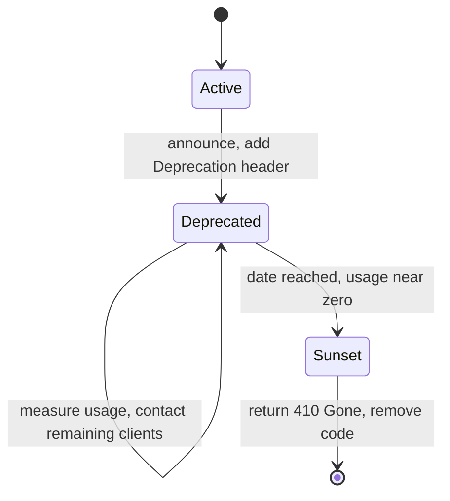

# API Versioning and Evolution

## Introduction

The day you publish an API, you gain users you cannot control. A partner wrote a client two years ago and the developer has left. A mobile app version from last spring is still installed on thousands of phones. A script in another team's cron job parses your JSON in a way you never imagined.

Your API **will** need to change: business rules evolve, you find design mistakes, and new features need new fields. The question is how to change it without breaking everyone who depends on it.

Think of a city's bus network. The city can add new routes and new stops whenever it likes, and nobody is hurt. Renumbering route 12 or removing a stop is different: riders need notice, signs at the old stop, and a period where both old and new routes run. API evolution works the same way.

This page covers:

- what counts as a **breaking change** (more than you might think),
- how to **avoid** versioning for most changes,
- the main **versioning strategies** and their trade-offs,
- and how to **deprecate and retire** old versions politely.

## What Is a Breaking Change?

A change is **breaking** if a correctly written existing client stops working, or starts working incorrectly, without changing its code.

| Change | Breaking? | Why |
| --- | --- | --- |
| Add a new endpoint | No | Existing clients do not call it |
| Add an optional request field | No | Old clients do not send it |
| Add a response field | Usually no | Tolerant clients ignore it, but strict deserializers may fail |
| Add a new enum value in a response | **Often yes** | Clients with a `switch` over known values may crash or misbehave |
| Remove or rename a field | Yes | Clients reading it get nothing |
| Change a field's type (`"12"` to `12`) | Yes | Parsing fails or behaves differently |
| Make an optional request field required | Yes | Old requests are now rejected |
| Tighten validation (max length 100 to 50) | Yes | Previously valid requests fail |
| Change default behavior (sort order, page size) | Yes, quietly | Clients relied on the old default |
| Change error codes or status codes | Yes | Client error handling breaks |
| Make a response slower or paginate a list that was not paginated | Can be | Timeouts, missing data |

The last rows illustrate **Hyrum's Law**, named after Hyrum Wright at Google: with enough users, every observable behavior of your system will be depended on by somebody, whatever your documentation promises. You cannot avoid all breakage, but you can make it rare, visible and planned.

## Evolve Without Versioning First

The cheapest version is the one you never have to create. Most changes can be made **additively**:

### Tolerant reader

Martin Fowler's **Tolerant Reader** pattern asks clients to read only the fields they need and ignore everything else. Combined with servers that only make additive changes, it removes most of the need for versions.

```python
from dataclasses import dataclass


@dataclass(frozen=True)
class BookView:
    title: str
    price_cents: int


def read_book(payload: dict) -> BookView:
    """Tolerant reader: take only what we need, ignore the rest, accept old and new shapes."""
    if "price" in payload:                    # newer shape
        cents = payload["price"]["amount"]
    else:                                     # older shape
        cents = payload["price_cents"]
    return BookView(title=payload["title"], price_cents=cents)


old = {"id": 7, "title": "Kindred", "author": "Octavia E. Butler", "price_cents": 1499}
new = {"id": 7, "title": "Kindred", "authors": [{"name": "Octavia E. Butler"}],
       "price": {"amount": 1499, "currency": "USD"}, "format": "paperback"}
print(read_book(old))
print(read_book(new))
```

Output:

```text
BookView(title='Kindred', price_cents=1499)
BookView(title='Kindred', price_cents=1499)
```

The client does not care about `author`, `authors` or the new `format` field, so none of those changes affect it. Pydantic models, Jackson and most JSON libraries can be configured to ignore unknown fields. Make sure that is the setting your generated SDKs use.

:::caution Be liberal in what you accept, carefully
The robustness principle ("be conservative in what you send, be liberal in what you accept") helps compatibility, but accepting malformed input can create security holes and lock you into supporting accidental behavior. Ignore **unknown fields**, but still validate the fields you do use.
:::

### Expand and contract (parallel change)

To make a breaking change without a version bump, split it into safe steps. Fowler calls this **Parallel Change**:



The same technique works for database schemas (see [Schema Evolution and Data Migrations](../11-arch-data-architecture/7-arch-data-migrations.mdx)). It needs telemetry: you must be able to see which clients still use the old field, for example by logging API keys or user agents per field or endpoint.

### Format-specific evolution

- **GraphQL** clients only receive fields they ask for, so adding fields is always safe, and you can mark old ones with `@deprecated(reason: "Use price")` and watch usage per field. Many GraphQL APIs never version. See [GraphQL](./2-arch-graphql.mdx).
- **Protobuf and gRPC** evolve by adding fields with new numbers and `reserved` for removed ones, and use package versions (`bookstore.v1`, `bookstore.v2`) for real breaks. See [gRPC](./3-arch-grpc.mdx).
- **Events** need the same discipline. A consumer may read an event written years ago from a stream. See [Messaging Patterns](./5-arch-messaging-patterns.mdx).

## Versioning Strategies

When a breaking change is unavoidable, you need a way for a client to say which contract it expects.

| Strategy | Example | Pros | Cons | Used by (examples) |
| --- | --- | --- | --- | --- |
| URI path | `GET /v2/books/7` | Obvious, easy to route and cache, easy to test in a browser | Encourages big-bang versions; same resource has many URLs | Many public APIs |
| Custom header | `API-Version: 2` | Clean URLs | Invisible in links and browsers; caches must `Vary` on it | Some SaaS APIs |
| Media type | `Accept: application/vnd.bookstore.v2+json` | Most "RESTful" in theory, per-representation | Unfamiliar, awkward in tools | GitHub has used media types for previews and versions |
| Query parameter | `/books/7?version=2` | Easy to try | Mixes versioning with filtering; often forgotten | Some cloud provider APIs |
| Date-based, pinned per account | `Stripe-Version: 2026-03-01` | Small, frequent changes; old clients stay pinned | Server must maintain transformation chains | Stripe; GitHub REST API uses dated versions |

There is no single right answer, and arguments about it can get religious. A practical guideline:

- **Internal APIs** with few, known consumers: avoid versions; use expand and contract and coordinate.
- **Public APIs** with major redesigns every few years: URI path versions (`/v1`, `/v2`) are simple and understood by everyone.
- **Public APIs** that change often in small ways: date-based versions with transformation layers.

### Date-based versions with a transformation chain

Stripe described how it handles hundreds of versions without hundreds of code paths: the core code produces only the **latest** representation, and a chain of small **version change** modules transforms the response backward for clients pinned to older versions. New Stripe accounts are pinned to the version current at signup. Stripe's more recent release process names major releases (for example "acacia", "basil", "clover") and ships backward-compatible monthly releases in between. Check Stripe's versioning docs for the current scheme.

Here is the idea in Python. The bookstore made two breaking changes this year: a single `author` string became a list of `authors`, and `price_cents` became a `price` object with a currency.

```python
from collections.abc import Callable

from fastapi import FastAPI, Header, Response

app = FastAPI()

# The code only ever builds the LATEST representation.
def current_book(book_id: int) -> dict:
    return {
        "id": book_id,
        "title": "Kindred",
        "authors": [{"name": "Octavia E. Butler"}],    # 2026-03-01: was "author": str
        "price": {"amount": 1499, "currency": "USD"},  # 2026-06-01: was "price_cents": int
    }


# Each version change knows how to turn the newer shape into the older one.
def to_single_author(book: dict) -> dict:
    book = dict(book)
    book["author"] = book.pop("authors")[0]["name"]
    return book


def to_price_cents(book: dict) -> dict:
    book = dict(book)
    book["price_cents"] = book.pop("price")["amount"]
    return book


# Newest first. A client pinned to version V gets every change newer than V undone.
VERSION_CHANGES: list[tuple[str, Callable[[dict], dict]]] = [
    ("2026-06-01", to_price_cents),
    ("2026-03-01", to_single_author),
]
LATEST = VERSION_CHANGES[0][0]
DEPRECATED = {"2025-11-01": "@1798761600"}  # version -> Deprecation date (Unix time)


def render(book: dict, version: str) -> dict:
    for changed_in, downgrade in VERSION_CHANGES:
        if version < changed_in:
            book = downgrade(book)
    return book


@app.get("/books/{book_id}")
def get_book(
    book_id: int,
    response: Response,
    api_version: str = Header(default=LATEST),
) -> dict:
    response.headers["API-Version"] = api_version
    if api_version in DEPRECATED:
        response.headers["Deprecation"] = DEPRECATED[api_version]
        response.headers["Sunset"] = "Sat, 01 May 2027 00:00:00 GMT"
        response.headers["Link"] = '<https://api.example.com/docs/upgrade>; rel="deprecation"'
    return render(current_book(book_id), api_version)
```

```python
from fastapi.testclient import TestClient
from versioned_api import app

client = TestClient(app)
for version in ["2026-06-01", "2026-03-01", "2025-11-01"]:
    r = client.get("/books/7", headers={"API-Version": version})
    print(version, r.json())
    if "deprecation" in r.headers:
        print("   Deprecation:", r.headers["deprecation"], "| Sunset:", r.headers["sunset"])
```

Output:

```text
2026-06-01 {'id': 7, 'title': 'Kindred', 'authors': [{'name': 'Octavia E. Butler'}], 'price': {'amount': 1499, 'currency': 'USD'}}
2026-03-01 {'id': 7, 'title': 'Kindred', 'authors': [{'name': 'Octavia E. Butler'}], 'price_cents': 1499}
2025-11-01 {'id': 7, 'title': 'Kindred', 'price_cents': 1499, 'author': 'Octavia E. Butler'}
   Deprecation: @1798761600 | Sunset: Sat, 01 May 2027 00:00:00 GMT
```



The business logic has **one** code path. Each breaking change adds one small, testable function. Old versions cost a little transformation, not a parallel codebase. The same chain works for requests in the other direction (upgrading old request shapes to the latest). The lexical string comparison works here because ISO dates (`YYYY-MM-DD`) sort correctly as strings. In real code, validate the header against the list of known versions.

## Deprecating and Retiring Versions

Supporting old versions forever is expensive. Retiring them is a process, not an event.



Two IETF standards let you announce this **in the protocol itself**, so clients and tooling can detect it automatically:

- **`Deprecation`** header, **RFC 9745** (March 2025): the resource is or will be deprecated. Its value is a Structured Field date, written as `@` followed by a Unix timestamp, such as `@1798761600` (1 January 2027). A `Link` header with `rel="deprecation"` points to human-readable migration docs.
- **`Sunset`** header, **RFC 8594** (2019): the date after which the resource is expected to stop responding, as an HTTP date. The sunset should not be earlier than the deprecation.

A good deprecation process:

1. **Announce** the change, the reason, the migration guide and the dates, in a changelog and by email to registered developers.
2. **Send the headers** on every response from the deprecated version, and log which clients still use it.
3. **Contact** the remaining heavy users directly. Many teams also run planned "brownouts": short, announced windows where the old version returns errors, so forgotten clients get noticed before the real shutdown.
4. **Sunset**: return `410 Gone` with a Problem Details body that links to the migration guide. Then delete the code.

Give external consumers a long, predictable notice period, often months for public APIs, and write the policy down before you need it.

## Catching Breaking Changes Before They Ship

- **Diff the contract** in CI: tools such as `oasdiff` (OpenAPI), `buf breaking` (protobuf) and GraphQL schema checks fail a build that removes or changes fields.
- **Consumer-driven contract tests** (for example with Pact): each consumer publishes the interactions it relies on, and the provider's pipeline verifies them. You learn exactly which consumer a change would break.
- **Usage telemetry** per endpoint, field and client, so "is anyone still using this?" has a data-driven answer.

## Versions of the API vs Versions of the SDK

Many APIs ship client libraries (SDKs), and those have their own version numbers. Keep the two ideas separate:

- The **API version** describes the wire contract: URLs, fields, behavior.
- The **SDK version** usually follows **semantic versioning** (`MAJOR.MINOR.PATCH`): a major SDK release may break your code (renamed methods) even when the API itself did not change, and a new API version may arrive in a minor SDK release that lets you opt in.

A common approach is for each SDK release to be pinned to one API version by default, with a way to override it. Document this mapping, because "which version am I on?" is one of the most frequent support questions for any public API.

## Writing the Policy Down

A versioning policy turns arguments into rules. It belongs in your public documentation and, internally, in an [Architecture Decision Record](../13-arch-documenting-and-evolving/0-arch-decision-records.mdx). A short example for the bookstore's partner API:

```text
Bookstore Partner API - Compatibility and Versioning Policy

1. Non-breaking changes ship at any time without notice:
   new endpoints, new optional request fields, new response fields,
   new event types. Clients must ignore unknown fields.
2. New enum values are announced 30 days in advance in the changelog.
3. Breaking changes ship only in a new dated version (API-Version header).
   Accounts stay on their pinned version until they upgrade.
4. A version is deprecated at the earliest 12 months after its successor
   is released. Deprecated versions return Deprecation, Sunset and Link headers.
5. Sunset happens at the earliest 6 months after deprecation, and only after
   direct contact with every partner still using the version.
6. Security fixes may require faster changes; we will notify affected
   partners directly.
```

The exact numbers matter less than having them, publishing them, and keeping them. A policy that partners can rely on is part of your API's quality, just like uptime.

## Real-World Scenario

Your bookstore's partner API has 140 partner integrations. You need two breaking changes: support for multiple authors per book and multi-currency prices. Last time, the team launched `/v2` with a dozen changes at once. Two years later, a third of partners are still on `/v1`, and every bug fix must be made twice.

This time you:

1. Make every additive change without a version: new fields, new endpoints, new optional parameters. Clients are documented as tolerant readers, and the generated SDKs ignore unknown fields.
2. Introduce **date-based versions** for the two breaking changes. Each partner is pinned to the version they integrated with, and the server keeps a transformation chain like the one above.
3. Add **`Deprecation`, `Sunset` and `Link`** headers for versions older than 12 months, and publish the policy.
4. Run **oasdiff** in CI so no unplanned breaking change can ship, and Pact tests with your three biggest partners.
5. Use per-partner telemetry to drive outreach. When usage of a version reaches zero, delete its transformation function.

**Why this approach fits:** many external clients upgrade at their own pace, and changes are small and frequent. Pinned date versions let you keep improving the API while each partner upgrades when it suits them, and there is one code path for business logic.

**When to use / when not to:**

- Use explicit versioning for public and partner APIs with consumers you do not control.
- Avoid heavy versioning for internal APIs where you can see and coordinate all consumers. Use expand and contract instead.
- Avoid date-based chains if your changes are rare and large. A `/v2` with a long overlap may be simpler.

**Alternatives and trade-offs:**

| Approach | Pros | Cons | Best for |
| --- | --- | --- | --- |
| No versions, additive changes only | Simplest, one contract | Some changes become impossible or awkward | Internal APIs, GraphQL |
| Expand and contract | No version bump, gradual | Needs usage telemetry and discipline | Internal and partner APIs |
| URI major versions (`/v1`, `/v2`) | Very clear, easy routing | Big-bang migrations, duplicated code | Rare, large redesigns |
| Date-based pinned versions | Small frequent changes, one core code path | Transformation chain to maintain and test | Large public APIs that change often |
| Separate deployments per version | Full isolation | Bug fixes in several places, infrastructure cost | Short overlaps during a rewrite |

## Common Mistakes

1. **Versioning everything from day one with no policy.** `/v1` in the URL is fine, but without rules for what triggers `/v2` and how long `/v1` lives, it is just decoration.
2. **Shipping breaking changes as "minor".** Renaming a field, adding an enum value or changing a default without a version or migration breaks clients silently.
3. **Big-bang versions.** Bundling many changes into one new major version makes migration expensive, so clients delay it for years.
4. **Never retiring anything.** Every live version is code to test, secure and explain. Measure usage and sunset deliberately.
5. **No telemetry.** Without knowing who uses what, you cannot safely contract or deprecate.
6. **Strict clients.** SDKs that fail on unknown fields turn every additive change into a breaking one.
7. **Forgetting caches.** If you version by header, responses must include `Vary` on that header, or a CDN can serve a v2 body to a v1 client.

## Summary

- A **breaking change** is anything that makes a correct existing client fail or behave differently, including new enum values, stricter validation and changed defaults.
- Avoid versions where you can: **tolerant readers**, **additive changes** and **expand and contract** handle most evolution.
- When you must version, choose deliberately: **URI** versions for rare big changes, **date-based pinned** versions with **transformation chains** for frequent small ones.
- Announce retirement in the protocol with **`Deprecation` (RFC 9745)** and **`Sunset` (RFC 8594)** headers, plus a `Link` to the migration guide.
- Catch breakage early with **contract diffs**, **consumer-driven contract tests** and **usage telemetry**.

## Exercises

1. Add a third breaking change to the transformation chain: `title` becomes an object `{"main": ..., "subtitle": ...}`. Write the downgrade function and test all four versions.
2. Make the chain work for **requests**: a client on `2025-11-01` sends `{"author": "..."}` when creating a book. Write the upgrade functions.
3. Classify these as breaking or non-breaking, and explain: adding `"status": "preorder"` to an existing enum; increasing the default page size from 20 to 50; returning `404` instead of `403` for books in other tenants.
4. Write a short deprecation policy for an API you work on: notice period, communication channels, headers and the sunset response.

### Related pages

- [REST API Design](./1-arch-rest-api-design.mdx)
- [Webhooks and Callbacks](./7-arch-webhooks.mdx): webhook payloads need versioning too
- [Fitness Functions and Evolutionary Architecture](../13-arch-documenting-and-evolving/3-arch-fitness-functions.mdx)
- [Architecture Decision Records](../13-arch-documenting-and-evolving/0-arch-decision-records.mdx): record your versioning policy as an ADR
- References: RFC 9745 and RFC 8594 at [rfc-editor.org](https://www.rfc-editor.org/); Martin Fowler's "TolerantReader" and "ParallelChange" articles at [martinfowler.com](https://martinfowler.com/); Stripe's blog post "APIs as infrastructure: future-proofing Stripe with versioning" and [Stripe's versioning docs](https://docs.stripe.com/api/versioning)
