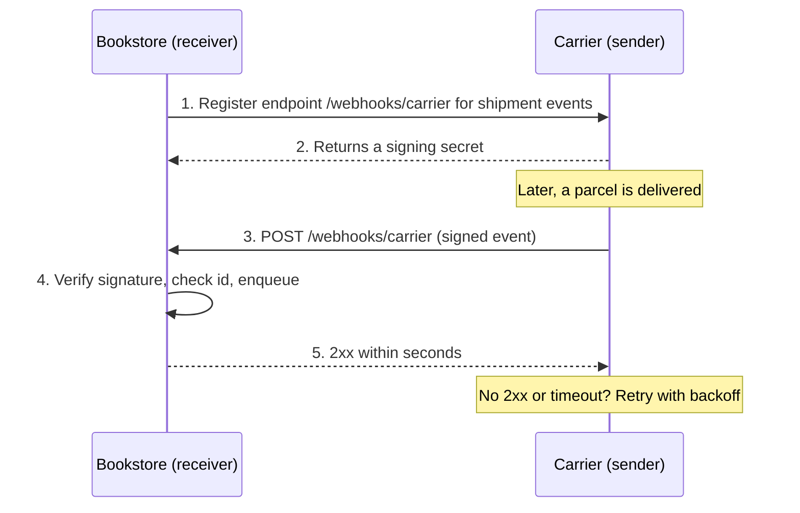
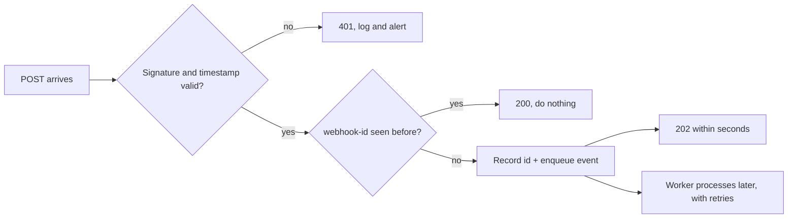
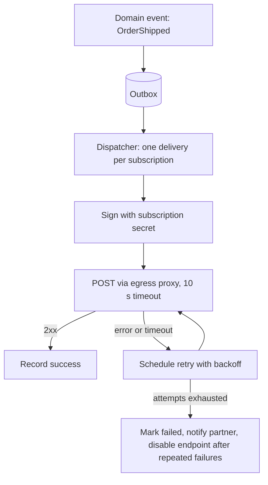

# Webhooks and Callbacks

## Introduction

Your bookstore ships orders through a delivery carrier. Customers want to know the moment their parcel is delivered. How does your system find out?

- **Polling**: every few minutes, ask the carrier "has anything changed?" for every open shipment. Most answers are "no". It is wasteful, and updates arrive late.
- **Webhooks**: give the carrier a URL. When something happens, the **carrier calls you** with an HTTP POST describing the event.

A webhook is a **user-defined HTTP callback**: an event notification sent from one system to another over plain HTTP, across company boundaries. Payment providers (Stripe), code hosting (GitHub), messaging platforms (Slack) and carriers all use them. They are the asynchronous messaging of the public internet, without a shared broker.

The analogy is a restaurant buzzer versus walking up to the counter every two minutes to ask if your food is ready. The buzzer is efficient, but only if it actually works, you can trust it came from this restaurant, and you do not mind if it buzzes twice.

This page covers both sides:

- **Receiving** webhooks safely: verify, deduplicate, respond fast.
- **Sending** webhooks reliably: sign, retry, protect your own network.

## How Webhooks Work



Key design decisions for any webhook system:

| Decision | Common choice |
| --- | --- |
| Transport | HTTPS POST with a JSON body |
| Authentication | HMAC signature with a shared secret (or an asymmetric signature) |
| Identity of an event | Unique message ID, stable across retries |
| Delivery guarantee | At least once, with retries over hours or days |
| Ordering | **Not guaranteed** |
| Success signal | Any 2xx response, quickly |

The **Standard Webhooks** specification (standardwebhooks.com), an open initiative backed by several webhook providers, writes these conventions down: `webhook-id`, `webhook-timestamp` and `webhook-signature` headers, and an HMAC-SHA256 signature over the ID, timestamp and body. Many providers use their own header names (Stripe uses `Stripe-Signature`, GitHub uses `X-Hub-Signature-256`), but the ideas are the same. The examples below follow Standard Webhooks.

## Signing and Verifying

Your webhook endpoint is a public URL. Anyone who discovers it can POST fake "payment succeeded" events to it. The sender therefore **signs** each request with a secret shared only with you, and you verify that signature before trusting anything in the body.

The signature includes a **timestamp**, so an attacker who captures a genuine request cannot **replay** it days later. You reject requests whose timestamp is too old (five minutes is a common tolerance).

```python
import base64
import hashlib
import hmac
import time


def sign(secret: str, msg_id: str, timestamp: int, body: bytes) -> str:
    """Standard Webhooks style: HMAC-SHA256 over "id.timestamp.body"."""
    key = base64.b64decode(secret.removeprefix("whsec_"))
    signed_content = f"{msg_id}.{timestamp}.".encode() + body
    digest = hmac.new(key, signed_content, hashlib.sha256).digest()
    return "v1," + base64.b64encode(digest).decode()


class InvalidSignature(Exception):
    pass


def verify(secret: str, headers: dict[str, str], body: bytes, tolerance_s: int = 300) -> None:
    msg_id = headers["webhook-id"]
    timestamp = int(headers["webhook-timestamp"])
    if abs(time.time() - timestamp) > tolerance_s:
        raise InvalidSignature("timestamp outside tolerance (possible replay)")
    expected = sign(secret, msg_id, timestamp, body)
    # The header may hold several space-separated signatures during secret rotation.
    for candidate in headers["webhook-signature"].split():
        if hmac.compare_digest(candidate, expected):  # constant-time comparison
            return
    raise InvalidSignature("no matching signature")
```

Save this as `signing.py`. Three details matter:

- **Sign and verify the raw bytes.** If you parse the JSON and re-serialize it, whitespace or key order can change and the signature will not match.
- **Use a constant-time comparison** (`hmac.compare_digest`). A normal `==` can leak, through timing, how many characters matched.
- **Support several signatures.** When a secret is rotated, the sender signs with both the old and new secrets for a while, so receivers can switch without downtime.

Let's test it, including three attacks:

```python
import base64
import json
import secrets
import time

from signing import InvalidSignature, sign, verify

secret = "whsec_" + base64.b64encode(secrets.token_bytes(24)).decode()
body = json.dumps({"type": "order.shipped", "data": {"order_id": "1001"}}).encode()
now = int(time.time())
headers = {
    "webhook-id": "msg_2f8a1c",
    "webhook-timestamp": str(now),
    "webhook-signature": sign(secret, "msg_2f8a1c", now, body),
}
print("signature header:", headers["webhook-signature"][:20] + "...")

verify(secret, headers, body)
print("genuine request: ok")

for name, tampered_headers, tampered_body in [
    ("changed body", headers, body.replace(b"1001", b"9999")),
    ("old timestamp", {**headers, "webhook-timestamp": str(now - 3600)}, body),
    ("wrong secret", {**headers, "webhook-signature": sign("whsec_" + base64.b64encode(b"x" * 24).decode(), "msg_2f8a1c", now, body)}, body),
]:
    try:
        verify(secret, tampered_headers, tampered_body)
    except InvalidSignature as exc:
        print(f"{name}: rejected ({exc})")
```

Example output (the signature differs on each run because the secret is random):

```text
signature header: v1,9Cr6nkQKYcplTL5Ah...
genuine request: ok
changed body: rejected (no matching signature)
old timestamp: rejected (timestamp outside tolerance (possible replay))
wrong secret: rejected (no matching signature)
```

In production, prefer the provider's official SDK or a maintained Standard Webhooks library for verification, because it will track details such as header formats and asymmetric signature schemes. Writing it once yourself is still the best way to understand what those libraries do.

## Receiving Webhooks: Verify, Deduplicate, Enqueue, Respond

A good receiver does as little as possible inside the HTTP request:



```python
import json
import os
import queue

from fastapi import FastAPI, Request, Response

from signing import InvalidSignature, verify

app = FastAPI()
SECRET = os.environ.get("CARRIER_WEBHOOK_SECRET", "whsec_dGVzdC1zZWNyZXQtZm9yLWRlbW8tb25seQ==")
seen_ids: set[str] = set()                # use a database table with a unique index in production
work: "queue.Queue[dict]" = queue.Queue()  # use a durable queue in production


@app.post("/webhooks/carrier")
async def carrier_webhook(request: Request) -> Response:
    body = await request.body()  # verify the RAW bytes, before any JSON parsing
    try:
        verify(SECRET, dict(request.headers), body)
    except (InvalidSignature, KeyError, ValueError):
        return Response(status_code=401)

    msg_id = request.headers["webhook-id"]
    if msg_id in seen_ids:
        return Response(status_code=200)  # duplicate delivery: acknowledge, do nothing
    seen_ids.add(msg_id)

    work.put(json.loads(body))  # hand off; do the slow work elsewhere
    return Response(status_code=202)
```

Save it as `receiver.py` and test it with a genuine delivery, a retry of the same message, and a forgery:

```python
import json
import time

from fastapi.testclient import TestClient

from receiver import SECRET, app, work
from signing import sign

client = TestClient(app)
body = json.dumps({"type": "shipment.delivered", "data": {"tracking": "1Z999"}}).encode()
ts = int(time.time())
headers = {"webhook-id": "msg_77", "webhook-timestamp": str(ts),
           "webhook-signature": sign(SECRET, "msg_77", ts, body),
           "content-type": "application/json"}

print("first delivery: ", client.post("/webhooks/carrier", content=body, headers=headers).status_code)
print("retry (same id):", client.post("/webhooks/carrier", content=body, headers=headers).status_code)
print("forged:         ", client.post("/webhooks/carrier", content=body,
                                      headers={**headers, "webhook-signature": "v1,Zm9yZ2Vk"}).status_code)
print("queued events:  ", work.qsize())
```

Output:

```text
first delivery:  202
retry (same id): 200
forged:          401
queued events:   1
```

Why each step matters:

- **Respond fast.** Senders time out after a few seconds (often 5 to 30) and then retry. If you send the email, update the database and call three services before answering, you will get duplicate deliveries during slow periods.
- **Deduplicate.** Delivery is at least once: a retry arrives whenever your 2xx response got lost. Store processed IDs with a unique constraint, ideally in the same transaction as the work. See [Idempotency](../9-arch-distributed-systems/7-arch-idempotency.mdx).
- **Do not trust order.** "delivered" can arrive before "out for delivery". Use timestamps or version numbers in the payload, or treat the webhook as a hint and **fetch the current state** from the sender's API.

### Thin events vs full payloads

Some providers send the full object in the webhook ("fat" payload). Others send only an ID and type ("thin" event), and you call their API for the details. Thin events avoid stale or out-of-order data and keep sensitive data out of webhook logs, at the cost of an extra API call. Some providers, including Stripe, now offer thin events as an option. A useful habit either way: **for important state changes, re-fetch the object from the API** before acting on it.

### Reconciliation

Webhooks can be lost permanently: the sender gives up after its last retry, an endpoint was misconfigured for a day, or a bug dropped events. Run a periodic **reconciliation job** that lists recent objects through the sender's API and fixes any that your system missed. Webhooks give you speed; reconciliation gives you correctness.

## Sending Webhooks: Being a Good Provider

If your bookstore sends webhooks to partners (for example `order.shipped` events to marketplaces that list your books), you take on the other half of the work.

### Retries with backoff

Partners' endpoints will be down sometimes. Retry with **exponential backoff and jitter**, over a long enough window to survive a typical outage, then stop and notify the partner.

```python
import ipaddress
import random
import socket
from urllib.parse import urlparse


def validate_endpoint(url: str) -> None:
    """Reject URLs that would make our servers call internal addresses (SSRF)."""
    parsed = urlparse(url)
    if parsed.scheme != "https" or not parsed.hostname:
        raise ValueError("endpoint must be an https:// URL")
    for info in socket.getaddrinfo(parsed.hostname, parsed.port or 443):
        ip = ipaddress.ip_address(info[4][0])
        if ip.is_private or ip.is_loopback or ip.is_link_local or ip.is_reserved:
            raise ValueError(f"{parsed.hostname} resolves to a non-public address {ip}")


def retry_schedule(attempts: int = 10, base_s: float = 60, cap_s: float = 6 * 3600) -> list[int]:
    """Exponential backoff, capped, with +/-20% jitter so retries do not arrive in waves."""
    rng = random.Random(42)  # seeded only so the demo output is stable
    return [int(min(cap_s, base_s * 2 ** n) * rng.uniform(0.8, 1.2)) for n in range(attempts)]


for url in ["http://shop.example.com/hook", "https://localhost/hook", "https://127.0.0.1:8443/x",
            "https://169.254.169.254/latest/meta-data"]:
    try:
        validate_endpoint(url)
        print("allowed ", url)
    except ValueError as exc:
        print("rejected", url, "->", exc)

delays = retry_schedule()
print("retry delays (s):", delays)
print(f"gives up after about {sum(delays) / 3600:.1f} hours")
```

Output:

```text
rejected http://shop.example.com/hook -> endpoint must be an https:// URL
rejected https://localhost/hook -> localhost resolves to a non-public address 127.0.0.1
rejected https://127.0.0.1:8443/x -> 127.0.0.1 resolves to a non-public address 127.0.0.1
rejected https://169.254.169.254/latest/meta-data -> 169.254.169.254 resolves to a non-public address 169.254.169.254
retry delays (s): [63, 97, 218, 426, 1050, 2055, 4442, 6411, 14880, 17537]
gives up after about 13.1 hours
```

Jitter spreads retries out, so when a partner recovers from an outage, it is not hit by every queued retry at the same moment. See [Circuit Breaker, Retry and Timeout](../9-arch-distributed-systems/8-arch-circuit-breaker.mdx).

### Protect yourself from SSRF

When customers can register **any URL** and your servers will POST to it, you have built a tool for **Server-Side Request Forgery** (SSRF). An attacker registers `http://169.254.169.254/...` (the cloud metadata service on many providers) or an internal admin URL, and your webhook sender makes the request from inside your network.

The `validate_endpoint` function above shows the first line of defense: HTTPS only, and no private, loopback, link-local or reserved addresses. It is **not enough on its own**. A hostname can resolve to a public address when you validate it and to a private one when you connect (DNS rebinding), and redirects can point anywhere. Robust senders:

- send webhooks from an **isolated network** with no route to internal services,
- or route them through an **egress proxy** that enforces the address rules at connect time (Stripe's open-source Smokescreen is one example),
- do not follow redirects,
- set short timeouts and a maximum response size.

### Everything else a provider owes its consumers



- **Generate events from an [outbox](../9-arch-distributed-systems/6-arch-outbox.mdx)** so events are never lost when the business transaction commits.
- **Isolate subscribers** from each other: one slow partner must not delay everyone else's deliveries. Use per-endpoint queues or concurrency limits ([bulkheads](../9-arch-distributed-systems/9-arch-bulkhead-and-rate-limiting.mdx)).
- **Version payloads** and let subscribers choose event types and API versions (see [API Versioning and Evolution](./6-arch-api-versioning.mdx)).
- **Give partners tooling**: a delivery log, a "resend" button, test events, secret rotation, and documentation with verification examples.
- **Consider a managed service.** Webhook delivery is undifferentiated infrastructure. Several companies offer webhook sending as a service, which may be cheaper than building retries, logs, portals and SSRF protection yourself.

## Callbacks in OpenAPI and Alternatives to Webhooks

OpenAPI can document webhooks: OpenAPI 3.0 has **callbacks** (requests your API sends back after a client calls an operation) and OpenAPI 3.1 added a top-level **webhooks** section for events that are not tied to a specific operation. Documenting payloads there lets partners generate types for them.

Webhooks are not the only way to push events:

| Approach | Pros | Cons | Best for |
| --- | --- | --- | --- |
| Webhooks | Simple HTTP, works across companies, no persistent connection | Receiver needs a public endpoint, at-least-once, unordered | Server-to-server notifications between organizations |
| Polling (with `If-None-Match` or `?since=`) | Receiver needs no public endpoint, simple | Latency and wasted requests | Low-frequency changes, firewalled consumers |
| Event stream API (list events since a cursor) | Consumer controls pace, can replay | Consumer must poll or hold state | Reconciliation, bulk sync |
| WebSockets or server-sent events | Low latency, push to browsers | Long-lived connections to manage | Live user interfaces |
| Shared broker or cloud event bus | Durable, ordered options | Both sides must access the same infrastructure | Integration within one organization or cloud |

Many mature providers offer **webhooks plus an events API**: webhooks for speed, a listable events endpoint for reconciliation.

## Real-World Scenario

Your bookstore accepts payments through a payment provider. The checkout page currently polls the provider every second after redirecting the customer back, and during peak hours you hit the provider's rate limits. Finance also found 14 orders last month that were paid but never marked as paid, because a polling worker crashed.

You redesign:

1. Register a webhook endpoint for `payment.succeeded`, `payment.failed` and `refund.created`.
2. The endpoint verifies the signature with the provider's SDK, stores the event ID with a unique constraint, puts the event on an internal queue, and returns `2xx` in milliseconds.
3. A worker re-fetches the payment object from the provider's API (so it acts on current state, not on an old or out-of-order payload), then marks the order paid. The update is idempotent: "mark paid if not already paid".
4. A **reconciliation job** runs every 15 minutes, listing recent payments through the API and fixing any order whose status disagrees.
5. Alerts fire on signature failures (possible attack or misconfigured secret), on queue depth, and on reconciliation corrections (which mean webhooks are being missed).

**Why this approach fits:** the provider pushes changes as they happen, removing wasteful polling. Verification and idempotency make it safe on a public URL with at-least-once delivery, and reconciliation catches the rare lost event, so money is never silently out of sync.

**When to use webhooks / when not to:**

- Use them to receive events from external SaaS providers, or to notify partners and customers' systems of changes in yours.
- Do not rely on them alone for anything financial or compliance-related: add reconciliation. Do not use them between your own internal services if you already have a broker, which gives you durability, ordering options and replay. Avoid them when consumers cannot expose a public HTTPS endpoint. Offer polling or an events API instead.

## Common Mistakes

1. **Not verifying signatures.** An unauthenticated webhook endpoint lets anyone mark orders as paid.
2. **Verifying parsed JSON instead of raw bytes.** Re-serialization changes the bytes, so valid signatures fail, and teams "fix" it by turning verification off.
3. **Doing slow work before responding.** Timeouts cause retries, which cause duplicates and more load.
4. **Assuming exactly-once or in-order delivery.** Deduplicate by event ID and handle out-of-order events.
5. **No reconciliation.** Lost events are rare but certain. Check against the source of truth periodically.
6. **Leaking secrets.** Signing secrets belong in a secret manager, not in code or logs. Rotate them with overlap.
7. **(Providers) Unrestricted outbound requests.** Validating URLs once is not enough. Isolate senders and block internal addresses at connect time.
8. **(Providers) Retrying forever, or not at all.** Use a bounded schedule with backoff and jitter, then notify the subscriber and eventually disable dead endpoints.

## Summary

- Webhooks are **HTTP callbacks**: the sender POSTs events to a URL you registered. They replace polling for cross-organization notifications.
- Receivers must **verify signatures over the raw body**, **reject old timestamps**, **deduplicate by event ID**, **respond quickly** and process asynchronously.
- Delivery is **at least once** and **unordered**. For important changes, re-fetch current state, and run **reconciliation**.
- Senders must **sign**, **retry with backoff and jitter**, **isolate subscribers**, publish from an **outbox**, and defend against **SSRF**.
- The **Standard Webhooks** specification captures common conventions for headers and signatures.

## Exercises

1. Extend `verify` to also accept the previous secret during a rotation window. How long should the overlap last?
2. Replace the in-memory `seen_ids` set with a SQLite table that has a unique index, and make inserting the ID and enqueuing the event a single transaction.
3. Write a reconciliation function that compares a list of "provider payments" with your orders and returns the orders to fix.
4. Design the subscription data model for a provider: what fields does a webhook subscription need (URL, event types, secret, API version, status, failure count, and so on)?

### Related pages

- [Synchronous vs Asynchronous Communication](./0-arch-communication-styles.mdx)
- [Messaging Patterns: Queues, Pub/Sub and Streams](./5-arch-messaging-patterns.mdx)
- [Idempotency](../9-arch-distributed-systems/7-arch-idempotency.mdx)
- [Case Study: Notification System](../14-arch-case-studies/3-arch-case-notifications.mdx)
- [Case Study: Payment Processing](../14-arch-case-studies/4-arch-case-payments.mdx)
- References: [standardwebhooks.com](https://www.standardwebhooks.com/), Stripe's and GitHub's webhook documentation, and the OWASP SSRF Prevention Cheat Sheet at [cheatsheetseries.owasp.org](https://cheatsheetseries.owasp.org/)
