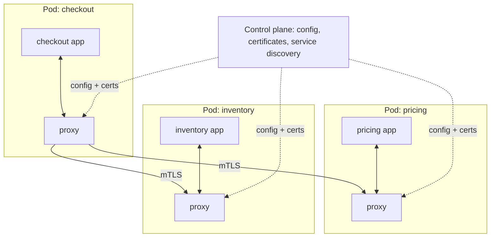
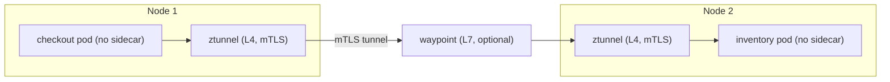

# Service Mesh and Sidecars

## Introduction

In a microservices system, every service needs the same plumbing for talking to other services: timeouts, retries, encryption, service identity, load balancing, metrics and tracing. You can put that plumbing in each service's code, through a shared library. That works until you have services in four languages, and the Go library has a retry bug that the Java library fixed last year.

The **sidecar** pattern takes another route: run a helper process **next to** each service instance that handles the plumbing, so the service does not have to. A **service mesh** is a fleet of these helpers (or node-level equivalents), configured centrally, that manages all service-to-service traffic in a cluster.

The name comes from the motorcycle sidecar: attached to the motorcycle, going wherever it goes, but a separate seat with its own job. In Kubernetes, the "motorcycle" is your application container, and the sidecar is another container in the same pod, sharing its network and lifecycle.

This page explains:

- the **sidecar**, **ambassador** and **adapter** patterns in general,
- what a **service mesh** adds on top,
- the newer **sidecarless** (ambient) mesh designs,
- and, most importantly, **when you do not need a mesh**.

## The Sidecar Pattern

A sidecar is a separate process or container deployed alongside the main application, sharing its lifecycle and usually its network namespace and volumes. Typical sidecars:

- **Proxies** for traffic (Envoy, linkerd2-proxy)
- **Log shippers** that read the app's log files and forward them
- **Configuration or secret agents** that fetch and refresh credentials
- **Adapters** that translate the app's metrics into the format your monitoring expects

The Azure Architecture Center documents the Sidecar and Ambassador patterns, and Brendan Burns and David Oppenheimer's paper "Design patterns for container-based distributed systems" (2016) named the sidecar, ambassador and adapter roles for multi-container pods:

| Pattern | Role | Example |
| --- | --- | --- |
| **Sidecar** | General helper deployed with the app | Log shipper, secret refresher |
| **Ambassador** | Out-of-process proxy for **outbound** calls; adds retries, circuit breaking, routing | Legacy app that cannot be changed gets resilience from a local proxy |
| **Adapter** | Translates the app's **interface** to what the platform expects | Exposes a legacy app's stats as Prometheus metrics |

### Seeing the idea in code

This toy example runs an unreliable upstream service and a sidecar proxy in one Python script, using only the standard library. The application makes a **plain HTTP call to localhost** with no retry logic at all. The sidecar adds retries, timeouts and metrics.

```python
"""A toy outbound sidecar: the app calls localhost, the sidecar adds retries, timeouts and metrics."""
import threading
import time
import urllib.error
import urllib.request
from collections import Counter
from http.server import BaseHTTPRequestHandler, ThreadingHTTPServer

# --- An unreliable upstream service (fails the first 2 calls) ----------------
calls = Counter()


class Upstream(BaseHTTPRequestHandler):
    def do_GET(self) -> None:
        calls["upstream"] += 1
        status = 503 if calls["upstream"] <= 2 else 200
        self.send_response(status)
        self.end_headers()
        self.wfile.write(b"stock=12" if status == 200 else b"busy")

    def log_message(self, *args) -> None:  # keep the demo output quiet
        pass


# --- The sidecar: same pod, separate process in real life --------------------
UPSTREAM = "http://127.0.0.1:9101"
metrics = Counter()


class Sidecar(BaseHTTPRequestHandler):
    def do_GET(self) -> None:
        start = time.perf_counter()
        for attempt in range(1, 4):  # retry policy lives here, not in the app
            try:
                with urllib.request.urlopen(UPSTREAM + self.path, timeout=0.5) as resp:
                    body, status = resp.read(), resp.status
                break
            except urllib.error.HTTPError as err:
                body, status = err.read(), err.code
                metrics[f"upstream_{status}"] += 1
                time.sleep(0.05 * attempt)
        metrics["requests"] += 1
        metrics["attempts"] += attempt
        print(f"[sidecar] GET {self.path} -> {status} after {attempt} attempt(s) "
              f"in {(time.perf_counter() - start) * 1000:.0f} ms")
        self.send_response(status)
        self.end_headers()
        self.wfile.write(body)

    def log_message(self, *args) -> None:
        pass


def start(server_cls, port: int) -> None:
    server = ThreadingHTTPServer(("127.0.0.1", port), server_cls)
    threading.Thread(target=server.serve_forever, daemon=True).start()


start(Upstream, 9101)
start(Sidecar, 15101)

# --- The application: plain HTTP call to localhost, no retry code at all -----
with urllib.request.urlopen("http://127.0.0.1:15101/stock/9780807083697") as resp:
    print("[app] got:", resp.read().decode())
print("[metrics]", dict(metrics))
```

Example output (timing varies):

```text
[sidecar] GET /stock/9780807083697 -> 200 after 3 attempt(s) in 154 ms
[app] got: stock=12
[metrics] {'upstream_503': 2, 'requests': 1, 'attempts': 3}
```

The application never knew the upstream failed twice. A real mesh proxy such as Envoy does the same thing, much more carefully, and also handles TLS, load balancing across many instances, and detailed telemetry. It also intercepts traffic **transparently** (using iptables or eBPF rules in the pod), so the app calls `http://inventory:8080` as usual, without pointing at a localhost port.

### Native sidecar containers in Kubernetes

For years, Kubernetes had no concept of a sidecar. A sidecar was just another container in the pod, which caused lifecycle problems: the sidecar could start after the app (so the app's first calls failed), and in Jobs the sidecar kept running after the main container finished, so the pod never completed.

Kubernetes added **native sidecar containers** in 1.28, and the feature became **stable in 1.33** (April 2025). A native sidecar is declared as an **init container with `restartPolicy: Always`**. It starts before the app containers, keeps running for the life of the pod, and does not block Job completion.

```yaml
apiVersion: v1
kind: Pod
metadata:
  name: catalog
spec:
  initContainers:
    - name: log-shipper            # a native sidecar: init container + restartPolicy Always
      image: fluent/fluent-bit:3.1
      restartPolicy: Always
      volumeMounts:
        - name: logs
          mountPath: /var/log/app
  containers:
    - name: catalog
      image: registry.example.com/bookstore/catalog:1.4.2
      ports:
        - containerPort: 8080
      volumeMounts:
        - name: logs
          mountPath: /var/log/app
  volumes:
    - name: logs
      emptyDir: {}
```

Service meshes that inject proxies can use native sidecars too, which fixes the "proxy not ready yet" and "proxy died first during shutdown" problems.

## What a Service Mesh Adds

A service mesh is two things:

- A **data plane**: the proxies that every request between services passes through.
- A **control plane**: the component that configures all the proxies from central policies, issues certificates, and collects telemetry.



What you get, without changing application code:

| Capability | What it means |
| --- | --- |
| **Mutual TLS (mTLS)** | Every connection is encrypted, and both sides prove their identity with certificates the mesh issues and rotates automatically |
| **Service identity and authorization** | Policies such as "only `checkout` may call `inventory`", based on cryptographic identity rather than IP addresses |
| **Traffic management** | Per-request load balancing, retries, timeouts, circuit breaking, traffic splitting for canary releases, fault injection for testing |
| **Uniform telemetry** | Request rates, error rates and latencies for every service pair, plus trace propagation, in the same format for every language |

The mesh handles traffic **between services** inside the cluster ("east-west"). The [API gateway](./4-arch-api-gateway.mdx) handles traffic **from outside** ("north-south"). Many meshes include an ingress gateway, and gateway products increasingly integrate with meshes, but the roles stay distinct.

## The Main Implementations

Features and versions change quickly, so check each project's documentation.

| Mesh | Data plane | Notes |
| --- | --- | --- |
| **Istio** (CNCF) | Envoy sidecars, or **ambient mode** with per-node ztunnel plus optional waypoint proxies | Most feature-rich. Ambient mode reached general availability in Istio 1.24 (November 2024) |
| **Linkerd** (CNCF) | linkerd2-proxy sidecars, written in Rust | Focused on simplicity and low overhead. Since 2024, stable release builds come from Buoyant (free for small organizations), while the open-source project publishes edge releases |
| **Cilium Service Mesh** | eBPF in the kernel plus a per-node Envoy for L7 | Builds on the Cilium networking (CNI) plugin |
| **Consul service mesh** | Envoy | From HashiCorp; also spans VMs and multiple platforms |
| **Cloud-managed meshes** | Varies | For example Google Cloud Service Mesh, which is based on Istio |

### Sidecar vs ambient (sidecarless) meshes

Sidecars have real costs. Every pod runs an extra proxy, using CPU and memory. Upgrading the mesh means restarting every pod to get the new proxy. And the proxy sits in every request path, adding a small amount of latency.

Istio's **ambient mode** splits the data plane into two layers:

- **ztunnel**: a shared, per-node proxy that handles Layer 4 concerns: mTLS, identity, L4 authorization and TCP telemetry. Every pod in an enrolled namespace gets these with no sidecar.
- **Waypoint proxies**: optional Envoy proxies, deployed per namespace or per service, only where you need Layer 7 features such as HTTP routing, retries, header-based authorization or HTTP metrics.



Enrolling a namespace is a label, and adding L7 features is one command:

```bash
kubectl label namespace bookstore istio.io/dataplane-mode=ambient
istioctl waypoint apply -n bookstore --enroll-namespace
```

The trade-off is that ambient is newer, and the node-level ztunnel is shared by every pod on the node, so its availability and resource limits matter for all of them. Sidecar mode remains fully supported.

## Configuring Mesh Behavior

Mesh configuration is declarative Kubernetes YAML. Here is Istio configuration that turns on strict mTLS for the bookstore namespace and allows only the checkout service account to call inventory:

```yaml
apiVersion: v1
kind: Namespace
metadata:
  name: bookstore
  labels:
    istio.io/dataplane-mode: ambient   # enroll every pod in this namespace in the ambient mesh
---
apiVersion: security.istio.io/v1
kind: PeerAuthentication
metadata:
  name: default
  namespace: bookstore
spec:
  mtls:
    mode: STRICT                       # reject plain-text traffic between workloads
---
apiVersion: security.istio.io/v1
kind: AuthorizationPolicy
metadata:
  name: inventory-callers
  namespace: bookstore
spec:
  selector:
    matchLabels:
      app: inventory
  action: ALLOW
  rules:
    - from:
        - source:
            principals:
              - cluster.local/ns/bookstore/sa/checkout
```

For traffic routing, the Kubernetes **Gateway API** has a mesh profile (the GAMMA initiative) in which an `HTTPRoute` attaches to a **Service** instead of a Gateway. Istio, Linkerd and other meshes support it, which makes routing configuration more portable between meshes. This route sends 10% of traffic for `inventory` to a new version, with a 2-second request timeout:

```yaml
apiVersion: gateway.networking.k8s.io/v1
kind: HTTPRoute
metadata:
  name: inventory-canary
  namespace: bookstore
spec:
  parentRefs:
    - group: ""
      kind: Service
      name: inventory            # GAMMA: the route attaches to a Service, not a Gateway
      port: 8080
  rules:
    - backendRefs:
        - name: inventory-v1
          port: 8080
          weight: 90
        - name: inventory-v2
          port: 8080
          weight: 10
      timeouts:
        request: 2s
```

Support for individual fields varies by mesh and version, so check your mesh's Gateway API conformance notes. In Istio ambient mode, L7 routing like this needs a waypoint.

:::caution Retries in two places
If your application code retries **and** the mesh retries, a single failure can turn into many requests (three app attempts times three mesh attempts is nine). Decide where retries live, usually in one layer, and keep retry budgets small. See [Circuit Breaker, Retry and Timeout](../9-arch-distributed-systems/8-arch-circuit-breaker.mdx).
:::

## Real-World Scenario

Your bookstore runs 35 services on Kubernetes, written in Python, Go and Java by six teams. Three problems keep coming up:

1. A security audit requires **encryption and authentication for all internal traffic**. Today, services talk plain HTTP inside the cluster, and any compromised pod can call the payments service.
2. Each language has its own resilience library with different retry and timeout defaults, and during incidents nobody can say which service is failing **calls to which other service**.
3. Teams want **canary releases** with 5% of traffic, which the current setup cannot do.

You adopt a mesh in stages:

1. Choose a mesh that fits your team's capacity. A team that wants minimal moving parts might pick Linkerd or Istio ambient mode with L4 only. A team that needs rich L7 policy might pick Istio with waypoints or sidecars.
2. Enable the mesh in **permissive mTLS** mode in one non-critical namespace, check dashboards and latency, then roll out namespace by namespace.
3. Switch to **STRICT** mTLS, then add **authorization policies**: `payments` accepts calls only from `checkout` and `refunds`.
4. Move timeout and retry **defaults** into mesh configuration, and remove duplicated retry code from services so retries happen in one layer.
5. Use weighted routes for canaries, combined with the mesh's per-route error-rate metrics to decide whether to continue a rollout.

**Why this approach fits:** the requirements are platform-wide (every service, every language), the organization is big enough to have a platform team to run the mesh, and the alternative (implementing mTLS, identity and consistent telemetry in three languages) would cost more.

**When to use a mesh / when not to:**

- Use one when you have **many services** in **several languages**, a **zero-trust** or compliance requirement for internal traffic, a need for uniform telemetry and traffic control, and a **platform team** that can operate it.
- Do not use one for a monolith, a [modular monolith](../6-arch-architectural-styles/3-arch-modular-monolith.mdx) or a handful of services. A load balancer, TLS at the ingress, and a good resilience library are simpler. Do not adopt one as the first step of a microservices migration: the mesh is complex infrastructure that can fail in confusing ways, and it adds latency and resource cost that you should measure.

**Alternatives and trade-offs:**

| Approach | Pros | Cons | Best for |
| --- | --- | --- | --- |
| Resilience libraries in code (for example Resilience4j, Polly, tenacity) | No extra infrastructure, full control, easy to debug | Per-language implementations drift; no uniform mTLS | Few services, one or two languages |
| Sidecar mesh (Istio sidecars, Linkerd) | Mature, per-pod isolation, rich L7 features | Proxy per pod (CPU, memory), pod restarts for upgrades | Large polyglot platforms with L7 needs |
| Ambient / node-level mesh (Istio ambient, Cilium) | Lower per-pod overhead, L7 only where needed, no restarts for L4 | Newer, shared node components | Large clusters wanting mTLS everywhere and L7 in places |
| Platform features only (network policies, managed certificates, gateway) | Simple, few moving parts | Coarser control, IP-based rather than identity-based | Small and medium systems |
| gRPC proxyless mesh (xDS in the gRPC library) | No proxy hop | gRPC only, library support varies by language | gRPC-heavy systems sensitive to latency |

## Common Mistakes

1. **Adopting a mesh for one feature.** If all you need is TLS between a few services, simpler options exist. Make a list of the capabilities you will actually use.
2. **Big-bang rollout.** Enabling strict mTLS and policies everywhere at once breaks things in hard-to-diagnose ways. Roll out by namespace, start permissive, watch metrics.
3. **Retries in both app and mesh.** This multiplies load during outages. Pick one layer.
4. **Ignoring resource cost.** Sidecars need CPU and memory requests in every pod, and they add up. Measure before and after.
5. **No owner.** A mesh is a platform product with upgrades, CVEs and on-call duties. Without a team that owns it, it becomes the scariest component in the cluster.
6. **Treating the mesh as the whole security story.** mTLS authenticates **workloads**, not end users. You still need user authentication and authorization in the application (see [Security by Design](../12-arch-quality-and-operations/4-arch-security-by-design.mdx)).
7. **Not handling lifecycle ordering.** Without native sidecars, apps can start before the proxy is ready, and Jobs can hang. Use native sidecar support where your mesh offers it.

## Summary

- A **sidecar** is a helper process deployed next to an application, sharing its lifecycle. **Ambassador** (outbound proxy) and **adapter** (interface translation) are specialized forms.
- Kubernetes **native sidecars** (init containers with `restartPolicy: Always`) are stable since 1.33 and fix startup and shutdown ordering.
- A **service mesh** = data plane proxies + control plane. It provides **mTLS and identity**, **authorization policies**, **traffic management** and **uniform telemetry** without code changes.
- **Ambient** (sidecarless) designs move L4 work into per-node proxies and add L7 proxies only where needed, reducing overhead.
- The Gateway API's mesh support (GAMMA) makes routing configuration more portable across meshes.
- A mesh is powerful and costly. Use it when many services, many languages and platform-wide requirements justify a platform team to run it.

## Exercises

1. Extend the toy sidecar with a simple circuit breaker: after five consecutive failures, return `503` immediately for ten seconds without calling the upstream.
2. Add a second toy sidecar on the **inbound** side that rejects requests without an `x-caller` header of `checkout`. What does a real mesh use instead of a header, and why?
3. For a system you know, list the cross-cutting networking features each service implements today. Which would a mesh replace, and which would remain in code?
4. Write a one-page [Architecture Decision Record](../13-arch-documenting-and-evolving/0-arch-decision-records.mdx) for "adopt a service mesh / do not adopt a service mesh" for a 10-service system with two languages.

### Related pages

- [API Gateway and Backend for Frontend](./4-arch-api-gateway.mdx)
- [gRPC](./3-arch-grpc.mdx): why per-request load balancing matters
- [Service Discovery and Load Balancing](../9-arch-distributed-systems/10-arch-service-discovery.mdx)
- [Designing for Observability](../12-arch-quality-and-operations/3-arch-observability.mdx)
- The site's [Kubernetes tutorial](/docs/devops/kubernetes)
- References: Azure Architecture Center "Sidecar" and "Ambassador" patterns; [Kubernetes sidecar containers](https://kubernetes.io/docs/concepts/workloads/pods/sidecar-containers/); [Istio ambient mode](https://istio.io/latest/docs/ambient/); [linkerd.io](https://linkerd.io/); [Gateway API mesh support](https://gateway-api.sigs.k8s.io/mesh/)
