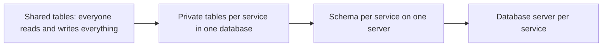
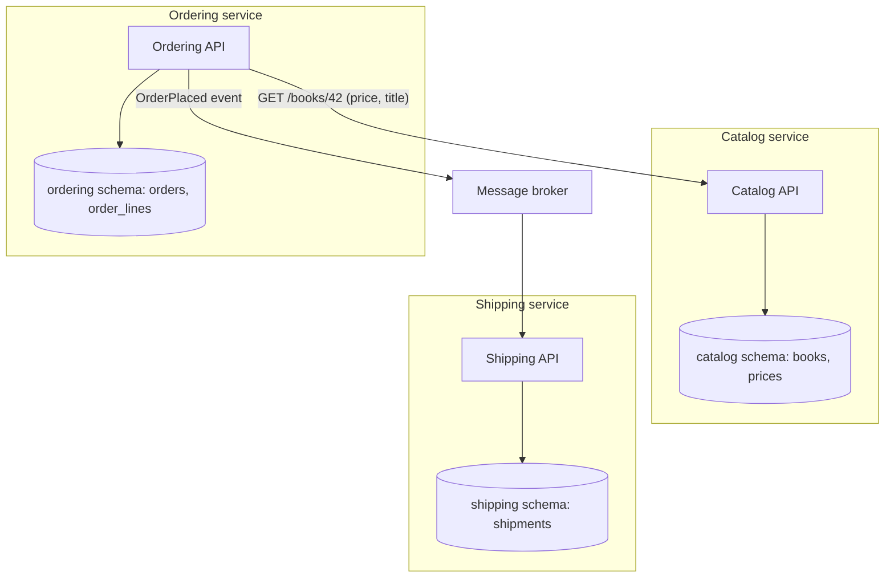
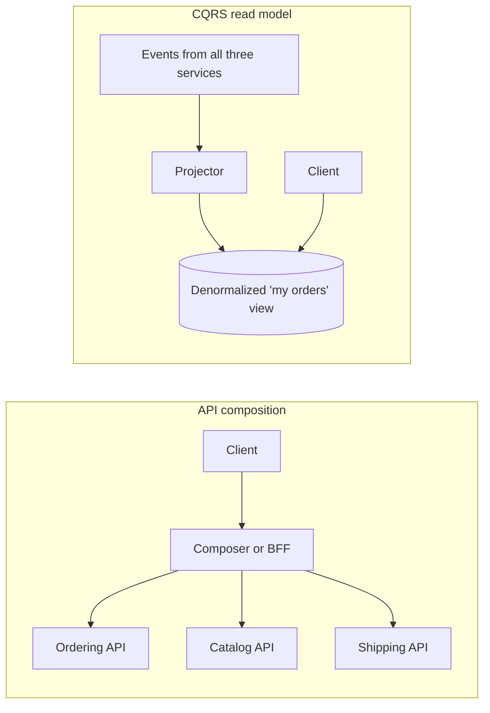

# Database per Service vs Shared Database

## Introduction

Once you split a system into services, or even into well-defined modules, one question comes up almost immediately: **who owns the data?**

There are two broad answers:

- **Shared database:** every service reads and writes the same database, often the same tables.
- **Database per service:** each service owns its data privately. Other services can only reach that data through the owner's API or the events it publishes.

An analogy: a shared database is like a shared office fridge with no labels. It is convenient until someone "borrows" your lunch, moves the shelves, or throws out the milk you were saving. Database per service gives each team its own fridge. Nobody takes your lunch, but if you want a colleague's leftovers you now have to ask them.

This choice decides how independently teams can change their code, how you run transactions that span business areas, and how you answer questions that need data from several places. Chris Richardson's [microservices.io](https://microservices.io/patterns/data/database-per-service.html) treats database per service as the default for microservices and lists [Shared Database](https://microservices.io/patterns/data/shared-database.html) as the alternative with known problems. That does not make a shared database always wrong. This page shows both sides.

We will use one running example throughout this section: an **online bookstore** with a Catalog service (books and prices), an Ordering service (carts and orders), and a Shipping service.

## The Spectrum of Data Ownership

"Database per service" is not one physical layout. It is a rule about **ownership and access**, and you can enforce it at several levels of isolation.



| Level | What it looks like | Isolation | Operational cost |
| --- | --- | --- | --- |
| Shared tables | All services use `books`, `orders`, `customers` directly | None | Lowest |
| Private tables | One database, but each table has exactly one owning service | Logical, by convention or grants | Low |
| Schema per service | `catalog.*`, `ordering.*`, `shipping.*` schemas with separate DB users | Logical, enforced by permissions | Low |
| Server per service | Separate database instance for each service | Physical: separate CPU, memory, storage, failures | Highest |

The key idea from microservices.io is that the first three rows can still satisfy "database per service" as long as **no service touches another service's tables**. You do not need a separate server per service on day one. Many teams start with schema per service on one PostgreSQL cluster and move a busy service to its own server only when it needs the capacity.

## The Problem: A Shared Database That Hurts

Here is a common starting point. The Catalog and Ordering code both talk to the same tables. The example uses SQLite from the Python standard library so you can run it as is.

```python
# shared_db_before.py
import sqlite3

db = sqlite3.connect(":memory:")
db.executescript("""
CREATE TABLE books (id INTEGER PRIMARY KEY, title TEXT, price_cents INTEGER, stock INTEGER);
CREATE TABLE orders (id INTEGER PRIMARY KEY, book_id INTEGER REFERENCES books(id), qty INTEGER);
INSERT INTO books VALUES (1, 'Domain-Driven Design', 5499, 3);
""")

# --- Ordering "service" code ---
def place_order(book_id: int, qty: int) -> int:
    # Reaches straight into the Catalog's table to check and change stock.
    (stock,) = db.execute("SELECT stock FROM books WHERE id = ?", (book_id,)).fetchone()
    if stock < qty:
        raise ValueError("out of stock")
    db.execute("UPDATE books SET stock = stock - ? WHERE id = ?", (qty, book_id))
    cur = db.execute("INSERT INTO orders (book_id, qty) VALUES (?, ?)", (book_id, qty))
    db.commit()
    return cur.lastrowid

# --- Reporting code, written by a third team ---
def order_report() -> list[tuple]:
    return db.execute("""
        SELECT o.id, b.title, o.qty * b.price_cents AS total_cents
        FROM orders o JOIN books b ON b.id = o.book_id
    """).fetchall()

place_order(1, 2)
print(order_report())

# Later, the Catalog team changes the price...
db.execute("UPDATE books SET price_cents = 5999 WHERE id = 1")
print(order_report())   # history has silently changed
```

Output:

```text
[(1, 'Domain-Driven Design', 10998)]
[(1, 'Domain-Driven Design', 11998)]
```

It works, and that is exactly why shared databases are so common. Look at what is coupled, though:

1. **Schema coupling.** The Catalog team cannot rename `price_cents` or split `stock` into a separate inventory table without breaking Ordering and Reporting, which they may not even know about.
2. **Semantic coupling.** The report computes order totals from the *current* book price, so a price change rewrites history. Nobody owned the rule "an order keeps the price it was sold at".
3. **Runtime coupling.** A slow reporting query or a long transaction holding locks on `books` can stall checkout.
4. **Hidden writers.** Stock is modified in at least two places. When the count is wrong, which code did it?

These are the drawbacks microservices.io lists for the shared database pattern: development-time coupling, runtime coupling, and one storage technology for every need.

## The Pattern Applied: Each Service Owns Its Data

With database per service, each service keeps private data and exposes behavior.



Ordering no longer reads `books`. When it needs a price, it asks Catalog. When it records an order line, it stores a **snapshot** of what it needs (title and price at the time of sale) in its own table.

```python
# per_service_after.py
from dataclasses import dataclass
import sqlite3

# ---------------- Catalog service (owns books) ----------------
class CatalogService:
    def __init__(self) -> None:
        self._db = sqlite3.connect(":memory:")
        self._db.executescript("""
        CREATE TABLE books (id INTEGER PRIMARY KEY, title TEXT, price_cents INTEGER, stock INTEGER);
        INSERT INTO books VALUES (1, 'Domain-Driven Design', 5499, 3);
        """)

    def get_book(self, book_id: int) -> dict:
        row = self._db.execute(
            "SELECT id, title, price_cents FROM books WHERE id = ?", (book_id,)
        ).fetchone()
        return {"id": row[0], "title": row[1], "price_cents": row[2]}

    def reserve_stock(self, book_id: int, qty: int) -> bool:
        cur = self._db.execute(
            "UPDATE books SET stock = stock - ? WHERE id = ? AND stock >= ?",
            (qty, book_id, qty),
        )
        self._db.commit()
        return cur.rowcount == 1

    def change_price(self, book_id: int, price_cents: int) -> None:
        self._db.execute("UPDATE books SET price_cents = ? WHERE id = ?", (price_cents, book_id))
        self._db.commit()

# ---------------- Ordering service (owns orders) ----------------
@dataclass(frozen=True)
class OrderLine:
    book_id: int
    title: str           # snapshot
    unit_price_cents: int  # snapshot: price at time of sale
    qty: int

class OrderingService:
    def __init__(self, catalog: CatalogService) -> None:
        self._catalog = catalog          # in production: an HTTP or gRPC client
        self._db = sqlite3.connect(":memory:")
        self._db.execute("""CREATE TABLE order_lines (
            order_id INTEGER, book_id INTEGER, title TEXT, unit_price_cents INTEGER, qty INTEGER)""")
        self._next_id = 1

    def place_order(self, book_id: int, qty: int) -> int:
        book = self._catalog.get_book(book_id)
        if not self._catalog.reserve_stock(book_id, qty):
            raise ValueError("out of stock")
        line = OrderLine(book_id, book["title"], book["price_cents"], qty)
        order_id = self._next_id
        self._next_id += 1
        self._db.execute("INSERT INTO order_lines VALUES (?, ?, ?, ?, ?)",
                         (order_id, line.book_id, line.title, line.unit_price_cents, line.qty))
        self._db.commit()
        return order_id

    def order_totals(self) -> list[tuple]:
        return self._db.execute(
            "SELECT order_id, title, unit_price_cents * qty FROM order_lines"
        ).fetchall()

catalog = CatalogService()
ordering = OrderingService(catalog)
ordering.place_order(1, 2)
print(ordering.order_totals())
catalog.change_price(1, 5999)
print(ordering.order_totals())   # history is stable
```

Output:

```text
[(1, 'Domain-Driven Design', 10998)]
[(1, 'Domain-Driven Design', 10998)]
```

What changed:

- Stock is changed in exactly one place, by Catalog, through an operation with a clear name (`reserve_stock`). The conditional `UPDATE ... WHERE stock >= ?` keeps that check atomic inside Catalog's own database.
- Ordering stores the facts it needs as they were at the time of sale. Copying data is not a bug here. It is how independent services record history.
- Catalog can restructure its tables freely as long as `get_book` keeps its contract.

:::note
The in-process method calls stand in for network calls. In a real system `get_book` becomes an HTTP or gRPC request, and you need timeouts and retries. See [Synchronous vs Asynchronous Communication](../10-arch-integration-and-apis/0-arch-communication-styles.mdx) and [Circuit Breaker, Retry and Timeout](../9-arch-distributed-systems/8-arch-circuit-breaker.mdx).
:::

## Enforcing Ownership in the Database

Conventions erode under deadline pressure. Microservices.io recommends giving each service its own database user with access only to its own data. In PostgreSQL, schema per service with separate roles looks like this:

```sql
-- Run as an administrator
CREATE ROLE catalog_svc LOGIN PASSWORD 'change-me';
CREATE ROLE ordering_svc LOGIN PASSWORD 'change-me';

CREATE SCHEMA catalog AUTHORIZATION catalog_svc;
CREATE SCHEMA ordering AUTHORIZATION ordering_svc;

-- Nobody else may use these schemas
REVOKE ALL ON SCHEMA catalog FROM PUBLIC;
REVOKE ALL ON SCHEMA ordering FROM PUBLIC;
```

Now a query from the Ordering service's connection that touches `catalog.books` fails with a permission error instead of quietly creating coupling. Each schema owner can also run its own migrations without coordinating with other teams. For more on roles and schemas, see the [PostgreSQL tutorial](/docs/database/postgresql).

## The Hard Parts and How to Handle Them

Database per service removes coupling but takes away two things a single database gave you for free: **ACID transactions across business areas** and **joins across business areas**.

### Transactions that span services

In the shared version, decrementing stock and inserting the order happened in one transaction. Now they happen in two databases. If Ordering crashes between `reserve_stock` and the insert, stock is reserved for an order that does not exist.

Your options, roughly from simplest to most involved:

| Option | How it works | Trade-off |
| --- | --- | --- |
| Redraw the boundary | If two pieces of data must always change together, they may belong to the same service | Fewer, larger services |
| Saga | A sequence of local transactions with compensating actions (release stock if the order fails) | Eventual consistency, more code |
| Reservation with expiry | Catalog holds stock for N minutes; unconfirmed reservations expire | Simple, but needs a cleanup job |
| Distributed transaction (2PC/XA) | A coordinator commits both databases atomically | Generally avoided: blocking, fragile, poor support in many stores |

Sagas are covered in depth in [Saga Pattern](../9-arch-distributed-systems/5-arch-saga.mdx). To publish events reliably alongside a local change, use the [Transactional Outbox](../9-arch-distributed-systems/6-arch-outbox.mdx).

### Queries that span services

"Show the customer's orders with current book covers and shipping status" needs data from three services. Two standard answers:



A minimal API composer in Python, with the service calls faked:

```python
# api_composition.py
import asyncio

async def get_orders(customer_id: int) -> list[dict]:
    await asyncio.sleep(0.05)  # pretend network call
    return [{"order_id": 7, "book_id": 1}, {"order_id": 8, "book_id": 2}]

async def get_books(ids: list[int]) -> dict[int, dict]:
    await asyncio.sleep(0.05)
    return {1: {"title": "Domain-Driven Design"}, 2: {"title": "Release It!"}}

async def get_shipments(order_ids: list[int]) -> dict[int, str]:
    await asyncio.sleep(0.05)
    return {7: "delivered", 8: "in transit"}

async def my_orders(customer_id: int) -> list[dict]:
    orders = await get_orders(customer_id)
    # Fan out to the other services in parallel, using batch endpoints
    books, shipments = await asyncio.gather(
        get_books([o["book_id"] for o in orders]),
        get_shipments([o["order_id"] for o in orders]),
    )
    return [
        {"order_id": o["order_id"],
         "title": books[o["book_id"]]["title"],
         "status": shipments.get(o["order_id"], "unknown")}
        for o in orders
    ]

print(asyncio.run(my_orders(42)))
```

Output:

```text
[{'order_id': 7, 'title': 'Domain-Driven Design', 'status': 'delivered'}, {'order_id': 8, 'title': 'Release It!', 'status': 'in transit'}]
```

API composition is simple and always fresh, but its latency and availability depend on every service it calls. A CQRS read model is fast and resilient but eventually consistent and needs an event pipeline. See [CQRS](../9-arch-distributed-systems/3-arch-cqrs.mdx) and [Change Data Capture](./5-arch-change-data-capture.mdx) for building such views.

### Reporting and analytics

Reporting is the most common reason teams keep a shared database alive. The better answer is usually to **copy** data out to a reporting store or warehouse rather than let analysts query service databases directly. [Search and Analytics Architecture](./6-arch-search-and-analytics.mdx) covers this.

## When a Shared Database Is the Right Call

Be honest about the trade-off. A shared database is reasonable when:

- **You have a monolith or modular monolith** deployed as one unit. One database is natural, but you can still give each module its own schema and forbid cross-module table access. This keeps a later split cheap. See [Modular Monolith](../6-arch-architectural-styles/3-arch-modular-monolith.mdx).
- **One small team owns all the services.** The coordination cost that database per service saves is low when the same five people own everything.
- **The data truly must change atomically together** and splitting it would force a saga with no business benefit. That may also be a sign the services should be merged.
- **You are early and the boundaries are unclear.** Splitting data along the wrong lines is expensive. Getting the boundaries right first, using [Bounded Contexts](../8-arch-domain-driven-design/2-arch-bounded-contexts.mdx), matters more than physical separation.

A useful middle ground that many teams use is "**one database server, one schema per service, no cross-schema access**". It costs little and preserves the option to separate later.

## Real-World Scenario

Your bookstore has grown from one team to four. The original Django monolith has 140 tables in one PostgreSQL database. The Ordering team wants to deploy several times a day, but every Catalog migration needs a cross-team review because six other modules read the `books` table directly. Last month, a heavy "bestsellers" report locked rows during a sale and checkout timed out.

**The plan:**

1. **Map table ownership.** Assign every table to exactly one owning module. Tables with no clear owner are a design smell. Discuss them.
2. **Find foreign readers.** Use query logs (for example, `pg_stat_statements`) or grep the code for table names to find every place a module reads another module's tables.
3. **Introduce schemas and roles.** Move tables into `catalog`, `ordering` and `shipping` schemas. At first grant cross-schema read access so nothing breaks, and log it.
4. **Replace foreign reads one at a time** with API calls, snapshots (price at sale time), or event-fed read models. Revoke each grant as its last reader disappears.
5. **Move reporting off the primary** to a replica first, then to a warehouse fed by CDC.
6. **Only then** consider moving Catalog to its own database server, because it has different scaling needs during sales.

**Why this approach:** it attacks coupling (the real pain) before physical separation (an operational choice). Each step is small and reversible, which follows the [Strangler Fig](../9-arch-distributed-systems/11-arch-strangler-fig.mdx) style of migration.

**When to use it:** several teams, independent deploy cadence, schema changes blocked by coordination, or services with very different load profiles.

**When not to:** one team, a monolith that deploys as one unit, or unclear domain boundaries. Then a well-modularized single database is cheaper and simpler.

| Approach | Pros | Cons | Best for |
| --- | --- | --- | --- |
| Shared tables | Simple joins and ACID transactions; one thing to operate | Schema and runtime coupling; unclear ownership | Small single-team apps, prototypes |
| One database, schema per module | Clear ownership; cheap; easy to split later | Shared resources, a noisy neighbor can still hurt | Modular monoliths, early microservices |
| Database server per service | Full isolation; right technology per service; independent scaling | Sagas, API composition, more ops and cost | Many teams, high scale, different storage needs |
| Shared database with read-only views per consumer | Hides internal schema behind a stable view | Still runtime coupling; views become an API to maintain | Transitional step while splitting |

## Common Mistakes

- **Splitting services but sharing tables.** You pay for network calls and distributed deployment but keep schema coupling. This is often called a distributed monolith.
- **Treating duplication as a sin.** A copy of the price on the order line is a business fact ("what we charged"), not redundant data. Copy what you need, and make clear which service is the source of truth.
- **Synchronous call chains for every read.** If Ordering calls Catalog, which calls Pricing, which calls Promotions, availability multiplies down. Prefer snapshots or local read models for hot paths.
- **Reaching for two-phase commit.** It looks like an easy fix but couples availability and is unsupported by many brokers and NoSQL stores. Use sagas, reservations, or redraw the boundary.
- **Giving analysts direct access to service databases.** Their queries become a hidden dependency on your internal schema. Export data instead.
- **No enforcement.** Without separate database users or schemas, "do not touch other teams' tables" will be broken within a quarter.

## Summary

- Database per service means **each service owns its data and others reach it only through its API or events**. It can be enforced with private tables, schemas, or separate servers.
- A shared database gives easy joins and transactions but creates schema, semantic and runtime coupling between teams.
- Database per service needs new tools for cross-service work: **sagas** and the **outbox** for consistency, **API composition** and **CQRS views** for queries, and a separate store for **analytics**.
- Copying data as snapshots (such as price at time of sale) is normal and often the correct business model.
- For a monolith or one small team, a single database with **one schema per module** is a strong, cheap default that keeps the option to split later.

## Exercises

1. Extend `per_service_after.py` so that if inserting the order line fails, Ordering calls a new `CatalogService.release_stock` method. What happens if the release call also fails? How would a saga or reservation expiry handle it?
2. Take a project you know and list every table with its owning module. How many tables are written by more than one module? How many are read by more than three?
3. Write the PostgreSQL commands to give a `reporting` role read-only access to a single view `ordering.order_summary` without exposing the underlying tables.
4. Sketch a CQRS read model for "my orders" in the bookstore. Which events does it need from each service, and how stale can it be?

**Related pages:** [Polyglot Persistence](./4-arch-polyglot-persistence.mdx), [Saga Pattern](../9-arch-distributed-systems/5-arch-saga.mdx), [Microservices Architecture](../6-arch-architectural-styles/4-arch-microservices.mdx), [Case Study: Breaking Up a Monolith](../14-arch-case-studies/7-arch-case-monolith-to-microservices.mdx).
