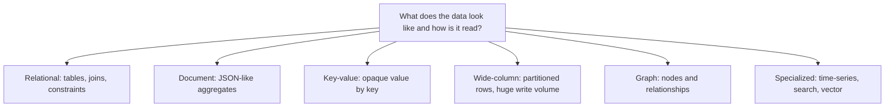
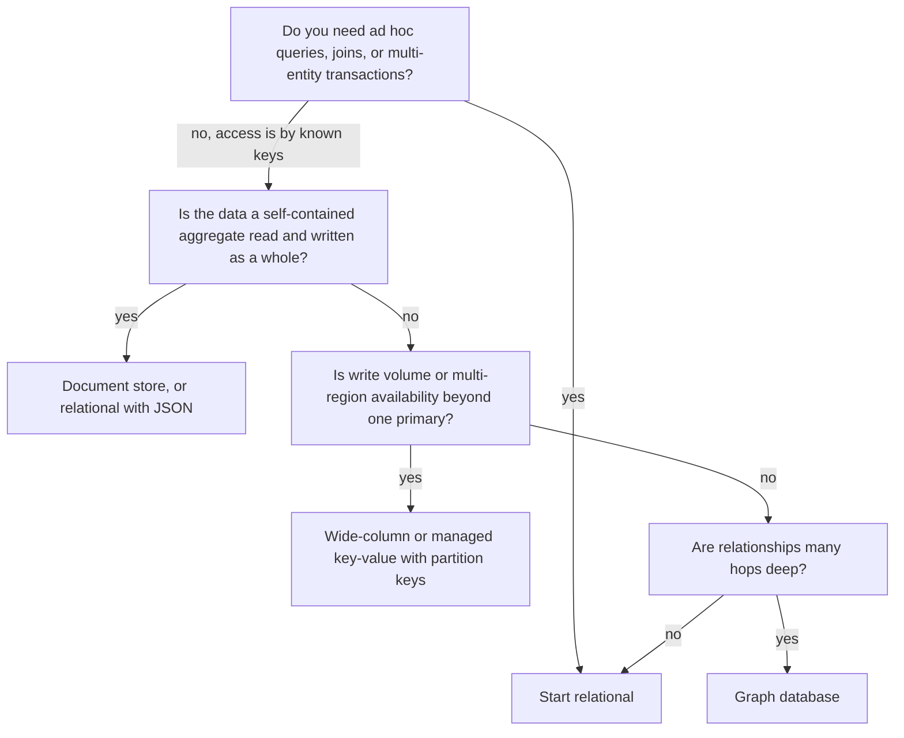

# Choosing SQL vs NoSQL

## Introduction

"Should we use SQL or NoSQL?" is one of the first architecture questions a new project faces, and one of the most often answered by fashion instead of analysis.

**SQL (relational) databases** such as PostgreSQL, MySQL, SQL Server and SQLite store data in tables with a declared schema, let you join tables freely, and offer ACID transactions.

**NoSQL** is not one thing. It is an umbrella for several families of databases that gave up some relational features to get something else in return, usually a more flexible data model, easier horizontal scaling, or very predictable performance for a known access pattern.

A useful analogy is storage at home. A relational database is a well-labeled filing cabinet with a cross-reference index: you can answer almost any question, as long as you filed things properly. A document database is a set of labeled boxes, one per project, with everything for that project inside: fast to grab one box, awkward to ask "which boxes contain receipts from March?". A key-value store is a coat check: hand over a ticket, get your coat back instantly, but do not ask the attendant to find "all blue coats".

This page teaches you to make the choice from **access patterns, consistency needs, and team skills**, not from benchmarks or hype. Martin Fowler's [PolyglotPersistence](https://martinfowler.com/bliki/PolyglotPersistence.html) note (2011) makes the same point: pick storage by how the data is used, and he still expected relational databases to remain the right choice for most projects.

## The Families at a Glance



| Family | Examples | Data model | Strong at | Weak at |
| --- | --- | --- | --- | --- |
| Relational | PostgreSQL, MySQL, SQL Server, SQLite | Tables, rows, foreign keys | Ad hoc queries, joins, transactions, integrity | Very large horizontal write scale needs extra tooling |
| Document | MongoDB, Couchbase, Firestore | JSON-like documents | Reading/writing a whole aggregate in one go; varied shapes | Joins and cross-document integrity |
| Key-value | Redis, Valkey, DynamoDB (also document) | Value looked up by key | Very fast lookups by key, caching, sessions | Queries by anything other than the key |
| Wide-column | Apache Cassandra, ScyllaDB, HBase, Bigtable | Rows grouped by partition key, sorted by clustering key | Huge write throughput, multi-region, time-ordered data | Ad hoc queries; you design tables per query |
| Graph | Neo4j, Amazon Neptune | Nodes, edges, properties | Multi-hop relationship queries | Bulk aggregation, simple CRUD |
| Time-series | TimescaleDB, InfluxDB | Timestamped points | Metrics, downsampling, retention | General-purpose data |
| Search | Elasticsearch, OpenSearch | Inverted index over documents | Full-text relevance, facets | Being the system of record |

Many products blur these lines. PostgreSQL has a `jsonb` type and indexes for it. MongoDB has multi-document ACID transactions (since version 4.0 for replica sets). DynamoDB supports transactions on up to a limited number of items. The families describe a **center of gravity**, not hard limits.

## The Same Data, Two Models

Let's model a bookstore order both ways and look at what each makes easy.

### Relational model

```python
# relational_order.py
import sqlite3

db = sqlite3.connect(":memory:")
db.executescript("""
CREATE TABLE customers (id INTEGER PRIMARY KEY, name TEXT NOT NULL);
CREATE TABLE books (id INTEGER PRIMARY KEY, title TEXT NOT NULL, author TEXT NOT NULL);
CREATE TABLE orders (id INTEGER PRIMARY KEY,
                     customer_id INTEGER NOT NULL REFERENCES customers(id),
                     placed_at TEXT NOT NULL);
CREATE TABLE order_lines (order_id INTEGER REFERENCES orders(id),
                          book_id INTEGER REFERENCES books(id),
                          qty INTEGER NOT NULL CHECK (qty > 0),
                          unit_price_cents INTEGER NOT NULL);

INSERT INTO customers VALUES (1, 'Ada'), (2, 'Grace');
INSERT INTO books VALUES (10, 'Refactoring', 'Fowler'), (11, 'Release It!', 'Nygard');
INSERT INTO orders VALUES (100, 1, '2026-10-01'), (101, 2, '2026-10-02');
INSERT INTO order_lines VALUES (100, 10, 1, 4500), (100, 11, 2, 3900), (101, 10, 1, 4500);
""")

# Question the designers never anticipated: revenue per author
for row in db.execute("""
    SELECT b.author, SUM(l.qty * l.unit_price_cents) / 100.0 AS revenue
    FROM order_lines l JOIN books b ON b.id = l.book_id
    GROUP BY b.author ORDER BY revenue DESC
"""):
    print(row)
```

Output:

```text
('Fowler', 90.0)
('Nygard', 78.0)
```

The relational model answered a question nobody planned for, with one query. That flexibility is the main strength of SQL: **you design the schema around the data, and queries come later.**

### Document model

```python
# document_order.py
import json

# One document per order: the whole aggregate is stored together.
orders = [
    {"_id": 100, "customer": {"id": 1, "name": "Ada"}, "placed_at": "2026-10-01",
     "lines": [{"book_id": 10, "title": "Refactoring", "author": "Fowler", "qty": 1, "unit_price_cents": 4500},
               {"book_id": 11, "title": "Release It!", "author": "Nygard", "qty": 2, "unit_price_cents": 3900}]},
    {"_id": 101, "customer": {"id": 2, "name": "Grace"}, "placed_at": "2026-10-02",
     "lines": [{"book_id": 10, "title": "Refactoring", "author": "Fowler", "qty": 1, "unit_price_cents": 4500}]},
]

# The common case is trivial: fetch one order with everything needed to render it.
order = next(o for o in orders if o["_id"] == 100)
print(json.dumps(order["lines"][0]))

# Revenue per author: we must scan every document and unwind the lines ourselves
# (in MongoDB you would write an aggregation pipeline with $unwind and $group).
revenue: dict[str, int] = {}
for o in orders:
    for line in o["lines"]:
        revenue[line["author"]] = revenue.get(line["author"], 0) + line["qty"] * line["unit_price_cents"]
print({k: v / 100 for k, v in revenue.items()})
```

Output:

```text
{"book_id": 10, "title": "Refactoring", "author": "Fowler", "qty": 1, "unit_price_cents": 4500}
{'Fowler': 90.0, 'Nygard': 78.0}
```

The document model makes the **main access pattern** (load or save one order) a single read or write with no joins. The order is an aggregate, which matches the [Aggregates](../8-arch-domain-driven-design/4-arch-aggregates.mdx) idea from DDD. But notice what we gave up:

- The author name is copied into every order line. If a name is corrected, you choose between updating many documents or living with the old value. (For historical orders, the old value may be exactly what you want.)
- Cross-order questions need aggregation pipelines or a separate analytics store.
- Nothing stops a buggy client from writing `"qty": -3` unless you add schema validation.

:::tip Schemaless is a myth
Document databases are *schema-on-read*, not schema-free. The schema still exists, in your application code. If you do not write it down (MongoDB supports `$jsonSchema` validation; in Python you can validate with dataclasses or Pydantic), every reader has to handle every historical shape.
:::

## Key-Value and Wide-Column: Design for Queries First

Key-value and wide-column stores flip the relational process. You **list your queries first and design the keys to answer them.** Here is the idea in plain Python, imitating a DynamoDB-style single table with a partition key (`pk`) and sort key (`sk`).

```python
# access_pattern_design.py
from bisect import insort
from collections import defaultdict

# partition key -> sorted list of (sort key, item)
table: dict[str, list[tuple[str, dict]]] = defaultdict(list)

def put(pk: str, sk: str, item: dict) -> None:
    insort(table[pk], (sk, item))

def query(pk: str, sk_prefix: str = "") -> list[dict]:
    # Fast: touches one partition only, items already sorted by sk
    return [item for sk, item in table[pk] if sk.startswith(sk_prefix)]

# Access pattern 1: get a customer's profile
put("CUSTOMER#1", "PROFILE", {"name": "Ada"})
# Access pattern 2: list a customer's orders, newest first
put("CUSTOMER#1", "ORDER#2026-10-01#100", {"total": 12300})
put("CUSTOMER#1", "ORDER#2026-09-15#087", {"total": 4500})
# Access pattern 3: get an order's lines
put("ORDER#100", "LINE#10", {"title": "Refactoring", "qty": 1})
put("ORDER#100", "LINE#11", {"title": "Release It!", "qty": 2})

print(query("CUSTOMER#1", "PROFILE"))
print(list(reversed(query("CUSTOMER#1", "ORDER#"))))
print(query("ORDER#100", "LINE#"))
```

Output:

```text
[{'name': 'Ada'}]
[{'total': 12300}, {'total': 4500}]
[{'title': 'Refactoring', 'qty': 1}, {'title': 'Release It!', 'qty': 2}]
```

Every planned query touches exactly one partition, which is why these databases can spread data over many machines and keep latency flat as data grows. The cost: "revenue per author" or "all orders containing book 10" is not supported by this design at all. You would add a secondary index, a second copy of the data keyed differently, or export to an analytics store.

## A Middle Path: Relational with JSON

You do not always have to choose. PostgreSQL's `jsonb` lets you keep relational integrity for the core and flexible attributes where shapes vary, such as product attributes that differ between books, e-books, and audiobooks.

```sql
CREATE TABLE products (
    id          bigint GENERATED ALWAYS AS IDENTITY PRIMARY KEY,
    sku         text UNIQUE NOT NULL,
    title       text NOT NULL,
    price_cents integer NOT NULL CHECK (price_cents >= 0),
    attributes  jsonb NOT NULL DEFAULT '{}'
);

-- A GIN index makes containment queries on attributes fast
CREATE INDEX products_attributes_gin ON products USING gin (attributes);

INSERT INTO products (sku, title, price_cents, attributes) VALUES
  ('BK-1', 'Refactoring', 4500, '{"format": "hardcover", "pages": 448}'),
  ('AB-1', 'Refactoring', 2900, '{"format": "audiobook", "narrator": "Jane Doe", "minutes": 720}');

SELECT sku, title FROM products WHERE attributes @> '{"format": "audiobook"}';
```

Example output:

```text
 sku  |    title
------+-------------
 AB-1 | Refactoring
(1 row)
```

This hybrid is a common modern default: relational for things you join, constrain, and report on, JSON for the long tail of variable fields. The [PostgreSQL tutorial](/docs/database/postgresql) and [MongoDB tutorial](/docs/database/mongodb) on this site cover each database in depth.

## When Relationships Are the Data: Graphs

Some questions are about chains of relationships: "customers who bought this also bought", "friends of friends", or "which accounts share a device with a known fraudster". Relational databases can answer these with recursive queries, and for a few hops that is often enough. SQLite and PostgreSQL both support `WITH RECURSIVE`:

```python
# recursive_cte.py
import sqlite3

db = sqlite3.connect(":memory:")
db.executescript("""
CREATE TABLE follows (follower TEXT, followee TEXT);
INSERT INTO follows VALUES
  ('ada', 'grace'), ('grace', 'linus'), ('linus', 'barbara'),
  ('ada', 'ken'), ('ken', 'barbara');
""")

# Everyone reachable from 'ada' within 3 hops, with the shortest distance
rows = db.execute("""
WITH RECURSIVE reach(person, hops) AS (
    SELECT followee, 1 FROM follows WHERE follower = 'ada'
    UNION
    SELECT f.followee, r.hops + 1
    FROM follows f JOIN reach r ON f.follower = r.person
    WHERE r.hops < 3
)
SELECT person, MIN(hops) FROM reach GROUP BY person ORDER BY 2, 1
""").fetchall()
print(rows)
```

Output:

```text
[('grace', 1), ('ken', 1), ('barbara', 2), ('linus', 2)]
```

This works well for shallow, bounded traversals. When queries routinely go many hops deep over millions of edges, or when relationship types and properties are central to the domain, a graph database such as Neo4j makes them both easier to write (a pattern-matching language such as Cypher, or the ISO GQL standard) and cheaper to run, because it follows stored relationships directly instead of repeating index lookups for every hop.

Before adopting one, ask whether the graph questions are a core, frequent workload or an occasional analysis. For occasional analysis, exporting edges into a graph tool or a notebook is often enough.

## Consistency Choices Inside NoSQL Stores

Choosing a NoSQL store does not mean choosing "eventual consistency" everywhere. Many let you choose per operation:

| Store | Consistency knob | Example |
| --- | --- | --- |
| Apache Cassandra | Consistency level per query (`ONE`, `QUORUM`, `LOCAL_QUORUM`, `ALL`) | Write and read at `QUORUM` so reads see the latest acknowledged write |
| Amazon DynamoDB | Eventually consistent reads by default, strongly consistent reads on request (with limits) | Use strong reads for a balance check, eventual reads for a product page |
| MongoDB | Read and write concerns (`majority`, and so on) and read preference | Read from secondaries for dashboards, from the primary for checkout |

The trade-off is always latency and availability against freshness, which [CAP and PACELC](../9-arch-distributed-systems/1-arch-cap-and-pacelc.mdx) explains. Check the defaults for your service in its official documentation, because they differ and do change.

## A Decision Process

Answer these questions in order. Most projects stop at the first or second.



Questions to ask in a design review:

1. **What are the top 5 queries, and how often does each run?** If you cannot list them, you need the flexibility of SQL.
2. **What must be consistent immediately?** Money, inventory and uniqueness constraints push toward ACID. See [Consistency Models](../9-arch-distributed-systems/2-arch-consistency-models.mdx) and [CAP and PACELC](../9-arch-distributed-systems/1-arch-cap-and-pacelc.mdx).
3. **What scale do you actually expect in the next 2 years?** A single well-tuned relational primary with replicas handles far more than most products need. Do not design for a scale you have not measured.
4. **How does the shape of the data vary?** Highly variable, nested data fits documents or JSON columns.
5. **What does the team know how to run?** Operating a database well (backups, upgrades, tuning, incident response) matters more than small feature differences. A managed service can change this answer.

## Common Myths

| Myth | Reality |
| --- | --- |
| "SQL does not scale" | Relational databases scale vertically a long way, scale reads with replicas, and can be sharded with tools like Citus or Vitess. Many very large sites run on them. |
| "NoSQL has no schema" | The schema moves into application code. Validation is still your job. |
| "NoSQL means no transactions" | MongoDB, DynamoDB and others offer transactions with documented limits. Check the limits for your use case. |
| "NoSQL is faster" | It is fast for the access patterns it was designed for. For other queries it can be much slower or impossible. |
| "We'll need to scale, so start with NoSQL" | Premature. Changing data stores later is hard, but so is living with a model that cannot answer new business questions. |

## Real-World Scenario

Your team runs the bookstore and is adding three features:

1. **Orders and payments**, which must never lose or double-count money.
2. **A product catalog** with very different attributes per product type (print books, e-books, audiobooks, gift cards, merchandise).
3. **Reading activity tracking**: every page turn in the e-reader app, around a few thousand events per second at peak, read back per user and time range.

**Solution:**

- **Orders:** PostgreSQL. Transactions, foreign keys, and `CHECK` constraints protect money. Finance will ask ad hoc questions forever.
- **Catalog:** PostgreSQL with a `jsonb` attributes column. Core fields (SKU, price, title) stay relational and indexed; the long tail goes into JSON. A document store would also work, but the team already runs PostgreSQL and the catalog joins to orders for reporting.
- **Reading activity:** a wide-column store or a managed key-value service, with partition key `user_id` and sort key `timestamp`. The only query is "events for user X between T1 and T2", writes are high-volume and append-only, and losing a few events is tolerable. A time-series extension on PostgreSQL is a reasonable alternative if volume stays moderate.

**Why this approach:** each choice follows the access pattern and consistency need, and it keeps the number of technologies small. Two databases are easier to operate than four.

**When to use it / when not:** use a NoSQL store when you can name the access patterns and they fit its model, or when you have measured a scale or availability need that one relational primary cannot meet. Do not adopt one because it is fashionable, or to avoid writing migrations. The migrations do not go away; they move into code. See [Schema Evolution and Data Migrations](./7-arch-data-migrations.mdx).

| Approach | Pros | Cons | Best for |
| --- | --- | --- | --- |
| Relational only | One technology, flexible queries, strong consistency | Scaling writes past one primary needs sharding work | Most business applications |
| Relational with JSON columns | Flexibility for variable fields, keeps joins and constraints | JSON fields have weaker typing; large JSON can be slow | Catalogs, settings, semi-structured data |
| Document store | Natural aggregates, flexible shape, built-in sharding | Joins and cross-document integrity are hard | Content, profiles, aggregates read whole |
| Wide-column / key-value | Predictable latency at huge scale, multi-region | Must design per query; poor for ad hoc analysis | Event logs, feeds, IoT, high-volume lookups |
| Graph | Natural multi-hop queries | Niche skills; poor at bulk aggregation | Recommendations, fraud rings, permissions graphs |

## Best Practices

- **Default to relational** unless you can name a specific access pattern or scale need it fails. This is a starting point, not dogma.
- **Write down the access patterns** before choosing a NoSQL store. If the list keeps changing, that is a sign you need SQL's flexibility.
- **Validate data at the boundary** no matter which database you use.
- **Plan for analytics separately.** Whatever you choose for transactions, reporting usually ends up in a warehouse. See [Search and Analytics Architecture](./6-arch-search-and-analytics.mdx).
- **Prefer managed services** when the team lacks deep operational experience with a database.
- **Hide the store behind a repository** so domain code does not depend on query syntax. This does not make switching databases free, but it keeps the blast radius small. See [Repository Pattern](../5-arch-modern-patterns/1-arch-repository-pattern.mdx).
- **Prototype the hardest query** on realistic data volumes before committing, especially for key-value and wide-column designs.
- **Write the decision down** in an [Architecture Decision Record](../13-arch-documenting-and-evolving/0-arch-decision-records.mdx), including the access patterns you assumed, so the next team knows when the choice should be revisited.
- **Check limits in the official docs**, such as item size limits, transaction limits, and consistency defaults. They change between versions and services.

## Summary

- "NoSQL" covers document, key-value, wide-column, graph and specialized stores, each with a different center of gravity.
- Relational databases let you **design around the data and query later**. NoSQL stores usually make you **design around the queries up front**.
- Document stores shine for self-contained aggregates; key-value and wide-column stores for known, high-volume access by key; graph stores for deep relationships.
- Modern relational databases with JSON support cover many "we need flexibility" cases.
- Choose based on access patterns, consistency, measured scale, and the team's operational skills.

## Exercises

1. Add a "list all orders containing book 10" query to `access_pattern_design.py`. What new items or index do you need, and what happens to write cost?
2. Model a helpdesk ticket with comments and attachments in both relational and document form. Which queries become harder in each?
3. List the five most frequent queries of an application you work on. Which family of database would serve them best, and does it differ from what you use today?
4. Read the MongoDB or DynamoDB documentation on transaction limits and write down two limits that would affect an order-processing design.

**Related pages:** [Polyglot Persistence](./4-arch-polyglot-persistence.mdx), [Replication and Sharding](./3-arch-replication-and-sharding.mdx), [Repository Pattern](../5-arch-modern-patterns/1-arch-repository-pattern.mdx), [Quality Attributes](../0-arch-fundamentals/3-arch-quality-attributes.mdx).
