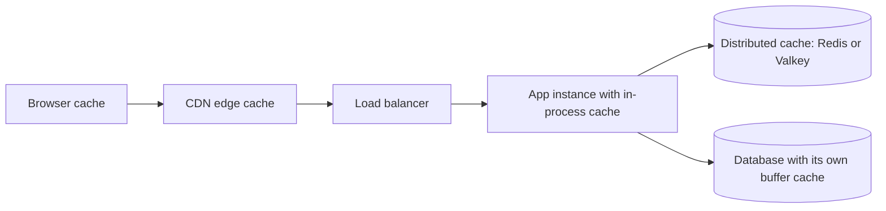
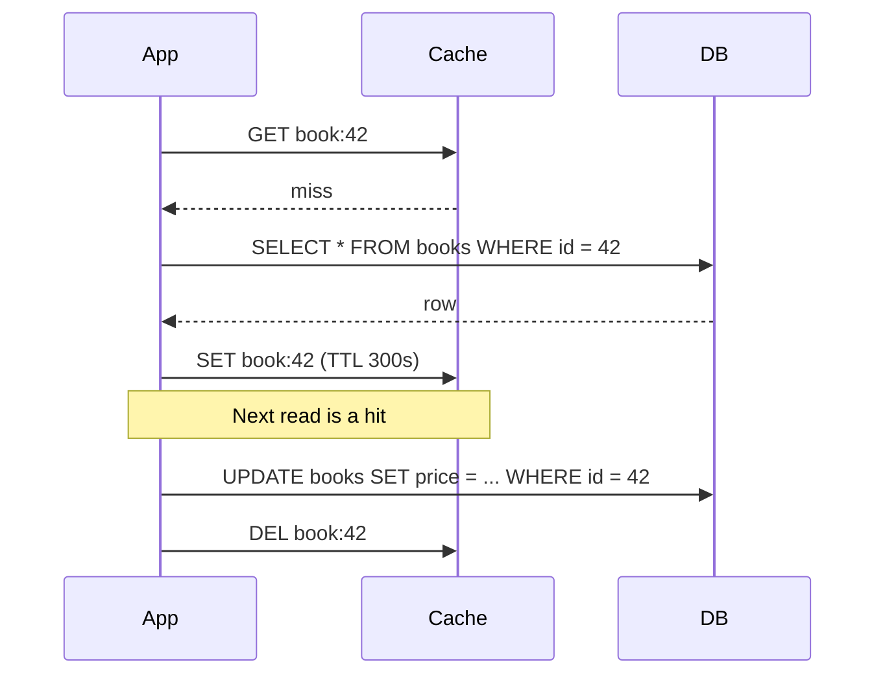

# Caching Strategies

## Introduction

A **cache** keeps a copy of data somewhere faster or closer than its original source, so repeated reads are cheaper. Caching is one of the most effective performance tools you have, and one of the easiest ways to introduce subtle bugs.

Think of a busy coffee shop. The barista keeps a few jugs of the most popular milk on the counter instead of walking to the back fridge for every order. That saves time, but now someone has to notice when a jug goes sour, refill it, and make sure the counter jug and the fridge agree on what "oat milk" means. Every caching strategy is a different answer to those three chores: **what to keep, when to refresh it, and how stale is acceptable.**

The famous line attributed to Phil Karlton, "There are only two hard things in Computer Science: cache invalidation and naming things," is popular for a reason. This page shows you the standard strategies, with code, and when each one fits.

## Where Caches Live

Before choosing a strategy, decide **where** to cache. Most systems use several layers.



| Layer | Example | Latency | Shared across instances? | Good for |
| --- | --- | --- | --- | --- |
| Client / browser | HTTP `Cache-Control` | None (no request) | No | Static assets, public pages |
| CDN | CloudFront, Cloudflare, Fastly | Very low, near the user | Yes, per edge | Images, JS, public API responses |
| In-process | Python dict, `functools.lru_cache`, Caffeine (Java) | Nanoseconds to microseconds | No, each instance has its own | Small, hot, rarely changing data |
| Distributed | Redis, Valkey, Memcached | Sub-millisecond to low ms over the network | Yes | Shared hot data, sessions, rate limits |
| Database | PostgreSQL shared buffers, materialized views | Saves disk I/O, not the network hop | Yes | Automatic; tune before adding more layers |

:::note Redis and Valkey
Redis changed its license in 2024, which led the Linux Foundation to host **Valkey**, a BSD-licensed fork backed by several cloud providers. In 2025, Redis 8 added the open source AGPLv3 license as an option. Both speak the same protocol for the commands on this page. Check each project's site for current licensing and features before choosing. This site's [Redis tutorial](/docs/middleware/redis) covers the basics.
:::

## Strategy 1: Cache-Aside (Lazy Loading)

Cache-aside is the most common strategy. The application talks to both the cache and the database:

1. Read from the cache.
2. On a **miss**, read from the database and put the result in the cache with a time to live (TTL).
3. On a write, update the database, then **delete** the cache entry.

The [Azure Cache-Aside pattern](https://learn.microsoft.com/en-us/azure/architecture/patterns/cache-aside) and the AWS whitepaper [Database Caching Strategies Using Redis](https://docs.aws.amazon.com/whitepapers/latest/database-caching-strategies-using-redis/caching-patterns.html) both describe it this way.



Here is a runnable version. A tiny in-memory TTL cache stands in for Redis, and a counter shows how often the "database" is hit.

```python
# cache_aside.py
import time
from dataclasses import dataclass, field

@dataclass
class TTLCache:
    """A minimal stand-in for Redis GET/SET with expiry."""
    _data: dict[str, tuple[float, object]] = field(default_factory=dict)

    def get(self, key: str) -> object | None:
        entry = self._data.get(key)
        if entry is None:
            return None
        expires_at, value = entry
        if time.monotonic() >= expires_at:
            del self._data[key]
            return None
        return value

    def set(self, key: str, value: object, ttl: float) -> None:
        self._data[key] = (time.monotonic() + ttl, value)

    def delete(self, key: str) -> None:
        self._data.pop(key, None)

class BookDB:
    def __init__(self) -> None:
        self.rows = {42: {"id": 42, "title": "Refactoring", "price_cents": 4500}}
        self.reads = 0

    def get(self, book_id: int) -> dict | None:
        self.reads += 1
        time.sleep(0.02)                 # pretend this is a slow query
        row = self.rows.get(book_id)
        return dict(row) if row else None

    def update_price(self, book_id: int, price_cents: int) -> None:
        self.rows[book_id]["price_cents"] = price_cents

class BookService:
    def __init__(self, db: BookDB, cache: TTLCache, ttl: float = 300) -> None:
        self.db, self.cache, self.ttl = db, cache, ttl

    def get_book(self, book_id: int) -> dict | None:
        key = f"book:{book_id}"
        cached = self.cache.get(key)
        if cached is not None:
            return cached
        book = self.db.get(book_id)
        if book is not None:
            self.cache.set(key, book, self.ttl)
        return book

    def change_price(self, book_id: int, price_cents: int) -> None:
        self.db.update_price(book_id, price_cents)   # 1. write the source of truth
        self.cache.delete(f"book:{book_id}")         # 2. then invalidate

db, cache = BookDB(), TTLCache()
svc = BookService(db, cache)

start = time.perf_counter()
for _ in range(100):
    svc.get_book(42)
print(f"100 reads, {db.reads} DB query, {time.perf_counter() - start:.3f}s")

svc.change_price(42, 3900)
print(svc.get_book(42)["price_cents"], "after", db.reads, "DB queries")
```

Example output (timings vary):

```text
100 reads, 1 DB query, 0.021s
3900 after 2 DB queries
```

The same logic against a real Redis or Valkey server uses the `redis` Python client (`pip install redis`):

```python
# cache_aside_redis.py
import json
import redis

r = redis.Redis(host="localhost", port=6379, decode_responses=True)

def get_book(book_id: int, load_from_db) -> dict | None:
    key = f"book:{book_id}"
    if (cached := r.get(key)) is not None:
        return json.loads(cached)
    book = load_from_db(book_id)
    if book is not None:
        r.set(key, json.dumps(book), ex=300)   # TTL in seconds
    return book

def invalidate_book(book_id: int) -> None:
    r.delete(f"book:{book_id}")
```

### Why delete instead of update?

On a write you could either `SET` the new value or `DEL` the key. Deleting is usually safer. If two writers race, "update cache" can leave the older value in the cache permanently, while "delete" at worst causes one extra miss. Azure's guidance also stresses the **order**: update the database first, then remove the cache entry. If you delete first, a reader can sneak in between, load the old row, and put it back into the cache.

Even "write DB, then delete" has a rare race: a slow reader loads the old row *before* the write, and puts it in the cache *after* the delete. A TTL bounds how long that stale value can live. That is why you should **always set a TTL**, even when you also invalidate explicitly.

### Built-in cache-aside in Python

For data local to one process, Python's standard library already gives you a cache-aside decorator:

```python
# lru_example.py
from functools import lru_cache

@lru_cache(maxsize=1024)
def shipping_zones(country: str) -> tuple[str, ...]:
    print(f"loading zones for {country}")   # imagine a DB query
    return ("north", "south") if country == "US" else ("all",)

shipping_zones("US"); shipping_zones("US"); shipping_zones("DE")
print(shipping_zones.cache_info())
```

Output:

```text
loading zones for US
loading zones for DE
CacheInfo(hits=1, misses=2, maxsize=1024, currsize=2)
```

`lru_cache` has no TTL and each process has its own copy, so it suits reference data that changes only on deploy. Call `shipping_zones.cache_clear()` to reset it. This is the [Decorator pattern](../3-arch-structural-patterns/3-arch-decorator.mdx) in a form you have probably used already.

## Strategy 2: Read-Through

Read-through looks the same to the caller as cache-aside, but the **cache itself** loads missing data from the source using a loader you register. The application only ever talks to the cache. Libraries such as Caffeine (Java) `LoadingCache`, and some data grids, work this way.

```python
# read_through.py
from collections.abc import Callable

class ReadThroughCache:
    def __init__(self, loader: Callable[[str], object]) -> None:
        self._loader = loader
        self._data: dict[str, object] = {}

    def get(self, key: str) -> object:
        if key not in self._data:
            self._data[key] = self._loader(key)   # the cache owns the loading
        return self._data[key]

calls = []
cache = ReadThroughCache(lambda k: calls.append(k) or k.upper())
print(cache.get("isbn-1"), cache.get("isbn-1"), calls)
```

Output:

```text
ISBN-1 ISBN-1 ['isbn-1']
```

The benefit is that caching logic lives in one place instead of being repeated in every service method. The cost is less control per call site.

## Strategy 3: Write-Through

With write-through, every write goes to the database **and** the cache in the same operation, so the cache is always warm for data that was recently written. AWS notes it is almost always combined with lazy loading for entries that expire.

```python
# write_through.py (continues the BookService idea)
def change_price_write_through(db, cache, book_id: int, price_cents: int, ttl: float = 300) -> None:
    db.update_price(book_id, price_cents)
    fresh = db.get(book_id)                 # or build the new value from what you wrote
    cache.set(f"book:{book_id}", fresh, ttl)
```

- **Pros:** reads right after a write see the new value; fewer misses.
- **Cons:** every write pays for a cache write; you cache data that may never be read; and if the cache write fails after the database write, you are back to needing a TTL or invalidation.

## Strategy 4: Write-Behind (Write-Back)

Write-behind writes to the cache first and flushes changes to the database **later**, often in batches. It gives very fast writes and can absorb bursts, for example counting page views.

```python
# write_behind.py
import threading, time
from collections import Counter

class ViewCounter:
    def __init__(self, flush_every: float = 0.1) -> None:
        self._pending: Counter[str] = Counter()
        self._lock = threading.Lock()
        self.db: Counter[str] = Counter()          # stand-in for the database
        self.flushes = 0
        self._flush_every = flush_every

    def record_view(self, book_id: str) -> None:
        with self._lock:
            self._pending[book_id] += 1             # fast, in memory

    def flush(self) -> None:
        with self._lock:
            batch, self._pending = self._pending, Counter()
        if batch:
            self.db.update(batch)                   # one batched write
            self.flushes += 1

vc = ViewCounter()
for i in range(10_000):
    vc.record_view("book:42" if i % 3 else "book:7")
vc.flush()
print(dict(vc.db), "in", vc.flushes, "write(s)")
```

Output:

```text
{'book:7': 3334, 'book:42': 6666} in 1 write(s)
```

The danger is obvious: **if the process or cache dies before a flush, those writes are lost.** Use write-behind only for data where approximate is acceptable (counters, analytics, "last seen" timestamps) or where the cache itself is durable and replicated.

## Strategy 5: Refresh-Ahead

Refresh-ahead reloads popular entries **before** they expire, so users rarely see a miss. A common lightweight version is "stale-while-revalidate": serve the slightly stale value and refresh it in the background. HTTP caches support this directly with the `stale-while-revalidate` directive of `Cache-Control` (RFC 5861).

## Comparing the Strategies

| Strategy | Read path | Write path | Staleness risk | Data loss risk | Typical use |
| --- | --- | --- | --- | --- | --- |
| Cache-aside | App checks cache, loads DB on miss | App writes DB, deletes key | Bounded by TTL and races | None | Default for most read-heavy data |
| Read-through | Cache loads on miss via loader | Usually paired with invalidation | Same as cache-aside | None | Centralized caching libraries |
| Write-through | Cache usually warm | App writes DB and cache | Low | None | Read-after-write paths, small data |
| Write-behind | Cache | Cache now, DB later | Low in cache, DB lags | Yes, on crash | Counters, metrics, bursty writes |
| Refresh-ahead | Cache, background reload | Any of the above | Low for hot keys | None | Hot keys with expensive loads |

## Invalidation Techniques

| Technique | How | Trade-off |
| --- | --- | --- |
| TTL only | Every entry expires after N seconds | Simple; data can be up to N seconds stale |
| Explicit delete on write | Writer deletes the key | Writer must know every key the change affects |
| Versioned keys | Key includes a version, such as `book:42:v17` | Old entries simply stop being read; needs a version source |
| Event-driven | Consumers of change events delete keys | Works across services; needs an event pipeline, see [Change Data Capture](./5-arch-change-data-capture.mdx) |
| Tag or prefix purge | CDNs and some caches purge groups of keys | Convenient; support varies by product |

## Protecting the Database: Cache Stampedes

When a very hot key expires, hundreds of requests can miss at the same moment and all hit the database together. This is a **cache stampede** (or thundering herd). Three standard defenses:

1. **Single-flight / request coalescing:** only one caller loads the value; the others wait for it.
2. **TTL jitter:** add randomness to TTLs so many keys do not expire in the same second.
3. **Stale-while-revalidate:** keep serving the old value while one worker refreshes.

A single-flight loader within one process:

```python
# single_flight.py
import random, threading, time
from concurrent.futures import ThreadPoolExecutor

db_queries = 0
cache: dict[str, str] = {}
locks: dict[str, threading.Lock] = {}
locks_guard = threading.Lock()

def load_from_db(key: str) -> str:
    global db_queries
    db_queries += 1
    time.sleep(0.1)
    return f"value-of-{key}"

def get(key: str) -> str:
    if key in cache:
        return cache[key]
    with locks_guard:
        lock = locks.setdefault(key, threading.Lock())
    with lock:                       # only one thread loads; the rest wait here
        if key not in cache:         # double-check after acquiring the lock
            cache[key] = load_from_db(key)
    return cache[key]

with ThreadPoolExecutor(max_workers=50) as pool:
    results = list(pool.map(get, ["bestsellers"] * 200))

print(len(results), "requests,", db_queries, "DB query")

def ttl_with_jitter(base: int = 300, spread: float = 0.1) -> int:
    return int(base * random.uniform(1 - spread, 1 + spread))
print(all(270 <= ttl_with_jitter() <= 330 for _ in range(1000)))
```

Output:

```text
200 requests, 1 DB query
True
```

Across many app instances, the same idea uses a short-lived distributed lock, for example Redis `SET lock:key token NX EX 10`, so only one instance rebuilds the value. Keep the lock short and always fall back to the database if the lock holder dies.

## Real-World Scenario

Your bookstore's product page reads the book, its price, average rating, and stock level. During a holiday sale, traffic jumps tenfold and the PostgreSQL primary hits 90% CPU, mostly from the same few hundred bestseller pages.

**Solution:**

- **Book details and ratings:** cache-aside in Redis or Valkey with a 10-minute TTL plus jitter. Catalog edits delete the key. Ratings may lag by a few minutes, which nobody notices.
- **Price:** cache-aside with explicit invalidation on every price change and a short TTL (60 seconds) as a safety net. At checkout, **always re-read the price from the database**; the cache is only for display.
- **Stock level:** do not cache the exact number. Show "In stock" or "Only a few left" from a cached value, and check real stock atomically in the database when the order is placed.
- **Bestseller list:** refresh-ahead every minute by a background job, so no user request ever rebuilds it.
- **Page views:** write-behind counters flushed every 10 seconds.
- **Static assets and cover images:** CDN with long `Cache-Control` max-age and fingerprinted file names.

**Why this approach:** each piece of data gets a strategy matched to how stale it may be. Read load drops sharply where it is safe to cache, while money and inventory decisions still go to the source of truth.

**When to use caching / when not:** cache data that is read much more often than it changes, and whose staleness you can describe in seconds. Azure's guidance warns against caching sensitive data in shared caches, against caching when most requests would miss anyway, and against making web sessions depend on one server's local cache. Before adding a cache, check whether a missing index or an N+1 query is the real problem. See [Designing for Performance](../12-arch-quality-and-operations/1-arch-performance.mdx).

| Approach | Pros | Cons | Best for |
| --- | --- | --- | --- |
| No cache, tune the database | No consistency problems; nothing new to operate | Limited by one database's capacity | Early stage, write-heavy data |
| In-process cache | Fastest; no network | Per-instance copies drift; memory per instance | Small reference data |
| Distributed cache-aside | Shared, simple, widely understood | Network hop; invalidation is your job | Most read-heavy web data |
| Write-through | Warm cache after writes | Write latency; caches unread data | Read-after-write consistency needs |
| Read replicas instead of a cache | Full query power; no invalidation code | Replication lag; costs more than a cache | Read-heavy queries that are hard to key |
| CDN / HTTP caching | Offloads entire requests near users | Only for cacheable, mostly public responses | Assets, public pages and APIs |

## Common Mistakes

- **No TTL.** Every invalidation bug becomes a permanent stale value. Always set one.
- **Caching null results forever,** or never caching them. Cache "not found" briefly (negative caching) to protect against repeated lookups for missing keys, but keep that TTL short.
- **Caching per-user data under a shared key.** A key like `cart` instead of `cart:user:123` leaks data between users.
- **Treating the cache as the source of truth.** Caches evict data under memory pressure and can restart empty. Your system must work, slowly, with a cold cache.
- **Unbounded keys.** Caching every search query string fills memory with entries that are never reused. Watch your hit ratio.
- **Ignoring serialization cost.** Large objects pickled or JSON-encoded on every hit can cost more than the query you saved.
- **Not measuring.** Track hit ratio, latency, evictions, and memory. A cache with a 20% hit ratio is mostly overhead.

## Summary

- Caches exist at several layers: browser, CDN, in-process, distributed, and inside the database.
- **Cache-aside** with a TTL and delete-on-write is the default. Update the database first, then delete the key.
- **Read-through** centralizes loading; **write-through** keeps the cache warm after writes; **write-behind** speeds writes but can lose data; **refresh-ahead** hides misses for hot keys.
- Protect the database from **stampedes** with single-flight loading, TTL jitter, and stale-while-revalidate.
- Decide staleness per piece of data, and never make money or inventory decisions from a cache.

## Exercises

1. Add negative caching to `cache_aside.py`: cache a "not found" marker for 30 seconds and verify that repeated lookups of a missing book hit the database only once.
2. Modify `single_flight.py` so entries expire after 1 second, then show what happens to `db_queries` when the TTL expires under load with and without the lock.
3. Write the version-key strategy: store a `book:42:version` counter and cache under `book:42:v<n>`. What happens to old entries?
4. For a system you know, list five pieces of data and write down how stale each may be. Which caching strategy fits each?

**Related pages:** [Replication and Sharding](./3-arch-replication-and-sharding.mdx), [Designing for Scalability](../12-arch-quality-and-operations/0-arch-scalability.mdx), [Proxy Pattern](../3-arch-structural-patterns/6-arch-proxy.mdx), [Case Study: URL Shortener](../14-arch-case-studies/0-arch-case-url-shortener.mdx).
