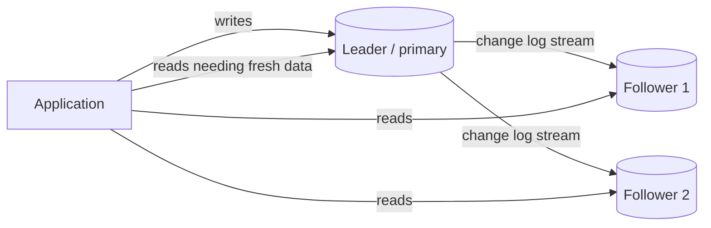
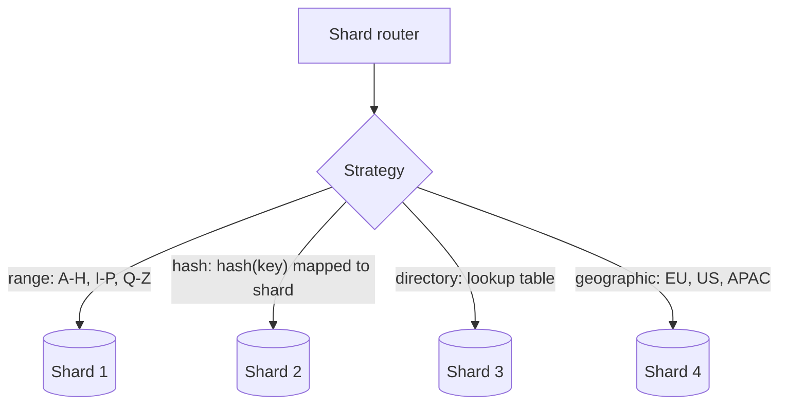
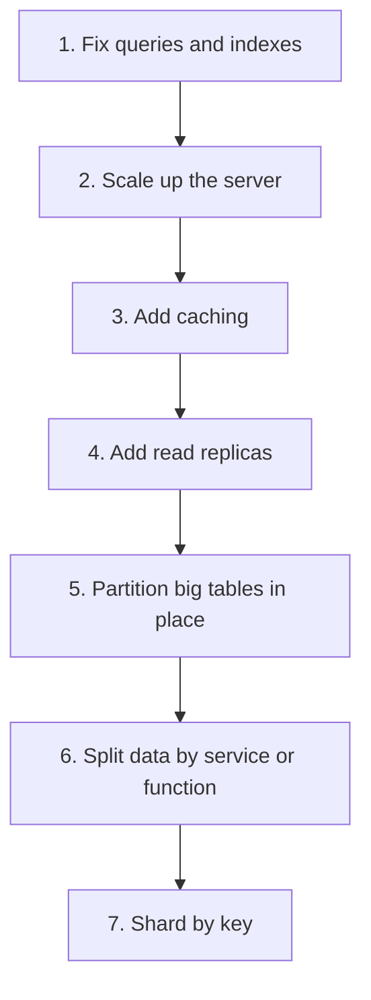

# Replication and Sharding

## Introduction

A single database server eventually runs out of something: CPU, memory, disk, network bandwidth, or tolerance for downtime. There are two basic ways to spread a database across more machines, and they solve different problems:

- **Replication** keeps **copies of the same data** on several servers. It helps with availability (a copy can take over if one fails) and read throughput (reads can go to copies).
- **Sharding** (horizontal partitioning) **splits the data** so each server holds only part of it. It helps with write throughput and total data size.

A library analogy: replication is buying three copies of a popular textbook so three students can read it at once, and the library still has one if a copy is lost. Sharding is splitting the collection across three branch libraries by subject. Each branch is smaller and busy with its own visitors, but a student who needs books on both history and chemistry has to visit two branches.

Most large systems use both: each shard is itself replicated. This page explains how each works, what breaks, and why the honest first answer to "should we shard?" is usually "not yet".

## Replication

### Leader-follower (primary-replica)

The most common setup. One **leader** (primary) accepts writes and streams its change log to **followers** (replicas), which apply the same changes. Reads may go to any replica.



PostgreSQL streaming replication (shipping WAL records), MySQL binlog replication, and MongoDB replica sets all follow this model. Managed services such as Amazon RDS, Cloud SQL and Azure Database offer it as "read replicas" and "high availability" options.

### Synchronous vs asynchronous

| Mode | The leader confirms a write when... | Pros | Cons |
| --- | --- | --- | --- |
| Asynchronous | It is durable on the leader | Fast writes; a slow replica does not block | A failover can lose the last few writes; replicas lag |
| Synchronous | At least one replica also has it | No data loss on failover to that replica | Higher write latency; writes stall if the sync replica is down |
| Semi-synchronous / quorum | Some number of replicas acknowledge | A tunable middle ground | More configuration and failure modes |

Most deployments use asynchronous replicas for reads and, where data loss is unacceptable, one synchronous standby for failover.

### Other topologies

- **Multi-leader:** several nodes accept writes (for example one per region) and replicate to each other. Useful for multi-region writes and offline-capable clients, but you must resolve **write conflicts** (last-writer-wins, merge rules, or CRDTs). Avoid it unless you truly need writes in several places.
- **Leaderless:** clients write to several replicas and read from several, using quorums. Amazon's Dynamo paper popularized this; Cassandra and ScyllaDB use it. With `N` replicas, writing to `W` and reading from `R` such that `W + R > N` means read and write sets overlap, so a read normally sees the latest acknowledged write.

### The catch: replication lag

With asynchronous replicas, a follower may be milliseconds or, under load, seconds behind. That creates visible anomalies. The classic one: a user updates their profile, the page reloads from a replica, and the old value appears. "Did my save fail?"

Martin Kleppmann's *Designing Data-Intensive Applications* names the guarantees you may need:

- **Read-your-writes:** a user always sees their own changes.
- **Monotonic reads:** a user never sees data go "back in time" between two reads.
- **Consistent prefix reads:** a reader sees changes in the order they happened.

The simulation below shows the problem and a common fix: route a user's reads to the leader for a short window after they write.

```python
# replication_lag.py
import time
from dataclasses import dataclass, field

@dataclass
class Replica:
    lag_s: float
    data: dict[str, str] = field(default_factory=dict)
    pending: list[tuple[float, str, str]] = field(default_factory=list)

    def receive(self, key: str, value: str) -> None:
        self.pending.append((time.monotonic() + self.lag_s, key, value))

    def read(self, key: str) -> str | None:
        now = time.monotonic()
        while self.pending and self.pending[0][0] <= now:
            _, k, v = self.pending.pop(0)
            self.data[k] = v
        return self.data.get(key)

class Cluster:
    def __init__(self) -> None:
        self.leader: dict[str, str] = {}
        self.replica = Replica(lag_s=0.5)
        self.last_write: dict[str, float] = {}   # user -> time of last write

    def write(self, user: str, key: str, value: str) -> None:
        self.leader[key] = value
        self.replica.receive(key, value)          # async: arrives later
        self.last_write[user] = time.monotonic()

    def read_naive(self, key: str) -> str | None:
        return self.replica.read(key)

    def read_your_writes(self, user: str, key: str, window_s: float = 1.0) -> str | None:
        recently_wrote = time.monotonic() - self.last_write.get(user, 0) < window_s
        return self.leader.get(key) if recently_wrote else self.replica.read(key)

c = Cluster()
c.leader["bio:ada"] = "old bio"; c.replica.data["bio:ada"] = "old bio"
c.write("ada", "bio:ada", "new bio")

print("naive read:      ", c.read_naive("bio:ada"))
print("read-your-writes:", c.read_your_writes("ada", "bio:ada"))
time.sleep(0.6)
print("naive after lag: ", c.read_naive("bio:ada"))
```

Output:

```text
naive read:       old bio
read-your-writes: new bio
naive after lag:  new bio
```

Other real-world fixes include tracking the leader's log position at write time (PostgreSQL LSN, MySQL GTID) and only reading from a replica that has caught up to it, or pinning a session to the leader. See [Consistency Models](../9-arch-distributed-systems/2-arch-consistency-models.mdx) for the theory.

### Failover

When the leader dies, a replica must be **promoted**. This is where most replication incidents happen:

- With async replication, writes not yet replicated are lost.
- If the old leader comes back still thinking it is the leader, you get **split brain**: two leaders accepting writes. Tools such as Patroni (PostgreSQL) or managed services use consensus or fencing to prevent this.
- Clients must find the new leader, usually through a DNS name, proxy, or service discovery. See [Service Discovery and Load Balancing](../9-arch-distributed-systems/10-arch-service-discovery.mdx).

Test failover regularly. A failover path that has never been exercised usually fails when you need it.

## Sharding

Replication gives you more copies, but **every replica still stores all the data and every write still goes through one leader.** When writes or total size outgrow one machine, you split the data.

### Partitioning first

Before sharding across servers, consider **partitioning within one server**. PostgreSQL declarative partitioning, for example, splits a big `events` table into monthly partitions. Queries for one month scan one partition, and dropping old data becomes `DROP TABLE` on a partition instead of a slow `DELETE`. You get many benefits of sharding without any distributed queries. Azure's [Sharding pattern](https://learn.microsoft.com/en-us/azure/architecture/patterns/sharding) guidance lists this as a reason sharding may be unnecessary.

### Sharding strategies



| Strategy | How rows are placed | Pros | Cons |
| --- | --- | --- | --- |
| Range | By key ranges (dates, alphabetical) | Efficient range scans; easy to understand | Hotspots when new data clusters on one range |
| Hash | By hash of the key | Even spread; no lookup table | Range queries hit every shard; resharding moves data |
| Directory (lookup) | A mapping table says where each key lives | Full control; move one tenant at a time | Lookup service is critical and must be cached |
| Geographic | By user region | Data residency, low latency | Uneven load between regions |

### Choosing a shard key

The shard key is the hardest decision to change later; Azure's guidance calls it the most critical design choice. A good shard key:

- **Has high cardinality**, so data can spread over many shards.
- **Distributes load evenly**, not just data. A celebrity user can make one shard hot.
- **Matches the dominant query**, so most requests touch one shard. For a SaaS app, `tenant_id` is a classic choice because almost every query is scoped to one tenant.
- **Is immutable**, so rows do not have to move between shards.
- **Is not monotonically increasing** when using range sharding, or all new writes land on the last shard.

### Why `hash(key) % N` hurts, and consistent hashing

A naive hash strategy picks `shard = hash(key) % N`. It distributes evenly, but when you go from 4 to 5 shards almost every key moves. **Consistent hashing** places shards and keys on a ring, so adding a shard moves only the keys between it and its neighbor. Using many **virtual nodes** per physical shard smooths the distribution. This demo counts how many keys move in each case.

```python
# consistent_hashing.py
import hashlib
from bisect import bisect

def h(s: str) -> int:
    return int.from_bytes(hashlib.md5(s.encode()).digest()[:8], "big")

def modulo_shard(key: str, n: int) -> int:
    return h(key) % n

class HashRing:
    def __init__(self, shards: list[str], vnodes: int = 100) -> None:
        self._ring = sorted((h(f"{s}#{i}"), s) for s in shards for i in range(vnodes))
        self._points = [p for p, _ in self._ring]

    def shard_for(self, key: str) -> str:
        idx = bisect(self._points, h(key)) % len(self._ring)
        return self._ring[idx][1]

keys = [f"customer:{i}" for i in range(100_000)]

before = {k: modulo_shard(k, 4) for k in keys}
after = {k: modulo_shard(k, 5) for k in keys}
moved = sum(before[k] != after[k] for k in keys)
print(f"modulo 4 -> 5 shards: {moved / len(keys):.0%} of keys moved")

ring4 = HashRing(["s1", "s2", "s3", "s4"])
ring5 = HashRing(["s1", "s2", "s3", "s4", "s5"])
moved = sum(ring4.shard_for(k) != ring5.shard_for(k) for k in keys)
print(f"consistent hashing 4 -> 5 shards: {moved / len(keys):.0%} of keys moved")

counts: dict[str, int] = {}
for k in keys:
    s = ring5.shard_for(k)
    counts[s] = counts.get(s, 0) + 1
print("distribution:", dict(sorted(counts.items())))
```

Example output (exact numbers depend on hashing):

```text
modulo 4 -> 5 shards: 80% of keys moved
consistent hashing 4 -> 5 shards: 17% of keys moved
distribution: {'s1': 21021, 's2': 19066, 's3': 21713, 's4': 21189, 's5': 17011}
```

With five shards, a fair share for the new one is 20% of the keys, so consistent hashing moves close to the minimum possible. The new shard got a bit less than its share here; more virtual nodes even this out. Dynamo-style databases such as Cassandra, and many distributed caches, use variants of this idea. Another common approach is a **fixed number of logical shards** (say 1,024) mapped to fewer physical servers through a directory, so rebalancing moves whole logical shards without rehashing keys.

### Directory routing in code

A directory (lookup) strategy combines well with logical shards. The application hashes the key to one of a fixed number of logical shards, and a small, cacheable map says which physical server holds each logical shard. Moving load means editing the map and copying one logical shard, not rehashing everything.

```python
# shard_directory.py
import hashlib

LOGICAL_SHARDS = 16

def logical_shard(tenant_id: str) -> int:
    digest = hashlib.sha256(tenant_id.encode()).digest()
    return int.from_bytes(digest[:4], "big") % LOGICAL_SHARDS

# The directory: logical shard -> physical database. Stored in a small, replicated
# config database and cached by every app instance.
directory = {ls: f"db-{ls % 2}" for ls in range(LOGICAL_SHARDS)}
# A large tenant gets pinned to its own server, overriding the hash.
pinned = {"megacorp": "db-dedicated-1"}

def route(tenant_id: str) -> str:
    return pinned.get(tenant_id) or directory[logical_shard(tenant_id)]

for t in ["acme", "globex", "initech", "megacorp"]:
    print(f"{t:9} -> logical {logical_shard(t):2} -> {route(t)}")

# Rebalance: move logical shard of 'acme' to a new server by editing the map
directory[logical_shard("acme")] = "db-2"
print("after move: acme ->", route("acme"))
```

Example output (the logical shard numbers depend on the hash):

```text
acme      -> logical 13 -> db-1
globex    -> logical 13 -> db-1
initech   -> logical  2 -> db-0
megacorp  -> logical  8 -> db-dedicated-1
after move: acme -> db-2
```

Notice that `acme` and `globex` share logical shard 13, so moving it moves both tenants. That is the unit of rebalancing: a logical shard, not a single key. Use enough logical shards (hundreds or thousands in production) that each one is small to move.

### IDs that work across shards

Auto-increment IDs are generated per database, so two shards will both create order `1001`. Common fixes:

- **UUIDs.** Random UUIDv4 values are unique but scatter inserts across a B-tree index. **UUIDv7** (RFC 9562) starts with a timestamp, so new IDs are roughly ordered and index-friendly. PostgreSQL 18 added a built-in `uuidv7()` function, and Python 3.14 added `uuid.uuid7()`.
- **Snowflake-style IDs:** 64-bit integers built from a timestamp, a worker or shard number, and a sequence.
- **Include the shard key in the primary key,** for example `(tenant_id, ticket_id)`, so uniqueness only needs to hold within a tenant.

```python
# ids.py  (requires Python 3.14+ for uuid.uuid7)
import uuid

ids = [uuid.uuid7() for _ in range(3)]
for i in ids:
    print(i)
print("sorted by creation time:", ids == sorted(ids))
```

Example output (values differ every run):

```text
01a12a95-b232-75cd-b59a-43f463534d40
01a12a95-b232-75cd-b59a-43f5e9f2cf52
01a12a95-b232-75cd-b59a-43f6e9957113
sorted by creation time: True
```

### What sharding costs you

- **Cross-shard queries** must fan out to every shard and merge results, and the slowest shard sets the latency.
- **Cross-shard transactions** need distributed coordination or a saga. Most sharded systems avoid them.
- **Unique constraints and IDs** across shards need a global scheme (UUIDv7, Snowflake-style IDs, or ranges per shard). Auto-increment per shard produces duplicates.
- **Operations multiply:** backups, migrations, monitoring and upgrades happen per shard. A schema migration must roll out to every shard. See [Schema Evolution and Data Migrations](./7-arch-data-migrations.mdx).
- **Rebalancing** live data without downtime is a project in itself.

### Who does the routing?

| Option | Examples | Notes |
| --- | --- | --- |
| Database does it natively | MongoDB sharded clusters, Cassandra, DynamoDB, Cosmos DB, CockroachDB, YugabyteDB, Spanner | You still choose the shard or partition key |
| Middleware or extension | Citus (PostgreSQL extension), Vitess (MySQL) | Keeps a familiar SQL database underneath |
| Application-level | A router in your data access layer | Full control, but you build and run all of it |

Product capabilities in this space change frequently. Check current docs before deciding.

## The Scaling Ladder

Sharding is near the top of a ladder. Climb it one rung at a time and measure at each step.



Step 6, splitting by service, is itself a form of partitioning (sometimes called functional partitioning). See [Database per Service vs Shared Database](./0-arch-database-per-service.mdx).

## Real-World Scenario

You run a multi-tenant SaaS helpdesk. About 3,000 customer companies use it; most are small, but the largest 20 generate half of all tickets. A single PostgreSQL primary with two read replicas handles today's load, but write volume has doubled in a year, and the `ticket_events` table is 4 TB.

**Plan:**

1. **Now:** partition `ticket_events` by month, move dashboards and exports to replicas, and use read-your-writes routing for agents who just updated a ticket.
2. **When writes approach the primary's limit:** shard by `tenant_id`, because almost every query is already scoped to one tenant. Use a **directory** so you can place each large tenant on its own shard and pack small tenants together.
3. **Keep global data unsharded:** billing plans, feature flags and user accounts stay in a small central database or are replicated to every shard as reference data.
4. **Cross-tenant analytics** go to a warehouse fed by CDC, never as fan-out queries on production shards. See [Search and Analytics Architecture](./6-arch-search-and-analytics.mdx).

**Why this approach:** `tenant_id` matches the dominant access pattern, so nearly all queries stay on one shard. A directory handles the uneven tenant sizes better than a pure hash. Doing the cheaper rungs first buys time and might make sharding unnecessary for years.

**When not to shard:** if data fits on one server with room to grow, if reads (not writes) are the bottleneck, or if your main queries join across the key you would shard on. The [Case Study: Multi-Tenant SaaS](../14-arch-case-studies/6-arch-case-saas-multitenancy.mdx) explores tenant isolation further.

| Approach | Pros | Cons | Best for |
| --- | --- | --- | --- |
| Vertical scaling | No code change, keeps transactions and joins | Hardware ceiling, cost grows fast near the top | Most systems for a long time |
| Read replicas | Simple read scaling and failover | Lag; writes still limited by one leader | Read-heavy workloads |
| In-database partitioning | Faster scans and retention on big tables | Still one server | Time-series and log-style tables |
| Sharding by tenant | Isolation, near-linear scale for tenant-scoped work | Cross-tenant queries and ops overhead | B2B SaaS |
| Distributed SQL database | Sharding and replication managed for you | Different performance profile, cost, vendor lock-in | Global apps needing SQL and scale |

## Common Mistakes

- **Sharding too early.** The complexity is permanent. Measure first and climb the ladder.
- **Picking a shard key that does not match queries,** so most requests fan out to every shard.
- **Monotonic keys with range sharding,** which sends every new write to the same shard.
- **Reading from replicas without thinking about lag,** causing "my change disappeared" bugs.
- **Never testing failover,** or not knowing how much data asynchronous replication could lose.
- **Assuming replicas are backups.** A bad `DELETE` replicates instantly. You still need point-in-time backups.

## Summary

- **Replication** copies data for availability and read scaling; **sharding** splits data for write and size scaling. Large systems combine them.
- Asynchronous replication causes **lag**; design for read-your-writes and monotonic reads where users would notice.
- Sharding strategies are range, hash, directory and geographic. The **shard key** is the critical, hard-to-change decision.
- **Consistent hashing** or many logical shards keep rebalancing cheap compared with `hash % N`.
- Sharding costs cross-shard queries, transactions, global IDs and operational overhead. Use cheaper techniques first.

## Exercises

1. Extend `replication_lag.py` with a second user who did not write. Show that they see the old value while the writer sees the new one. Is that acceptable for a profile page? For a bank balance?
2. Change `vnodes` in `HashRing` to 1 and to 500. How does the distribution change, and why?
3. Design a shard key for a ride-sharing app's trips table. Which queries would become cross-shard? Compare with the [Capstone](../14-arch-case-studies/8-arch-capstone.mdx).
4. Write down the failover steps for a leader-follower database you use. Where could data be lost?

**Related pages:** [CAP and PACELC](../9-arch-distributed-systems/1-arch-cap-and-pacelc.mdx), [Designing for Scalability](../12-arch-quality-and-operations/0-arch-scalability.mdx), [Caching Strategies](./2-arch-caching-strategies.mdx), and this site's [MongoDB tutorial](/docs/database/mongodb), which covers replica sets and sharded clusters hands-on.
