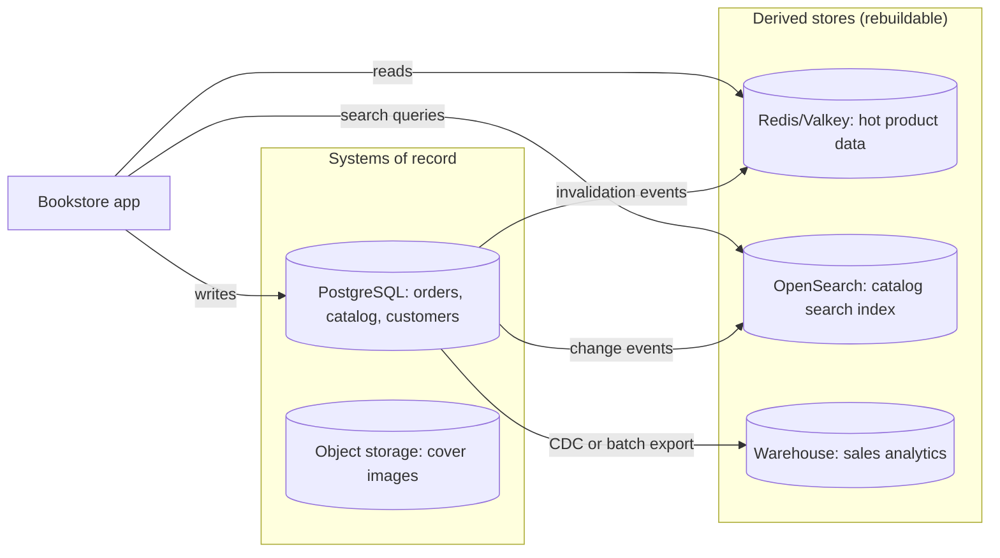
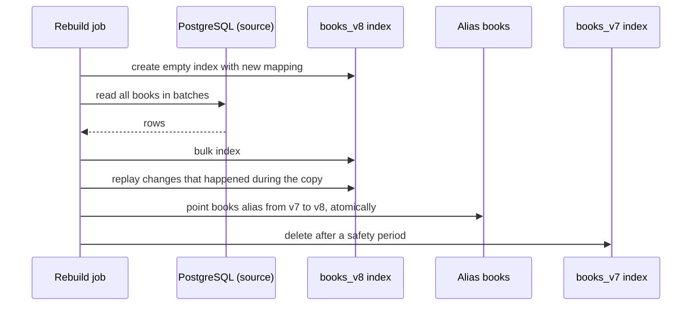

# Polyglot Persistence

## Introduction

**Polyglot persistence** means using different data storage technologies for different kinds of data within one system, chosen by how each kind of data is used. Martin Fowler popularized the term in his 2011 [PolyglotPersistence](https://martinfowler.com/bliki/PolyglotPersistence.html) note, crediting Scott Leberknight with coining it and building on Neal Ford's earlier idea of polyglot programming.

A kitchen is a good analogy. You keep milk in the fridge, flour in the pantry, ice cream in the freezer and knives in a block. Nobody would store everything in the freezer just to have "one storage system". But each new appliance costs space, power and attention, and a kitchen with nine fridges is harder to run than one with a well-organized fridge and pantry.

In software, a typical modern system might use:

- a **relational database** for orders and payments,
- a **cache** such as Redis or Valkey for sessions and hot reads,
- a **search engine** such as OpenSearch or Elasticsearch for full-text search,
- **object storage** such as Amazon S3 for images and files,
- a **data warehouse** for analytics.

This page is about doing that **safely**: deciding which store is the source of truth, keeping the others in sync without losing data, and recognizing when one database would serve you better.

## The Core Idea: System of Record vs Derived Data

The most important rule in a polyglot system is that **every piece of data has exactly one system of record** (the source of truth). Other stores hold **derived data**: copies, indexes, aggregates or caches that can be rebuilt from the source.

Martin Kleppmann's *Designing Data-Intensive Applications* builds much of its later chapters on this distinction. It turns a confusing web of databases into a clear data flow.



Once you draw this picture, several decisions become easy:

- **Writes go to the system of record.** The app never writes to the search index directly as the "real" write.
- **Derived stores are updated from the source**, by events or change data capture.
- **If a derived store is lost or corrupted, rebuild it** by replaying from the source. You do not need to back it up the same way.

## The Problem: Dual Writes

The most common polyglot bug is the **dual write**: the application writes to two stores one after the other and assumes both succeed.

```python
# dual_write_before.py
import sqlite3

db = sqlite3.connect(":memory:")
db.execute("CREATE TABLE books (id INTEGER PRIMARY KEY, title TEXT, price_cents INTEGER)")
search_index: dict[int, dict] = {}        # stand-in for OpenSearch

class SearchDown(Exception):
    pass

def index_book(book: dict, fail: bool = False) -> None:
    if fail:
        raise SearchDown("search cluster timed out")
    search_index[book["id"]] = book

def add_book(book_id: int, title: str, price_cents: int, search_fails: bool = False) -> None:
    db.execute("INSERT INTO books VALUES (?, ?, ?)", (book_id, title, price_cents))
    db.commit()                                       # write 1 succeeded
    index_book({"id": book_id, "title": title}, fail=search_fails)  # write 2 may fail

add_book(1, "Refactoring", 4500)
try:
    add_book(2, "Release It!", 3900, search_fails=True)
except SearchDown as exc:
    print("error:", exc)

print("in database:", [r[0] for r in db.execute("SELECT id FROM books")])
print("in search:  ", sorted(search_index))
```

Output:

```text
error: search cluster timed out
in database: [1, 2]
in search:   [1]
```

Book 2 exists but can never be found by search. Swapping the order does not help; then you can have search results for books that do not exist. Retrying helps sometimes, but if the process crashes between the two writes, the retry never happens. And with concurrent updates, two dual writes can arrive at the two stores in different orders, leaving them permanently disagreeing.

There is no transaction that spans PostgreSQL and a search cluster. You need a different design.

## The Pattern Applied: One Write, Then Propagate

The fix is to make **one atomic write to the system of record** and derive everything else from it. Two standard ways:

1. **Transactional outbox:** in the same database transaction, write the business row and an "event" row in an `outbox` table. A relay process reads the outbox and updates other stores, retrying until it succeeds. See [Transactional Outbox](../9-arch-distributed-systems/6-arch-outbox.mdx).
2. **Change data capture (CDC):** a connector reads the database's own change log and publishes every change. See [Change Data Capture](./5-arch-change-data-capture.mdx).

Here is the outbox version of the same example:

```python
# outbox_after.py
import json
import sqlite3

db = sqlite3.connect(":memory:")
db.executescript("""
CREATE TABLE books (id INTEGER PRIMARY KEY, title TEXT, price_cents INTEGER);
CREATE TABLE outbox (seq INTEGER PRIMARY KEY AUTOINCREMENT, topic TEXT, payload TEXT,
                     published INTEGER NOT NULL DEFAULT 0);
""")
search_index: dict[int, dict] = {}
search_is_up = False

def add_book(book_id: int, title: str, price_cents: int) -> None:
    with db:  # one transaction: both rows commit, or neither does
        db.execute("INSERT INTO books VALUES (?, ?, ?)", (book_id, title, price_cents))
        db.execute("INSERT INTO outbox (topic, payload) VALUES (?, ?)",
                   ("book.upserted", json.dumps({"id": book_id, "title": title})))

def relay_once() -> int:
    """Push unpublished events to the search index. Safe to run repeatedly."""
    sent = 0
    rows = db.execute("SELECT seq, payload FROM outbox WHERE published = 0 ORDER BY seq").fetchall()
    for seq, payload in rows:
        if not search_is_up:
            break                                   # try again on the next run
        doc = json.loads(payload)
        search_index[doc["id"]] = doc               # idempotent upsert by id
        with db:
            db.execute("UPDATE outbox SET published = 1 WHERE seq = ?", (seq,))
        sent += 1
    return sent

add_book(1, "Refactoring", 4500)
add_book(2, "Release It!", 3900)
print("relay while search is down:", relay_once(), "sent;", "search has", sorted(search_index))

search_is_up = True
print("relay after recovery:     ", relay_once(), "sent;", "search has", sorted(search_index))
```

Output:

```text
relay while search is down: 0 sent; search has []
relay after recovery:      2 sent; search has [1, 2]
```

The search index is **eventually consistent**: it may lag for a while, but it will catch up, and it never contains books that do not exist. Two details make this safe:

- The relay may send an event twice (for example, if it crashes after indexing but before marking it published). The search write is an **idempotent upsert by ID**, so duplicates are harmless. See [Idempotency](../9-arch-distributed-systems/7-arch-idempotency.mdx).
- Events are processed **in order** per book, so an older update cannot overwrite a newer one.

## Keeping Code Clean: One Port per Store

When code talks to five stores, store-specific code can leak everywhere. A simple discipline from [Hexagonal Architecture](../7-arch-clean-architecture/0-arch-hexagonal.mdx) helps: the domain defines small interfaces (ports) for what it needs, and each store gets an adapter.

```python
# ports.py
from typing import Protocol

class BookRepository(Protocol):          # system of record, e.g. PostgreSQL
    def get(self, book_id: int) -> dict | None: ...
    def save(self, book: dict) -> None: ...

class BookSearch(Protocol):              # derived store, e.g. OpenSearch
    def search(self, text: str, limit: int = 10) -> list[int]: ...

class InMemoryBooks:
    def __init__(self) -> None:
        self._rows: dict[int, dict] = {}
    def get(self, book_id: int) -> dict | None:
        return self._rows.get(book_id)
    def save(self, book: dict) -> None:
        self._rows[book["id"]] = book

class NaiveSearch:
    def __init__(self, books: InMemoryBooks) -> None:
        self._books = books
    def search(self, text: str, limit: int = 10) -> list[int]:
        return [b["id"] for b in self._books._rows.values()
                if text.lower() in b["title"].lower()][:limit]

def search_page(text: str, search: BookSearch, books: BookRepository) -> list[str]:
    # Search returns IDs; details come from the system of record (or its cache).
    return [books.get(i)["title"] for i in search.search(text) if books.get(i)]

repo = InMemoryBooks()
repo.save({"id": 1, "title": "Refactoring"})
repo.save({"id": 2, "title": "Refactoring to Patterns"})
print(search_page("refactoring", NaiveSearch(repo), repo))
```

Output:

```text
['Refactoring', 'Refactoring to Patterns']
```

Note the design choice in `search_page`: the search engine returns **IDs**, and authoritative details come from the system of record. That way a slightly stale index can affect *which* results appear, but never shows a wrong price.

## Rebuilding a Derived Store

"Derived" is only true if you can actually rebuild the store. Practise it. A common technique for search indexes is the **blue/green rebuild with an alias**: build a brand-new index from the system of record while the old one keeps serving, then switch an alias in one step. OpenSearch and Elasticsearch both support index aliases for this.



The same idea in plain Python:

```python
# rebuild_index.py
source = {1: "Refactoring", 2: "Release It!", 3: "Domain-Driven Design"}
indexes: dict[str, dict[int, str]] = {"books_v7": {1: "Refactoring"}}   # stale: missing 2 and 3
alias = {"books": "books_v7"}

def rebuild(new_name: str, batch_size: int = 2) -> None:
    indexes[new_name] = {}
    ids = sorted(source)
    for start in range(0, len(ids), batch_size):          # batch to limit load on the source
        for book_id in ids[start:start + batch_size]:
            indexes[new_name][book_id] = source[book_id].lower()
    alias["books"] = new_name                             # switch readers in one step

def search(text: str) -> list[int]:
    return [i for i, t in indexes[alias["books"]].items() if text in t]

print("before:", search("release"))
rebuild("books_v8")
print("after: ", search("release"), "served by", alias["books"])
```

Output:

```text
before: []
after:  [2] served by books_v8
```

In production, the tricky part is changes that arrive **during** the rebuild. Record the change-stream position (or outbox sequence) before you start copying, then replay changes from that point into the new index before switching the alias. Because updates are idempotent upserts, replaying a few changes twice is harmless.

## What Users Experience

Derived stores lag behind the source. Plan for the visible effects:

- **"I just added it and search can't find it."** After a user creates something, show it from the system of record (for example, redirect to its detail page) instead of a search results page.
- **Counts that disagree.** A dashboard fed from the warehouse may show yesterday's numbers while the order page shows today's. Label data freshness ("updated 10 minutes ago").
- **Deleted items that linger.** Filter search results against the source, as `search_page` does, for anything where showing deleted data matters.

Measure the lag of each pipeline (for example, the age of the oldest unpublished outbox row) and alert when it grows. That number is the "eventual" in eventual consistency.

## The Counter-Argument: Maybe One Database Is Enough

Fowler's original note was careful: he expected most projects to still be best served by relational databases, and recommended considering alternatives mainly for strategic projects with real data needs. Every extra store adds:

- a new technology to learn, secure, monitor, upgrade and back up,
- new failure modes and a new sync pipeline,
- eventual consistency that users may notice,
- on-call knowledge spread across more systems.

Modern relational databases cover a surprising range of needs. PostgreSQL, for example, offers:

| Need | Built-in or extension option in PostgreSQL | When a dedicated store wins |
| --- | --- | --- |
| Flexible documents | `jsonb` with GIN indexes | Very high write scale of documents with native sharding |
| Full-text search | `tsvector`, `tsquery`, GIN indexes | Relevance tuning, fuzzy search, facets, many languages at scale |
| Vector similarity | `pgvector` extension | Very large vector collections needing specialized indexing |
| Job queues | `SELECT ... FOR UPDATE SKIP LOCKED` | Very high throughput or many consumers and replay, use a broker |
| Pub/sub notifications | `LISTEN` / `NOTIFY` | Durable messaging; NOTIFY is not persisted |
| Time-series | Declarative partitioning, TimescaleDB extension | Extreme ingest rates and long retention |
| Caching | Materialized views, buffer cache | Sub-millisecond reads at high QPS |

The "just use Postgres" approach is a legitimate, popular strategy for small and mid-sized teams. The polyglot approach is legitimate when you have **measured** a need that the main database serves badly. Both are trade-offs, not ideologies.

## A Checklist Before Adding a Store

Ask these before adding a new data technology:

1. **What specific query or workload does the current database fail at?** Do you have numbers?
2. **Is the new store a system of record or derived?** If derived, how is it fed and how is it rebuilt?
3. **What consistency will users see,** and is the lag acceptable?
4. **Who operates it?** Is there a managed option, and does the team have on-call skills?
5. **How do you back it up, secure it, and handle personal data** (deletion requests must reach every copy)?
6. **What is the exit plan** if it does not work out?

Record the answers in an [Architecture Decision Record](../13-arch-documenting-and-evolving/0-arch-decision-records.mdx).

## Real-World Scenario

The bookstore's product team asks for three features: typo-tolerant search with filters by format, price and rating; "readers also bought" recommendations; and a sales dashboard for the finance team. Today everything runs on PostgreSQL.

**Solution:**

- **Search:** add OpenSearch (or Elasticsearch) as a **derived** store. The catalog stays in PostgreSQL. Changes flow through CDC into the index. The index can be rebuilt from PostgreSQL at any time.
- **Recommendations:** start inside PostgreSQL with a nightly job that computes "bought together" pairs into a table. Revisit a graph database only if the queries become deep, multi-hop and interactive.
- **Sales dashboard:** do not run it on the primary. Feed a warehouse with CDC or a nightly export. See [Search and Analytics Architecture](./6-arch-search-and-analytics.mdx).
- **Sessions and hot product data:** Redis or Valkey with cache-aside, as in [Caching Strategies](./2-arch-caching-strategies.mdx).

**Why this approach:** only search gets a new store, because full-text relevance, typo tolerance and facets are what search engines do far better than a relational database. The other needs are met with the existing database or are clearly derived. Each new store has one feed and can be rebuilt.

**When to use polyglot persistence:** distinct workloads with measured needs, a team that can operate the extra stores (or managed services), and clear source-of-truth rules.

**When not to:** small teams, early products, or when the motivation is novelty. Several databases owned by one team is a common source of operational toil.

| Approach | Pros | Cons | Best for |
| --- | --- | --- | --- |
| One relational database for everything | Simple ops, strong consistency, one skill set | Some workloads are slow or awkward | Small and mid-sized systems, early products |
| Relational plus a few derived stores | Each workload served well; source of truth is clear | Sync pipelines, eventual consistency | Most growing products |
| Many stores, each a system of record per service | Teams choose freely; matches database per service | Hardest to operate and to query across | Large organizations with platform teams |
| Multi-model database | One product with several models | Each model may be weaker than a specialist | Teams wanting fewer vendors |

## Common Mistakes

- **Dual writes** from application code to two stores. Use an outbox or CDC.
- **Unclear source of truth.** If two stores can both be "right", they will eventually disagree, and nobody knows which to trust.
- **Treating derived stores as primary,** for example reading prices from the search index at checkout.
- **Forgetting personal data in derived stores.** A deletion request must remove data from the cache, index and warehouse too.
- **No rebuild procedure.** If you cannot rebuild the search index from scratch, it is not really derived.
- **Adding a store per feature.** Each new technology is a long-term commitment for the whole team.

## Summary

- Polyglot persistence uses different stores for different data and workloads, chosen by access pattern.
- Give every piece of data **one system of record**; everything else is **derived** and rebuildable.
- Avoid **dual writes**. Write once to the source, then propagate with an **outbox** or **CDC**, using idempotent, ordered updates.
- Keep store-specific code behind **ports and adapters**.
- A single capable database is often enough. Add a store when you have measured a need it serves badly and can operate it.

## Exercises

1. In `outbox_after.py`, simulate a crash after indexing but before marking the event published. Show that rerunning the relay leaves the index correct.
2. Add a `book.deleted` event and handle it in the relay. What happens if the delete is processed before the create?
3. Draw a system-of-record diagram for an application you know. Which stores are derived? Could each be rebuilt from scratch?
4. Pick one workload you would move out of your main database. Answer the six checklist questions for it.

**Related pages:** [Choosing SQL vs NoSQL](./1-arch-sql-vs-nosql.mdx), [Database per Service vs Shared Database](./0-arch-database-per-service.mdx), [CQRS](../9-arch-distributed-systems/3-arch-cqrs.mdx), [Event-Driven Architecture](../6-arch-architectural-styles/5-arch-event-driven.mdx).
