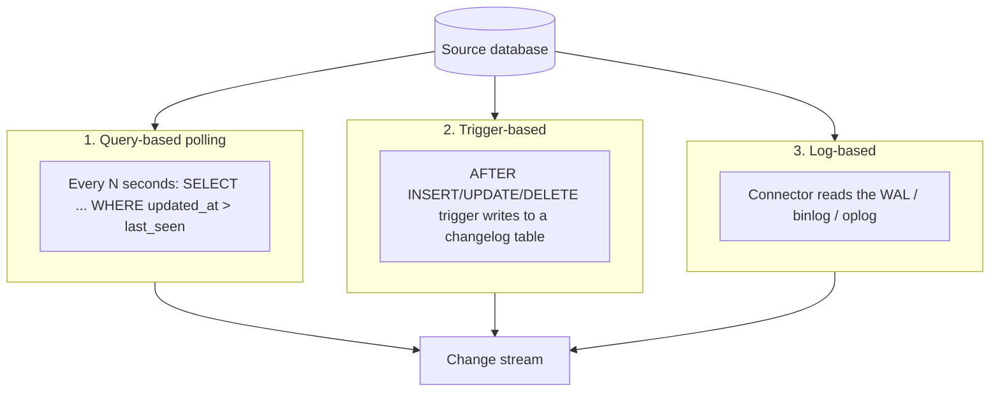
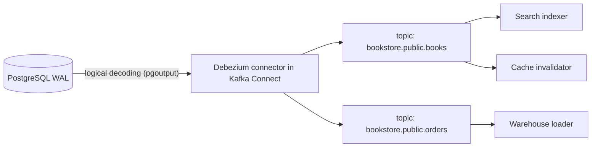

# Change Data Capture

## Introduction

**Change data capture (CDC)** is the practice of detecting every insert, update and delete in a database and publishing those changes as a stream that other systems can consume.

Why would you want that? Because in most architectures the database is the **system of record**, but many other things need to know when it changes: the search index, the cache, the data warehouse, other microservices, audit logs. Without CDC, each of those either polls the database, or the application tries to notify them all itself, which leads to the dual-write bugs described in [Polyglot Persistence](./4-arch-polyglot-persistence.mdx).

An analogy: imagine a shared spreadsheet that many teams depend on. You could ask every team to check it every hour (polling), or ask everyone who edits it to email all the other teams (dual writes, which people forget). CDC is like turning on the spreadsheet's built-in **revision history** and streaming each revision to anyone who subscribes. Nobody has to remember to notify anyone, and nothing is missed.

Databases already keep such a history for their own purposes: PostgreSQL's write-ahead log (WAL), MySQL's binary log, MongoDB's oplog, SQL Server's transaction log. **Log-based CDC** reads that history.

## Three Ways to Capture Changes



### 1. Query-based polling

The simplest approach needs only an `updated_at` column.

```python
# cdc_polling.py
import sqlite3

db = sqlite3.connect(":memory:")
db.executescript("""
CREATE TABLE books (id INTEGER PRIMARY KEY, title TEXT, price_cents INTEGER,
                    updated_at INTEGER NOT NULL);
INSERT INTO books VALUES (1, 'Refactoring', 4500, 100), (2, 'Release It!', 3900, 101);
""")

last_seen = 0
def poll() -> list[tuple]:
    global last_seen
    rows = db.execute(
        "SELECT id, title, price_cents, updated_at FROM books WHERE updated_at > ? ORDER BY updated_at",
        (last_seen,),
    ).fetchall()
    if rows:
        last_seen = rows[-1][3]
    return rows

print("poll 1:", poll())

db.execute("UPDATE books SET price_cents = 4200, updated_at = 102 WHERE id = 1")
db.execute("UPDATE books SET price_cents = 4000, updated_at = 103 WHERE id = 1")  # two changes
db.execute("DELETE FROM books WHERE id = 2")                                      # a delete
print("poll 2:", poll())
```

Output:

```text
poll 1: [(1, 'Refactoring', 4500, 100), (2, 'Release It!', 3900, 101)]
poll 2: [(1, 'Refactoring', 4000, 103)]
```

Polling is easy and works with any database, but look at what poll 2 missed:

- **The delete of book 2 is invisible.** You need soft deletes (`deleted_at`) to see it.
- **The intermediate price 4200 is lost.** Only the latest state is seen.
- **Every table needs a reliable `updated_at`,** and clock skew or long transactions that commit with an older timestamp can make rows slip past `last_seen`.
- Polling adds load and latency (you see changes only every N seconds).

It is still a fine choice for nightly exports or small tables where these limits do not matter.

### 2. Trigger-based capture

Database triggers can write every change into a changelog table in the same transaction. This catches deletes and every intermediate change.

```python
# cdc_triggers.py
import sqlite3

db = sqlite3.connect(":memory:")
db.executescript("""
CREATE TABLE books (id INTEGER PRIMARY KEY, title TEXT, price_cents INTEGER);
CREATE TABLE changelog (seq INTEGER PRIMARY KEY AUTOINCREMENT, op TEXT, book_id INTEGER,
                        title TEXT, price_cents INTEGER);

CREATE TRIGGER books_ins AFTER INSERT ON books BEGIN
  INSERT INTO changelog (op, book_id, title, price_cents) VALUES ('c', NEW.id, NEW.title, NEW.price_cents);
END;
CREATE TRIGGER books_upd AFTER UPDATE ON books BEGIN
  INSERT INTO changelog (op, book_id, title, price_cents) VALUES ('u', NEW.id, NEW.title, NEW.price_cents);
END;
CREATE TRIGGER books_del AFTER DELETE ON books BEGIN
  INSERT INTO changelog (op, book_id, title, price_cents) VALUES ('d', OLD.id, OLD.title, OLD.price_cents);
END;
""")

db.execute("INSERT INTO books VALUES (1, 'Refactoring', 4500)")
db.execute("UPDATE books SET price_cents = 4200 WHERE id = 1")
db.execute("UPDATE books SET price_cents = 4000 WHERE id = 1")
db.execute("DELETE FROM books WHERE id = 1")

for row in db.execute("SELECT * FROM changelog ORDER BY seq"):
    print(row)
```

Output:

```text
(1, 'c', 1, 'Refactoring', 4500)
(2, 'u', 1, 'Refactoring', 4200)
(3, 'u', 1, 'Refactoring', 4000)
(4, 'd', 1, 'Refactoring', 4000)
```

Triggers are complete and transactional, but every write now does extra work inside the transaction, triggers must be maintained alongside schema changes, and the changelog table still has to be read (by polling) and cleaned up.

### 3. Log-based capture

Log-based CDC reads the database's replication log, the same stream that replicas use. It sees every committed change, including deletes, in commit order, without changing the schema or adding work to application transactions. This is the approach used by [Debezium](https://debezium.io/) (open source) and many managed services, such as AWS Database Migration Service ongoing replication and Google Cloud Datastream.

| Approach | Captures deletes | Every intermediate change | Load on source | Schema changes needed | Latency |
| --- | --- | --- | --- | --- | --- |
| Polling | Only with soft deletes | No | Repeated queries | `updated_at` column | Poll interval |
| Triggers | Yes | Yes | Extra writes per transaction | Triggers and changelog table | Low, plus reading the changelog |
| Log-based | Yes | Yes | Low; reads the log | None (database configuration only) | Typically low |

## Log-Based CDC with Debezium

Debezium is a set of connectors that turn database logs into change events. It most commonly runs inside **Kafka Connect** and writes to Apache Kafka topics. It can also run as **Debezium Server**, which sends events to other destinations such as cloud messaging services, or be embedded in a Java application. At the time of writing, the current release line is 3.x; check the [Debezium releases page](https://debezium.io/releases/) for current versions and Java and Kafka Connect requirements.



### Preparing PostgreSQL

Logical decoding must be enabled on the source server, and the connector needs a user with replication rights:

```sql
-- postgresql.conf (requires a restart):  wal_level = logical
CREATE ROLE debezium WITH LOGIN REPLICATION PASSWORD 'change-me';
GRANT SELECT ON ALL TABLES IN SCHEMA public TO debezium;
```

Managed PostgreSQL services expose this through their own settings (for example, a parameter group flag), so check your provider's documentation. The Debezium PostgreSQL connector docs list the exact privileges needed for your setup, including those for creating publications.

### Registering a connector

A minimal connector configuration, posted to the Kafka Connect REST API:

```json
{
  "name": "bookstore-connector",
  "config": {
    "connector.class": "io.debezium.connector.postgresql.PostgresConnector",
    "database.hostname": "postgres",
    "database.port": "5432",
    "database.user": "debezium",
    "database.password": "change-me",
    "database.dbname": "bookstore",
    "topic.prefix": "bookstore",
    "plugin.name": "pgoutput",
    "slot.name": "bookstore_slot",
    "table.include.list": "public.books,public.orders"
  }
}
```

```bash
curl -X POST -H "Content-Type: application/json" \
     --data @bookstore-connector.json \
     http://localhost:8083/connectors
```

Key settings:

- `plugin.name: pgoutput` uses PostgreSQL's built-in logical decoding plugin (PostgreSQL 10 and later), so nothing extra is installed on the server.
- `topic.prefix` names the topics: changes to `public.books` go to `bookstore.public.books`.
- `slot.name` is the **replication slot** that remembers how far the connector has read. More on its risks below.
- On first start, the connector takes a **snapshot** of existing rows (emitted with `op` set to `r`), then streams live changes.

### What a change event looks like

Each event carries the row **before** and **after** the change, plus metadata. A simplified update event value:

```json
{
  "before": { "id": 1, "title": "Refactoring", "price_cents": 4500 },
  "after":  { "id": 1, "title": "Refactoring", "price_cents": 4200 },
  "source": { "connector": "postgresql", "db": "bookstore", "schema": "public",
              "table": "books", "txId": 7812, "lsn": 24023128 },
  "op": "u",
  "ts_ms": 1760173200123
}
```

| `op` | Meaning |
| --- | --- |
| `c` | create (insert) |
| `u` | update |
| `d` | delete (`after` is null) |
| `r` | read, from the initial snapshot |
| `t` | truncate |

:::caution The before image depends on REPLICA IDENTITY
In PostgreSQL, `before` contains the full old row only if the table's `REPLICA IDENTITY` is set to `FULL`. With the default, you usually get only the primary key for deletes and no `before` for updates. Setting `FULL` increases WAL volume, so enable it only on tables where consumers need old values.
:::

### Consuming change events

A consumer applies events to a derived store. The two rules: **be idempotent** and **respect order per key**. This consumer keeps a search index in sync and ignores stale or duplicate events using the log position (`lsn`).

```python
# apply_changes.py
import json

events = [
    '{"op":"r","before":null,"after":{"id":1,"title":"Refactoring"},"source":{"lsn":100}}',
    '{"op":"c","before":null,"after":{"id":2,"title":"Release It!"},"source":{"lsn":110}}',
    '{"op":"u","before":null,"after":{"id":1,"title":"Refactoring, 2nd ed."},"source":{"lsn":120}}',
    '{"op":"u","before":null,"after":{"id":1,"title":"Refactoring, 2nd ed."},"source":{"lsn":120}}',
    '{"op":"d","before":{"id":2},"after":null,"source":{"lsn":130}}',
]

index: dict[int, dict] = {}
applied_lsn: dict[int, int] = {}      # last position applied per key

def apply(raw: str) -> str:
    e = json.loads(raw)
    row = e["after"] or e["before"]
    key, lsn = row["id"], e["source"]["lsn"]
    if applied_lsn.get(key, -1) >= lsn:
        return f"skip duplicate/stale for id={key}"
    if e["op"] == "d":
        index.pop(key, None)
    else:                                # r, c, u are all upserts
        index[key] = e["after"]
    applied_lsn[key] = lsn
    return f"{e['op']} id={key}"

for raw in events:
    print(apply(raw))
print(index)
```

Output:

```text
r id=1
c id=2
u id=1
skip duplicate/stale for id=1
d id=2
{1: {'id': 1, 'title': 'Refactoring, 2nd ed.'}}
```

Debezium uses the table's primary key as the Kafka message key, so all changes for one row go to the same partition and arrive in order. Delivery is **at-least-once**, which is why the duplicate check matters. See [Idempotency](../9-arch-distributed-systems/7-arch-idempotency.mdx) and [Messaging Patterns](../10-arch-integration-and-apis/5-arch-messaging-patterns.mdx).

## CDC and the Outbox Pattern

Raw table changes expose your **internal schema** to every consumer. Rename a column and you break downstream services, the same coupling problem a shared database has.

For integration between services, combine CDC with the [Transactional Outbox](../9-arch-distributed-systems/6-arch-outbox.mdx). The service writes deliberate, versioned events into an `outbox` table in the same transaction as its business change. Debezium captures only the outbox table, and its **Outbox Event Router** transform turns each row into a clean message. By default it routes on an `aggregatetype` column to topics named `outbox.event.<aggregatetype>`, uses `aggregateid` as the message key, and sends the `payload` column as the message body.

```text
transforms=outbox
transforms.outbox.type=io.debezium.transforms.outbox.EventRouter
```

A good rule of thumb:

- **Raw table CDC** for derived data your own team owns (search index, cache, warehouse).
- **Outbox plus CDC** for events other teams consume, so your public contract is separate from your tables.

## Choosing a Runtime

| Option | What you run | Good fit |
| --- | --- | --- |
| Debezium on Kafka Connect | Kafka, Kafka Connect workers, connectors | You already run Kafka, or need replayable topics for many consumers |
| Debezium Server | One standalone service that sends events to a supported sink | You use a cloud messaging service instead of Kafka |
| Embedded Debezium engine | A library inside your own Java application | One application needs changes, no shared infrastructure |
| Managed CDC service | Cloud provider's replication or streaming service | You want less to operate and accept the provider's limits and pricing |

Supported sinks, source databases and managed-service features change often. Check the official documentation for each option before deciding.

## Operational Pitfalls

- **Replication slots retain WAL.** If the connector stops, PostgreSQL keeps all WAL since the slot's position, and the disk can fill up and take the primary down. Monitor slot lag, alert on it, and consider `max_slot_wal_keep_size` (PostgreSQL 13 and later) to cap retention, accepting that the connector must re-snapshot if it falls too far behind.
- **Snapshots of large tables take time** and add read load. Plan them; Debezium supports incremental snapshots that run in chunks alongside streaming.
- **Schema changes flow downstream.** A dropped column changes every event. Use a schema registry and compatibility rules for consumers. See [Schema Evolution and Data Migrations](./7-arch-data-migrations.mdx).
- **Failover.** On a leader failover, logical replication slots may not exist on the new primary unless your setup synchronizes them. Check what your PostgreSQL version and managed service support.
- **Personal data.** CDC copies everything you include. Use `table.include.list` and column filters so sensitive columns do not leak into topics.
- **Large transactions** produce bursts of events; consumers must cope with spikes.

## Real-World Scenario

The bookstore keeps its catalog in PostgreSQL. Three things depend on catalog changes: the OpenSearch search index, the Redis product cache, and the finance warehouse. Today the catalog service updates the search index and deletes cache keys directly after every write. A few times a month, books are missing from search or show old prices, and nobody can say why.

**Solution:**

1. Enable logical decoding and deploy Debezium with `table.include.list` limited to the catalog tables.
2. A **search indexer** consumes `bookstore.public.books`, applies idempotent upserts and deletes, and tracks the last applied position per book.
3. A **cache invalidator** consumes the same topic and deletes `book:<id>` keys. The TTL stays as a safety net.
4. A **warehouse loader** writes the change stream to the warehouse in micro-batches.
5. The catalog service's code shrinks: it writes to PostgreSQL only.
6. Monitoring covers replication slot lag, consumer lag per topic, and a nightly reconciliation that compares counts between PostgreSQL and the index.

**Why this approach:** the database's commit log is the single, ordered truth. Every consumer sees every change, including deletes, without the application having to remember anything. Adding a fourth consumer later requires no change to the catalog service.

**When to use CDC:** several derived stores must follow one database; you are migrating data to a new system and need it in sync during the move (see [Strangler Fig Migration](../9-arch-distributed-systems/11-arch-strangler-fig.mdx)); or you need an audit trail of every change.

**When not to:** one small consumer that can tolerate a nightly export; teams without capacity to run Kafka Connect or similar infrastructure (consider a managed service or a simple outbox relay instead); or when consumers really need business events, not row changes.

| Approach | Pros | Cons | Best for |
| --- | --- | --- | --- |
| Dual writes from the app | No infrastructure | Inconsistent on failure; easy to forget a consumer | Nothing important |
| Polling with `updated_at` | Simple; any database | Misses deletes and intermediate states; polling load | Nightly exports, small tables |
| Triggers to changelog table | Complete; transactional | Write overhead; trigger maintenance | Databases without log access |
| Log-based CDC (Debezium, managed CDC) | Complete, ordered, low overhead | Infrastructure to run; slot and schema pitfalls | Several derived stores, migrations |
| Outbox plus CDC | Stable, intentional contracts | Must design events and write outbox rows | Integration events between services |

## Summary

- CDC turns database changes into a stream that search indexes, caches, warehouses and other services can follow.
- **Polling** is simple but misses deletes and intermediate states; **triggers** are complete but add write overhead; **log-based** CDC reads the commit log and is usually the best fit at scale.
- Debezium events carry `before`, `after`, `source` metadata and an `op` code (`c`, `u`, `d`, `r`, `t`).
- Consumers must be **idempotent** and **ordered per key**, because delivery is at-least-once.
- Use **outbox plus CDC** for cross-team events, and monitor **replication slot lag** to protect the source database.

## Exercises

1. Modify `cdc_polling.py` to use soft deletes (`deleted_at`) and show that deletes are now captured. What still gets lost?
2. Shuffle the `events` list in `apply_changes.py`. Which orders produce a wrong index? How does Kafka's per-key partitioning prevent that?
3. Run Debezium's official tutorial with Docker locally and inspect a real update event. Compare its `source` block with the simplified one above.
4. Design the monitoring for a CDC pipeline: list three metrics and the alert threshold you would choose for each.

**Related pages:** [Transactional Outbox](../9-arch-distributed-systems/6-arch-outbox.mdx), [Event Sourcing](../9-arch-distributed-systems/4-arch-event-sourcing.mdx) (a different idea: events as the source of truth, not a by-product), [Search and Analytics Architecture](./6-arch-search-and-analytics.mdx).
