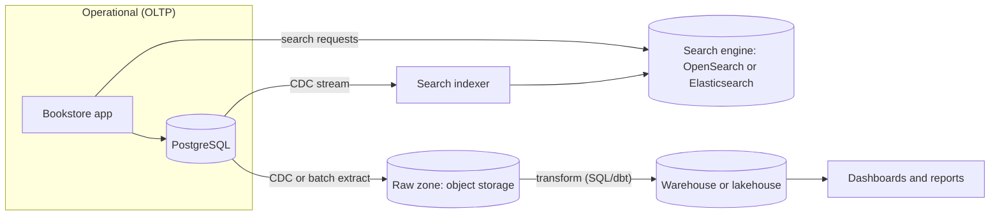
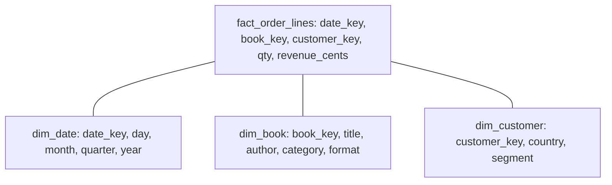

# Search and Analytics Architecture

## Introduction

Your operational database is built to answer questions like "load order 1234" or "decrement stock for book 42" thousands of times per second. Two other kinds of questions arrive sooner or later, and the operational database handles them poorly:

- **Search:** "find books about *distributed sistems* (sic) under $40, in English, sorted by relevance, with counts per format." This needs text analysis, typo tolerance, relevance ranking and facets.
- **Analytics:** "revenue by category and month for the last three years, compared with the same period last year." This scans millions of rows and aggregates them.

Running these on the primary database is the classic way to slow checkout to a crawl. The usual answer is to **copy data out** into stores built for each job: a **search engine** and an **analytical store** (a data warehouse or lakehouse).

An analogy: a shop's till is optimized for ringing up one sale quickly. You would not stop the till to count every sale of the year; you take a copy of the receipts to the back office (analytics). And you would not look for "that blue book about sailing" by reading every receipt; you use the catalog card index (search).

## OLTP vs OLAP

| | OLTP (operational) | OLAP (analytical) |
| --- | --- | --- |
| Typical query | Read or write a few rows by key | Scan and aggregate many rows |
| Users | The application, many concurrent requests | Analysts, dashboards, data science |
| Data freshness | Current | Minutes to a day behind is often fine |
| Storage layout | Row-oriented | Column-oriented |
| Schema style | Normalized | Denormalized (star schema, wide tables) |
| Examples | PostgreSQL, MySQL, DynamoDB | BigQuery, Snowflake, Redshift, ClickHouse, DuckDB |

The overall architecture usually looks like this:



Both pipelines read from the system of record. Neither is ever written to by the app as the "real" write. That is the [Polyglot Persistence](./4-arch-polyglot-persistence.mdx) rule applied to search and analytics.

## Search Architecture

### How a search engine works: the inverted index

A relational index on `title` helps with exact matches and prefixes. Full-text search needs an **inverted index**: a map from each term to the documents containing it, built after **analyzing** text (lowercasing, splitting into tokens, removing stop words, reducing words to stems).

Here is a tiny search engine in Python with TF-IDF ranking, enough to see the moving parts:

```python
# tiny_search.py
import math
import re
from collections import Counter, defaultdict

STOP = {"the", "a", "of", "and", "to", "in", "for"}

def analyze(text: str) -> list[str]:
    tokens = re.findall(r"[a-z0-9]+", text.lower())
    return [t.rstrip("s") for t in tokens if t not in STOP]   # crude stemming

docs = {
    1: "Designing Data-Intensive Applications",
    2: "Distributed Systems for Practitioners",
    3: "Understanding Distributed Systems",
    4: "The Design of Everyday Things",
}

index: dict[str, dict[int, int]] = defaultdict(dict)   # term -> {doc_id: term frequency}
for doc_id, text in docs.items():
    for term, tf in Counter(analyze(text)).items():
        index[term][doc_id] = tf

def search(query: str) -> list[tuple[int, float]]:
    scores: Counter[int] = Counter()
    for term in analyze(query):
        postings = index.get(term, {})
        if not postings:
            continue
        idf = math.log(len(docs) / len(postings)) + 1      # rarer terms count more
        for doc_id, tf in postings.items():
            scores[doc_id] += tf * idf
    return [(d, round(s, 2)) for d, s in scores.most_common()]

print(dict(list(index.items())[:4]))
print(search("distributed systems"))
print(search("data applications"))
```

Output:

```text
{'designing': {1: 1}, 'data': {1: 1}, 'intensive': {1: 1}, 'application': {1: 1}}
[(2, 3.39), (3, 3.39)]
[(1, 4.77)]
```

Real engines such as OpenSearch and Elasticsearch (both built on Apache Lucene) add much more: the BM25 relevance function, language-specific analyzers, fuzzy matching for typos, synonyms, highlighting, aggregations for facets, and sharding and replication across nodes.

### Near real-time, not real-time

Search engines buffer new documents and make them searchable on a periodic **refresh**. Elastic's documentation describes a default refresh every second, which is why it calls search "near real-time". Combined with the delay of a CDC pipeline, a new book may take a few seconds to appear in search. Design the UI for that: after creating a book, show its detail page from the system of record rather than a search results page.

### Start with your database's full-text search

Before adding a search cluster, check whether your database is enough. PostgreSQL has built-in full-text search:

```sql
ALTER TABLE books ADD COLUMN search tsvector
  GENERATED ALWAYS AS (
    setweight(to_tsvector('english', coalesce(title, '')), 'A') ||
    setweight(to_tsvector('english', coalesce(description, '')), 'B')
  ) STORED;

CREATE INDEX books_search_idx ON books USING gin (search);

SELECT id, title, ts_rank(search, query) AS rank
FROM books, websearch_to_tsquery('english', 'distributed systems') AS query
WHERE search @@ query
ORDER BY rank DESC
LIMIT 10;
```

Example output (rank values depend on your data and weights):

```text
 id |                 title                 |   rank
----+---------------------------------------+-----------
  3 | Understanding Distributed Systems     | 0.6079271
  2 | Distributed Systems for Practitioners | 0.6079271
(2 rows)
```

This handles stemming, ranking and boolean queries with no extra infrastructure, and results are always consistent with your data. The `pg_trgm` extension adds similarity matching for typos. Move to a dedicated engine when you need advanced relevance tuning, rich facets at scale, many languages, or search load that would compete with transactions.

| Need | Database full-text | Dedicated search engine |
| --- | --- | --- |
| Basic keyword search with stemming | Yes | Yes |
| Always consistent with the data | Yes | No, near real-time via a pipeline |
| Typo tolerance, synonyms, "did you mean" | Limited (trigrams) | Strong |
| Faceted navigation with counts | Possible with SQL, slower at scale | Built in |
| Relevance tuning and boosting | Basic | Extensive |
| Extra infrastructure | None | A cluster plus a sync pipeline |

### Designing the search document

A search index is a **read model**: shape each document for the queries users run, not like your tables. For a bookstore, one document per book with the author names, format and price band already joined in. In OpenSearch or Elasticsearch you declare a mapping: `text` fields are analyzed for full-text search, `keyword` fields are kept exact for filters, sorting and facets.

```json
{
  "mappings": {
    "properties": {
      "title":       { "type": "text", "fields": { "raw": { "type": "keyword" } } },
      "authors":     { "type": "text" },
      "format":      { "type": "keyword" },
      "language":    { "type": "keyword" },
      "price_cents": { "type": "integer" },
      "rating":      { "type": "float" },
      "published":   { "type": "date" }
    }
  }
}
```

A query that tolerates typos, filters by format and price, and returns counts per format for the facet sidebar:

```json
{
  "query": {
    "bool": {
      "must":   [ { "multi_match": { "query": "distribted systems", "fields": ["title^2", "authors"], "fuzziness": "AUTO" } } ],
      "filter": [ { "term": { "format": "ebook" } }, { "range": { "price_cents": { "lte": 4000 } } } ]
    }
  },
  "aggs": { "by_format": { "terms": { "field": "format" } } },
  "size": 10
}
```

Things to decide up front: which fields are searchable versus filter-only, how to boost fields (a title match matters more than a description match), and how to handle denormalized data when it changes. If an author's name is corrected, every book document by that author must be reindexed, so your indexer needs to react to author changes too.

:::note Licensing and forks
Elastic changed Elasticsearch's license in 2021, and AWS created the **OpenSearch** fork. In 2024 Elastic added AGPLv3 as a license option, and OpenSearch moved to a foundation under the Linux Foundation. The two projects have diverged in features since the fork. Check each project's current license and features for your use.
:::

## Analytics Architecture

### Why columnar storage is faster for analytics

A row store keeps each row together on disk. To sum one column over 10 million rows, it still reads every column of every row. A **column store** keeps each column together, so an aggregate reads only the columns it needs, and similar values next to each other compress very well.

```python
# row_vs_column.py
import random
import time

N = 1_000_000
random.seed(1)

# Row-oriented: a list of records
rows = [{"order_id": i, "customer": f"c{i % 5000}", "category": random.choice("ABCDE"),
         "amount_cents": random.randint(500, 9000), "note": "x" * 20} for i in range(N)]

# Column-oriented: one list per column
cols = {k: [r[k] for r in rows] for k in rows[0]}

t = time.perf_counter()
total_rows = sum(r["amount_cents"] for r in rows)
t_rows = time.perf_counter() - t

t = time.perf_counter()
total_cols = sum(cols["amount_cents"])
t_cols = time.perf_counter() - t

print(total_rows == total_cols, f"row scan {t_rows:.3f}s, column scan {t_cols:.3f}s")
print("distinct values in 'category':", len(set(cols["category"])), "of", N, "-> compresses well")
```

Example output (times vary by machine):

```text
True row scan 0.023s, column scan 0.006s
distinct values in 'category': 5 of 1000000 -> compresses well
```

The Python difference comes partly from avoiding a dictionary lookup per row. In real databases the effect comes from reading far less data from disk and memory, compression, and vectorized execution. That is why warehouses such as BigQuery, Snowflake and Amazon Redshift, engines like ClickHouse and DuckDB, and file formats like Apache Parquet are all columnar.

### Getting data in: ETL, ELT and streaming

| Approach | How | Pros | Cons |
| --- | --- | --- | --- |
| ETL | Extract, transform in a separate tool, then load | Only clean data lands in the warehouse | Transform logic lives outside the warehouse; harder to re-run |
| ELT | Extract and load raw data, transform with SQL inside the warehouse (often with dbt) | Raw history kept; transformations versioned and re-runnable | Raw zone needs governance and cost control |
| Streaming | CDC events flow continuously into the analytical store | Minutes or seconds of latency | More infrastructure; harder to correct mistakes |

ELT is the common modern default because warehouses are good at large SQL transformations and keeping raw data lets you rebuild models when business rules change. [Change Data Capture](./5-arch-change-data-capture.mdx) is a common way to extract.

### Modeling for analytics: the star schema

Analytical models are usually **denormalized** into a **star schema**: a central **fact** table of events (order lines) with keys to **dimension** tables that describe them (date, book, customer).



```python
# star_schema.py
import sqlite3

db = sqlite3.connect(":memory:")
db.executescript("""
CREATE TABLE dim_book (book_key INTEGER PRIMARY KEY, title TEXT, category TEXT);
CREATE TABLE dim_date (date_key INTEGER PRIMARY KEY, month TEXT);
CREATE TABLE fact_order_lines (date_key INTEGER, book_key INTEGER, qty INTEGER, revenue_cents INTEGER);

INSERT INTO dim_book VALUES (1, 'Refactoring', 'Software'), (2, 'Dune', 'Fiction'), (3, 'Release It!', 'Software');
INSERT INTO dim_date VALUES (20260901, '2026-09'), (20261001, '2026-10');
INSERT INTO fact_order_lines VALUES
  (20260901, 1, 2, 9000), (20260901, 2, 1, 1500), (20261001, 1, 1, 4500),
  (20261001, 3, 3, 11700), (20261001, 2, 4, 6000);
""")

for row in db.execute("""
    SELECT d.month, b.category, SUM(f.revenue_cents) / 100.0 AS revenue
    FROM fact_order_lines f
    JOIN dim_date d ON d.date_key = f.date_key
    JOIN dim_book b ON b.book_key = f.book_key
    GROUP BY d.month, b.category
    ORDER BY d.month, revenue DESC
"""):
    print(row)
```

Output:

```text
('2026-09', 'Software', 90.0)
('2026-09', 'Fiction', 15.0)
('2026-10', 'Software', 162.0)
('2026-10', 'Fiction', 60.0)
```

The fact table also captures history. If a book moves to a new category, a "slowly changing dimension" design decides whether past sales are reported under the old or new category, a question that operational schemas usually cannot answer.

### Warehouse, lake, or lakehouse?

- **Data warehouse:** a managed analytical database with SQL, such as BigQuery, Snowflake or Redshift. Easiest to start with.
- **Data lake:** raw files (often Parquet) in object storage. Cheap and flexible, but without table semantics it can turn into a "data swamp".
- **Lakehouse:** open table formats such as Apache Iceberg or Delta Lake add transactions, schema evolution and time travel to files in object storage, so several engines can query the same tables.

For small and medium data, an embedded engine like DuckDB reading Parquet files, or a read replica plus a reporting schema, can be all you need. Product capabilities and pricing change frequently; compare current official docs rather than relying on older comparisons.

## Real-World Scenario

The bookstore has 2 million titles and 50,000 orders a day. Two complaints reach the architecture review: customers cannot find books when they misspell author names, and the finance team's month-end report takes 40 minutes and slows down checkout while it runs.

**Solution:**

- **Search:** PostgreSQL full-text search was enough at launch, but typo tolerance and faceted filters (format, price band, language, rating) are now core features. Add a managed OpenSearch domain fed by the CDC pipeline. The index stores only the fields needed for search and facets; prices on result pages are refreshed from the catalog service or its cache.
- **Immediate relief for finance:** point the report at a read replica the same day.
- **Analytics:** load CDC data into a warehouse (ELT), build a star schema with dbt, and move dashboards there. Finance now gets reports in seconds and can ask new questions without touching production.

**Why this approach:** each workload goes to a store designed for it, and the system of record stays focused on transactions. The read replica is a cheap first step while the warehouse is built.

**When to use it / when not:** add a search engine when search quality or load is a real product problem; add a warehouse when analytical queries hurt production or need history and joins across many sources. If your data fits comfortably in one database and reports run in seconds on a replica, keep it simple.

| Approach | Pros | Cons | Best for |
| --- | --- | --- | --- |
| Query the primary | No new systems | Hurts production; limited analytics | Tiny apps, quick checks |
| Read replica for reports | Cheap, fast to set up | Still row-oriented; long queries can delay replication | Early-stage reporting |
| Database full-text search | Consistent, no pipeline | Limited relevance and typo handling | Simple keyword search |
| Dedicated search engine | Relevance, facets, typo tolerance | Cluster and pipeline to run; near real-time | Search-centric products |
| Cloud data warehouse | Fast analytics, managed, SQL | Ongoing cost; data pipeline needed | Most growing companies |
| Lakehouse on open formats | Cheap storage; many engines; avoids lock-in | More components to assemble and govern | Large data volumes, data platforms |

## Common Mistakes

- **Running analytics on the primary,** especially long scans during peak hours.
- **Treating the search index as the source of truth,** for example reading stock or price from it at checkout.
- **Indexing everything.** Large documents with unused fields make the index slow and expensive. Index what users search and filter on.
- **No reindex plan.** Analyzer and mapping changes usually require a full reindex. Use versioned index names behind an alias.
- **Copying personal data into analytics without controls.** Mask or drop what analysts do not need, and make deletion requests reach the warehouse.
- **Building a lakehouse for gigabytes of data.** Match the platform to the data size and team.

## Summary

- Operational databases (OLTP) serve transactions; search engines and analytical stores (OLAP) serve search and aggregation. Copy data to them from the system of record.
- Search engines use **inverted indexes**, text **analysis** and relevance scoring, and are **near real-time**. Database full-text search is a strong first step.
- Analytical stores are **columnar**, which makes scans and aggregates fast and compression effective.
- **ELT** with CDC or batch extracts into a warehouse, modeled as a **star schema**, is the common modern pattern.
- Start with a read replica or database features, and add dedicated systems when measured needs justify them.

## Exercises

1. Add fuzzy matching to `tiny_search.py`: when a query term is not in the index, try terms within edit distance 1. How does it affect speed as the vocabulary grows?
2. Add a `dim_customer` table with `country` to `star_schema.py` and report revenue by country and category.
3. Write the PostgreSQL query for "books matching 'design' with counts per category". When would this become too slow?
4. Sketch the pipeline for a helpdesk product that needs ticket search and SLA dashboards. Which data goes where, and how fresh must each be?

**Related pages:** [Change Data Capture](./5-arch-change-data-capture.mdx), [CQRS](../9-arch-distributed-systems/3-arch-cqrs.mdx), [Pipes and Filters Architecture](../6-arch-architectural-styles/9-arch-pipes-and-filters.mdx), [Cost-Aware Architecture](../12-arch-quality-and-operations/7-arch-cost-awareness.mdx).
