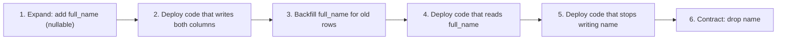

# Schema Evolution and Data Migrations

## Introduction

Your code changes every day. Your data has to change with it: new columns, renamed fields, split tables, new event formats. But data is not like code. You cannot simply delete the old version and deploy the new one, because **the old data is still there**, and during a rolling deployment **old and new versions of your application run at the same time**.

Changing a running system's schema is like renovating a restaurant kitchen while it keeps serving dinner. You cannot rip out the old stove before the new one works, and the cooks on the evening shift must be able to work in a kitchen that is half old and half new. So you add the new stove alongside the old one, move cooking over dish by dish, and remove the old stove only when nobody uses it.

This page covers:

- **schema migrations** (changing structure) and **data migrations** (changing or moving existing rows),
- the **expand and contract** technique for zero-downtime changes,
- doing it safely in a real database, with PostgreSQL as the example,
- evolving **event and message schemas**, where you cannot migrate old data at all.

## Migrations as Code

The foundation is treating every database change as a versioned script, checked into the same repository as the application. Pramod Sadalage and Martin Fowler's article [Evolutionary Database Design](https://martinfowler.com/articles/evodb.html) describes the practices: every change is a migration, migrations are small and sequenced, a table in the database records which ones have run, and CI applies them to a fresh database on every build.

Common tools:

| Tool | Ecosystem | Style |
| --- | --- | --- |
| Alembic | Python / SQLAlchemy | Python migration scripts, autogenerate from models |
| Django migrations | Python / Django | Generated from models |
| Flyway | JVM and CLI | Versioned SQL files |
| Liquibase | JVM and CLI | Changelogs in SQL, XML, YAML or JSON |
| Prisma Migrate, Rails Active Record migrations, EF Core migrations | Their frameworks | Generated from models |

An Alembic migration looks like this:

```python
# migrations/versions/20261011_add_full_name.py
"""add customers.full_name"""
from alembic import op
import sqlalchemy as sa

revision = "20261011_add_full_name"
down_revision = "20261001_create_customers"

def upgrade() -> None:
    op.add_column("customers", sa.Column("full_name", sa.Text(), nullable=True))

def downgrade() -> None:
    op.drop_column("customers", "full_name")
```

```bash
alembic upgrade head      # apply all pending migrations
alembic current           # show the revision the database is at
```

Example output:

```text
INFO  [alembic.runtime.migration] Running upgrade 20261001_create_customers -> 20261011_add_full_name, add customers.full_name
20261011_add_full_name (head)
```

Under the hood, every tool does the same thing. Here is the core idea in 25 lines, using SQLite:

```python
# tiny_migrator.py
import sqlite3

MIGRATIONS = [
    ("001_create_customers", "CREATE TABLE customers (id INTEGER PRIMARY KEY, name TEXT NOT NULL)"),
    ("002_add_email",        "ALTER TABLE customers ADD COLUMN email TEXT"),
    ("003_index_email",      "CREATE INDEX customers_email_idx ON customers (email)"),
]

def migrate(db: sqlite3.Connection) -> list[str]:
    db.execute("CREATE TABLE IF NOT EXISTS schema_migrations (version TEXT PRIMARY KEY)")
    done = {v for (v,) in db.execute("SELECT version FROM schema_migrations")}
    applied = []
    for version, sql in MIGRATIONS:
        if version in done:
            continue
        with db:                                    # each migration in its own transaction
            db.execute(sql)
            db.execute("INSERT INTO schema_migrations VALUES (?)", (version,))
        applied.append(version)
    return applied

db = sqlite3.connect(":memory:")
print("first run: ", migrate(db))
print("second run:", migrate(db))
```

Output:

```text
first run:  ['001_create_customers', '002_add_email', '003_index_email']
second run: []
```

:::tip Roll forward, not back
Down migrations are useful in development, but in production they are rarely safe once new data has been written (you cannot "un-drop" a column's data). Most teams **roll forward** with a new migration that fixes the problem, and design each change so the previous application version still works with the new schema.
:::

## The Core Problem: Old and New Code at Once

Suppose you want to rename `customers.name` to `full_name`. The obvious migration is one statement:

```sql
ALTER TABLE customers RENAME COLUMN name TO full_name;
```

During a rolling deploy, some application instances still run the old code. The moment this migration runs, every old instance that queries `name` fails. If you deploy code first, the new code queries `full_name` before it exists. **There is no ordering of "migrate" and "deploy" that works for a breaking change in one step.**

The rule that follows: **every schema change must be compatible with both the currently running code and the code being deployed.**

## Expand and Contract (Parallel Change)

The answer is to split a breaking change into several non-breaking ones. Danilo Sato's [ParallelChange](https://martinfowler.com/bliki/ParallelChange.html) article on martinfowler.com calls the phases **expand, migrate, contract**.



| Step | Schema | Code | Safe to roll back the code? |
| --- | --- | --- | --- |
| 1 Expand | `name`, `full_name` (nullable) | Old code, ignores `full_name` | Yes |
| 2 Dual write | Same | Writes both; reads `name` | Yes |
| 3 Backfill | Same, old rows filled in | Same | Yes |
| 4 Switch reads | Same | Writes both; reads `full_name` | Yes, old code still finds `name` filled |
| 5 Stop old writes | Same | Writes and reads `full_name` only | Only to step 4 code |
| 6 Contract | `full_name` only | Same | Old code no longer works |

Each step is a separate deploy, and each can run for as long as needed. That is the price: a "rename" becomes a small project. The benefit is no downtime and a rollback option at almost every step.

The application side of step 2 is small:

```python
# repository_dual_write.py
import sqlite3

db = sqlite3.connect(":memory:")
db.executescript("""
CREATE TABLE customers (id INTEGER PRIMARY KEY, name TEXT NOT NULL);
INSERT INTO customers (id, name) VALUES (1, 'Ada Lovelace'), (2, 'Grace Hopper');
ALTER TABLE customers ADD COLUMN full_name TEXT;   -- step 1: expand
""")

READ_FROM_NEW = False   # flipped to True in step 4 (often via a feature flag)

def save_customer(cid: int, full_name: str) -> None:
    # Step 2: write both columns so old and new code see the same data
    db.execute(
        "INSERT INTO customers (id, name, full_name) VALUES (?, ?, ?) "
        "ON CONFLICT(id) DO UPDATE SET name = excluded.name, full_name = excluded.full_name",
        (cid, full_name, full_name),
    )

def load_customer(cid: int) -> str:
    col = "full_name" if READ_FROM_NEW else "name"
    (value,) = db.execute(f"SELECT {col} FROM customers WHERE id = ?", (cid,)).fetchone()
    return value

save_customer(3, "Barbara Liskov")
print(db.execute("SELECT id, name, full_name FROM customers").fetchall())
```

Output:

```text
[(1, 'Ada Lovelace', None), (2, 'Grace Hopper', None), (3, 'Barbara Liskov', 'Barbara Liskov')]
```

Rows 1 and 2 still have no `full_name`. That is what the backfill fixes.

## Backfilling Data Safely

A backfill is a **data migration**: it changes existing rows. On a large table, a single `UPDATE customers SET full_name = name` can lock rows for a long time, generate a huge transaction, and lag every replica. Do it in **small batches**, with a pause between them, and make it **resumable**.

```python
# backfill.py
import sqlite3
import time

db = sqlite3.connect(":memory:")
db.execute("CREATE TABLE customers (id INTEGER PRIMARY KEY, name TEXT NOT NULL, full_name TEXT)")
db.executemany("INSERT INTO customers (id, name) VALUES (?, ?)",
               [(i, f"Customer {i}") for i in range(1, 10_001)])
db.commit()

def backfill(batch_size: int = 2_000, pause_s: float = 0.01) -> None:
    last_id = 0                                    # store this somewhere to resume after a crash
    while True:
        with db:                                   # one short transaction per batch
            rows = db.execute(
                "SELECT id FROM customers WHERE id > ? AND full_name IS NULL ORDER BY id LIMIT ?",
                (last_id, batch_size),
            ).fetchall()
            if not rows:
                break
            first, last_id = rows[0][0], rows[-1][0]
            cur = db.execute(
                "UPDATE customers SET full_name = name "
                "WHERE id BETWEEN ? AND ? AND full_name IS NULL", (first, last_id))
        print(f"batch ids {first}-{last_id}: {cur.rowcount} rows")
        time.sleep(pause_s)                        # give replicas and other traffic room

backfill()
(missing,) = db.execute("SELECT COUNT(*) FROM customers WHERE full_name IS NULL").fetchone()
print("rows still missing full_name:", missing)
```

Output:

```text
batch ids 1-2000: 2000 rows
batch ids 2001-4000: 2000 rows
batch ids 4001-6000: 2000 rows
batch ids 6001-8000: 2000 rows
batch ids 8001-10000: 2000 rows
rows still missing full_name: 0
```

Note the `full_name IS NULL` condition in the update: rows written by the new dual-writing code in the meantime are left alone, and running the backfill twice is harmless. In production, also watch replication lag and database load, and slow down automatically if they rise.

## Doing It Safely in PostgreSQL

The expand and contract plan is only zero-downtime if each individual statement is fast and does not hold heavy locks for long. Most `ALTER TABLE` forms take an `ACCESS EXCLUSIVE` lock, which blocks reads and writes on the table. A statement waiting for that lock also blocks everything queued behind it. Key facts from the [PostgreSQL ALTER TABLE documentation](https://www.postgresql.org/docs/current/sql-altertable.html):

| Change | What happens | Safer approach |
| --- | --- | --- |
| `ADD COLUMN` nullable, or with a non-volatile default | Metadata-only, no table rewrite, very fast | Fine; still set a `lock_timeout` |
| `ADD COLUMN` with a volatile default such as `clock_timestamp()` | Rewrites the whole table | Add nullable, then backfill in batches |
| `CREATE INDEX` | Blocks writes for the whole build | `CREATE INDEX CONCURRENTLY` (cannot run inside a transaction block) |
| `ADD FOREIGN KEY` or `CHECK` | Scans the table to validate | Add with `NOT VALID`, then `VALIDATE CONSTRAINT` separately, which allows concurrent reads and writes |
| `SET NOT NULL` | Scans the table to check for nulls | Add a `CHECK (col IS NOT NULL) NOT VALID`, validate it, then `SET NOT NULL` can skip the scan |
| `ALTER COLUMN TYPE` | Usually rewrites the table and its indexes | New column plus expand and contract |

A safe migration script for our example:

```sql
-- Fail fast instead of queueing behind long-running transactions
SET lock_timeout = '3s';

-- Expand
ALTER TABLE customers ADD COLUMN full_name text;

-- Index without blocking writes (run outside a transaction block)
CREATE INDEX CONCURRENTLY customers_full_name_idx ON customers (full_name);

-- After the backfill: enforce NOT NULL without a long exclusive lock
ALTER TABLE customers ADD CONSTRAINT customers_full_name_not_null
  CHECK (full_name IS NOT NULL) NOT VALID;
ALTER TABLE customers VALIDATE CONSTRAINT customers_full_name_not_null;
ALTER TABLE customers ALTER COLUMN full_name SET NOT NULL;   -- skips the scan
ALTER TABLE customers DROP CONSTRAINT customers_full_name_not_null;

-- Contract, weeks later, once no code reads or writes "name"
ALTER TABLE customers DROP COLUMN name;
```

In Alembic, a concurrent index needs to run outside the migration's transaction:

```python
from alembic import op

def upgrade() -> None:
    with op.get_context().autocommit_block():
        op.create_index("customers_full_name_idx", "customers", ["full_name"],
                        postgresql_concurrently=True)
```

For MySQL, many changes are online or instant in recent versions, and tools such as gh-ost and pt-online-schema-change copy the table in the background for those that are not. Behavior differs by version and storage engine, so check the docs for yours.

## Evolving Event and Message Schemas

Database rows can be migrated. **Events that have already been published cannot.** They sit in Kafka topics, queues, event stores and other teams' systems. So event schemas evolve under **compatibility rules** instead of migrations.

| Compatibility | Meaning | Allows |
| --- | --- | --- |
| Backward | New consumers can read old messages | Adding optional fields with defaults; removing fields consumers do not need |
| Forward | Old consumers can read new messages | Adding fields old consumers ignore |
| Full | Both directions | Only adding or removing optional fields with defaults |

Schema registries (such as Confluent Schema Registry, Apicurio, or cloud equivalents) check new Avro, Protobuf or JSON Schema versions against these rules before producers can use them. With Protobuf, never reuse a field number; mark removed fields as `reserved`.

Consumers should also be **tolerant readers**: ignore unknown fields and supply defaults for missing ones. An "upcaster" converts old event versions to the current shape at read time:

```python
# tolerant_reader.py
import json
from dataclasses import dataclass

@dataclass(frozen=True)
class CustomerRegistered:
    customer_id: int
    full_name: str
    marketing_opt_in: bool

def upcast(raw: dict) -> dict:
    version = raw.get("schema_version", 1)
    if version == 1:                       # v1 used "name" and had no opt-in field
        raw = {**raw, "full_name": raw["name"], "schema_version": 2}
    return raw

def parse(message: str) -> CustomerRegistered:
    data = upcast(json.loads(message))
    return CustomerRegistered(
        customer_id=data["customer_id"],
        full_name=data["full_name"],
        marketing_opt_in=data.get("marketing_opt_in", False),   # default for old events
    )                                                             # unknown fields are ignored

v1 = '{"schema_version": 1, "customer_id": 7, "name": "Ada Lovelace"}'
v2 = '{"schema_version": 2, "customer_id": 8, "full_name": "Grace Hopper", "marketing_opt_in": true, "referrer": "x"}'
print(parse(v1))
print(parse(v2))
```

Output:

```text
CustomerRegistered(customer_id=7, full_name='Ada Lovelace', marketing_opt_in=False)
CustomerRegistered(customer_id=8, full_name='Grace Hopper', marketing_opt_in=True)
```

This matters even more with [Event Sourcing](../9-arch-distributed-systems/4-arch-event-sourcing.mdx), where years of old events are replayed, and with [Change Data Capture](./5-arch-change-data-capture.mdx), where table changes become events automatically. API contracts follow similar rules; see [API Versioning and Evolution](../10-arch-integration-and-apis/6-arch-api-versioning.mdx).

## Real-World Scenario

The bookstore wants to split `customers.name` into `given_name` and `family_name` for personalized emails. The `customers` table has 30 million rows, the app runs 12 instances with rolling deploys, and three other services consume `CustomerRegistered` events.

**Plan:**

1. **Expand:** add nullable `given_name` and `family_name` with `lock_timeout` set. Metadata-only, takes milliseconds.
2. **Dual write:** deploy code that writes `name` and the two new columns. Splitting is done by a function with tests for tricky names, and ambiguous cases are flagged rather than guessed.
3. **Backfill** in batches of a few thousand rows, throttled on replica lag, resumable from the last ID.
4. **Events:** publish `CustomerRegistered` version 2 with the new fields added as **optional**, keeping `full_name`. The registry checks backward compatibility. Consumers upgrade at their own pace.
5. **Switch reads** behind a feature flag, then verify with a reconciliation query that `name` matches the joined parts.
6. **Contract** a few weeks later: stop writing `name`, and drop it once logs and query statistics show no remaining readers.

**Why this approach:** every step is backward-compatible, so a failed deploy can be rolled back without data loss, and no step locks a 30-million-row table for more than a moment.

**When to use expand and contract:** any breaking change (rename, type change, split or merge, moving data between tables or services) on a system that cannot take downtime.

**When not to:** small internal tools with a maintenance window, or brand-new tables with no production data. A single migration is fine there; extra steps would be ceremony.

| Approach | Pros | Cons | Best for |
| --- | --- | --- | --- |
| Single migration during a maintenance window | Simple; one step | Downtime; risky rollback | Internal tools, small data |
| Expand and contract | Zero downtime; rollback at most steps | Several deploys; temporary dual code | Production systems with live traffic |
| Online schema change tool (gh-ost, pt-online-schema-change) | Rebuilds big tables without long locks | Extra tooling; needs disk space and care | Large MySQL tables |
| New table plus sync, then switch | Clean redesign; can test in parallel | Sync logic; longer project | Big restructures, moving data between services |
| Event versioning with tolerant readers | Old events stay readable forever | Upcasting code accumulates | Events, messages, event-sourced systems |

## Common Mistakes

- **Renaming or dropping in one step** while old code is still running.
- **Big-bang backfills** in one transaction, causing lock contention and replication lag.
- **No `lock_timeout`.** A migration waiting for a lock blocks every query queued behind it.
- **Never contracting.** Old columns and dual writes pile up. Track contract steps as tickets with owners.
- **Editing old migrations** that have already run elsewhere. Add a new one instead.
- **Making event fields required** in a new version, breaking every consumer that reads older messages.
- **Untested migrations.** Run them in CI against a database with realistic size or at least realistic shape.

## Summary

- Treat every schema and data change as a **versioned migration** in source control, applied automatically.
- During deploys, old and new code run together, so each change must be **compatible with both**.
- **Expand, migrate, contract** turns breaking changes into a sequence of safe ones.
- **Backfill in small, resumable, idempotent batches**, watching load and replication lag.
- Know your database's **locking behavior**: concurrent indexes, `NOT VALID` constraints, and `lock_timeout` in PostgreSQL.
- Events cannot be migrated, so evolve them with **compatibility rules**, a schema registry, and **tolerant readers**.

## Exercises

1. Extend `tiny_migrator.py` to record a checksum of each migration's SQL and refuse to run if an already-applied migration was edited.
2. Write the full expand and contract plan, with SQL and code steps, for changing `price` from a floating-point column to integer `price_cents`.
3. Make `backfill.py` resumable by storing `last_id` in a `backfill_progress` table. Kill it halfway and show it continues where it stopped.
4. Add a version 3 of `CustomerRegistered` that splits `full_name` into two fields. Extend `upcast` so v1, v2 and v3 messages all parse.

**Related pages:** [Designing for Deployability](../12-arch-quality-and-operations/6-arch-deployability.mdx), [Strangler Fig Migration](../9-arch-distributed-systems/11-arch-strangler-fig.mdx), [Legacy System Modernization](../13-arch-documenting-and-evolving/5-arch-legacy-modernization.mdx), [Database per Service vs Shared Database](./0-arch-database-per-service.mdx).
