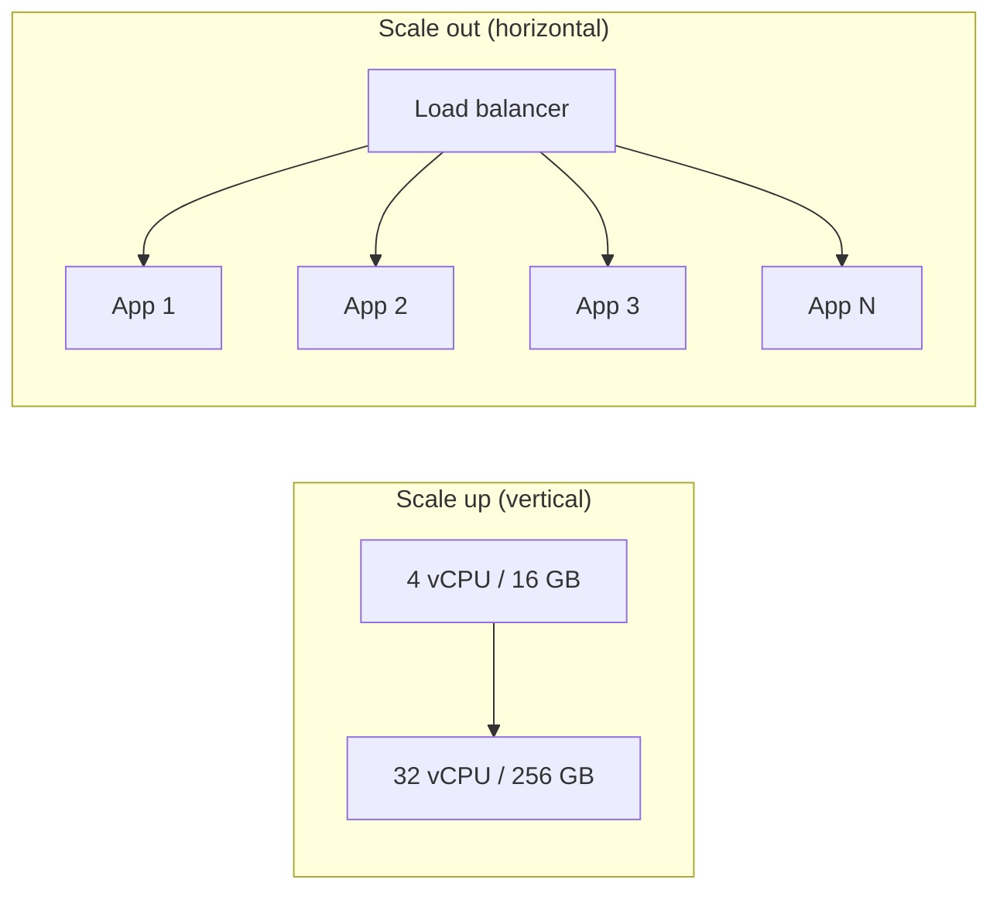
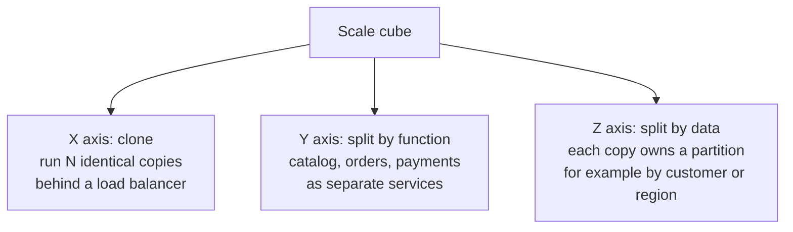
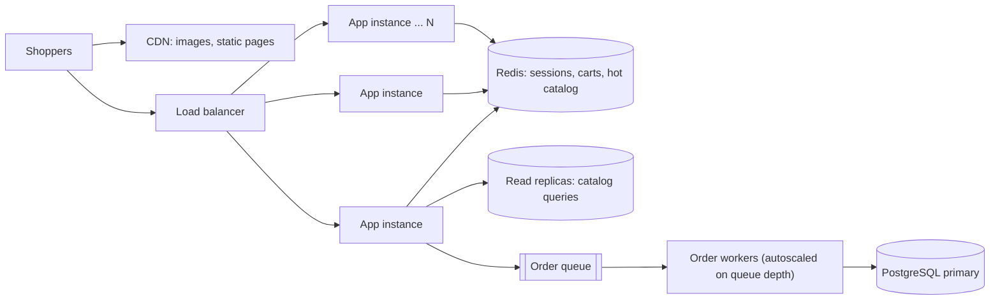

# Designing for Scalability

## Introduction

A system is **scalable** if it can handle more load by adding resources, without a redesign and without performance falling apart. The key words are "by adding resources". If the only way to survive next year's traffic is a rewrite, the system is not scalable, however fast it is today.

Think of a small bakery. When the queue gets long, the owner can buy a bigger oven (scale **up**), open more counters with more bakers (scale **out**), or split the work so one team only makes bread and another only makes cakes (scale by **function**). Each option has a cost. A bigger oven is simple but has a ceiling. More counters only work if every baker can serve every customer, which means the recipes and the order book can't live in one baker's head.

Software is the same. This page covers:

- how to describe load precisely before you design for it
- vertical vs horizontal scaling, and why statelessness is the price of scaling out
- the **scale cube**, a map of the three basic ways to scale
- capacity math with **Little's Law**, and why scaling is never perfectly linear
- queues, caching, and partitioning as scaling tools
- when scaling work is premature and not worth it

Scalability is one of the [quality attributes](../0-arch-fundamentals/3-arch-quality-attributes.mdx) you trade against others. It is closely related to, but different from, [performance](./1-arch-performance.mdx):

| Question | Attribute |
| --- | --- |
| How fast is one request when the system is quiet? | Performance |
| Does it stay fast when load grows 10x if we add machines? | Scalability |
| Can it add and remove capacity automatically as load rises and falls? | Elasticity |

Richards and Ford's *Fundamentals of Software Architecture* draws the same line between scalability (handling growth in users over time) and elasticity (handling sudden bursts).

## Step 1: Describe Your Load

"It needs to scale" is not a requirement. Before you design anything, name the **load parameters** that actually grow. Martin Kleppmann's *Designing Data-Intensive Applications* makes this point well: the right parameter depends on the system.

For an online bookstore, candidates include:

| Load parameter | Example value | Why it matters |
| --- | --- | --- |
| Requests per second at peak | 800 req/s on a normal evening | Sizing web and API tiers |
| Read/write ratio | about 100 catalog reads per order placed | Caching and read replicas pay off |
| Concurrent sessions | 20,000 logged-in shoppers | Session storage, connection limits |
| Data volume | 2 million titles, 50 million reviews | Index size, partitioning |
| Burstiness | 5x spike when a sale starts | Elasticity, queues, pre-warming |
| Fan-out | one "home page" call hits 6 services | Tail latency multiplies |

Then express a target as a measurable scenario, for example: "At 5x the normal evening peak, the 99th percentile latency of the product page stays under 400 ms, with no manual intervention." That sentence can be load-tested. "Must be scalable" cannot.

:::tip
Find the **dominant** load parameter first. A social feed is dominated by fan-out, a reporting system by data volume, a ticket sale by burstiness. You rarely need to design for all of them at once.
:::

## Step 2: Vertical vs Horizontal Scaling



| Approach | Pros | Cons | Best for |
| --- | --- | --- | --- |
| Vertical (bigger machine) | No code changes, no distributed-systems problems, strong consistency stays easy | Hard ceiling, cost grows faster than capacity at the top end, one machine is one failure domain | Databases, early-stage products, workloads that are hard to split |
| Horizontal (more machines) | Near-unlimited ceiling, adds redundancy, can scale elastically | Requires stateless design or partitioned state, adds network hops and coordination | Stateless web/API tiers, workers, read-heavy traffic |

A common and very reasonable shape is: scale the **stateless** tiers horizontally, and scale the **database** vertically for as long as you can, adding read replicas before you ever consider sharding. Sharding is covered in [Replication and Sharding](../11-arch-data-architecture/3-arch-replication-and-sharding.mdx).

## Step 3: Make Services Stateless

Horizontal scaling assumes that **any instance can serve any request**. That is only true if instances don't keep important state in their own memory or on their own disk. The [Twelve-Factor App](https://12factor.net/processes) calls this "execute the app as one or more stateless processes".

### Before: state trapped in the instance

Here is a shopping cart that lives in each instance's memory, behind a simple round-robin load balancer.

```python
import itertools

class AppInstance:
    """BEFORE: each instance keeps carts in its own memory."""
    def __init__(self, name: str) -> None:
        self.name = name
        self.carts: dict[str, list[str]] = {}

    def add_to_cart(self, session_id: str, isbn: str) -> None:
        self.carts.setdefault(session_id, []).append(isbn)

    def view_cart(self, session_id: str) -> list[str]:
        return self.carts.get(session_id, [])

instances = [AppInstance("app-1"), AppInstance("app-2")]
round_robin = itertools.cycle(instances)  # a simple load balancer

next(round_robin).add_to_cart("sess-42", "978-0134757599")
next(round_robin).add_to_cart("sess-42", "978-1492043454")
node = next(round_robin)
print(f"{node.name} sees cart: {node.view_cart('sess-42')}")
```

Output:

```text
app-1 sees cart: ['978-0134757599']
```

The shopper added two books but sees one. The second book went to `app-2`. Teams often "fix" this with **sticky sessions** (the load balancer pins a user to one instance). That works until the instance restarts, a deploy drains it, or autoscaling removes it, and then the cart is gone. Sticky sessions also make load uneven.

### After: externalize the state

Move the cart to a store that every instance shares, such as [Redis](/docs/middleware/redis) or the database, and inject it through an interface.

```python
import itertools
from typing import Protocol

class CartStore(Protocol):
    def append(self, session_id: str, isbn: str) -> None: ...
    def items(self, session_id: str) -> list[str]: ...

class SharedCartStore:
    """Stand-in for Redis or a database: one store shared by every instance."""
    def __init__(self) -> None:
        self._data: dict[str, list[str]] = {}

    def append(self, session_id: str, isbn: str) -> None:
        self._data.setdefault(session_id, []).append(isbn)

    def items(self, session_id: str) -> list[str]:
        return list(self._data.get(session_id, []))

class AppInstance:
    """AFTER: the instance is stateless; state lives in the injected store."""
    def __init__(self, name: str, store: CartStore) -> None:
        self.name = name
        self.store = store

    def add_to_cart(self, session_id: str, isbn: str) -> None:
        self.store.append(session_id, isbn)

    def view_cart(self, session_id: str) -> list[str]:
        return self.store.items(session_id)

store = SharedCartStore()
instances = [AppInstance(f"app-{i}", store) for i in range(1, 4)]
round_robin = itertools.cycle(instances)

next(round_robin).add_to_cart("sess-42", "978-0134757599")
next(round_robin).add_to_cart("sess-42", "978-1492043454")
node = next(round_robin)
print(f"{node.name} sees cart: {node.view_cart('sess-42')}")
```

Output:

```text
app-3 sees cart: ['978-0134757599', '978-1492043454']
```

Now we can run 3 or 30 instances. Notice what happened, though: we didn't remove the state, we **moved** it. The shared store is now the thing that must scale and stay available. Scalability work is often about pushing state into a few components designed to hold it (databases, caches, queues, object storage) and keeping everything else disposable.

Other common sources of hidden instance state:

- files written to local disk (uploads, generated PDFs) instead of object storage
- in-process caches that must be consistent across instances
- scheduled jobs that run on "every instance" and so run N times
- WebSocket connections, which are inherently tied to one instance and need a pub/sub backplane to fan messages out

## Step 4: The Scale Cube

Martin Abbott and Michael Fisher's **AKF Scale Cube** (from *The Art of Scalability*) names three independent axes. Chris Richardson uses it on [microservices.io](https://microservices.io/articles/scalecube.html) to explain where microservices fit.



| Axis | What you split | Bookstore example | Main cost |
| --- | --- | --- | --- |
| X: horizontal duplication | Nothing, you clone | 10 identical catalog API instances | Needs stateless code; does not shrink the data |
| Y: functional decomposition | Code by capability | Separate search, checkout and recommendations services | Distributed-systems complexity, see [Microservices](../6-arch-architectural-styles/4-arch-microservices.mdx) |
| Z: data partitioning | Data by key | Orders sharded by customer ID; EU and US stamps | Cross-partition queries, rebalancing, hot keys |

The axes combine. Most systems start with X (cheap and easy), add Y only where one capability has very different load or team ownership, and reach for Z when one dataset outgrows a single node. The Azure **Deployment Stamps** pattern is a Z-axis split at the level of whole environments: each stamp is a full copy of the system serving a subset of tenants.

## Step 5: Capacity Math with Little's Law

You can estimate capacity with surprisingly simple math. **Little's Law** says that in a stable system:

```text
L = lambda x W
L      = average number of requests in the system (in flight)
lambda = average arrival rate (requests per second)
W      = average time each request spends in the system (seconds)
```

If each instance can handle a fixed number of concurrent requests (worker threads, connection pool size), you can turn that into an instance count:

```python
import math

def instances_needed(peak_rps: float, latency_s: float, concurrency_per_instance: int,
                     target_utilization: float = 0.6) -> int:
    """Little's Law: in-flight requests L = arrival rate (lambda) x time in system (W)."""
    in_flight = peak_rps * latency_s
    usable_per_instance = concurrency_per_instance * target_utilization
    return math.ceil(in_flight / usable_per_instance)

for label, rps in [("normal day", 200), ("evening peak", 800), ("flash sale", 4000)]:
    n = instances_needed(peak_rps=rps, latency_s=0.25, concurrency_per_instance=16)
    print(f"{label:>13}: {rps:>5} req/s -> {rps * 0.25:>6.0f} in flight -> {n:>3} instances")
```

Output:

```text
   normal day:   200 req/s ->     50 in flight ->   6 instances
 evening peak:   800 req/s ->    200 in flight ->  21 instances
   flash sale:  4000 req/s ->   1000 in flight -> 105 instances
```

Two lessons fall out of this:

1. **Latency is a capacity lever.** Halve `latency_s` and you halve the instances needed. A slow dependency doesn't only hurt users, it ties up workers. That is why [performance](./1-arch-performance.mdx) work and scalability work overlap.
2. **Plan for headroom.** The `target_utilization` of 0.6 leaves room for spikes and for losing an instance. Running at 95% utilization means queueing delay explodes on the smallest burst.

:::caution
Back-of-the-envelope numbers are for deciding **which design** to load-test, not a replacement for load testing. Real systems have connection pools, garbage collection pauses and shared databases that this formula ignores.
:::

## Step 6: Why Scaling Is Never Linear

Doubling instances rarely doubles throughput. Two forces eat into the gains:

- **Contention**: work that has to be serialized, such as a lock, a single database primary, or a hot row. This is Amdahl's Law territory.
- **Coherency**: the cost of keeping nodes in agreement, such as cache invalidation, distributed locks, or gossip. This grows with the number of node pairs.

Neil Gunther's **Universal Scalability Law** models both. The parameters below are illustrative, not measured from any real system:

```python
def usl_throughput(n: int, alpha: float, beta: float, single_node: float) -> float:
    """Universal Scalability Law (Gunther): relative capacity C(N) times one node's throughput."""
    capacity = n / (1 + alpha * (n - 1) + beta * n * (n - 1))
    return capacity * single_node

print(f"{'nodes':>5} {'linear':>8} {'contention':>11} {'+coherency':>11}")
for n in [1, 2, 4, 8, 16, 32, 64]:
    linear = usl_throughput(n, 0.0, 0.0, 100)
    contended = usl_throughput(n, 0.05, 0.0, 100)
    coherent = usl_throughput(n, 0.05, 0.002, 100)
    print(f"{n:>5} {linear:>8.0f} {contended:>11.0f} {coherent:>11.0f}")
```

Output:

```text
nodes   linear  contention  +coherency
    1      100         100         100
    2      200         190         190
    4      400         348         341
    8      800         593         547
   16     1600         914         717
   32     3200        1255         706
   64     6400        1542         524
```

With even small coherency costs, adding nodes past a point makes the system **slower**. The architectural takeaway is to design out shared, serialized resources: avoid global locks, avoid "every node must agree" steps in the hot path, and partition data so that nodes don't need to talk to each other to serve a request.

## Step 7: Tools for Scaling the Hard Parts

Stateless app tiers are the easy part. The interesting design work is in the stateful parts.

### Caching for read-heavy load

If reads outnumber writes 100 to 1, every cache hit is a database query you don't need to scale for. See [Caching Strategies](../11-arch-data-architecture/2-arch-caching-strategies.mdx) for cache-aside, write-through, and invalidation.

### Read replicas, then partitioning

Send reads to replicas and writes to the primary. Accept that replicas lag slightly behind (see [Consistency Models](../9-arch-distributed-systems/2-arch-consistency-models.mdx)). Partition only when writes or data size outgrow one primary.

### Queues to absorb bursts

Not every request needs to finish while the user waits. Put work on a queue and let a pool of workers drain it at a steady rate. Azure calls this **Queue-Based Load Leveling**, usually paired with **Competing Consumers**.

```python
from collections import deque

arrivals = [50, 50, 400, 600, 300, 50, 50, 50, 50, 50]   # orders arriving each minute
WORKER_CAPACITY = 60          # orders one worker can process per minute
workers = 3

queue: deque[int] = deque()
for minute, new_orders in enumerate(arrivals, start=1):
    queue.extend(range(new_orders))
    processed = min(len(queue), workers * WORKER_CAPACITY)
    for _ in range(processed):
        queue.popleft()
    print(f"min {minute:>2}: arrived {new_orders:>3}, processed {processed:>3}, backlog {len(queue):>4}")
```

Output:

```text
min  1: arrived  50, processed  50, backlog    0
min  2: arrived  50, processed  50, backlog    0
min  3: arrived 400, processed 180, backlog  220
min  4: arrived 600, processed 180, backlog  640
min  5: arrived 300, processed 180, backlog  760
min  6: arrived  50, processed 180, backlog  630
min  7: arrived  50, processed 180, backlog  500
min  8: arrived  50, processed 180, backlog  370
min  9: arrived  50, processed 180, backlog  240
min 10: arrived  50, processed 180, backlog  110
```

The burst of 1,300 orders never hits the payment and fulfilment systems all at once. The cost is **delay**: an order placed at minute 4 may be processed several minutes later, so the user experience must say "order received" rather than "order shipped". With autoscaling on queue depth, you add workers while the backlog grows. Queues are covered in depth in [Messaging Patterns](../10-arch-integration-and-apis/5-arch-messaging-patterns.mdx), and controlling inflow is covered in [Bulkheads, Rate Limiting and Backpressure](../9-arch-distributed-systems/9-arch-bulkhead-and-rate-limiting.mdx).

### Autoscaling

Autoscalers add and remove instances based on a signal: CPU, request rate, queue depth, or a custom metric. In [Kubernetes](/docs/devops/kubernetes) this is the Horizontal Pod Autoscaler; every major cloud has an equivalent. Things to design for:

- **Startup time.** If an instance takes 3 minutes to boot and warm its caches, autoscaling cannot save you from a 30-second spike. Pre-scale before known events.
- **The right signal.** CPU is a poor signal for I/O-bound services. Queue depth or in-flight requests often track load better.
- **Downstream limits.** Scaling the API from 10 to 100 instances also multiplies database connections by 10. Many outages during traffic spikes are a connection-pool storm, not a CPU shortage.

## Real-World Scenario

Your team runs an online bookstore. Normal evening peak is about 800 requests per second. Marketing announces a 24-hour sale on the anniversary of a hit series, and last year's similar event produced a 5x spike in the first ten minutes that took the site down. The architecture today is a modular monolith on 8 instances with one PostgreSQL primary, and sessions stored in instance memory with sticky sessions.



The plan:

1. **Measure the dominant load parameter.** Logs from last year show 92% of requests were catalog and product page reads; checkout was a small fraction but was where the database primary saturated.
2. **Make the app tier stateless.** Move sessions and carts to Redis and drop sticky sessions. Now the autoscaler can add and remove instances freely.
3. **Push reads away from the primary.** Serve images and static pages from a CDN, cache hot product data in Redis with a short TTL, and send remaining catalog queries to read replicas.
4. **Level the write burst.** "Place order" validates the cart, reserves stock with a single short transaction, puts an `OrderPlaced` message on a queue and returns "order received". Workers handle payment capture, emails and fulfilment at the rate the downstream systems can sustain.
5. **Size and pre-scale.** Using Little's Law with measured latency, the team estimates the instance count for 5x peak, pre-scales an hour before the sale starts, and lets autoscaling handle the rest. They cap the database connection pool per instance so scaling out can't exhaust the primary.
6. **Load-test the plan** at 6x peak in a staging environment that has production-like data volumes.

**Why this approach:** the bottleneck was the single database primary, not CPU on the app servers. Caching, replicas and a queue remove most of the load from the primary without the team having to split the monolith or shard the database, both of which would take months.

**When to use it / when not to:** this pattern of stateless app plus shared state stores plus queue fits most read-heavy web systems. It is overkill for an internal tool with 50 users, where one well-sized server is simpler and cheaper. It is not enough for a system where *writes* to one dataset dominate (for example a global leaderboard updated on every game move), which needs partitioning or a specialized store.

**Alternatives and trade-offs:**

| Approach | Pros | Cons | Best for |
| --- | --- | --- | --- |
| Bigger database server | Zero code changes, done in a day | Ceiling, cost, still one failure domain | Buying time while you fix the real bottleneck |
| Cache + read replicas + queue (chosen) | Big gain for read-heavy load, incremental | Stale reads, eventual consistency in order status | Read-heavy sites with bursty writes |
| Split checkout into a microservice | Scale and deploy checkout independently | Months of work, network calls, data ownership questions | When team ownership or very different load profiles justify it |
| Shard the database by customer | Scales writes almost without limit | Cross-shard queries, rebalancing, operational complexity | Write-heavy data that outgrows the largest single node |
| Virtual waiting room | Protects the system absolutely, honest to users | Users wait, and it feels less polished | Ticket drops and extreme, short spikes |

## Common Mistakes

- **Scaling before measuring.** Teams split services or add Kubernetes when the real bottleneck is a missing database index. Profile first.
- **Scaling the wrong tier.** Adding app instances in front of a saturated database makes things worse, because more instances means more connections and more contention.
- **Hidden state.** Local files, in-memory caches and cron jobs on every instance quietly break horizontal scaling. Audit for them.
- **Sticky sessions as a permanent fix.** They hide statefulness until a deploy or scale-in event logs everyone out.
- **Ignoring hot keys.** A partitioned system is only as scalable as its busiest partition. One bestselling title or one large tenant can overload a shard.
- **Designing for Google scale on day one.** Most products never need sharding or a dozen services. Following [YAGNI](../1-arch-design-principles/6-arch-dry-kiss-yagni.mdx), keep the design *able* to scale (stateless tiers, clear module boundaries) without paying for scale you don't have.
- **Forgetting scale-down.** Elasticity includes removing capacity. Systems that can only grow end up paying for peak all year (see [Cost-Aware Architecture](./7-arch-cost-awareness.mdx)).

## Summary

- Scalability means handling more load **by adding resources**, without a redesign. Elasticity is doing it automatically, in both directions.
- Start by naming the **load parameters** that grow, and write scenarios you can load-test.
- Scale up is simple and has a ceiling. Scale out needs **stateless** instances and moves state into dedicated stores.
- The **scale cube** gives three axes: clone (X), split by function (Y) and split by data (Z).
- **Little's Law** links arrival rate, latency and concurrency, so lower latency directly reduces the capacity you need.
- Scaling is sub-linear because of **contention** and **coherency**. Design out shared serialized resources.
- Caches, replicas, queues and autoscaling handle most real-world needs before sharding or microservices.

## Exercises

1. Pick a system you work on and list its top three load parameters with real numbers. Which one dominates?
2. Using the `instances_needed` function, compute how many instances you need if latency rises from 250 ms to 600 ms because a dependency slows down. What does that tell you about timeouts?
3. Audit a service for hidden state: local files, in-memory caches, scheduled jobs, WebSockets. For each, name where the state should live instead.
4. Modify the queue simulation to add one worker whenever the backlog exceeds 300 orders. How long does it take to drain the backlog now?

Related pages:

- [Designing for Performance](./1-arch-performance.mdx): making each request cheaper
- [Caching Strategies](../11-arch-data-architecture/2-arch-caching-strategies.mdx) and [Replication and Sharding](../11-arch-data-architecture/3-arch-replication-and-sharding.mdx)
- [Bulkheads, Rate Limiting and Backpressure](../9-arch-distributed-systems/9-arch-bulkhead-and-rate-limiting.mdx)
- [Space-Based Architecture](../6-arch-architectural-styles/8-arch-space-based.mdx): a style built around extreme, elastic scalability
