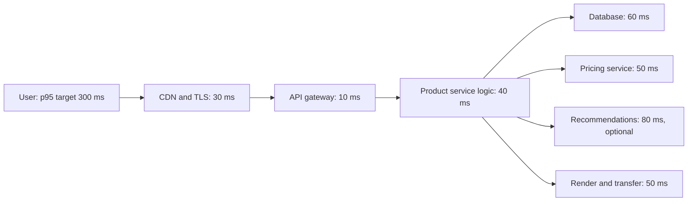
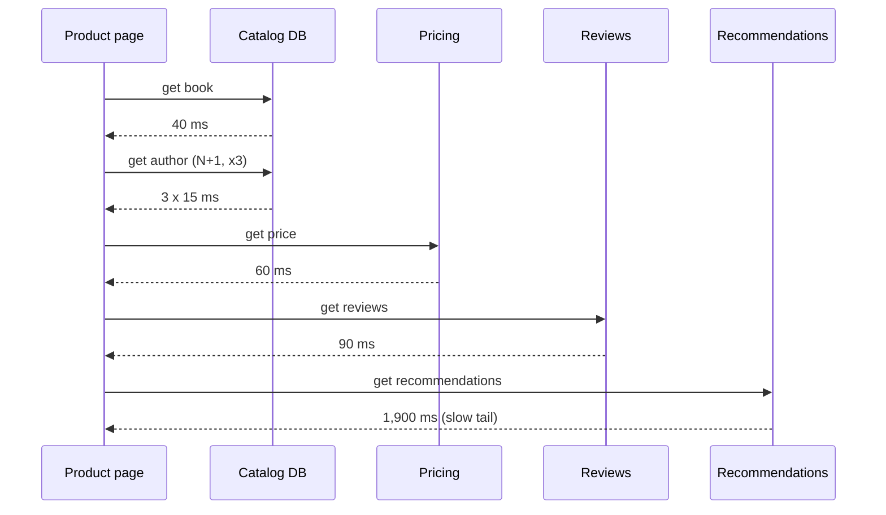

# Designing for Performance

## Introduction

**Performance** is how quickly and efficiently a system does its work: how long one request takes (**latency**) and how much work it gets through per second (**throughput**). Users feel latency. Your cloud bill feels throughput.

Most performance problems are **architectural**, not about clever code. A product page that makes 101 database round trips, or calls four services one after another, will be slow even if every line of code is perfectly tuned. Conversely, a well-shaped request path stays fast even in a slow language.

An analogy: a restaurant kitchen is slow not because the chef chops slowly, but because the waiter walks to the kitchen once per ingredient, or because the dessert chef waits for the main course chef to finish before starting. Fix the workflow first, and the knife skills later.

This page covers:

- measuring the right thing: percentiles and tail latency, not averages
- latency budgets across a request path
- the most common architectural performance killers: chatty data access, serial calls, and missing caching
- degrading gracefully instead of waiting on slow dependencies
- performance budgets as automated checks
- when to stop optimizing

Performance is related to [scalability](./0-arch-scalability.mdx) but not the same. Performance asks "how fast is one request?" Scalability asks "does it stay fast when we add load and machines?"

## Measure Before You Design

### Averages lie

Latency distributions have long tails. The average hides them. Here is a simulated product page where 2% of requests hit a slow path, for example a cache miss followed by a cold database query:

```python
import random
import statistics

random.seed(7)
# Simulated product-page latencies in ms: most requests are fast, a few hit a slow path.
latencies = [random.gauss(120, 20) for _ in range(9_800)] + \
            [random.uniform(800, 2_500) for _ in range(200)]

cuts = statistics.quantiles(latencies, n=1000)   # 999 cut points
p50, p95, p99, p999 = cuts[499], cuts[949], cuts[989], cuts[998]
print(f"mean  {statistics.fmean(latencies):7.0f} ms")
print(f"p50   {p50:7.0f} ms")
print(f"p95   {p95:7.0f} ms")
print(f"p99   {p99:7.0f} ms")
print(f"p99.9 {p999:7.0f} ms")
```

Output:

```text
mean      152 ms
p50       121 ms
p95       157 ms
p99      1707 ms
p99.9    2417 ms
```

The mean of 152 ms looks healthy. But 1 in 100 requests takes over 1.7 seconds, and on a busy site that is thousands of unhappy users per hour. Your most active customers make the most requests, so they are the most likely to hit the tail.

:::tip
State performance requirements as percentiles: "p95 under 300 ms and p99 under 800 ms, measured at the load balancer." The [Google SRE workbook](https://sre.google/workbook/implementing-slos/) uses latency SLOs in exactly this shape.
:::

### Tail latency gets worse with fan-out

Jeffrey Dean and Luiz André Barroso's article ["The Tail at Scale"](https://research.google/pubs/the-tail-at-scale/) (Communications of the ACM, 2013) showed why tails matter so much in distributed systems: if a page waits for many backend calls, it is as slow as the slowest one.

```python
def chance_any_slow(per_call_p99_hit: float, fan_out: int) -> float:
    """Probability that at least one of `fan_out` parallel calls lands in its slow tail."""
    return 1 - (1 - per_call_p99_hit) ** fan_out

for fan_out in [1, 5, 20, 100]:
    print(f"fan-out {fan_out:>3}: {chance_any_slow(0.01, fan_out):6.1%} of page loads see a p99-slow call")
```

Output:

```text
fan-out   1:   1.0% of page loads see a p99-slow call
fan-out   5:   4.9% of page loads see a p99-slow call
fan-out  20:  18.2% of page loads see a p99-slow call
fan-out 100:  63.4% of page loads see a p99-slow call
```

A backend's rare p99 becomes the page's common case. This is an architectural argument against deep, wide call graphs, and a reason to give each dependency a timeout and a fallback.

### Profile, don't guess

Before redesigning, find where time actually goes:

- **Distributed traces** show which hop in a request is slow. See [Designing for Observability](./3-arch-observability.mdx).
- **Profilers** show which functions are hot inside one process. In Python, `python -m cProfile -s cumtime app.py` is built in; sampling profilers such as py-spy can attach to a running process.
- **Database query logs and `EXPLAIN`** show missing indexes and full table scans, which are among the most common causes of slowness.

## Latency Budgets

A **latency budget** splits an end-to-end target across the parts of a request. It turns a vague "make it fast" into a design constraint each team can check.



Budgets make trade-offs visible. If recommendations need 80 ms but the page only has 60 ms left, the team must choose: make the call in parallel, cache it, load it after the page renders, or drop it. Without a budget, every team adds "just 20 ms" until the page takes two seconds.

## Architectural Performance Killers

### 1. Chatty data access (the N+1 problem)

The classic one. Code loads a list, then makes one more query per item. Each query is fast on its own, but round trips add up. This example adds a 2 ms delay to each query to simulate a database across a network:

```python
import sqlite3
import time

NETWORK_ROUND_TRIP_S = 0.002   # pretend the database is 2 ms away, as it would be over a network

class CountingDB:
    def __init__(self) -> None:
        self.conn = sqlite3.connect(":memory:")
        self.queries = 0

    def query(self, sql: str, params: tuple = ()) -> list[tuple]:
        self.queries += 1
        time.sleep(NETWORK_ROUND_TRIP_S)
        return self.conn.execute(sql, params).fetchall()

db = CountingDB()
db.conn.executescript("""
    CREATE TABLE authors (id INTEGER PRIMARY KEY, name TEXT);
    CREATE TABLE books (id INTEGER PRIMARY KEY, title TEXT, author_id INTEGER);
""")
db.conn.executemany("INSERT INTO authors VALUES (?, ?)", [(i, f"Author {i}") for i in range(1, 51)])
db.conn.executemany("INSERT INTO books VALUES (?, ?, ?)",
                    [(i, f"Book {i}", (i % 50) + 1) for i in range(1, 101)])

def list_page_n_plus_one() -> list[str]:
    books = db.query("SELECT id, title, author_id FROM books ORDER BY id LIMIT 100")
    rows = []
    for _, title, author_id in books:                      # one extra query per book
        (name,) = db.query("SELECT name FROM authors WHERE id = ?", (author_id,))[0]
        rows.append(f"{title} by {name}")
    return rows

def list_page_joined() -> list[str]:
    books = db.query("""
        SELECT b.title, a.name FROM books b JOIN authors a ON a.id = b.author_id
        ORDER BY b.id LIMIT 100
    """)
    return [f"{title} by {name}" for title, name in books]

for fn in (list_page_n_plus_one, list_page_joined):
    db.queries = 0
    start = time.perf_counter()
    rows = fn()
    elapsed_ms = (time.perf_counter() - start) * 1000
    print(f"{fn.__name__:<22} rows={len(rows)} queries={db.queries:<3} time={elapsed_ms:6.1f} ms")
```

Example output (timings vary by machine):

```text
list_page_n_plus_one   rows=100 queries=101 time= 207.7 ms
list_page_joined       rows=100 queries=1   time=   2.2 ms
```

ORMs make N+1 easy to write by accident, because `book.author.name` looks like a field access but runs a query. Most ORMs have an eager-loading option, such as `select_related`/`prefetch_related` in Django or `selectinload` in SQLAlchemy. The same problem appears between services: a "get order" endpoint that calls the catalog service once per line item. The architectural fix is the same: **batch** (one call for many IDs) or **co-locate** data the page always needs together.

### 2. Serial calls that could be parallel

When a page needs data from independent services, calling them one after another adds their latencies. Calling them concurrently costs only the slowest one.

```python
import asyncio
import time

async def call(service: str, latency_s: float) -> str:
    await asyncio.sleep(latency_s)          # stands in for an HTTP call
    return f"{service} ok"

DEPENDENCIES = {"catalog": 0.08, "pricing": 0.05, "reviews": 0.12, "recommendations": 0.15}

async def sequential() -> list[str]:
    return [await call(name, lat) for name, lat in DEPENDENCIES.items()]

async def concurrent() -> list[str]:
    return await asyncio.gather(*(call(name, lat) for name, lat in DEPENDENCIES.items()))

async def main() -> None:
    for fn in (sequential, concurrent):
        start = time.perf_counter()
        await fn()
        print(f"{fn.__name__:<10} {(time.perf_counter() - start) * 1000:5.0f} ms")

asyncio.run(main())
```

Example output:

```text
sequential   401 ms
concurrent   151 ms
```

Only parallelize calls that are truly independent. If pricing needs the catalog result, they must stay in order. That dependency graph is worth drawing during design.

### 3. Waiting on optional dependencies

Not every part of a page is equally important. Recommendations are nice to have; the price is essential. Give optional dependencies a short timeout and a fallback, so a slow recommendations service can't make the whole page slow:

```python
import asyncio

async def call(service: str, latency_s: float) -> str:
    await asyncio.sleep(latency_s)
    return f"{service} ok"

async def optional(coro, timeout_s: float, fallback: str) -> str:
    """Wait at most timeout_s for a non-critical dependency, then degrade."""
    try:
        return await asyncio.wait_for(coro, timeout=timeout_s)
    except TimeoutError:
        return fallback

async def product_page() -> dict[str, str]:
    catalog, pricing, recs = await asyncio.gather(
        call("catalog", 0.08),
        call("pricing", 0.05),
        optional(call("recommendations", 1.50), timeout_s=0.20, fallback="bestsellers (cached)"),
    )
    return {"catalog": catalog, "pricing": pricing, "recommendations": recs}

print(asyncio.run(product_page()))
```

Output:

```text
{'catalog': 'catalog ok', 'pricing': 'pricing ok', 'recommendations': 'bestsellers (cached)'}
```

This is graceful degradation, covered more fully in [Designing for Reliability and Resilience](./2-arch-reliability.mdx). Since Python 3.11, `asyncio.wait_for` raises the built-in `TimeoutError`.

An advanced tail-latency technique from "The Tail at Scale" is the **hedged request**: if a read hasn't answered within, say, its p95 latency, send the same request to a second replica and use whichever answers first. It cuts tail latency at the cost of a small amount of extra load. It is only safe for idempotent reads.

### 4. Recomputing what you already know

Caching trades memory and freshness for speed. Inside one process, Python's `functools.lru_cache` is the simplest form:

```python
import time
from functools import lru_cache

def slow_tax_rules(country: str) -> dict[str, float]:
    time.sleep(0.05)                     # pretend this reads a config service
    return {"books": 0.0 if country == "GB" else 0.07}

@lru_cache(maxsize=256)
def tax_rules(country: str) -> tuple[tuple[str, float], ...]:
    return tuple(slow_tax_rules(country).items())   # return an immutable value from a cache

start = time.perf_counter()
for _ in range(100):
    tax_rules("US")
print(f"100 lookups: {(time.perf_counter() - start) * 1000:.0f} ms")
print(tax_rules.cache_info())
```

Example output:

```text
100 lookups: 50 ms
CacheInfo(hits=99, misses=1, maxsize=256, currsize=1)
```

One slow call, 99 free ones. Note the cache returns an immutable tuple: returning a shared mutable dict from a cache invites a caller to modify it and corrupt every later result. The tax rates in this example are made up.

At the architecture level, caching exists at many layers, each with different freshness and invalidation trade-offs:

| Layer | Example | Typical use |
| --- | --- | --- |
| Browser / HTTP | `Cache-Control` headers | Static assets, public pages |
| CDN | Edge cache | Images, scripts, cacheable HTML |
| Application (in-process) | `lru_cache`, a dict | Small, hot, rarely changing data |
| Distributed cache | [Redis](/docs/middleware/redis) | Shared across instances, sessions, computed views |
| Database | Buffer pool, materialized views | Repeated queries, expensive aggregations |

Choosing among these is covered in [Caching Strategies](../11-arch-data-architecture/2-arch-caching-strategies.mdx).

### 5. Doing slow work in the request path

If the user doesn't need the result immediately, don't make them wait for it. Sending the confirmation email, generating the invoice PDF, and updating the search index can happen **after** responding, via a queue and background workers. The Azure catalog calls this [Asynchronous Request-Reply](https://learn.microsoft.com/en-us/azure/architecture/patterns/asynchronous-request-reply) when the client later needs to poll for the result.

### 6. Wrong data shape for the query

When a page needs data joined from five tables and aggregated, no amount of indexing makes that cheap at scale. Precompute it: a **materialized view** or a dedicated read model kept up to date by events. This is the core idea behind [CQRS](../9-arch-distributed-systems/3-arch-cqrs.mdx). The cost is extra storage and eventual consistency between the write model and the read model.

## Performance Budgets as Automated Checks

Performance tends to decay slowly, one small regression at a time. Turn your budget into a test that fails the build. This is a simple example of an architectural **fitness function** (see [Fitness Functions and Evolutionary Architecture](../13-arch-documenting-and-evolving/3-arch-fitness-functions.mdx)):

```python
# test_query_budget.py  (run with: pytest -q test_query_budget.py)
import sqlite3

class CountingConnection:
    def __init__(self) -> None:
        self.conn = sqlite3.connect(":memory:")
        self.count = 0
        self.conn.set_trace_callback(lambda _sql: self._inc())

    def _inc(self) -> None:
        self.count += 1

def render_book_list(db: CountingConnection) -> list[str]:
    rows = db.conn.execute(
        "SELECT b.title, a.name FROM books b JOIN authors a ON a.id = b.author_id"
    ).fetchall()
    return [f"{t} by {n}" for t, n in rows]

def test_book_list_uses_constant_queries() -> None:
    db = CountingConnection()
    db.conn.executescript("""
        CREATE TABLE authors (id INTEGER PRIMARY KEY, name TEXT);
        CREATE TABLE books (id INTEGER PRIMARY KEY, title TEXT, author_id INTEGER);
        INSERT INTO authors VALUES (1, 'Ada');
        INSERT INTO books VALUES (1, 'B1', 1), (2, 'B2', 1), (3, 'B3', 1);
    """)
    db.count = 0
    render_book_list(db)
    assert db.count <= 2, f"query budget exceeded: {db.count} queries"
```

Example output:

```text
.                                                                        [100%]
1 passed in 0.01s
```

Counting queries is stable across machines, unlike wall-clock timing, which makes it a good CI check. Wall-clock budgets belong in load tests that run against a production-like environment.

## Real-World Scenario

Your team runs an online bookstore. The product detail page has a p50 of 180 ms, but p99 is 2.4 seconds, and conversion data shows shoppers abandoning slow pages. The page is served by a backend that calls the catalog database, a pricing service, a reviews service, an inventory service and a recommendations service.

A trace of a slow request shows:



The fixes, in order of value:

1. **Treat recommendations as optional.** 200 ms timeout, then fall back to a cached "bestsellers in this category" list. This alone removes most of the p99 problem.
2. **Run independent calls concurrently.** Pricing, reviews, inventory and recommendations depend only on the book ID, so they run in parallel after the catalog lookup.
3. **Fix the N+1.** One joined query for book plus authors.
4. **Cache the read-mostly parts.** Book metadata changes rarely: cache it in Redis for a few minutes, invalidated when an editor updates the record. Prices change more often and stay uncached, to avoid showing a stale price at checkout.
5. **Add a query-count test and a p95 latency check** in the nightly load test so the page doesn't drift back.

**Why this approach:** the slowness came from the shape of the request (serial calls, chatty queries, waiting on a non-essential dependency), not from slow code. Reshaping the request path gives large wins without a rewrite.

**When to use it / when not to:** use timeouts, parallel calls and caching on any page with multiple dependencies and a latency target. Don't cache data where staleness is costly (prices at checkout, stock counts at payment) without a clear invalidation path. Don't parallelize calls that have real ordering dependencies.

**Alternatives and trade-offs:**

| Approach | Pros | Cons | Best for |
| --- | --- | --- | --- |
| Timeouts + fallbacks for optional parts | Huge tail-latency gain, cheap | Users sometimes see degraded content | Non-essential widgets |
| Parallel fan-out | Latency = slowest call, not the sum | More concurrent load on dependencies | Independent backend calls |
| Caching | Removes work entirely | Staleness, invalidation bugs, memory | Read-heavy, slowly changing data |
| Precomputed read model (CQRS) | Fast reads of complex views | Extra storage, eventual consistency, more moving parts | Complex aggregated pages at high volume |
| Client-side lazy loading | Fast first paint | More requests, layout shifts | Below-the-fold content |
| Rewrite hot path in a faster language | Raw CPU gains | Cost, two stacks to maintain | Truly CPU-bound hot loops, after profiling |

## Best Practices

- **Measure percentiles at the edge**, where users experience latency, not only inside services.
- **Set budgets early** and give each hop a share, so trade-offs happen during design rather than in an incident.
- **Minimize round trips**: batch, join, and avoid chatty interfaces between services.
- **Timeouts on every remote call**, shorter for optional dependencies.
- **Move non-essential work out of the request path** with queues.
- **Cache deliberately**, with an owner, a TTL and an invalidation plan for each cache.
- **Automate regression checks** with query-count tests and load tests.
- **Know when to stop.** Once you meet your targets with headroom, more optimization usually costs more in complexity than it returns. Knuth's warning about premature optimization is about optimizing without evidence, not a ban on designing for performance.

## Summary

- Performance is latency and throughput. Users feel the **tail**, so measure p95, p99 and p99.9, not averages.
- **Fan-out amplifies tail latency**: many parallel calls make rare slowness common.
- A **latency budget** turns a target into a design constraint per component.
- The big architectural wins are removing **N+1** access, running independent calls **concurrently**, **timing out** optional dependencies, **caching** read-mostly data, and moving slow work **off the request path**.
- Encode budgets in automated tests so performance doesn't erode release by release.

## Exercises

1. Run the percentile example with 5% slow requests instead of 2%. How do the mean and p95 change? Which number would you put on a dashboard?
2. Add an `inventory` call with 300 ms latency to the concurrent example. Then wrap it in `optional()` with a 100 ms timeout. What should the fallback show the user, and is that fallback safe?
3. Draw a latency budget for one important page in a system you know. Which hop has the least slack?
4. Write a query-count test for an endpoint in your own codebase that loads a list of items.

Related pages:

- [Designing for Scalability](./0-arch-scalability.mdx)
- [Caching Strategies](../11-arch-data-architecture/2-arch-caching-strategies.mdx)
- [Circuit Breaker, Retry and Timeout](../9-arch-distributed-systems/8-arch-circuit-breaker.mdx)
- [CQRS](../9-arch-distributed-systems/3-arch-cqrs.mdx)
