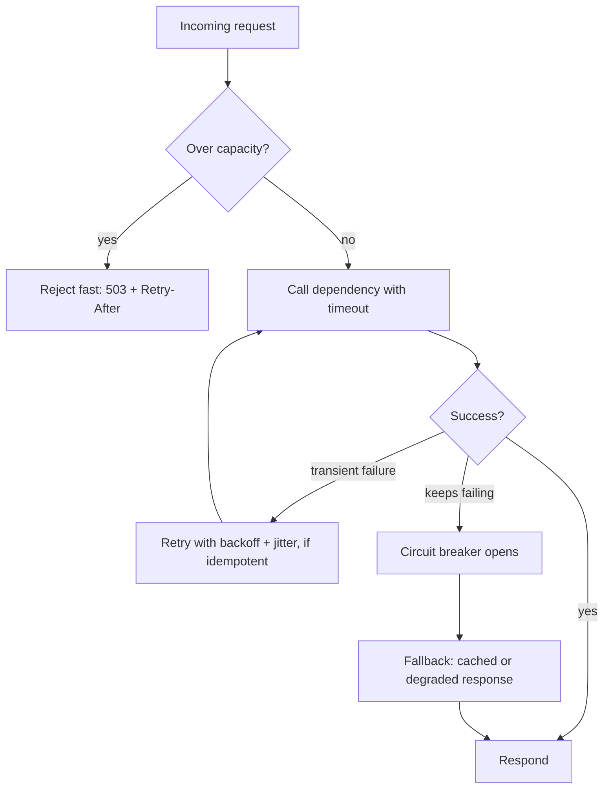
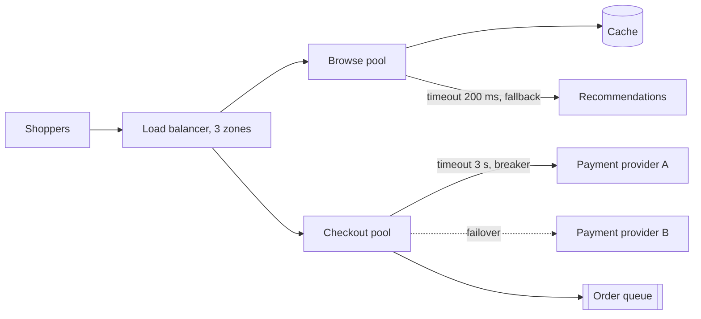

# Designing for Reliability and Resilience

## Introduction

**Reliability** is the ability of a system to keep doing what users expect, correctly, over time. **Resilience** is the part of reliability that deals with failure: absorbing faults, limiting the damage, and recovering quickly.

In a distributed system, something is always failing a little: a disk, a network link, a dependency deploying a bad build, a cloud zone having a bad afternoon. The fallacies of distributed computing start with "the network is reliable" for a reason. So the design question is not "how do we prevent all failures?" but **"what happens to users when this part fails, and how do we make that acceptable?"**

A good analogy is a ship. Ships are built expecting leaks: watertight bulkheads keep one flooded compartment from sinking the vessel, pumps run continuously, and lifeboats exist even though nobody plans to use them. Nobody designs a ship by assuming the hull will never be breached.

This page covers:

- how availability adds up (and multiplies down) across components
- SLIs, SLOs and error budgets as the way to decide "reliable enough"
- failure mode analysis: listing what can break before it does
- core resilience techniques: redundancy, timeouts, retries with jitter, graceful degradation, load shedding, health checks and static stability
- verifying resilience with chaos experiments

Detailed implementations of some patterns live elsewhere in this tutorial: [Circuit Breaker, Retry and Timeout](../9-arch-distributed-systems/8-arch-circuit-breaker.mdx), [Bulkheads, Rate Limiting and Backpressure](../9-arch-distributed-systems/9-arch-bulkhead-and-rate-limiting.mdx) and [Idempotency](../9-arch-distributed-systems/7-arch-idempotency.mdx). This page is about how they fit into an overall reliability design.

## Availability Math

**Availability** is the fraction of time (or of requests) a system works. Two rules explain most of reliability architecture:

- Components in **series** (all must work) multiply their availabilities, so the chain is **less** available than its weakest link.
- **Redundant** components in **parallel** (any one is enough) multiply their *unavailabilities*, so the group is **more** available than any member.

```python
from math import prod

def serial(*availabilities: float) -> float:
    """All components must work: multiply availabilities."""
    return prod(availabilities)

def parallel(a: float, copies: int) -> float:
    """At least one of N independent redundant copies must work."""
    return 1 - (1 - a) ** copies

MINUTES_PER_30_DAYS = 30 * 24 * 60

def downtime_minutes(a: float) -> float:
    return (1 - a) * MINUTES_PER_30_DAYS

checkout = serial(0.999, 0.999, 0.995, 0.999)   # gateway, app, payment provider, database
print(f"checkout chain        {checkout:.4%}  ~{downtime_minutes(checkout):5.0f} min down / 30 days")

app_tier = parallel(0.99, 3)                     # three app instances, each only 99%
print(f"3 x 99% app instances {app_tier:.4%}  ~{downtime_minutes(app_tier):5.2f} min down / 30 days")
```

Output:

```text
checkout chain        99.2018%  ~  345 min down / 30 days
3 x 99% app instances 99.9999%  ~ 0.04 min down / 30 days
```

The numbers are illustrative, but the lessons are real:

1. **Every synchronous dependency lowers your ceiling.** A checkout that calls four things in a row can't be more available than their product. Removing a dependency from the critical path, or making it asynchronous, often helps more than hardening it.
2. **Redundancy works, if failures are independent.** The parallel formula assumes the three instances don't fail together. Three instances in the same rack, on the same bad deploy, or sharing one database are not independent. Correlated failure is the enemy of redundancy.

## How Reliable Is Reliable Enough? SLOs and Error Budgets

100% reliability is the wrong target. It is unreachable, extremely expensive to approach, and users can't tell the difference past a point because their own Wi-Fi and phones fail more often. Google's [Site Reliability Engineering](https://sre.google/workbook/implementing-slos/) practice gives a vocabulary for choosing a target:

| Term | Meaning | Bookstore example |
| --- | --- | --- |
| **SLI** (indicator) | A measured ratio of good events to valid events | Share of checkout requests that return success in under 1 s |
| **SLO** (objective) | Your target for the SLI over a window | 99.9% over 30 days |
| **Error budget** | 100% minus the SLO: the unreliability you are allowed | 0.1% of checkout requests may fail |
| **SLA** (agreement) | A contract with consequences, usually looser than the SLO | Credits if monthly availability is below 99.5% |

The error budget turns reliability into a decision tool. While budget remains, teams ship features and take risks. When it runs out, a pre-agreed **error budget policy** kicks in: for example, freeze risky releases and prioritize reliability work until the service is back within its SLO.

```python
from dataclasses import dataclass

@dataclass(frozen=True)
class SLO:
    name: str
    target: float          # e.g. 0.999 means 99.9% of valid requests are good

    def report(self, good: int, valid: int) -> str:
        sli = good / valid
        budget = (1 - self.target) * valid         # bad requests we are allowed
        spent = valid - good
        remaining = 1 - spent / budget
        status = "OK, ship features" if remaining > 0.25 else (
            "CAUTION, slow down risky changes" if remaining > 0 else "EXHAUSTED, focus on reliability")
        return (f"{self.name}: SLI {sli:.3%} vs SLO {self.target:.1%} | "
                f"budget {budget:.0f} errors, spent {spent}, remaining {remaining:.0%} -> {status}")

checkout_slo = SLO("checkout availability", 0.999)
print(checkout_slo.report(good=1_998_700, valid=2_000_000))
print(checkout_slo.report(good=1_997_400, valid=2_000_000))
```

Output:

```text
checkout availability: SLI 99.935% vs SLO 99.9% | budget 2000 errors, spent 1300, remaining 35% -> OK, ship features
checkout availability: SLI 99.870% vs SLO 99.9% | budget 2000 errors, spent 2600, remaining -30% -> EXHAUSTED, focus on reliability
```

:::tip
Different parts of a system deserve different SLOs. Checkout and login may need 99.9% or more; book recommendations can live with much less. Setting one SLO for "the whole site" wastes effort on unimportant features and under-protects important ones.
:::

## Failure Mode Analysis

Before choosing techniques, list what can fail and what users would experience. A lightweight table, inspired by FMEA (Failure Mode and Effects Analysis), works well in a design review:

| Component | Failure mode | User impact | Detection | Mitigation |
| --- | --- | --- | --- | --- |
| Payment provider | Slow (5 s+) responses | Checkout hangs, workers tied up | Latency SLI, timeouts | 3 s timeout, circuit breaker, "try again" message |
| Recommendations | Down | Empty widget | Error rate | Fallback to cached bestsellers |
| Database primary | Instance lost | All writes fail | Health checks | Managed failover to standby in another zone |
| One availability zone | Outage | A third of capacity lost | Load balancer health checks | Run in 3 zones, sized to survive losing one |
| Bad deploy | Errors on new version | Elevated errors | Canary metrics | Canary release and automatic rollback |
| Traffic spike | Overload | Everyone gets slow | Saturation, queue depth | Autoscaling plus load shedding |

The **detection** column matters as much as the mitigation. A failure you can't see can't be handled. See [Designing for Observability](./3-arch-observability.mdx).

## Core Resilience Techniques



### 1. Redundancy and failure domains

Run more than one of everything that matters, and spread copies across **failure domains** (hosts, racks, availability zones, sometimes regions) so that one event can't take out all copies. Size for the loss: if you run in three zones and must survive losing one, each zone needs to carry half of peak, not a third.

### 2. Timeouts on every remote call

A call without a timeout can wait forever, holding a thread, a connection and memory. Under load, slow dependencies are more dangerous than dead ones because they tie up resources silently. Choose timeouts from measured latency (for example a little above the dependency's p99.9) and keep them shorter than the caller's own timeout, or the work is wasted.

### 3. Retries with exponential backoff and jitter

Many failures are transient: a dropped connection, a 503 during a deploy. Retrying fixes them, but naive retries are dangerous. If 1,000 clients all retry immediately, they create a **retry storm** that keeps the struggling service down. Two fixes, both described in the AWS Builders' Library article on timeouts, retries and backoff with jitter:

- **Exponential backoff:** wait longer after each failure.
- **Jitter:** randomize the wait so clients don't retry in sync.

```python
import random
from collections.abc import Callable
from typing import TypeVar

T = TypeVar("T")

class TransientError(Exception):
    """A failure worth retrying: timeout, 503, connection reset."""

def retry(op: Callable[[], T], *, attempts: int = 4, base_s: float = 0.1, cap_s: float = 2.0,
          sleep: Callable[[float], None], rng: random.Random) -> T:
    for attempt in range(1, attempts + 1):
        try:
            return op()
        except TransientError as exc:
            if attempt == attempts:
                raise
            # Exponential backoff with "full jitter": wait a random time in [0, min(cap, base * 2^n)]
            delay = rng.uniform(0, min(cap_s, base_s * 2 ** attempt))
            print(f"  attempt {attempt} failed ({exc}); retrying in {delay:.3f}s")
            sleep(delay)
    raise AssertionError("unreachable")

# A fake inventory service that fails twice, then succeeds.
responses = iter([TransientError("503"), TransientError("timeout"), "in stock: 7"])
def check_inventory() -> str:
    result = next(responses)
    if isinstance(result, Exception):
        raise result
    return result

print(retry(check_inventory, sleep=lambda s: None, rng=random.Random(1)))
```

Output:

```text
  attempt 1 failed (503); retrying in 0.027s
  attempt 2 failed (timeout); retrying in 0.339s
in stock: 7
```

The `sleep` and `rng` parameters are injected so the code is deterministic in tests, a small example of [designing for testability](./5-arch-testability.mdx). In production you'd pass `time.sleep` and a normal `random.Random()`, or use a library such as `tenacity`.

Retry rules that matter architecturally:

- **Only retry idempotent operations**, or make them idempotent with an idempotency key. Retrying "charge card" without one can charge twice.
- **Retry at one layer only.** If the browser, the gateway, the service and the client library each retry 3 times, one failure becomes 81 attempts.
- **Combine with a circuit breaker** so that a persistent failure stops retries entirely. The Azure catalog recommends pairing [Retry](https://learn.microsoft.com/en-us/azure/architecture/patterns/retry) with [Circuit Breaker](https://learn.microsoft.com/en-us/azure/architecture/patterns/circuit-breaker) for exactly this reason.

### 4. Graceful degradation

Decide in advance which features are **essential** and which are **optional**, and give optional ones a fallback.

```python
from dataclasses import dataclass, field

class DependencyDown(Exception):
    pass

@dataclass
class ShippingQuotes:
    healthy: bool = True
    def quote(self, postcode: str) -> str:
        if not self.healthy:
            raise DependencyDown("shipping-quotes")
        return "2 days, $3.99"

@dataclass
class CheckoutPage:
    shipping: ShippingQuotes
    degraded: list[str] = field(default_factory=list)

    def shipping_estimate(self, postcode: str) -> str:
        try:
            return self.shipping.quote(postcode)
        except DependencyDown:
            self.degraded.append("shipping")               # record it so dashboards show degradation
            return "3-5 days, calculated at dispatch"      # safe, honest fallback

page = CheckoutPage(ShippingQuotes(healthy=False))
print(page.shipping_estimate("10001"))
print("degraded features:", page.degraded)
```

Output:

```text
3-5 days, calculated at dispatch
degraded features: ['shipping']
```

Good fallbacks are **honest** (they don't pretend to be live data when correctness matters) and **observable** (degradation is recorded, so you notice it). Some things must **fail closed** rather than degrade: never fall back to "assume the payment succeeded" or "assume the user is authorized".

### 5. Load shedding

When a system is overloaded, accepting more work makes every request slow and can cause a total collapse. It is better to reject some requests quickly so the rest succeed.

```python
import threading
from contextlib import contextmanager

class LoadShedder:
    """Reject new work fast when too much is already in flight, instead of queueing forever."""
    def __init__(self, max_in_flight: int) -> None:
        self._sem = threading.BoundedSemaphore(max_in_flight)

    @contextmanager
    def admit(self):
        if not self._sem.acquire(blocking=False):
            raise OverloadedError("503 Service Unavailable, Retry-After: 2")
        try:
            yield
        finally:
            self._sem.release()

class OverloadedError(Exception):
    pass

shedder = LoadShedder(max_in_flight=2)
with shedder.admit():
    with shedder.admit():
        try:
            with shedder.admit():
                print("third request admitted")
        except OverloadedError as e:
            print("third request rejected:", e)
with shedder.admit():
    print("capacity freed, new request admitted")
```

Output:

```text
third request rejected: 503 Service Unavailable, Retry-After: 2
capacity freed, new request admitted
```

More sophisticated versions shed **low-priority** traffic first (background sync, crawlers) and protect high-priority traffic (checkout). See [Bulkheads, Rate Limiting and Backpressure](../9-arch-distributed-systems/9-arch-bulkhead-and-rate-limiting.mdx).

### 6. Health checks that mean something

Load balancers and orchestrators route traffic based on health checks, so a bad health check can cause an outage on its own. [Kubernetes](/docs/devops/kubernetes) separates two questions, and so should your design:

| Check | Question | If it fails | Should it check dependencies? |
| --- | --- | --- | --- |
| **Liveness** | Is this process stuck beyond repair? | Restart the process | No. Otherwise a database blip restarts every instance at once |
| **Readiness** | Can this instance serve traffic right now? | Stop sending it traffic | Its own essential prerequisites, carefully |

A classic failure: every instance's health check calls the shared database, the database slows down, every instance is marked unhealthy, and the load balancer has nowhere to send traffic. A slow database became a full outage.

### 7. Static stability

The AWS Builders' Library describes **static stability**: a system should keep working in its current state when a dependency (especially a control plane) fails, rather than needing that dependency to react. Its EC2 example: if the control plane that launches instances and changes configuration is impaired, running instances keep sending and receiving traffic with the configuration they already have.

In practice this means:

- Pre-provision capacity to survive a zone loss, instead of depending on launching new instances during the outage.
- Cache configuration, feature flags and credentials locally, so a config service outage doesn't break request handling.
- Keep the **data plane** (serving requests) simpler and more available than the **control plane** (changing things).

### 8. Limit the blast radius

Even with all of the above, some failures will hit. Design so they hit **fewer users**:

- **Bulkheads:** separate thread pools or connection pools per dependency, so one slow dependency can't exhaust them all.
- **Cells or stamps:** split users across independent copies of the stack, so a bad deploy or poison data affects one cell. The Azure [Deployment Stamps](https://learn.microsoft.com/en-us/azure/architecture/patterns/deployment-stamp) pattern describes this.
- **Progressive rollouts:** deploy to a small slice first. See [Designing for Deployability](./6-arch-deployability.mdx).

## Verify It: Chaos Engineering

Resilience features that are never exercised tend to be broken when you need them. **Chaos engineering** (see [principlesofchaos.org](https://principlesofchaos.org/)) runs controlled experiments: form a hypothesis ("if the recommendations service is down, checkout success stays above 99.9%"), inject the failure in a controlled way, and compare against steady state.

Start small and safe: in a test environment, with one failure at a time, with an abort button. Game days, where the team practices responding to a simulated outage, test the people and runbooks as well as the software.

## Real-World Scenario

Your team runs an online bookstore. Last quarter, a payment provider had a 40-minute slowdown. Checkout requests hung, the app's worker threads all ended up waiting on payment calls, and the **entire site** went down, including browsing, which doesn't need payments at all. Leadership asks for a design that "doesn't let one vendor take us down".



The redesign:

1. **Set SLOs per journey.** Browsing: 99.9%. Checkout: 99.9% success for valid attempts. Recommendations: best effort.
2. **Bulkhead the pools.** Browsing and checkout run in separate worker pools (or separate deployments), so checkout trouble can't starve browsing.
3. **Timeout and circuit-break payments.** 3 s timeout, a circuit breaker that opens after a burst of failures, and an idempotency key on every payment request so retries can't double-charge.
4. **Degrade honestly.** When the breaker is open, either route to a second payment provider or accept the order as "pending payment" and confirm by email once payment completes, depending on the fraud and business rules agreed with the finance team.
5. **Fix health checks.** Liveness no longer calls the payment provider or database.
6. **Run a game day** that injects payment latency in staging and checks that browsing SLOs hold.

**Why this approach:** the outage was caused by **coupling** (a shared pool and a missing timeout), not by the vendor alone. Isolating the failure and bounding wait times turns a site-wide outage into a degraded checkout.

**When to use it / when not to:** bulkheads, breakers and failover fit any system with critical external dependencies. A second payment provider is a big investment (integration, reconciliation, contracts), justified only if checkout revenue during outages exceeds that cost. An internal admin tool needs none of this: a timeout and a clear error message are enough.

**Alternatives and trade-offs:**

| Approach | Pros | Cons | Best for |
| --- | --- | --- | --- |
| Timeouts + circuit breaker | Cheap, stops cascading failure | Users still see errors for that feature | Every remote dependency |
| Bulkheads (separate pools) | Contains the blast radius | Some idle capacity, more config | Mixed critical and non-critical traffic |
| Async "pending" orders | Checkout keeps working during outage | Payment may fail later, needs customer follow-up | Businesses that can tolerate delayed confirmation |
| Second provider failover | Highest checkout availability | Expensive, complex reconciliation | High-revenue checkout |
| Multi-region active-active | Survives region loss | Very high cost and data consistency complexity | Systems where regional outage is unacceptable |

## Common Mistakes

- **No timeouts**, or default timeouts of 30-60 seconds that are far longer than any user will wait.
- **Retrying everything everywhere**, causing retry storms and duplicate side effects.
- **Health checks that check the world**, turning a dependency blip into a fleet-wide restart.
- **Redundancy with shared fate**: replicas in one zone, all instances on one bad config push.
- **Untested failover**: backups never restored, standbys never promoted until the real outage.
- **Aiming for 100%.** Each extra "nine" costs far more than the last. Spend the error budget on shipping value.
- **Fallbacks that lie**, such as showing stale stock levels as live at payment time.

## Summary

- Reliability is about **what users experience when parts fail**, not about preventing all failure.
- **Serial dependencies multiply** availability down; **independent redundancy** multiplies it up.
- **SLOs and error budgets** define "reliable enough" and balance features against stability.
- Use **failure mode analysis** to list failures, impact, detection and mitigation before you build.
- Core techniques: redundancy across failure domains, **timeouts**, **retries with backoff and jitter** for idempotent calls, **graceful degradation**, **load shedding**, meaningful **health checks**, **static stability** and **blast-radius** limits.
- **Test resilience** with chaos experiments and game days.

## Exercises

1. Compute the availability of a request path that calls five dependencies in series, each at 99.95%. Then make one of them optional with a fallback. What changes?
2. Write a failure mode table for a system you know, with at least five rows. Which failure has no detection today?
3. Extend the `retry` function so it refuses to retry when the operation is marked non-idempotent, and add a total time limit across all attempts.
4. Design an error budget policy for the bookstore's checkout: what happens at 50%, 25% and 0% remaining, and who decides?

Related pages:

- [Circuit Breaker, Retry and Timeout](../9-arch-distributed-systems/8-arch-circuit-breaker.mdx)
- [Idempotency](../9-arch-distributed-systems/7-arch-idempotency.mdx)
- [Designing for Observability](./3-arch-observability.mdx)
- [Thinking in Trade-offs](../0-arch-fundamentals/4-arch-trade-offs.mdx)
