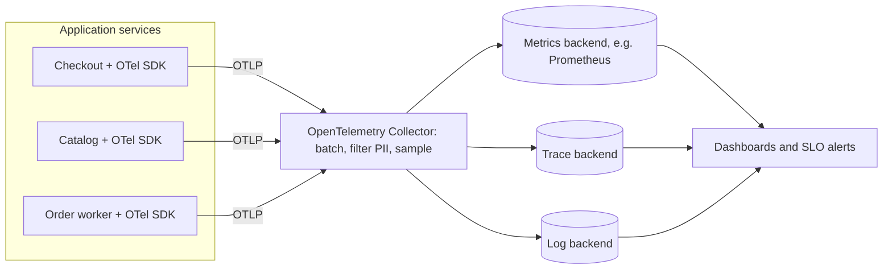

# Designing for Observability

## Introduction

**Observability** is how well you can understand what a system is doing from the outside, using the data it emits, including for problems you didn't predict. **Monitoring** answers questions you knew to ask in advance ("is CPU above 80%?"). Observability lets you ask new questions during an incident ("why are checkout requests from wallet payments in the EU slow since 14:05?") without shipping new code.

A doctor's checkup is a good analogy. A thermometer is monitoring: one known number with a threshold. Observability is the full set of tools the doctor can use when something unexpected shows up: blood tests, scans, a patient history. You can't add the patient history after the illness starts. In the same way, **observability is an architectural property you design in**, not a dashboard you add later. The Azure Architecture Center even lists "observability implementation can be delayed" as a modern fallacy of distributed computing.

This page covers:

- the telemetry signals and what each is good for
- structured logs with correlation IDs
- metrics using the RED and USE methods, and the cardinality trap
- distributed tracing with OpenTelemetry, with runnable Python
- the telemetry pipeline: context propagation, the Collector, and sampling
- alerting on symptoms and SLOs, not on causes

## The Signals

| Signal | What it is | Good for | Weakness |
| --- | --- | --- | --- |
| **Metrics** | Numbers aggregated over time (counters, gauges, histograms) | Dashboards, alerts, trends, cheap at scale | Lose per-request detail |
| **Logs** | Timestamped records of discrete events | Details of what happened and why | Expensive at volume; hard to correlate across services without IDs |
| **Traces** | The path of one request across services, as a tree of timed spans | Finding *where* time or errors happen in a distributed request | Usually sampled; need instrumentation everywhere |
| **Profiles** | Where CPU and memory go inside a process | Finding hot code | Newer in OpenTelemetry; tooling still maturing |

The signals are most useful when **linked**: a spike on a latency graph leads to example traces, a slow span leads to the logs written during that span. That linking only works if you designed shared identifiers in from the start.

[OpenTelemetry](https://opentelemetry.io/) (OTel), a CNCF project, has become the common vendor-neutral standard for producing telemetry. You instrument once with its APIs and send data to whatever backend you choose ([Prometheus](/docs/observability/prometheus), [Grafana](/docs/observability/grafana) and Loki, Jaeger, or a commercial tool). Signal maturity differs per language and changes over time: at the time of writing, the [OTel status page](https://opentelemetry.io/status/) lists Python traces and metrics as stable and Python logs as still in development. Check it before you commit to an approach.

## Structured Logs with Correlation IDs

Plain-text logs like `Payment slow for c-1001 (2140ms)` are easy to write and hard to query. **Structured logs** emit key-value data (usually JSON), so you can filter on `duration_ms > 2000` and group by `provider`.

The second key design decision is a **correlation ID**: an ID assigned at the edge of the system and attached to every log line, in every service, for that request.

```python
import json
import logging
import uuid
from contextvars import ContextVar

request_id: ContextVar[str] = ContextVar("request_id", default="-")

class JsonFormatter(logging.Formatter):
    def format(self, record: logging.LogRecord) -> str:
        entry = {
            "ts": self.formatTime(record, "%Y-%m-%dT%H:%M:%S"),
            "level": record.levelname,
            "logger": record.name,
            "msg": record.getMessage(),
            "request_id": request_id.get(),
        }
        entry.update(getattr(record, "fields", {}))      # structured extras
        return json.dumps(entry)

handler = logging.StreamHandler()
handler.setFormatter(JsonFormatter())
log = logging.getLogger("checkout")
log.addHandler(handler)
log.setLevel(logging.INFO)

def place_order(customer_id: str, total_cents: int) -> None:
    request_id.set(uuid.uuid4().hex[:8])          # normally taken from an incoming header
    log.info("order received", extra={"fields": {"customer_id": customer_id, "total_cents": total_cents}})
    log.warning("payment slow", extra={"fields": {"provider": "acme-pay", "duration_ms": 2140}})

place_order("c-1001", 4599)
```

Example output (the ID and timestamp will differ):

```text
{"ts": "2026-10-11T03:49:53", "level": "INFO", "logger": "checkout", "msg": "order received", "request_id": "0d26843f", "customer_id": "c-1001", "total_cents": 4599}
{"ts": "2026-10-11T03:49:53", "level": "WARNING", "logger": "checkout", "msg": "payment slow", "request_id": "0d26843f", "provider": "acme-pay", "duration_ms": 2140}
```

`ContextVar` keeps the ID correct per request even with threads or `asyncio`, so business code never passes it around by hand. That is the architectural point: **cross-cutting concerns belong in infrastructure** (middleware, logging setup), not sprinkled through domain code. With OpenTelemetry, you'd typically use the trace ID as the correlation ID, so logs and traces join automatically.

Log design rules:

- **Log events, not narration.** "order received" with fields beats "Now entering the order function".
- **Never log secrets or full personal data**: passwords, tokens, card numbers. Treat logs as a data store with its own access controls (see [Security by Design](./4-arch-security-by-design.mdx)).
- **Agree on field names** across services (`request_id`, `customer_id`, `duration_ms`), or queries become impossible. OTel's semantic conventions help here.

## Metrics: What to Measure

Metrics are cheap to store and fast to query, so they power dashboards and alerts. Two well-known methods tell you what to measure:

- **RED** (Tom Wilkie), for **request-driven services**: **R**ate, **E**rrors, **D**uration.
- **USE** (Brendan Gregg), for **resources** like CPU, disks, pools and queues: **U**tilization, **S**aturation, **E**rrors.

Google's SRE book has a similar list, the **four golden signals**: latency, traffic, errors and saturation.

Here is RED for a checkout service with the OpenTelemetry metrics API. An in-memory reader stands in for a real exporter so we can print the results:

```python
import random

from opentelemetry import metrics
from opentelemetry.sdk.metrics import MeterProvider
from opentelemetry.sdk.metrics.export import InMemoryMetricReader

reader = InMemoryMetricReader()          # in production: PeriodicExportingMetricReader + an OTLP exporter
metrics.set_meter_provider(MeterProvider(metric_readers=[reader]))
meter = metrics.get_meter("bookstore.checkout")

requests = meter.create_counter("checkout.requests", unit="{request}", description="Checkout requests")
duration = meter.create_histogram("checkout.duration", unit="ms", description="Checkout latency")

random.seed(3)
for _ in range(500):
    failed = random.random() < 0.02
    attrs = {"outcome": "error" if failed else "success", "payment.method": random.choice(["card", "wallet"])}
    requests.add(1, attrs)
    duration.record(random.uniform(80, 400) if not failed else 3000, attrs)

for rm in reader.get_metrics_data().resource_metrics:
    for sm in rm.scope_metrics:
        for m in sm.metrics:
            for p in m.data.data_points:
                value = p.value if hasattr(p, "value") else f"count={p.count} sum={p.sum:.0f}"
                print(f"{m.name:<18} {dict(p.attributes)} -> {value}")
```

Install with `pip install opentelemetry-sdk` (this example was checked with version 1.45). Output:

```text
checkout.requests  {'outcome': 'success', 'payment.method': 'card'} -> 226
checkout.requests  {'outcome': 'success', 'payment.method': 'wallet'} -> 265
checkout.requests  {'outcome': 'error', 'payment.method': 'wallet'} -> 5
checkout.requests  {'outcome': 'error', 'payment.method': 'card'} -> 4
checkout.duration  {'outcome': 'success', 'payment.method': 'card'} -> count=226 sum=52531
checkout.duration  {'outcome': 'success', 'payment.method': 'wallet'} -> count=265 sum=61350
checkout.duration  {'outcome': 'error', 'payment.method': 'wallet'} -> count=5 sum=15000
checkout.duration  {'outcome': 'error', 'payment.method': 'card'} -> count=4 sum=12000
```

From these two instruments you get all three RED values: rate (count over time), errors (count where `outcome=error`), and duration (the histogram, from which the backend computes percentiles). Use a **histogram** for latency, never an average gauge; [performance](./1-arch-performance.mdx) lives in the tail.

:::warning The cardinality trap
Every unique combination of attribute values creates a separate time series. `outcome` (2 values) times `payment.method` (2 values) is 4 series. Add `customer_id` with a million values and you have millions of series, which can overload or bankrupt a metrics backend. Keep high-cardinality fields (user IDs, order IDs, full URLs) in **logs and traces**, and keep metric attributes to small, bounded sets.
:::

## Distributed Tracing

In a monolith, a stack trace shows where time went. Once a request crosses several services and queues, you need a **distributed trace**: a tree of **spans**, each recording one unit of work with a start time, duration, attributes and status. All spans in a request share a **trace ID**.

```python
import time

from opentelemetry import trace
from opentelemetry.sdk.resources import Resource
from opentelemetry.sdk.trace import ReadableSpan, TracerProvider
from opentelemetry.sdk.trace.export import ConsoleSpanExporter, SimpleSpanProcessor
from opentelemetry.trace import Status, StatusCode

def one_line(span: ReadableSpan) -> str:
    ms = (span.end_time - span.start_time) / 1e6
    parent = format(span.parent.span_id, "016x")[:6] if span.parent else "root  "
    trace_id = format(span.context.trace_id, "032x")[:8]
    return (f"trace={trace_id} span={format(span.context.span_id, '016x')[:6]} parent={parent} "
            f"{span.name:<22} {ms:6.1f} ms {span.status.status_code.name:<5} {dict(span.attributes)}\n")

provider = TracerProvider(resource=Resource.create({"service.name": "bookstore-checkout"}))
# SimpleSpanProcessor exports each span immediately: fine for demos. Use BatchSpanProcessor in production.
provider.add_span_processor(SimpleSpanProcessor(ConsoleSpanExporter(formatter=one_line)))
trace.set_tracer_provider(provider)
tracer = trace.get_tracer("bookstore.checkout")

def reserve_stock(isbn: str) -> None:
    with tracer.start_as_current_span("reserve_stock") as span:
        span.set_attribute("book.isbn", isbn)
        time.sleep(0.02)

def charge_card(amount_cents: int) -> None:
    with tracer.start_as_current_span("charge_card") as span:
        span.set_attribute("payment.provider", "acme-pay")
        time.sleep(0.15)
        try:
            raise TimeoutError("provider did not answer in 150 ms")
        except TimeoutError as exc:
            span.record_exception(exc)
            span.set_status(Status(StatusCode.ERROR, "payment timeout"))

with tracer.start_as_current_span("POST /checkout") as root:
    root.set_attribute("http.request.method", "POST")
    reserve_stock("978-0134757599")
    charge_card(4599)
```

Example output (IDs and timings differ on each run):

```text
trace=6b07f3d6 span=022600 parent=287091 reserve_stock            20.1 ms UNSET {'book.isbn': '978-0134757599'}
trace=6b07f3d6 span=194185 parent=287091 charge_card             150.7 ms ERROR {'payment.provider': 'acme-pay'}
trace=6b07f3d6 span=287091 parent=root   POST /checkout          171.2 ms UNSET {'http.request.method': 'POST'}
```

All three spans share one trace ID, and the child spans point to the root. In a tracing UI this appears as a waterfall that immediately shows `charge_card` taking most of the time and failing. The custom `formatter` keeps the console output short; by default `ConsoleSpanExporter` prints each span as multi-line JSON.

### Linking logs to traces

Earlier we generated our own `request_id`. Once tracing is in place, the simplest correlation ID is the **trace ID** itself. A logging filter can copy it onto every record, so a slow span in the tracing UI leads straight to its log lines:

```python
import json
import logging

from opentelemetry import trace
from opentelemetry.sdk.trace import TracerProvider

trace.set_tracer_provider(TracerProvider())
tracer = trace.get_tracer("bookstore.checkout")

class TraceContextFilter(logging.Filter):
    """Copy the active trace and span IDs onto every log record."""
    def filter(self, record: logging.LogRecord) -> bool:
        ctx = trace.get_current_span().get_span_context()
        record.trace_id = format(ctx.trace_id, "032x") if ctx.is_valid else "-"
        record.span_id = format(ctx.span_id, "016x") if ctx.is_valid else "-"
        return True

class JsonFormatter(logging.Formatter):
    def format(self, record: logging.LogRecord) -> str:
        return json.dumps({"level": record.levelname, "msg": record.getMessage(),
                           "trace_id": record.trace_id, "span_id": record.span_id})

handler = logging.StreamHandler()
handler.addFilter(TraceContextFilter())
handler.setFormatter(JsonFormatter())
log = logging.getLogger("checkout")
log.addHandler(handler)
log.setLevel(logging.INFO)

log.info("startup complete")                      # outside any span
with tracer.start_as_current_span("POST /checkout"):
    log.info("payment declined")                  # inside the request's span
```

Example output (IDs differ on each run):

```text
{"level": "INFO", "msg": "startup complete", "trace_id": "-", "span_id": "-"}
{"level": "INFO", "msg": "payment declined", "trace_id": "f722910f81a584101aec0ef1981c430d", "span_id": "f74c065dae201807"}
```

OpenTelemetry also ships a logging instrumentation package and a logs bridge that do this for you; check their current status for your language before relying on them.

In real services you rarely create spans by hand for HTTP and database calls. OpenTelemetry has **instrumentation libraries** for common frameworks and clients, and a zero-code option (`opentelemetry-instrument`) that applies them automatically. You add manual spans for **business-significant** steps such as "reserve stock" and "charge card".

### Context propagation

For a trace to span services, the trace context must travel with the request. The W3C **Trace Context** standard defines a `traceparent` HTTP header for this, and OTel instrumentation injects and extracts it automatically. Architecturally, every hop must carry it, including the awkward ones:

- **Message queues**: put the trace context in message headers, so a consumer's span links to the producer.
- **Batch jobs and schedulers**: start a new trace, and add links to the triggering traces if useful.
- **Third-party calls**: you won't see inside them, but a client span still records how long they took.

### The telemetry pipeline



The [OpenTelemetry Collector](https://opentelemetry.io/docs/collector/) receives telemetry (usually over OTLP, the OpenTelemetry protocol), processes it, and exports it to one or more backends. Putting a Collector between services and backends is an architectural decoupling: services don't know or care which vendor stores the data, and you can batch, retry, redact sensitive fields and switch backends in one place.

### Sampling

Recording every span of every request is often too expensive at scale. Two strategies:

| Strategy | How | Pros | Cons |
| --- | --- | --- | --- |
| Head sampling | Decide at the start of a trace, for example keep 10% | Simple, cheap, done in the SDK | Might drop the one slow or failed request you needed |
| Tail sampling | Decide after the trace finishes, in the Collector | Keep all errors and slow traces, sample the boring ones | The Collector must buffer whole traces, which costs memory and complexity |

A common compromise is tail sampling that keeps every error and every trace above a latency threshold, plus a small percentage of normal traffic.

## Alert on Symptoms, Not Causes

An alert should mean "a human needs to act now because users are, or soon will be, affected." Alerting on causes (CPU at 85%, one pod restarted) creates noise, and noisy alerts get ignored.

- **Page on SLO symptoms**: checkout error rate, checkout latency, measured where users feel them. See [Designing for Reliability and Resilience](./2-arch-reliability.mdx).
- **Burn-rate alerts**: the [Google SRE workbook](https://sre.google/workbook/alerting-on-slos/) describes alerting when the error budget is being consumed fast (page) or steadily (ticket), using multiple time windows to cut false alarms.
- **Causes go on dashboards**, where they help diagnosis after a symptom alert fires.

## Observability Decisions to Make Early

Most of what makes a system observable is decided at design time, and is painful to retrofit. A short checklist for design reviews:

| Decision | Why it is architectural |
| --- | --- |
| Which correlation or trace ID, assigned where | Every service, queue and job must carry it |
| Log format and shared field names | Changing them later breaks every query and dashboard |
| SLIs and SLOs for each user journey | Determines which metrics must exist and where they are measured |
| Telemetry pipeline (direct export vs Collector) | Affects vendor lock-in, cost control and data redaction |
| Sampling strategy | Decides which evidence survives for incident investigation |
| Retention and access rules | Telemetry often contains personal data and must follow privacy rules |
| Business events (orders, refunds, sign-ups) | Often the earliest signal that something is wrong |

## Real-World Scenario

Your team runs an online bookstore with five services: storefront, catalog, checkout, payments adapter and an order worker reading from a queue. Customers report that checkout is "sometimes really slow", but the dashboards show average latency of 200 ms and CPU under 40% everywhere. Each service logs plain text to its own files. Nobody can tell which service is slow.

The design:

1. **Adopt OpenTelemetry everywhere** with framework auto-instrumentation, plus manual spans for business steps. `service.name` is set on every service.
2. **Propagate context through the queue**, so the order worker's spans join the checkout trace.
3. **Switch to structured JSON logs** that include `trace_id` and `span_id`, so a slow span links straight to its logs.
4. **Emit RED metrics** with bounded attributes (route, outcome, payment method) as histograms, and set SLOs on checkout p99 latency and success rate.
5. **Run a Collector** that redacts card-like patterns and email addresses, keeps all error traces and traces over 1 s, and samples 5% of the rest.
6. **Page on SLO burn rate**, not on CPU.

Within a day, traces show the slow requests share one pattern: wallet payments for EU customers call a fraud-check endpoint that sometimes takes 3 s. Nobody had a metric for it because nobody knew that call existed in the critical path.

**Why this approach:** the problem was an **unknown unknown**. No predefined dashboard would have found it. Traces with rich attributes let the team slice by payment method and region and discover it.

**When to use it / when not to:** full tracing pays off as soon as a request crosses more than two or three processes. A single-process app with one database can get far with structured logs plus RED metrics; tracing is still useful there but less urgent. Don't add tracing for every internal function call: span overhead and noise grow, and the waterfall becomes unreadable.

**Alternatives and trade-offs:**

| Approach | Pros | Cons | Best for |
| --- | --- | --- | --- |
| Logs only | Simple, familiar | Hard to correlate, costly at volume | Small single-service apps |
| Metrics + logs | Cheap alerts plus detail | Still blind to cross-service latency | Monoliths, modular monoliths |
| OTel traces + metrics + logs (chosen) | Correlated, vendor-neutral, answers new questions | Instrumentation effort, pipeline to run, storage cost | Distributed systems, microservices |
| Vendor agent auto-instrumentation | Fastest to start | Lock-in, less control over data and cost | Teams that want a managed experience now |

Telemetry is not free. Storage and ingestion can become a large line item, so budget for it (see [Cost-Aware Architecture](./7-arch-cost-awareness.mdx)).

## Common Mistakes

- **Adding observability after the first big outage.** By then you have no history and no context propagation.
- **Unstructured logs** that can only be grepped, with different formats per service.
- **High-cardinality metric attributes** such as user IDs, causing cost explosions.
- **Average latency dashboards** that hide the tail.
- **Broken traces** at queues, thread pools and batch jobs, because context wasn't propagated.
- **Alerting on everything.** Alert fatigue means real alerts get missed.
- **Logging sensitive data**, turning the log store into a security and privacy liability.
- **Only technical signals.** Business events (orders placed per minute, payment failures by provider) often detect problems first.

## Summary

- Observability lets you answer **new** questions about a running system. It must be **designed in**.
- Use **metrics** for cheap aggregates and alerts, **logs** for event detail, **traces** for cross-service request paths, and link them with shared IDs.
- Structure logs as key-value data and attach a **correlation or trace ID** via infrastructure, not business code.
- Measure **RED** for services and **USE** for resources, use **histograms** for latency, and keep metric **cardinality** bounded.
- **OpenTelemetry** gives vendor-neutral instrumentation; the **Collector** decouples services from backends and handles sampling and redaction.
- **Alert on SLO symptoms** and burn rate; keep causes on dashboards.

## Exercises

1. Extend the logging example so `request_id` is read from an incoming `X-Request-ID` header when present and generated otherwise. Why is trusting a client-supplied ID a small security concern, and how would you limit it?
2. Add a `fraud_check` span inside `charge_card` in the tracing example and give it an attribute for region. Print the output and find the parent-child relationships.
3. List the metric attributes for an HTTP service you know. Estimate the number of time series. Which attribute would you remove first?
4. Draw the telemetry pipeline for a system with a message queue. Where must trace context be injected and extracted?

Related pages:

- [Designing for Reliability and Resilience](./2-arch-reliability.mdx)
- [Designing for Performance](./1-arch-performance.mdx)
- [Service Mesh and Sidecars](../10-arch-integration-and-apis/8-arch-service-mesh.mdx)
- The site's [Prometheus](/docs/observability/prometheus) and [Grafana](/docs/observability/grafana) tutorials
