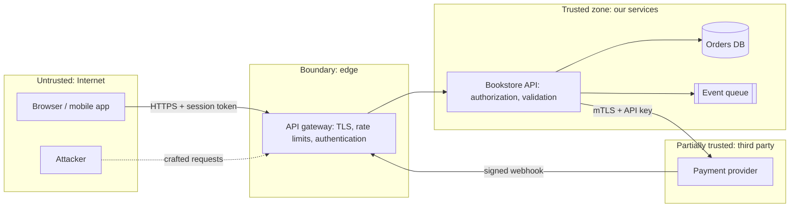

# Security by Design

## Introduction

**Security by design** means treating security as a property of the architecture, decided early, rather than a set of patches applied after a penetration test. Many of the most damaging vulnerabilities are not coding typos but **design flaws**: an API that trusts an ID from the client, a service that can read every table, a gift card flow where two requests can spend the same balance.

The [OWASP Top 10:2025](https://owasp.org/Top10/2025/0x00_2025-Introduction/) keeps **Insecure Design** as its own category (A06), alongside **Broken Access Control** at the top of the list. Fixing a design flaw after launch means changing contracts, data models and other teams' code. Thinking about it during design costs a whiteboard session.

An analogy: a bank branch isn't made secure by adding a lock to the vault after the building is finished. The architect decides where the public area ends, where staff-only doors are, which rooms need two keys, where cameras go, and what happens if the power fails. Software architecture makes the same decisions about trust boundaries, privileges and failure behavior.

This page covers:

- core secure design principles and what they mean in code
- threat modeling with four questions and STRIDE
- trust boundaries and where to put controls
- centralized authorization, validated input and parameterized queries, with before/after code
- secrets, dependencies and the software supply chain
- a real scenario: designing a gift card feature

This page focuses on **architecture**. It doesn't replace a full application security course. The [OWASP Application Security Verification Standard](https://owasp.org/www-project-application-security-verification-standard/) (ASVS, version 5.0 released in May 2025) is a good, detailed checklist once your design is in place.

## Secure Design Principles

Many of these go back to Saltzer and Schroeder's 1975 paper "The Protection of Information in Computer Systems", and they still hold.

| Principle | Meaning | Architectural example |
| --- | --- | --- |
| **Least privilege** | Every component gets only the access it needs | The catalog service's database user can't read the payments schema |
| **Defense in depth** | Several independent layers, so one failure isn't fatal | WAF + authentication + authorization in the service + row-level checks |
| **Secure defaults** | The default configuration is the safe one | New storage buckets are private; new endpoints require authentication unless marked public |
| **Fail securely** | Errors deny access rather than grant it | If the policy service is unreachable, deny, don't allow |
| **Complete mediation** | Check authorization on every access, not just the first | Don't trust "already checked in the UI" |
| **Minimize attack surface** | Fewer endpoints, ports, features and dependencies | Remove the unused admin API; don't expose internal services publicly |
| **Separation of duties** | No single actor can do a sensitive thing alone | Refunds above a threshold need a second approver |
| **Zero trust** | Don't grant trust based on network location | Service-to-service calls are authenticated, even inside the VPC (see NIST SP 800-207) |

CISA's [Secure by Design](https://www.cisa.gov/securebydesign) initiative pushes the same idea from the vendor side: software makers should take ownership of customer security outcomes and ship products that are secure out of the box, instead of leaving hardening to customers.

## Threat Modeling

**Threat modeling** is a structured way to find design flaws before attackers do. The [Threat Modeling Manifesto](https://www.threatmodelingmanifesto.org/) frames it as four questions:

1. What are we working on?
2. What can go wrong?
3. What are we going to do about it?
4. Did we do a good enough job?

You don't need special tools. A diagram, a team and an hour per significant feature is a good start.

### Step 1: Draw the system and its trust boundaries

A **trust boundary** is any place where data or control passes between parts with different levels of trust: browser to server, your service to a third party, a public subnet to a private one, one tenant's data to another's. Controls belong at these boundaries.



### Step 2: Ask what can go wrong, with STRIDE

**STRIDE**, developed at Microsoft, gives six categories to walk through for each element and each arrow on the diagram:

| Threat | Violates | Bookstore example | Typical mitigation |
| --- | --- | --- | --- |
| **S**poofing | Authentication | Forged payment webhook claims an order is paid | Verify webhook signatures |
| **T**ampering | Integrity | Client changes the price field in the checkout request | Server recomputes price from the catalog |
| **R**epudiation | Non-repudiation | Support agent denies issuing a large refund | Append-only audit log with actor identity |
| **I**nformation disclosure | Confidentiality | User reads another user's order by changing the ID | Object-level authorization check |
| **D**enial of service | Availability | Bot floods the search endpoint | Rate limits, caching, load shedding |
| **E**levation of privilege | Authorization | Customer calls an admin-only endpoint | Role checks enforced in the service, deny by default |

### Step 3: Decide what to do

For each credible threat, choose: **mitigate** (add a control), **eliminate** (remove the feature or data), **transfer** (let a specialist handle it, such as a payment provider holding card data), or **accept** (document it, with an owner). Record significant decisions in an [Architecture Decision Record](../13-arch-documenting-and-evolving/0-arch-decision-records.mdx).

:::tip
"Don't store it" is often the best control. If you never store card numbers, a whole class of threats and compliance work disappears. Tokenization by a payment provider is a design decision, not a coding one.
:::

## Design Pattern 1: Centralized, Object-Level Authorization

Broken access control is the top OWASP category, and its most common form is simple: the code checks that the user is **logged in**, but not that they may access **this particular object**. This is often called IDOR (insecure direct object reference).

### Before

```python
from dataclasses import dataclass

@dataclass(frozen=True)
class Order:
    id: str
    customer_id: str
    total_cents: int

ORDERS = {
    "o-1": Order("o-1", customer_id="c-alice", total_cents=4599),
    "o-2": Order("o-2", customer_id="c-bob", total_cents=1299),
}

# BEFORE: the handler trusts the ID in the URL. Any logged-in user can read any order.
def get_order_before(current_user: str, order_id: str) -> Order:
    return ORDERS[order_id]

print(get_order_before(current_user="c-alice", order_id="o-2"))
```

Output:

```text
Order(id='o-2', customer_id='c-bob', total_cents=1299)
```

Alice just read Bob's order. Each handler in a codebase like this has to remember its own check, and one forgotten check is a data breach.

### After

Make authorization a **policy object** that the application service always calls, so the rule lives in one place and can be tested on its own.

```python
from dataclasses import dataclass
from typing import Protocol

@dataclass(frozen=True)
class Principal:
    user_id: str
    roles: frozenset[str]

@dataclass(frozen=True)
class Order:
    id: str
    customer_id: str
    total_cents: int

class Forbidden(Exception):
    pass

class OrderPolicy:
    """One place that answers 'may this principal do this to this order?'"""
    def can_view(self, who: Principal, order: Order) -> bool:
        return order.customer_id == who.user_id or "support" in who.roles

class OrderRepository(Protocol):
    def get(self, order_id: str) -> Order | None: ...

class InMemoryOrders:
    def __init__(self, orders: dict[str, Order]) -> None:
        self._orders = orders
    def get(self, order_id: str) -> Order | None:
        return self._orders.get(order_id)

class OrderService:
    def __init__(self, repo: OrderRepository, policy: OrderPolicy) -> None:
        self.repo, self.policy = repo, policy

    def get_order(self, who: Principal, order_id: str) -> Order:
        order = self.repo.get(order_id)
        # Same error for "missing" and "not yours", so attackers can't probe which IDs exist.
        if order is None or not self.policy.can_view(who, order):
            raise Forbidden("order not found")
        return order

repo = InMemoryOrders({
    "o-1": Order("o-1", "c-alice", 4599),
    "o-2": Order("o-2", "c-bob", 1299),
})
service = OrderService(repo, OrderPolicy())
alice = Principal("c-alice", frozenset({"customer"}))
agent = Principal("u-sam", frozenset({"support"}))

print(service.get_order(alice, "o-1"))
print(service.get_order(agent, "o-2"))
try:
    service.get_order(alice, "o-2")
except Forbidden as e:
    print("alice -> o-2:", e)
```

Output:

```text
Order(id='o-1', customer_id='c-alice', total_cents=4599)
Order(id='o-2', customer_id='c-bob', total_cents=1299)
alice -> o-2: order not found
```

Design notes:

- The service, not the HTTP handler or the UI, enforces the rule. Every entry point (REST, GraphQL, a background job, an admin script) goes through it.
- Identity comes from a verified token as a `Principal`, never from a request field like `customer_id`.
- As rules grow, the policy can move to a dedicated policy engine. Open Policy Agent and Cedar are two well-known options; whichever you choose, keep the **single decision point**.
- In multi-tenant systems, add a second layer such as database row-level security, so a missed check in code still can't cross tenants (defense in depth).

## Design Pattern 2: Validate at the Boundary, Then Trust Types

Validate untrusted input **once, at the trust boundary**, and turn it into a typed object the rest of the code can rely on. This idea is often summarized as "parse, don't validate".

```python
import re
from dataclasses import dataclass

class InvalidInput(ValueError):
    pass

GIFT_CODE = re.compile(r"[A-Z0-9]{4}-[A-Z0-9]{4}-[A-Z0-9]{4}")

@dataclass(frozen=True)
class RedeemGiftCard:
    """A validated command. If you hold one, its fields are already safe to use."""
    code: str
    amount_cents: int

    @classmethod
    def parse(cls, raw: dict[str, object]) -> "RedeemGiftCard":
        code = str(raw.get("code", "")).strip().upper()
        if not GIFT_CODE.fullmatch(code):
            raise InvalidInput("code must look like ABCD-1234-EFGH")
        amount = raw.get("amount_cents")
        if not isinstance(amount, int) or isinstance(amount, bool) or not 1 <= amount <= 50_000:
            raise InvalidInput("amount_cents must be an integer from 1 to 50000")
        return cls(code, amount)

for payload in [
    {"code": "abcd-1234-efgh", "amount_cents": 2500},
    {"code": "' OR 1=1 --", "amount_cents": 2500},
    {"code": "ABCD-1234-EFGH", "amount_cents": -100},
]:
    try:
        print("accepted:", RedeemGiftCard.parse(payload))
    except InvalidInput as e:
        print("rejected:", e)
```

Output:

```text
accepted: RedeemGiftCard(code='ABCD-1234-EFGH', amount_cents=2500)
rejected: code must look like ABCD-1234-EFGH
rejected: amount_cents must be an integer from 1 to 50000
```

Use **allow-lists** (what valid input looks like) rather than deny-lists (guessing what attacks look like). Libraries such as Pydantic do the same job with less code; the architectural point is *where* validation happens, not which library does it.

Validation is not a substitute for safe handling downstream. Even validated data must go into SQL as parameters, into HTML through an escaping template engine, and into shell commands not at all if you can avoid it:

```python
import sqlite3

conn = sqlite3.connect(":memory:")
conn.executescript("""
    CREATE TABLE gift_cards (code TEXT PRIMARY KEY, balance_cents INTEGER);
    INSERT INTO gift_cards VALUES ('ABCD-1234-EFGH', 2500), ('ZZZZ-9999-YYYY', 10000);
""")

user_input = "nope' OR '1'='1"

# BEFORE: string building lets input change the query's structure.
unsafe = f"SELECT code, balance_cents FROM gift_cards WHERE code = '{user_input}'"
print("unsafe:", conn.execute(unsafe).fetchall())

# AFTER: a parameterized query treats input strictly as data.
safe = "SELECT code, balance_cents FROM gift_cards WHERE code = ?"
print("safe:  ", conn.execute(safe, (user_input,)).fetchall())
```

Output:

```text
unsafe: [('ABCD-1234-EFGH', 2500), ('ZZZZ-9999-YYYY', 10000)]
safe:   []
```

## Design Pattern 3: Make Business Rules Hard to Abuse

Some of the worst flaws are in business logic, which no scanner finds. A classic one is a **race condition**: two requests check the balance at the same time, both see enough money, and both spend it. Put the check and the change in **one atomic operation**:

```python
import sqlite3

conn = sqlite3.connect(":memory:", isolation_level=None)   # autocommit, for a short demo
conn.executescript("""
    CREATE TABLE gift_cards (code TEXT PRIMARY KEY, balance_cents INTEGER NOT NULL
                             CHECK (balance_cents >= 0));
    INSERT INTO gift_cards VALUES ('ABCD-1234-EFGH', 2500);
""")

def redeem(code: str, amount_cents: int) -> bool:
    # Check and update in ONE statement: two concurrent requests can't both pass the check.
    cur = conn.execute(
        "UPDATE gift_cards SET balance_cents = balance_cents - ? "
        "WHERE code = ? AND balance_cents >= ?",
        (amount_cents, code, amount_cents),
    )
    return cur.rowcount == 1

print("first  redeem 2000:", redeem("ABCD-1234-EFGH", 2000))
print("second redeem 2000:", redeem("ABCD-1234-EFGH", 2000))
print("balance:", conn.execute("SELECT balance_cents FROM gift_cards").fetchone()[0])
```

Output:

```text
first  redeem 2000: True
second redeem 2000: False
balance: 500
```

The `CHECK` constraint is a second layer: even buggy code can't push the balance below zero. Other business-logic controls to design in: idempotency keys on payment-like operations (see [Idempotency](../9-arch-distributed-systems/7-arch-idempotency.mdx)), rate limits on guessable things such as gift codes and login attempts, and limits on value per time window.

## Secrets, Dependencies and the Supply Chain

Architecture decisions also cover what surrounds your code:

- **Secrets** (database passwords, API keys) never live in source code or images. Load them at runtime from a secrets manager or the platform's secret store, scope them per service, and rotate them. Prefer short-lived, automatically issued credentials (workload identity) over long-lived keys where your platform supports it.
- **Dependencies**: OWASP's 2025 list added **Software Supply Chain Failures** (A03), broadening the old "vulnerable and outdated components". Pin versions, use a lock file, scan dependencies in CI, generate an SBOM (software bill of materials), and limit who can publish your build artifacts.
- **Encryption**: TLS for data in transit, including internal traffic where practical, and encryption at rest, usually provided by the platform. The design question is key management: who can use which key.
- **Logging and alerting**: the OWASP category **Security Logging and Alerting Failures** (A09) is an architectural one. Security-relevant events (logins, permission changes, refunds) need audit logs that attackers can't edit, and alerts someone actually reads. See [Designing for Observability](./3-arch-observability.mdx).
- **Error handling**: the new 2025 category **Mishandling of Exceptional Conditions** (A10) covers failing open, leaking stack traces and inconsistent error paths. "Fail securely" is the design answer.

## Real-World Scenario

Your team runs an online bookstore and is adding **gift cards**: customers buy them, receive a code by email, and redeem them at checkout. Support agents can look up and refund cards. Gift cards are effectively money, so they will attract fraud.

The team runs a one-hour threat modeling session using the four questions:

1. **What are we working on?** They draw the data flow: purchase, code generation, email, redemption at checkout, support lookup, and the trust boundaries between browser, API, support tool and email provider.
2. **What can go wrong?** Walking STRIDE produces: guessing valid codes (spoofing), redeeming the same balance twice concurrently (tampering), a support agent issuing themselves cards (elevation of privilege and repudiation), codes leaking through logs or email previews (information disclosure), and bots brute-forcing codes (denial of service).
3. **What will we do?**
   - Codes are long and generated with a cryptographically secure random generator (`secrets` in Python), and only a hash of each code is stored, like a password.
   - Redemption is an atomic conditional update with an idempotency key.
   - Redemption attempts are rate-limited per account and per IP, with alerts on spikes of failed attempts.
   - Support refunds over a threshold need a second approver; every support action is audit-logged with the agent's identity.
   - Logs and traces redact the code field at the Collector and in the logging formatter.
   - All authorization goes through a `GiftCardPolicy`, enforced in the service layer.
4. **Did we do a good enough job?** The threats and decisions are recorded in an ADR. Security tests for the abuse cases (concurrent redemption, guessing, cross-account access) are added to CI.

**Why this approach:** most gift card risks are design and business-logic flaws, which scanners and code review of individual lines rarely catch. One structured session up front costs far less than a fraud incident.

**When to use it / when not to:** run a threat model for features that touch money, identity, personal data, permissions or new trust boundaries. Small changes inside an existing, already-modeled flow (a new field on a form) usually need only a quick check against the existing model, not a full session.

**Alternatives and trade-offs:**

| Approach | Pros | Cons | Best for |
| --- | --- | --- | --- |
| Lightweight threat modeling per feature (chosen) | Catches design flaws early, cheap, builds team skill | Depends on facilitation, can become a box-ticking exercise | Most product teams |
| Security review only before launch | Expert eyes | Late, so design flaws are expensive to fix | Very small teams with a security specialist on call |
| Penetration test after launch | Finds real exploitable issues | Doesn't scale to every change; finds symptoms, not design causes | Periodic assurance, compliance |
| Buy instead of build (a gift card platform) | Fraud controls included, less to secure | Fees, integration, less control | Teams without fraud expertise |
| Automated scanning (SAST, DAST, dependency scans) | Continuous, cheap per run | Misses business logic and authorization design flaws | A baseline for every pipeline, not a replacement |

## Common Mistakes

- **Authentication without object-level authorization**: "logged in" is not "allowed to see this".
- **Trusting the client**: prices, roles, user IDs or "isAdmin" flags taken from request bodies.
- **Authorization checks scattered across handlers**, so new endpoints forget them.
- **Shared, over-privileged credentials**: every service using the same database admin user.
- **Failing open**: "if the auth service is down, let them in so the site stays up".
- **Secrets in code, images or logs.**
- **Security as a final phase** instead of a design input.
- **Ignoring abuse cases**: designing only for the happy path and not asking "what would a fraudster do?"

## Summary

- Many serious vulnerabilities are **design flaws**; OWASP's Top 10:2025 lists Insecure Design and puts Broken Access Control first.
- Apply classic principles: **least privilege, defense in depth, secure defaults, fail securely, complete mediation, small attack surface, zero trust**.
- **Threat model** with the four questions and **STRIDE**, focusing on **trust boundaries**.
- Centralize **object-level authorization** in a policy the service always calls.
- **Validate at the boundary** into typed objects, and still use **parameterized** queries and safe encoders downstream.
- Make business rules **atomic** and abuse-resistant; manage **secrets** and the **supply chain** deliberately.

## Exercises

1. Draw a data flow diagram with trust boundaries for a "password reset by email" feature. Walk through STRIDE for each arrow and list at least five threats.
2. Extend `OrderPolicy` with `can_refund`, allowing support agents to refund up to an amount limit and requiring a `finance` role above it. Write tests for each rule.
3. Find one place in a codebase you know where a request field is trusted for identity or price. Redesign it.
4. Rewrite the gift card storage so only a hash of each code is stored. How does lookup work, and what hash function would you choose?

Related pages:

- [Designing for Testability](./5-arch-testability.mdx): security rules need tests too
- [API Gateway and Backend for Frontend](../10-arch-integration-and-apis/4-arch-api-gateway.mdx)
- [Webhooks and Callbacks](../10-arch-integration-and-apis/7-arch-webhooks.mdx): verifying signed webhooks
- [Architecture Decision Records](../13-arch-documenting-and-evolving/0-arch-decision-records.mdx)
