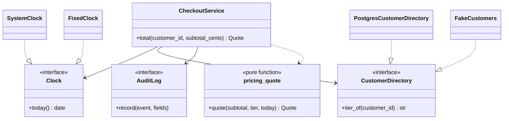
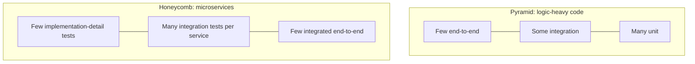
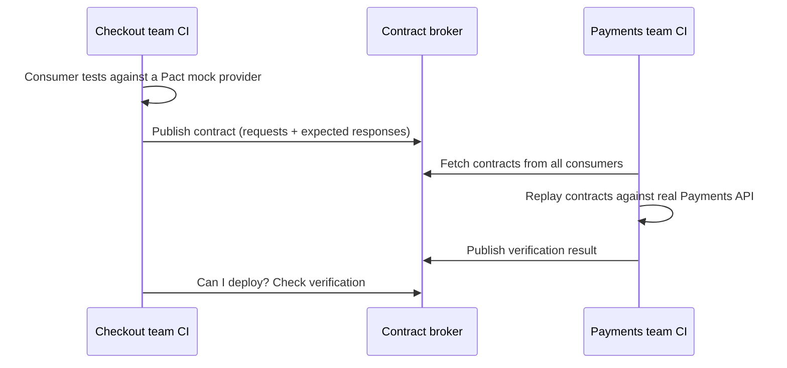

# Designing for Testability

## Introduction

**Testability** is how easily you can show that a piece of software works, and find out quickly when it stops working. It is mostly decided by **design**, not by the testing framework. If a function reads the real clock, opens its own database connection and writes to a global logger, no amount of pytest cleverness makes it pleasant to test. If the same logic is a pure function that takes its inputs as parameters, a test is three lines.

Think of a car engine. Mechanics can diagnose a modern engine quickly because it was designed with a diagnostic port, sensors on each subsystem and parts that can be swapped individually. An engine welded into one block might run just as well, but every check means taking the whole car apart.

Testable design brings benefits beyond tests:

- The things that make code hard to test (hidden dependencies, mixed responsibilities, global state) also make it hard to change and reason about.
- Fast, reliable tests make frequent, safe deployment possible (see [Designing for Deployability](./6-arch-deployability.mdx)).
- Tests act as executable documentation of the rules.

This page covers:

- what makes code hard to test, with a "before" example
- the **functional core, imperative shell** structure and dependency injection
- choosing test doubles: fakes, stubs and mocks
- the shape of a test suite: pyramid, trophy and honeycomb
- testing at architectural boundaries with integration and contract tests

## What Makes Code Hard to Test

Here is a checkout pricing function from an online bookstore. It works. It's also miserable to test:

```python
# discounts_before.py
import sqlite3
from datetime import datetime

DB_PATH = "bookstore.db"

def checkout_total(customer_id: str, subtotal_cents: int) -> int:
    conn = sqlite3.connect(DB_PATH)                     # hidden dependency: a real database file
    row = conn.execute("SELECT tier FROM customers WHERE id = ?", (customer_id,)).fetchone()
    tier = row[0] if row else "standard"
    now = datetime.now()                                # hidden dependency: the real clock
    discount = 0.0
    if tier == "gold":
        discount = 0.10
    if now.month == 11 and now.day >= 25:               # "Black Friday week" sale
        discount += 0.05
    total = round(subtotal_cents * (1 - discount))
    print(f"[audit] {customer_id} paid {total}")        # side effect mixed into the logic
    return total
```

To test the sale-week rule you would have to set up a database file with the right schema and rows, then either wait until November or monkeypatch `datetime`, then capture stdout to check the audit line. Each test is slow, fragile, and tests three things at once.

The underlying problems are common, and each has a name:

| Smell | In the example | Why it hurts testing |
| --- | --- | --- |
| Hidden dependencies | `sqlite3.connect`, `datetime.now()` created inside the function | Can't substitute controlled versions |
| Mixed concerns | Business rules, data access and auditing in one function | Can't test the rule without the I/O |
| Non-determinism | The real clock | Tests pass or fail depending on the date |
| Global state | `DB_PATH` module constant, stdout | Tests interfere with each other |
| Side effects without a seam | `print` as the audit log | Hard to assert that auditing happened |

These are the same problems the [Dependency Inversion Principle](../1-arch-design-principles/5-arch-dependency-inversion.mdx) and [Separation of Concerns](../1-arch-design-principles/9-arch-separation-of-concerns.mdx) address. Testability is often the first place you *feel* them.

## Functional Core, Imperative Shell

A powerful structure, popularized by Gary Bernhardt's talk "Boundaries", splits code in two:

- A **functional core**: pure business logic. Values in, values out. No I/O, no clock, no randomness.
- An **imperative shell**: a thin layer that gathers inputs from the outside world, calls the core, and acts on the result.

The core holds most of the logic and needs no test doubles at all. The shell holds little logic and is tested with a few integration tests.

```python
# pricing.py: the functional core. No I/O, no clock, no globals.
from dataclasses import dataclass
from datetime import date

@dataclass(frozen=True)
class Quote:
    subtotal_cents: int
    discount_rate: float
    total_cents: int

def is_sale_week(today: date) -> bool:
    return today.month == 11 and today.day >= 25

def quote(subtotal_cents: int, tier: str, today: date) -> Quote:
    rate = 0.10 if tier == "gold" else 0.0
    if is_sale_week(today):
        rate += 0.05
    return Quote(subtotal_cents, rate, round(subtotal_cents * (1 - rate)))
```

The shell depends on small **interfaces** (here `typing.Protocol`s), not on concrete classes. Real implementations are passed in at startup; tests pass simple fakes. This is [Dependency Injection](../1-arch-design-principles/10-arch-dependency-injection.mdx) in its plainest form, without a framework.

```python
# checkout.py: the imperative shell. Wires real dependencies to the pure core.
from datetime import date
from typing import Protocol

from pricing import Quote, quote

class Clock(Protocol):
    def today(self) -> date: ...

class CustomerDirectory(Protocol):
    def tier_of(self, customer_id: str) -> str: ...

class AuditLog(Protocol):
    def record(self, event: str, **fields: object) -> None: ...

class CheckoutService:
    def __init__(self, clock: Clock, customers: CustomerDirectory, audit: AuditLog) -> None:
        self.clock, self.customers, self.audit = clock, customers, audit

    def total(self, customer_id: str, subtotal_cents: int) -> Quote:
        q = quote(subtotal_cents, self.customers.tier_of(customer_id), self.clock.today())
        self.audit.record("checkout_priced", customer_id=customer_id, total_cents=q.total_cents)
        return q
```



Now the tests are short, fast and deterministic:

```python
# test_checkout.py  (run with: pytest -q)
from dataclasses import dataclass, field
from datetime import date

import pytest

from checkout import CheckoutService
from pricing import quote

# Unit tests of the pure core: no setup, no doubles, very fast.
@pytest.mark.parametrize("tier, today, expected", [
    ("standard", date(2026, 3, 1), 10_000),
    ("gold",     date(2026, 3, 1), 9_000),
    ("standard", date(2026, 11, 27), 9_500),
    ("gold",     date(2026, 11, 27), 8_500),
])
def test_quote_rules(tier: str, today: date, expected: int) -> None:
    assert quote(10_000, tier, today).total_cents == expected

# Simple hand-written fakes for the shell's dependencies.
@dataclass
class FixedClock:
    fixed: date
    def today(self) -> date:
        return self.fixed

@dataclass
class FakeCustomers:
    tiers: dict[str, str]
    def tier_of(self, customer_id: str) -> str:
        return self.tiers.get(customer_id, "standard")

@dataclass
class RecordingAudit:
    events: list[tuple[str, dict]] = field(default_factory=list)
    def record(self, event: str, **fields: object) -> None:
        self.events.append((event, fields))

def test_checkout_service_prices_and_audits() -> None:
    audit = RecordingAudit()
    service = CheckoutService(FixedClock(date(2026, 11, 27)), FakeCustomers({"c-1": "gold"}), audit)

    result = service.total("c-1", 10_000)

    assert result.total_cents == 8_500
    assert audit.events == [("checkout_priced", {"customer_id": "c-1", "total_cents": 8_500})]
```

Output of `pytest -v`:

```text
test_checkout.py::test_quote_rules[standard-today0-10000] PASSED         [ 20%]
test_checkout.py::test_quote_rules[gold-today1-9000] PASSED              [ 40%]
test_checkout.py::test_quote_rules[standard-today2-9500] PASSED          [ 60%]
test_checkout.py::test_quote_rules[gold-today3-8500] PASSED              [ 80%]
test_checkout.py::test_checkout_service_prices_and_audits PASSED         [100%]
```

Adding a new pricing rule now means adding one row to a table of cases. The design made the tests cheap, so the team will actually write them.

:::note
Real money code should avoid floating-point rates. Use integer basis points or `decimal.Decimal` with an explicit rounding rule. The float here keeps the example short.
:::

This is the same shape as [Hexagonal Architecture](../7-arch-clean-architecture/0-arch-hexagonal.mdx): the domain in the middle, ports (the Protocols) around it, adapters (Postgres, the system clock) at the edges. Testability is one of the main reasons those architectures exist.

## Choosing Test Doubles

A **test double** stands in for a real dependency in a test. Martin Fowler's article [Mocks Aren't Stubs](https://martinfowler.com/articles/mocksArentStubs.html) explains the distinctions:

| Double | What it does | Example | Use when |
| --- | --- | --- | --- |
| **Dummy** | Passed but never used | `None` for an unused logger | Filling a parameter list |
| **Stub** | Returns canned answers | `FixedClock` | You need controlled input |
| **Fake** | Working but simplified implementation | `FakeCustomers` with a dict; an in-memory repository | You need realistic behavior without infrastructure |
| **Spy** | Records how it was called | `RecordingAudit` | You need to check a side effect happened |
| **Mock** | Pre-programmed with expectations it verifies | `unittest.mock.Mock` with `assert_called_once_with` | Verifying an interaction is the point of the test |

Guidelines:

- **Prefer fakes and stubs for queries, spies or mocks for commands.** Check what the code *produces*, and only check *how* it talks to collaborators when the talking is the behavior (sending an email, publishing an event).
- **Don't mock what you don't own.** Mocking a third-party SDK's internals ties your tests to its implementation. Wrap the SDK in your own small interface (an adapter) and fake that interface.
- **Heavy mocking is a design smell.** If a test needs eight mocks, the class under test probably has too many responsibilities.
- **Keep fakes honest.** A fake that behaves differently from the real thing gives false confidence. Run the same contract tests against both (shown below).

## The Shape of a Test Suite

Mike Cohn's **test pyramid** recommends many fast unit tests, fewer integration tests, and very few end-to-end tests. Martin Fowler's [Practical Test Pyramid](https://martinfowler.com/articles/practical-test-pyramid.html) refines it, and other shapes have been proposed for different architectures:



| Shape | Emphasis | Best fit |
| --- | --- | --- |
| Pyramid | Unit tests | Rich domain logic, libraries, the functional core |
| Testing trophy (Kent C. Dodds) | Integration tests, plus static analysis at the base | Front-end and UI-heavy apps |
| Honeycomb (Spotify engineering) | Integration tests of each service through its API | Microservices with little logic and lots of I/O |

The shapes disagree less than they seem. All of them say: **push each check to the cheapest level that can catch the bug**, and keep slow, flaky end-to-end tests to a few critical journeys. What the right mix looks like depends on where your code's complexity lives.

## Testing at Architectural Boundaries

The functional core is easy. The risk moves to the **boundaries**: does the Postgres adapter really return the tier? Does the payments service still accept our requests?

### Integration tests for adapters

Test each adapter against the real technology, narrowly. For databases, [Testcontainers](https://testcontainers.com/) starts a throwaway container for the test. The Python package follows this pattern (install `testcontainers[postgres]` plus a driver such as `psycopg2-binary` and `sqlalchemy`; Docker must be running):

```python
# test_customer_directory_integration.py
import sqlalchemy
from testcontainers.postgres import PostgresContainer

class PostgresCustomerDirectory:
    def __init__(self, engine: sqlalchemy.Engine) -> None:
        self.engine = engine

    def tier_of(self, customer_id: str) -> str:
        with self.engine.connect() as conn:
            row = conn.execute(
                sqlalchemy.text("SELECT tier FROM customers WHERE id = :id"), {"id": customer_id}
            ).fetchone()
        return row[0] if row else "standard"

def test_tier_lookup_against_real_postgres() -> None:
    with PostgresContainer("postgres:16") as pg:
        engine = sqlalchemy.create_engine(pg.get_connection_url())
        with engine.begin() as conn:
            conn.execute(sqlalchemy.text("CREATE TABLE customers (id TEXT PRIMARY KEY, tier TEXT)"))
            conn.execute(sqlalchemy.text("INSERT INTO customers VALUES ('c-1', 'gold')"))

        directory = PostgresCustomerDirectory(engine)
        assert directory.tier_of("c-1") == "gold"
        assert directory.tier_of("unknown") == "standard"
```

Example output:

```text
.                                                                        [100%]
1 passed in 4.87s
```

The timing is dominated by container startup, which is why you want **few** of these, one per adapter behavior, and many fast core tests. See the [Testcontainers for Python docs](https://testcontainers-python.readthedocs.io/) for current module options.

### Contract tests between services

When the bookstore's checkout service calls a separate payments service, how do you know a change to payments won't break checkout, without spinning up both in a shared environment?

**Consumer-driven contract testing** answers this. The consumer (checkout) writes down the requests it makes and the responses it relies on, as a contract. The provider (payments) runs that contract against its real code in its own CI. [Pact](https://docs.pact.io/) is the best-known tool and supports many languages, including Python.



Contract tests replace much of the need for big end-to-end environments, and they support **independent deployability**, a core goal of [microservices](../6-arch-architectural-styles/4-arch-microservices.mdx). The cost is tooling, a broker, and discipline in both teams.

## Real-World Scenario

Your team owns the bookstore's checkout. The test suite takes 40 minutes, mostly end-to-end browser tests against a shared staging environment, and about one run in five fails for reasons nobody can reproduce. Developers re-run the pipeline until it goes green. Pricing bugs still reach production, because promotional rules have dozens of combinations and the E2E suite covers only three.

The plan:

1. **Extract the functional core.** Pricing, promotion and tax rules move into pure functions with typed inputs. Table-driven unit tests cover every combination the business has written down. This suite runs in under a second.
2. **Introduce ports.** Clock, customer directory, inventory and payments become Protocols. The service is wired with real adapters in production and fakes in tests.
3. **Test adapters narrowly** with Testcontainers for Postgres and a contract test with the payments team.
4. **Cut E2E to a few journeys**: browse, add to cart, pay, see confirmation. Quarantine and fix flaky tests rather than retrying them silently.
5. **Track the suite's speed and flakiness** as a team metric.

**Why this approach:** the bugs lived in combinatorial business rules, which end-to-end tests are worst at covering and pure unit tests are best at. The flakiness came from shared environments, which contract tests and containers remove.

**When to use it / when not to:** this structure pays off wherever there is real business logic. For a thin CRUD service that mostly passes data from HTTP to a database, a functional core would be nearly empty; there, a handful of integration tests through the API (the honeycomb) gives more confidence per line of test code. Don't introduce interfaces for things that have only one implementation and are trivial to use for real in tests (for example a pure helper module).

**Alternatives and trade-offs:**

| Approach | Pros | Cons | Best for |
| --- | --- | --- | --- |
| Functional core + many unit tests (chosen for pricing) | Fast, precise, cheap to extend | Requires refactoring; misses wiring bugs | Rule-heavy domain logic |
| Integration tests through the API | Tests real wiring, refactor-friendly | Slower, need data setup | Thin services, CRUD |
| Mock-heavy unit tests | Easy to start in legacy code | Brittle, test implementation details | Short-term safety net while refactoring |
| Contract tests | Independent deploys, no shared env | Tooling and cross-team discipline | Service-to-service APIs owned by different teams |
| End-to-end tests | Highest realism | Slow, flaky, hard to debug | A few critical user journeys |

## Common Mistakes

- **Calling `datetime.now()`, `random`, or `os.environ` deep inside logic.** Pass them in.
- **Business logic in controllers or ORM models**, so testing a rule needs a web request or a database.
- **Mocking everything**, producing tests that pass while the real system is broken.
- **Treating flaky tests as normal.** A suite that is sometimes red trains people to ignore red.
- **One giant shared test environment** that every team depends on.
- **Testing private methods** instead of observable behavior, which locks in implementation details.
- **Adding interfaces "for testability" everywhere**, even for trivial pure code. Indirection has a cost too ([YAGNI](../1-arch-design-principles/6-arch-dry-kiss-yagni.mdx)).

## Summary

- Testability is a **design property**: hidden dependencies, mixed concerns and global state make code hard to test and hard to change.
- Split code into a **functional core** (pure logic, tested exhaustively and cheaply) and an **imperative shell** (thin I/O wiring, tested with a few integration tests).
- Depend on small **interfaces** and inject implementations; use **fakes and stubs** by default and **mocks** when the interaction is the behavior.
- Choose a suite **shape** that matches where complexity lives; push checks to the cheapest level that can catch the bug.
- Test **adapters** against real technology (for example with Testcontainers) and **service boundaries** with consumer-driven **contract tests**.

## Exercises

1. Take the `checkout_total` "before" function and add a new rule: "first order gets 5% off". Notice how hard it is to test. Then add the same rule to the `quote` core with two new parametrized cases.
2. Write a `SystemClock` and a `PrintAuditLog` implementation and wire a real `CheckoutService` in a `main()` function. Where does the wiring live, and why does it matter?
3. Write a shared contract test function that runs the same assertions against `FakeCustomers` and `PostgresCustomerDirectory`, so the fake can't drift.
4. Classify the tests in a project you know as unit, integration, contract or end-to-end. Does the shape match where the bugs come from?

Related pages:

- [Dependency Injection](../1-arch-design-principles/10-arch-dependency-injection.mdx)
- [Hexagonal Architecture (Ports and Adapters)](../7-arch-clean-architecture/0-arch-hexagonal.mdx)
- [Repository Pattern](../5-arch-modern-patterns/1-arch-repository-pattern.mdx): a natural seam for fakes
- [Designing for Deployability](./6-arch-deployability.mdx)
