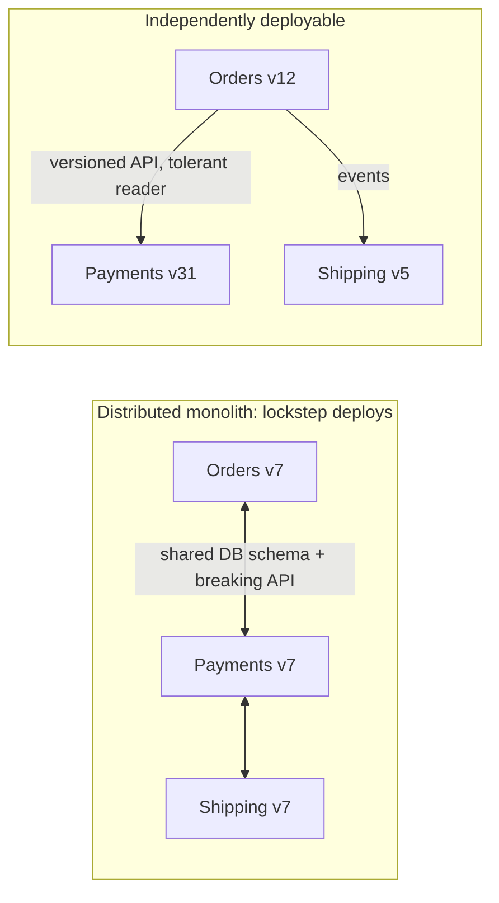
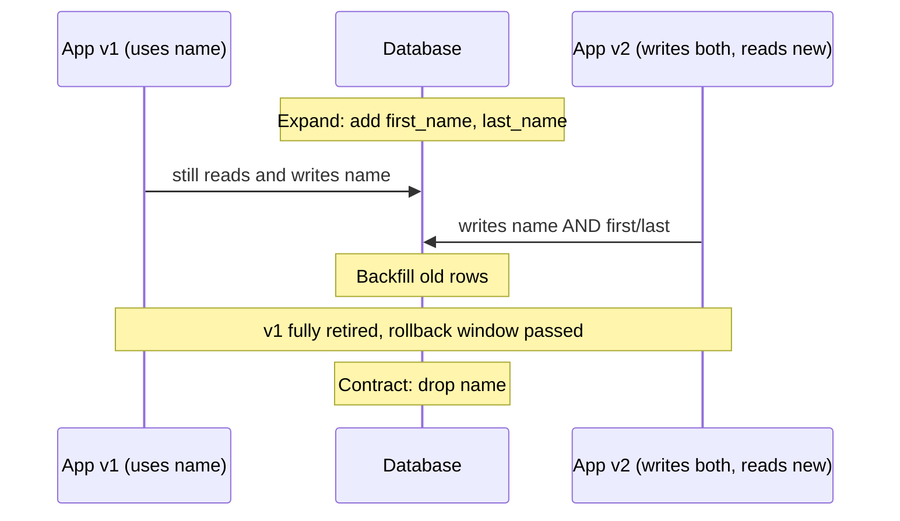

# Designing for Deployability

## Introduction

**Deployability** is how easily, safely and often you can get a change into production. It sounds like a CI/CD concern, and pipelines matter, but the hardest deployment problems are **architectural**:

- Two services that must be deployed together, in a specific order, or things break.
- A database migration that locks a table for 20 minutes.
- A release that can't be rolled back because the new code already rewrote data.
- An app that needs a different build for each environment.
- A process that drops in-flight requests every time it restarts.

No pipeline can fix those. They are fixed by how the software is designed.

Think about a theater changing sets between scenes. A well-designed production builds sets on wheels, in modules, so the crew can swap one piece in the dark in thirty seconds while the actors keep performing. A badly designed one needs the curtain down and an intermission for every change. Software that is designed for deployability changes scenery while the show is running.

This page covers:

- how to measure deployability with the **DORA** metrics
- **independent deployability** and the "distributed monolith" trap
- build once, configure per environment
- **backward-compatible change**: expand/contract for databases and APIs
- **separating deploy from release** with feature flags
- **graceful startup and shutdown**
- choosing a rollout strategy and planning rollback

The mechanics of pipelines and rollout strategies are covered in depth in the site's [CI/CD tutorial](/docs/devops/cicd). This page focuses on the design decisions that make those mechanics work.

## Measuring Deployability: DORA Metrics

The DORA research program (DevOps Research and Assessment, now part of Google Cloud) has studied software delivery for over a decade. Its current [guide to software delivery metrics](https://dora.dev/guides/dora-metrics/) groups five metrics into throughput and instability:

| Group | Metric | What it measures |
| --- | --- | --- |
| Throughput | **Change lead time** | Time from a change being committed to it being deployed in production |
| Throughput | **Deployment frequency** | How often you deploy to production |
| Throughput | **Failed deployment recovery time** | How long it takes to recover from a deployment that needs immediate intervention |
| Instability | **Change fail rate** | Share of deployments that need immediate intervention, such as a rollback or hotfix |
| Instability | **Deployment rework rate** | Share of deployments that are unplanned and made because of a production incident |

Rework rate is the newest of the five. Older material lists four metrics and calls recovery time "MTTR". DORA's research has consistently found that throughput and stability go **together** rather than trading off: teams that deploy small changes often tend to have fewer, smaller failures. Check DORA's site for current definitions and benchmarks, as they are revised with each report.

You can compute rough versions from your own deployment records:

```python
from dataclasses import dataclass
from datetime import datetime, timedelta
from statistics import median

@dataclass(frozen=True)
class Deployment:
    first_commit_at: datetime
    deployed_at: datetime
    failed: bool                                   # needed immediate intervention (rollback, hotfix)
    recovered_at: datetime | None = None
    unplanned: bool = False                        # deployed to fix a production incident

def dora_summary(deploys: list[Deployment], days: int) -> None:
    lead_times = [d.deployed_at - d.first_commit_at for d in deploys]
    failures = [d for d in deploys if d.failed]
    recoveries = [d.recovered_at - d.deployed_at for d in failures if d.recovered_at]
    print(f"deployment frequency      : {len(deploys) / days:.1f} per day")
    print(f"change lead time (median) : {median(lead_times)}")
    print(f"change fail rate          : {len(failures) / len(deploys):.0%}")
    print(f"failed deploy recovery    : {median(recoveries) if recoveries else 'n/a'}")
    print(f"deployment rework rate    : {sum(d.unplanned for d in deploys) / len(deploys):.0%}")

t0 = datetime(2026, 9, 1, 9, 0)
deploys = [
    Deployment(t0, t0 + timedelta(hours=5), failed=False),
    Deployment(t0 + timedelta(days=1), t0 + timedelta(days=1, hours=3), failed=True,
               recovered_at=t0 + timedelta(days=1, hours=3, minutes=12)),
    Deployment(t0 + timedelta(days=1, hours=4), t0 + timedelta(days=1, hours=5), failed=False, unplanned=True),
    Deployment(t0 + timedelta(days=2), t0 + timedelta(days=2, hours=26), failed=False),
    Deployment(t0 + timedelta(days=3), t0 + timedelta(days=3, hours=4), failed=False),
]
dora_summary(deploys, days=5)
```

Output:

```text
deployment frequency      : 1.0 per day
change lead time (median) : 4:00:00
change fail rate          : 20%
failed deploy recovery    : 0:12:00
deployment rework rate    : 20%
```

:::caution
These metrics describe a delivery **system**, not individual people. Using them to rank developers or teams quickly leads to gaming (for example, splitting one change into five deploys). Use them to find bottlenecks.
:::

## Independent Deployability

The single most important architectural property for deployability is that each unit can be **deployed on its own**, without coordinating with other units. Chris Richardson lists independent deployability as a defining property of microservices on [microservices.io](https://microservices.io/), but it matters for modules in a monolith too.



If three services always have to be deployed together, you have the costs of a distributed system (network calls, partial failure) and the deployment coupling of a monolith. This is often called a **distributed monolith**. Common causes:

- a **shared database schema** that several services read and write directly (see [Database per Service vs Shared Database](../11-arch-data-architecture/0-arch-database-per-service.mdx))
- **breaking API changes** without versioning (see [API Versioning and Evolution](../10-arch-integration-and-apis/6-arch-api-versioning.mdx))
- **shared libraries** containing business logic, so a rule change forces every service to rebuild
- **synchronous chains** where a change in one call's contract ripples through several services

A well-structured **monolith** is a single deployable, so independent deployability between its modules isn't the goal. There the questions are: can it be deployed safely many times a day, and can one team's change go out without waiting on everyone else's (trunk-based development plus feature flags)? Many teams get most of the benefit of microservices' deployment speed from a [modular monolith](../6-arch-architectural-styles/3-arch-modular-monolith.mdx) with a fast pipeline.

## Build Once, Configure per Environment

A deployable artifact (a container image, a wheel, a JAR) should be built **once** and promoted unchanged from test to staging to production. If you rebuild for each environment, you're deploying something you never tested. That requires the code to read environment-specific settings at **runtime**, which is factor III of the [Twelve-Factor App](https://12factor.net/config): store config in the environment.

```python
import os
from dataclasses import dataclass

@dataclass(frozen=True)
class Settings:
    database_url: str
    payment_api_base: str
    request_timeout_s: float
    log_level: str

    @classmethod
    def from_env(cls) -> "Settings":
        missing = [k for k in ("DATABASE_URL", "PAYMENT_API_BASE") if k not in os.environ]
        if missing:
            raise RuntimeError(f"missing required config: {', '.join(missing)}")   # fail fast at startup
        return cls(
            database_url=os.environ["DATABASE_URL"],
            payment_api_base=os.environ["PAYMENT_API_BASE"],
            request_timeout_s=float(os.environ.get("REQUEST_TIMEOUT_S", "3.0")),
            log_level=os.environ.get("LOG_LEVEL", "INFO"),
        )

os.environ.update({"DATABASE_URL": "postgresql://app@db-staging/bookstore",
                   "PAYMENT_API_BASE": "https://sandbox.payments.example"})
print(Settings.from_env())
```

Output:

```text
Settings(database_url='postgresql://app@db-staging/bookstore', payment_api_base='https://sandbox.payments.example', request_timeout_s=3.0, log_level='INFO')
```

Design notes:

- **Fail fast** on missing required config at startup, so a bad deploy fails its readiness check instead of failing the first customer request.
- Load config into a typed object **once**, then inject it. Code that calls `os.environ` everywhere is hard to test.
- Secrets come in the same way (from the platform's secret store into the environment or a mounted file), never baked into the image. See [Security by Design](./4-arch-security-by-design.mdx).

## Backward-Compatible Change: Expand and Contract

During any rolling deployment, **old and new versions run at the same time**. And if you roll back, old code runs against whatever the new code did to the data. So every change must be compatible in both directions for at least one release.

The **expand and contract** pattern (also called parallel change, described on [martinfowler.com](https://martinfowler.com/bliki/ParallelChange.html)) breaks a breaking change into safe steps. Here it is for splitting a `name` column into `first_name` and `last_name`:

```python
import sqlite3

db = sqlite3.connect(":memory:")
db.executescript("""
    CREATE TABLE customers (id TEXT PRIMARY KEY, name TEXT);
    INSERT INTO customers VALUES ('c-1', 'Ada Lovelace'), ('c-2', 'Alan Turing');
""")

# Release 1 (EXPAND): add new nullable columns. Old code keeps working because it ignores them.
db.execute("ALTER TABLE customers ADD COLUMN first_name TEXT")
db.execute("ALTER TABLE customers ADD COLUMN last_name TEXT")

# Release 2: new code writes BOTH old and new columns; a backfill job fills existing rows.
for cid, name in db.execute("SELECT id, name FROM customers WHERE first_name IS NULL").fetchall():
    first, _, last = name.partition(" ")
    db.execute("UPDATE customers SET first_name = ?, last_name = ? WHERE id = ?", (first, last, cid))

# Release 3: code reads only the new columns. Old column still present, so rollback is safe.
print(db.execute("SELECT id, first_name, last_name FROM customers").fetchall())

# Release 4 (CONTRACT): once no running version uses `name`, drop it.
db.execute("ALTER TABLE customers DROP COLUMN name")      # SQLite 3.35+ supports DROP COLUMN
print([row[1] for row in db.execute("PRAGMA table_info(customers)")])
```

Output:

```text
[('c-1', 'Ada', 'Lovelace'), ('c-2', 'Alan', 'Turing')]
['id', 'first_name', 'last_name']
```

(Splitting names on the first space is fine for a demo and wrong for real people's names; real migrations need real data rules.)



The same idea applies to APIs and events: add new fields as optional, keep old ones until every consumer has moved, make readers **tolerant** of unknown fields, and only then remove. Large-table changes also need care with locking; [Schema Evolution and Data Migrations](../11-arch-data-architecture/7-arch-data-migrations.mdx) goes deeper.

## Separate Deploy from Release: Feature Flags

**Deploying** puts code on servers. **Releasing** exposes a behavior to users. Feature flags (also called feature toggles) separate the two, so you can deploy unfinished or risky code switched off, then turn it on for staff, then 10% of users, then everyone, without another deploy. Pete Hodgson's article [Feature Toggles](https://martinfowler.com/articles/feature-toggles.html) on martinfowler.com is the standard reference for the different kinds.

[OpenFeature](https://openfeature.dev/) is a CNCF project that standardizes the flag-evaluation API, so application code doesn't depend on one vendor's SDK. This example uses its in-memory provider (install `openfeature-sdk`; checked with version 0.10) with a staff-first, then 10% rollout rule:

```python
import hashlib

from openfeature import api
from openfeature.evaluation_context import EvaluationContext
from openfeature.flag_evaluation import FlagResolutionDetails, Reason
from openfeature.provider.in_memory_provider import InMemoryFlag, InMemoryProvider

ROLLOUT_PERCENT = 10

def bucket(user_id: str) -> int:
    """Stable 0-99 bucket per user, so a user doesn't flip between old and new."""
    return int(hashlib.sha256(user_id.encode()).hexdigest(), 16) % 100

def staff_then_percentage(flag: InMemoryFlag, ctx: EvaluationContext) -> FlagResolutionDetails:
    if ctx.attributes.get("staff"):
        variant, reason = "on", Reason.TARGETING_MATCH
    elif ctx.targeting_key and bucket(ctx.targeting_key) < ROLLOUT_PERCENT:
        variant, reason = "on", Reason.SPLIT
    else:
        variant, reason = "off", Reason.DEFAULT
    return FlagResolutionDetails(value=flag.variants[variant], variant=variant, reason=reason)

# In production you'd configure a flag service's provider instead; the calling code stays the same.
api.set_provider(InMemoryProvider({
    "new-checkout-flow": InMemoryFlag("off", {"on": True, "off": False},
                                      context_evaluator=staff_then_percentage),
}))
client = api.get_client()

users = [("u-staff-7", True)] + [(f"c-{n}", False) for n in range(1000, 1010)]
for user, staff in users:
    ctx = EvaluationContext(targeting_key=user, attributes={"staff": staff})
    details = client.get_boolean_details("new-checkout-flow", False, ctx)
    print(f"{user:<10} -> {'new' if details.value else 'old'} checkout ({details.reason})")
```

Output:

```text
u-staff-7  -> new checkout (TARGETING_MATCH)
c-1000     -> old checkout (DEFAULT)
c-1001     -> new checkout (SPLIT)
c-1002     -> old checkout (DEFAULT)
c-1003     -> old checkout (DEFAULT)
c-1004     -> old checkout (DEFAULT)
c-1005     -> old checkout (DEFAULT)
c-1006     -> old checkout (DEFAULT)
c-1007     -> old checkout (DEFAULT)
c-1008     -> old checkout (DEFAULT)
c-1009     -> old checkout (DEFAULT)
```

With only 10 sample users, one landing in the 10% bucket is a coincidence; over many users the split approaches 10%. The default value passed to `get_boolean_value` or `get_boolean_details` (here `False`) is what you get if the flag system is unavailable, so choose the **safe** default. That is static stability again (see [Reliability](./2-arch-reliability.mdx)).

:::warning Flags are debt
Every flag doubles the number of code paths. Give each release flag an owner and a removal date, and delete it once the rollout finishes. Long-lived flags for operations (kill switches) and permissions are different and should be documented as such.
:::

## Graceful Startup and Shutdown

Frequent deploys mean frequent restarts. If each restart drops in-flight requests or kills a job halfway through, deploying often means failing often. Design processes to be **disposable** (Twelve-Factor IX): start fast, and shut down gracefully.

On shutdown, platforms such as [Kubernetes](/docs/devops/kubernetes) send `SIGTERM`, wait for a grace period, then send `SIGKILL`. The process should stop accepting new work, finish what it has, and exit:

```python
import os
import signal
import threading
import time

shutting_down = threading.Event()
in_flight = 0
lock = threading.Lock()

def on_sigterm(signum: int, frame: object) -> None:
    print("SIGTERM received: failing readiness, finishing in-flight work")
    shutting_down.set()

signal.signal(signal.SIGTERM, on_sigterm)

def ready() -> bool:
    """Readiness probe: tell the load balancer to stop sending new traffic."""
    return not shutting_down.is_set()

def handle_request(n: int) -> None:
    global in_flight
    time.sleep(0.3)                       # simulated work
    with lock:
        in_flight -= 1
    print(f"request {n} completed")

workers = [threading.Thread(target=handle_request, args=(n,)) for n in range(3)]
in_flight = len(workers)                  # a real server tracks this per accepted request
for w in workers:
    w.start()

os.kill(os.getpid(), signal.SIGTERM)      # the platform asks us to stop, e.g. during a rolling deploy
print("ready?", ready())

deadline = time.monotonic() + 10          # stay below the platform's grace period
while in_flight and time.monotonic() < deadline:
    time.sleep(0.05)
print(f"exiting cleanly, in-flight={in_flight}")
```

Output (Linux or macOS):

```text
SIGTERM received: failing readiness, finishing in-flight work
ready? False
request 0 completed
request 1 completed
request 2 completed
exiting cleanly, in-flight=0
```

Most production web servers (Gunicorn, Uvicorn and others) implement graceful shutdown for HTTP; your job is to make sure **background work** is safe too. Queue consumers should acknowledge messages only after finishing, so an interrupted message is redelivered, and handlers must be [idempotent](../9-arch-distributed-systems/7-arch-idempotency.mdx) so redelivery is harmless. On startup, report ready only once connections and caches are warm.

## Choosing a Rollout Strategy

| Strategy | How it works | Rollback | Needs from the architecture |
| --- | --- | --- | --- |
| Recreate | Stop old, start new | Redeploy old | Nothing special; has downtime |
| Rolling | Replace instances a few at a time | Roll back the same way | Old and new versions compatible at once |
| Blue-green | Run a full new copy, switch traffic | Switch back | Double capacity during switch; shared data compatible with both |
| Canary | Send a small % of traffic to the new version, watch metrics | Route traffic back | Good metrics per version; compatible data |
| Feature flag rollout | Deploy dark, enable per user segment | Turn the flag off | Flag system, discipline removing flags |

Each strategy is detailed in the [CI/CD tutorial](/docs/devops/cicd). Notice the right column: every strategy except "recreate" requires **old and new versions to coexist**, which is why backward compatibility is the foundation of deployability.

Plan rollback **before** deploying. If a change can't be rolled back (a destructive migration, an external side effect such as emails sent), split it so that the irreversible step happens last, behind a flag, after the reversible parts have proven themselves.

## Real-World Scenario

Your team runs an online bookstore as a monolith with a monthly "release weekend". Each release bundles about 200 changes, needs a 2-hour maintenance window for database migrations, and roughly every third release is partly rolled back, which is painful because migrations have already changed data. Leadership wants to ship daily without hurting reliability.

The plan:

1. **Trunk-based development with flags.** Small changes merge daily; unfinished features stay behind flags evaluated through OpenFeature.
2. **Build once, promote.** One container image per commit, promoted from test to staging to production, with configuration from the environment.
3. **Expand/contract migrations only.** Destructive schema changes are banned from the same release as the code that stops using the old schema. Migrations run as a separate pipeline step before the code deploy.
4. **Rolling deploys with readiness probes and graceful shutdown**, so no maintenance window is needed.
5. **Canary at 5% for 15 minutes**, with automatic rollback if the checkout SLO burn rate rises (see [Observability](./3-arch-observability.mdx)).
6. **Track DORA metrics** monthly to see whether the changes are working.

**Why this approach:** the pain came from **batch size** and **irreversible coupling** of code and schema. Small, backward-compatible, flag-guarded changes make each deploy low risk and easy to undo, which is what allows deploying often.

**When to use it / when not to:** this approach suits any product where shipping speed matters and the team controls its own deployment. In heavily regulated environments with mandatory release approvals, or for software shipped to customers' own servers or devices, you may still deploy to internal environments continuously but release on a slower schedule. A tiny internal tool with one deploy a quarter doesn't need canaries.

**Alternatives and trade-offs:**

| Approach | Pros | Cons | Best for |
| --- | --- | --- | --- |
| Release trains (fixed schedule) | Predictable, easy to coordinate | Big batches, long lead time, risky rollbacks | Mobile app stores, regulated releases |
| Continuous delivery, monolith (chosen) | One artifact, simple ops, fast | Shared pipeline, needs discipline and good tests | Most product teams |
| Microservices with independent pipelines | Teams deploy without coordination | Distributed-systems complexity, contract testing needed | Many teams on one product |
| Blue-green for everything | Instant switch back | Double capacity cost, data compatibility still required | Smaller systems with strict downtime rules |

## Common Mistakes

- **Lockstep deploys** between services, a sign of a distributed monolith.
- **Rebuilding artifacts per environment**, so production runs something never tested.
- **Destructive migrations in the same release** as the code change, making rollback impossible.
- **Ignoring SIGTERM**, dropping requests and half-processing jobs on every deploy.
- **Flag graveyards**: hundreds of stale flags nobody dares to remove.
- **Big batches.** The more changes in one deploy, the harder it is to find which one broke things.
- **No automated verification** after deploy: if nobody watches the canary, it's just a slow deploy.

## Summary

- Deployability is mostly an **architectural** property: coupling, data compatibility and process lifecycle decide how safely you can ship.
- Measure with the five **DORA** metrics: change lead time, deployment frequency, failed deployment recovery time, change fail rate and deployment rework rate.
- Aim for **independent deployability**; avoid shared schemas, breaking contracts and logic-heavy shared libraries.
- **Build once**, read config from the environment, fail fast on bad config.
- Use **expand and contract** so old and new versions can coexist and rollback stays possible.
- **Separate deploy from release** with feature flags, and remove flags when done.
- Handle **SIGTERM** gracefully and make background work idempotent.

## Exercises

1. Use `dora_summary` on your team's last 20 deployments (from your CI or release notes). Which metric is weakest, and what architectural change would improve it most?
2. Plan an expand/contract migration to rename the `orders.total` column to `orders.total_cents`, listing each release and what code runs in it.
3. Change the feature flag example so the rollout percentage comes from flag configuration rather than a constant. What should happen if the flag service is unreachable?
4. Extend the shutdown example with a queue consumer that stops pulling new messages on SIGTERM and only acknowledges messages after processing.

Related pages:

- [Designing for Testability](./5-arch-testability.mdx): fast tests make frequent deploys safe
- [API Versioning and Evolution](../10-arch-integration-and-apis/6-arch-api-versioning.mdx)
- [Schema Evolution and Data Migrations](../11-arch-data-architecture/7-arch-data-migrations.mdx)
- [Strangler Fig Migration](../9-arch-distributed-systems/11-arch-strangler-fig.mdx)
