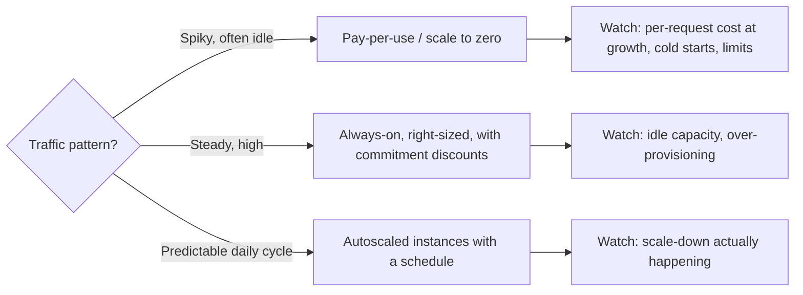
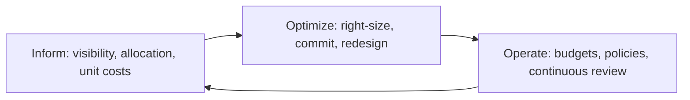

# Cost-Aware Architecture

## Introduction

In the cloud, **every architecture decision is also a buying decision**. Choosing a managed database, logging every request at debug level, replicating across regions, or calling a service per item instead of in batches all show up on next month's bill. Cost is a quality attribute like performance or reliability: it can be designed for, measured and traded off.

Werner Vogels' [The Frugal Architect](https://thefrugalarchitect.com/) puts it as its first law: "Make Cost a Non-functional Requirement." The AWS Well-Architected Framework has a dedicated cost optimization pillar, and the Azure Well-Architected Framework does too. None of these mean "make it cheap". They mean **spend deliberately**, so that cost grows in line with the value the system delivers.

An analogy: running a restaurant. A good owner knows the cost of each dish, not just the monthly grocery bill. If the most popular dish loses money on every plate, more customers means bigger losses. Software is the same: if each order costs more to serve than it earns, scaling up is a problem, not a success.

This page covers:

- where cloud costs come from, and the ones architects forget
- **unit economics**: cost per order, per customer, per request
- comparing hosting models with a simple cost model and a break-even point
- architectural levers that reduce cost, and their trade-offs
- cost visibility: tagging, allocation and the **FinOps** practice
- keeping cost and reliability in balance

:::caution Prices change
Every price on this page is **made up** for illustration. Real cloud prices vary by provider, region, commitment and over time. Always use the provider's official pricing pages and calculators for real decisions.
:::

## Where the Money Goes

| Cost driver | What drives it | Often overlooked because |
| --- | --- | --- |
| Compute | Instance size, count, hours running, idle capacity | Provisioned for peak and never scaled down |
| Managed databases | Instance size, replicas, storage, IOPS, backups | Replicas and backups added "temporarily" |
| Storage | Volume, storage class, retention | Nothing is ever deleted |
| Data transfer | Egress to the internet, cross-region, sometimes cross-zone | Invisible in architecture diagrams |
| Per-request services | Function invocations, API gateway calls, queue messages | Cheap per call, large at volume |
| Observability | Log ingestion and retention, metric series, trace volume | Grows quietly with traffic and verbosity |
| Non-production environments | Staging, test, dev, preview environments | Left running nights and weekends |
| Licenses and support | Per-core databases, commercial tools | Billed outside the cloud console |

Two of these deserve emphasis because they come directly from architecture:

- **Data transfer.** A design that ships large payloads between regions, or between a service and a database in another zone, pays for every byte. Chatty microservices spread across zones can generate surprising transfer bills.
- **Observability.** As covered in [Designing for Observability](./3-arch-observability.mdx), high-cardinality metrics and verbose logs can cost as much as the system they observe.

## Unit Economics: Cost per Unit of Value

A total bill tells you little. "We spent $19,800 this month" is neither good nor bad. "It costs us 16.5 cents to serve an order" can be compared with the margin on an order, tracked over time, and broken down by component.

```python
# Monthly bill by component (made-up numbers for illustration), and business volume.
bill = {
    "compute: web + api": 6_200,
    "compute: order workers": 1_100,
    "database (primary + replicas)": 4_800,
    "cache": 900,
    "object storage + CDN": 1_300,
    "data transfer": 2_100,
    "observability (logs, metrics, traces)": 3_400,
}
orders = 120_000
monthly_active_customers = 310_000

total = sum(bill.values())
print(f"total monthly cost      : ${total:,}")
print(f"cost per order          : ${total / orders:.3f}")
print(f"cost per active customer: ${total / monthly_active_customers:.3f}")
print()
for item, cost in sorted(bill.items(), key=lambda kv: kv[1], reverse=True):
    print(f"{item:<38} ${cost:>6,}  {cost / total:5.1%}  ${cost / orders:.4f}/order")
```

Output:

```text
total monthly cost      : $19,800
cost per order          : $0.165
cost per active customer: $0.064

compute: web + api                     $ 6,200  31.3%  $0.0517/order
database (primary + replicas)          $ 4,800  24.2%  $0.0400/order
observability (logs, metrics, traces)  $ 3,400  17.2%  $0.0283/order
data transfer                          $ 2,100  10.6%  $0.0175/order
object storage + CDN                   $ 1,300   6.6%  $0.0108/order
compute: order workers                 $ 1,100   5.6%  $0.0092/order
cache                                  $   900   4.5%  $0.0075/order
```

Things to look for:

- **Is the unit cost flat, falling or rising as volume grows?** Healthy architectures get cheaper per unit with scale (fixed costs spread out, caches get hotter). If cost per order rises with volume, something scales worse than linearly, such as a fan-out, a growing table scan, or per-tenant infrastructure.
- **Which component is surprisingly large?** Here, observability costs almost as much per order as the database. That's a design conversation, not just a budget one.
- **Which unit fits your business?** Orders for a shop, active tenants for a SaaS, minutes streamed for video, API calls for a platform. The Frugal Architect's second law is that systems that last "align cost to business".

## Comparing Hosting Models: A Simple Cost Model

Different compute models have different cost **shapes**. Always-on instances cost the same whether busy or idle. Pay-per-use services (serverless functions, some managed databases) cost nothing at zero traffic but more per unit at high, steady traffic. A small model shows where they cross:

```python
# Compare two hosting models for a bursty internal job API. ALL RATES ARE HYPOTHETICAL.
ALWAYS_ON_PER_HOUR = 0.10            # one small always-on instance
HOURS_PER_MONTH = 730
INSTANCES = 2                        # two for availability

PER_MILLION_INVOCATIONS = 0.20       # pay-per-use function pricing (hypothetical)
PER_GB_SECOND = 0.0000167
MEMORY_GB = 0.5
AVG_DURATION_S = 0.3

def always_on_cost() -> float:
    return ALWAYS_ON_PER_HOUR * HOURS_PER_MONTH * INSTANCES

def pay_per_use_cost(requests_per_month: int) -> float:
    invocations = requests_per_month / 1_000_000 * PER_MILLION_INVOCATIONS
    compute = requests_per_month * AVG_DURATION_S * MEMORY_GB * PER_GB_SECOND
    return invocations + compute

print(f"{'requests/month':>15} {'always-on':>10} {'pay-per-use':>12}  cheaper")
for reqs in [100_000, 1_000_000, 10_000_000, 50_000_000, 100_000_000]:
    a, p = always_on_cost(), pay_per_use_cost(reqs)
    print(f"{reqs:>15,} {a:>10.2f} {p:>12.2f}  {'pay-per-use' if p < a else 'always-on'}")

low, high = 0, 1_000_000_000
while high - low > 1_000:
    mid = (low + high) // 2
    if pay_per_use_cost(mid) < always_on_cost():
        low = mid
    else:
        high = mid
print(f"break-even at roughly {low:,} requests/month")
```

Output:

```text
 requests/month  always-on  pay-per-use  cheaper
        100,000     146.00         0.27  pay-per-use
      1,000,000     146.00         2.71  pay-per-use
     10,000,000     146.00        27.05  pay-per-use
     50,000,000     146.00       135.25  pay-per-use
    100,000,000     146.00       270.50  always-on
break-even at roughly 53,973,195 requests/month
```

The specific break-even is meaningless because the rates are invented, but the **shape** of the result is general:



The model also leaves things out, and those often decide the question: engineering time to operate each option, cold-start latency, concurrency limits, and the cost of rewriting if you outgrow a model. See [Serverless Architecture](../6-arch-architectural-styles/6-arch-serverless.mdx) for the non-cost trade-offs.

:::tip
Build a cost model like this **during design**, with the provider's real prices and your expected traffic, and keep it next to the [Architecture Decision Record](../13-arch-documenting-and-evolving/0-arch-decision-records.mdx). When traffic changes, rerun it to see whether the decision still holds.
:::

## Architectural Levers

| Lever | How it saves | Trade-off |
| --- | --- | --- |
| **Right-size and scale down** | Pay for what you use; autoscale in both directions | Needs good metrics; too tight hurts latency |
| **Scale to zero** for idle workloads | No cost when nobody uses it | Cold starts; not for latency-critical paths |
| **Schedule non-production** | Turn staging and dev off outside working hours | Less convenient for distributed teams |
| **Caching and CDNs** | Fewer database reads and origin requests | Staleness, invalidation complexity |
| **Batching and async processing** | Fewer per-request charges; smooth peaks so you size for average, not peak | Added latency for the user's result |
| **Storage tiering and retention** | Move old data to cheaper classes; delete what you don't need | Slower or costlier retrieval of old data |
| **Keep chatty components together** | Avoid cross-zone and cross-region transfer | Can reduce isolation and resilience |
| **Sample and reduce telemetry** | Lower observability bills | Less evidence during incidents |
| **Commitment discounts** for steady baseline | Lower unit price for committed usage | Lock-in to capacity you must keep using |
| **Spot or preemptible capacity** for interruptible work | Large discounts on spare capacity | Instances can be reclaimed; work must be restartable |
| **Managed services** instead of self-hosting | Less operations work | Higher sticker price, less control |

The last row is a reminder that the cheapest bill is not always the cheapest system. A self-hosted database might cost less in the cloud bill but more in engineer time, on-call load and risk. Count **total cost of ownership**, including people.

### Estimating the cost of a design detail

Small design details multiply by traffic. Log verbosity is a good example, because it feels free when you write the log line:

```python
# Estimate monthly log volume for a design. The per-GB price is HYPOTHETICAL.
SECONDS_PER_MONTH = 30 * 24 * 3600
PRICE_PER_GB_INGESTED = 0.50

def monthly_log_gb(avg_rps: float, lines_per_request: float, bytes_per_line: int) -> float:
    return avg_rps * SECONDS_PER_MONTH * lines_per_request * bytes_per_line / 1e9

designs = {
    "INFO, 3 lines/request":        (3, 300),
    "DEBUG left on, 25 lines/req":  (25, 350),
    "INFO + 10% sampled DEBUG":     (3 + 0.1 * 25, 310),
}
for name, (lines, size) in designs.items():
    gb = monthly_log_gb(avg_rps=300, lines_per_request=lines, bytes_per_line=size)
    print(f"{name:<30} {gb:>8,.0f} GB/month  ~${gb * PRICE_PER_GB_INGESTED:>8,.0f}")
```

Output:

```text
INFO, 3 lines/request               700 GB/month  ~$     350
DEBUG left on, 25 lines/req       6,804 GB/month  ~$   3,402
INFO + 10% sampled DEBUG          1,326 GB/month  ~$     663
```

The same back-of-the-envelope style works for data transfer (bytes per response times responses), queue messages, and function invocations. It takes five minutes during design and avoids a surprise months later.

### Cost and sustainability

Wasted compute is also wasted energy. AWS added a **sustainability** pillar to its Well-Architected Framework, and many of its recommendations (right-size, scale down idle resources, delete unneeded data, keep data close to where it is used) are the same levers as cost optimization. Cost-aware design is often greener design too, though the two can diverge, for example when the cheapest region isn't the one with the cleanest energy.

### Cost as a fitness function

Cost regressions creep in like performance regressions. You can guard against the architectural ones automatically, for example:

- a CI check that fails when a new resource in infrastructure code lacks required cost tags
- a test that estimates log bytes per request and fails if it grows beyond a budget
- budget alerts per team and per environment that notify owners at 50%, 80% and 100% of forecast

These are examples of [fitness functions](../13-arch-documenting-and-evolving/3-arch-fitness-functions.mdx). The Frugal Architect's fifth law, "Cost Aware Architectures Implement Cost Controls," is about the same idea.

## Visibility: Tagging and Allocation

You can't manage costs you can't attribute. The first step is almost always **tagging** (labels on resources) so spend can be grouped by team, service, environment and product. Infrastructure as code, for example with [Terraform](/docs/devops/terraform), makes consistent tags enforceable.

```python
from collections import defaultdict

# Simplified rows from a cost export (FOCUS-style exports have many more columns).
line_items = [
    {"resource": "api-cluster",      "cost": 6200, "tags": {"team": "storefront", "env": "prod"}},
    {"resource": "orders-db",        "cost": 4800, "tags": {"team": "checkout",   "env": "prod"}},
    {"resource": "worker-pool",      "cost": 1100, "tags": {"team": "checkout",   "env": "prod"}},
    {"resource": "staging-cluster",  "cost": 1900, "tags": {"team": "storefront", "env": "staging"}},
    {"resource": "log-index",        "cost": 3400, "tags": {"team": "platform",   "env": "prod"}},
    {"resource": "old-test-db",      "cost":  750, "tags": {}},
    {"resource": "ml-gpu-notebook",  "cost": 1400, "tags": {"env": "dev"}},
]
REQUIRED_TAGS = {"team", "env"}

by_team: dict[str, int] = defaultdict(int)
untagged = []
for item in line_items:
    missing = REQUIRED_TAGS - item["tags"].keys()
    if missing:
        untagged.append((item["resource"], item["cost"], sorted(missing)))
    by_team[item["tags"].get("team", "UNALLOCATED")] += item["cost"]

total = sum(i["cost"] for i in line_items)
for team, cost in sorted(by_team.items(), key=lambda kv: -kv[1]):
    print(f"{team:<12} ${cost:>6,}  {cost / total:5.1%}")
print("\nmissing required tags:")
for resource, cost, missing in untagged:
    print(f"  {resource:<16} ${cost:>5,}  missing {missing}")
```

Output:

```text
storefront   $ 8,100  41.4%
checkout     $ 5,900  30.2%
platform     $ 3,400  17.4%
UNALLOCATED  $ 2,150  11.0%

missing required tags:
  old-test-db      $  750  missing ['env', 'team']
  ml-gpu-notebook  $1,400  missing ['team']
```

Untagged resources are often the forgotten ones: an old test database, a GPU notebook someone left running. The **FOCUS** specification (FinOps Open Cost and Usage Specification) aims to give cost exports from different providers a common format, which makes this kind of analysis portable across clouds.

## FinOps: Making Cost Everyone's Job

**FinOps** is the operating practice for cloud cost, promoted by the [FinOps Foundation](https://www.finops.org/framework/). Its framework describes three iterative phases:



Two of its principles matter most to architects: **everyone takes ownership for their technology usage** (the team that builds a service sees and owns its cost), and **business value drives technology decisions** (the cheapest option is not automatically the right one). The framework is updated over time, so check the Foundation's site for the current version.

## Cost vs Other Qualities

Cost trades against almost everything else on this section's pages:

| Decision | Cheaper option | What you give up |
| --- | --- | --- |
| Run in one zone | Fewer replicas, no cross-zone transfer | [Reliability](./2-arch-reliability.mdx) when that zone fails |
| Scale to zero | No idle cost | [Performance](./1-arch-performance.mdx) on cold starts |
| Sample traces at 1% | Lower observability bill | Evidence for rare failures |
| No staging environment | Saves a full copy of the system | Safer [deploys](./6-arch-deployability.mdx) |
| Lower headroom | Fewer instances | [Scalability](./0-arch-scalability.mdx) under sudden spikes |

There is no universal answer. The useful habit is to make the trade-off **explicit**: "We run checkout in three zones because an hour of checkout downtime costs more than a year of the extra capacity." Writing that sentence forces someone to estimate both numbers.

## Real-World Scenario

Your team runs an online bookstore. The cloud bill grew 70% over the year while orders grew 20%, and the finance team is asking why. Nobody can say which team or feature drives the increase, because half the resources have no tags.

The plan:

1. **Inform first.** Enforce `team`, `service` and `env` tags through infrastructure-as-code checks. Build a monthly report of cost per order, broken down by component, like the one above.
2. **Find the drivers.** The report shows three: observability grew fastest (debug logging left on after an incident, plus a metric labeled with `customer_id`), a staging environment runs at production size around the clock, and a recommendations service in another region pulls the full catalog across regions every hour.
3. **Fix with design changes, not just discounts.**
   - Drop `customer_id` from metric labels, set log level to INFO, add tail sampling in the Collector, and shorten retention for debug-level data.
   - Scale staging down outside working hours and give it smaller database instances.
   - Move the recommendations job into the same region as the catalog, and sync only changed books.
4. **Then optimize price.** Once the baseline is stable and right-sized, buy commitment discounts for the steady part of production compute.
5. **Operate.** Budget alerts per team, and a "cost impact" section in the ADR template for new designs.

**Why this approach:** most of the growth came from **design choices** (telemetry design, environment sizing, data placement), not from prices. Buying discounts first would have locked in a wasteful baseline.

**When to use it / when not to:** cost reviews pay off once cloud spend is significant relative to revenue or budget. For an early-stage product, engineering time is usually the scarcer resource: pick simple managed services, set a budget alert, and revisit when spend becomes material. Never cut costs by removing redundancy from systems whose SLOs depend on it without an explicit decision.

**Alternatives and trade-offs:**

| Approach | Pros | Cons | Best for |
| --- | --- | --- | --- |
| Design-level fixes (chosen) | Lasting savings, often improves the system | Needs engineering time | Waste caused by architecture |
| Commitment discounts | Quick savings, no code changes | Locks in usage; wasteful if baseline is wrong | Stable, right-sized baselines |
| Spot or preemptible capacity | Large discounts | Interruptions; work must be restartable | Batch jobs, CI runners, stateless workers |
| Across-the-board cuts | Fast, simple to announce | Hurts reliability and morale, savings often come back | Rarely the right choice |
| Repatriation (move off cloud) | Lower unit cost for steady, large workloads | Capex, hardware ops, loss of elasticity | Very large, predictable workloads with ops expertise |

## Common Mistakes

- **Ignoring cost until the bill arrives.** By then the architecture is set.
- **Optimizing totals instead of unit costs**, which punishes growth and hides inefficiency.
- **Provisioning for peak, all year.** Use autoscaling and schedules.
- **Forgetting data transfer and observability** in design estimates.
- **No tags, no owners.** Unowned resources are never cleaned up.
- **Buying discounts before right-sizing.**
- **Saving money by removing reliability** without an explicit, documented trade-off.
- **Counting only the cloud bill** and not engineering and on-call time.

## Summary

- Treat **cost as a non-functional requirement**, designed and measured like any other quality attribute.
- Know the **cost drivers**, especially the easy-to-miss ones: data transfer, observability, idle capacity and non-production environments.
- Track **unit economics**, such as cost per order, and watch whether they improve with scale.
- Build simple **cost models** during design to compare options and find break-even points, using real, current prices.
- Use architectural **levers** (right-sizing, scale to zero, caching, batching, tiering, data locality, telemetry sampling) and know what each costs in other qualities.
- Make spend visible with **tags and allocation**, and run cost as an ongoing **FinOps** practice: inform, optimize, operate.

## Exercises

1. Build a unit-economics report for a system you know (even a rough one). What is your unit of value, and which component costs most per unit?
2. Change the hosting model example so pay-per-use functions need 1 GB of memory and run for 800 ms. Where does the break-even move? What non-cost factors would still affect your choice?
3. Write a check that reads a list of resources from infrastructure code and fails if any lack `team`, `service` or `env` tags.
4. Pick one design decision in your system and write the explicit cost-versus-quality sentence for it, with estimates for both sides.

Related pages:

- [Thinking in Trade-offs](../0-arch-fundamentals/4-arch-trade-offs.mdx)
- [Serverless Architecture](../6-arch-architectural-styles/6-arch-serverless.mdx)
- [Designing for Scalability](./0-arch-scalability.mdx)
- [Designing for Observability](./3-arch-observability.mdx)
