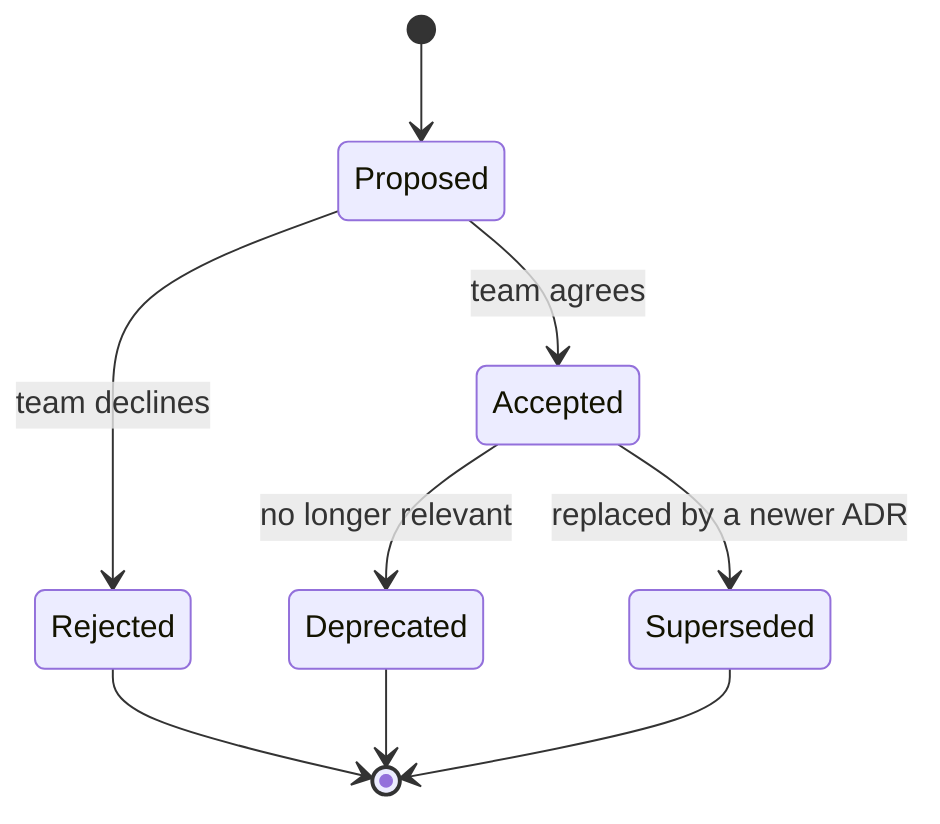
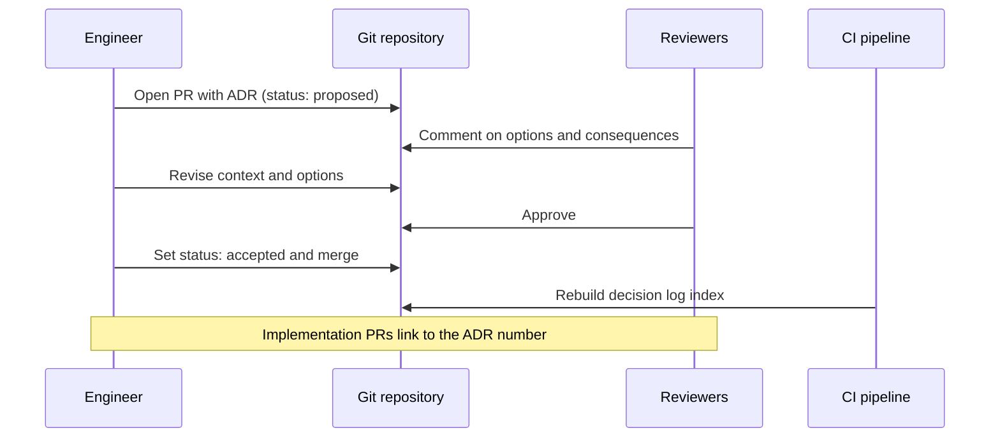

# Architecture Decision Records

## Introduction

Six months after a big design choice, someone new joins the team and asks: "Why do we use RabbitMQ here instead of Kafka?" Nobody remembers. The person who chose it has moved to another team. The Slack thread is gone. The new engineer either accepts the decision blindly or reverses it, without knowing which constraints made it sensible in the first place.

An **Architecture Decision Record (ADR)** prevents this. It is a short text document that captures **one** significant decision, the context that forced it, the options considered, and the consequences the team accepted. The collection of ADRs in a project is its **decision log**.

The idea was popularized by Michael Nygard in his 2011 post [Documenting Architecture Decisions](https://www.cognitect.com/blog/2011/11/15/documenting-architecture-decisions). The community hub [adr.github.io](https://adr.github.io/) defines an architectural decision as a justified design choice that addresses an architecturally significant requirement, functional or not, and an ADR as the record of that choice and its rationale.

A good analogy is a ship's logbook. It does not describe the whole ship. It records what the crew decided at each moment, and why: "changed course to 040 because of a storm warning." Later readers can reconstruct the reasoning even if they were not on board.

:::info Where this page fits
ADRs record *why*. [The C4 Model](./1-arch-c4-model.mdx) and [Diagrams as Code](./2-arch-diagrams-as-code.mdx) show *what* the system looks like. [Fitness Functions](./3-arch-fitness-functions.mdx) check automatically that decisions are still followed. If you need a refresher on why every decision is a trade-off, read [Thinking in Trade-offs](../0-arch-fundamentals/4-arch-trade-offs.mdx) first.
:::

## What Counts as an Architectural Decision?

Not every choice deserves an ADR. Write one when a decision is **hard to reverse**, **affects several teams or modules**, or **trades one quality attribute against another**. A useful test: *would a future engineer reasonably want to undo this without knowing why we did it?*

| Usually worth an ADR | Usually not worth an ADR |
| --- | --- |
| Choosing a database or message broker | Naming a local variable |
| Splitting a module into a separate service | Choosing between two equivalent utility libraries |
| Adopting event sourcing for orders | Formatting rules (put them in a linter config) |
| Picking synchronous REST vs async messaging between contexts | A bug fix |
| Deciding on a multi-tenant data isolation model | A refactor that does not change structure |
| Accepting eventual consistency in the catalog | Upgrading a minor library version |

Decisions also include things you decided **not** to do. "We will not add a cache in front of the catalog yet" is a valid and very useful ADR, because the next person to suggest a cache can read why.

## The Anatomy of an ADR

### Nygard's original format

Nygard's template is deliberately tiny. It has five parts:

1. **Title**: a short noun phrase, numbered, for example "ADR 7: Use PostgreSQL for the order store".
2. **Status**: proposed, accepted, deprecated or superseded.
3. **Context**: the forces at play: technical, political, social and project constraints. Written neutrally.
4. **Decision**: the response to those forces, in active voice: "We will ...".
5. **Consequences**: what becomes easier or harder after the decision, including the negative ones.

```markdown
# 7. Use PostgreSQL for the order store

## Status

Accepted

## Context

The bookstore checkout writes orders, order lines and payments in one
transaction. The team knows SQL well. Reporting needs ad-hoc joins.
Expected load is a few hundred orders per minute at peak.

## Decision

We will store orders in a managed PostgreSQL instance, one schema per module.

## Consequences

* Multi-row transactions are simple and well understood.
* Reporting can run SQL directly against a read replica.
* Horizontal write scaling is limited; if peak load grows by an order of
  magnitude we must revisit (see ADR 12 on partitioning).
* We take on schema migrations as part of every release.
```

The **Consequences** section is the one people skip, and it is the most valuable. A decision with no listed downsides was either not examined or not honestly recorded.

### MADR: Markdown Architectural Decision Records

[MADR](https://adr.github.io/madr/) is a more structured template maintained by the ADR community. Version 4.0.0 was released in September 2024. It adds explicit sections for the options you rejected, which is where most of the learning lives. Its main headings are:

- `Context and Problem Statement`
- `Decision Drivers` (optional)
- `Considered Options`
- `Decision Outcome`, with optional `Consequences` and `Confirmation` subsections
- `Pros and Cons of the Options` (optional)
- `More Information` (optional)

MADR files use the name pattern `NNNN-title-with-dashes.md` and by default live in `docs/decisions`. Metadata such as status, date and decision makers goes in YAML front matter. Check the MADR site for the current template before you copy it, because it evolves between versions.

The **Confirmation** section is worth highlighting. It asks: *how will we know the decision is actually followed?* The answer might be a code review checklist item, or better, an automated test. That links ADRs directly to [fitness functions](./3-arch-fitness-functions.mdx).

### Y-statements: the one-sentence ADR

For smaller decisions, Olaf Zimmermann and colleagues proposed the **Y-statement**, a single structured sentence:

```text
In the context of <use case or component>,
facing <concern or requirement>,
we decided for <option>
and neglected <other options>,
to achieve <quality or benefit>,
accepting <downside>.
```

For example: "In the context of the order service, facing the need to notify shipping and email without coupling them to checkout, we decided for publishing domain events via a message broker and neglected direct HTTP calls, to achieve independent deployability, accepting eventual consistency and an extra piece of infrastructure."

Y-statements fit nicely in a pull request description or as the summary line at the top of a longer MADR file.

### Choosing a template

| Template | Length | Strength | Best for |
| --- | --- | --- | --- |
| Nygard | Half a page | Easy to start, low friction | Small teams, first ADRs |
| MADR | One to two pages | Forces you to list rejected options | Decisions with real alternatives |
| Y-statement | One sentence | Fast, fits in a PR or commit | Medium decisions, summaries |
| Design doc / RFC | Several pages | Room for exploration and diagrams | Large, cross-team proposals |

Pick one template for the repository and stick with it. Consistency matters more than the choice of template.

## The ADR Lifecycle

ADRs are **immutable once accepted**. You do not edit an accepted ADR to change the decision. You write a new ADR that **supersedes** it, and you update the old one's status to point at the new one. That way the log preserves history: you can see what was decided, when, and why it changed.



Small corrections, like fixing a typo or adding a link, are fine. Changing the **decision** is not. Rejected ADRs are worth keeping too. They answer "did anyone consider X?" in seconds.

## Where ADRs Live

Keep ADRs **in the repository, next to the code they describe**, as Markdown files. This gives you:

- **Review through pull requests**: the same workflow as code, with comments and approvals.
- **Versioning for free**: `git log` shows how the decision evolved.
- **Discoverability**: the ADR is one `grep` away from the code it affects.

A common layout:

```text
bookstore/
├── docs/
│   └── decisions/
│       ├── README.md                          # index, generated
│       ├── 0000-record-architecture-decisions.md
│       ├── 0001-use-postgresql-for-the-order-store.md
│       ├── 0002-modular-monolith-first.md
│       └── 0003-publish-order-events-with-rabbitmq.md
└── src/
```

For decisions that span many repositories, such as company-wide platform choices, teams often keep a dedicated `architecture-decisions` repository or a wiki section, and link to it from each service.

## Tooling: A Minimal ADR Helper

You do not need special tools. A Markdown file and a numbering convention are enough. Still, a small script removes friction, and friction is the main reason teams stop writing ADRs.

Existing tools include Nat Pryce's [adr-tools](https://github.com/npryce/adr-tools), a set of shell scripts with commands such as `adr init`, `adr new "Title"` and `adr new -s 9 "Title"` to supersede ADR 9. The [adr.github.io tooling page](https://adr.github.io/) lists more, including static site generators that publish the log as a browsable website. Check each tool's activity before adopting it, since several are maintained by volunteers.

Here is a self-contained Python helper that creates MADR-style records, handles superseding, and regenerates an index. It uses only the standard library.

```python
"""adr.py - a tiny ADR helper: create numbered records and rebuild the index."""
from __future__ import annotations

import argparse
import re
from datetime import date
from pathlib import Path

ADR_DIR = Path("docs/decisions")
FILE_RE = re.compile(r"^(\d{4})-(.+)\.md$")

TEMPLATE = """---
status: proposed
date: {today}
decision-makers: []
---

# {title}

## Context and Problem Statement

What problem are we solving, and why now?

## Decision Drivers

* ...

## Considered Options

* ...

## Decision Outcome

Chosen option: "...", because ...

### Consequences

* Good, because ...
* Bad, because ...

### Confirmation

How will we check that the decision is followed?
"""


def slugify(title: str) -> str:
    return re.sub(r"[^a-z0-9]+", "-", title.lower()).strip("-")


def existing() -> list[tuple[int, Path]]:
    found = []
    for path in ADR_DIR.glob("*.md"):
        if match := FILE_RE.match(path.name):
            found.append((int(match.group(1)), path))
    return sorted(found)


def new(title: str) -> Path:
    ADR_DIR.mkdir(parents=True, exist_ok=True)
    number = max((n for n, _ in existing()), default=-1) + 1
    path = ADR_DIR / f"{number:04d}-{slugify(title)}.md"
    path.write_text(TEMPLATE.format(today=date.today().isoformat(), title=title))
    return path


def read_status(path: Path) -> str:
    match = re.search(r"^status:\s*(.+)$", path.read_text(), re.MULTILINE)
    return match.group(1).strip() if match else "unknown"


def read_title(path: Path) -> str:
    match = re.search(r"^# (.+)$", path.read_text(), re.MULTILINE)
    return match.group(1).strip() if match else path.stem


def index() -> str:
    lines = ["# Decision Log", "", "| ADR | Title | Status |", "| --- | --- | --- |"]
    for number, path in existing():
        lines.append(f"| [{number:04d}]({path.name}) | {read_title(path)} | {read_status(path)} |")
    return "\n".join(lines) + "\n"


def supersede(old: int, new_number: int) -> None:
    for number, path in existing():
        if number == old:
            text = re.sub(
                r"^status:.*$",
                f"status: superseded by ADR-{new_number:04d}",
                path.read_text(),
                count=1,
                flags=re.MULTILINE,
            )
            path.write_text(text)
            return
    raise SystemExit(f"ADR {old} not found")


def main() -> None:
    parser = argparse.ArgumentParser(description="Manage architecture decision records")
    sub = parser.add_subparsers(dest="command", required=True)
    new_cmd = sub.add_parser("new")
    new_cmd.add_argument("title")
    new_cmd.add_argument("--supersedes", type=int)
    sub.add_parser("index")
    args = parser.parse_args()

    if args.command == "new":
        path = new(args.title)
        if args.supersedes is not None:
            supersede(args.supersedes, int(path.name[:4]))
        print(f"Created {path}")
    else:
        out = ADR_DIR / "README.md"
        out.write_text(index())
        print(out.read_text(), end="")


if __name__ == "__main__":
    main()
```

Try it out. After creating the first three records, mark 0000 and 0001 as accepted by editing their front matter, then supersede 0002:

```bash
python3 adr.py new "Record architecture decisions"
python3 adr.py new "Use PostgreSQL for the order store"
python3 adr.py new "Publish order events with RabbitMQ"
# ...edit 0000 and 0001: status: accepted
python3 adr.py new "Publish order events with Kafka" --supersedes 2
python3 adr.py index
```

Output:

```text
Created docs/decisions/0000-record-architecture-decisions.md
Created docs/decisions/0001-use-postgresql-for-the-order-store.md
Created docs/decisions/0002-publish-order-events-with-rabbitmq.md
Created docs/decisions/0003-publish-order-events-with-kafka.md
# Decision Log

| ADR | Title | Status |
| --- | --- | --- |
| [0000](0000-record-architecture-decisions.md) | Record architecture decisions | accepted |
| [0001](0001-use-postgresql-for-the-order-store.md) | Use PostgreSQL for the order store | accepted |
| [0002](0002-publish-order-events-with-rabbitmq.md) | Publish order events with RabbitMQ | superseded by ADR-0003 |
| [0003](0003-publish-order-events-with-kafka.md) | Publish order events with Kafka | proposed |
```

A nice touch is to run `python3 adr.py index` in CI and fail the build if `README.md` changes, so the index can never go stale.

## ADRs in the Team Workflow

Writing the document is the easy part. The hard part is making ADRs a habit. A workflow that works for many teams:



Practical tips:

- **Write the ADR before or alongside the change**, not months later. Retroactive ADRs are still better than none, but the context is fresher at decision time.
- **Keep the PR open for a fixed window** (for example, three working days) so people in other time zones can weigh in.
- **Link the ADR from code** where the decision is visible, for example a comment `# See ADR-0003` next to the broker configuration.
- **Name the decision makers.** It is not about blame. It tells future readers whom to ask.
- **Start with ADR 0000: "Record architecture decisions".** It explains to newcomers why the folder exists.

## Real-World Scenario

Your team runs **PageTurn**, an online bookstore built as a [modular monolith](../6-arch-architectural-styles/3-arch-modular-monolith.mdx). The orders module needs to notify shipping, email and the loyalty-points module whenever an order is placed. Today, checkout calls all three directly inside the request, so a slow email provider makes checkout slow, and an exception in loyalty points fails the order.

A senior engineer proposes publishing an `OrderPlaced` event. Three options come up in the design discussion, and the team writes them down as a MADR before choosing.

```markdown
---
status: accepted
date: 2026-03-04
decision-makers: [Priya (orders lead), Tomás (platform), Mei (shipping)]
---

# Publish order events through a message broker

## Context and Problem Statement

Checkout calls shipping, email and loyalty synchronously. A failure or slow
response in any of them fails or delays the customer's order. How should the
orders module notify other modules without coupling checkout to them?

## Decision Drivers

* Checkout must not fail because a downstream consumer fails
* Events must not be lost if the app crashes after the order commits
* The platform team (2 people) must be able to operate it
* Shipping may become a separate service within a year

## Considered Options

* In-process event bus with a transactional outbox table
* RabbitMQ with a transactional outbox
* Apache Kafka with a transactional outbox

## Decision Outcome

Chosen option: "RabbitMQ with a transactional outbox", because it decouples
checkout from consumers, supports a future out-of-process shipping service,
and the platform team already runs RabbitMQ for another product.

### Consequences

* Good, because checkout latency no longer depends on email or loyalty.
* Good, because shipping can move to its own service without changing orders.
* Bad, because consumers see events a little later (eventual consistency).
* Bad, because we must operate a broker and monitor the outbox relay.
* Neutral: event replay for analytics is not supported; revisit if needed.

### Confirmation

An architecture test forbids imports from `bookstore.orders` into
`bookstore.shipping`, `bookstore.email` and `bookstore.loyalty`.

## Pros and Cons of the Options

### In-process event bus with outbox

* Good, because no new infrastructure.
* Bad, because it cannot deliver to a separate shipping service later.

### Kafka with outbox

* Good, because events are retained and replayable.
* Bad, because the team has no Kafka operating experience.
* Bad, because it is more than current volume requires.
```

A year later, the data team needs to replay order history into a new analytics platform, and order volume has grown tenfold. The team writes ADR 0011, "Publish order events with Kafka", with `--supersedes 3`. ADR 0003 stays in the log with `status: superseded by ADR-0011`. A new engineer reading both understands that RabbitMQ was the right call **then**, and why the context changed.

### Why this approach

- The ADR captured the rejected options. When someone later says "why not Kafka from day one?", the answer is already written down, with the constraint (a two-person platform team) that drove it.
- The **Confirmation** section turned the decision into an automated check, so it could not quietly erode.
- Superseding instead of editing kept the history honest.

### When to use ADRs, and when not to

Use them for decisions that are costly to reverse, cross team boundaries, or trade quality attributes. Do **not** use them as meeting minutes, task lists, or for trivial choices; a decision log with 400 entries about library versions buries the five that matter. Very early prototypes may not need ADRs at all, though a single "why we built it this way" note helps if the prototype survives.

### Alternatives and trade-offs

| Approach | Pros | Cons | Best for |
| --- | --- | --- | --- |
| ADRs in the repo | Versioned, reviewed like code, close to code | Only developers tend to read them | Most engineering teams |
| Wiki pages | Easy for non-developers to read and edit | Drift from code, weak history and review | Org-wide policies |
| Design docs / RFCs | Room for deep exploration and diagrams | Heavy; often never updated after approval | Large cross-team proposals (summarize the outcome in an ADR) |
| Issue tracker comments | Zero extra effort | Hard to find, mixed with noise | Nothing long-lived |
| Nothing ("the code is the documentation") | No overhead | Code shows *what*, never *why* or what was rejected | Throwaway prototypes |

## Common Mistakes

1. **Recording only the winner.** Without the considered options, readers cannot tell whether alternatives were evaluated. Always list at least two options, even if one is "do nothing".
2. **Hiding the downsides.** An ADR with only good consequences reads like marketing. List what got harder.
3. **Editing accepted ADRs.** Changing history destroys the log's value. Supersede instead.
4. **Writing essays.** If an ADR is longer than two pages, split it, or move the exploration to a design doc and keep the ADR as the summary.
5. **Writing ADRs nobody can find.** Keep an index, link ADRs from code and from pull requests, and mention them in onboarding.
6. **Making ADRs a gate.** If every small change needs an ADR and a committee, people route around the process. Keep it lightweight and reserved for significant decisions.
7. **Vague context.** "We need scalability" is not context. "Peak load is 300 orders per minute; the business expects 3,000 within two years" is.

## Summary

- An ADR records **one** architecturally significant decision: context, options, decision and consequences.
- **Nygard's** format is minimal; **MADR** adds considered options and confirmation; **Y-statements** fit in one sentence.
- ADRs are **immutable once accepted**. Change a decision by writing a new ADR that supersedes the old one.
- Store ADRs as Markdown **in the repository**, review them in pull requests, and keep an index.
- The **Confirmation** section connects a decision to an automated check, so it does not silently decay.
- Keep the process light, or people will stop doing it.

## Exercises

1. Pick a project you work on and write ADR 0000 ("Record architecture decisions") plus ADRs for two decisions that were already made, such as the database and the web framework. Note how hard it is to reconstruct the context afterwards.
2. Extend `adr.py` with a `check` command that exits with status 1 if any ADR is missing a `Considered Options` section or has fewer than two options listed.
3. Write the same decision three ways: as a Y-statement, in Nygard format and in MADR format. Which one would you want to read in two years?
4. Add a CI step that runs `python3 adr.py index` and fails if `git diff --exit-code docs/decisions/README.md` reports a change.

### Related pages

- [Thinking in Trade-offs](../0-arch-fundamentals/4-arch-trade-offs.mdx)
- [The Role of a Software Architect](../0-arch-fundamentals/2-arch-architect-role.mdx)
- [The C4 Model](./1-arch-c4-model.mdx)
- [Fitness Functions and Evolutionary Architecture](./3-arch-fitness-functions.mdx)
- [Transactional Outbox](../9-arch-distributed-systems/6-arch-outbox.mdx)
