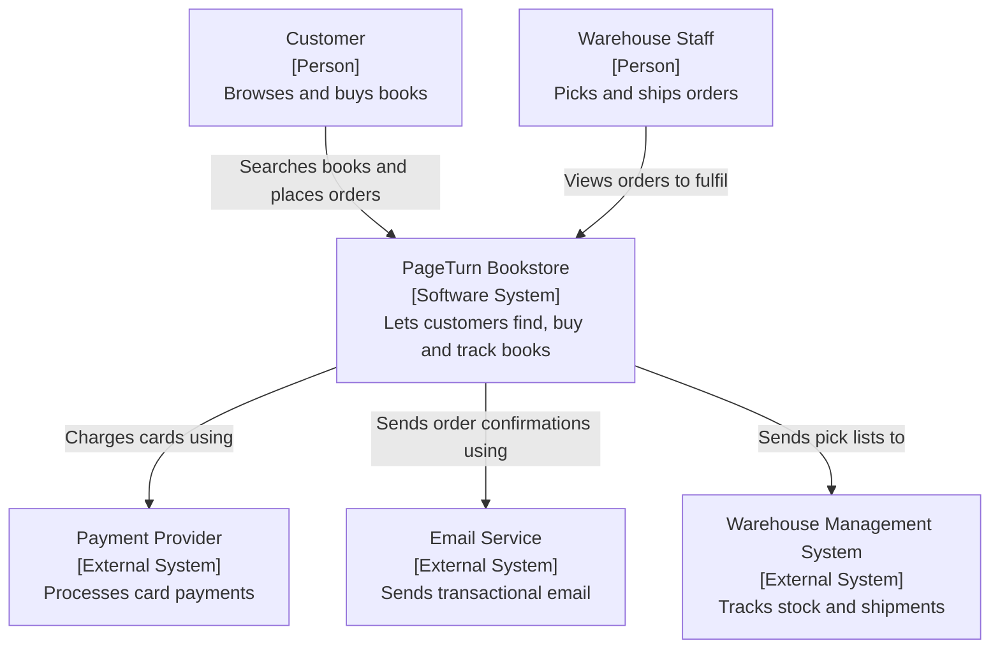
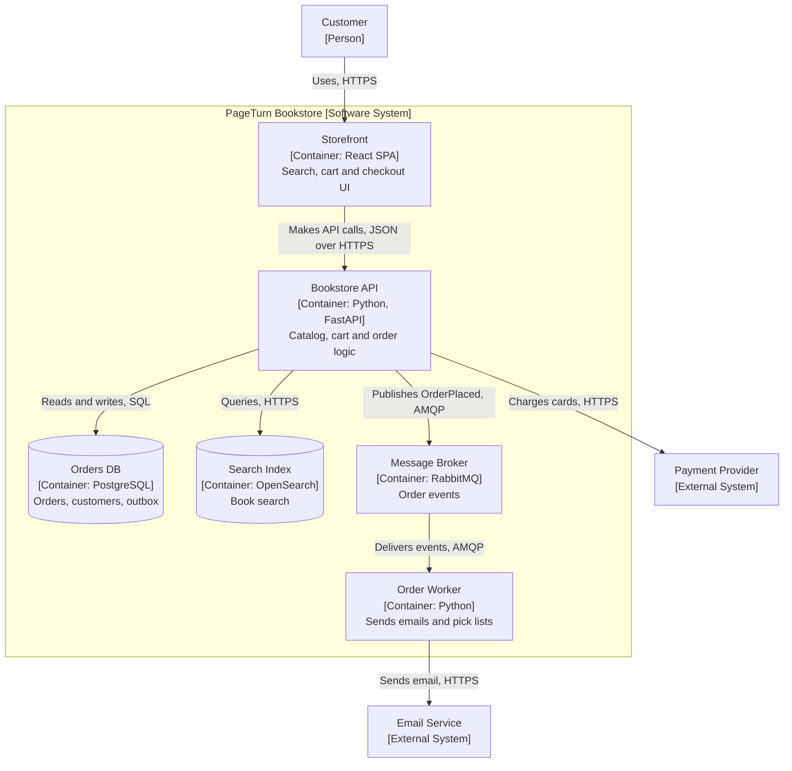
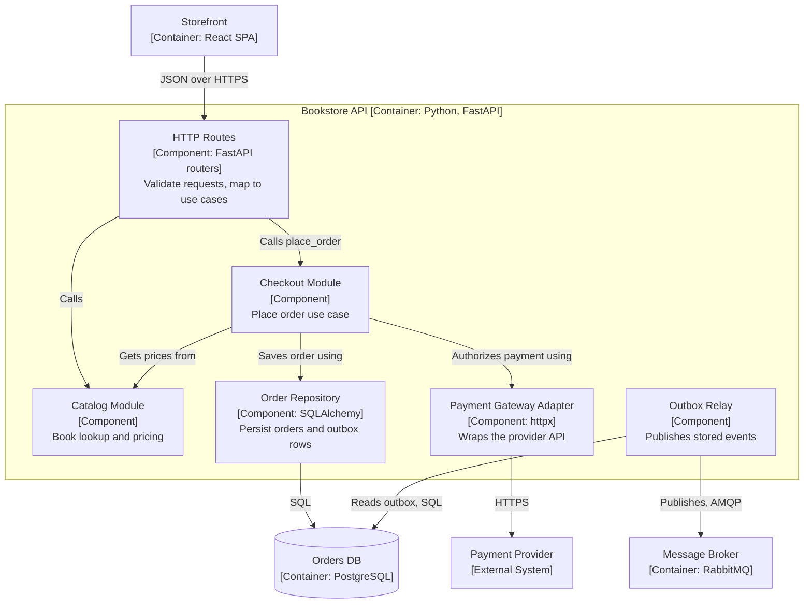
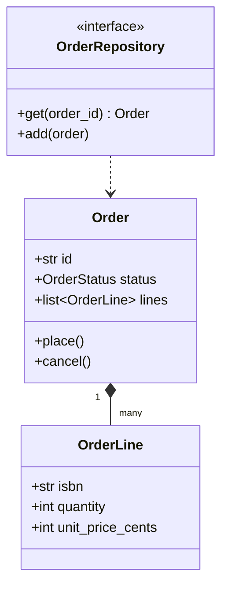
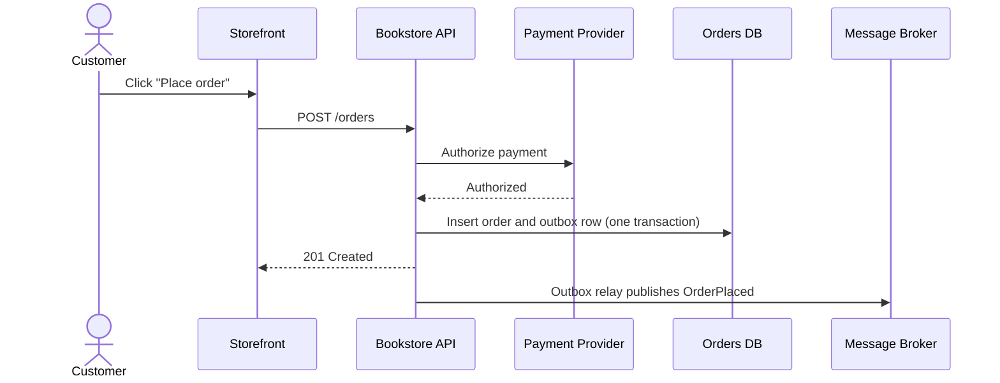
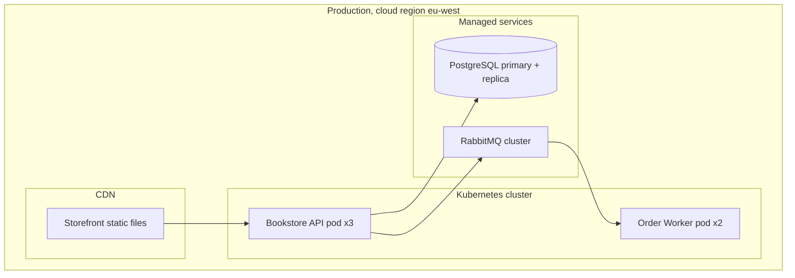

# The C4 Model

## Introduction

Ask five engineers to "draw the architecture" on a whiteboard and you will get five different pictures. One draws servers, one draws classes, one draws teams, and one draws a cloud with arrows. Boxes have no labels, arrows go both ways, and nobody can tell whether a box is a process, a library or a database.

The **C4 model**, created by Simon Brown and documented at [c4model.com](https://c4model.com/), fixes this with two simple ideas:

1. **A small set of abstractions**: people, software systems, containers and components (plus code).
2. **A hierarchy of diagrams**, one per level of zoom, so each diagram answers one question for one audience.

The usual analogy is an online map. At the country level you see cities and highways. Zoom into a city and you see neighbourhoods and main roads. Zoom further and you see individual streets. You never try to show every street on the country map. C4 does the same for software: **Context, Containers, Components, Code**.

C4 is **notation independent** and **tooling independent**. You can draw it on a whiteboard, in a diagram tool, or as code. This page covers the concepts. [Diagrams as Code](./2-arch-diagrams-as-code.mdx) covers the tools.

## The Abstractions

Before the diagrams, you need the vocabulary. Most confusion in architecture diagrams comes from mixing these up.

| Abstraction | What it is | Bookstore examples |
| --- | --- | --- |
| **Person** | A human user, role or persona | Customer, warehouse staff, support agent |
| **Software system** | The highest level: something that delivers value, usually owned by one team | PageTurn Bookstore, a payment provider, an email service |
| **Container** | A separately runnable or deployable unit that executes code or stores data | React storefront, Python API, PostgreSQL database, worker process |
| **Component** | A grouping of related functionality behind a well-defined interface, inside one container | Catalog module, checkout module, order repository |
| **Code** | Classes, functions, tables | `Order`, `OrderRepository`, `place_order()` |

:::caution "Container" does not mean Docker
In C4, a **container** is "an application or a data store": a web app, a single-page app, a mobile app, a serverless function, a database schema, even a folder of files. It may run in a Docker container, but the term predates Docker's popularity and means something more general. Say this out loud the first time you show C4 diagrams to a team.
:::

A useful rule of thumb: **if it has its own process or storage, it is a container. If it lives inside a process, it is a component.**

## Level 1: System Context Diagram

The system context diagram is the zoomed-out view. It shows **your system as one box**, the people who use it, and the other systems it talks to. It deliberately hides technology and protocols.

- **Scope:** one software system.
- **Audience:** everyone, including non-technical stakeholders.
- **Question it answers:** "What is this system, who uses it, and what does it depend on?"



Notice what is **not** here: no databases, no queues, no "microservice A". A product manager can read this in thirty seconds. It is the diagram you show in the first ten minutes of onboarding.

## Level 2: Container Diagram

Zoom into the bookstore box and you see its containers: the deployable pieces and how they communicate. This is the diagram engineers use most.

- **Scope:** one software system.
- **Audience:** technical people inside and outside the team: developers, architects, operations, security.
- **Question it answers:** "What are the major building blocks, what technology are they, and how do they talk?"



The container diagram shows **technology choices** and **communication protocols**, because those are what operations and security people need. It does **not** show load balancers, replicas or regions. Those belong in a deployment diagram.

## Level 3: Component Diagram

Zoom into one container to see its components. For a modular monolith API, components are often the modules and their main interfaces.

- **Scope:** one container.
- **Audience:** architects and developers working on or near that container.
- **Question it answers:** "How is this container structured inside, and where does responsibility live?"



The C4 site recommends component diagrams only **when they add value**, and suggests automating them for long-lived documentation, because component structure changes as the code changes. A hand-drawn component diagram of a fast-moving codebase is usually wrong within months.

## Level 4: Code

The code level shows classes, interfaces or tables, typically as a UML class diagram or an entity-relationship diagram. In practice, **most teams skip this level** for documentation. IDEs can generate it on demand, and it goes stale fastest. Draw it only for a small, important, stable piece of the design, such as the aggregate at the heart of your domain.



## Supplementary Diagrams

The four levels describe **static structure**. The C4 model adds three supporting diagram types for other questions.

| Diagram | Shows | Use it when |
| --- | --- | --- |
| **System landscape** | All software systems and people across an organization | You have many systems and need a map of the whole estate |
| **Dynamic** | How elements collaborate at runtime for one scenario | A flow is not obvious from the static diagrams, such as checkout |
| **Deployment** | How containers map to infrastructure in one environment | Operations, capacity planning, security reviews |

A dynamic diagram is often easiest as a sequence diagram. Here is checkout:



A deployment diagram reuses the containers and places them on infrastructure nodes:



Draw one deployment diagram **per environment** that differs meaningfully, for example production and a smaller staging setup.

## Notation Rules That Make Diagrams Readable

C4 does not prescribe shapes or colours. It does give a checklist, summarized from the [c4model.com notation guidance](https://c4model.com/diagrams/notation):

- **Every diagram has a title** that states its type and scope, such as "Container diagram for PageTurn Bookstore".
- **Every diagram has a key or legend** explaining shapes, colours, line styles and arrowheads.
- **Every element states its type** (Person, Software System, Container, Component) and has a short description.
- **Every container and component states its technology.**
- **Every arrow is one-directional and labelled** with intent, such as "Publishes OrderPlaced events to", not just "Uses".
- **Arrows between containers show the protocol**, such as JSON over HTTPS, SQL or AMQP.
- **Colours are consistent** and the diagram still works in black and white and for colour-blind readers.

The test: a diagram should be **mostly understandable without someone narrating it**.

### Automating the review

Because the rules are mechanical, you can check them in code if you keep your model as data. Here is a minimal C4 model in Python with a review function that flags the most common problems.

```python
"""c4_review.py - a tiny C4 model plus an automated notation review."""
from __future__ import annotations

from dataclasses import dataclass, field
from enum import Enum


class Kind(Enum):
    PERSON = "Person"
    SYSTEM = "Software System"
    CONTAINER = "Container"
    COMPONENT = "Component"


@dataclass(frozen=True)
class Element:
    id: str
    name: str
    kind: Kind
    description: str = ""
    technology: str = ""
    external: bool = False


@dataclass(frozen=True)
class Relationship:
    source: str
    target: str
    description: str
    technology: str = ""


@dataclass
class Model:
    elements: dict[str, Element] = field(default_factory=dict)
    relationships: list[Relationship] = field(default_factory=list)

    def add(self, element: Element) -> None:
        self.elements[element.id] = element

    def rel(self, source: str, target: str, description: str, technology: str = "") -> None:
        self.relationships.append(Relationship(source, target, description, technology))


VAGUE_LABELS = {"uses", "calls", "talks to", "connects", ""}


def review(model: Model) -> list[str]:
    """Return a list of problems, following the c4model.com notation checklist."""
    problems: list[str] = []
    for el in model.elements.values():
        if not el.description:
            problems.append(f"{el.kind.value} '{el.name}' has no description")
        if el.kind in (Kind.CONTAINER, Kind.COMPONENT) and not el.technology:
            problems.append(f"{el.kind.value} '{el.name}' has no technology")
    for r in model.relationships:
        src, dst = model.elements[r.source], model.elements[r.target]
        if r.description.strip().lower() in VAGUE_LABELS:
            problems.append(f"'{src.name}' -> '{dst.name}' has a vague label: '{r.description}'")
        both_containers = src.kind is Kind.CONTAINER and dst.kind is Kind.CONTAINER
        if both_containers and not r.technology:
            problems.append(f"'{src.name}' -> '{dst.name}' is inter-process but has no protocol")
    return problems


def bookstore() -> Model:
    m = Model()
    m.add(Element("customer", "Customer", Kind.PERSON, "Buys books online"))
    m.add(Element("spa", "Storefront", Kind.CONTAINER, "Browse and buy books", "React"))
    m.add(Element("api", "Bookstore API", Kind.CONTAINER, "Catalog, cart, orders", "Python, FastAPI"))
    m.add(Element("db", "Orders DB", Kind.CONTAINER, "Orders and customers"))
    m.add(Element("pay", "Payment Provider", Kind.SYSTEM, "Card payments", external=True))
    m.rel("customer", "spa", "Browses books and places orders", "HTTPS")
    m.rel("spa", "api", "Calls", "JSON/HTTPS")
    m.rel("api", "db", "Reads and writes orders")
    m.rel("api", "pay", "Charges cards using", "HTTPS")
    return m


if __name__ == "__main__":
    issues = review(bookstore())
    for issue in issues:
        print(f"- {issue}")
    print(f"{len(issues)} problem(s) found")
```

Output:

```text
- Container 'Orders DB' has no technology
- 'Storefront' -> 'Bookstore API' has a vague label: 'Calls'
- 'Bookstore API' -> 'Orders DB' is inter-process but has no protocol
3 problem(s) found
```

This "model first, diagrams second" idea is exactly what dedicated tools like Structurizr do at scale. You will see it in [Diagrams as Code](./2-arch-diagrams-as-code.mdx).

## Real-World Scenario

PageTurn has grown from 4 to 25 engineers in a year. New hires take weeks to understand how a book search request flows through the system. The only architecture diagram is a two-year-old slide with eleven unlabeled boxes, three of which no longer exist. A security review is coming up, and the auditor has asked "which components handle card data?"

The team decides to adopt C4, in this order:

1. **One system context diagram** for the whole bookstore. The engineering manager uses it in the onboarding deck and in the security review.
2. **One container diagram**, owned by the platform team, reviewed whenever a container is added or removed. The security auditor gets an immediate answer: only the Bookstore API container talks to the payment provider, over HTTPS, and no container stores card numbers.
3. **Component diagrams only for the API**, since it is the largest container, and generated from the model rather than drawn by hand.
4. **A dynamic diagram for checkout**, because that flow causes the most support incidents.
5. **No code-level diagrams.**

The diagrams live in the repository next to the [ADRs](./0-arch-decision-records.mdx), and every ADR that changes a container must update the container diagram in the same pull request.

### Why this approach

- The audiences are clear: managers and auditors read levels 1 and 2, developers read 2 and 3.
- Each diagram answers one question, so none of them is overloaded.
- Only the diagrams that stay valuable get maintained. The team did not commit to drawing every level for every container.

### When to use C4, and when not to

C4 fits most business software built by teams: web apps, APIs, service-based systems. It is less helpful for:

- **Tiny projects**: a single script or library may need only a README.
- **Hardware-heavy or embedded systems**, where physical topology matters more; UML deployment or SysML diagrams may fit better.
- **Detailed behaviour modelling**, such as complex state machines, where UML state diagrams are more precise.

### Alternatives and trade-offs

| Approach | Pros | Cons | Best for |
| --- | --- | --- | --- |
| C4 model | Simple vocabulary, clear zoom levels, audience-focused | Only covers structure plus a few runtime views | Most teams documenting software systems |
| UML (full) | Precise, standardized, many diagram types | Heavy, few people read it fluently | Regulated domains, detailed design |
| arc42 template | Complete documentation outline in 12 sections, works well with C4 | More to write and maintain | Long-lived systems needing full docs |
| 4+1 view model (Kruchten) | Covers logical, process, development and physical views plus scenarios | Abstract, less prescriptive about notation | Large systems with many stakeholder types |
| Ad hoc boxes and lines | Fast, no learning curve | Ambiguous, inconsistent, quickly misleading | Whiteboard brainstorming only |

C4 and arc42 combine well: arc42 gives the document outline, and its context and building block views can be C4 context, container and component diagrams.

## Common Mistakes

1. **Mixing levels in one diagram.** Classes next to databases next to external systems. Pick one zoom level per diagram.
2. **Unlabeled or bidirectional arrows.** "A talks to B" says nothing about who depends on whom. Use one direction and a specific label.
3. **Treating "container" as "Docker container".** Two web apps in one Docker image are still two C4 containers; one database server with two schemas owned by different apps is often two containers.
4. **Showing infrastructure in the container diagram.** Load balancers, replicas and subnets belong in deployment diagrams.
5. **Drawing every level for every container.** Most teams need context and container diagrams. Add components selectively.
6. **No legend.** If colours or dashed lines carry meaning, say what it is.
7. **Diagrams that live only in a slide deck.** They rot. Keep them as code in the repository, near the code.

## Summary

- C4 stands for **Context, Containers, Components, Code**: four zoom levels of the same system.
- Its abstractions are **person, software system, container, component**; a container is any app or data store, not specifically Docker.
- **Context** diagrams are for everyone; **container** diagrams are the engineering workhorse; **component** diagrams are optional; **code** diagrams are rarely worth maintaining.
- **Dynamic**, **deployment** and **system landscape** diagrams cover runtime flows, infrastructure and the wider estate.
- Follow the notation checklist: titles, legends, element types, technologies, and one-way labelled arrows.
- Keep the model as data and you can review and render it automatically.

## Exercises

1. Draw a system context and a container diagram for a project you know. Ask someone outside the team to explain the system back to you using only the diagrams.
2. Extend `c4_review.py` so it also warns when an arrow points to an element that does not exist, and when a diagram has more than about 20 elements.
3. Add a `to_mermaid(model)` function that renders the bookstore model as a Mermaid flowchart with subgraphs.
4. Draw a dynamic diagram for "customer cancels an order after payment" and list which containers it touches.

### Related pages

- [Architecture Decision Records](./0-arch-decision-records.mdx)
- [Diagrams as Code](./2-arch-diagrams-as-code.mdx)
- [Modular Monolith](../6-arch-architectural-styles/3-arch-modular-monolith.mdx)
- [Structuring a Codebase](../7-arch-clean-architecture/6-arch-structuring-a-codebase.mdx)
- [Transactional Outbox](../9-arch-distributed-systems/6-arch-outbox.mdx)
