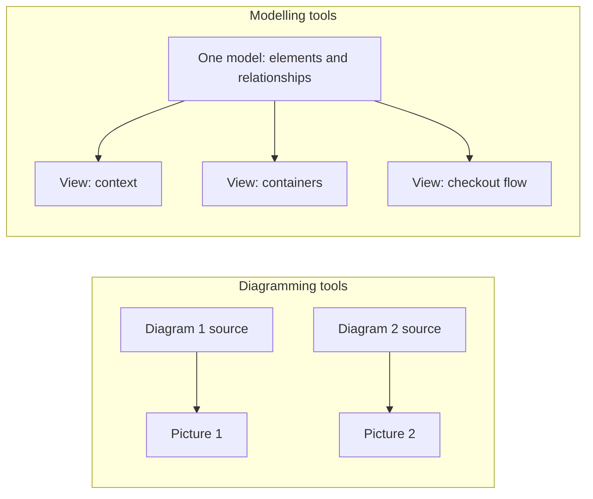
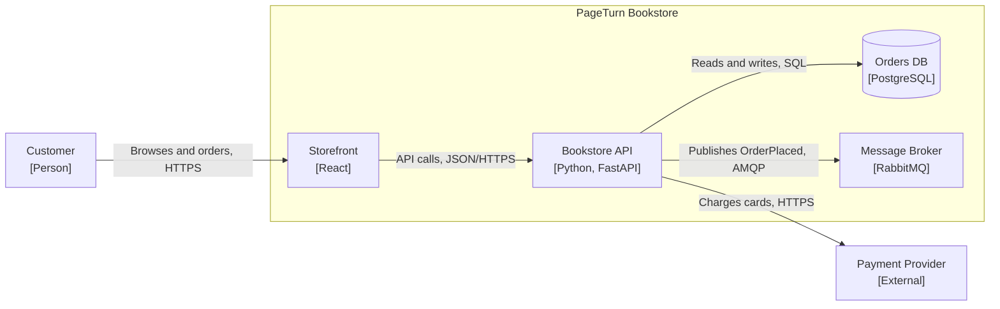
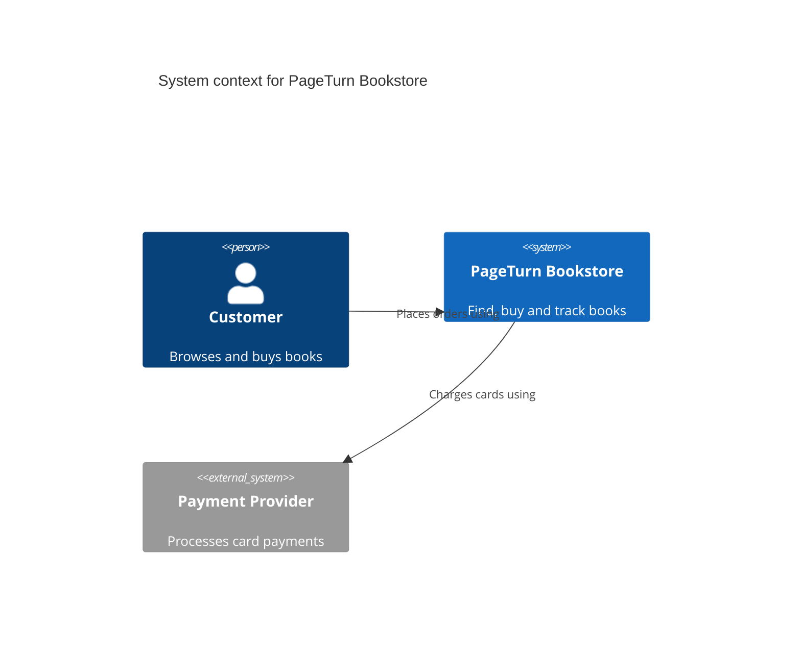
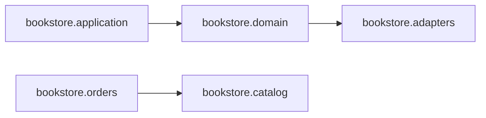

# Diagrams as Code

## Introduction

Most architecture diagrams die the same way. Someone draws a beautiful picture in a drawing tool, exports a PNG, and pastes it into a wiki. Three months later a new service appears, a database is replaced, and the PNG is wrong. Nobody updates it, because the source file is on someone's laptop, or because changing one box means re-arranging twenty others by hand.

**Diagrams as code** treats diagrams like source code. You describe the diagram in a text format, keep it in the repository, review changes in pull requests, and let a tool do the layout and rendering. It is the same idea as infrastructure as code: text is diffable, versionable, and automatable.

An analogy: a hand-drawn diagram is a photograph of your system. Diagrams as code is a recipe that produces the picture. When the system changes, you change one line of the recipe, and the picture updates itself.

This page builds on [The C4 Model](./1-arch-c4-model.mdx). We will draw the same PageTurn bookstore container diagram with four tools, then go one step further and generate diagrams from the code itself so they **cannot** go stale.

## Why Text Beats Pictures for Living Documentation

| Concern | Drawing tool (binary or XML file) | Diagrams as code |
| --- | --- | --- |
| Review | Compare two screenshots by eye | Line-by-line diff in a pull request |
| History | Often none, or opaque file versions | Full `git log` and blame |
| Layout | Manual; every change shuffles boxes | Automatic layout engine |
| Consistency | Each diagram redrawn by hand | Shared styles; with a model, shared elements |
| Automation | Hard | Validate, render and publish in CI |
| Fine visual control | Excellent | Limited; auto-layout can be awkward |
| Non-developer editing | Easy | Requires learning a syntax |

The last two rows are real costs. For a one-off marketing graphic or a carefully composed poster, a drawing tool is the better choice. For diagrams that must track a changing system, text wins.

## Two Families: Diagramming vs Modelling

The tools fall into two families, and the difference matters more than the syntax.



- **Diagramming tools** (Mermaid, PlantUML, D2, Graphviz): each diagram is its own file. If "Orders DB" appears in three diagrams, you write it three times, and renaming it means three edits.
- **Modelling tools** (Structurizr DSL): you describe the architecture **once** as a model, then define **views** of it. Every diagram is generated from the same model, so they cannot disagree. The [c4model.com tooling page](https://c4model.com/tooling) recommends modelling tools for this reason.

## Mermaid

[Mermaid](https://mermaid.js.org/) is the most widely available option because many platforms render it natively: GitHub and GitLab render Mermaid code blocks in Markdown, and Docusaurus (the engine behind this site) supports it through a theme plugin. Every diagram on this page is Mermaid.

A C4-style container diagram as a flowchart with subgraphs:



The source is just the text inside the code fence. Change `RabbitMQ` to `Kafka`, commit, and the rendered diagram updates.

Mermaid also has dedicated C4 diagram types (`C4Context`, `C4Container`, `C4Component`, `C4Dynamic`, `C4Deployment`) with macros like `Person`, `Container`, `ContainerDb` and `Rel`. The [Mermaid C4 documentation](https://mermaid.js.org/syntax/c4.html) marks this syntax as **experimental**: it may change between releases, and its automatic layout is basic. Here is a small one:



For anything bigger, many teams find the plain flowchart form above easier to lay out.

**Strengths:** renders almost everywhere, no install, good for sequence, state and class diagrams. **Weaknesses:** limited layout control, large diagrams get messy, no shared model.

## PlantUML with C4-PlantUML

[PlantUML](https://plantuml.com/) is an older, Java-based tool with deep UML support. The [C4-PlantUML](https://github.com/plantuml-stdlib/C4-PlantUML) library adds C4 macros. It ships in PlantUML's standard library, so `!include <C4/C4_Container>` works offline.

```text
@startuml
!include <C4/C4_Container>

title Container diagram for PageTurn Bookstore

Person(customer, "Customer", "Browses and buys books")
System_Ext(payment, "Payment Provider", "Processes card payments")

System_Boundary(bookstore, "PageTurn Bookstore") {
    Container(spa, "Storefront", "React", "Search, cart and checkout UI")
    Container(api, "Bookstore API", "Python, FastAPI", "Catalog, cart and order logic")
    ContainerDb(db, "Orders DB", "PostgreSQL", "Orders, customers and outbox")
    ContainerQueue(broker, "Message Broker", "RabbitMQ", "Carries order events")
}

Rel(customer, spa, "Browses books and places orders using", "HTTPS")
Rel(spa, api, "Makes API calls to", "JSON/HTTPS")
Rel(api, db, "Reads from and writes to", "SQL")
Rel(api, payment, "Charges cards using", "HTTPS")
Rel(api, broker, "Publishes OrderPlaced events to", "AMQP")

SHOW_LEGEND()
@enduml
```

Render it with the PlantUML jar (Java required; Graphviz is needed for some diagram types):

```bash
java -jar plantuml.jar -tsvg containers.puml
ls
```

Example output:

```text
containers.puml  containers.svg
```

`SHOW_LEGEND()` must be the last line; it adds the key that the C4 notation guidance asks for. Use `Rel_U`, `Rel_D`, `Rel_L` and `Rel_R` to nudge the layout when auto-layout puts things in odd places.

**Strengths:** mature, very expressive, legends and styles built in, many diagram types. **Weaknesses:** needs Java, output looks dated unless themed, still one file per diagram.

## D2

[D2](https://d2lang.com/) is a newer declarative diagram language from Terrastruct, distributed as a single binary. Its syntax is compact: nesting with braces creates containers, and `->` creates connections.

```text
direction: right

customer: Customer {
  shape: person
}

payment: Payment Provider {
  style.fill: "#dddddd"
}

bookstore: PageTurn Bookstore {
  spa: "Storefront\n[React]"
  api: "Bookstore API\n[Python, FastAPI]"
  db: "Orders DB\n[PostgreSQL]" {
    shape: cylinder
  }
  broker: "Message Broker\n[RabbitMQ]" {
    shape: queue
  }

  spa -> api: Makes API calls to (JSON/HTTPS)
  api -> db: Reads and writes (SQL)
  api -> broker: Publishes OrderPlaced (AMQP)
}

customer -> bookstore.spa: Browses and orders (HTTPS)
bookstore.api -> payment: Charges cards using (HTTPS)
```

Labels containing square brackets must be quoted, because unquoted `[` starts an array in D2. Render it, or use watch mode to get a live preview in the browser while you edit:

```bash
d2 containers.d2 containers.svg
d2 --watch containers.d2 containers.svg
d2 --layout=elk containers.d2 containers.svg
```

Example output:

```text
success: successfully compiled containers.d2 to containers.svg in 5.019282ms
```

`dagre` is the default layout engine and `elk` is bundled as an alternative; run `d2 layout` to list what your installation supports.

**Strengths:** clean modern output, pleasant syntax, several layout engines. **Weaknesses:** fewer platforms render it natively, smaller ecosystem, still a diagramming tool rather than a model.

## Structurizr DSL: Model Once, Render Many Views

[Structurizr](https://docs.structurizr.com/) was created by Simon Brown, the author of C4, specifically for C4 modelling. The DSL describes a **workspace** containing a **model** (people, systems, containers, components, relationships) and **views** of that model.

:::note Tooling changes
The Structurizr tooling was consolidated recently. Per the [Structurizr end-of-life page](https://docs.structurizr.com/eol), Structurizr Lite was replaced by the `local` command, the old CLI by commands such as `export` and `push`, and the on-premises installation by `server`. The hosted cloud service has no replacement. Older tutorials that mention `structurizr/lite` or `structurizr-cli` describe the previous tools. Check the docs for the current state before you adopt it.
:::

Here is the PageTurn model with three views:

```text
workspace "PageTurn Bookstore" "Architecture model for the PageTurn online bookstore" {

    !identifiers hierarchical

    model {
        customer = person "Customer" "Browses and buys books"

        payment = softwareSystem "Payment Provider" "Processes card payments" {
            tags "External"
        }
        email = softwareSystem "Email Service" "Sends transactional email" {
            tags "External"
        }

        bookstore = softwareSystem "PageTurn Bookstore" "Lets customers find, buy and track books" {
            spa = container "Storefront" "Search, cart and checkout UI" "React"
            api = container "Bookstore API" "Catalog, cart and order logic" "Python, FastAPI"
            worker = container "Order Worker" "Sends confirmation emails" "Python"
            db = container "Orders DB" "Orders, customers and outbox" "PostgreSQL" {
                tags "Database"
            }
            broker = container "Message Broker" "Carries order events" "RabbitMQ" {
                tags "Queue"
            }
        }

        customer -> bookstore.spa "Browses books and places orders using" "HTTPS"
        bookstore.spa -> bookstore.api "Makes API calls to" "JSON/HTTPS"
        bookstore.api -> bookstore.db "Reads from and writes to" "SQL"
        bookstore.api -> payment "Charges cards using" "HTTPS"
        bookstore.api -> bookstore.broker "Publishes OrderPlaced events to" "AMQP"
        bookstore.broker -> bookstore.worker "Delivers order events to" "AMQP"
        bookstore.worker -> email "Sends order confirmations using" "HTTPS"
    }

    views {
        systemContext bookstore "Context" "System context diagram for PageTurn" {
            include *
            autolayout lr
        }

        container bookstore "Containers" "Container diagram for PageTurn" {
            include *
            autolayout lr
        }

        dynamic bookstore "Checkout" "What happens when a customer places an order" {
            customer -> bookstore.spa "Clicks Place order"
            bookstore.spa -> bookstore.api "POST /orders"
            bookstore.api -> payment "Authorizes the payment"
            bookstore.api -> bookstore.db "Saves order and outbox row"
            bookstore.api -> bookstore.broker "Publishes OrderPlaced"
            bookstore.broker -> bookstore.worker "Delivers OrderPlaced"
            bookstore.worker -> email "Requests confirmation email"
            autolayout lr
        }

        styles {
            element "Person" {
                shape person
            }
            element "Database" {
                shape cylinder
            }
            element "Queue" {
                shape pipe
            }
            element "External" {
                background #999999
                color #ffffff
            }
        }
    }
}
```

Notice three things:

1. The **system context view** shows `customer -> bookstore` even though the model only says `customer -> bookstore.spa`. Structurizr derives the higher-level relationship automatically. You never draw it twice.
2. The **dynamic view** reuses existing relationships in a numbered order. Structurizr checks that each step corresponds to a relationship in the model.
3. Renaming "Orders DB" means changing **one** line, and every view updates.

Explore it locally with the official Docker image. The `local` command serves a browser UI on port 8080 and reads `workspace.dsl` from the mounted directory:

```bash
docker pull structurizr/structurizr
docker run -it --rm -p 8080:8080 -v "$PWD":/usr/local/structurizr structurizr/structurizr local
```

In CI you usually want two other commands: `validate` to catch broken references, and `export` to produce files other tools can render. The `export` formats include `mermaid`, `plantuml`, `plantuml/c4plantuml`, `json` and more.

```bash
docker run --rm -v "$PWD":/usr/local/structurizr structurizr/structurizr \
  validate -workspace /usr/local/structurizr/workspace.dsl
echo "exit=$?"

docker run --rm -u "$(id -u):$(id -g)" -v "$PWD":/usr/local/structurizr structurizr/structurizr \
  export -workspace /usr/local/structurizr/workspace.dsl -format mermaid -output /usr/local/structurizr/out
```

Example output (logging timestamps trimmed):

```text
exit=0
INFO ExportCommand -- Exporting workspace from /usr/local/structurizr/workspace.dsl
INFO ExportCommand -- Exporting with MermaidDiagramExporter
INFO ExportCommand -- Writing /usr/local/structurizr/out/structurizr-Context.mmd
INFO ExportCommand -- Writing /usr/local/structurizr/out/structurizr-Containers.mmd
INFO ExportCommand -- Writing /usr/local/structurizr/out/structurizr-Checkout.mmd
INFO ExportCommand -- Finished
```

If you mistype an identifier, `validate` fails with a precise message and a non-zero exit code, which is exactly what a CI check needs:

```text
ERROR ValidateCommand -- The source element "bookstore.wrker" does not exist at line 33 of /usr/local/structurizr/workspace.dsl
```

**Strengths:** a real model, views cannot contradict each other, built for C4, validates references. **Weaknesses:** another tool and syntax to learn, C4-specific, the tooling has recently changed shape.

## Going Further: Generate Diagrams From the Code

Even diagrams as code can drift, because a human still has to remember to edit them. For **component-level** diagrams, the most reliable option is to **generate them from the source code**. The code is the truth; the diagram is a view of it.

This script parses Python files with the standard library `ast` module, finds imports between top-level modules of the `bookstore` package, and prints a Mermaid diagram.

```python
"""depgraph.py - generate a Mermaid diagram of module dependencies from source code."""
from __future__ import annotations

import ast
import sys
from pathlib import Path


def module_name(path: Path, src_root: Path) -> str:
    parts = path.relative_to(src_root).with_suffix("").parts
    return ".".join(p for p in parts if p != "__init__")


def collect_edges(src_root: Path, package: str, depth: int) -> set[tuple[str, str]]:
    """Return (importer, imported) pairs, truncated to `depth` name segments."""
    edges: set[tuple[str, str]] = set()
    for path in sorted((src_root / package).rglob("*.py")):
        importer = module_name(path, src_root)
        tree = ast.parse(path.read_text(), filename=str(path))
        for node in ast.walk(tree):
            if isinstance(node, ast.ImportFrom) and node.module and node.level == 0:
                targets = [node.module]
            elif isinstance(node, ast.Import):
                targets = [alias.name for alias in node.names]
            else:
                continue
            for target in targets:
                if not target.startswith(package + "."):
                    continue
                src = ".".join(importer.split(".")[:depth])
                dst = ".".join(target.split(".")[:depth])
                if src != dst:
                    edges.add((src, dst))
    return edges


def to_mermaid(edges: set[tuple[str, str]]) -> str:
    lines = ["flowchart LR"]
    for src, dst in sorted(edges):
        lines.append(f'    {src.replace(".", "_")}["{src}"] --> {dst.replace(".", "_")}["{dst}"]')
    return "\n".join(lines)


if __name__ == "__main__":
    root = Path(sys.argv[1]) if len(sys.argv) > 1 else Path("src")
    print(to_mermaid(collect_edges(root, "bookstore", depth=2)))
```

Run it against a small `src/bookstore` package with `domain`, `application`, `adapters`, `catalog` and `orders` subpackages:

```bash
python3 depgraph.py src
```

Output:

```text
flowchart LR
    bookstore_application["bookstore.application"] --> bookstore_domain["bookstore.domain"]
    bookstore_domain["bookstore.domain"] --> bookstore_adapters["bookstore.adapters"]
    bookstore_orders["bookstore.orders"] --> bookstore_catalog["bookstore.catalog"]
```

Rendered:



The generated diagram immediately reveals a problem: `domain` depends on `adapters`, which breaks the dependency rule of [Hexagonal](../7-arch-clean-architecture/0-arch-hexagonal.mdx) and [Clean Architecture](../7-arch-clean-architecture/2-arch-clean-architecture.mdx). A hand-drawn diagram would have shown the *intended* arrows. The generated one shows the *real* ones. Turning that observation into an automated check is the topic of [Fitness Functions](./3-arch-fitness-functions.mdx).

Similar ideas exist in other ecosystems: `pydeps` and `import-linter` for Python, `dependency-cruiser` for JavaScript and TypeScript, and IDE features that draw dependency graphs for Java and .NET.

## Keeping Diagrams Honest in CI

Put the pieces together in a pipeline. The workflow below validates the Structurizr model and fails the pull request if the generated dependency diagram no longer matches what is committed. That forces the author to regenerate and commit the diagram, so reviewers see the architectural change in the diff.

```yaml
name: architecture-diagrams

on:
  pull_request:
    paths:
      - "docs/architecture/**"
      - "src/**"

jobs:
  diagrams:
    runs-on: ubuntu-latest
    steps:
      - uses: actions/checkout@v7

      - name: Validate the Structurizr model
        run: |
          docker run --rm -v "$PWD/docs/architecture:/usr/local/structurizr" \
            structurizr/structurizr validate \
            -workspace /usr/local/structurizr/workspace.dsl

      - uses: actions/setup-python@v7
        with:
          python-version: "3.13"

      - name: Regenerate the module dependency diagram
        run: python3 tools/depgraph.py src > docs/architecture/modules.mmd

      - name: Fail if the committed diagram is stale
        run: git diff --exit-code docs/architecture/modules.mmd
```

Action major versions change over time; check the [actions/checkout](https://github.com/actions/checkout) and [actions/setup-python](https://github.com/actions/setup-python) release pages when you copy this.

## Real-World Scenario

PageTurn's engineering wiki has 40 architecture diagrams made in a drawing tool. An audit during onboarding finds that 26 of them show at least one service that no longer exists. New engineers have stopped trusting any diagram.

The team decides on a layered approach:

- **Context and container views** live in a single `workspace.dsl` in the platform repository. They change rarely, and when they do, the change goes through review with the related [ADR](./0-arch-decision-records.mdx).
- **Sequence and state diagrams** are written in Mermaid directly inside the Markdown docs, because GitHub renders them in place and they are small.
- **Module dependency diagrams** for the API are **generated** by `depgraph.py` in CI and committed.
- The old wiki pages are archived with a banner pointing to the repository.

### Why this approach

- Each tool is used where it is strongest: Structurizr for the shared model, Mermaid for small inline diagrams, generation for the fast-changing level.
- Reviews now show architecture changes as text diffs.
- The generated diagram cannot lie about dependencies.

### When to use diagrams as code, and when not to

Use it for diagrams that must stay accurate as the system evolves and that developers maintain. Avoid it for one-off presentation graphics, diagrams that need precise artistic layout, and collaborative whiteboarding sessions with non-technical people. For those, a visual tool is faster, and you can transcribe the result into code afterwards if it needs to live on.

### Alternatives and trade-offs

| Approach | Pros | Cons | Best for |
| --- | --- | --- | --- |
| Mermaid | Renders natively on GitHub, GitLab, many doc sites | Weak layout control; C4 syntax experimental | Inline docs, sequence and state diagrams |
| PlantUML + C4-PlantUML | Mature, expressive, built-in legends | Java dependency; one file per diagram | Teams already using PlantUML or UML |
| D2 | Clean output, nice syntax, multiple layout engines | Smaller ecosystem, fewer native renderers | Polished standalone diagrams |
| Structurizr DSL | Single model, many consistent views, validation | C4-specific; tooling recently reorganized | Long-lived C4 documentation |
| Generated from code | Always accurate | Shows reality, not intent; can be noisy | Component and module views |
| Visual drawing tools | Total layout freedom, easy for everyone | Drift, no diff, manual updates | Workshops, presentations |

## Common Mistakes

1. **Committing only the rendered image.** Commit the source. Render in CI or in the docs site.
2. **One giant diagram.** Auto-layout struggles past roughly 20 to 30 elements, and so do readers. Split by C4 level or by scenario.
3. **Copy-pasting the same element into many diagram files.** If you have more than a few related diagrams, move to a modelling tool.
4. **Fighting the layout engine for hours.** Accept "good enough" layout, or nudge it with direction hints. The value is accuracy, not beauty.
5. **Generating everything.** Generated diagrams show every dependency, including accidental ones. They complement, not replace, a hand-curated container view that shows intent.
6. **Following outdated tool instructions.** Tools in this space change quickly; Structurizr's recent consolidation is an example. Check the official docs.

## Summary

- Diagrams as code stores diagrams as **text in the repository**, reviewed and versioned like code.
- **Diagramming tools** (Mermaid, PlantUML, D2) render one file per picture; **modelling tools** (Structurizr DSL) render many views from one model.
- Mermaid is the most widely rendered; its C4 syntax is still experimental, so C4-style flowcharts are a safe fallback.
- Structurizr's tooling now centres on one image with commands like `local`, `validate` and `export`.
- **Generate** component-level diagrams from source code to make drift impossible, and check them in CI.

## Exercises

1. Take one existing hand-drawn diagram from a project you know and rewrite it in Mermaid. Note what was ambiguous in the original.
2. Add a `deployment` environment to the Structurizr workspace with a production deployment view, then validate it.
3. Extend `depgraph.py` to accept the package name and depth as command-line arguments, and to colour edges red when they break a declared layer order.
4. Add a step to the CI workflow that exports the Structurizr workspace to Mermaid and publishes the `.mmd` files as build artifacts.

### Related pages

- [The C4 Model](./1-arch-c4-model.mdx)
- [Architecture Decision Records](./0-arch-decision-records.mdx)
- [Fitness Functions and Evolutionary Architecture](./3-arch-fitness-functions.mdx)
- [Structuring a Codebase](../7-arch-clean-architecture/6-arch-structuring-a-codebase.mdx)
- [Designing for Deployability](../12-arch-quality-and-operations/6-arch-deployability.mdx)
