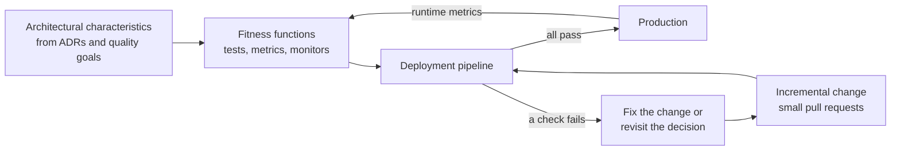
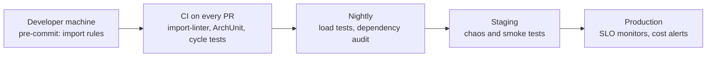

# Fitness Functions and Evolutionary Architecture

## Introduction

Your team agreed, in an [ADR](./0-arch-decision-records.mdx), that the domain layer must never import the database layer. Everyone nodded. Six months later, under deadline pressure, someone adds `from bookstore.adapters.postgres import save_order` inside a domain class "just for now". Code review missed it. Then another developer copies the pattern. A year later the "clean" architecture exists only in the diagrams.

Architecture erodes not because people are careless but because **nothing checks it**. Unit tests protect behaviour. Linters protect style. Who protects structure, performance budgets and dependency rules?

**Fitness functions** do. The term comes from *Building Evolutionary Architectures* by Neal Ford, Rebecca Parsons and Patrick Kua (the second edition, 2022, adds Pramod Sadalage). They borrow the idea from evolutionary computing, where a fitness function scores how close a candidate solution is to the goal. In architecture, a fitness function is **any mechanism that gives an objective assessment of an architectural characteristic**: a test, a metric threshold, a monitor, even a checklist.

An analogy: a building has inspectors who check fire exits, load limits and wiring, not once at design time but at every renovation. Fitness functions are your architecture's inspectors, and the best ones run automatically on every change.

## Evolutionary Architecture in One Picture

The book's central claim is that an architecture should support **guided, incremental change** across multiple dimensions. "Incremental" means you change it in small steps, using practices like continuous delivery. "Guided" means fitness functions tell you whether each step moved you in the right direction.



Two consequences follow:

1. **You can defer decisions.** If structure is protected automatically, you can postpone expensive choices (like splitting into services) until you have evidence, because the code stays in a state that allows the split.
2. **Decisions become executable.** Instead of "we agreed the domain stays pure", you have a failing build when it does not.

## A Vocabulary for Fitness Functions

The book classifies fitness functions along several axes. You do not need to memorize them, but they help you notice gaps in your coverage.

| Axis | Options | Example |
| --- | --- | --- |
| **Scope** | Atomic (one characteristic, one context) vs holistic (several characteristics together) | "No import cycles" vs "checkout stays under 800 ms p95 while the security scanner is enabled" |
| **Cadence** | Triggered (on an event, such as a commit) vs continual (always running) | A unit test in CI vs a production latency monitor |
| **Result** | Static (fixed pass/fail threshold) vs dynamic (threshold depends on context) | "Max 400 lines per file" vs "latency budget scales with payload size" |
| **Invocation** | Automated vs manual | A test vs a legal review of data retention |
| **Proactivity** | Intentional (designed up front) vs emergent (discovered later) | Layering rules vs a check added after an outage |

A healthy setup mixes **many cheap, atomic, triggered** checks in CI with **a few holistic, continual** checks in production.

## Structural Fitness Functions in Python

Let us protect the PageTurn bookstore code base. It follows a [hexagonal](../7-arch-clean-architecture/0-arch-hexagonal.mdx) layout inside a [modular monolith](../6-arch-architectural-styles/3-arch-modular-monolith.mdx):

```text
src/bookstore/
├── adapters/        # database, HTTP clients (outer layer)
│   └── postgres.py
├── application/     # use cases
│   └── place_order.py
├── domain/          # entities and rules (inner layer)
│   └── order.py
├── catalog/         # business module
│   └── books.py
└── orders/          # business module
    └── checkout.py
```

Two rules come from earlier ADRs:

1. Dependencies point inward: `adapters` may use `application` and `domain`; `domain` may use neither.
2. The `catalog` and `orders` modules are independent, so either can be extracted into a service later.

Someone has already broken both:

```python
# src/bookstore/domain/order.py
from dataclasses import dataclass

from bookstore.adapters.postgres import save_order  # oops: domain depends on infrastructure


@dataclass
class Order:
    id: str
    total_cents: int

    def place(self) -> None:
        save_order(self)
```

```python
# src/bookstore/orders/checkout.py
from bookstore.catalog.books import find_book


def checkout(isbn: str) -> str:
    return find_book(isbn)["isbn"]
```

### Option 1: import-linter

[Import Linter](https://import-linter.readthedocs.io/) checks Python import rules declared as **contracts**. Install it with `pip install import-linter` and add the contracts to `pyproject.toml`:

```toml
[tool.importlinter]
root_package = "bookstore"

[[tool.importlinter.contracts]]
name = "Hexagonal layers"
type = "layers"
layers = [
    "bookstore.adapters",
    "bookstore.application",
    "bookstore.domain",
]

[[tool.importlinter.contracts]]
name = "Catalog and orders modules are independent"
type = "independence"
modules = [
    "bookstore.catalog",
    "bookstore.orders",
]
```

In a `layers` contract, higher layers (listed first) may import lower ones, never the reverse, and indirect imports count too. An `independence` contract forbids any import between the listed modules. There is also a `forbidden` contract for rules like "nothing in `bookstore.domain` may import `sqlalchemy`".

Run it (the package must be importable, so set `PYTHONPATH` or install the project):

```bash
PYTHONPATH=src lint-imports
```

Example output (version 2.15; the ASCII-art banner is omitted):

```text
---------
Contracts
---------

Analyzed 11 files, 3 dependencies.
----------------------------------

Hexagonal layers BROKEN
Catalog and orders modules are independent BROKEN

Contracts: 0 kept, 2 broken.


----------------
Broken contracts
----------------

Hexagonal layers
----------------

bookstore.domain is not allowed to import bookstore.adapters:

- bookstore.domain.order -> bookstore.adapters.postgres (l.3)


Catalog and orders modules are independent
------------------------------------------

bookstore.orders is not allowed to import bookstore.catalog:

- bookstore.orders.checkout -> bookstore.catalog.books (l.1)
```

The command exits with status 1, so CI fails. The message names the exact file and line. When you have a legitimate, temporary exception, list it under `ignore_imports` in the contract with a comment linking to the ADR or ticket. That keeps the debt visible instead of silent.

### Option 2: custom pytest fitness functions

Sometimes you want a rule no tool offers out of the box. Fitness functions are just code, so write them as tests. This file runs with the normal test suite and needs only the standard library plus pytest.

```python
"""tests/test_architecture.py - architecture fitness functions."""
from __future__ import annotations

import ast
from collections import defaultdict
from pathlib import Path

SRC = Path(__file__).resolve().parents[1] / "src"
PACKAGE = "bookstore"
MAX_MODULE_LINES = 400


def import_graph(depth: int = 2) -> dict[str, set[str]]:
    """Map each top-level module (e.g. bookstore.orders) to the modules it imports."""
    graph: dict[str, set[str]] = defaultdict(set)
    for path in (SRC / PACKAGE).rglob("*.py"):
        parts = path.relative_to(SRC).with_suffix("").parts
        importer = ".".join(parts[:depth])
        for node in ast.walk(ast.parse(path.read_text())):
            names: list[str] = []
            if isinstance(node, ast.ImportFrom) and node.module and node.level == 0:
                names = [node.module]
            elif isinstance(node, ast.Import):
                names = [a.name for a in node.names]
            for name in names:
                if name.startswith(PACKAGE + "."):
                    target = ".".join(name.split(".")[:depth])
                    if target != importer:
                        graph[importer].add(target)
    return graph


def find_cycle(graph: dict[str, set[str]]) -> list[str] | None:
    """Depth-first search; return one cycle as a list of modules, or None."""
    visiting: set[str] = set()
    done: set[str] = set()
    stack: list[str] = []

    def visit(node: str) -> list[str] | None:
        visiting.add(node)
        stack.append(node)
        for nxt in sorted(graph.get(node, ())):
            if nxt in visiting:
                return stack[stack.index(nxt):] + [nxt]
            if nxt not in done and (cycle := visit(nxt)):
                return cycle
        visiting.discard(node)
        done.add(node)
        stack.pop()
        return None

    for start in sorted(graph):
        if start not in done and (cycle := visit(start)):
            return cycle
    return None


def test_no_cyclic_dependencies_between_modules() -> None:
    cycle = find_cycle(import_graph())
    assert cycle is None, "Dependency cycle: " + " -> ".join(cycle or [])


def test_modules_stay_small() -> None:
    too_big = {
        str(p.relative_to(SRC)): n
        for p in (SRC / PACKAGE).rglob("*.py")
        if (n := len(p.read_text().splitlines())) > MAX_MODULE_LINES
    }
    assert not too_big, f"Files over {MAX_MODULE_LINES} lines: {too_big}"
```

Now a developer adds a "bestsellers" feature to the catalog that calls into orders, creating a cycle:

```python
# src/bookstore/catalog/bestsellers.py
from bookstore.orders.checkout import checkout  # cycle: catalog -> orders -> catalog


def top_sellers() -> list[str]:
    return [checkout("978-0134757599")]
```

```bash
PYTHONPATH=src python -m pytest -q tests
```

Example output (trimmed):

```text
F.                                                                       [100%]
=================================== FAILURES ===================================
_________________ test_no_cyclic_dependencies_between_modules __________________

    def test_no_cyclic_dependencies_between_modules() -> None:
        cycle = find_cycle(import_graph())
>       assert cycle is None, "Dependency cycle: " + " -> ".join(cycle or [])
E       AssertionError: Dependency cycle: bookstore.catalog -> bookstore.orders -> bookstore.catalog

tests/test_architecture.py:60: AssertionError
=========================== short test summary info ============================
FAILED tests/test_architecture.py::test_no_cyclic_dependencies_between_modules
1 failed, 1 passed in 0.01s
```

The failure message tells the developer exactly what to fix. Cycles between modules are worth catching early: two modules that depend on each other cannot be built, tested, or extracted into services separately, and untangling them gets harder the longer they grow together.

:::tip Prefer existing tools for common rules
Use import-linter (Python), ArchUnit (Java and other JVM languages), ArchUnitNET (.NET) or dependency-cruiser (JavaScript and TypeScript) for standard layering and cycle rules. Write custom tests for rules specific to your domain, such as "every public API handler must have an OpenAPI tag".
:::

## Structural Fitness Functions in Java with ArchUnit

On the JVM, [ArchUnit](https://www.archunit.org/) is the standard tool. Rules are written as fluent Java and run as JUnit tests. Java shows the idea especially clearly because packages and types are explicit. Add the dependency (check Maven Central for the latest version; 1.5.1 at the time of writing):

```xml
<dependency>
    <groupId>com.tngtech.archunit</groupId>
    <artifactId>archunit-junit5</artifactId>
    <version>1.5.1</version>
    <scope>test</scope>
</dependency>
```

```java
package com.pageturn;

import static com.tngtech.archunit.lang.syntax.ArchRuleDefinition.noClasses;
import static com.tngtech.archunit.library.Architectures.layeredArchitecture;
import static com.tngtech.archunit.library.dependencies.SlicesRuleDefinition.slices;

import com.tngtech.archunit.core.importer.ImportOption;
import com.tngtech.archunit.junit.AnalyzeClasses;
import com.tngtech.archunit.junit.ArchTest;
import com.tngtech.archunit.lang.ArchRule;

@AnalyzeClasses(packages = "com.pageturn", importOptions = ImportOption.DoNotIncludeTests.class)
class ArchitectureTest {

    @ArchTest
    static final ArchRule layers_are_respected = layeredArchitecture()
            .consideringAllDependencies()
            .layer("Web").definedBy("..web..")
            .layer("Application").definedBy("..application..")
            .layer("Domain").definedBy("..domain..")
            .layer("Infrastructure").definedBy("..infrastructure..")
            .whereLayer("Web").mayNotBeAccessedByAnyLayer()
            .whereLayer("Application").mayOnlyBeAccessedByLayers("Web")
            .whereLayer("Infrastructure").mayNotBeAccessedByAnyLayer();

    @ArchTest
    static final ArchRule domain_has_no_framework_dependencies = noClasses()
            .that().resideInAPackage("..domain..")
            .should().dependOnClassesThat()
            .resideInAnyPackage("org.springframework..", "jakarta.persistence..");

    @ArchTest
    static final ArchRule modules_are_free_of_cycles = slices()
            .matching("com.pageturn.(*)..")
            .should().beFreeOfCycles();
}
```

The three rules map directly to ADRs: layering, a framework-free domain, and acyclic modules. `Infrastructure` "may not be accessed by any layer" because it is wired in through [dependency injection](../1-arch-design-principles/10-arch-dependency-injection.mdx) and implements interfaces owned by the domain. ArchUnit also supports **freezing** rules: it records existing violations and fails only on new ones, which lets you introduce rules into a legacy code base without fixing everything first.

## Beyond Structure: Operational Fitness Functions

Structure is only one characteristic. Other [quality attributes](../0-arch-fundamentals/3-arch-quality-attributes.mdx) can be checked too:

| Characteristic | Triggered check (CI) | Continual check (production) |
| --- | --- | --- |
| Performance | Benchmark a critical path against a budget | p95 latency per endpoint vs SLO |
| Reliability | Chaos test in staging: kill one instance, expect no errors | Error rate and availability vs SLO |
| Security | Dependency vulnerability scan, secret scanning | Alert on unexpected outbound connections |
| Scalability | Load test before major releases | Auto-scaling events and saturation metrics |
| Deployability | Build time under N minutes, deploy script dry run | Deployment frequency and change failure rate |
| Cost | Infrastructure plan diff shows estimated cost change | Monthly spend per tenant vs budget |

Here is a small **holistic, continual** fitness function that checks service level objectives against request records. In production the records come from your metrics or tracing backend (see [Designing for Observability](../12-arch-quality-and-operations/3-arch-observability.mdx)); here they are generated so the example runs anywhere.

```python
"""slo_check.py - a continual, holistic fitness function evaluated on production metrics."""
from __future__ import annotations

import statistics
from dataclasses import dataclass


@dataclass(frozen=True)
class Objective:
    endpoint: str
    p95_ms: float
    max_error_rate: float


OBJECTIVES = [
    Objective("POST /orders", p95_ms=800, max_error_rate=0.01),
    Objective("GET /books/search", p95_ms=300, max_error_rate=0.005),
]


def p95(values: list[float]) -> float:
    return statistics.quantiles(values, n=20)[-1]  # 19 cut points; the last is p95


def evaluate(records: list[dict], objective: Objective) -> list[str]:
    rows = [r for r in records if r["endpoint"] == objective.endpoint]
    latencies = [r["ms"] for r in rows]
    errors = sum(1 for r in rows if r["status"] >= 500) / len(rows)
    observed = p95(latencies)
    failures = []
    if observed > objective.p95_ms:
        failures.append(f"{objective.endpoint}: p95 {observed:.0f} ms > {objective.p95_ms:.0f} ms")
    if errors > objective.max_error_rate:
        failures.append(f"{objective.endpoint}: error rate {errors:.2%} > {objective.max_error_rate:.2%}")
    return failures


if __name__ == "__main__":
    # In production these records come from your metrics or tracing backend.
    sample = [
        *({"endpoint": "POST /orders", "ms": 150 + i * 6, "status": 200} for i in range(100)),
        *({"endpoint": "GET /books/search", "ms": 40 + i * 4, "status": 200} for i in range(98)),
        {"endpoint": "GET /books/search", "ms": 900, "status": 503},
        {"endpoint": "GET /books/search", "ms": 950, "status": 503},
    ]
    records = sample
    problems = [p for o in OBJECTIVES for p in evaluate(records, o)]
    for o in OBJECTIVES:
        print(f"checked {o.endpoint}")
    print("\n".join(problems) if problems else "all objectives met")
```

Output:

```text
checked POST /orders
checked GET /books/search
GET /books/search: p95 420 ms > 300 ms
GET /books/search: error rate 2.00% > 0.50%
```

In a real system you would not write this loop yourself. You would express the objectives as alerting rules or SLOs in your monitoring platform. The point is the mindset: the architecture's promises ("search is fast") are written down as numbers and checked continuously.

:::caution Flaky performance checks erode trust
Timing-based tests on shared CI runners are noisy. Use generous budgets, compare against a baseline rather than an absolute number, run them on dedicated hardware, or move them to a nightly job. A fitness function that fails randomly will be disabled within a week.
:::

## Where Fitness Functions Run



Put fast checks as early as possible, slow ones later, and continual ones in production. Every check needs an **owner** and a link back to the decision it protects.

## Real-World Scenario

PageTurn is a modular monolith with five business modules. The business wants to sell e-books, which will have very different load patterns from physical books, and leadership asks: "Could we split the catalog into its own service next year if we need to?"

The architect does not answer with a diagram. She answers with fitness functions:

1. An ADR records the goal: keep `catalog` extractable. The ADR's **Confirmation** section lists the checks below.
2. An import-linter `independence` contract between `catalog` and the other modules. Three existing violations are listed under `ignore_imports`, each with a ticket number.
3. The custom cycle test from this page runs on every pull request.
4. A forbidden contract stops any module other than `catalog` from importing the catalog's database models; others must go through `bookstore.catalog.api`.
5. A continual check alerts if catalog search p95 latency exceeds 300 ms, since a future service boundary will add network latency and the budget needs headroom.

Over the next quarter, the team fixes the three ignored imports one by one. When e-book traffic actually arrives, extracting the catalog takes weeks instead of months, because the boundaries were enforced all along.

### Why this approach

- The goal ("extractable later") was turned into **objective, automated checks**, not good intentions.
- It **defers the expensive decision** (actually splitting) until there is evidence, while keeping the option open. That is the core promise of evolutionary architecture.
- Ignored imports with tickets make the remaining debt visible and measurable.

### When to use fitness functions, and when not to

Use them for characteristics you have **explicitly decided** matter, especially those that erode silently: dependency direction, module boundaries, latency budgets. Do not write fitness functions for every conceivable rule. Each one costs maintenance and can block delivery. For a short-lived prototype, a single-developer script, or a rule nobody can explain, skip it.

### Alternatives and trade-offs

| Approach | Pros | Cons | Best for |
| --- | --- | --- | --- |
| Automated fitness functions | Objective, fast feedback, never forget | Upfront effort, maintenance, possible false positives | Rules that matter and erode silently |
| Code review only | No tooling, flexible judgment | Inconsistent, misses indirect dependencies, does not scale | Small teams, nuanced design choices |
| Periodic architecture review | Considers trade-offs holistically | Slow feedback, findings arrive late | Big decisions (see [Architecture Reviews](./4-arch-reviews.mdx)) |
| Language-level enforcement (separate packages, access modifiers, build modules) | Compiler enforces it, zero runtime cost | Harder to set up, may need repo restructuring | Mature boundaries that rarely change |
| Nothing | Zero cost now | Gradual, invisible erosion | Throwaway code |

## Common Mistakes

1. **Rules without a reason.** Every fitness function should trace to an ADR or quality goal. Otherwise people delete it when it gets in the way.
2. **Big-bang introduction.** Turning on twenty rules in a legacy code base produces hundreds of failures. Start with a baseline (ArchUnit's freezing, import-linter's `ignore_imports`) and ratchet down.
3. **Only structural checks.** Layering tests are easy, so teams stop there. Add at least one operational check for your most important quality attribute.
4. **Flaky checks.** Noisy timing tests teach people to ignore red builds.
5. **Checks that only run locally.** If it is not in CI or production monitoring, it is a suggestion.
6. **No owner.** When a check fails at 2 a.m. or blocks a release, someone must know why it exists and decide what to do.

## Summary

- A **fitness function** is any objective check of an architectural characteristic: tests, metrics, monitors.
- **Evolutionary architecture** supports guided, incremental change: small steps, each checked by fitness functions.
- Classify checks as **atomic or holistic**, **triggered or continual**, to spot gaps.
- In Python, **import-linter** enforces layers, independence and forbidden imports; custom pytest checks cover the rest. On the JVM, **ArchUnit** does the same.
- Operational fitness functions check latency, error rates, security and cost, often continually in production.
- Introduce rules gradually, keep them reliable, and link each to the decision it protects.

## Exercises

1. Add a `forbidden` import-linter contract that stops `bookstore.domain` from importing `sqlalchemy` or `fastapi`, and verify it fails when you add such an import.
2. Extend `test_architecture.py` with a rule that every module under `bookstore/` exposes a public `api.py`, and that other modules import only from `api`.
3. Change `slo_check.py` so it compares each p95 against the previous week's value and fails only on a regression of more than 20 percent.
4. Pick one quality attribute from your own project and write down one triggered and one continual fitness function for it, including where each would run and who owns it.

### Related pages

- [Architecture Decision Records](./0-arch-decision-records.mdx)
- [Quality Attributes and Non-Functional Requirements](../0-arch-fundamentals/3-arch-quality-attributes.mdx)
- [Coupling and Cohesion](../0-arch-fundamentals/5-arch-coupling-and-cohesion.mdx)
- [Modular Monolith](../6-arch-architectural-styles/3-arch-modular-monolith.mdx)
- [Designing for Testability](../12-arch-quality-and-operations/5-arch-testability.mdx)
