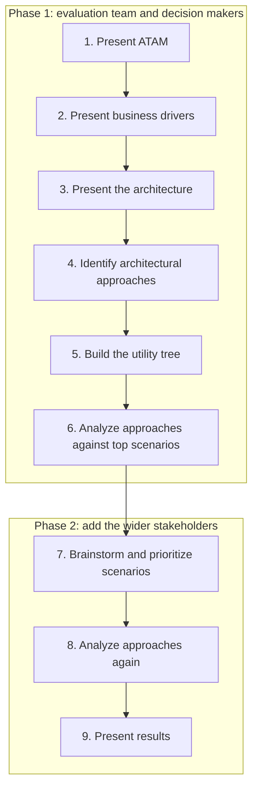
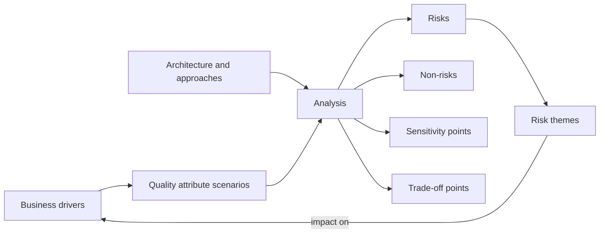
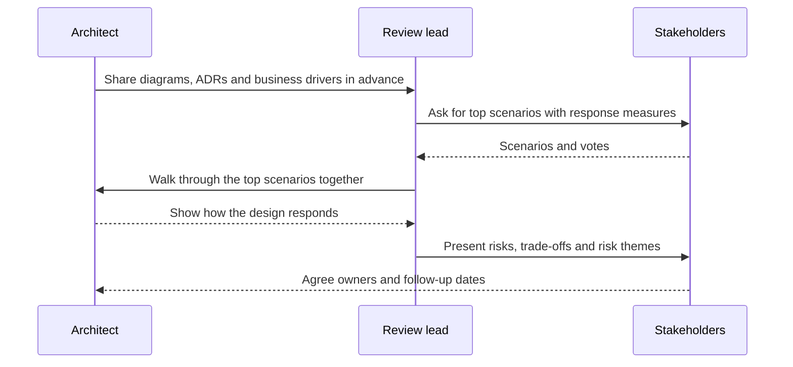

# Architecture Reviews and ATAM

## Introduction

An architecture review is a structured conversation that asks one question: **will this architecture deliver what the business needs, and what could go wrong?** It happens before a big build, before a risky migration, or when a system keeps disappointing people and nobody can say why.

Reviews often go wrong in two opposite ways. Some are **rubber stamps**: a slide deck, a few polite questions, approval. Others are **gatekeeping committees**: senior people with opinions blocking teams for weeks on matters of taste. Neither finds the real risks.

The **Architecture Tradeoff Analysis Method (ATAM)**, developed at the Software Engineering Institute (SEI) at Carnegie Mellon University, is the best-known structured alternative. It was described by Rick Kazman, Mark Klein and Paul Clements in the SEI technical report [ATAM: Method for Architecture Evaluation](https://www.sei.cmu.edu/library/atam-method-for-architecture-evaluation) (CMU/SEI-2000-TR-004, 2000). ATAM is heavier than most teams need day to day, but its core ideas, especially **quality attribute scenarios** and **trade-off points**, improve any review.

An analogy: a pre-purchase inspection for a house. A good inspector does not tell you whether they like the kitchen. They ask what you need (a growing family, a home office), then check whether the structure supports it, and they hand you a list of specific risks with evidence.

This page covers ATAM properly, then shows lighter formats you can use every week.

## Start With Scenarios, Not Opinions

Vague goals make reviews useless. "The system must be scalable" cannot be checked. "During a Black Friday peak of 50 orders per second, p95 checkout response stays under 800 ms" can.

The SEI approach, described in *Software Architecture in Practice* by Len Bass, Paul Clements and Rick Kazman, writes requirements as **quality attribute scenarios** with six parts:

| Part | Meaning | Checkout example |
| --- | --- | --- |
| **Source** | Who or what causes the stimulus | Customers |
| **Stimulus** | The event | 50 order submissions per second |
| **Artifact** | What is stimulated | Bookstore API and Orders DB |
| **Environment** | Conditions at the time | Peak sale, one replica in maintenance |
| **Response** | What the system does | Accepts and confirms orders |
| **Response measure** | How you know it worked | p95 under 800 ms, zero lost orders |

You do not need all six columns in every conversation, but the **response measure** is non-negotiable. Without a number or a clear observable outcome, you cannot decide whether a risk exists. See [Quality Attributes and Non-Functional Requirements](../0-arch-fundamentals/3-arch-quality-attributes.mdx) for more on eliciting these.

## ATAM in Nine Steps

ATAM brings together three groups: the **evaluation team** (ideally outsiders to the project), the **project decision makers** (architect, product owner, managers), and wider **stakeholders** (developers, testers, operations, security, sometimes customers). The nine steps run in two phases.



1. **Present ATAM.** The evaluation leader explains the method, so everyone knows what to expect.
2. **Present business drivers.** The project manager or product owner explains goals, constraints and what success looks like. For PageTurn: survive holiday peaks, launch e-books within a year, pass a payment-card security audit.
3. **Present the architecture.** The architect walks through it, ideally with [C4 diagrams](./1-arch-c4-model.mdx) and the [decision log](./0-arch-decision-records.mdx).
4. **Identify architectural approaches.** Name the patterns in use: modular monolith, transactional outbox, read replicas, cache-aside, circuit breaker.
5. **Generate the quality attribute utility tree.** Break "utility" into quality attributes, refine each, and attach concrete scenarios rated for **importance** and **difficulty**.
6. **Analyze the architectural approaches.** For the highest-priority scenarios, trace how the architecture responds. Record risks, non-risks, sensitivity points and trade-off points.
7. **Brainstorm and prioritize scenarios.** The wider stakeholder group adds scenarios and votes. This often surfaces concerns the architects never considered, such as operations asking about restore times.
8. **Analyze the architectural approaches again**, this time with the new top scenarios.
9. **Present results**: the scenarios, the analysis and, above all, the **risk themes**.

In practice, SEI's fuller descriptions also include preparation work before Phase 1 (agreeing scope, gathering documents) and a follow-up after step 9 (a written report and action tracking). A full ATAM typically takes several days of meetings spread over a few weeks.

## The Utility Tree

The utility tree is the heart of ATAM. It starts with "utility" (overall goodness), branches into quality attributes, refines each into specific concerns, and ends with concrete scenarios. Each scenario gets two ratings, usually H, M or L:

- **Importance**: how much the business cares.
- **Difficulty**: how hard the architects think it is to achieve.

Scenarios rated **(H,H)** get analyzed first. **(H,L)** scenarios matter but are probably fine. **(L,H)** scenarios are a warning sign of gold plating.

Here is a small script that captures PageTurn's tree and chooses where to focus. The value is not the code but the discipline: every scenario has a measurable outcome and two explicit ratings.

```python
"""utility_tree.py - capture an ATAM utility tree and pick scenarios to analyze first."""
from __future__ import annotations

from dataclasses import dataclass
from enum import IntEnum


class Level(IntEnum):
    L = 1
    M = 2
    H = 3


@dataclass(frozen=True)
class Scenario:
    attribute: str      # e.g. Performance
    refinement: str     # e.g. Checkout latency
    text: str           # stimulus, environment, response and measure in one sentence
    importance: Level   # how much the business cares
    difficulty: Level   # how hard the architects think it is to achieve

    @property
    def rank(self) -> tuple[int, int]:
        return (self.importance, self.difficulty)


TREE = [
    Scenario("Performance", "Checkout latency",
             "During a Black Friday peak of 50 orders/s, p95 checkout response stays under 800 ms",
             Level.H, Level.H),
    Scenario("Performance", "Search latency",
             "A customer search under normal load returns in under 300 ms p95",
             Level.H, Level.M),
    Scenario("Availability", "Payment provider outage",
             "If the payment provider times out, customers can still place orders that are charged later",
             Level.H, Level.H),
    Scenario("Modifiability", "New product type",
             "A team adds e-books to the catalog in under 4 weeks without changing checkout",
             Level.M, Level.M),
    Scenario("Security", "Card data",
             "No PageTurn container stores or logs full card numbers",
             Level.H, Level.L),
    Scenario("Deployability", "Release cadence",
             "Any module can be deployed in under 15 minutes during business hours",
             Level.M, Level.L),
]


def print_tree(tree: list[Scenario]) -> None:
    attribute = refinement = None
    for s in sorted(tree, key=lambda s: (s.attribute, s.refinement)):
        if s.attribute != attribute:
            attribute = s.attribute
            print(f"Utility -> {attribute}")
        if s.refinement != refinement:
            refinement = s.refinement
            print(f"    {refinement}")
        print(f"        ({s.importance.name},{s.difficulty.name}) {s.text}")


if __name__ == "__main__":
    print_tree(TREE)
    print("\nAnalyze first (H,H) and (H,M):")
    for s in sorted(TREE, key=lambda s: s.rank, reverse=True):
        if s.importance is Level.H and s.difficulty >= Level.M:
            print(f"  - [{s.importance.name},{s.difficulty.name}] {s.attribute}: {s.refinement}")
```

Output:

```text
Utility -> Availability
    Payment provider outage
        (H,H) If the payment provider times out, customers can still place orders that are charged later
Utility -> Deployability
    Release cadence
        (M,L) Any module can be deployed in under 15 minutes during business hours
Utility -> Modifiability
    New product type
        (M,M) A team adds e-books to the catalog in under 4 weeks without changing checkout
Utility -> Performance
    Checkout latency
        (H,H) During a Black Friday peak of 50 orders/s, p95 checkout response stays under 800 ms
    Search latency
        (H,M) A customer search under normal load returns in under 300 ms p95
Utility -> Security
    Card data
        (H,L) No PageTurn container stores or logs full card numbers

Analyze first (H,H) and (H,M):
  - [H,H] Performance: Checkout latency
  - [H,H] Availability: Payment provider outage
  - [H,M] Performance: Search latency
```

## The Outputs: Risks, Non-Risks, Sensitivity and Trade-off Points

Step 6 analyzes each top scenario by walking it through the architecture. Every finding falls into one of four categories:

| Output | Definition | PageTurn example |
| --- | --- | --- |
| **Risk** | A decision that may cause a scenario to fail | Checkout calls the payment provider synchronously with a 30 s timeout. During a provider slowdown, API worker threads fill up and all endpoints stall. |
| **Non-risk** | A decision that supports the scenario, with the reasoning written down | Card data never touches PageTurn servers because the storefront uses the provider's hosted payment fields. |
| **Sensitivity point** | A property of one component that strongly affects one quality attribute | The size of the API's database connection pool directly limits checkout throughput. |
| **Trade-off point** | A property that affects several quality attributes in opposite directions | Adding a cache in front of book prices improves search latency but risks showing stale prices during a sale (performance vs correctness). |

Trade-off points are the most valuable findings because they are where good architects disagree. Writing them down makes the disagreement explicit and decidable. See [Thinking in Trade-offs](../0-arch-fundamentals/4-arch-trade-offs.mdx).

Finally, individual risks are grouped into **risk themes** and tied to business drivers. For example: "Several risks show that PageTurn has no strategy for slow external dependencies. This threatens the business goal of surviving holiday peaks." A theme like that gets management attention in a way that forty individual bullet points never will.



## Worked Example: Analyzing One Scenario

Here is what step 6 looks like for the (H,H) scenario "If the payment provider times out, customers can still place orders that are charged later". The evaluators ask the architect to trace the request through the design, one approach at a time, and write down what they find.

| Step in the flow | Architectural approach | Question asked | Finding |
| --- | --- | --- | --- |
| Customer submits order | Synchronous REST call from storefront to API | What does the customer see if the API is slow? | Spinner with no timeout in the SPA: **risk** |
| API authorizes payment | Direct HTTPS call, 30 s timeout, no circuit breaker | What happens to API threads when the provider is slow? | Worker pool exhausts in seconds at peak: **risk** |
| API saves order | Order and outbox row in one transaction | Can an order be saved without a payment result? | Not today; status model lacks "payment pending": **sensitivity point** on the order state model |
| Charge later | Not designed yet | Is accepting unpaid orders acceptable? | Better conversion vs fraud and failed charges: **trade-off point**, needs a product decision |
| Confirmation email | Outbox relay and worker | Is email affected by the outage? | No, the worker is decoupled through the broker: **non-risk** |

Notice the style of the questions. They are not "is this good?" but "**what happens when** this stimulus arrives in this environment?" Each answer is tied to a specific architectural approach, which makes the fix concrete: add timeouts and a circuit breaker, introduce a `PAYMENT_PENDING` state, and ask product to set a fraud tolerance.

## The Review Report

Whatever format you use, the output should be short and actionable. A template that works well:

```markdown
# Architecture review: PageTurn e-books and subscriptions (2026-09-14)

## Business drivers
1. Stable holiday season (no outage over 5 minutes)
2. Launch e-books by November
3. Pass the payment-card security audit

## Top scenarios (importance, difficulty)
- S1 (H,H) Payment provider times out; orders still accepted, charged later
- S2 (H,H) 50 orders/s at peak; p95 checkout under 800 ms
- S3 (H,M) E-book download available within 1 minute of purchase

## Risk themes
- RT1: No consistent strategy for slow external dependencies (S1, S2) -> threatens driver 1

## Findings
| ID | Type | Scenario | Finding | Owner | Due |
| --- | --- | --- | --- | --- | --- |
| R1 | Risk | S1 | 30 s payment timeout, no circuit breaker | Priya | Oct 1 |
| T1 | Trade-off | S1, S3 | Early access vs fraud exposure | Product (Sam) | Sep 30 |
| N1 | Non-risk | - | Card data handled only by provider fields | - | - |

## Follow-ups
- ADR for payment timeouts and circuit breaker
- Nightly load test as a fitness function for S2
```

Keep it to one or two pages. If nobody will read the report, nobody will act on it.

## Lighter-Weight Review Formats

Few teams run a full ATAM more than occasionally. These formats borrow its best ideas at lower cost.

### Design doc or RFC review

An author writes a short document: context, goals and non-goals, proposed design, alternatives considered, risks. Reviewers comment asynchronously for a fixed period, then there is one meeting to resolve open points. Many companies work this way; Google's practice is described in the essay [Design Docs at Google](https://www.industrialempathy.com/posts/design-docs-at-google/). The accepted outcome is summarized in an [ADR](./0-arch-decision-records.mdx).

### Scenario-based review in one hour

A compressed ATAM:

1. **10 minutes**: business drivers and the top three to five quality attribute scenarios, each with a response measure.
2. **15 minutes**: the architect walks through the container diagram and the dynamic diagram for the riskiest flow.
3. **25 minutes**: trace each scenario through the design and classify findings as risks, non-risks, sensitivity points or trade-off points.
4. **10 minutes**: agree on owners and dates for each risk.

### Cloud provider frameworks

The [AWS Well-Architected Framework](https://docs.aws.amazon.com/wellarchitected/latest/framework/welcome.html) and the [Azure Well-Architected Framework](https://learn.microsoft.com/azure/well-architected/) provide pillar-based question sets (operational excellence, security, reliability, performance, cost, and for AWS also sustainability) and free review tools. They are excellent checklists for cloud workloads, but they ask generic questions. They do not know your business drivers, so pair them with your own scenarios.

### Continuous review through fitness functions

The cheapest review is the one a machine runs on every commit. Once a review identifies a sensitivity point, such as the connection pool size, turn it into a [fitness function](./3-arch-fitness-functions.mdx) so it is checked continuously.

## Running a Review Well



Guidelines that make the difference:

- **Send material in advance.** Nobody can find real risks in a deck seen for the first time.
- **Review against scenarios, not preferences.** "I would have used Kafka" is not a finding. "Scenario 3 fails because events are lost if the broker restarts" is.
- **Include operations and security early.** They find the scenarios developers forget: restores, key rotation, on-call load.
- **Separate the reviewers from the approvers** when possible. People find more risks when they are not also the gate.
- **Track follow-ups.** A review without owners and dates is theatre.
- **Keep it blameless.** The goal is a better system, not grading the architect.

## Real-World Scenario

PageTurn plans to launch e-books and a subscription plan in time for the holiday season. The design touches catalog, checkout, payments and a new download service. Leadership is nervous after last year's Black Friday incident, when a slow payment provider took the whole site down for 40 minutes.

The architect proposes a **half-day scenario-based review**, ATAM style, instead of the usual slide presentation:

1. **Before the session**, she shares the container diagram, three dynamic diagrams and the relevant ADRs. The product owner writes down the business drivers.
2. **Utility tree**: the group produces 14 scenarios and rates them. Four are (H,H), including the payment outage scenario and "a customer who bought an e-book can download it within 1 minute, even if the payment confirmation webhook is delayed".
3. **Analysis** of the (H,H) scenarios finds:
   - **Risk**: synchronous payment calls with long timeouts (the same pattern that caused last year's incident).
   - **Trade-off point**: granting download access before payment confirmation improves user experience but risks fraud.
   - **Sensitivity point**: webhook processing is single-threaded.
   - **Non-risk**: card data stays with the provider.
4. **Risk theme**: "PageTurn lacks a consistent strategy for slow or failing external dependencies, threatening the goal of a stable holiday season."
5. **Follow-ups**: add [timeouts and circuit breakers](../9-arch-distributed-systems/8-arch-circuit-breaker.mdx) with an ADR; product decides on a fraud tolerance for early access; a load test becomes a nightly fitness function.

### Why this approach

- The scenarios forced vague worries ("is it scalable?") into checkable statements.
- The risk theme linked technical findings to a business goal leadership cared about, so the fixes got prioritized.
- Half a day was proportionate to the risk; a full multi-day ATAM was not needed.

### When to use ATAM, and when not to

A full ATAM fits **large, expensive, long-lived or safety-critical** systems, major re-architectures, or procurement decisions where an independent evaluation is valuable. It is overkill for a feature in a single service, an early prototype, or a team that cannot yet state its business drivers. In those cases use a design doc review or a one-hour scenario review.

### Alternatives and trade-offs

| Approach | Pros | Cons | Best for |
| --- | --- | --- | --- |
| Full ATAM | Thorough, stakeholder-driven, finds trade-offs and risk themes | Days of effort, needs trained facilitators | Large or critical systems, major rewrites |
| Scenario-based mini review | Keeps ATAM's core ideas, fits in hours | Less stakeholder breadth, depends on facilitator | Significant features and migrations |
| Design doc / RFC review | Asynchronous, scales across time zones, leaves a record | Can drift into opinions without scenarios | Most cross-team proposals |
| Well-Architected reviews | Free, structured, broad cloud coverage | Generic; ignores your business specifics | Cloud workloads, periodic health checks |
| Architecture review board | Consistency across many teams | Easily becomes a bottleneck or rubber stamp | Large organizations with shared platforms |
| Fitness functions | Continuous, objective, automated | Only checks what you thought to encode | Protecting known decisions |

## Common Mistakes

1. **Reviewing without business drivers.** You cannot judge an architecture without knowing what it is for.
2. **Scenarios without response measures.** "Fast" and "reliable" lead to arguments, not findings.
3. **Turning the review into a design session.** Record risks and options; redesign afterwards with the owning team.
4. **Only architects in the room.** Operations, security, support and product see different risks.
5. **Reviewing too late.** A review after launch is a post-mortem. Review when changes are still cheap.
6. **No follow-up.** Assign owners, dates, and turn recurring risks into fitness functions.
7. **Taste-based findings.** "I prefer GraphQL" is not a risk unless it ties to a scenario that fails.

## Summary

- An architecture review checks whether the architecture meets business goals and identifies risks early.
- **Quality attribute scenarios** (source, stimulus, artifact, environment, response, response measure) make goals testable.
- **ATAM** runs nine steps in two phases and produces **risks, non-risks, sensitivity points, trade-off points and risk themes**.
- The **utility tree** rates scenarios by importance and difficulty, so effort goes to (H,H) items first.
- Lighter formats such as design doc reviews, one-hour scenario reviews and Well-Architected reviews reuse ATAM's ideas at lower cost.
- Close the loop by tracking follow-ups and encoding sensitivity points as fitness functions.

## Exercises

1. Write five quality attribute scenarios for a system you work on, each with all six parts. Rate them H/M/L for importance and difficulty.
2. Extend `utility_tree.py` with `Finding` records (risk, non-risk, sensitivity point, trade-off point) linked to scenarios, and print a report grouped by risk theme.
3. Take one recent design decision in your team and identify at least one trade-off point it created. Which quality attribute got worse?
4. Run a one-hour scenario review with two colleagues using the agenda on this page. Afterwards, list which findings would have been missed by a normal slide presentation.

### Related pages

- [Quality Attributes and Non-Functional Requirements](../0-arch-fundamentals/3-arch-quality-attributes.mdx)
- [Thinking in Trade-offs](../0-arch-fundamentals/4-arch-trade-offs.mdx)
- [The Role of a Software Architect](../0-arch-fundamentals/2-arch-architect-role.mdx)
- [Fitness Functions and Evolutionary Architecture](./3-arch-fitness-functions.mdx)
- [Designing for Reliability and Resilience](../12-arch-quality-and-operations/2-arch-reliability.mdx)
