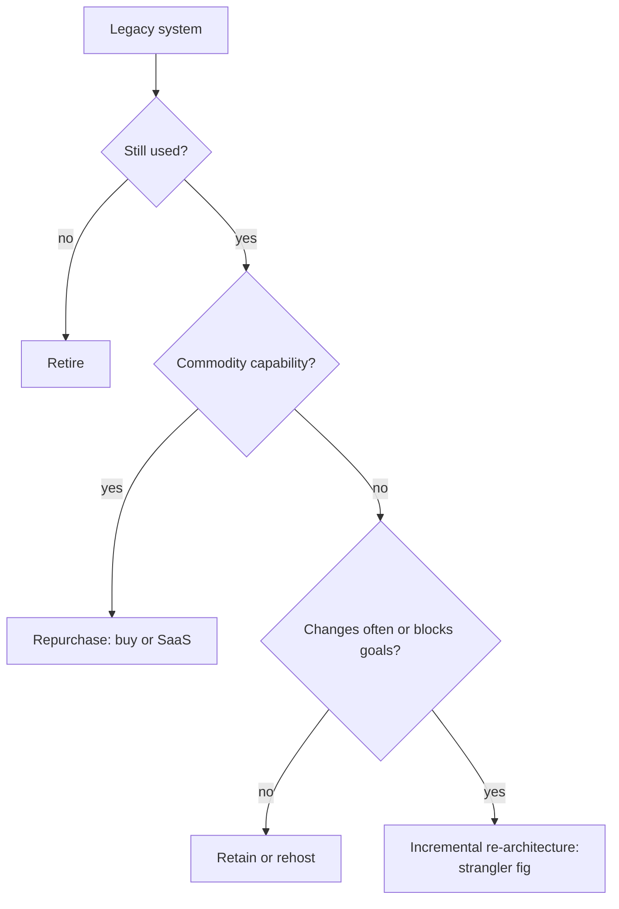
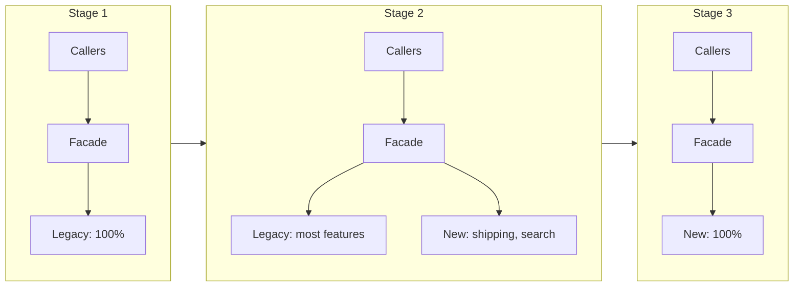
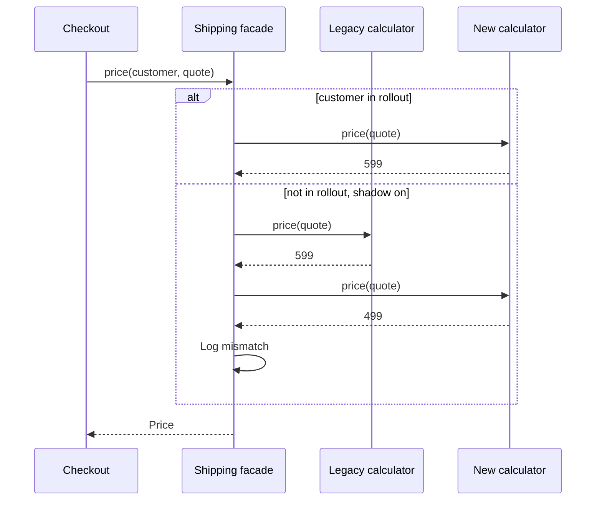

# Legacy System Modernization

## Introduction

Every successful system becomes a legacy system. The code that runs PageTurn's warehouse today was written fifteen years ago by people who have left. It works, mostly. It also blocks every new feature: changing a shipping rule takes three weeks, nobody dares to touch the stock synchronization, and the framework it uses no longer gets security patches.

Michael Feathers, in *Working Effectively with Legacy Code* (2004), offered a practical definition: **legacy code is code without tests**. Without tests you cannot change it safely, so every change is slow and risky. Age is not the problem. Fear is.

**Legacy modernization** is the work of moving a system from that state to one you can change confidently, while the business keeps running. The hard part is not designing the target architecture. It is getting there **without stopping the business** and without a multi-year project that delivers nothing until the end.

The analogy most people use comes from Martin Fowler: the **strangler fig**, a vine that grows around a host tree, gradually takes over its role, and eventually stands on its own. You grow the new system around the old one, piece by piece, until the old one can be removed.

:::info Related pages
The [Strangler Fig Migration](../9-arch-distributed-systems/11-arch-strangler-fig.mdx) page covers the routing pattern in depth, and the [Breaking Up a Monolith](../14-arch-case-studies/7-arch-case-monolith-to-microservices.mdx) case study applies it end to end. This page is the broader playbook: when to modernize, which strategy to pick, and how to make each step safe.
:::

## Why Big-Bang Rewrites Usually Disappoint

The tempting plan: "Freeze the old system, rebuild it properly in 18 months, switch over in one weekend." Joel Spolsky's well-known essay [Things You Should Never Do, Part I](https://www.joelonsoftware.com/2000/04/06/things-you-should-never-do-part-i/) (2000) argues against exactly this, using Netscape's rewrite as the cautionary tale. Fowler's [Strangler Fig](https://martinfowler.com/bliki/StranglerFigApplication.html) article lists why like-for-like replacements struggle:

- **It takes longer than planned**, and the business cannot wait without new features, so the old system keeps changing and the target keeps moving.
- **The old system's behaviour is the real specification.** Years of bug fixes and special cases live only in the code. A rewrite from documents loses them.
- **Much legacy behaviour is no longer needed**, but nobody knows which parts, so teams rebuild everything.
- **The value arrives only at the end**, so the risk of cancellation is high and feedback is late.

Incremental modernization flips each point: small replacements go live early, real traffic validates them, and the old system shrinks steadily.

## Choosing a Strategy for Each System

Not every legacy system needs the same treatment. AWS Prescriptive Guidance describes [seven migration strategies, the "7 Rs"](https://docs.aws.amazon.com/prescriptive-guidance/latest/large-migration-guide/migration-strategies.html), in the context of moving to the cloud. They are a useful vocabulary for any modernization portfolio:

| Strategy | What it means | Typical reason |
| --- | --- | --- |
| **Retire** | Decommission it | Nobody uses it, or another system covers it |
| **Retain** | Leave it as is for now | Works fine, low change rate, or too risky now |
| **Rehost** ("lift and shift") | Move to new infrastructure unchanged | Data center exit, quick win |
| **Relocate** | Move a platform (for example, a VM estate) to the cloud version of the same platform | Fast moves without changing the application |
| **Repurchase** ("drop and shop") | Replace with a product, often SaaS | Commodity capability, such as email or HR |
| **Replatform** ("lift, tinker and shift") | Small changes to use managed services | Managed database, containers |
| **Refactor or re-architect** | Change the architecture significantly | The system blocks business goals |

AWS notes that refactoring is the most complex and costly option and, for large migrations, recommends moving first and modernizing afterwards where possible. The same thinking applies outside the cloud: **reserve deep re-architecture for systems where change speed truly matters to the business**.



## Step 1: Understand and Pin Down Current Behaviour

Before you change anything, make the current behaviour **observable and testable**.

**Archaeology.** Read logs and production data, interview users and support staff, and map who calls the system and what reads its database. Fowler's [Patterns of Legacy Displacement](https://martinfowler.com/articles/patterns-legacy-displacement/) series by Ian Cartwright, Rob Horn and James Lewis warns that hidden consumers, such as a report that reads a table directly, are a classic source of surprises.

**Characterization tests.** Feathers' term for tests that record what the code **does**, not what it **should** do. You run the legacy code over many inputs, store the outputs as a "golden master", and require any replacement to match.

Here is PageTurn's legacy shipping calculator. Note the cryptic names and the unexplained Sunday surcharge:

```python
"""legacy_pricing.py - 15-year-old shipping price logic nobody fully understands."""


def calc_ship(w, c, m, d):
    # w = weight in grams, c = country code, m = member flag "Y"/"N", d = day of week 0-6
    p = 0
    if c == "US":
        p = 499
        if w > 1000:
            p = p + ((w - 1000) // 500 + 1) * 150
    elif c in ("CA", "MX"):
        p = 899
        if w > 1000:
            p = p + ((w - 1000) // 500 + 1) * 250
    else:
        p = 1599 + (w // 500) * 400
    if m == "Y":
        if c == "US":
            p = 0 if w <= 2000 else p // 2
        else:
            p = p - 300
    if d == 6 and c == "US":  # Sunday surcharge, added in 2014 for a courier contract
        p = p + 100
    return p
```

Record its behaviour across the interesting boundaries:

```python
"""record_golden.py - capture what the legacy code does today (characterization)."""
import itertools
import json

from legacy_pricing import calc_ship

WEIGHTS = [0, 400, 1000, 1001, 1500, 2000, 2001, 5000]
COUNTRIES = ["US", "CA", "MX", "DE", "JP"]
MEMBER = ["Y", "N"]
DAYS = [0, 5, 6]

cases = [
    {"w": w, "c": c, "m": m, "d": d, "expected": calc_ship(w, c, m, d)}
    for w, c, m, d in itertools.product(WEIGHTS, COUNTRIES, MEMBER, DAYS)
]
with open("golden_shipping.json", "w") as f:
    json.dump(cases, f, indent=1)
print(f"recorded {len(cases)} cases")
```

Output:

```text
recorded 240 cases
```

Now write the new, readable implementation:

```python
"""shipping.py - the new, readable implementation."""
from __future__ import annotations

from dataclasses import dataclass
from enum import Enum

SUNDAY = 6


class Zone(Enum):
    DOMESTIC = "domestic"
    NORTH_AMERICA = "north_america"
    INTERNATIONAL = "international"


@dataclass(frozen=True)
class Rate:
    base_cents: int
    per_500g_cents: int
    free_weight_g: int  # weight included in the base price


RATES = {
    Zone.DOMESTIC: Rate(499, 150, 1000),
    Zone.NORTH_AMERICA: Rate(899, 250, 1000),
    Zone.INTERNATIONAL: Rate(1599, 400, 0),
}


def zone_for(country: str) -> Zone:
    if country == "US":
        return Zone.DOMESTIC
    if country in ("CA", "MX"):
        return Zone.NORTH_AMERICA
    return Zone.INTERNATIONAL


def extra_steps(weight_g: int, rate: Rate) -> int:
    if rate.free_weight_g == 0:
        return weight_g // 500
    if weight_g <= rate.free_weight_g:
        return 0
    return (weight_g - rate.free_weight_g) // 500 + 1


def shipping_cents(weight_g: int, country: str, is_member: bool, weekday: int) -> int:
    zone = zone_for(country)
    rate = RATES[zone]
    price = rate.base_cents + extra_steps(weight_g, rate) * rate.per_500g_cents
    if is_member:
        if zone is Zone.DOMESTIC:
            price = 0 if weight_g <= 2000 else price // 2
        else:
            price -= 300
    if weekday == SUNDAY and zone is Zone.DOMESTIC:
        price += 100
    return price
```

And the characterization test:

```python
"""test_shipping_characterization.py - new code must match legacy on every recorded case."""
import json
from pathlib import Path

import pytest

from shipping import shipping_cents

CASES = json.loads(Path(__file__).with_name("golden_shipping.json").read_text())


@pytest.mark.parametrize("case", CASES, ids=lambda c: f"{c['c']}-{c['w']}g-{c['m']}-d{c['d']}")
def test_matches_legacy(case: dict) -> None:
    actual = shipping_cents(case["w"], case["c"], case["m"] == "Y", case["d"])
    assert actual == case["expected"]
```

```bash
python -m pytest -q test_shipping_characterization.py
```

Output:

```text
........................................................................ [ 90%]
........................                                                 [100%]
240 passed in 0.06s
```

While refactoring, a developer notices something odd: members in the US get free shipping, **except on Sundays, when they pay 100 cents**. That looks like a bug. If they "fix" it by skipping the surcharge when the price is zero, the characterization test catches the change immediately:

```text
FAILED test_shipping_characterization.py::test_matches_legacy[US-0g-Y-d6]
FAILED test_shipping_characterization.py::test_matches_legacy[US-400g-Y-d6]
...
6 failed, 234 passed in 0.07s
```

That is exactly what you want. Characterization tests do not decide whether behaviour is right; they make every **change** in behaviour a **deliberate decision**. The team asks the business, learns the courier still charges for Sunday pickups, and keeps the behaviour, now with a name and a comment.

## Step 2: Put a Seam in Front of the Legacy Code

To replace something gradually, you need a place where you can redirect calls: a **seam**. For whole applications, the seam is usually a **routing facade**: a proxy, API gateway or a thin module that every caller goes through. For code inside one code base, it is an interface. Fowler calls the in-code technique [Branch by Abstraction](https://martinfowler.com/bliki/BranchByAbstraction.html): introduce an abstraction over the old code, move callers to it, build the new implementation behind it, switch, then delete the old one.



## Step 3: Move Traffic Gradually, With a Parallel Run

The facade lets you choose, per request, which implementation serves it. Two techniques make the switch safe:

- **Parallel run (shadowing):** compute the answer with both implementations, serve the legacy one, and log differences. Real production inputs test the new code without any customer risk. Fowler's legacy displacement catalog describes the related idea of **dark launching**.
- **Gradual rollout:** send a stable percentage of customers to the new implementation, increase it as confidence grows, and roll back by changing a number.



Here is the facade. Callers depend only on `ShippingFacade`; the rollout percentage and shadow flag would normally come from a feature flag service.

```python
"""strangler.py - a facade that routes shipping quotes between legacy and new code."""
from __future__ import annotations

import hashlib
import logging
from dataclasses import dataclass
from typing import Protocol

from legacy_pricing import calc_ship
from shipping import shipping_cents

logging.basicConfig(level=logging.INFO, format="%(levelname)s %(message)s")
log = logging.getLogger("strangler")


@dataclass(frozen=True)
class Quote:
    weight_g: int
    country: str
    is_member: bool
    weekday: int


class ShippingCalculator(Protocol):
    def price(self, q: Quote) -> int: ...


class LegacyCalculator:
    def price(self, q: Quote) -> int:
        return calc_ship(q.weight_g, q.country, "Y" if q.is_member else "N", q.weekday)


class NewCalculator:
    def price(self, q: Quote) -> int:
        return shipping_cents(q.weight_g, q.country, q.is_member, q.weekday)


def in_rollout(customer_id: str, percent: int) -> bool:
    """Stable bucketing: the same customer always gets the same answer."""
    bucket = int(hashlib.sha256(customer_id.encode()).hexdigest(), 16) % 100
    return bucket < percent


class ShippingFacade:
    """Callers only see this class. Behind it, traffic moves from legacy to new."""

    def __init__(self, legacy: ShippingCalculator, new: ShippingCalculator,
                 rollout_percent: int, shadow: bool) -> None:
        self.legacy, self.new = legacy, new
        self.rollout_percent, self.shadow = rollout_percent, shadow

    def price(self, customer_id: str, q: Quote) -> int:
        if in_rollout(customer_id, self.rollout_percent):
            return self.new.price(q)
        result = self.legacy.price(q)
        if self.shadow:  # parallel run: compute both, serve legacy, report differences
            candidate = self.new.price(q)
            if candidate != result:
                log.warning("mismatch customer=%s %s legacy=%s new=%s", customer_id, q, result, candidate)
        return result


class BuggyNewCalculator(NewCalculator):
    """Simulates a bug in the new code: forgets the Sunday surcharge."""

    def price(self, q: Quote) -> int:
        return shipping_cents(q.weight_g, q.country, q.is_member, 0)


if __name__ == "__main__":
    facade = ShippingFacade(LegacyCalculator(), BuggyNewCalculator(), rollout_percent=0, shadow=True)
    quotes = [Quote(800, "US", False, 2), Quote(800, "US", False, 6), Quote(3000, "DE", True, 6)]
    for i, q in enumerate(quotes):
        print(f"customer-{i}: {facade.price(f'customer-{i}', q)} cents")
    served_new = sum(in_rollout(f"customer-{i}", 10) for i in range(10_000))
    print(f"10% rollout sends {served_new} of 10000 customers to the new code")
```

Output:

```text
customer-0: 499 cents
WARNING mismatch customer=customer-1 Quote(weight_g=800, country='US', is_member=False, weekday=6) legacy=599 new=499
customer-1: 599 cents
customer-2: 3699 cents
10% rollout sends 1008 of 10000 customers to the new code
```

The customer was charged the correct legacy price, and the mismatch log pointed straight at the bug before any customer saw it. Hashing the customer ID keeps each customer's experience consistent across requests, which matters for anything visible like prices.

:::caution Parallel runs and side effects
Shadowing is safe only for **reads and pure calculations**. Never let the shadow path send emails, charge cards or write to shared tables. For commands with side effects, use the new path for a small rollout percentage instead, with careful monitoring and a fast rollback.
:::

## Step 4: Protect the New Model With an Anti-Corruption Layer

The new code often still needs data from the legacy system during the transition. If you let the legacy data model leak into the new code (cryptic status codes, fixed-width fields, overloaded columns), you rebuild the old mess in a new language. The [Anti-Corruption Layer](https://learn.microsoft.com/en-us/azure/architecture/patterns/anti-corruption-layer) pattern, from Domain-Driven Design and documented in the Azure Architecture Center, puts a translator at the boundary so the new model speaks its own language (see [Bounded Contexts](../8-arch-domain-driven-design/2-arch-bounded-contexts.mdx)).

```python
"""acl.py - an anti-corruption layer between the legacy warehouse system and the new catalog."""
from __future__ import annotations

from dataclasses import dataclass
from datetime import date
from enum import Enum


# --- The new model: our language -------------------------------------------
class Availability(Enum):
    IN_STOCK = "in_stock"
    LOW_STOCK = "low_stock"
    OUT_OF_STOCK = "out_of_stock"
    DISCONTINUED = "discontinued"


@dataclass(frozen=True)
class StockLevel:
    isbn: str
    available: int
    availability: Availability
    restock_date: date | None


# --- The translator: the only code that knows the legacy format ------------
class LegacyWarehouseTranslator:
    """Legacy rows are fixed-width: ISBN(13) QTY(5) RESERVED(5) STATUS(1) RESTOCK(8, YYYYMMDD or zeros)."""

    LOW_STOCK_THRESHOLD = 5

    def to_stock_level(self, row: str) -> StockLevel:
        isbn, qty, reserved = row[0:13], int(row[13:18]), int(row[18:23])
        status, restock = row[23], row[24:32]
        available = max(qty - reserved, 0)  # legacy QTY includes reserved copies
        if status == "D":                   # "D" = discontinued in the legacy system
            availability = Availability.DISCONTINUED
        elif available == 0:
            availability = Availability.OUT_OF_STOCK
        elif available < self.LOW_STOCK_THRESHOLD:
            availability = Availability.LOW_STOCK
        else:
            availability = Availability.IN_STOCK
        restock_date = None
        if restock != "00000000":
            restock_date = date(int(restock[:4]), int(restock[4:6]), int(restock[6:]))
        return StockLevel(isbn, available, availability, restock_date)


if __name__ == "__main__":
    translator = LegacyWarehouseTranslator()
    rows = [
        "97801347575990004200000A00000000",
        "97814920975320000300001A20261102",
        "97802016336100000700000D00000000",
    ]
    for row in rows:
        print(translator.to_stock_level(row))
```

Output:

```text
StockLevel(isbn='9780134757599', available=42, availability=<Availability.IN_STOCK: 'in_stock'>, restock_date=None)
StockLevel(isbn='9781492097532', available=2, availability=<Availability.LOW_STOCK: 'low_stock'>, restock_date=datetime.date(2026, 11, 2))
StockLevel(isbn='9780201633610', available=7, availability=<Availability.DISCONTINUED: 'discontinued'>, restock_date=None)
```

Two pieces of hidden legacy knowledge ("QTY includes reserved copies" and "status D means discontinued") now live in **one** class. When the legacy warehouse is finally retired, you delete the translator, and nothing else changes.

## Step 5: Handle the Data

Code is often the easy part. Legacy databases are shared by reports, batch jobs and other systems. Common techniques:

- **Change Data Capture (CDC)** streams changes from the legacy database to the new system's store, so both stay in sync during the transition. See [Change Data Capture](../11-arch-data-architecture/5-arch-change-data-capture.mdx).
- **Event interception**: capture state changes as they flow into the legacy system and route some of them to new components, a pattern in the legacy displacement catalog.
- **Legacy mimic**: make the new system look like the old one to downstream consumers (for example, by writing the same files or tables) so they do not need to change at the same time.
- **Transitional architecture**: temporary code that exists only to let old and new coexist. Fowler's article argues it is worth paying for, because it reduces risk and delivers value earlier. Plan its removal from the start.

See [Schema Evolution and Data Migrations](../11-arch-data-architecture/7-arch-data-migrations.mdx) for expand-and-contract techniques.

## Real-World Scenario

PageTurn's warehouse and shipping system is a 15-year-old application with a shared database. It blocks two business goals: same-day delivery in three cities and selling e-books, which need no shipping at all. A consultant proposes an 18-month rewrite. The architect proposes incremental modernization instead.

The plan, recorded in an [ADR](./0-arch-decision-records.mdx):

1. **Retire** the unused "gift wrap" module (no calls in 90 days of logs).
2. **Repurchase**: replace the in-house label printing with the courier's SaaS API.
3. **Characterize** the shipping price rules with golden master tests (as above).
4. **Introduce a facade** in front of shipping and stock lookups. All callers move to it in two sprints; behaviour is unchanged.
5. **Shadow** the new shipping calculator for two weeks, fixing every mismatch, then roll out 5, 25, 50 and 100 percent.
6. **Anti-corruption layer** for stock levels while the legacy warehouse database remains the source of truth; CDC feeds a new stock read model.
7. **Remove** the legacy shipping code and the transitional routing once traffic is at 100 percent for a month.

Same-day delivery launches after five months, built on the new shipping module, while the rest of the legacy warehouse system still runs.

### Why this approach

- Value arrived in months, not at the end of a long rewrite.
- Each step was **reversible**: a facade flag rolls back in seconds.
- Characterization tests and shadowing turned "we hope it works the same" into evidence.
- Retiring and repurchasing shrank the problem before any rewriting started.

### When to modernize incrementally, and when not to

Incremental modernization fits systems that **must keep running** and that you **can intercept** (HTTP endpoints, message flows, a database you can replicate). A rewrite can make sense when the system is small, has few integrations, has well-understood behaviour, or the platform is truly unsupportable (for example, hardware or runtime end-of-life with no migration path). And sometimes the right answer is **not to modernize at all**: a stable system that rarely changes and meets its goals is not a problem worth funding.

### Alternatives and trade-offs

| Approach | Pros | Cons | Best for |
| --- | --- | --- | --- |
| Incremental (strangler fig) | Early value, reversible, risk spread over time | Transitional architecture costs; long coexistence period | Business-critical systems that must keep running |
| Big-bang rewrite | Clean slate, no coexistence code | Late value, high risk, moving target, lost behaviour | Small systems with clear, documented behaviour |
| Rehost or replatform only | Fast, low risk | Same code problems, now on new infrastructure | Infrastructure-driven deadlines |
| Repurchase (SaaS or product) | No code to maintain | Customization limits, vendor lock-in, data migration | Commodity capabilities |
| Refactor in place | No new system; improves code gradually | Hard without tests; architecture constraints remain | Code that is messy but structurally sound |
| Retain | Zero cost now | Risk grows over time (security, skills) | Stable, rarely changed systems |

## Common Mistakes

1. **Rewriting without capturing current behaviour.** Characterize first, or you will rediscover old bugs and requirements in production.
2. **Modernizing the easy parts first and stopping there.** Pick slices that deliver business value, not just the ones that are technically convenient.
3. **Never removing the old code.** If legacy paths and transitional code are not deleted, you end up running two systems forever. Track removal as explicit work.
4. **Letting the legacy model leak into the new code.** Use an anti-corruption layer at every boundary with the old system.
5. **Shadowing commands with side effects.** Parallel runs are for reads and calculations only.
6. **Ignoring the organization.** Fowler's article stresses that team structure must change too (see [Conway's Law](../0-arch-fundamentals/9-arch-conways-law.mdx)), or the new system becomes the next legacy.
7. **Forgetting hidden consumers** of the legacy database, such as reports and spreadsheets. Do archaeology before you move data.

## Summary

- Legacy code is code you are afraid to change, usually because it lacks tests.
- Big-bang rewrites delay value and lose hidden behaviour; incremental modernization delivers early and stays reversible.
- Decide per system with the **7 Rs**: retire, retain, rehost, relocate, repurchase, replatform, refactor.
- **Characterization tests** pin down current behaviour so every change is deliberate.
- A **facade** or **branch by abstraction** creates the seam; **parallel runs** and **gradual rollout** move traffic safely.
- An **anti-corruption layer** keeps legacy concepts out of the new model; CDC and transitional architecture handle data during coexistence.
- Plan to delete the old code and the transitional pieces.

## Exercises

1. Add three more weight values to `record_golden.py` near the 500 g step boundaries, re-record, and confirm the new implementation still matches. What edge did you test?
2. Extend `ShippingFacade` to count mismatches and automatically disable the rollout (set it to 0) if the mismatch rate in the last 1,000 shadowed requests exceeds 1 percent.
3. Pick a legacy system you know and classify each of its major features with one of the 7 Rs. Which feature would you modernize first, and why?
4. Write an anti-corruption layer for a legacy customer record with fields `CUSTNM`, `STAT` (`A`, `I`, `X`) and `CRLIM` (credit limit in hundreds of dollars), producing a clean `Customer` dataclass.

### Related pages

- [Strangler Fig Migration](../9-arch-distributed-systems/11-arch-strangler-fig.mdx)
- [Technical Debt](../0-arch-fundamentals/8-arch-technical-debt.mdx)
- [Refactoring to Patterns](../5-arch-modern-patterns/8-arch-refactoring-to-patterns.mdx)
- [Change Data Capture](../11-arch-data-architecture/5-arch-change-data-capture.mdx)
- [Case Study: Breaking Up a Monolith](../14-arch-case-studies/7-arch-case-monolith-to-microservices.mdx)
