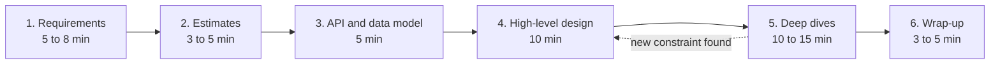
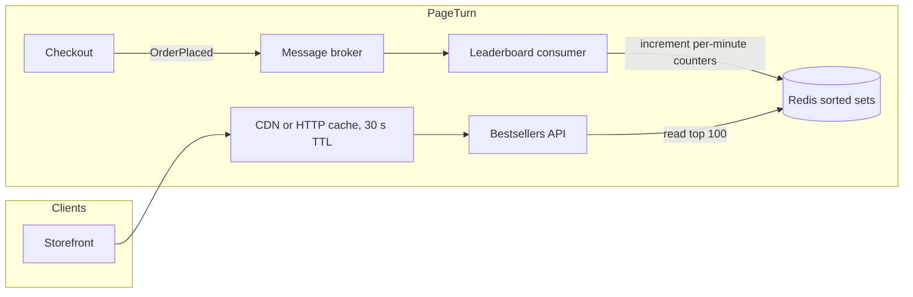

# System Design Interview Approach

## Introduction

A system design interview gives you 45 to 60 minutes and a vague prompt: "Design a URL shortener", "Design a chat app", "Design a leaderboard". There is no single correct answer, and the interviewer knows it. What they evaluate is **how you think**: whether you clarify before building, make reasonable estimates, choose components for stated reasons, notice trade-offs, and communicate clearly while doing it.

That is the same skill set this whole tutorial teaches. A system design interview is a compressed architecture exercise: requirements, [quality attributes](../0-arch-fundamentals/3-arch-quality-attributes.mdx), a container diagram, a few [ADR-style](./0-arch-decision-records.mdx) decisions and a mini [architecture review](./4-arch-reviews.mdx) of your own design, all spoken aloud.

An analogy: it is like a cooking show where you get a mystery basket. Nobody expects a perfect dish. They watch whether you check the ingredients, plan before you cook, manage the time, and explain why you are making each choice.

This page gives you a **repeatable framework**, a worked example, and the mistakes that sink most candidates. For topic-by-topic refreshers, see the site's [System Design interview section](../../interview/6-system-design/0-system-design-fundamentals.mdx), and for full worked designs, the [Case Studies](../14-arch-case-studies/0-arch-case-url-shortener.mdx).

## The Framework

Many published guides converge on a similar flow. Alex Xu's *System Design Interview: An Insider's Guide*, for example, uses four steps: understand the problem and establish design scope, propose a high-level design and get buy-in, design deep dive, and wrap up. The version below splits out estimation and the API because they are where candidates most often skip ahead.



The times are for a 45-minute slot and are guides, not rules. The interviewer may steer you somewhere else; follow them. The point of the framework is that you **never get lost**: at any moment you know which step you are in and what comes next.

### 1. Clarify requirements

Turn the vague prompt into a scoped problem. Ask, and write down the answers where the interviewer can see them:

- **Functional requirements:** what must users be able to do? Pick the 2 to 4 that matter most and say explicitly what is **out of scope**.
- **Non-functional requirements:** scale, latency, availability, consistency, durability, security. Prefer numbers: "p95 under 200 ms", "99.9% available", "a few seconds of staleness is fine".
- **Users and access patterns:** read-heavy or write-heavy? Global or one region? Spiky traffic?

If the interviewer says "you decide", state an assumption and move on: "I will assume 2 million daily users; tell me if you want a different scale."

### 2. Back-of-the-envelope estimates

Estimates decide whether you need a cache, a queue, sharding or nothing special. They are rough on purpose: **orders of magnitude matter, decimals do not**. Useful anchors:

| Quantity | Handy approximation |
| --- | --- |
| Seconds per day | about 86,400, round to 100,000 for mental math |
| 1 million requests per day | about 12 per second on average |
| Peak vs average | often 2x to 10x, depending on the product |
| Main memory read | around 100 ns |
| Round trip inside a data center | around 0.5 ms |
| Cross-continent round trip | around 100 to 150 ms |

The latency figures are classic rough orders of magnitude (popularized by Jeff Dean's "numbers everyone should know"); real values vary with hardware and network. Use them to compare options, not as specifications.

### 3. API and data model

Sketch the main endpoints or messages and the core entities. This forces precision: what goes in, what comes out, what is stored. Keep it short, such as three endpoints and two tables. See [REST API Design](../10-arch-integration-and-apis/1-arch-rest-api-design.mdx).

### 4. High-level design

Draw a simple container diagram: clients, a load balancer or gateway, services, data stores, queues, caches. Walk one request through it end to end. **Get buy-in** before going deeper: "Does this overall shape make sense before I go into the ranking logic?"

### 5. Deep dives

Pick the hardest or most interesting parts, or let the interviewer pick, and go deep: data partitioning, consistency, hot keys, failure handling, caching strategy. This is where trade-off discussion earns the most credit.

### 6. Wrap up

Summarize the design, name the main **bottlenecks and risks**, and say what you would do with more time or at 10x scale. Proactively naming weaknesses is a strength, not an admission.

## Worked Example: A Bestseller Leaderboard

> "PageTurn wants a 'Bestsellers right now' widget: the top 100 books by units sold in the last hour, overall and per category. Design it."

### Step 1: Requirements

A good candidate asks and writes down:

```text
Functional
  - Show top 100 books by units sold in the last 60 minutes, overall and for each of ~50 categories
  - Widget appears on most pages
  Out of scope: personalization, all-time rankings, fraud detection

Non-functional
  - Freshness: a sale should be reflected within ~1 minute
  - Read latency: p95 < 50 ms for the widget API
  - Availability: widget can degrade (show slightly stale data) but must not break pages
  - Accuracy: approximate is fine; exact ordering of books with similar counts is not critical

Scale (assumed, confirmed with interviewer)
  - 2M daily active users, ~10 page views each
  - 150K orders/day, ~2 books per order, 5x peak during holiday sales
```

The two most important answers are **"approximate is fine"** and **"can show slightly stale data"**. They unlock much simpler designs.

### Step 2: Estimates

Do the math out loud. In an interview you would do it on the whiteboard; here it is as a script so you can check it:

```python
"""estimate.py - back-of-the-envelope numbers for the bestseller leaderboard."""
SECONDS_PER_DAY = 86_400

daily_active_users = 2_000_000
page_views_per_user = 10          # leaderboard widget is on most pages
orders_per_day = 150_000
lines_per_order = 2               # books per order on average
peak_factor = 5                   # holiday peak vs daily average

reads_per_sec = daily_active_users * page_views_per_user / SECONDS_PER_DAY
writes_per_sec = orders_per_day * lines_per_order / SECONDS_PER_DAY

categories = 50
buckets = 60                      # one counter set per minute for the last hour
books_sold_per_minute = orders_per_day * lines_per_order / (24 * 60)
bytes_per_entry = 64              # book id + score + overhead, rough guess
window_bytes = buckets * books_sold_per_minute * bytes_per_entry * 2  # x2: global + category

print(f"reads/s   avg {reads_per_sec:8,.0f}   peak {reads_per_sec * peak_factor:8,.0f}")
print(f"writes/s  avg {writes_per_sec:8,.1f}   peak {writes_per_sec * peak_factor:8,.1f}")
print(f"distinct books sold per minute (upper bound): {books_sold_per_minute:,.0f}")
print(f"hot data for a 1-hour window: {window_bytes / 1_000_000:.1f} MB")
print(f"categories: {categories} -> leaderboards to serve: {categories + 1}")
```

Output:

```text
reads/s   avg      231   peak    1,157
writes/s  avg      3.5   peak     17.4
distinct books sold per minute (upper bound): 208
hot data for a 1-hour window: 1.6 MB
categories: 50 -> leaderboards to serve: 51
```

**This is the most important moment of the interview.** The numbers say the problem is **small**: about 17 writes per second at peak and a couple of megabytes of hot data. You do not need a stream-processing cluster or sharding. Saying so, with numbers, shows judgment. Reaching for Kafka, Flink and five microservices here would be a red flag. The interesting part is the **read path** (about a thousand requests per second for data that changes once a minute) and the **sliding window**.

### Step 3: API and data model

```text
GET /api/bestsellers?category=fiction&limit=100
  -> 200 { "window": "60m", "generated_at": "...", "items": [ { "isbn": "...", "title": "...", "units": 42 } ] }

Event consumed: OrderPlaced { order_id, placed_at, lines: [ { isbn, category, quantity } ] }
```

The leaderboard service consumes the `OrderPlaced` event that checkout already publishes, rather than adding a synchronous call into checkout. That keeps checkout's latency and availability independent of the widget (see [Event-Driven Architecture](../6-arch-architectural-styles/5-arch-event-driven.mdx)).

### Step 4: High-level design



Walk one sale through: checkout publishes `OrderPlaced`; the consumer increments the book's count in the current minute's bucket, overall and for its category; the API merges the last 60 buckets, takes the top 100 and returns it; a 30-second HTTP cache absorbs most reads, since freshness of about a minute was acceptable.

### Step 5: Deep dives

**The sliding window.** A single counter per book cannot "forget" old sales. The standard trick is **time buckets**: one counter set per minute, summed over the last 60. Here is the algorithm in plain Python so you can explain it precisely:

```python
"""leaderboard.py - sliding-window top-K with per-minute buckets (in memory)."""
from __future__ import annotations

import heapq
from collections import Counter, deque


class SlidingTopK:
    def __init__(self, window_minutes: int = 60) -> None:
        self.window = window_minutes
        self.buckets: deque[tuple[int, Counter[str]]] = deque()  # (minute, counts)
        self.totals: Counter[str] = Counter()

    def _expire(self, now_minute: int) -> None:
        while self.buckets and self.buckets[0][0] <= now_minute - self.window:
            _, old = self.buckets.popleft()
            self.totals.subtract(old)          # remove the expired minute from the totals
            for isbn in [k for k, v in self.totals.items() if v <= 0]:
                del self.totals[isbn]

    def record_sale(self, isbn: str, quantity: int, minute: int) -> None:
        self._expire(minute)
        if not self.buckets or self.buckets[-1][0] != minute:
            self.buckets.append((minute, Counter()))
        self.buckets[-1][1][isbn] += quantity
        self.totals[isbn] += quantity

    def top(self, k: int, now_minute: int) -> list[tuple[str, int]]:
        self._expire(now_minute)
        return heapq.nlargest(k, self.totals.items(), key=lambda kv: kv[1])


if __name__ == "__main__":
    board = SlidingTopK(window_minutes=60)
    board.record_sale("dune", 5, minute=0)
    board.record_sale("hobbit", 3, minute=10)
    board.record_sale("dune", 1, minute=30)
    board.record_sale("sapiens", 4, minute=45)
    print("at minute 50:", board.top(3, now_minute=50))
    print("at minute 61:", board.top(3, now_minute=61))   # minute-0 sales expired
```

Output:

```text
at minute 50: [('dune', 6), ('sapiens', 4), ('hobbit', 3)]
at minute 61: [('sapiens', 4), ('hobbit', 3), ('dune', 1)]
```

At minute 61, the five copies of *Dune* sold at minute 0 have left the window, so *Dune* drops from first to third.

**Mapping it to Redis.** In production, keep the buckets in Redis [sorted sets](../../../middleware/redis/1-redis-data-types/3-redis-sorted-sets.mdx) so several API and consumer instances share them:

```text
# consumer, for each order line (bucket key = current minute)
ZINCRBY bestsellers:{all}:202611271405 2 "9780441013593"
EXPIRE  bestsellers:{all}:202611271405 7200

# API, at most every 30 s: merge the last 60 buckets, then read the top 100
ZUNIONSTORE bestsellers:{all}:last60 60 bestsellers:{all}:202611271306 ... bestsellers:{all}:202611271405
ZRANGE bestsellers:{all}:last60 0 99 REV WITHSCORES
```

Points worth saying aloud:

- `ZRANGE ... REV` replaces `ZREVRANGE`, which Redis marks as deprecated since 6.2.
- `ZUNIONSTORE` sums scores by default, which is exactly the window total.
- In Redis Cluster, multi-key commands need all keys in one hash slot, which is why the keys share the `{all}` hash tag (one tag per category). With only 51 small leaderboards, that is fine.
- `EXPIRE` cleans up old buckets automatically.

**Failure handling.** If Redis is down, the API serves the last cached response and the widget shows slightly stale data, which the requirements allow. If the consumer falls behind, counts lag but nothing is lost because the broker retains messages. Duplicate event delivery would double-count, so the consumer records processed `order_id`s for a couple of hours ([Idempotency](../9-arch-distributed-systems/7-arch-idempotency.mdx)), or the team accepts small overcounts since "approximate is fine".

**Hot keys.** During a viral launch, one book gets most sales. At 17 writes per second total, this is irrelevant here. Saying "at 100x this would matter, and I would batch increments in the consumer" shows you know where the limit is without over-building.

### Step 6: Wrap-up

> "The design uses the existing order events, one small consumer, Redis sorted sets as per-minute buckets, and an HTTP cache for reads. Main risks: duplicate events causing overcounting, and Redis availability, both mitigated with idempotency keys and stale-cache fallback. At 100x scale I would batch increments in the consumer, pre-compute the merged top 100 every 30 seconds instead of on read, and consider an approximate algorithm like Count-Min Sketch with a heap if the number of distinct items exploded."

## Building Blocks and When to Reach for Them

Most designs are assembled from a small set of components. What matters is **the reason** you add each one. A useful habit is to name the requirement or estimate that justifies it.

| Building block | Add it when | Main trade-off to mention | Learn more |
| --- | --- | --- | --- |
| Load balancer | More than one instance of a stateless service | Health checks and session handling | [Service Discovery and Load Balancing](../9-arch-distributed-systems/10-arch-service-discovery.mdx) |
| Cache | Read-heavy, data tolerates some staleness | Invalidation and stale reads | [Caching Strategies](../11-arch-data-architecture/2-arch-caching-strategies.mdx) |
| Message queue or log | Work can be asynchronous, or producers and consumers scale differently | Eventual consistency, duplicate delivery | [Messaging Patterns](../10-arch-integration-and-apis/5-arch-messaging-patterns.mdx) |
| Read replicas | Reads far exceed writes on a relational database | Replication lag | [Replication and Sharding](../11-arch-data-architecture/3-arch-replication-and-sharding.mdx) |
| Sharding | Writes or data size exceed one node | Cross-shard queries, rebalancing | [Replication and Sharding](../11-arch-data-architecture/3-arch-replication-and-sharding.mdx) |
| CDN | Static or cacheable content, global users | Purging, cost | [Designing for Performance](../12-arch-quality-and-operations/1-arch-performance.mdx) |
| Search index | Full-text or faceted queries | A second copy of data to keep in sync | [Search and Analytics Architecture](../11-arch-data-architecture/6-arch-search-and-analytics.mdx) |
| Rate limiter | Abuse protection or fair sharing of capacity | Choosing limits, distributed counting | [Bulkheads, Rate Limiting and Backpressure](../9-arch-distributed-systems/9-arch-bulkhead-and-rate-limiting.mdx) |
| Circuit breaker and timeouts | Calls to dependencies that can be slow | Degraded responses must be designed | [Circuit Breaker, Retry and Timeout](../9-arch-distributed-systems/8-arch-circuit-breaker.mdx) |

A sentence like "reads are about 70 times writes and a minute of staleness is fine, so I will put a cache in front" is worth more than a diagram with ten components and no reasons.

## What Interviewers Look For

| Signal | Strong candidate | Weak candidate |
| --- | --- | --- |
| Scoping | Asks questions, writes down requirements and non-goals | Starts drawing boxes immediately |
| Estimation | Uses numbers to justify (or reject) complexity | Skips it, or computes then ignores it |
| Design | Simple first, then evolves under stated constraints | Lists every technology they know |
| Trade-offs | "X gives us A but costs B; given our requirement C, I prefer X" | "X is best practice" |
| Depth | Can go deep on one or two areas with specifics | Stays shallow everywhere |
| Communication | Thinks aloud, checks in, follows the interviewer's lead | Long silences or a monologue |
| Failure thinking | Asks "what happens when this fails?" unprompted | Assumes everything always works |

## Real-World Scenario

Your colleague Maya has a senior engineer interview next week. In a mock interview, she is asked to "design a notification system". She spends the first 20 minutes on a detailed microservice diagram with Kafka, three databases and a service mesh. When the interviewer asks how many notifications per second it handles, she does not know. The deep dive runs out of time before failure handling.

You coach her with the framework:

1. **Requirements first, out loud**: which channels (email, push, SMS)? Transactional or marketing? Delivery guarantees? Opt-out rules?
2. **Estimates before components**: she computes roughly 500 notifications per second at peak, which justifies a queue but not a multi-region streaming platform.
3. **One request end to end** on a simple diagram, then **buy-in**.
4. **Two deep dives**: retries with idempotency, and per-user rate limiting. Both tie directly to stated requirements.
5. **Wrap-up** naming the weakest part (third-party provider outages) and what she would add.

In the second mock, she finishes with ten minutes to spare and spends them on trade-offs, which is what earns senior-level credit. The full design is in the [Notification System case study](../14-arch-case-studies/3-arch-case-notifications.mdx).

### Why this approach

- The framework is **time-boxed**, so you always reach the deep dive and the wrap-up.
- Estimates **anchor** technology choices in numbers, which is exactly the trade-off thinking interviewers test.
- Checking in for buy-in turns the interview into collaboration, which is how real design work happens.

### When to use the framework, and when to adapt

Use it for open-ended "design X" questions. Adapt it when:

- **The interviewer drives**: some interviewers jump straight to a deep dive. Follow them; the framework is a fallback, not a script.
- **Object-oriented design questions** ("design a parking lot's classes") focus on classes and patterns; see the [creational](../2-arch-creational-patterns/0-arch-design-patterns-introduction.mdx) and [behavioral](../4-arch-behavioral-patterns/0-arch-strategy.mdx) pattern sections instead.
- **Product or API design** interviews put more weight on step 3.
- **Real projects** need much more: stakeholder input, reviews, ADRs and evolution over time. An interview is a sketch, not an architecture.

### Alternatives and trade-offs

| Preparation approach | Pros | Cons | Best for |
| --- | --- | --- | --- |
| Framework plus timed mocks | Builds the habit under realistic pressure | Needs a partner | Everyone, especially the final weeks |
| Memorizing reference designs | Fast recall of common systems | Breaks down on unfamiliar prompts; sounds rehearsed | Building a vocabulary of components |
| Reading engineering blogs and case studies | Real trade-offs from real systems | Hard to translate into a 45-minute answer | Depth and examples for deep dives |
| Building small systems yourself | Real intuition about bottlenecks | Time-consuming | Long-term growth |

## Common Mistakes

1. **Designing before scoping.** Jumping to boxes means designing for the wrong problem.
2. **Over-engineering.** Microservices, Kafka and sharding for 20 writes per second signal poor judgment. Let the estimates set the complexity.
3. **Estimating and then ignoring the result.** Use the numbers to make decisions out loud.
4. **Buzzword answers.** "Use a cache" is not a design. Say what is cached, the TTL, the invalidation strategy, and what happens on a miss.
5. **Silence.** The interviewer cannot credit reasoning they cannot hear.
6. **Not managing time.** Never reaching failure handling or the wrap-up loses easy points.
7. **Defending a choice instead of discussing it.** When challenged, compare options; changing your mind for a good reason is a positive signal.
8. **Ignoring failure modes.** Always ask "what if this component is slow or down?"

## Summary

- System design interviews test structured thinking, trade-off reasoning and communication, not a single right answer.
- Use a time-boxed flow: **requirements, estimates, API and data model, high-level design, deep dives, wrap-up**.
- Write down functional and non-functional requirements with numbers, plus explicit non-goals.
- Let **estimates** decide complexity; small numbers justify simple designs.
- Go deep on one or two areas with specifics, discuss failure modes, and name trade-offs explicitly.
- Wrap up by naming bottlenecks, risks and what changes at 10x scale.

## Exercises

1. Run `estimate.py` with 20 million daily users and 2 million orders per day. Which parts of the design change, and which stay the same?
2. Extend `SlidingTopK` to support categories, and add a test showing that sales in one category do not affect another category's leaderboard.
3. Do a timed 45-minute mock for "Design a URL shortener" using the framework, then compare your answer with the [URL Shortener case study](../14-arch-case-studies/0-arch-case-url-shortener.mdx).
4. Write a one-page "design summary" for the bestseller leaderboard in the style of an [ADR](./0-arch-decision-records.mdx), listing the considered options (database query, Redis buckets, stream processor) and why you chose one.

### Related pages

- [Thinking in Trade-offs](../0-arch-fundamentals/4-arch-trade-offs.mdx)
- [Designing for Scalability](../12-arch-quality-and-operations/0-arch-scalability.mdx)
- [Caching Strategies](../11-arch-data-architecture/2-arch-caching-strategies.mdx)
- [Capstone: Designing a Ride-Sharing System](../14-arch-case-studies/8-arch-capstone.mdx)
- [System Design interview fundamentals](../../interview/6-system-design/0-system-design-fundamentals.mdx)
