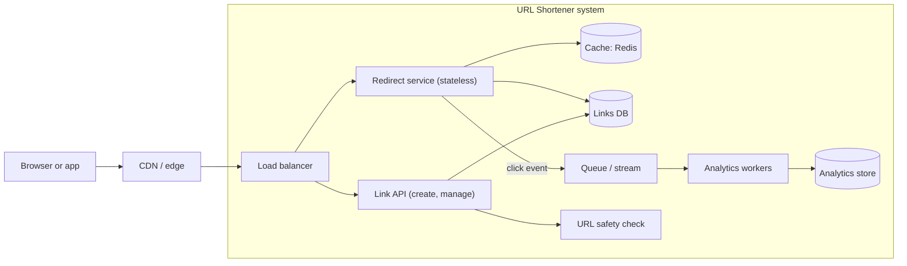
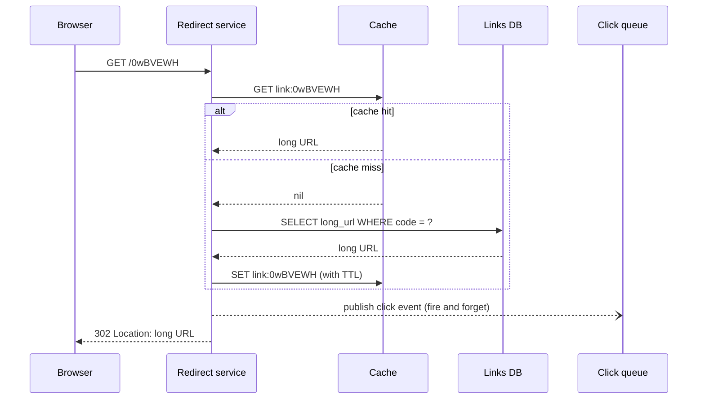

# Case Study: URL Shortener

## Introduction

A URL shortener turns `https://example.com/spring-sale?utm_source=newsletter&utm_campaign=2026-q2` into something like `https://sho.rt/0wBVEWH`. When someone opens the short link, the service looks up the long URL and answers with an HTTP redirect.

It is the classic first system design exercise because it is small enough to hold in your head, yet it touches almost every topic in this tutorial:

- **Requirements and quality attributes**: what must it do, and how fast and reliable must it be?
- **Data modelling and ID generation**: how do you create billions of short, unique codes?
- **Read-heavy scaling**: almost all traffic is redirects, so caching dominates the design.
- **Asynchronous side work**: click analytics must not slow down redirects.
- **Trade-offs**: 301 vs 302, random vs sequential codes, SQL vs key-value store.

Think of it as a coat check at a theatre. You hand over a bulky coat (the long URL), get a small numbered ticket (the code), and later swap the ticket for the coat. The interesting questions are how to print tickets that never clash, and how to hand coats back quickly when the whole audience leaves at once.

This page walks through the design the way you would on a real project or in a [system design interview](../13-arch-documenting-and-evolving/6-arch-system-design-interviews.mdx): requirements first, then estimates, then the design, then the trade-offs.

## Step 1: Requirements

### Functional requirements

1. A user can submit a long URL and receive a short link.
2. A user can optionally choose a custom alias, such as `sho.rt/docs`.
3. Opening a short link redirects the browser to the long URL.
4. Links can optionally expire.
5. Link owners can see click counts per day, country and referrer.

### Non-functional requirements

These come from the [quality attributes](../0-arch-fundamentals/3-arch-quality-attributes.mdx) that matter for this product:

| Quality attribute | Target (example) | Why it matters here |
| --- | --- | --- |
| Latency | Redirect p99 under 50 ms at the edge of our system | A slow redirect makes every marketing link feel broken |
| Availability | Redirects at 99.95% or better | A dead short link in a printed flyer cannot be fixed |
| Durability | Never lose a created link | Links live for years in emails, PDFs and QR codes |
| Scalability | Reads grow much faster than writes | One viral link can get millions of clicks |
| Security | Do not become a phishing or malware launcher | Shorteners hide the destination, so abuse is common |

Notice the asymmetry: **creating** a link can be a bit slower and can even be briefly unavailable, but **redirecting** must almost never fail. That one observation drives most of the design.

### Out of scope (for now)

Billing, team accounts, and link editing. Saying what you will not build is part of the design, and it keeps the first version small.

## Step 2: Back-of-the-Envelope Estimates

Estimates tell you whether you need one database or a hundred. The numbers below are **assumptions for this exercise**, not figures from any real company.

- New links: 1 million per day, so about 12 writes per second on average.
- Read-to-write ratio: 100 to 1, so about 1,200 redirects per second on average. Plan for a peak of 10 times that, around 12,000 per second.
- Storage per link: roughly 500 bytes (code, URL, timestamps, owner). One million links a day for 5 years is about 1.8 billion links, or under 1 TB of raw data.

How long should the code be? With 62 characters (`0-9`, `a-z`, `A-Z`), each extra character multiplies the space by 62:

```python
import string

ALPHABET = string.digits + string.ascii_lowercase + string.ascii_uppercase  # 62 chars
BASE = len(ALPHABET)


def encode_base62(n: int) -> str:
    if n < 0:
        raise ValueError("only non-negative integers")
    if n == 0:
        return ALPHABET[0]
    chars: list[str] = []
    while n:
        n, rem = divmod(n, BASE)
        chars.append(ALPHABET[rem])
    return "".join(reversed(chars))


def decode_base62(s: str) -> int:
    n = 0
    for ch in s:
        n = n * BASE + ALPHABET.index(ch)
    return n


for n in [0, 61, 62, 125_000_000, 3_521_614_606_207]:
    code = encode_base62(n)
    print(f"{n:>18,} -> {code:<8} -> {decode_base62(code):,}")

for length in [6, 7, 8]:
    print(f"{length} chars: {BASE**length:,} codes")
```

Output:

```text
                 0 -> 0        -> 0
                61 -> Z        -> 61
                62 -> 10       -> 62
       125,000,000 -> 8sud2    -> 125,000,000
 3,521,614,606,207 -> ZZZZZZZ  -> 3,521,614,606,207
6 chars: 56,800,235,584 codes
7 chars: 3,521,614,606,208 codes
8 chars: 218,340,105,584,896 codes
```

Seven characters give about 3.5 trillion codes, far more than 1.8 billion links. With **random** codes, a bigger space also keeps collisions rare, which matters later.

:::tip
The point of estimates is not precision. It is to discover the shape of the problem. Here the shape is: modest storage, modest writes, heavy and spiky reads. You do not need sharding on day one, but you do need a cache.
:::

## Step 3: API Design

Two endpoints cover the core. The design follows the conventions from [REST API Design](../10-arch-integration-and-apis/1-arch-rest-api-design.mdx).

```text
POST /api/v1/links
Content-Type: application/json
Idempotency-Key: 6f1d3c1e-0b6a-4f55-9a43-1f0a8c7d2b11

{"long_url": "https://example.com/spring-sale", "alias": null, "expires_at": null}

201 Created
{"code": "0wBVEWH", "short_url": "https://sho.rt/0wBVEWH"}
```

```text
GET /0wBVEWH

302 Found
Location: https://example.com/spring-sale
Cache-Control: private, max-age=90
```

The `Idempotency-Key` header lets a client retry a timed-out create without making two links. See [Idempotency](../9-arch-distributed-systems/7-arch-idempotency.mdx) for how to implement it.

### 301 or 302?

This is a real product decision, not a detail:

| Status | Meaning | Effect |
| --- | --- | --- |
| `301 Moved Permanently` | The resource has moved for good | Browsers may cache the redirect and skip your server next time. Less load, but you lose click counts and cannot change the target. |
| `302 Found` (or `307`) | Temporary redirect | Every click hits your service. More load, but accurate analytics, and you can edit or disable links. |

Commercial shorteners that sell analytics generally prefer temporary redirects for this reason. A pure "make it short" utility with no analytics might pick 301 to save cost. Pick based on the requirement, and write the choice down in an [ADR](../13-arch-documenting-and-evolving/0-arch-decision-records.mdx).

## Step 4: Generating Short Codes

This is the heart of the problem. There are four common approaches.

### Option A: Hash the long URL

Take `md5(long_url)` or `sha256(long_url)`, base62-encode it, and keep the first 7 characters.

- Same URL gives the same code, which deduplicates for free.
- Truncated hashes **collide**, so you must check and retry with a salt.
- Two users shortening the same URL get the same link, which breaks per-user analytics.

### Option B: Counter plus base62

Keep a global counter, and encode each new number in base62: 1 becomes `1`, 125,000,000 becomes `8sud2`.

- No collisions at all.
- Codes are **guessable and enumerable**. Anyone can walk `aaaaaa`, `aaaaab`, and so on, and scrape every link, including private ones.
- A single global counter is a bottleneck and a single point of failure. You can fix that by handing out ranges (for example, each app server reserves 1,000 numbers at a time from the database).

### Option C: Snowflake-style IDs

Twitter's Snowflake format packs a timestamp, a worker ID and a sequence number into 64 bits, so each server can generate unique IDs without coordinating. The usual layout is 41 bits of milliseconds since a custom epoch, 10 bits of worker ID, and 12 bits of sequence.

```python
import threading
import time


class SnowflakeGenerator:
    """64-bit IDs: 41 bits ms timestamp | 10 bits worker id | 12 bits sequence."""

    EPOCH_MS = 1_704_067_200_000  # 2024-01-01T00:00:00Z, our own custom epoch
    WORKER_BITS = 10
    SEQUENCE_BITS = 12
    MAX_WORKER = (1 << WORKER_BITS) - 1
    MAX_SEQUENCE = (1 << SEQUENCE_BITS) - 1

    def __init__(self, worker_id: int) -> None:
        if not 0 <= worker_id <= self.MAX_WORKER:
            raise ValueError(f"worker_id must be 0..{self.MAX_WORKER}")
        self.worker_id = worker_id
        self.last_ms = -1
        self.sequence = 0
        self.lock = threading.Lock()

    def _now_ms(self) -> int:
        return time.time_ns() // 1_000_000

    def next_id(self) -> int:
        with self.lock:
            now = self._now_ms()
            if now < self.last_ms:
                raise RuntimeError("clock moved backwards; refusing to generate IDs")
            if now == self.last_ms:
                self.sequence = (self.sequence + 1) & self.MAX_SEQUENCE
                if self.sequence == 0:          # 4096 IDs used this ms: wait
                    while now <= self.last_ms:
                        now = self._now_ms()
            else:
                self.sequence = 0
            self.last_ms = now
            return ((now - self.EPOCH_MS) << (self.WORKER_BITS + self.SEQUENCE_BITS)) \
                | (self.worker_id << self.SEQUENCE_BITS) | self.sequence


def explain(snowflake_id: int) -> dict[str, int]:
    return {
        "ms_since_epoch": snowflake_id >> 22,
        "worker": (snowflake_id >> 12) & 0x3FF,
        "sequence": snowflake_id & 0xFFF,
    }


gen = SnowflakeGenerator(worker_id=7)
ids = [gen.next_id() for _ in range(3)]
for i in ids:
    print(i, explain(i))
print("sorted by time:", ids == sorted(ids))
```

Example output:

```text
367623832753696768 {'ms_since_epoch': 87648351849, 'worker': 7, 'sequence': 0}
367623832753696769 {'ms_since_epoch': 87648351849, 'worker': 7, 'sequence': 1}
367623832753696770 {'ms_since_epoch': 87648351849, 'worker': 7, 'sequence': 2}
sorted by time: True
```

Snowflake IDs are great primary keys, but encoded in base62 they are about 10 to 11 characters, which is long for a "short" link. They are also time-ordered, so they leak creation time and are still somewhat guessable.

### Option D: Random codes with a uniqueness check

Generate 7 random characters with a cryptographically secure generator, insert with a unique constraint, and retry on the rare collision. With 3.5 trillion possible codes and around 2 billion links, the chance that a new random code clashes is well under 0.1%, so retries are cheap.

This is the option we pick for the main design: it is simple, not enumerable, and needs no coordination beyond the database's unique constraint.

| Approach | Pros | Cons | Best for |
| --- | --- | --- | --- |
| Hash of URL | Deterministic, dedupes | Collisions after truncation, same code for all users | Single-tenant internal tools |
| Counter + base62 | Shortest codes, no collisions | Enumerable, needs a coordinated counter | Public, non-sensitive links where length matters most |
| Snowflake | No coordination, sortable | Longer codes, leaks timestamp | Internal primary keys, event IDs |
| Random + unique check | Simple, not guessable | Needs retry logic, insert needs the DB | Most shorteners |

## Step 5: The Design

Here is the C4 container view. See [The C4 Model](../13-arch-documenting-and-evolving/1-arch-c4-model.mdx) if this diagram style is new.



Key decisions:

- **Separate read and write paths.** The redirect service is tiny and stateless, so you can scale it out on its own. The link API carries the heavier logic (validation, safety checks, aliases).
- **Cache-aside on reads.** Redirects check Redis first and fall back to the database. Links rarely change, so the hit ratio can be very high. See [Caching Strategies](../11-arch-data-architecture/2-arch-caching-strategies.mdx).
- **Analytics is asynchronous.** The redirect publishes a click event and returns at once. Workers aggregate later. If analytics falls behind, redirects are unaffected.
- **Storage.** The access pattern is a pure key lookup by code, so a key-value store such as DynamoDB or Cassandra fits well. A single PostgreSQL instance with read replicas also handles these estimates comfortably. See [Choosing SQL vs NoSQL](../11-arch-data-architecture/1-arch-sql-vs-nosql.mdx).

### The redirect flow



## Step 6: A Working Core

The code below models the core logic with SQLite and an in-memory LRU cache, so you can run it anywhere. In production, the cache would be Redis and the click list would be a queue or stream.

```python
import secrets
import sqlite3
import string
from collections import OrderedDict
from dataclasses import dataclass
from datetime import datetime, timezone

ALPHABET = string.digits + string.ascii_lowercase + string.ascii_uppercase
RESERVED = {"api", "admin", "login", "health"}


@dataclass(frozen=True)
class Redirect:
    status: int          # 301, 302, 404 or 410
    location: str | None


class LruCache:
    def __init__(self, capacity: int) -> None:
        self.capacity = capacity
        self.data: OrderedDict[str, str] = OrderedDict()
        self.hits = self.misses = 0

    def get(self, key: str) -> str | None:
        if key in self.data:
            self.data.move_to_end(key)
            self.hits += 1
            return self.data[key]
        self.misses += 1
        return None

    def put(self, key: str, value: str) -> None:
        self.data[key] = value
        self.data.move_to_end(key)
        if len(self.data) > self.capacity:
            self.data.popitem(last=False)


class Shortener:
    def __init__(self, db: sqlite3.Connection, cache: LruCache, code_length: int = 7) -> None:
        self.db = db
        self.cache = cache
        self.code_length = code_length
        self.click_events: list[dict] = []   # stand-in for a queue such as Kafka or SQS
        db.execute("""CREATE TABLE IF NOT EXISTS links (
            code TEXT PRIMARY KEY,
            long_url TEXT NOT NULL,
            created_at TEXT NOT NULL,
            expires_at TEXT)""")

    def _random_code(self) -> str:
        return "".join(secrets.choice(ALPHABET) for _ in range(self.code_length))

    def create(self, long_url: str, alias: str | None = None, expires_at: str | None = None) -> str:
        if not long_url.startswith(("http://", "https://")):
            raise ValueError("only http(s) URLs are allowed")
        if alias and alias.lower() in RESERVED:
            raise ValueError(f"alias '{alias}' is reserved")
        now = datetime.now(timezone.utc).isoformat()
        for _ in range(5):                   # retry on the rare collision
            code = alias or self._random_code()
            try:
                with self.db:
                    self.db.execute("INSERT INTO links VALUES (?, ?, ?, ?)",
                                    (code, long_url, now, expires_at))
                return code
            except sqlite3.IntegrityError:
                if alias:
                    raise ValueError(f"alias '{alias}' is taken") from None
        raise RuntimeError("could not find a free code; increase code_length")

    def resolve(self, code: str, user_agent: str = "") -> Redirect:
        url = self.cache.get(code)
        if url is None:
            row = self.db.execute(
                "SELECT long_url, expires_at FROM links WHERE code = ?", (code,)).fetchone()
            if row is None:
                return Redirect(404, None)
            long_url, expires_at = row
            if expires_at and expires_at < datetime.now(timezone.utc).isoformat():
                return Redirect(410, None)
            if expires_at is None:           # only cache links that cannot expire
                self.cache.put(code, long_url)
            url = long_url
        self.click_events.append({"code": code, "ua": user_agent})   # async in production
        return Redirect(302, url)


service = Shortener(sqlite3.connect(":memory:"), LruCache(capacity=10_000))
code = service.create("https://example.com/spring-sale?utm_source=newsletter")
service.create("https://example.com/docs", alias="docs")
print("created:", code, "and docs")

for _ in range(3):
    print(service.resolve(code, user_agent="Mozilla/5.0"))
print(service.resolve("docs"))
print(service.resolve("nope123"))
try:
    service.create("https://evil.example", alias="admin")
except ValueError as exc:
    print("rejected:", exc)
print(f"cache hits={service.cache.hits} misses={service.cache.misses} "
      f"clicks queued={len(service.click_events)}")
```

Example output (your code will differ, because it is random):

```text
created: lEGwr4G and docs
Redirect(status=302, location='https://example.com/spring-sale?utm_source=newsletter')
Redirect(status=302, location='https://example.com/spring-sale?utm_source=newsletter')
Redirect(status=302, location='https://example.com/spring-sale?utm_source=newsletter')
Redirect(status=302, location='https://example.com/docs')
Redirect(status=404, location=None)
rejected: alias 'admin' is reserved
cache hits=2 misses=3 clicks queued=4
```

Things worth noticing:

- The **unique constraint** on `code` does the collision detection. Never "check, then insert" in two steps, because two requests can pass the check at the same moment.
- Reserved words such as `api` and `admin` cannot be used as aliases, or someone could hijack your own routes.
- Links with an expiry are not cached in this simple version, so an expired link is never served from a stale cache entry. A real system would cache them with a TTL that ends at `expires_at`.
- Missing links return 404 and expired ones return 410 Gone, which tells crawlers to stop retrying.

## Step 7: Scaling and Reliability

As traffic grows, apply ideas from [Designing for Scalability](../12-arch-quality-and-operations/0-arch-scalability.mdx) in this order:

1. **Cache more aggressively.** A small fraction of links usually gets most clicks, so even a modest Redis cluster absorbs most reads.
2. **Add read replicas** for cache misses.
3. **Use the CDN.** Some edge platforms can run a small function or keep a key-value store at the edge, so popular redirects never reach your servers. Check your CDN's documentation for what it supports.
4. **Partition the links table by code** only when a single primary cannot keep up with writes or storage. Random codes spread evenly across shards, which is another quiet benefit of option D. See [Replication and Sharding](../11-arch-data-architecture/3-arch-replication-and-sharding.mdx).
5. **Protect the create endpoint** with rate limits per user and per IP. See [Bulkheads, Rate Limiting and Backpressure](../9-arch-distributed-systems/9-arch-bulkhead-and-rate-limiting.mdx).

:::caution
Do not let the cache become a single point of failure. If Redis is down, the redirect service should fall back to the database (with a [circuit breaker](../9-arch-distributed-systems/8-arch-circuit-breaker.mdx) so it does not overload it), not return errors.
:::

## Real-World Scenario

Your team builds an email marketing SaaS. Customers send campaigns with tracked links, and they want click reports per campaign. Links appear in emails sent to millions of recipients, and most clicks happen in the first hour after a send, so traffic is extremely bursty.

**The design you choose:**

- Random 7-character codes, created in bulk when a campaign is scheduled (not when the email is opened), so the create path is never under pressure.
- `302` redirects so every click is counted and links can be disabled if a customer is found sending spam.
- Pre-warm the cache for a campaign's links just before it is sent, so the first-hour burst hits Redis, not the database.
- Click events go into a stream, with an idempotent consumer keyed by event ID so retries do not double-count (see [Messaging Patterns](../10-arch-integration-and-apis/5-arch-messaging-patterns.mdx)).
- A URL safety check runs at link creation, and a kill switch can disable all links for an abusive tenant.
- The shortener lives as a module inside the existing monolith at first, with its own tables. The redirect path is deployed as a separate small service only because its scaling profile is so different, which is a clear reason to extract it (see [Modular Monolith](../6-arch-architectural-styles/3-arch-modular-monolith.mdx)).

**Why this approach:** the business sells analytics, so accuracy beats the bandwidth savings of 301. The burst is predictable, so pre-warming is cheaper than over-provisioning.

**When not to use it:** if you only need a handful of internal short links (a "go links" tool for your company), a single table and a 30-line web handler is the whole design. Everything above would be over-engineering.

**Alternatives and trade-offs:**

| Approach | Pros | Cons | Best for |
| --- | --- | --- | --- |
| Buy a commercial shortener | Zero ops, branded domains, analytics included | Cost per link or click, data leaves your system | Teams without a strong reason to own it |
| Single service + PostgreSQL + Redis | Simple, cheap, easy to reason about | One region, manual scaling | Most products up to large scale |
| Key-value store + edge functions | Very low latency worldwide | Vendor lock-in, harder to debug, eventual consistency at the edge | Global, very high read volume |
| Encode the target in the link (signed token) | No database lookup at all | Long "short" links, cannot edit or disable | Expiring download links, not shortening |

## Common Mistakes

- **Sequential codes for private links.** Enumerable codes let anyone scrape shared documents. Use random codes for anything that might be private.
- **Check-then-insert for uniqueness.** It has a race condition. Let the database's unique constraint decide.
- **Writing analytics synchronously in the redirect.** A slow analytics database then makes every redirect slow. Publish an event and move on.
- **Choosing 301 without thinking.** Browsers can cache it, so you lose analytics and the ability to change or block the link.
- **Ignoring abuse.** Shorteners are a favourite tool for phishing. Validate schemes (no `javascript:` URLs), check destinations against a safe-browsing list, and rate-limit creation.
- **Designing for a billion clicks a day when you have a thousand.** Start with one service and one database. The design above scales in steps, so take each step when the metrics say so.

## Summary

- Requirements and a rough estimate show the shape of the problem: modest writes, heavy and spiky reads.
- Seven random base62 characters give about 3.5 trillion codes, enough for billions of links with rare collisions.
- Counter, hash, Snowflake and random codes each trade off length, guessability and coordination.
- Split the read path (redirects) from the write path (creation), cache aggressively, and keep analytics asynchronous.
- 301 vs 302 is a product decision about analytics and control, not just HTTP trivia.
- Scale in steps: cache, replicas, CDN, then sharding.

## Exercises

1. **Custom domains.** Customers want `go.acme.com/xyz` instead of `sho.rt/xyz`. How do the data model, the uniqueness rule and TLS certificates change?
2. **Range-based counters.** Implement option B with each server reserving blocks of 1,000 IDs from SQLite. What happens to unused IDs when a server restarts?
3. **Expiry with cache.** Change `resolve` so links with an expiry are cached with a TTL that ends exactly at `expires_at`.
4. **Write an ADR** for 301 vs 302 using the template in [Architecture Decision Records](../13-arch-documenting-and-evolving/0-arch-decision-records.mdx).

Related pages: [Caching Strategies](../11-arch-data-architecture/2-arch-caching-strategies.mdx), [Idempotency](../9-arch-distributed-systems/7-arch-idempotency.mdx), [Designing for Scalability](../12-arch-quality-and-operations/0-arch-scalability.mdx), and the next case study, [E-Commerce Checkout](./1-arch-case-ecommerce.mdx). For hands-on Redis caching, see the [Redis tutorial](/docs/middleware/redis).
