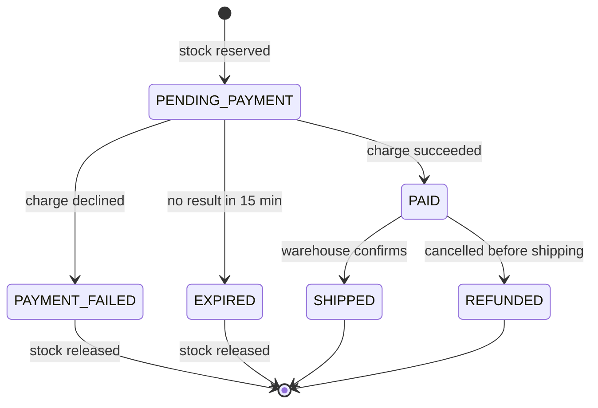
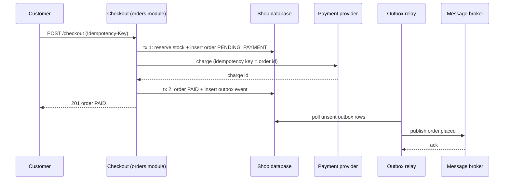
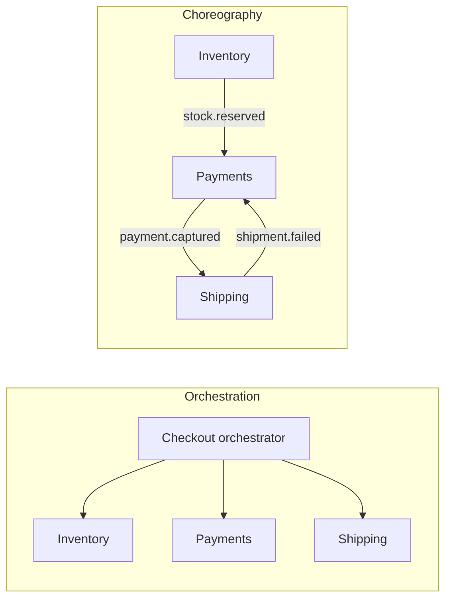

# Case Study: E-Commerce Checkout

## Introduction

Checkout is the few seconds between "Place order" and "Thank you". It is also where an online shop makes its money, so bugs here are expensive in a very literal way: a customer charged twice, a book sold that is not in the warehouse, or an order that exists in one system and not in another.

What makes checkout hard is not the business logic. It is that one click touches several things that **cannot share a single database transaction**:

- your own database (orders, stock)
- a payment provider on the other side of the internet
- the warehouse or shipping system
- email and analytics

Think of it like booking a holiday: the flight, the hotel and the car are three separate companies. If the hotel is full after the flight is booked, someone has to cancel the flight. Nobody can lock all three companies into one atomic "book everything or nothing" button.

This case study uses an online bookstore. We start with a naive design that loses money, fix it inside a [modular monolith](../6-arch-architectural-styles/3-arch-modular-monolith.mdx), then show what changes if checkout is split across services.

## Requirements

**Functional**

1. A customer checks out a cart: items, shipping address, payment method.
2. Stock must be reserved so we do not sell books we do not have.
3. The card is charged exactly once per order.
4. After a successful order, the warehouse is told to ship and the customer gets a confirmation email.

**Non-functional**

| Quality attribute | Target | Why |
| --- | --- | --- |
| Correctness | No double charges, no lost orders | Money and trust |
| Availability | Checkout survives a slow email or analytics system | Side systems must not block revenue |
| Latency | Most checkouts complete in a couple of seconds | Abandoned carts |
| Auditability | Every state change of an order is recorded | Support, refunds, disputes |

## The Naive Design (Before)

A first version often puts everything in one function and one database transaction:

```python
import sqlite3


class FakePaymentGateway:
    def __init__(self) -> None:
        self.charges: list[tuple[str, int]] = []

    def charge(self, customer: str, cents: int) -> str:
        self.charges.append((customer, cents))
        return f"ch_{len(self.charges)}"


db = sqlite3.connect(":memory:")
db.executescript("""
CREATE TABLE stock (sku TEXT PRIMARY KEY, qty INTEGER NOT NULL CHECK (qty >= 0));
CREATE TABLE orders (id INTEGER PRIMARY KEY, customer TEXT, sku TEXT, charge_id TEXT);
INSERT INTO stock VALUES ('BOOK-DDD', 1);
""")
gateway = FakePaymentGateway()


def checkout(customer: str, sku: str, cents: int) -> None:
    """BEFORE: everything in one function, payment in the middle of a DB transaction."""
    with db:
        charge_id = gateway.charge(customer, cents)            # money moves here...
        db.execute("UPDATE stock SET qty = qty - 1 WHERE sku = ?", (sku,))   # ...this can fail
        db.execute("INSERT INTO orders (customer, sku, charge_id) VALUES (?, ?, ?)",
                   (customer, sku, charge_id))


for customer in ["ana", "ben"]:
    try:
        checkout(customer, "BOOK-DDD", 4_500)
        print(customer, "-> order placed")
    except sqlite3.IntegrityError as exc:
        print(customer, "-> checkout failed:", exc)

print("charges at gateway:", gateway.charges)
print("orders in DB:", db.execute("SELECT customer FROM orders").fetchall())
```

Output:

```text
ana -> order placed
ben -> checkout failed: CHECK constraint failed: qty >= 0
charges at gateway: [('ana', 4500), ('ben', 4500)]
orders in DB: [('ana',)]
```

Ben was charged 45.00 and has no order. The database transaction rolled back, but **the payment provider is not part of your transaction**, so its side effect stayed. The same bug appears if the process crashes after the charge, or if the network times out and the code retries the charge.

Three lessons:

1. Never call a remote system inside a database transaction and assume the rollback covers it.
2. Every remote call can fail **after** it succeeded on the other side (a timeout on the response). You need idempotency.
3. Check and reserve stock **before** taking money.

## The Order Lifecycle

Before writing better code, draw the states. A checkout is a long-running process, and a [state machine](../4-arch-behavioral-patterns/3-arch-state.mdx) makes every in-between state explicit, so nothing gets "stuck" silently.



Each arrow is a transition your code allows. Anything else, such as `PAYMENT_FAILED` to `SHIPPED`, is a bug and should raise an error.

## The Better Design (After), Inside a Modular Monolith

For most shops, checkout should start inside one deployable application with clear modules: `catalog`, `inventory`, `orders`, `payments`. They share one database (with separate tables per module), so **stock reservation and order creation can be one local transaction**. Only the payment provider is remote.



Here is the core of that flow, runnable with SQLite:

```python
import json
import sqlite3
import uuid
from dataclasses import dataclass


class PaymentDeclined(Exception):
    pass


class FakePaymentGateway:
    """Behaves like a PSP that honours idempotency keys."""

    def __init__(self, declined_customers: set[str]) -> None:
        self.declined = declined_customers
        self.by_key: dict[str, str] = {}

    def charge(self, customer: str, cents: int, idempotency_key: str) -> str:
        if idempotency_key in self.by_key:              # retry: same answer, no new charge
            return self.by_key[idempotency_key]
        if customer in self.declined:
            raise PaymentDeclined("card_declined")
        charge_id = f"ch_{len(self.by_key) + 1}"
        self.by_key[idempotency_key] = charge_id
        return charge_id


@dataclass(frozen=True)
class CheckoutResult:
    order_id: str
    status: str


SCHEMA = """
CREATE TABLE stock (sku TEXT PRIMARY KEY, qty INTEGER NOT NULL CHECK (qty >= 0));
CREATE TABLE orders (id TEXT PRIMARY KEY, request_id TEXT UNIQUE, customer TEXT,
                     sku TEXT, cents INTEGER, status TEXT, charge_id TEXT);
CREATE TABLE outbox (id INTEGER PRIMARY KEY, topic TEXT, payload TEXT, sent INTEGER DEFAULT 0);
"""


class CheckoutService:
    def __init__(self, db: sqlite3.Connection, gateway: FakePaymentGateway) -> None:
        self.db, self.gateway = db, gateway

    def checkout(self, request_id: str, customer: str, sku: str, cents: int) -> CheckoutResult:
        # 1. Idempotent entry point: a retried request returns the original order.
        row = self.db.execute("SELECT id, status FROM orders WHERE request_id = ?",
                              (request_id,)).fetchone()
        if row:
            return CheckoutResult(*row)

        # 2. Short local transaction: reserve stock and create a PENDING order.
        order_id = str(uuid.uuid4())[:8]
        with self.db:
            reserved = self.db.execute(
                "UPDATE stock SET qty = qty - 1 WHERE sku = ? AND qty >= 1", (sku,)).rowcount
            if not reserved:
                return CheckoutResult("-", "OUT_OF_STOCK")
            self.db.execute("INSERT INTO orders VALUES (?, ?, ?, ?, ?, 'PENDING_PAYMENT', NULL)",
                            (order_id, request_id, customer, sku, cents))

        # 3. Remote call OUTSIDE any DB transaction, with an idempotency key.
        try:
            charge_id = self.gateway.charge(customer, cents, idempotency_key=order_id)
        except PaymentDeclined:
            with self.db:   # compensate locally: release the reservation
                self.db.execute("UPDATE stock SET qty = qty + 1 WHERE sku = ?", (sku,))
                self.db.execute("UPDATE orders SET status = 'PAYMENT_FAILED' WHERE id = ?",
                                (order_id,))
            return CheckoutResult(order_id, "PAYMENT_FAILED")

        # 4. Record the result and the event atomically (transactional outbox).
        with self.db:
            self.db.execute("UPDATE orders SET status = 'PAID', charge_id = ? WHERE id = ?",
                            (charge_id, order_id))
            self.db.execute("INSERT INTO outbox (topic, payload) VALUES (?, ?)",
                            ("order.placed", json.dumps({"order_id": order_id, "sku": sku})))
        return CheckoutResult(order_id, "PAID")


db = sqlite3.connect(":memory:")
db.executescript(SCHEMA + "INSERT INTO stock VALUES ('BOOK-DDD', 2);")
svc = CheckoutService(db, FakePaymentGateway(declined_customers={"carl"}))

print("ana     ", svc.checkout("req-1", "ana", "BOOK-DDD", 4_500))
print("ana retry", svc.checkout("req-1", "ana", "BOOK-DDD", 4_500))
print("carl    ", svc.checkout("req-2", "carl", "BOOK-DDD", 4_500))
print("ben     ", svc.checkout("req-3", "ben", "BOOK-DDD", 4_500))
print("dana    ", svc.checkout("req-4", "dana", "BOOK-DDD", 4_500))
print("stock left:", db.execute("SELECT qty FROM stock").fetchone()[0])
print("outbox:", db.execute("SELECT topic FROM outbox").fetchall())
```

Example output:

```text
ana      CheckoutResult(order_id='c932fbea', status='PAID')
ana retry CheckoutResult(order_id='c932fbea', status='PAID')
carl     CheckoutResult(order_id='0dd933f7', status='PAYMENT_FAILED')
ben      CheckoutResult(order_id='1d3bdb47', status='PAID')
dana     CheckoutResult(order_id='-', status='OUT_OF_STOCK')
stock left: 0
outbox: [('order.placed',), ('order.placed',)]
```

What each step buys you:

| Step | Technique | Problem it solves |
| --- | --- | --- |
| 1 | Unique `request_id` from the client's `Idempotency-Key` | Double-click and client retry create one order, not two |
| 2 | Conditional `UPDATE ... WHERE qty >= 1` | Two customers racing for the last copy cannot both win |
| 3 | Payment outside the transaction, keyed by order id | Network retries never charge twice; no DB locks held during a slow remote call |
| 3b | Local compensation | Declined card releases the reserved copy |
| 4 | [Transactional outbox](../9-arch-distributed-systems/6-arch-outbox.mdx) | "Order paid" and "event to publish" are saved atomically, so the warehouse never misses an order |

### What if the process crashes between steps?

This is the question reviewers will ask, and the state machine answers it:

- **Crash after step 2, before the charge:** the order sits in `PENDING_PAYMENT`. A background job finds orders older than a few minutes and either retries the charge with the **same idempotency key** (safe, because the provider deduplicates) or asks the provider for the status of that key.
- **Crash after the charge, before step 4:** same job, same idempotency key. The provider returns the original charge instead of a new one, and the job completes step 4.
- **No answer after the reservation timeout:** the job moves the order to `EXPIRED` and releases stock.

Payment providers such as Stripe document this model directly: you send an `Idempotency-Key` header on `POST` requests, and a retry with the same key returns the saved result of the first request instead of creating a second charge. Check your provider's documentation for how long keys are kept; Stripe's API v1 docs say keys can be pruned once they are at least 24 hours old. See [Idempotency](../9-arch-distributed-systems/7-arch-idempotency.mdx) for building the same thing in your own APIs.

:::note
Many shops **authorize** the card at checkout and **capture** the money only when the book ships. That gives you a cheap undo (void the authorization) if the warehouse finds the book damaged. Authorizations expire after a period set by the card networks and provider, so check your provider's documentation. The [Payment Processing](./4-arch-case-payments.mdx) case study goes deeper.
:::

### Everything after "PAID" is asynchronous

Shipping, email, loyalty points and analytics consume the `order.placed` event. If the email service is down for an hour, customers still check out; emails are just late. This is the [event-driven](../6-arch-architectural-styles/5-arch-event-driven.mdx) part of the design, and it is the main reason checkout stays available when side systems fail.

Consumers must be idempotent too, because an outbox relay delivers **at least once**. The warehouse should ignore a second `order.placed` for an order it already has.

## When Checkout Spans Services: Sagas

Suppose inventory belongs to a separate warehouse system with its own database, and shipping is a third-party carrier API. Now stock reservation is a remote call too, and there is no shared transaction at all. The pattern for this is the [saga](../9-arch-distributed-systems/5-arch-saga.mdx): a sequence of local steps, each with a **compensating action** that semantically undoes it.

A minimal orchestrator:

```python
from collections.abc import Callable
from dataclasses import dataclass, field


@dataclass
class SagaStep:
    name: str
    action: Callable[[dict], None]
    compensation: Callable[[dict], None] | None = None


@dataclass
class Saga:
    steps: list[SagaStep]
    log: list[str] = field(default_factory=list)

    def run(self, ctx: dict) -> bool:
        done: list[SagaStep] = []
        for step in self.steps:
            try:
                step.action(ctx)
                self.log.append(f"ok   {step.name}")
                done.append(step)
            except Exception as exc:
                self.log.append(f"FAIL {step.name}: {exc}")
                for prev in reversed(done):           # undo in reverse order
                    if prev.compensation:
                        prev.compensation(ctx)
                        self.log.append(f"undo {prev.name}")
                return False
        return True


# Stand-ins for calls to separate services (HTTP, gRPC or messages in real life)
inventory = {"BOOK-DDD": 5}
payments: dict[str, str] = {}


def reserve_stock(ctx: dict) -> None:
    if inventory[ctx["sku"]] < ctx["qty"]:
        raise RuntimeError("insufficient stock")
    inventory[ctx["sku"]] -= ctx["qty"]


def release_stock(ctx: dict) -> None:
    inventory[ctx["sku"]] += ctx["qty"]


def charge_card(ctx: dict) -> None:
    payments[ctx["order_id"]] = "CAPTURED"


def refund_card(ctx: dict) -> None:
    payments[ctx["order_id"]] = "REFUNDED"


def book_shipment(ctx: dict) -> None:
    if ctx["country"] not in {"US", "CA", "GB"}:
        raise RuntimeError(f"no carrier for {ctx['country']}")


def checkout_saga() -> Saga:
    return Saga([
        SagaStep("reserve stock", reserve_stock, release_stock),
        SagaStep("charge card", charge_card, refund_card),
        SagaStep("book shipment", book_shipment),   # last step: nothing runs after it
    ])


for order in [{"order_id": "o-1", "sku": "BOOK-DDD", "qty": 2, "country": "US"},
              {"order_id": "o-2", "sku": "BOOK-DDD", "qty": 1, "country": "AQ"}]:
    saga = checkout_saga()
    ok = saga.run(order)
    print(order["order_id"], "succeeded" if ok else "rolled back")
    for line in saga.log:
        print("   ", line)

print("inventory:", inventory, "payments:", payments)
```

Output:

```text
o-1 succeeded
    ok   reserve stock
    ok   charge card
    ok   book shipment
o-2 rolled back
    ok   reserve stock
    ok   charge card
    FAIL book shipment: no carrier for AQ
    undo charge card
    undo reserve stock
inventory: {'BOOK-DDD': 3} payments: {'o-1': 'CAPTURED', 'o-2': 'REFUNDED'}
```

Order `o-2` shows a design smell: we charged the card and then found we cannot ship to that country, so we had to refund. Refunds cost fees and confuse customers. **Order saga steps so that the steps most likely to fail and cheapest to undo run first.** Validate the shipping address before reserving stock, and reserve stock before charging.

A production orchestrator also needs:

- **Persistent saga state**, so a crash mid-saga resumes instead of forgetting (a table, or a workflow engine such as Temporal or AWS Step Functions).
- **Retries with backoff** on each step, with idempotency keys so retries are safe.
- **Compensations that cannot fail permanently**, or a human escalation queue when they do.

### Orchestration or choreography?



| Style | Pros | Cons | Best for |
| --- | --- | --- | --- |
| Orchestration | Flow visible in one place, easy to add steps and timeouts | Orchestrator can become a "god service" | Checkout, where the business wants to see and change the flow |
| Choreography | No central coordinator, services loosely coupled | Flow is spread across services; hard to answer "where is order 123?" | Simple flows with 2 or 3 steps |

Most teams pick orchestration for checkout because the flow is the business's most important process, and they want it in one readable place.

## Real-World Scenario

Your company runs an online bookstore with about 40 engineers. Black Friday traffic is roughly ten times a normal day. Last year two problems hurt: a slow email provider made checkout time out, and a popular signed edition oversold by 300 copies.

**The solution:**

1. Keep checkout in the existing monolith, but enforce module boundaries (`orders` may call `inventory` only through its public interface).
2. Reserve stock with a conditional update in the same transaction as order creation. That alone fixes the oversell.
3. Move email, analytics and the warehouse notification behind an outbox and a message broker. Checkout no longer waits on any of them.
4. Use idempotency keys from the browser to the API, and from the API to the payment provider.
5. Add a reconciliation job that compares the provider's list of charges with orders marked `PAID` each night, and alerts on any mismatch.
6. For the hot signed edition, put a short-lived reservation counter in Redis in front of the database, so the burst does not hammer one row. The database stays the source of truth.

**Why this approach:** the failures were about coupling to slow side systems and racing on stock, not about deployment. Splitting into microservices would have added network calls to the most sensitive flow without fixing either problem.

**When not to use it:** if inventory truly lives in a separate company system (a third-party logistics provider), you have no choice: use a saga with an orchestrator. If you sell digital goods with unlimited stock, skip reservations entirely.

**Alternatives and trade-offs:**

| Approach | Pros | Cons | Best for |
| --- | --- | --- | --- |
| Hosted checkout (payment provider's page) | Least PCI scope, fastest to build | Less control over UX and flow | Small shops, MVPs |
| Monolith with local transaction + outbox | Strong consistency for stock and orders, simple | One deployable, scales as a unit | Most shops |
| Microservices + orchestrated saga | Independent teams and scaling | Eventual consistency, compensations, more ops | Large orgs with separate inventory or fulfilment teams |
| Reserve at add-to-cart | No surprises at checkout | Carts hoard stock; needs expiry | Limited drops, ticketing |
| Allow oversell, apologize later | Highest conversion, simplest | Cancelled orders, unhappy customers | Print-on-demand, restockable goods |

## Common Mistakes

- **Remote calls inside DB transactions.** They hold locks for seconds and do not roll back. Commit, then call, then record the result.
- **Read-then-write stock checks.** `SELECT qty` followed by `UPDATE` races. Use a conditional update or a row lock.
- **Retrying payments without an idempotency key.** A timeout does not mean the charge failed.
- **Publishing events directly after commit.** If the process dies between commit and publish, the event is lost. Use an outbox or [change data capture](../11-arch-data-architecture/5-arch-change-data-capture.mdx).
- **No timeout for pending states.** Without an expiry job, reserved stock leaks away one crashed request at a time.
- **Splitting checkout into services first.** You trade a simple local transaction for a saga. Do it only when a team or system boundary forces it.

## Summary

- Checkout spans systems that cannot share one transaction, so design for partial failure from the start.
- Model the order as a state machine and give every pending state a timeout.
- Reserve stock atomically, call the payment provider outside transactions, and use idempotency keys end to end.
- Use a transactional outbox so side effects (shipping, email) happen at least once without blocking checkout.
- Across services, use an orchestrated saga with compensations, ordered so likely failures come first.
- A modular monolith with a local transaction is the simplest correct design for most shops.

## Exercises

1. **Expiry job.** Add a function that moves `PENDING_PAYMENT` orders older than 15 minutes to `EXPIRED` and releases their stock. How do you stop it racing with a late payment success?
2. **Outbox relay.** Write a relay loop that reads unsent outbox rows, "publishes" them by printing, and marks them sent. What happens if it crashes after publishing but before marking?
3. **Reorder the saga.** Add an address validation step to `checkout_saga()` and order the steps to minimize refunds.
4. **Authorize and capture.** Change `FakePaymentGateway` to support `authorize`, `capture` and `void`, and update the state machine.

Related pages: [Saga Pattern](../9-arch-distributed-systems/5-arch-saga.mdx), [Transactional Outbox](../9-arch-distributed-systems/6-arch-outbox.mdx), [Aggregates and Consistency Boundaries](../8-arch-domain-driven-design/4-arch-aggregates.mdx), and the next case study, [Real-Time Chat](./2-arch-case-chat.mdx).
