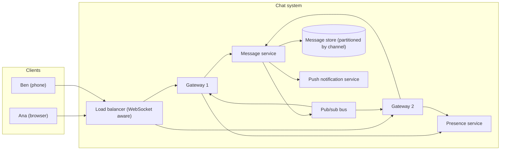
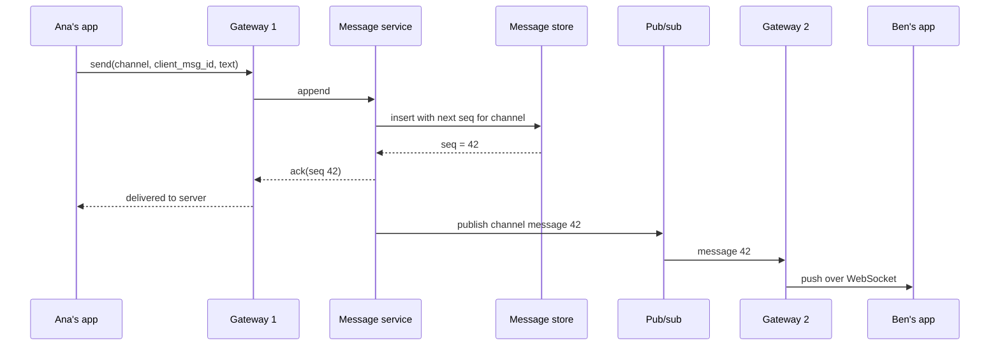

# Case Study: Real-Time Chat

## Introduction

Chat looks simple: Ana types, Ben sees it. Under the surface it is one of the most instructive systems to design, because it breaks the assumptions most web apps rely on:

- **Connections are long-lived.** A normal web request lasts milliseconds. A chat connection stays open for hours, so servers hold state (who is connected to which machine).
- **The server pushes.** Messages must arrive without the client asking, which plain request/response HTTP does not do well.
- **Order and delivery matter.** "Yes" before "Do you want to get lunch?" makes no sense. Lost messages destroy trust.
- **Load is uneven.** A 10,000-member community channel and a two-person DM have very different fan-out.

An analogy: a web app is a post office counter, where you queue, get served and leave. A chat system is a telephone exchange: every caller holds a line open, and the exchange must route each word to the right line instantly, even when callers are plugged into different buildings.

This case study designs a team chat product (think of a small Slack or Discord), starting from one server and growing to many.

## Requirements

**Functional**

1. One-to-one and group channels (up to a few thousand members).
2. Messages appear for online members in near real time.
3. Members who were offline see what they missed when they come back, in order.
4. Presence: show who is online.
5. History is searchable and kept for years.

**Non-functional**

| Quality attribute | Target | Notes |
| --- | --- | --- |
| Latency | Delivery to online members in well under a second | Users notice delays above a few hundred milliseconds |
| Durability | A message acknowledged to the sender is never lost | Persist before acknowledging |
| Ordering | Everyone sees a channel's messages in the same order | Per channel, not global |
| Availability | Reconnect automatically after network blips and deploys | Mobile networks drop constantly |

Note what is **not** required: global ordering across all channels. Ordering per channel is much cheaper and is all users can perceive.

## Choosing a Transport

How does the server push a message to the browser?

| Technique | How it works | Pros | Cons |
| --- | --- | --- | --- |
| Short polling | Client asks "anything new?" every few seconds | Works everywhere | Wasteful, slow to deliver |
| Long polling | Server holds the request open until there is news | Works through old proxies | One request per message batch, awkward |
| Server-Sent Events | One long HTTP response streaming events | Simple, auto-reconnect built in | Server to client only |
| WebSocket | Full-duplex connection upgraded from HTTP (RFC 6455) | Low overhead both ways, widely supported | Stateful connections, needs load balancer support |

Chat needs both directions with low latency, so **WebSocket** is the usual choice, with long polling as a fallback for hostile networks. Mobile apps also rely on push notifications (APNs, FCM) when the app is in the background, which the [Notification System](./3-arch-case-notifications.mdx) case study covers.

## Version 1: One Server

The smallest real design is one process that keeps a map of rooms to open connections. Here it is with the Python `websockets` library:

```python
# pip install websockets   (tested with websockets 17.2)
import asyncio
import json

from websockets.asyncio.client import connect
from websockets.asyncio.server import ServerConnection, broadcast, serve

rooms: dict[str, set[ServerConnection]] = {}   # room -> open connections on THIS server


async def handler(ws: ServerConnection) -> None:
    joined: set[str] = set()
    try:
        async for raw in ws:
            msg = json.loads(raw)
            if msg["type"] == "join":
                rooms.setdefault(msg["room"], set()).add(ws)
                joined.add(msg["room"])
            elif msg["type"] == "send":
                out = json.dumps({"room": msg["room"], "from": msg["user"], "text": msg["text"]})
                broadcast(rooms.get(msg["room"], set()), out)
    finally:                                   # connection closed: clean up
        for room in joined:
            rooms[room].discard(ws)


async def client(name: str, room: str, say: str | None, inbox: list[str]) -> None:
    async with connect("ws://localhost:8765") as ws:
        await ws.send(json.dumps({"type": "join", "room": room}))
        await asyncio.sleep(0.1)               # let everyone join
        if say:
            await ws.send(json.dumps({"type": "send", "room": room, "user": name, "text": say}))
        try:
            while True:
                inbox.append(f"{name} got: {await asyncio.wait_for(ws.recv(), 0.3)}")
        except TimeoutError:
            pass


async def main() -> None:
    async with serve(handler, "localhost", 8765):
        inbox: list[str] = []
        await asyncio.gather(client("ana", "books", "Anyone read DDD?", inbox),
                             client("ben", "books", None, inbox),
                             client("cat", "music", None, inbox))
        print("\n".join(sorted(inbox)))


asyncio.run(main())
```

Example output:

```text
ana got: {"room": "books", "from": "ana", "text": "Anyone read DDD?"}
ben got: {"room": "books", "from": "ana", "text": "Anyone read DDD?"}
```

This works, and for an internal tool with a few hundred users it may be all you need. But look at the global `rooms` dictionary. It only knows about connections **on this process**. The moment you run two servers behind a load balancer, Ana on server A and Ben on server B can no longer talk. Messages are also lost when the server restarts, because nothing is persisted.

## Version 2: Many Gateways, One Message Path

The fix is to separate two jobs:

- **Gateways** hold WebSocket connections. They are stateful only in the sense of "these users are plugged into me".
- **The message path** persists each message, assigns its position in the channel, and fans it out to every gateway that has members of that channel.



The send path, step by step:



Three design rules hide in that diagram:

1. **Persist, then acknowledge, then fan out.** If the server crashes after the ack, the message is safe in the store and offline catch-up delivers it.
2. **The server assigns a per-channel sequence number.** Client clocks are wrong and differ, so never order by the sender's timestamp.
3. **The client sends its own `client_msg_id`.** If the ack is lost and the app retries, the server recognizes the duplicate instead of posting the message twice. This is [idempotency](../9-arch-distributed-systems/7-arch-idempotency.mdx) applied to chat.

Here is a runnable model of the whole path with two gateways:

```python
from collections import defaultdict
from collections.abc import Callable
from dataclasses import dataclass


@dataclass(frozen=True)
class Message:
    channel: str
    seq: int             # per-channel order, assigned by the server
    client_msg_id: str   # chosen by the sender, used to drop duplicates
    sender: str
    text: str


class PubSub:
    """Stand-in for Redis Pub/Sub, NATS or a Kafka topic between gateway servers."""

    def __init__(self) -> None:
        self.subscribers: list[Callable[[Message], None]] = []

    def publish(self, msg: Message) -> None:
        for deliver in self.subscribers:
            deliver(msg)


class MessageStore:
    """Stand-in for the durable message database, partitioned by channel."""

    def __init__(self) -> None:
        self.by_channel: dict[str, list[Message]] = defaultdict(list)
        self.seen: dict[tuple[str, str], Message] = {}

    def append(self, channel: str, client_msg_id: str, sender: str, text: str) -> Message:
        key = (channel, client_msg_id)
        if key in self.seen:                         # client retried: same message back
            return self.seen[key]
        msg = Message(channel, len(self.by_channel[channel]) + 1, client_msg_id, sender, text)
        self.by_channel[channel].append(msg)
        self.seen[key] = msg
        return msg

    def since(self, channel: str, after_seq: int) -> list[Message]:
        return [m for m in self.by_channel[channel] if m.seq > after_seq]


class Gateway:
    """Holds WebSocket connections for the users connected to THIS server."""

    def __init__(self, name: str, store: MessageStore, bus: PubSub) -> None:
        self.name, self.store, self.bus = name, store, bus
        self.online: dict[str, list[str]] = {}       # user -> received lines
        self.last_seq: dict[tuple[str, str], int] = defaultdict(int)
        bus.subscribers.append(self.on_bus_message)

    def connect(self, user: str) -> None:
        self.online[user] = []

    def send(self, user: str, channel: str, client_msg_id: str, text: str) -> None:
        msg = self.store.append(channel, client_msg_id, user, text)   # 1. persist
        self.bus.publish(msg)                                         # 2. fan out

    def on_bus_message(self, msg: Message) -> None:
        for user, inbox in self.online.items():      # real code: only channel members
            if user == msg.sender or msg.seq <= self.last_seq[(user, msg.channel)]:
                continue                             # own message, or a duplicate delivery
            self.last_seq[(user, msg.channel)] = msg.seq
            inbox.append(f"[{self.name}] #{msg.channel} {msg.seq}: {msg.sender}: {msg.text}")


store, bus = MessageStore(), PubSub()
gw_a, gw_b = Gateway("gw-a", store, bus), Gateway("gw-b", store, bus)
gw_a.connect("ana")
gw_b.connect("ben")                                  # ben is on a different server

gw_a.send("ana", "books", "m-1", "Anyone read DDD?")
gw_a.send("ana", "books", "m-1", "Anyone read DDD?")  # network retry, same client id
gw_b.send("ben", "books", "m-7", "Yes, chapter 14 is the best part")

print("ben's screen:", *gw_b.online["ben"], sep="\n  ")
print("ana's screen:", *gw_a.online["ana"], sep="\n  ")

# cat was offline; her app remembers the last seq it saw and catches up on reconnect
missed = store.since("books", after_seq=0)
print("cat catches up:", [(m.seq, m.text) for m in missed])
```

Output:

```text
ben's screen:
  [gw-b] #books 1: ana: Anyone read DDD?
ana's screen:
  [gw-a] #books 2: ben: Yes, chapter 14 is the best part
cat catches up: [(1, 'Anyone read DDD?'), (2, 'Yes, chapter 14 is the best part')]
```

The retry with `m-1` did not create a second message, and the sequence numbers let gateways (and clients) drop duplicate deliveries, which happen with any at-least-once bus. Cat's app keeps the highest `seq` it has seen per channel and asks for everything after it when it reconnects. That one integer gives you gap detection too: if a client sees 41 then 43, it knows to fetch 42.

:::tip
Sequence numbers per channel need a single writer per channel, or an atomic counter. That is one reason large systems route all writes for a channel to one owner, as the next section shows.
:::

## Scaling Further: Who Owns a Channel?

With one pub/sub bus, every gateway receives every message and filters. That is fine for thousands of users but wasteful for millions. Large systems route by channel instead.

Slack's engineering blog describes this kind of design: **channel servers** each own a slice of channels, chosen by consistent hashing of the channel ID, and **gateway servers** hold client WebSocket connections and subscribe to the channel servers that own their users' channels. See [Real-time Messaging](https://slack.engineering/real-time-messaging/) on the Slack engineering blog.

Consistent hashing is what makes adding a server cheap:

```python
import bisect
import hashlib


def h(key: str) -> int:
    return int.from_bytes(hashlib.sha256(key.encode()).digest()[:8], "big")


class HashRing:
    def __init__(self, nodes: list[str], vnodes: int = 100) -> None:
        self.vnodes = vnodes
        self.ring: list[tuple[int, str]] = []
        for node in nodes:
            self.add(node)

    def add(self, node: str) -> None:
        for i in range(self.vnodes):              # many points per node = even spread
            bisect.insort(self.ring, (h(f"{node}#{i}"), node))

    def node_for(self, key: str) -> str:
        idx = bisect.bisect(self.ring, (h(key), "")) % len(self.ring)
        return self.ring[idx][1]


channels = [f"channel-{i}" for i in range(10_000)]

ring = HashRing(["cs-1", "cs-2", "cs-3"])
before = {c: ring.node_for(c) for c in channels}
ring.add("cs-4")
after = {c: ring.node_for(c) for c in channels}

moved = sum(before[c] != after[c] for c in channels)
load = {n: list(after.values()).count(n) for n in sorted(set(after.values()))}
print(f"channels moved after adding cs-4: {moved / len(channels):.0%}")
print("channels per server:", load)

naive_before = {c: h(c) % 3 for c in channels}
naive_after = {c: h(c) % 4 for c in channels}
naive_moved = sum(naive_before[c] != naive_after[c] for c in channels)
print(f"with plain hash % N instead:   {naive_moved / len(channels):.0%}")
```

Output:

```text
channels moved after adding cs-4: 24%
channels per server: {'cs-1': 2346, 'cs-2': 2937, 'cs-3': 2333, 'cs-4': 2384}
with plain hash % N instead:   74%
```

With consistent hashing, adding a fourth server moves about a quarter of the channels (the share the new server should take). With `hash % N`, most channels move, which would mean a storm of reconnects and cache misses. More virtual nodes per server gives a more even spread.

## Storing Messages

Chat history is append-heavy, read mostly by "the latest page of channel X", and grows forever. A common design partitions by **channel plus time bucket**, so one channel's recent messages sit together and no partition grows without limit.

Discord's engineering blog describes exactly this for its message store: the partition key combines the channel ID with a time bucket, and message IDs are Snowflakes, so they sort by time. The same post explains their move from Apache Cassandra to ScyllaDB, completed in 2022, and a Rust data-service layer that **coalesces** identical concurrent reads, so a burst of users opening the same busy channel causes one database query instead of thousands. See [How Discord Stores Trillions of Messages](https://discord.com/blog/how-discord-stores-trillions-of-messages).

```sql
-- Cassandra / ScyllaDB style table (CQL)
CREATE TABLE messages (
    channel_id bigint,
    bucket     int,          -- for example, days since epoch
    message_id bigint,       -- Snowflake: time-ordered
    author_id  bigint,
    content    text,
    PRIMARY KEY ((channel_id, bucket), message_id)
) WITH CLUSTERING ORDER BY (message_id DESC);
```

At smaller scale, PostgreSQL with an index on `(channel_id, seq)` is completely adequate and much simpler to operate. Choose the wide-column store when write volume or data size outgrows a single primary, not before. See [Choosing SQL vs NoSQL](../11-arch-data-architecture/1-arch-sql-vs-nosql.mdx).

Search is a separate concern: stream messages into a search index such as OpenSearch or Elasticsearch through [change data capture](../11-arch-data-architecture/5-arch-change-data-capture.mdx) or the event bus, as described in [Search and Analytics Architecture](../11-arch-data-architecture/6-arch-search-and-analytics.mdx).

## Presence

"Who is online" sounds trivial and is a classic source of load. Each gateway knows its own connections, but broadcasting every online/offline change to every contact multiplies quickly.

Practical choices:

- Store presence in a fast shared store (for example Redis keys with a TTL that gateways refresh with heartbeats). A user is "online" while the key exists.
- Debounce flapping: a phone switching from Wi-Fi to mobile data should not show "offline" then "online" two seconds later.
- Push presence only for people currently visible on screen; fetch the rest lazily.
- Accept that presence is **eventually consistent** and slightly stale. Nobody is harmed if a green dot is 10 seconds late.

## Real-World Scenario

Your company sells a SaaS helpdesk, and customers want live chat between their support agents and website visitors. Expect around 20,000 concurrent visitor connections at peak, and each conversation has two to five participants.

**The design:**

- WebSocket gateways behind a load balancer, deployed as a separate service because their scaling profile (many idle connections, little CPU) differs completely from the main helpdesk app.
- The message service stays inside the existing helpdesk monolith, as a module with its own tables in PostgreSQL. Conversations are short and small, so per-conversation `seq` is a simple counter column updated in the insert transaction.
- Redis Pub/Sub as the bus between the monolith and the gateways. With this fan-out (a handful of participants per conversation), every gateway can filter cheaply.
- Agents' apps reconnect with the last `seq` they saw, so a deploy that restarts gateways loses nothing.
- When a visitor closes the tab, an outbox event triggers an email transcript.

**Why this approach:** the hard part (holding thousands of open sockets) is isolated in a tiny service. Everything else reuses the existing database and deploy pipeline.

**When not to use it:** if chat is a minor feature, a hosted real-time service (for example a managed pub/sub or chat API) may be cheaper than running gateways yourself. If you are building a community platform with very large channels, you need channel ownership, a wide-column store and careful fan-out, which is a much bigger project.

**Alternatives and trade-offs:**

| Approach | Pros | Cons | Best for |
| --- | --- | --- | --- |
| Managed real-time service | No socket infrastructure to run | Per-connection or per-message pricing, vendor lock-in | Small teams, chat as a side feature |
| Gateways + Redis Pub/Sub + SQL | Simple, few moving parts | Every gateway sees every message; Pub/Sub does not persist | Up to moderate scale |
| Gateways + Kafka or similar log | Replayable, durable fan-out | More ops, higher latency than in-memory pub/sub | Event-heavy systems that also feed analytics |
| Channel servers with consistent hashing | Efficient routing at very large scale | Complex membership, rebalancing, failover | Very large chat products |

## Common Mistakes

- **Ordering by client timestamps.** Clocks drift. Use a server-assigned sequence per channel.
- **Acknowledging before persisting.** A crash loses messages the sender believes were sent.
- **Assuming one server.** In-memory connection maps break the moment you add a second instance. Plan the bus early, even if you start with one node.
- **No reconnect protocol.** Clients must resume with "everything after seq N", or mobile users will see gaps.
- **Sticky everything.** Pinning users to a gateway is fine; storing chat state only in gateway memory is not. Gateways should be disposable.
- **Treating presence as strongly consistent.** It is the most chatty, least important data. Make it cheap and approximate.

## Summary

- Chat needs server push and long-lived connections; WebSocket is the usual transport.
- Split stateful gateways (connections) from the message path (persist, sequence, fan out).
- Persist before acknowledging, order with per-channel sequence numbers, and dedupe with client message IDs.
- Clients catch up after reconnecting by asking for messages after their last sequence number.
- At large scale, route channels to owners with consistent hashing and partition storage by channel and time bucket.
- Presence is high-volume and low-value; keep it approximate and lazy.

## Exercises

1. **Typing indicators.** Add "Ana is typing..." to the simulation. Should these go through the message store? Why not?
2. **Gap detection.** Change the client logic so that receiving seq 43 after 41 triggers a fetch of 42 from the store.
3. **Read receipts.** Design how "seen by 3 people" is stored and updated for a 2,000-member channel without writing a row per member per message.
4. **Vnodes.** Run the hash ring with 10, 100 and 500 virtual nodes and compare how evenly channels spread.

Related pages: [Synchronous vs Asynchronous Communication](../10-arch-integration-and-apis/0-arch-communication-styles.mdx), [Messaging Patterns](../10-arch-integration-and-apis/5-arch-messaging-patterns.mdx), [Consistency Models](../9-arch-distributed-systems/2-arch-consistency-models.mdx), and the next case study, [Notification System](./3-arch-case-notifications.mdx). For Pub/Sub in practice, see the [Redis tutorial](/docs/middleware/redis).
