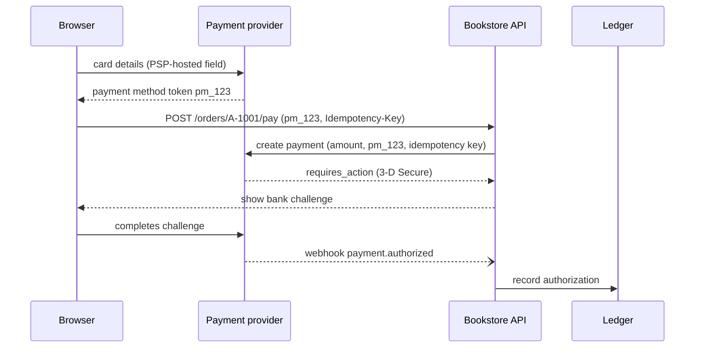
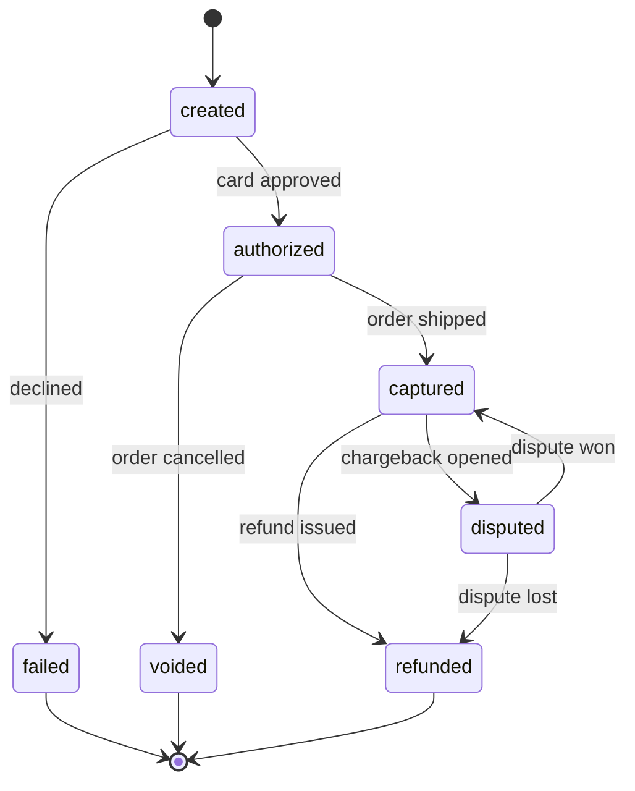
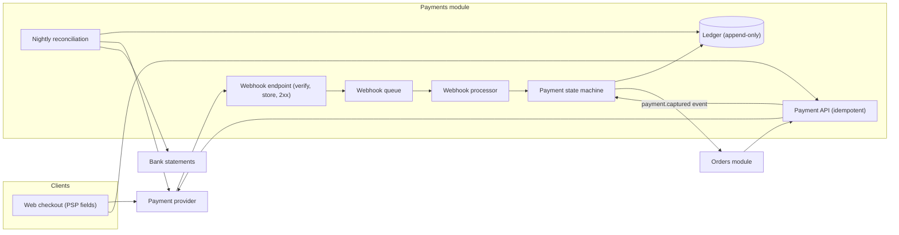

# Case Study: Payment Processing

## Introduction

Most companies do not "process payments" in the sense banks do. They integrate with a **payment service provider (PSP)** such as Stripe, Adyen, Braintree or PayPal, which talks to card networks and banks. Even so, the part you own is surprisingly hard to get right:

- deciding **when** to charge, and making sure each charge happens once
- tracking every payment through authorize, capture, refund and dispute
- keeping your own books that agree with the PSP and the bank, to the cent
- doing all this without ever touching raw card numbers if you can avoid it

Payments are where the abstract ideas from earlier sections stop being abstract. [Idempotency](../9-arch-distributed-systems/7-arch-idempotency.mdx) is the difference between a happy customer and a chargeback. An append-only [event log](../9-arch-distributed-systems/4-arch-event-sourcing.mdx) is what accountants have called a ledger for centuries.

An analogy: think of the PSP as an armoured-car company. You never handle the cash yourself; you hand over a sealed bag (a token) and get a receipt. Your job is to keep perfect records of every bag, never send the same bag twice, and check your records against the bank statement every night.

This case study builds on [E-Commerce Checkout](./1-arch-case-ecommerce.mdx) and designs the payments part of an online bookstore.

## Requirements

**Functional**

1. Accept card and wallet payments for orders.
2. Authorize at checkout, capture when the order ships, void if cancelled before shipping.
3. Full and partial refunds.
4. Handle asynchronous outcomes: 3-D Secure challenges, bank transfers, disputes.
5. Produce correct balances for finance: what we are owed, what we have received, and fees.

**Non-functional**

| Quality attribute | Target | Notes |
| --- | --- | --- |
| Correctness | Never charge twice; never lose a payment | Idempotency and reconciliation |
| Auditability | Every money movement traceable to a reason | Append-only ledger |
| Security and compliance | Minimize PCI DSS scope | Tokenization, hosted fields |
| Availability | Degrade gracefully when the PSP is slow | Timeouts, retries, clear pending states |

## Rule Zero: Keep Card Data Out of Your Systems

The Payment Card Industry Data Security Standard (**PCI DSS**) applies to any system that stores, processes or transmits cardholder data. The current version is **PCI DSS v4.0.1**, published in June 2024; v4.0 was retired at the end of 2024, and the requirements that v4.0 marked as "future-dated" became mandatory on 31 March 2025. Check the [PCI Security Standards Council](https://www.pcisecuritystandards.org/) for the authoritative documents, since dates and versions change.

The architectural lesson is to **shrink your scope**:

- Use the PSP's hosted payment page, or its embedded fields (an iframe or SDK element), so the card number goes from the customer's browser straight to the PSP.
- Your servers only ever see a **token** or payment method ID such as `pm_123`.
- Your scope is then much smaller (your compliance assessor decides exactly how small), and a breach of your database does not leak card numbers.



Notice that the final result arrives by **webhook**, not in the API response. Many payment methods are asynchronous by nature, so your design must be too.

## Money Mistakes (Before)

Two habits from everyday programming are dangerous with money:

```python
# BEFORE: floats for money and a mutable balance column
balance = 0.0
for _ in range(10):
    balance += 0.10          # ten payments of 10 cents
print("balance:", balance, "| equals 1.00?", balance == 1.00)

wallets = {"ana": 50.0, "shop": 0.0}
wallets["ana"] -= 19.99      # crash here and the money vanishes...
wallets["shop"] += 19.99     # ...and nothing records why balances changed
print(wallets)
```

Output:

```text
balance: 0.9999999999999999 | equals 1.00? False
{'ana': 30.01, 'shop': 19.99}
```

- **Floats cannot represent most decimal fractions exactly.** Use integers in the currency's smallest unit (cents), or `decimal.Decimal`, and store the currency next to every amount. Note that not every currency has two decimal places; check your PSP's list of currency exponents.
- **A mutable balance column has no history.** When the numbers are wrong (and one day they will be), you cannot tell why. And two updates that should be atomic can be split by a crash.

## The Ledger: Double-Entry Bookkeeping

Accountants solved this centuries ago. Every movement of money is a **journal entry** with two or more **postings**, and the postings in each entry sum to zero: money always comes from somewhere and goes somewhere. Balances are **derived** by summing postings, never edited directly.

```python
from collections import defaultdict
from dataclasses import dataclass
from datetime import datetime, timezone


@dataclass(frozen=True)
class Posting:
    account: str
    amount: int              # integer minor units (cents); debit > 0, credit < 0


@dataclass(frozen=True)
class JournalEntry:
    entry_id: str
    description: str
    postings: tuple[Posting, ...]
    created_at: datetime


class UnbalancedEntry(ValueError):
    pass


class Ledger:
    """Append-only double-entry ledger. Balances are derived, never stored by hand."""

    def __init__(self) -> None:
        self.entries: list[JournalEntry] = []
        self.ids: set[str] = set()

    def post(self, entry_id: str, description: str, *postings: Posting) -> None:
        if entry_id in self.ids:
            return                                   # idempotent: already recorded
        if sum(p.amount for p in postings) != 0:
            raise UnbalancedEntry(f"{entry_id} does not sum to zero")
        self.entries.append(JournalEntry(entry_id, description, postings,
                                         datetime.now(timezone.utc)))
        self.ids.add(entry_id)

    def balances(self) -> dict[str, int]:
        totals: dict[str, int] = defaultdict(int)
        for entry in self.entries:
            for p in entry.postings:
                totals[p.account] += p.amount
        return dict(totals)


def fmt(cents: int) -> str:
    return f"{cents / 100:>9.2f}"


ledger = Ledger()
# Customer pays 19.99 for an order; the PSP holds the funds for us
ledger.post("pay_1", "Order A-1001 captured",
            Posting("psp_clearing", 1_999), Posting("customer_payments", -1_999))
# PSP fee of 0.88 (an example value) when the payout lands in our bank
ledger.post("payout_1", "PSP payout for pay_1",
            Posting("bank", 1_911), Posting("psp_fees", 88), Posting("psp_clearing", -1_999))
# Partial refund of 5.00
ledger.post("refund_1", "Refund damaged cover on A-1001",
            Posting("customer_payments", 500), Posting("bank", -500))
ledger.post("refund_1", "Refund damaged cover on A-1001",          # retried by a job: ignored
            Posting("customer_payments", 500), Posting("bank", -500))

try:
    ledger.post("bad_1", "Typo", Posting("bank", 1_000), Posting("revenue", -100))
except UnbalancedEntry as exc:
    print("rejected:", exc)

for account, cents in sorted(ledger.balances().items()):
    print(f"{account:<18}{fmt(cents)}")
print("sum of all balances:", sum(ledger.balances().values()))
```

Output:

```text
rejected: bad_1 does not sum to zero
bank                  14.11
customer_payments    -14.99
psp_clearing           0.00
psp_fees               0.88
sum of all balances: 0
```

Properties you get for free:

- **Invariant checking.** An entry that does not balance is rejected at write time, and the sum of all balances is always zero. A non-zero sum means a bug, detected immediately.
- **Audit trail.** Each balance can be explained by listing its postings.
- **Idempotency.** Each entry has a business ID (`refund_1`), so a retried job cannot post twice.
- **Corrections are new entries.** You never edit history; you post a reversing entry. This is the same idea as [Event Sourcing](../9-arch-distributed-systems/4-arch-event-sourcing.mdx).

The sign convention (debits positive, credits negative) and the account names here are simplified. A real chart of accounts should come from your finance team, because they will read these reports.

## Calling the PSP Safely: Idempotency Keys

The most dangerous moment in payments is a timeout. Did the PSP charge the card or not? The answer is to make the request **safe to repeat**. Stripe's API, for example, accepts an `Idempotency-Key` header on `POST` requests. It saves the first response for a key, returns that same response for retries, and returns an error if the same key is reused with different parameters. Its v1 API documentation says keys may be removed once they are at least 24 hours old. Other PSPs have similar mechanisms; check each provider's documentation.

Your own payment API should offer the same guarantee to its callers. Here is the pattern:

```python
import hashlib
import json
import sqlite3
from collections.abc import Callable

db = sqlite3.connect(":memory:", isolation_level=None)   # autocommit; explicit BEGINs below
db.execute("""CREATE TABLE idempotency_keys (
    key TEXT PRIMARY KEY,
    request_hash TEXT NOT NULL,
    status TEXT NOT NULL,              -- 'in_progress' or 'done'
    response TEXT)""")


def fingerprint(body: dict) -> str:
    return hashlib.sha256(json.dumps(body, sort_keys=True).encode()).hexdigest()


def idempotent(key: str, body: dict, handler: Callable[[dict], dict]) -> tuple[int, dict]:
    h = fingerprint(body)
    try:
        db.execute("INSERT INTO idempotency_keys VALUES (?, ?, 'in_progress', NULL)", (key, h))
    except sqlite3.IntegrityError:                     # key seen before
        stored_hash, status, response = db.execute(
            "SELECT request_hash, status, response FROM idempotency_keys WHERE key = ?",
            (key,)).fetchone()
        if stored_hash != h:
            return 422, {"error": "idempotency key reused with different parameters"}
        if status == "in_progress":
            return 409, {"error": "original request still in progress, retry later"}
        return 200, json.loads(response)               # replay the saved response

    try:
        result = handler(body)
    except Exception:
        db.execute("DELETE FROM idempotency_keys WHERE key = ?", (key,))   # allow a clean retry
        raise
    db.execute("UPDATE idempotency_keys SET status = 'done', response = ? WHERE key = ?",
               (json.dumps(result), key))
    return 201, result


charges: list[dict] = []


def create_charge(body: dict) -> dict:
    charge = {"id": f"ch_{len(charges) + 1}", "amount": body["amount"], "status": "succeeded"}
    charges.append(charge)
    return charge


body = {"amount": 1999, "currency": "usd", "order_id": "A-1001"}
print(idempotent("key-123", body, create_charge))
print(idempotent("key-123", body, create_charge))                       # client retry
print(idempotent("key-123", {**body, "amount": 2999}, create_charge))   # misuse
print("charges actually created:", len(charges))
```

Output:

```text
(201, {'id': 'ch_1', 'amount': 1999, 'status': 'succeeded'})
(200, {'id': 'ch_1', 'amount': 1999, 'status': 'succeeded'})
(422, {'error': 'idempotency key reused with different parameters'})
charges actually created: 1
```

Design notes:

- The **unique primary key** on the idempotency table is what makes concurrent duplicates safe: only one insert wins.
- An `in_progress` row with a `409` tells a fast double-click to back off instead of starting a second charge.
- Hashing the request body catches a client bug where a key is reused for a different payment.
- If the handler crashes before finishing, the row is deleted so a retry can run. If the process itself dies, rows stuck in `in_progress` need a timeout and a check against the PSP before they can be retried.

## The Payment State Machine and Webhooks

A payment moves through states, and the PSP tells you about many transitions through webhooks:



Webhooks have three properties you must design for. Stripe's webhook documentation states all three explicitly, and they are common across providers:

1. **At-least-once delivery.** Stripe retries failed deliveries with exponential backoff for up to three days in live mode, so you will see duplicates. Track event IDs.
2. **No ordering guarantee.** A `refunded` event can arrive before `captured`.
3. **Authenticity must be verified.** Check the signature (Stripe uses an HMAC-SHA256 signature in the `Stripe-Signature` header) before trusting anything, and return `2xx` quickly, doing the real work asynchronously.

```python
from dataclasses import dataclass, field
from enum import StrEnum


class PaymentStatus(StrEnum):
    CREATED = "created"
    AUTHORIZED = "authorized"
    CAPTURED = "captured"
    FAILED = "failed"
    VOIDED = "voided"
    REFUNDED = "refunded"


ALLOWED = {
    PaymentStatus.CREATED: {PaymentStatus.AUTHORIZED, PaymentStatus.FAILED},
    PaymentStatus.AUTHORIZED: {PaymentStatus.CAPTURED, PaymentStatus.VOIDED},
    PaymentStatus.CAPTURED: {PaymentStatus.REFUNDED},
}


@dataclass
class Payment:
    payment_id: str
    status: PaymentStatus = PaymentStatus.CREATED
    history: list[str] = field(default_factory=list)


class WebhookProcessor:
    """Runs in a worker. The HTTP endpoint only verified the signature, stored the
    raw event and returned 2xx quickly."""

    def __init__(self) -> None:
        self.payments: dict[str, Payment] = {}
        self.seen_events: set[str] = set()
        self.deferred: list[dict] = []

    def process(self, event: dict) -> str:
        if event["id"] in self.seen_events:
            return f"{event['id']}: duplicate, ignored"
        payment = self.payments.setdefault(event["payment_id"], Payment(event["payment_id"]))
        target = PaymentStatus(event["status"])
        if target != payment.status and target not in ALLOWED.get(payment.status, set()):
            # Out of order: do not apply blindly. Park it and retry later
            # (or fetch the payment's current state from the PSP's API).
            self.deferred.append(event)
            return f"{event['id']}: {payment.status} -> {target} not allowed yet, deferred"
        self.seen_events.add(event["id"])
        if target != payment.status:
            payment.history.append(f"{payment.status} -> {target}")
            payment.status = target
        return f"{event['id']}: now {target}"


w = WebhookProcessor()
events = [
    {"id": "evt_1", "payment_id": "pay_9", "status": "authorized"},
    {"id": "evt_3", "payment_id": "pay_9", "status": "refunded"},   # arrived early
    {"id": "evt_2", "payment_id": "pay_9", "status": "captured"},
    {"id": "evt_2", "payment_id": "pay_9", "status": "captured"},   # PSP retried delivery
]
for e in events:
    print(w.process(e))

retry, w.deferred = w.deferred, []
for e in retry:                                                     # a minute later
    print("retry:", w.process(e))
print("history:", w.payments["pay_9"].history)
```

Output:

```text
evt_1: now authorized
evt_3: authorized -> refunded not allowed yet, deferred
evt_2: now captured
evt_2: duplicate, ignored
retry: evt_3: now refunded
history: ['created -> authorized', 'authorized -> captured', 'captured -> refunded']
```

The state machine is the safety net. An out-of-order event cannot jump a payment from `authorized` to `refunded`; it waits until the state allows it. Duplicates are dropped by event ID. In production, the deferred retry is often replaced by asking the PSP's API for the payment's current state, which is the source of truth.

## Reconciliation: Trust, but Verify

Even with everything above, your records and the PSP's will drift: a webhook endpoint was down for four days, a refund was issued by hand in the PSP dashboard, a currency conversion rounded differently. **Reconciliation** is the scheduled job that compares:

- your ledger against the PSP's balance transaction or settlement reports, and
- PSP payouts against deposits in your bank account.

Every mismatch becomes a ticket for a human or an automatic correcting entry. Reconciliation is not a sign of a bad design; it is a required part of every payment design.

## The Architecture



Payments usually deserve to be a **strongly bounded module** even inside a monolith, with its own tables and a narrow interface, because its correctness rules, audit needs and compliance scope differ from the rest of the app. It is also one of the more common early candidates for a separate service, mainly to isolate compliance scope and access controls. See [Bounded Contexts](../8-arch-domain-driven-design/2-arch-bounded-contexts.mdx).

## Real-World Scenario

Your SaaS helpdesk company moves from annual invoices paid by bank transfer to self-serve monthly card subscriptions. Finance currently reconciles invoices in a spreadsheet. The CTO asks you to design payments so that finance can trust the numbers and the company stays out of heavy PCI scope.

**The design:**

1. Use the PSP's subscription billing product and hosted payment fields. You store only customer and payment method IDs.
2. A payments module owns: the idempotent payment API, the webhook endpoint (verify signature, store raw event, return `2xx`), a queue-backed processor with a state machine, and a double-entry ledger.
3. Each subscription renewal posts entries: receivable on invoice, cash on payment, fees on payout.
4. A nightly job pulls the PSP's balance transactions and compares them to the ledger. Mismatches open tickets for finance.
5. Account access is driven from ledger state (paid through which date), not from individual webhook events, so a missed webhook does not lock out a paying customer.

**Why this approach:** the PSP does the regulated, hard parts (card storage, retries of failed renewals, tax in some products). You own correctness of your records, which no vendor can do for you.

**When not to use it:** if you sell a handful of products and finance is happy with the PSP's own dashboard and exports, skip the in-house ledger. Build it when you need your own reporting, multiple PSPs, or marketplace-style money flows.

**Alternatives and trade-offs:**

| Approach | Pros | Cons | Best for |
| --- | --- | --- | --- |
| PSP hosted checkout + PSP dashboard | Fastest, smallest PCI scope | Limited control and reporting | Early-stage products |
| PSP API + own ledger and reconciliation | Accurate books, flexible flows | More code to own and test | Growing SaaS, marketplaces |
| Multiple PSPs behind a payment orchestration layer | Redundancy, local payment methods, cost routing | Much more complexity, harder reconciliation | Large global merchants |
| Direct acquirer integration, storing cards | Full control, possibly lower fees | Full PCI scope, major security burden | Very large payment companies only |

## Common Mistakes

- **Floats for money.** Use integer minor units or decimals, always with a currency code.
- **Editable balance columns.** Use an append-only ledger and derive balances.
- **Retrying charges without idempotency keys.** Timeouts are ambiguous; idempotency keys make retries safe.
- **Trusting the API response as final.** Many methods finish asynchronously. Drive state from verified webhooks and PSP lookups.
- **Processing webhooks in order of arrival.** They can be duplicated and reordered. Use event IDs and a state machine.
- **Skipping reconciliation.** Every payment system drifts. Find the drift nightly, not at the annual audit.
- **Logging full request bodies.** Payment payloads can contain personal data. Redact before logging.

## Summary

- Integrate with a PSP and keep card data out of your systems with hosted fields and tokens; PCI DSS v4.0.1 is the current standard.
- Represent money as integer minor units with a currency, and record movements in a double-entry, append-only ledger.
- Make every money-moving request idempotent, both when calling the PSP and in your own API.
- Model payments as a state machine; treat webhooks as duplicated, unordered and untrusted until verified.
- Reconcile your ledger with the PSP and the bank on a schedule.

## Exercises

1. **Signature check.** Implement HMAC-SHA256 verification for a webhook payload with Python's `hmac` module, using `hmac.compare_digest` and a timestamp tolerance.
2. **Currency.** Extend the ledger so each posting has a currency and entries must balance per currency.
3. **Disputes.** Add `disputed` handling to the webhook processor and post the ledger entries for a lost dispute (refund plus dispute fee).
4. **Reconcile.** Given a list of PSP transactions and your ledger, write a function that returns missing, extra and mismatched amounts.

Related pages: [E-Commerce Checkout](./1-arch-case-ecommerce.mdx), [Webhooks and Callbacks](../10-arch-integration-and-apis/7-arch-webhooks.mdx), [Security by Design](../12-arch-quality-and-operations/4-arch-security-by-design.mdx), [State Pattern](../4-arch-behavioral-patterns/3-arch-state.mdx), and the next case study, [Video Streaming Platform](./5-arch-case-video-streaming.mdx).
