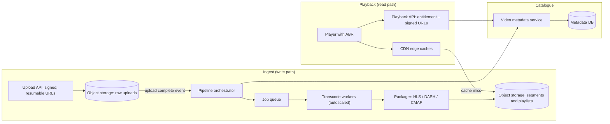
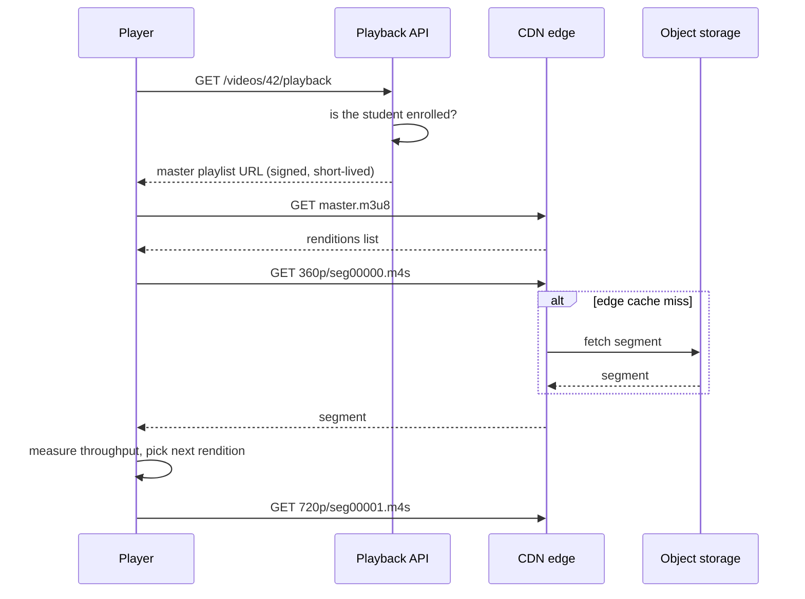

# Case Study: Video Streaming Platform

## Introduction

When you press play on a streaming service, the video starts in a second or two, adapts when your train enters a tunnel, and never makes you download a 2 GB file first. Behind that is a system with two very different halves:

- **The ingest side** (write path): accept a large upload, transcode it into many sizes and formats, and publish it. This is heavy, batch-style compute that can take minutes.
- **The playback side** (read path): serve small video segments to millions of viewers with low latency. This is almost entirely a **content delivery** problem.

The architecture lesson is that these halves have nothing in common except the storage between them, so you design, scale and pay for them separately.

An analogy: a newspaper. The newsroom (ingest) writes, edits and prints overnight, and it can take hours. Distribution (playback) puts copies in thousands of shops near readers before breakfast. Nobody drives to the printing press to buy a paper.

This case study designs a video platform for an online learning company: instructors upload course videos, and students watch on laptops and phones.

## Requirements

**Functional**

1. Instructors upload videos up to several GB, over unreliable connections.
2. Videos are processed into formats that play on browsers, iOS, Android and smart TVs.
3. Students stream with quality that adapts to their bandwidth, and can seek.
4. Thumbnails, captions and a processing status ("processing", "ready", "failed").
5. Only enrolled students can watch paid courses.

**Non-functional**

| Quality attribute | Target | Notes |
| --- | --- | --- |
| Startup time | Playback starts within a couple of seconds | Slow starts are a major cause of abandonment |
| Rebuffering | As rare as possible | Adaptive bitrate is the main tool |
| Scalability | Read traffic dominates and spikes at course launches | CDN carries it, not your servers |
| Cost | Storage and egress are the big bills | Choose the encoding ladder carefully |
| Processing time | Minutes, not hours, for a one-hour video | Parallel encoding |

## Why One MP4 File Is Not Enough (Before)

The simplest design stores the uploaded file and serves it with a `<video>` tag. Here is what that means for viewers on different networks:

```python
# BEFORE: one 1080p MP4 at a fixed 5 Mbps, downloaded progressively
VIDEO_BITRATE_MBPS = 5.0
DURATION_S = 600                       # a 10-minute episode

for name, bandwidth in [("fibre", 50.0), ("good 4G", 8.0), ("busy cafe Wi-Fi", 3.0)]:
    if bandwidth >= VIDEO_BITRATE_MBPS:
        print(f"{name:<16} plays smoothly")
        continue
    # playback needs 5 Mb every second but only `bandwidth` Mb arrives
    download_s = DURATION_S * VIDEO_BITRATE_MBPS / bandwidth
    print(f"{name:<16} needs {download_s:.0f}s to download a {DURATION_S}s video: "
          f"about {download_s - DURATION_S:.0f}s of buffering")
```

Output:

```text
fibre            plays smoothly
good 4G          plays smoothly
busy cafe Wi-Fi  needs 1000s to download a 600s video: about 400s of buffering
```

A single bitrate is either too high for weak connections (stalls) or too low for strong ones (blurry). The original upload may also use a codec or container some devices cannot play, and a 2 GB file served from your application servers would consume their bandwidth.

## Core Concepts

- **Transcoding**: decoding the source and re-encoding it into target codecs (for example H.264, HEVC or AV1) at several resolutions and bitrates.
- **Encoding ladder**: the set of renditions, such as 1080p at 5 Mbps down to 360p at 0.8 Mbps.
- **Segmenting and packaging**: cutting each rendition into short segments (a few seconds each) and writing playlists that describe them.
- **Adaptive bitrate (ABR)**: the player measures its download speed and picks the best rendition for each next segment.
- **Protocols**: **HLS** (HTTP Live Streaming, published as RFC 8216) and **MPEG-DASH** (ISO/IEC 23009-1). Both deliver plain files over HTTP, which is why ordinary CDNs can cache them.
- **CMAF** (ISO/IEC 23000-19): a common fragmented MP4 segment format that both HLS and DASH can reference, so you can store one set of segments instead of two. The catch is DRM: one copy for all devices generally means standardizing on the `cbcs` encryption scheme, so check which devices you must support.

## The Architecture



### Upload: never through your app servers

Large uploads should go **directly to object storage** using pre-signed URLs and a resumable or multipart protocol (Amazon S3 multipart upload, Google Cloud Storage resumable uploads, or the open `tus` protocol). Your API only issues the upload URL and records the video's metadata. If an instructor's Wi-Fi drops at 80%, the upload resumes instead of restarting, and your API servers never hold gigabytes in memory.

### Processing: pipes and filters, in parallel

Transcoding is the textbook case for [Pipes and Filters](../6-arch-architectural-styles/9-arch-pipes-and-filters.mdx): validate, extract audio, split, encode, package, generate thumbnails, publish. The key speed-up is to **split the source into chunks** and encode every chunk and rendition in parallel, then stitch the results back together.

```python
from dataclasses import dataclass


@dataclass(frozen=True)
class Rendition:
    name: str
    width: int
    height: int
    video_kbps: int
    codecs: str


# An example ladder. Real services tune this per title or even per scene.
LADDER = [
    Rendition("1080p", 1920, 1080, 5000, "avc1.640028,mp4a.40.2"),
    Rendition("720p", 1280, 720, 3000, "avc1.4d401f,mp4a.40.2"),
    Rendition("480p", 854, 480, 1400, "avc1.4d401e,mp4a.40.2"),
    Rendition("360p", 640, 360, 800, "avc1.42e01e,mp4a.40.2"),
]
AUDIO_KBPS = 128
SEGMENT_S = 6


def plan_jobs(video_id: str, duration_s: int, chunk_s: int = 60) -> list[str]:
    """Split the source into chunks so each (chunk, rendition) encodes in parallel."""
    chunks = range(0, duration_s, chunk_s)
    return [f"encode {video_id} [{start}s-{min(start + chunk_s, duration_s)}s] -> {r.name}"
            for start in chunks for r in LADDER]


def master_playlist() -> str:
    lines = ["#EXTM3U", "#EXT-X-INDEPENDENT-SEGMENTS"]
    for r in LADDER:
        bandwidth = (r.video_kbps + AUDIO_KBPS) * 1000
        lines.append(f'#EXT-X-STREAM-INF:BANDWIDTH={bandwidth},'
                     f'RESOLUTION={r.width}x{r.height},CODECS="{r.codecs}"')
        lines.append(f"{r.name}/index.m3u8")
    return "\n".join(lines)


def media_playlist(duration_s: int) -> str:
    lines = ["#EXTM3U", "#EXT-X-VERSION:7", f"#EXT-X-TARGETDURATION:{SEGMENT_S}",
             "#EXT-X-MEDIA-SEQUENCE:0", "#EXT-X-PLAYLIST-TYPE:VOD", '#EXT-X-MAP:URI="init.mp4"']
    for i, start in enumerate(range(0, duration_s, SEGMENT_S)):
        lines.append(f"#EXTINF:{min(SEGMENT_S, duration_s - start):.3f},")
        lines.append(f"seg{i:05d}.m4s")
    lines.append("#EXT-X-ENDLIST")
    return "\n".join(lines)


jobs = plan_jobs("vid_42", duration_s=150)
print(f"{len(jobs)} parallel encode jobs, for example:")
print("  " + "\n  ".join(jobs[:3]))
print()
print(master_playlist())
print()
print(media_playlist(duration_s=15))
```

Output:

```text
12 parallel encode jobs, for example:
  encode vid_42 [0s-60s] -> 1080p
  encode vid_42 [0s-60s] -> 720p
  encode vid_42 [0s-60s] -> 480p

#EXTM3U
#EXT-X-INDEPENDENT-SEGMENTS
#EXT-X-STREAM-INF:BANDWIDTH=5128000,RESOLUTION=1920x1080,CODECS="avc1.640028,mp4a.40.2"
1080p/index.m3u8
#EXT-X-STREAM-INF:BANDWIDTH=3128000,RESOLUTION=1280x720,CODECS="avc1.4d401f,mp4a.40.2"
720p/index.m3u8
#EXT-X-STREAM-INF:BANDWIDTH=1528000,RESOLUTION=854x480,CODECS="avc1.4d401e,mp4a.40.2"
480p/index.m3u8
#EXT-X-STREAM-INF:BANDWIDTH=928000,RESOLUTION=640x360,CODECS="avc1.42e01e,mp4a.40.2"
360p/index.m3u8

#EXTM3U
#EXT-X-VERSION:7
#EXT-X-TARGETDURATION:6
#EXT-X-MEDIA-SEQUENCE:0
#EXT-X-PLAYLIST-TYPE:VOD
#EXT-X-MAP:URI="init.mp4"
#EXTINF:6.000,
seg00000.m4s
#EXTINF:6.000,
seg00001.m4s
#EXTINF:3.000,
seg00002.m4s
#EXT-X-ENDLIST
```

A 150-second video becomes 12 independent jobs (3 chunks times 4 renditions). A one-hour lecture becomes hundreds, which a fleet of autoscaled workers finishes far faster than one machine encoding sequentially. Chunk boundaries must fall on keyframes, and keyframes should be aligned across renditions, or players glitch when they switch quality.

The master playlist lists renditions; each media playlist lists segments. In the HLS specification, `BANDWIDTH` is the **peak** bitrate of the rendition; this example uses the nominal bitrate to keep it short, but real packagers measure it.

### Orchestration and failure handling

Each job can fail (a corrupt frame, a worker evicted from a spot instance). The orchestrator:

- tracks the state of each video and job in the metadata DB (`uploaded`, `processing`, `ready`, `failed`)
- retries failed jobs a bounded number of times, and makes each job **idempotent** by writing outputs to deterministic paths, so a retried job overwrites rather than duplicates
- publishes `video.ready` only when every required rendition exists

This is a natural fit for a workflow engine or a managed media service, which brings us to a key decision below.

## Playback: Let the CDN Do the Work

When a student presses play:



Your servers handle **one small request per playback** (the entitlement check). Everything else is static files served from the edge. That is why streaming scales: the CDN's cache hit ratio, not your server count, determines most of your capacity and much of your cost.

At very large scale, some companies run their own CDN. Netflix's **Open Connect** program, for example, places Netflix's own caching appliances inside internet service providers' networks; per the Open Connect site, qualifying ISPs receive the embedded appliances at no charge. For nearly everyone else, a commercial CDN is the right answer.

### Adaptive bitrate in the player

ABR logic lives in the **client** (hls.js, Shaka Player, ExoPlayer/Media3, AVPlayer), not on the server. A simplified throughput-based algorithm:

```python
LADDER_KBPS = {"1080p": 5128, "720p": 3128, "480p": 1528, "360p": 928}
SEGMENT_S = 6
SAFETY = 0.8                  # only use 80% of the measured throughput
LOW_BUFFER_S = 10             # below this, play it safe


def choose(throughput_kbps: float, buffer_s: float) -> str:
    budget = throughput_kbps * SAFETY
    if buffer_s < LOW_BUFFER_S:
        budget *= 0.5             # nearly empty buffer: prefer anything that will not stall
    for name, kbps in LADDER_KBPS.items():          # highest first
        if kbps <= budget:
            return name
    return "360p"


# Network bandwidth for each segment download (kbps): good, then a dip, then recovery
network = [8000, 8000, 7500, 2500, 1800, 1500, 2600, 6000, 9000, 9000]

buffer_s, estimate, stalls = 0.0, 3000.0, 0.0      # start with a guess
for i, bandwidth in enumerate(network):
    rendition = choose(estimate, buffer_s)
    download_s = LADDER_KBPS[rendition] * SEGMENT_S / bandwidth
    if i > 0:                                       # playback drains while we download
        stalls += max(0.0, download_s - buffer_s)
        buffer_s = max(0.0, buffer_s - download_s)
    buffer_s += SEGMENT_S
    estimate = 0.7 * estimate + 0.3 * bandwidth     # smoothed throughput estimate
    print(f"seg {i}: net {bandwidth:>5} kbps -> {rendition:<5} "
          f"download {download_s:4.1f}s  buffer {buffer_s:4.1f}s")
print(f"total stall time: {stalls:.1f}s")
```

Output:

```text
seg 0: net  8000 kbps -> 360p  download  0.7s  buffer  6.0s
seg 1: net  8000 kbps -> 480p  download  1.1s  buffer 10.9s
seg 2: net  7500 kbps -> 720p  download  2.5s  buffer 14.4s
seg 3: net  2500 kbps -> 720p  download  7.5s  buffer 12.8s
seg 4: net  1800 kbps -> 720p  download 10.4s  buffer  8.4s
seg 5: net  1500 kbps -> 480p  download  6.1s  buffer  8.3s
seg 6: net  2600 kbps -> 360p  download  2.1s  buffer 12.2s
seg 7: net  6000 kbps -> 480p  download  1.5s  buffer 16.6s
seg 8: net  9000 kbps -> 720p  download  2.1s  buffer 20.6s
seg 9: net  9000 kbps -> 720p  download  2.1s  buffer 24.5s
total stall time: 0.0s
```

Trade-offs visible even in this toy:

- Starting low gives a fast start, then quality climbs as the buffer grows.
- The smoothed estimate reacts slowly, so segments 3 and 4 were fetched at 720p while the network was weak. The buffer absorbed it, which is exactly what the buffer is for.
- Safety margins mean we never reached 1080p on a 9 Mbps link. Real players use more sophisticated buffer-based or hybrid algorithms to balance quality against stall risk.

## Key Decision: Build or Buy the Pipeline?

| Approach | Pros | Cons | Best for |
| --- | --- | --- | --- |
| Video platform API (upload in, player URL out) | Days to integrate, no media expertise needed | Per-minute pricing, less control, lock-in | Products where video is a feature, not the core |
| Managed cloud media services (transcoding + packaging) + your own CDN setup | Scales, no encoder fleet to run | Must design orchestration and storage layout | Medium to large catalogues |
| Self-hosted FFmpeg workers on containers or spot instances | Full control, can be cheapest at scale | Significant media and operations expertise | Video-centric companies with special needs |

Prices and feature sets of managed services change often; compare current offerings from the vendors you are considering.

## Real-World Scenario

Your online learning company has 3,000 hours of course video, adds around 50 hours a week, and has students in regions with slow mobile networks. Videos are currently MP4 files on a single server, and students in some regions complain of constant buffering.

**The design:**

1. Upload directly to object storage with resumable uploads. An upload-complete event triggers processing.
2. Use a managed transcoding service for the encoding ladder, including a low 240p or 360p rung for weak mobile networks, plus thumbnails and captions.
3. Package as CMAF segments with HLS and DASH playlists, so one set of files serves all devices.
4. Serve everything through a CDN. The playback API checks enrolment and issues short-lived signed URLs or cookies so paid content cannot be hot-linked.
5. Track rebuffering ratio and startup time from the player (client-side telemetry) per region and CDN, because server logs cannot see stalls.

**Why this approach:** the team has no video specialists, and video is important but not their core product. Managed transcoding plus a CDN removes the hard parts, while keeping the files in their own storage avoids being locked into a single platform.

**When not to use it:** for a few dozen short marketing videos, an all-in-one video platform or a video hosting site is cheaper and faster. For live streaming (lectures broadcast in real time), latency targets and ingest protocols change significantly; look at low-latency HLS or DASH, or WebRTC for truly interactive sessions.

## Common Mistakes

- **Uploading through your API servers.** Large bodies tie up workers and fail on flaky networks. Use pre-signed, resumable uploads to object storage.
- **One rendition for everyone.** Without an encoding ladder and ABR, weak connections stall and strong ones look blurry.
- **Encoding sequentially on one big machine.** Split into chunks and parallelize; align keyframes.
- **Serving segments from origin.** If your origin sees most requests, your CDN configuration (cache keys, TTLs, signed URL handling) is wrong.
- **Signing every segment URL with unique query strings.** That can destroy CDN cache hit ratio. Prefer signed cookies or tokens the CDN validates without varying the cache key.
- **Measuring only server metrics.** Startup time and rebuffering happen in the player; collect client telemetry.

## Summary

- Separate the heavy, batch-style ingest path from the read-heavy playback path.
- Upload directly to object storage with resumable, pre-signed uploads.
- Transcode into an encoding ladder in parallel chunks, then package into HLS and DASH, ideally sharing CMAF segments.
- Let the CDN serve almost all playback traffic; your API only checks entitlement and issues signed URLs.
- Adaptive bitrate runs in the player and trades quality against stall risk.
- Buy the pipeline unless video is your core business.

## Exercises

1. **Ladder design.** Add a 240p rung and a 1440p rung to `LADDER`. What does each cost in storage per hour of video, using the bitrates as estimates?
2. **Buffer-based ABR.** Change `choose` to pick the rendition from buffer level alone (for example, more than 20 seconds means 1080p). Compare stalls and average quality on the same network trace.
3. **Idempotent jobs.** Design the output path scheme for transcode jobs so that a retried job is harmless. What happens if two retries run at once?
4. **Live mode.** Sketch how the architecture changes for a live lecture with a target of 5 seconds glass-to-glass latency.

Related pages: [Pipes and Filters Architecture](../6-arch-architectural-styles/9-arch-pipes-and-filters.mdx), [Designing for Performance](../12-arch-quality-and-operations/1-arch-performance.mdx), [Cost-Aware Architecture](../12-arch-quality-and-operations/7-arch-cost-awareness.mdx), and the next case study, [Multi-Tenant SaaS](./6-arch-case-saas-multitenancy.mdx).
