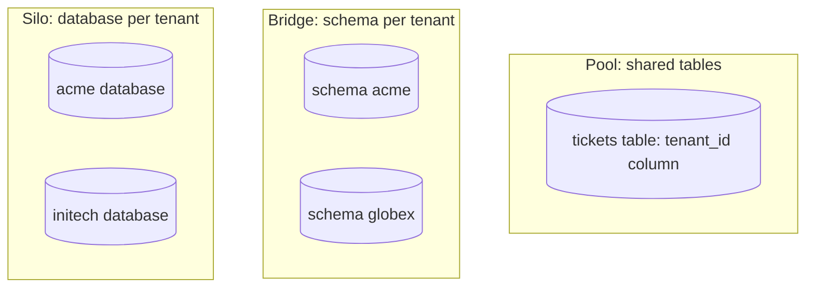
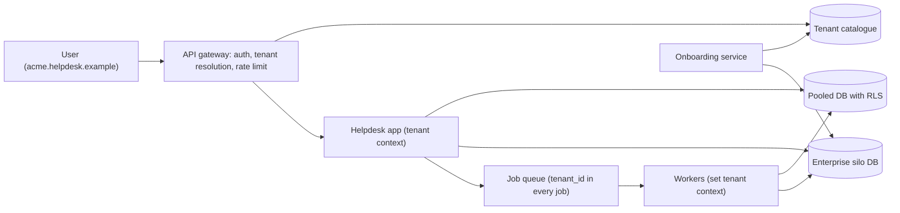

# Case Study: Multi-Tenant SaaS

## Introduction

A **multi-tenant** application serves many customer organizations (tenants) from one product. Acme and Globex both use your helpdesk; each sees only its own tickets, users and settings, as if it had a private copy. Underneath, they may share servers, databases and even tables.

Multi-tenancy is how SaaS makes economic sense: one deployment, one upgrade, shared infrastructure. It also creates the defining risk of SaaS: **one tenant seeing another tenant's data**. That is not a bug report; it is a security incident and possibly a contract breach.

An analogy: an apartment building. Tenants share the foundation, plumbing and elevator (cheap and efficient), but every apartment has its own lock. Some tenants pay for a detached house instead (more isolation, more cost). The architect's job is to decide what is shared, what is private, and to make sure no key opens the wrong door.

This case study designs tenancy for a SaaS helpdesk, the recurring scenario in this tutorial.

## Requirements

**Functional**

1. Self-service sign-up creates a new tenant in seconds.
2. Each tenant has its own users, tickets, settings and branding.
3. Plans: Free, Pro and Enterprise, with different limits.
4. Some enterprise customers require their data in a specific region, or on dedicated infrastructure.

**Non-functional**

| Quality attribute | Target | Notes |
| --- | --- | --- |
| Isolation (security) | Zero cross-tenant data access | Defence in depth, not one check |
| Isolation (performance) | One tenant cannot degrade others | Noisy neighbour control |
| Cost efficiency | Cost per tenant low enough for a free tier | Pooling |
| Operability | Upgrades and migrations for all tenants together | One codebase, one version |
| Compliance | Data residency and per-tenant export and deletion | Placement and tenant-aware data handling |

## Tenancy Models: Silo, Pool and Bridge

The AWS Well-Architected SaaS Lens names three models, and the terms are widely used:

- **Silo**: each tenant gets dedicated resources (its own database, or even its whole stack). It is still SaaS because identity, onboarding and operations are shared.
- **Pool**: tenants share resources, and data is separated by a tenant identifier.
- **Bridge**: a mix. Some services or tiers are siloed, others pooled.

See [Silo, Pool, and Bridge Models](https://docs.aws.amazon.com/wellarchitected/latest/saas-lens/silo-pool-and-bridge-models.html). The Azure Architecture Center has a similar discussion of tenancy models for data.

At the database layer, the common options are:



| Model | Isolation | Cost per tenant | Onboarding | Migrations | Best for |
| --- | --- | --- | --- | --- | --- |
| Shared tables + `tenant_id` | Logical only | Lowest | Insert a row | Once | Many small tenants, free tiers |
| Schema per tenant | Better, still shared server | Medium | Create schema | Once per schema | Hundreds to low thousands of tenants |
| Database per tenant | Strong | Highest | Provision a DB | Once per DB (needs automation) | Enterprise, regulated, data residency |

Most successful SaaS products end up as a **bridge**: pooled for the long tail of small tenants, siloed for the few large or regulated ones.

## The Classic Failure (Before)

In a pooled database, every query must filter by tenant. When that relies on every developer remembering every time, someone eventually forgets:

```python
import sqlite3

db = sqlite3.connect(":memory:")
db.executescript("""
CREATE TABLE tickets (id INTEGER PRIMARY KEY, tenant_id TEXT NOT NULL, subject TEXT);
INSERT INTO tickets (tenant_id, subject) VALUES
  ('acme', 'Printer on fire'), ('acme', 'VPN down'), ('globex', 'Cannot log in');
""")


# BEFORE: every query must remember the tenant filter by hand
def list_tickets(tenant_id: str) -> list[tuple]:
    return db.execute("SELECT id, subject FROM tickets WHERE tenant_id = ?",
                      (tenant_id,)).fetchall()


def search_tickets(tenant_id: str, text: str) -> list[tuple]:
    # written in a hurry for a new feature... the tenant filter is missing
    return db.execute("SELECT id, subject FROM tickets WHERE subject LIKE ?",
                      (f"%{text}%",)).fetchall()


print("acme list:  ", list_tickets("acme"))
print("acme search:", search_tickets("acme", "n"))   # includes globex's ticket!
```

Output:

```text
acme list:   [(1, 'Printer on fire'), (2, 'VPN down')]
acme search: [(1, 'Printer on fire'), (2, 'VPN down'), (3, 'Cannot log in')]
```

Acme's search returned Globex's ticket. Code review might catch it. Might.

## Layer 1: Tenant Context in the Application

The fix is to make the tenant filter **structural** rather than remembered:

1. Middleware resolves the tenant from the **verified** identity (token claims, or the subdomain checked against the user's memberships), never from a request parameter the client controls.
2. It stores the tenant in a request-scoped context.
3. Repositories read the tenant from that context and always apply it. Code outside the repository cannot query tenant tables.
4. No tenant in context means an error, not "all tenants".

```python
import sqlite3
from collections.abc import Iterator
from contextlib import contextmanager
from contextvars import ContextVar
from dataclasses import dataclass

_current_tenant: ContextVar[str | None] = ContextVar("current_tenant", default=None)


class NoTenantContext(RuntimeError):
    pass


@contextmanager
def tenant_scope(tenant_id: str) -> Iterator[None]:
    """Set by middleware from the verified auth token, never from a request parameter."""
    token = _current_tenant.set(tenant_id)
    try:
        yield
    finally:
        _current_tenant.reset(token)


def current_tenant() -> str:
    tenant = _current_tenant.get()
    if tenant is None:
        raise NoTenantContext("no tenant in context; refusing to touch tenant data")
    return tenant


@dataclass(frozen=True)
class Ticket:
    id: int
    subject: str


class TicketRepository:
    """The ONLY way application code reads tickets. The tenant filter cannot be forgotten."""

    def __init__(self, db: sqlite3.Connection) -> None:
        self.db = db

    def list(self) -> list[Ticket]:
        rows = self.db.execute("SELECT id, subject FROM tickets WHERE tenant_id = ?",
                               (current_tenant(),))
        return [Ticket(*r) for r in rows]

    def search(self, text: str) -> list[Ticket]:
        rows = self.db.execute(
            "SELECT id, subject FROM tickets WHERE tenant_id = ? AND subject LIKE ?",
            (current_tenant(), f"%{text}%"))
        return [Ticket(*r) for r in rows]

    def add(self, subject: str) -> None:
        with self.db:
            self.db.execute("INSERT INTO tickets (tenant_id, subject) VALUES (?, ?)",
                            (current_tenant(), subject))


db = sqlite3.connect(":memory:")
db.execute("CREATE TABLE tickets (id INTEGER PRIMARY KEY, tenant_id TEXT NOT NULL, subject TEXT)")
repo = TicketRepository(db)

with tenant_scope("acme"):
    repo.add("Printer on fire")
    repo.add("VPN down")
with tenant_scope("globex"):
    repo.add("Cannot log in")

with tenant_scope("acme"):
    print("acme search:", repo.search("n"))
with tenant_scope("globex"):
    print("globex list:", repo.list())

try:
    repo.list()                      # e.g. a background job that forgot to set a tenant
except NoTenantContext as exc:
    print("blocked:", exc)
```

Output:

```text
acme search: [Ticket(id=1, subject='Printer on fire'), Ticket(id=2, subject='VPN down')]
globex list: [Ticket(id=3, subject='Cannot log in')]
blocked: no tenant in context; refusing to touch tenant data
```

Python's `contextvars` work correctly with threads and `asyncio` tasks, so concurrent requests never see each other's tenant. This is the [Repository pattern](../5-arch-modern-patterns/1-arch-repository-pattern.mdx) doing security work. The context should also flow into logs, metrics and traces, so you can answer "which tenant caused this spike?".

Background jobs are where tenant context most often goes missing. Make every job payload carry its `tenant_id`, and have the job runner set the context before running the job.

## Layer 2: Row-Level Security in the Database

Application checks are one layer. PostgreSQL's **row-level security (RLS)** adds a second, inside the database: a policy is applied to every query on the table, including ones a developer writes by hand in a hurry.

```sql
-- Run as the schema owner (for example, in a migration)
CREATE TABLE tickets (
    id        bigserial PRIMARY KEY,
    tenant_id text NOT NULL,
    subject   text NOT NULL
);
CREATE INDEX ON tickets (tenant_id);

ALTER TABLE tickets ENABLE ROW LEVEL SECURITY;
ALTER TABLE tickets FORCE ROW LEVEL SECURITY;     -- apply to the table owner too

CREATE POLICY tenant_isolation ON tickets
    USING (tenant_id = current_setting('app.tenant_id', true))
    WITH CHECK (tenant_id = current_setting('app.tenant_id', true));

-- The application connects as a role that is NOT a superuser and has no BYPASSRLS
CREATE ROLE helpdesk_app LOGIN PASSWORD 'change-me';
GRANT SELECT, INSERT, UPDATE, DELETE ON tickets TO helpdesk_app;
GRANT USAGE ON SEQUENCE tickets_id_seq TO helpdesk_app;
```

The application sets the tenant per transaction with `SET LOCAL`, which ends with the transaction, so it is safe with pooled connections:

```sql
-- As helpdesk_app: each transaction sets the tenant for its own scope
BEGIN;
SET LOCAL app.tenant_id = 'acme';
INSERT INTO tickets (tenant_id, subject) VALUES ('acme', 'Printer on fire');
COMMIT;

BEGIN;
SET LOCAL app.tenant_id = 'globex';
INSERT INTO tickets (tenant_id, subject) VALUES ('globex', 'Cannot log in');
SELECT tenant_id, subject FROM tickets;          -- no WHERE clause, still isolated
INSERT INTO tickets (tenant_id, subject) VALUES ('acme', 'Sneaky write');
ROLLBACK;

SELECT count(*) AS visible_without_tenant FROM tickets;   -- no tenant set: nothing
```

Output (PostgreSQL 17, run as `helpdesk_app`):

```text
BEGIN
SET
INSERT 0 1
COMMIT
BEGIN
SET
INSERT 0 1
 tenant_id |    subject
-----------+---------------
 globex    | Cannot log in
(1 row)

psql:demo.sql:11: ERROR:  new row violates row-level security policy for table "tickets"
ROLLBACK
 visible_without_tenant
------------------------
                      0
(1 row)
```

The `SELECT` had no `WHERE` clause but returned only Globex's row. The attempt to write a row for Acme while acting as Globex was rejected by the `WITH CHECK` clause. With no tenant set, nothing is visible.

:::warning
RLS has sharp edges. Superusers and roles with the `BYPASSRLS` attribute skip policies, and a table's owner skips them unless you use `FORCE ROW LEVEL SECURITY`. Your application must connect as a separate, ordinary role. Also make sure the tenant setting is applied per transaction (`SET LOCAL`), because a session-level `SET` on a pooled connection can leak to the next request. See the PostgreSQL documentation on [Row Security Policies](https://www.postgresql.org/docs/current/ddl-rowsecurity.html).
:::

## Layer 3: Placement, Routing and Noisy Neighbours

In a bridge model, a **tenant catalogue** records where each tenant lives and what its limits are. Every request looks it up (cached) and routes accordingly. Per-tenant rate limits keep one tenant's runaway script from slowing everyone else.

```python
from dataclasses import dataclass, field


@dataclass(frozen=True)
class TenantPlacement:
    tier: str                  # "free", "pro", "enterprise"
    model: str                 # "pool" or "silo"
    database_url: str
    requests_per_minute: int


# The tenant catalogue: one lookup tells every request where the tenant lives
CATALOGUE = {
    "acme":    TenantPlacement("pro", "pool", "postgres://pool-db-1/helpdesk", 600),
    "globex":  TenantPlacement("free", "pool", "postgres://pool-db-1/helpdesk", 60),
    "initech": TenantPlacement("enterprise", "silo", "postgres://initech-db/helpdesk", 6000),
}


@dataclass
class TokenBucket:
    capacity: int
    refill_per_s: float
    tokens: float = field(init=False)
    last: float = 0.0

    def __post_init__(self) -> None:
        self.tokens = self.capacity

    def allow(self, now: float) -> bool:
        self.tokens = min(self.capacity, self.tokens + (now - self.last) * self.refill_per_s)
        self.last = now
        if self.tokens >= 1:
            self.tokens -= 1
            return True
        return False


buckets = {t: TokenBucket(capacity=p.requests_per_minute // 6,     # allow 10-second bursts
                          refill_per_s=p.requests_per_minute / 60)
           for t, p in CATALOGUE.items()}


def handle(tenant: str, now: float) -> str:
    placement = CATALOGUE[tenant]
    if not buckets[tenant].allow(now):
        return "429 Too Many Requests"
    return f"200 via {placement.model} db {placement.database_url}"


# globex (free tier) runs a buggy script: 50 requests in one second
results = [handle("globex", now=0.02 * i) for i in range(50)]
print("globex:", results.count("429 Too Many Requests"), "of 50 throttled")
print("acme:   ", handle("acme", now=1.0))          # unaffected neighbour
print("initech:", handle("initech", now=1.0))
```

Output:

```text
globex: 40 of 50 throttled
acme:    200 via pool db postgres://pool-db-1/helpdesk
initech: 200 via silo db postgres://initech-db/helpdesk
```

Globex's buggy script was throttled after its burst allowance, and Acme never noticed. Rate limiting is one of several noisy-neighbour controls; see [Bulkheads, Rate Limiting and Backpressure](../9-arch-distributed-systems/9-arch-bulkhead-and-rate-limiting.mdx). Others include per-tenant queues or worker quotas, statement timeouts in the database, and moving a heavy tenant to its own silo.

### The full picture



Onboarding is part of the architecture too: creating a pooled tenant is an insert; creating a silo tenant means provisioning a database, running migrations and registering it, which should be fully automated (infrastructure as code) so it is repeatable.

## Real-World Scenario

Your helpdesk SaaS has 4,000 tenants in one PostgreSQL database with a `tenant_id` column. Three things happened this quarter: a bug in a reporting endpoint exposed one tenant's ticket titles to another; one large tenant's nightly export slowed the database for everyone; and a bank wants to sign an enterprise deal if its data is stored in the EU on dedicated infrastructure.

**The solution:**

1. **Isolation in depth.** Route all data access through tenant-scoped repositories, and enable RLS on every tenant table as a backstop. Add an automated test that runs every repository method as tenant A and asserts it never returns tenant B's rows.
2. **Noisy neighbours.** Move exports to a background queue with per-tenant concurrency limits, add per-tenant API rate limits by plan, and set statement timeouts.
3. **Bridge model.** Add a tenant catalogue. The bank becomes a silo tenant with its own database in an EU region, running the same code and migrations. Everyone else stays pooled.
4. **Observability.** Tag logs, metrics and traces with `tenant_id`, so cost and load per tenant are visible, which also informs pricing.

**Why this approach:** pooling keeps the long tail cheap; RLS and scoped repositories make a repeat of the leak structurally unlikely; silos are reserved for tenants who pay for them.

**When not to use it:** a B2B product with a dozen large customers might simply give each a silo from day one, which makes isolation and residency trivial at a higher cost. A consumer app where each "tenant" is one person usually does not need tenancy machinery at all; ordinary per-user authorization is enough.

**Alternatives and trade-offs:**

| Approach | Pros | Cons | Best for |
| --- | --- | --- | --- |
| All pooled, app-level filters only | Simplest, cheapest | One missed filter leaks data | Prototypes only |
| Pooled + scoped repositories + RLS | Cheap and defensively isolated | RLS setup and testing effort; shared performance | Most B2B SaaS |
| Schema per tenant | Easier per-tenant backup and restore | Migrations across many schemas, catalogue bloat at scale | Moderate tenant counts |
| Database (or stack) per tenant | Strong isolation, residency, per-tenant tuning | Cost, fleet-wide migrations, many connections | Enterprise and regulated tenants |

## Common Mistakes

- **Trusting a tenant ID from the request.** Derive it from verified identity, and check membership.
- **Relying on developers to remember filters.** Make tenant scoping structural and add RLS as a backstop.
- **Forgetting background jobs, caches and search indexes.** Cache keys and search documents need the tenant too, or the cache becomes the leak.
- **Session-level tenant settings on pooled connections.** Use `SET LOCAL` per transaction.
- **No per-tenant limits.** One tenant's spike becomes everyone's outage.
- **Hand-provisioned silos.** If creating a silo tenant is a manual runbook, you will have configuration drift within months.

## Summary

- Multi-tenancy shares infrastructure across customers; the core risk is cross-tenant access.
- Silo, pool and bridge describe how much is shared; most mature products use a bridge.
- Resolve the tenant from verified identity, carry it in request context, and enforce it in repositories.
- Use PostgreSQL row-level security as a second layer, with a non-owner app role and `SET LOCAL`.
- Control noisy neighbours with per-tenant rate limits, queues and timeouts, and route via a tenant catalogue.

## Exercises

1. **Leak test.** Write a test that creates two tenants, calls every method of `TicketRepository` as tenant A, and fails if any result belongs to tenant B.
2. **Cache keys.** Add a cache to `TicketRepository.list` and make sure the key includes the tenant. Write the test that would catch a missing tenant in the key.
3. **Move a tenant.** Design the steps to move one tenant from the pooled database to a silo with minimal downtime. Which ideas from [Schema Evolution and Data Migrations](../11-arch-data-architecture/7-arch-data-migrations.mdx) apply?
4. **Fair queues.** Implement a job queue that round-robins between tenants so one tenant's 10,000 jobs cannot starve others.

Related pages: [Security by Design](../12-arch-quality-and-operations/4-arch-security-by-design.mdx), [Database per Service vs Shared Database](../11-arch-data-architecture/0-arch-database-per-service.mdx), [Cost-Aware Architecture](../12-arch-quality-and-operations/7-arch-cost-awareness.mdx), and the next case study, [Breaking Up a Monolith](./7-arch-case-monolith-to-microservices.mdx).
