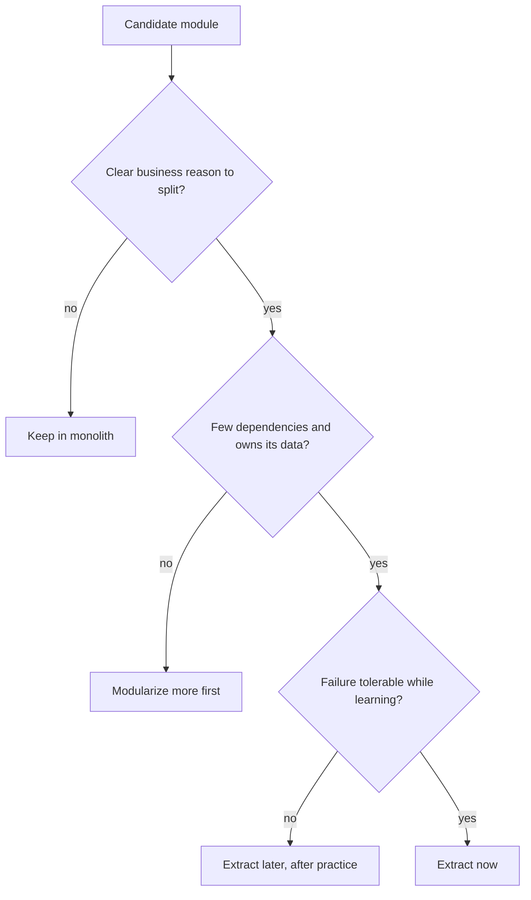
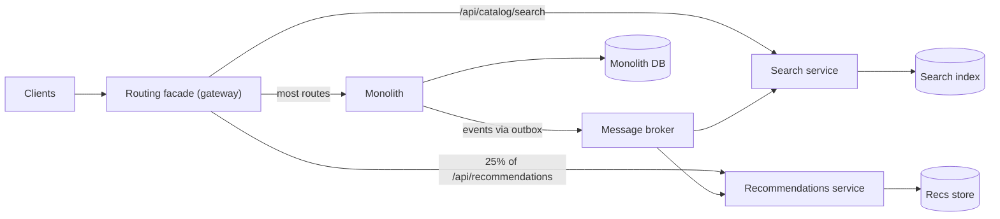
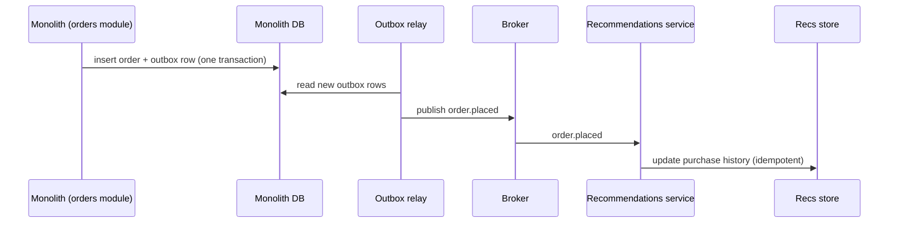

# Case Study: Breaking Up a Monolith

## Introduction

"We need to move to microservices" is one of the most expensive sentences in software. Sometimes it is right. Often the real problem is a tangled codebase, slow deploys or unclear ownership, and microservices add network calls, distributed data and operational load on top of those problems instead of fixing them.

This case study follows a realistic migration of an online bookstore's monolith. It does not start with Kubernetes. It starts with **why**, then **modularizes inside the monolith**, then extracts services **one at a time** using the [Strangler Fig](../9-arch-distributed-systems/11-arch-strangler-fig.mdx) pattern, and only where there is a clear reason.

Martin Fowler named the approach after strangler fig vines, which grow around a host tree until they replace it. His article [Strangler Fig Application](https://martinfowler.com/bliki/StranglerFigApplication.html) frames incremental modernization around four activities: understand the outcomes you want, break the problem into parts, deliver the parts, and change the organization so it can keep doing this. This page follows that shape.

An analogy: renovating a restaurant while it stays open. You do not close for a year and rebuild. You renovate one room at a time, put up temporary walls (transitional architecture), and move diners as each room is ready. Some rooms you never touch, because they are fine.

## The Starting Point

The bookstore runs a ten-year-old Python web monolith with one PostgreSQL database and about 60 engineers in 8 teams.

Pain points, as reported by the teams:

1. Deploys happen weekly and take a release manager half a day; a bug anywhere blocks everyone's release.
2. The test suite takes 50 minutes.
3. The recommendations feature needs GPUs and different scaling, and its experiments crash the web process.
4. Checkout and catalog code reach into each other's tables; no one is sure what a change will break.
5. Black Friday traffic hits search hardest, but scaling means scaling the whole app.

## Step 1: Decide Whether to Split at All

Map each pain point to the cheapest fix. This is the [Thinking in Trade-offs](../0-arch-fundamentals/4-arch-trade-offs.mdx) step, and it is where many migrations should end.

| Pain point | Root cause | Does a service split fix it? | Cheaper fix first |
| --- | --- | --- | --- |
| Slow, risky deploys | Manual process, no feature flags | Partly | CI/CD automation, trunk-based development, feature flags |
| 50-minute tests | Everything tests everything | Partly | Module boundaries, run only affected tests |
| Recommendations needs GPUs | Different runtime and scaling profile | **Yes** | None really; this is a genuine reason to extract |
| Tangled tables | No module boundaries | No, it moves the tangle onto the network | Modularize; one owner per table |
| Search scaling | One hot area | **Maybe** | Read replicas, cache, dedicated search index |

Two pain points justify services. The rest are fixed by better engineering inside the monolith.

### Counter-cases worth knowing

The industry has public examples on both sides:

- **Segment** wrote about moving from many destination microservices back to a single service ("Goodbye Microservices", 2018), because operational overhead grew with every new destination and shared libraries drifted between services.
- **Amazon Prime Video** described in 2023 how its audio/video monitoring tool moved from a distributed design built on AWS Step Functions and Lambda to a single process on ECS, reporting a large infrastructure cost reduction. Commentators noted that the lesson is about choosing the right granularity and orchestration costs, not that microservices are bad.
- **Shopify** chose a **modular monolith** for its core Rails application, enforcing component boundaries with its open-source tool Packwerk instead of splitting into services. See [Deconstructing the Monolith](https://shopify.engineering/deconstructing-monolith-designing-software-maximizes-developer-productivity).

At the same time, many companies with large, independent teams and very different scaling needs have successfully moved to services. The question is never "monolith or microservices?" in general; it is "what does this system and this organization need now?" See [Choosing an Architectural Style](../6-arch-architectural-styles/10-arch-choosing-a-style.mdx).

:::tip
Write the decision down as an [Architecture Decision Record](../13-arch-documenting-and-evolving/0-arch-decision-records.mdx), including the outcomes you expect (for example, "recommendations deploys independently, with no impact on web latency"). Revisit it in six months against those outcomes.
:::

## Step 2: Modularize Inside the Monolith

You cannot extract a service cleanly from code that has no seams. So the first engineering step is a [modular monolith](../6-arch-architectural-styles/3-arch-modular-monolith.mdx):

- Group code into modules along [bounded contexts](../8-arch-domain-driven-design/2-arch-bounded-contexts.mdx): `catalog`, `search`, `orders`, `inventory`, `payments`, `recommendations`, `accounts`.
- Each module exposes a small public API; everything else is internal.
- Each table has exactly one owning module. Other modules ask the owner, through its API, instead of joining its tables.
- Enforce the rules automatically, or they will erode within weeks.

A simple automated check is an architectural [fitness function](../13-arch-documenting-and-evolving/3-arch-fitness-functions.mdx). Here is one for Python import boundaries, using only the standard library:

```python
import ast
import tempfile
from pathlib import Path

# Each module may be imported by other modules only through its public "api" submodule.
PUBLIC_ENTRY = "api"
MODULES = {"orders", "inventory", "payments", "catalog"}


def violations(root: Path) -> list[str]:
    found = []
    for file in sorted(root.rglob("*.py")):
        owner = file.relative_to(root).parts[0]
        tree = ast.parse(file.read_text(), filename=str(file))
        for node in ast.walk(tree):
            names = []
            if isinstance(node, ast.Import):
                names = [a.name for a in node.names]
            elif isinstance(node, ast.ImportFrom) and node.module and node.level == 0:
                names = [node.module]
            for name in names:
                parts = name.split(".")
                target = parts[0]
                if target in MODULES and target != owner:
                    if len(parts) < 2 or parts[1] != PUBLIC_ENTRY:
                        found.append(f"{file.relative_to(root)}:{node.lineno} "
                                     f"imports {name} (use {target}.{PUBLIC_ENTRY})")
    return found


# Build a tiny fake codebase to check
with tempfile.TemporaryDirectory() as tmp:
    root = Path(tmp)
    files = {
        "inventory/api.py": "def reserve(sku, qty): ...\n",
        "inventory/models.py": "class StockRow: ...\n",
        "orders/service.py": (
            "from inventory.api import reserve\n"
            "from inventory.models import StockRow   # reaches into internals\n"
            "import payments.gateway                 # same problem\n"
        ),
        "payments/gateway.py": "from orders.service import place_order\n",
    }
    for rel, src in files.items():
        (root / rel).parent.mkdir(parents=True, exist_ok=True)
        (root / rel).write_text(src)

    problems = violations(root)
    print(f"{len(problems)} boundary violations")
    for p in problems:
        print(" ", p)
```

Output:

```text
3 boundary violations
  orders/service.py:2 imports inventory.models (use inventory.api)
  orders/service.py:3 imports payments.gateway (use payments.api)
  payments/gateway.py:1 imports orders.service (use orders.api)
```

Run it in CI and fail the build on new violations. In a large codebase, start by recording the existing violations as a baseline and only block new ones. Ready-made tools exist too, such as `import-linter` for Python, ArchUnit for Java, and Packwerk for Ruby.

Notice the last violation: `payments` imports `orders`, and `orders` imports `payments`. A cycle like that is the single biggest obstacle to extraction; break cycles with events or by moving the shared concept to its rightful owner.

## Step 3: Pick the First Service

Good first candidates are:

- **valuable**: they fix a real pain point
- **loosely coupled**: few calls in and out, little shared data
- **low risk**: a failure does not stop revenue



For the bookstore, **recommendations** wins: it needs GPUs, it only reads catalog and order history, and if it fails the site shows "bestsellers" instead. **Checkout** is the worst first candidate: high coupling, high risk. It may never need to leave the monolith.

## Step 4: Strangle Through a Routing Facade

Put a routing layer (an API gateway or reverse proxy) in front of the monolith. At first it sends everything to the monolith. Then, route by route, it sends traffic to new services, gradually.

```python
import hashlib
from dataclasses import dataclass


@dataclass(frozen=True)
class Route:
    prefix: str
    new_backend: str
    rollout_percent: int          # 0 = all legacy, 100 = fully migrated


LEGACY = "http://monolith:8080"
ROUTES = [
    Route("/api/catalog/search", "http://search-svc:8000", 100),   # migrated
    Route("/api/recommendations", "http://recs-svc:8000", 25),     # being rolled out
    Route("/api/checkout", "http://checkout-svc:8000", 0),         # built, not live yet
]


def bucket(user_id: str) -> int:
    """Stable 0-99 bucket so a user always gets the same side during a rollout."""
    return int(hashlib.sha256(user_id.encode()).hexdigest(), 16) % 100


def route(path: str, user_id: str) -> str:
    for r in ROUTES:
        if path.startswith(r.prefix) and bucket(user_id) < r.rollout_percent:
            return r.new_backend
    return LEGACY                 # everything not yet strangled


users = [f"user-{i}" for i in range(1000)]
for path in ["/api/catalog/search?q=ddd", "/api/recommendations", "/api/checkout", "/api/account"]:
    targets = [route(path, u) for u in users]
    new_share = sum(t != LEGACY for t in targets) / len(users)
    print(f"{path:<28} new: {new_share:>4.0%}  e.g. {route(path, 'user-7')}")
```

Output:

```text
/api/catalog/search?q=ddd    new: 100%  e.g. http://search-svc:8000
/api/recommendations         new:  26%  e.g. http://monolith:8080
/api/checkout                new:   0%  e.g. http://monolith:8080
/api/account                 new:   0%  e.g. http://monolith:8080
```

Bucketing by user ID keeps each user on one side during a rollout, which avoids confusing experiences and makes metrics comparable. Rolling back is a configuration change to `rollout_percent`.



See [API Gateway and Backend for Frontend](../10-arch-integration-and-apis/4-arch-api-gateway.mdx) for gateway options.

## Step 5: Prove Equivalence With a Parallel Run

When the new code replaces existing behaviour (not just adding a feature), run both and compare before switching. Users see only the legacy answer; mismatches are logged.

```python
import logging
import sys
from collections.abc import Callable
from decimal import Decimal

logging.basicConfig(format="%(levelname)s %(message)s", level=logging.INFO, stream=sys.stdout)
log = logging.getLogger("parallel-run")


def legacy_shipping_cost(weight_kg: Decimal, country: str) -> Decimal:
    base = Decimal("4.99") if country == "US" else Decimal("12.50")
    return (base + weight_kg * Decimal("1.10")).quantize(Decimal("0.01"))


def new_shipping_cost(weight_kg: Decimal, country: str) -> Decimal:
    base = Decimal("4.99") if country in {"US"} else Decimal("12.50")
    extra = weight_kg * Decimal("1.10")
    if weight_kg > 20:                     # new rule someone "simplified"... or a bug?
        extra = Decimal("22.00")
    return (base + extra).quantize(Decimal("0.01"))


def parallel_run(old: Callable[..., Decimal], new: Callable[..., Decimal], *args) -> Decimal:
    """Serve the legacy answer; compare the new one in the background and log mismatches."""
    expected = old(*args)
    try:
        actual = new(*args)
        if actual != expected:
            log.warning("mismatch args=%s legacy=%s new=%s", args, expected, actual)
    except Exception:
        log.exception("new implementation failed for args=%s", args)
    return expected                         # users only ever see the legacy result


for weight, country in [(Decimal("1.2"), "US"), (Decimal("5"), "DE"), (Decimal("25"), "US")]:
    print("charged:", parallel_run(legacy_shipping_cost, new_shipping_cost, weight, country))
```

Output:

```text
charged: 6.31
charged: 18.00
WARNING mismatch args=(Decimal('25'), 'US') legacy=32.49 new=26.99
charged: 32.49
```

The mismatch is the point: is the heavy-parcel rule a bug in the new code or an undocumented business rule that the new team "simplified"? Either way, you find out from logs, not from customer complaints. Parallel runs work best for side-effect-free logic (pricing, search, eligibility). For writes, compare in a shadow environment, or call the new path in a dry-run mode.

## Step 6: Separate the Data

Code extraction is the easy half. The hard half is the data the module used to share.

1. **Give the module sole ownership of its tables inside the monolith first.** No other module reads them directly.
2. **Publish changes as events** through a [transactional outbox](../9-arch-distributed-systems/6-arch-outbox.mdx) or [change data capture](../11-arch-data-architecture/5-arch-change-data-capture.mdx), so the new service can build its own copy.
3. **Backfill** historical data into the new store, then let events keep it current.
4. **Switch reads**, then **switch writes**, one step at a time with a rollback plan at each step.
5. **Avoid naive dual writes** (application code writing to both databases). A crash between the two writes leaves them inconsistent with no record of it.



See [Database per Service vs Shared Database](../11-arch-data-architecture/0-arch-database-per-service.mdx) and [Schema Evolution and Data Migrations](../11-arch-data-architecture/7-arch-data-migrations.mdx).

## Step 7: Change the Organization

[Conway's Law](../0-arch-fundamentals/9-arch-conways-law.mdx) says systems mirror the communication structure of the teams that build them. If eight teams still share one release train and one on-call rotation, the new services will drift back into a distributed monolith. Each extracted service needs:

- one owning team (a "stream-aligned" team in [Team Topologies](https://teamtopologies.com/) terms) that builds, deploys and runs it
- its own pipeline and the ability to deploy without coordinating with others
- a platform (logging, tracing, deploy templates) so every team does not reinvent operations

## Real-World Scenario: The Bookstore, 18 Months Later

**What happened:**

- Months 1 to 6: CI/CD overhaul and feature flags (deploys went from weekly to daily), module boundaries with an import checker, affected-tests-only CI. These fixed three of the five pain points with no new services.
- Months 6 to 9: recommendations extracted behind the gateway, fed by order events, rolled out from 5% to 100% over three weeks.
- Months 9 to 14: search extracted with its own index, built from catalog change events, after read replicas proved insufficient for peak traffic.
- Checkout, payments, inventory and accounts remain modules of the monolith. They are well bounded, and no outcome justifies the cost of splitting them.

**Why this approach:** each step delivered value on its own and could be stopped at any time. The team never spent a year on a "big bang" rewrite that ships nothing until the end.

**When not to use it:** if the system is small, owned by one team and deployed easily, do none of this. If a legacy system is so unmaintainable that even modularizing is impossible (no tests, dead language, no source), the options shift toward replacement; see [Legacy System Modernization](../13-arch-documenting-and-evolving/5-arch-legacy-modernization.mdx).

**Alternatives and trade-offs:**

| Approach | Pros | Cons | Best for |
| --- | --- | --- | --- |
| Stay monolith, improve engineering | Cheapest, lowest risk | Does not solve truly different scaling or runtime needs | Most teams, most of the time |
| Modular monolith | Clear ownership, faster tests, extraction-ready | Needs discipline and tooling | Growing teams in one codebase |
| Incremental strangler extraction | Value at each step, reversible | Transitional architecture to build and later remove | Clear reasons for specific services |
| Big-bang rewrite | Clean slate | Long time with no value, feature freeze, high failure risk | Rarely justified |

## Common Mistakes

- **Starting with infrastructure.** A Kubernetes cluster is not a migration strategy. Start with outcomes and module boundaries.
- **Splitting by technical layer.** A "database service" and a "business logic service" create chatty, coupled services. Split by business capability.
- **Extracting the riskiest part first.** Learn on something that can fail gracefully.
- **Sharing the database between the monolith and new services.** That keeps the coupling and adds network latency. Move data ownership.
- **Dual writes without an outbox or CDC.** They drift silently.
- **Never finishing.** Remove the transitional routes and the dead monolith code after each extraction, or you maintain two versions forever.
- **Ignoring team structure.** Services without owning teams become a distributed monolith.

## Summary

- Start from outcomes and pain points; many are fixed without splitting anything.
- Modularize inside the monolith first, and enforce boundaries with automated fitness functions.
- Extract one service at a time, choosing valuable, loosely coupled, low-risk candidates.
- Use a routing facade for gradual, reversible rollout, and parallel runs to prove equivalence.
- Separate data with events (outbox or CDC) and backfills, not dual writes.
- Align teams with services, and know the counter-cases: Segment, Prime Video and Shopify all chose consolidation or modular monoliths for good reasons.

## Exercises

1. **Baseline violations.** Extend the import checker to read a baseline file of known violations and fail only on new ones.
2. **Sticky rollout.** Change `route` so a user who saw the new service keeps seeing it even when `rollout_percent` is lowered, unless an emergency flag is set. When is that a bad idea?
3. **Parallel run for writes.** Design a safe way to compare the new and legacy implementations of "apply discount code", which writes to the database.
4. **ADR.** Write an ADR for extracting recommendations, with the expected outcomes and the conditions under which you would merge it back.

Related pages: [Strangler Fig Migration](../9-arch-distributed-systems/11-arch-strangler-fig.mdx), [Monolithic Architecture](../6-arch-architectural-styles/2-arch-monolith.mdx), [Microservices Architecture](../6-arch-architectural-styles/4-arch-microservices.mdx), [Designing for Deployability](../12-arch-quality-and-operations/6-arch-deployability.mdx), and the capstone, [Designing a Ride-Sharing System](./8-arch-capstone.mdx).
