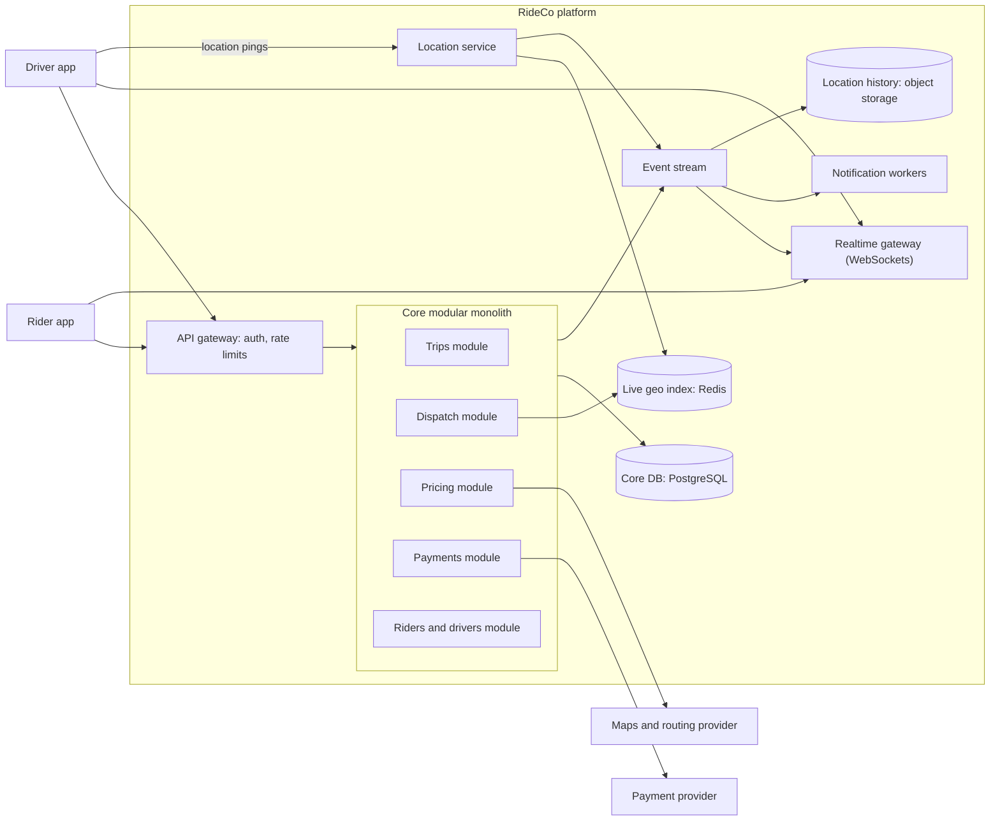
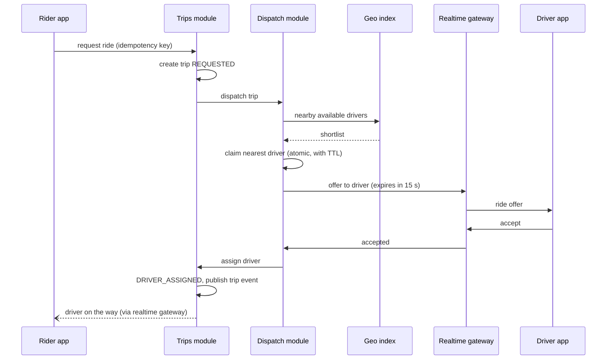
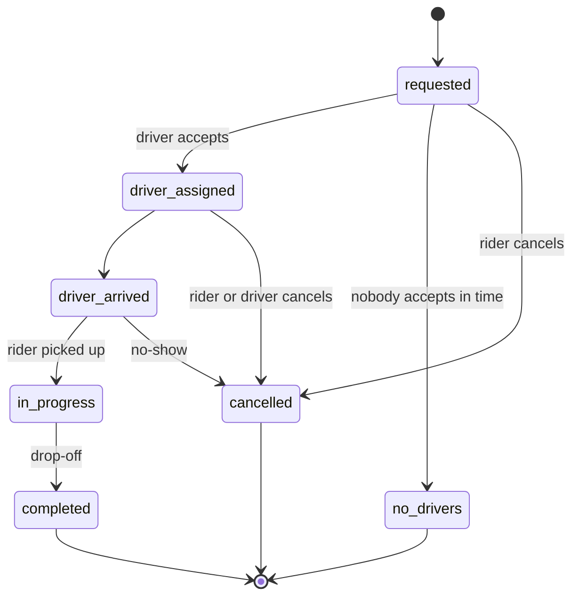

# Capstone: Designing a Ride-Sharing System

## Introduction

This capstone pulls the whole tutorial together. You will design a ride-sharing platform (think of a small Uber or Lyft) from a blank page to a reviewed architecture, using the same steps a real team would:

1. clarify requirements and [quality attributes](../0-arch-fundamentals/3-arch-quality-attributes.mdx)
2. estimate the load
3. choose an [architectural style](../6-arch-architectural-styles/10-arch-choosing-a-style.mdx) and draw [C4 diagrams](../13-arch-documenting-and-evolving/1-arch-c4-model.mdx)
4. design the hard parts in detail: live locations, geospatial search, matching, trip state, pricing and payments
5. reason about failures and consistency
6. record decisions as [ADRs](../13-arch-documenting-and-evolving/0-arch-decision-records.mdx) and run an [architecture review](../13-arch-documenting-and-evolving/4-arch-reviews.mdx)

Ride-sharing is a great capstone because it mixes problems you have met separately: a write-heavy real-time stream (driver locations), a latency-critical search (nearby drivers), a contended resource (a driver can take only one trip), a long-running stateful process (the trip), money (fares and payouts), and notifications.

The page gives you a worked reference design with runnable pieces, and then a set of deliverables to produce yourself. Treat the reference as one reasonable answer, not the answer.

## The Brief

> RideCo is launching in three cities. Riders request a ride from their current location to a destination, see a price up front, get matched with a nearby driver within seconds, watch the driver approach on a map, and pay automatically at the end. Drivers go online and offline, receive ride offers, and get paid weekly. The company has 25 engineers today and expects to grow to 80 within two years.

## Step 1: Requirements

**Functional (in scope)**

1. Drivers go online or offline and stream their location while online.
2. Riders get an upfront price and an ETA for a route.
3. Riders request a ride; the system offers it to suitable nearby drivers until one accepts.
4. Both sides see trip status and live driver location.
5. Fare is charged at trip end; drivers are paid out periodically.
6. Ratings after the trip.

**Out of scope for this version:** shared rides (pooling), scheduled rides, food delivery, in-app chat.

**Non-functional**

| Quality attribute | Target (example) | Driving design choice |
| --- | --- | --- |
| Match latency | Most requests matched or rejected within a short window, such as 30 seconds | In-memory geo index, async offers |
| Freshness | Driver positions on the map a few seconds old at most | High-rate location ingestion, ephemeral storage |
| Correctness | A driver is never assigned two trips; a rider is never charged twice | Atomic claims, idempotent payments |
| Availability | Ride requests keep working if payments or ratings are down | Async downstream, bulkheads |
| Scalability | Add cities without redesign | Partition by city or region |
| Privacy | Location data protected and retained only as long as needed | Separate hot and historical location stores |

## Step 2: Back-of-the-Envelope Estimates

Estimate per metro region, because riders and drivers in different cities never interact. That fact is your best friend for scaling. All inputs below are **assumptions** for the exercise.

```python
# Back-of-the-envelope numbers for ONE large metro region. All inputs are assumptions.
online_drivers = 50_000
update_interval_s = 4
bytes_per_update = 100                 # driver id, lat, lng, heading, speed, timestamp
trips_per_day = 1_000_000
peak_factor = 3                        # evening peak vs daily average

location_writes_per_s = online_drivers / update_interval_s
location_mb_per_s = location_writes_per_s * bytes_per_update / 1_000_000
avg_trip_requests_per_s = trips_per_day / 86_400
peak_trip_requests_per_s = avg_trip_requests_per_s * peak_factor
location_history_gb_per_day = location_writes_per_s * 86_400 * bytes_per_update / 1e9

print(f"location updates:     {location_writes_per_s:>10,.0f} per second")
print(f"location bandwidth:   {location_mb_per_s:>10,.1f} MB/s")
print(f"trip requests (avg):  {avg_trip_requests_per_s:>10,.1f} per second")
print(f"trip requests (peak): {peak_trip_requests_per_s:>10,.1f} per second")
print(f"raw location history: {location_history_gb_per_day:>10,.0f} GB per day if all kept")
```

Output:

```text
location updates:         12,500 per second
location bandwidth:          1.2 MB/s
trip requests (avg):        11.6 per second
trip requests (peak):       34.7 per second
raw location history:        108 GB per day if all kept
```

What the numbers say:

- **Location updates dominate** the write load (thousands per second) but each is tiny and **ephemeral**: only the latest position matters for matching. They belong in memory, not in a relational table.
- **Trip requests are modest** (tens per second at peak). A conventional database handles trip records easily.
- **Location history is large** if you keep everything (the figure assumes every driver is online all day, so it is an upper bound). Decide retention and sampling deliberately, for cost and for privacy.

## Step 3: Architectural Style

With 25 engineers, starting as microservices-everywhere would spend much of the team's capacity on infrastructure. But this domain has one component with a radically different runtime profile: **location ingestion and geo search** (high-rate, in-memory, latency-critical). That is a clear reason to separate it.

The reference design is therefore a **modular monolith for the business core** (riders, drivers, trips, pricing, payments, ratings), plus a small number of separately deployed services where the runtime profile differs:

- **Location service**: ingests driver pings, maintains the live geo index.
- **Realtime gateway**: holds WebSocket connections to rider and driver apps (see [Real-Time Chat](./2-arch-case-chat.mdx)).
- **Notification workers**: push and SMS (see [Notification System](./3-arch-case-notifications.mdx)).

As teams grow, modules such as pricing or payments can be extracted with the strangler approach from [Breaking Up a Monolith](./7-arch-case-monolith-to-microservices.mdx), when there is a reason.

### C4 container view



## Step 4: Live Locations and Geospatial Search

The core query is "find available drivers near this point, nearest first". Scanning every driver and computing distances works for a demo and fails at scale. You need a **spatial index** that narrows the search to nearby candidates.

Common options:

| Index | Idea | Notes |
| --- | --- | --- |
| Geohash | Interleave latitude and longitude bits into a string; nearby points share prefixes | Simple; cells are rectangles that vary in size with latitude |
| Quadtree | Recursively split dense areas into four | Adapts to density; more complex to update |
| H3 | Hierarchical hexagonal grid, open-sourced by Uber | Uniform neighbours (6 per hexagon), good for aggregation like surge pricing |
| S2 | Hierarchical cells on a sphere, from Google | Strong for region coverage queries |
| Database geo features (PostGIS, Redis GEO) | Index built in | Often the right first step |

### The idea, in plain Python

Here is a grid index: drivers are bucketed by cell, and a search only checks the rider's cell and its neighbours.

```python
import math
import random
from collections import defaultdict

CELL_DEG = 0.01            # about 1.1 km of latitude per cell; a stand-in for geohash or H3


def haversine_km(lat1: float, lng1: float, lat2: float, lng2: float) -> float:
    r = 6371.0
    p1, p2 = math.radians(lat1), math.radians(lat2)
    dp, dl = p2 - p1, math.radians(lng2 - lng1)
    a = math.sin(dp / 2) ** 2 + math.cos(p1) * math.cos(p2) * math.sin(dl / 2) ** 2
    return 2 * r * math.asin(math.sqrt(a))


def cell_of(lat: float, lng: float) -> tuple[int, int]:
    return (math.floor(lat / CELL_DEG), math.floor(lng / CELL_DEG))


class DriverIndex:
    """In-memory grid index: cell -> drivers. Location updates move drivers between cells."""

    def __init__(self) -> None:
        self.cells: dict[tuple[int, int], set[str]] = defaultdict(set)
        self.where: dict[str, tuple[float, float]] = {}

    def update(self, driver: str, lat: float, lng: float) -> None:
        if driver in self.where:
            self.cells[cell_of(*self.where[driver])].discard(driver)
        self.where[driver] = (lat, lng)
        self.cells[cell_of(lat, lng)].add(driver)

    def remove(self, driver: str) -> None:
        if driver in self.where:
            self.cells[cell_of(*self.where.pop(driver))].discard(driver)

    def nearby(self, lat: float, lng: float, k: int = 3,
               rings: int = 2) -> tuple[list[tuple[str, float]], int]:
        clat, clng = cell_of(lat, lng)
        candidates = [d for dy in range(-rings, rings + 1) for dx in range(-rings, rings + 1)
                      for d in self.cells.get((clat + dy, clng + dx), ())]
        ranked = sorted((haversine_km(lat, lng, *self.where[d]), d) for d in candidates)
        return [(d, round(km, 2)) for km, d in ranked[:k]], len(candidates)


random.seed(7)
index = DriverIndex()
for i in range(20_000):                      # drivers spread over a ~50 km box
    index.update(f"driver:{i}", 37.5 + random.random() * 0.45, -122.6 + random.random() * 0.55)

rider = (37.7792, -122.4172)
nearest, scanned = index.nearby(*rider)
print("nearest available drivers:", nearest)
print(f"distance checks: {scanned} with the grid vs {len(index.where)} with a full scan")
```

Example output:

```text
nearest available drivers: [('driver:16536', 0.08), ('driver:14392', 0.18), ('driver:8724', 0.45)]
distance checks: 214 with the grid vs 20000 with a full scan
```

The grid checked about 1% of the drivers. Two caveats a reviewer will raise: a fixed ring count can miss a closer driver just outside the search square, so production code expands rings until it has enough candidates; and straight-line distance is not driving time, so the shortlist is then ranked by ETA from a routing engine.

### The same thing with Redis

You rarely need to build this yourself. Redis stores geo data in a sorted set and supports radius search. Since Redis 6.2, `GEOSEARCH` is the recommended command; `GEORADIUS` is deprecated.

```text
127.0.0.1:6379> GEOADD drivers:available -122.4194 37.7749 driver:17 -122.4089 37.7837 driver:42 -122.4313 37.7739 driver:7 -122.2711 37.8044 driver:99
(integer) 4
127.0.0.1:6379> GEOSEARCH drivers:available FROMLONLAT -122.4172 37.7792 BYRADIUS 3 km ASC COUNT 5 WITHDIST
1) 1) "driver:17"
   2) "0.5160"
2) 1) "driver:42"
   2) "0.8850"
3) 1) "driver:7"
   2) "1.3727"
```

Note that Redis takes **longitude first**. Keep one key per city (`drivers:available:sf`), which partitions load naturally, and remove drivers from the key when they go offline or accept a trip. Location pings should also refresh a per-driver heartbeat key with a TTL, so drivers whose app died are cleaned up. See the [Redis tutorial](/docs/middleware/redis) and the [GEOSEARCH documentation](https://redis.io/docs/latest/commands/geosearch/).

### Hexagons for aggregation: H3

For questions like "how many open requests versus available drivers are in this area?", a uniform hexagonal grid is convenient. Uber open-sourced H3 for this kind of work:

```python
# pip install h3   (tested with h3 4.x; the v4 API renamed many v3 functions)
import h3

rider_cell = h3.latlng_to_cell(37.7792, -122.4172, 8)    # resolution 8 hexagon
print("rider cell:", rider_cell)

nearby_cells = h3.grid_disk(rider_cell, 1)                # the cell plus its 6 neighbours
print("cells to search:", len(nearby_cells))

# Count open ride requests and available drivers per cell to compute surge
demand = {rider_cell: 42}
supply = {rider_cell: 12}
ratio = demand[rider_cell] / max(supply[rider_cell], 1)
print(f"demand/supply in rider cell: {ratio:.1f}")
print("parent cell (resolution 6):", h3.cell_to_parent(rider_cell, 6))
```

Output:

```text
rider cell: 8828308287fffff
cells to search: 7
demand/supply in rider cell: 3.5
parent cell (resolution 6): 86283082fffffff
```

H3 v4 renamed many functions from v3 (for example `geo_to_h3` became `latlng_to_cell`), so check which version a tutorial or library uses. See the [H3 documentation](https://h3geo.org/).

## Step 5: Matching and the Driver Claim Problem

Dispatch takes the shortlist and offers the trip to drivers one at a time (or a few at a time), nearest by ETA first. The subtle part is **contention**: two riders nearby request at the same moment, and both see the same nearest driver. Without care, one driver gets two offers or, worse, two assigned trips.

The fix is an **atomic claim** on the driver before sending an offer: a database row update with a condition, or a Redis `SET driver_lock:<id> <trip> NX EX 15` (set only if not exists, with a 15-second expiry so a crashed dispatcher cannot hold a driver forever).



## Step 6: The Trip State Machine

A trip lives for minutes to hours and changes hands between rider, driver and system. Model it explicitly, as you did for orders in [E-Commerce Checkout](./1-arch-case-ecommerce.mdx):



Here is dispatch plus the state machine, including a driver who is already busy with another offer and one who declines:

```python
from dataclasses import dataclass, field
from enum import StrEnum


class TripState(StrEnum):
    REQUESTED = "requested"
    DRIVER_ASSIGNED = "driver_assigned"
    DRIVER_ARRIVED = "driver_arrived"
    IN_PROGRESS = "in_progress"
    COMPLETED = "completed"
    CANCELLED = "cancelled"
    NO_DRIVERS = "no_drivers"


TRANSITIONS = {
    TripState.REQUESTED: {TripState.DRIVER_ASSIGNED, TripState.CANCELLED, TripState.NO_DRIVERS},
    TripState.DRIVER_ASSIGNED: {TripState.DRIVER_ARRIVED, TripState.CANCELLED},
    TripState.DRIVER_ARRIVED: {TripState.IN_PROGRESS, TripState.CANCELLED},
    TripState.IN_PROGRESS: {TripState.COMPLETED},
}


@dataclass
class Trip:
    trip_id: str
    rider: str
    state: TripState = TripState.REQUESTED
    driver: str | None = None
    events: list[str] = field(default_factory=list)

    def move(self, to: TripState) -> None:
        if to not in TRANSITIONS.get(self.state, set()):
            raise ValueError(f"{self.trip_id}: {self.state} -> {to} is not allowed")
        self.events.append(f"{self.state} -> {to}")   # each one is published as an event
        self.state = to


class DriverLocks:
    """Stand-in for an atomic 'claim driver' (e.g. Redis SET NX with a TTL, or a DB row)."""

    def __init__(self) -> None:
        self.owner: dict[str, str] = {}

    def try_claim(self, driver: str, trip_id: str) -> bool:
        if driver in self.owner:
            return False
        self.owner[driver] = trip_id
        return True

    def release(self, driver: str) -> None:
        self.owner.pop(driver, None)


def dispatch(trip: Trip, candidates: list[str], accepts: dict[str, bool], locks: DriverLocks) -> None:
    for driver in candidates:                         # nearest first
        if not locks.try_claim(driver, trip.trip_id):
            trip.events.append(f"skip {driver}: busy with another offer")
            continue
        if accepts.get(driver, False):                # offer sent; driver taps accept in time
            trip.driver = driver
            trip.move(TripState.DRIVER_ASSIGNED)
            return
        trip.events.append(f"{driver} declined or timed out")
        locks.release(driver)
    trip.move(TripState.NO_DRIVERS)


locks = DriverLocks()
locks.try_claim("driver:16536", "trip-0")             # nearest driver already has an offer

t1 = Trip("trip-1", "rider:ana")
dispatch(t1, ["driver:16536", "driver:14392", "driver:8724"],
         accepts={"driver:14392": False, "driver:8724": True}, locks=locks)
t1.move(TripState.DRIVER_ARRIVED)
t1.move(TripState.IN_PROGRESS)
t1.move(TripState.COMPLETED)
print(t1.trip_id, t1.state, "driver:", t1.driver)
print("  " + "\n  ".join(t1.events))

try:
    t1.move(TripState.CANCELLED)
except ValueError as exc:
    print("rejected:", exc)
```

Output:

```text
trip-1 completed driver: driver:8724
  skip driver:16536: busy with another offer
  driver:14392 declined or timed out
  requested -> driver_assigned
  driver_assigned -> driver_arrived
  driver_arrived -> in_progress
  in_progress -> completed
rejected: trip-1: completed -> cancelled is not allowed
```

Every transition becomes a domain event (`trip.driver_assigned`, `trip.completed`) published through an [outbox](../9-arch-distributed-systems/6-arch-outbox.mdx). Downstream modules react: notifications tell the rider, payments charge the fare on `trip.completed`, ratings open a prompt. This is the [event-driven](../6-arch-architectural-styles/5-arch-event-driven.mdx) part of the design, and it keeps the trip flow independent of slower systems.

## Step 7: Pricing, Payments and Notifications

- **Upfront pricing.** Price = f(route distance and time from the maps provider, a base fare, and a demand multiplier per area). Store the **quoted** price with an expiry and a quote ID; the request must reference a valid quote, so the rider pays what they saw.
- **Surge.** A background job computes demand/supply per H3 cell every minute or so and publishes multipliers. Pricing reads the latest value; it is fine if it is a minute stale. That is an explicit [consistency](../9-arch-distributed-systems/2-arch-consistency-models.mdx) trade-off.
- **Payments.** Authorize when the trip is requested, capture on completion, with idempotency keys and a ledger, exactly as in [Payment Processing](./4-arch-case-payments.mdx). Driver payouts are a weekly batch from the ledger.
- **Notifications.** Driver offers go over the realtime connection when the app is open, and via push when it is backgrounded (see [Notification System](./3-arch-case-notifications.mdx)).

## Step 8: Consistency, Failure and Scaling

Map each piece of data to the consistency it really needs:

| Data | Consistency needed | Store | Why |
| --- | --- | --- | --- |
| Driver location | Latest-wins, seconds stale is fine | Redis, in memory | Ephemeral, very high write rate |
| Driver claim during dispatch | Strong, atomic | Redis `SET NX` or DB row | Prevent double assignment |
| Trip record and state | Strong per trip | PostgreSQL | Money and disputes depend on it |
| Surge multipliers | Eventually consistent | Cache, refreshed each minute | Slight staleness is harmless |
| Ledger | Strong, append-only | PostgreSQL | Financial correctness |
| Location history | Eventually, batch | Object storage | Analytics and safety investigations |

Failure scenarios to walk through in a review:

- **Geo index node lost.** Driver apps ping every few seconds, so the index rebuilds itself within one interval. Run a replica for faster failover, but you do not need durable storage for live locations.
- **Driver app loses connection mid-trip.** The trip is in the database; the app resumes from the trip state on reconnect. Location gaps are interpolated for the map and fare uses the server-side record.
- **Payment provider down at trip end.** The trip completes; the capture is retried with the same idempotency key by a background job. Riders are not blocked from their next ride unless an outstanding balance exceeds a limit.
- **Maps provider slow.** Pricing uses a [circuit breaker](../9-arch-distributed-systems/8-arch-circuit-breaker.mdx) and falls back to a straight-line estimate with a safety margin, flagged for review.
- **City launch spike.** Each city's location key and dispatch workers are partitioned, so one city's spike does not starve others ([bulkheads](../9-arch-distributed-systems/9-arch-bulkhead-and-rate-limiting.mdx)).

Scaling path, in order: partition by city; scale location service horizontally (pings hash to instances by driver ID, index sharded by city); add read replicas for trip history; extract dispatch as its own service if its release cadence or scaling diverges from the core.

## Step 9: Record the Decisions

Write an ADR for each significant, hard-to-reverse choice. A short example:

```text
ADR-004: Live driver locations stored only in Redis, not PostgreSQL

Status: Accepted
Context: Up to roughly 12,500 location writes per second per large city (estimate).
  Only the latest position is needed for dispatch. History is needed for analytics
  and safety reviews but not in real time.
Decision: Location service writes latest positions to a per-city Redis geo set,
  with heartbeat keys that expire after 30 seconds. Pings are also published to the
  event stream and archived to object storage in batches.
Consequences:
  + Low-latency nearby search, simple horizontal scaling by city.
  + Primary database protected from the highest-volume write path.
  - Live positions are lost if Redis fails; rebuilt from pings within seconds.
  - Two places to reason about location (live vs history).
Alternatives considered: PostGIS table updated per ping (simpler, but write load and
  vacuum pressure); in-process index in dispatch (fast, but couples scaling and state).
```

## Real-World Scenario

RideCo's first city launch is in six weeks. The CTO asks for a review of the design with the leads of the rider, driver and payments teams.

**What the review focuses on** (using the scenario-based approach from [Architecture Reviews and ATAM](../13-arch-documenting-and-evolving/4-arch-reviews.mdx)):

1. *"Two riders request at the same corner at the same time."* Walk through the claim; confirm the TTL and the release on decline.
2. *"The payments provider is down on Friday night."* Confirm trips continue and captures retry idempotently.
3. *"We launch a second city."* Confirm that per-city keys and partitioning need configuration, not code changes.
4. *"A driver disputes a fare."* Confirm the quote, trip events and ledger entries are enough to reconstruct what happened.

**Why this approach:** a modular core keeps 25 engineers productive in one codebase, while the two components with unusual runtime profiles (location and realtime) are separate from day one, because that is where the scaling pressure is.

**When not to use it:** for a single-city pilot with a few hundred drivers, PostGIS queries in the monolith and polling apps would work and ship faster. Introduce the location service when measured load or latency demands it.

**Alternatives and trade-offs:**

| Approach | Pros | Cons | Best for |
| --- | --- | --- | --- |
| Monolith + PostGIS + polling | Fastest to build, one system | Write pressure from pings, slower updates | Pilots, small fleets |
| Modular core + location and realtime services | Isolates the hot path, team stays productive | Several deployables, event plumbing | Launching in a few cities |
| Full microservices by capability | Independent teams and scaling | High operational and coordination cost | Large orgs with many teams |
| Buy a dispatch platform | Fast launch | Limited differentiation, vendor dependence | Companies where rides are not the core product |

## Your Turn: Capstone Deliverables

Produce these artifacts for RideCo. Keep them short; clarity beats volume.

1. **Requirements sheet**: functional scope, out-of-scope list, and a quality attribute table with measurable targets.
2. **Estimates**: your own assumptions and the resulting numbers, in a small script like `p8c.py`.
3. **C4 diagrams**: a context diagram and a container diagram, as diagrams-as-code ([Diagrams as Code](../13-arch-documenting-and-evolving/2-arch-diagrams-as-code.mdx)).
4. **Three ADRs**: for example, the style choice, the geo index, and the dispatch claim mechanism.
5. **One deep dive with code**: extend the grid index to expand rings until it finds `k` candidates, or implement dispatch with a real Redis `SET NX EX` claim.
6. **Failure mode table**: at least six failures, their impact, detection and mitigation.
7. **Fitness functions**: two automated checks that protect your architecture, such as an import-boundary test for the modular core ([Fitness Functions](../13-arch-documenting-and-evolving/3-arch-fitness-functions.mdx)).

### Self-review checklist

| Question | Where in this tutorial |
| --- | --- |
| Did you justify each separately deployed service with a concrete reason? | [Microservices Architecture](../6-arch-architectural-styles/4-arch-microservices.mdx) |
| Is every cross-module write either local and transactional or covered by an outbox or saga? | [Saga Pattern](../9-arch-distributed-systems/5-arch-saga.mdx) |
| Are all retries safe (idempotent)? | [Idempotency](../9-arch-distributed-systems/7-arch-idempotency.mdx) |
| Does each data type have a stated consistency need and a matching store? | [CAP and PACELC](../9-arch-distributed-systems/1-arch-cap-and-pacelc.mdx) |
| Can you observe match latency, offer acceptance rate and stale locations? | [Designing for Observability](../12-arch-quality-and-operations/3-arch-observability.mdx) |
| Is location data protected and retained only as long as needed? | [Security by Design](../12-arch-quality-and-operations/4-arch-security-by-design.mdx) |
| Do team boundaries match module and service boundaries? | [Conway's Law and Team Topologies](../0-arch-fundamentals/9-arch-conways-law.mdx) |

## Common Mistakes

- **Storing every location ping in the main database.** It is the highest-volume, least durable data; give it its own path.
- **Ranking by straight-line distance only.** A driver across a river is close and far away. Shortlist by distance, rank by ETA.
- **No atomic driver claim.** Double assignment is a race, not a rare bug; it will happen at peak.
- **One global partition.** Cities are natural shards. Use them.
- **Synchronous chains at request time.** Payments, ratings and notifications should not sit on the critical path of matching.
- **Designing for Uber's scale on day one.** Size the design to your estimates, and record what would trigger the next step.

## Summary

- Start from requirements and estimates; they show location updates are the hot path and trips are modest.
- A modular core plus separate location and realtime services fits a 25-person team with one clearly different workload.
- Use a spatial index (grid, geohash, H3, or Redis GEO with `GEOSEARCH`) to shortlist drivers, then rank by ETA.
- Prevent double assignment with an atomic claim with a TTL; model the trip as a state machine that publishes events.
- Match consistency to each data type, plan for failures explicitly, and partition by city.
- Record decisions as ADRs and test the design with scenario-based reviews.

## Further Learning

1. Complete the deliverables above and ask a peer to review them using the self-review checklist.
2. Re-run the design for **food delivery**. What changes when there are three parties (customer, restaurant, courier) and preparation time?
3. Add **shared rides** to your design. Which modules change, and does the matching problem still fit the same architecture?
4. Practise presenting the design in 45 minutes using the structure from [System Design Interview Approach](../13-arch-documenting-and-evolving/6-arch-system-design-interviews.mdx).

Revisit the earlier case studies for the building blocks used here: [URL Shortener](./0-arch-case-url-shortener.mdx), [E-Commerce Checkout](./1-arch-case-ecommerce.mdx), [Real-Time Chat](./2-arch-case-chat.mdx), [Notification System](./3-arch-case-notifications.mdx), [Payment Processing](./4-arch-case-payments.mdx), [Video Streaming Platform](./5-arch-case-video-streaming.mdx), [Multi-Tenant SaaS](./6-arch-case-saas-multitenancy.mdx) and [Breaking Up a Monolith](./7-arch-case-monolith-to-microservices.mdx). For running the infrastructure, see the [Kubernetes tutorial](/docs/devops/kubernetes).
