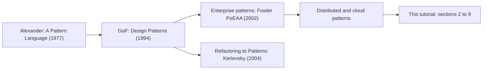
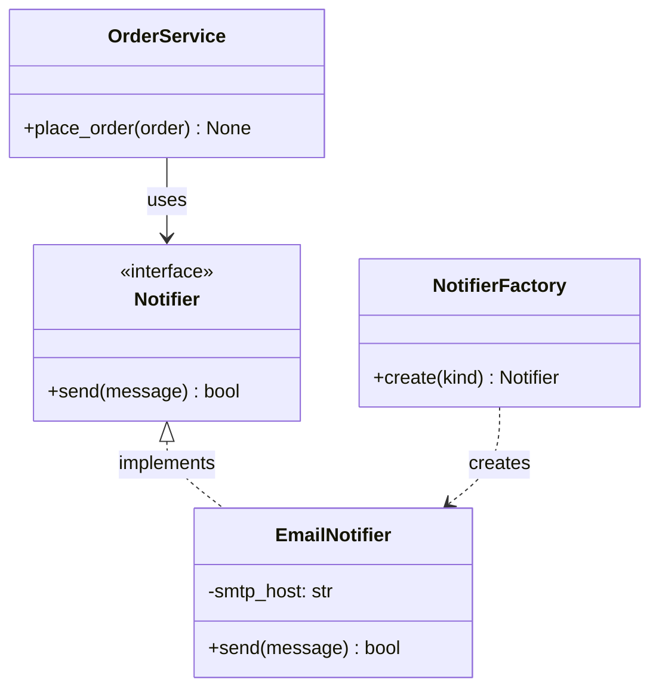
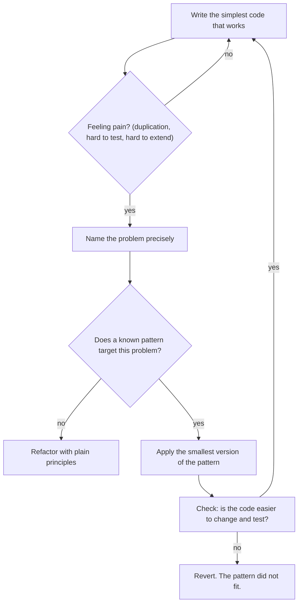

# Design Patterns Introduction

## Introduction

Sooner or later, every developer solves the same problem twice. You write a class that needs "exactly one shared config object." Six months later, in a different project, you need it again. You write an `if/elif` ladder that picks which payment provider to create. Then you find the same ladder in three more files.

A **design pattern** is a named, reusable solution to a problem that keeps coming back in software design. It is not a library you install or a block of code you paste. It is closer to a recipe: it describes the problem, the shape of a solution, and the consequences of using it. You still have to cook the dish yourself, in your own language and your own codebase.

An analogy: architects (the building kind) talk about a "courtyard" or an "entrance transition." Those words carry a whole design idea in one phrase. When a developer says "let's put a factory in front of that" or "this is a strategy," the team understands the shape of the change before anyone writes code. That shared vocabulary is the first and biggest benefit of patterns.

This page introduces patterns in general. The rest of this section covers the **creational** patterns, which are about how objects get created. Later sections cover [structural patterns](../3-arch-structural-patterns/0-arch-adapter.mdx) and [behavioral patterns](../4-arch-behavioral-patterns/0-arch-strategy.mdx).

## Where Design Patterns Came From

The idea of a "pattern language" comes from the architect Christopher Alexander, whose 1977 book *A Pattern Language* catalogued solutions for towns and buildings. Each entry named a problem, described the context, and gave a solution that could be applied "a million times over, without ever doing it the same way twice."

In 1994, Erich Gamma, Richard Helm, Ralph Johnson and John Vlissides, now known as the **Gang of Four (GoF)**, published *Design Patterns: Elements of Reusable Object-Oriented Software*. It catalogued 23 patterns for object-oriented code, with examples in C++ and Smalltalk, grouped into three families:

| Family | Question it answers | GoF patterns |
| --- | --- | --- |
| **Creational** | How do objects get created, and who decides which class? | Singleton, Factory Method, Abstract Factory, Builder, Prototype |
| **Structural** | How do classes and objects fit together into larger structures? | Adapter, Bridge, Composite, Decorator, Facade, Flyweight, Proxy |
| **Behavioral** | How do objects share responsibility and talk to each other? | Strategy, Observer, Command, State, Template Method, Chain of Responsibility, Iterator, Mediator, Memento, Visitor, Interpreter |

Many more patterns have been documented since then. Martin Fowler's *Patterns of Enterprise Application Architecture* (2002) added patterns such as Repository and Unit of Work, which this tutorial covers in [Modern and Functional Patterns](../5-arch-modern-patterns/1-arch-repository-pattern.mdx). The **Object Pool** pattern in this section is not in the GoF book, but it is a creational pattern you will meet in almost every database driver.



## Anatomy of a Pattern

Every good pattern description has the same parts. The GoF book listed many sections per pattern, but four matter most:

1. **Name**: a short handle such as "Builder." The name is what you say in a code review.
2. **Problem**: the situation and forces that make the obvious solution painful.
3. **Solution**: the roles (classes, interfaces, functions) and how they collaborate. This is a template, not finished code.
4. **Consequences**: what you gain and what you pay. Every pattern adds indirection. If the consequences section does not mention a cost, the description is incomplete.

Each pattern page in this tutorial follows that shape:

- the problem first, as "before" code that hurts
- the pattern applied ("after")
- a class or sequence diagram
- where you have already used the pattern in real libraries
- **when not to use it**
- related patterns that are easy to confuse

## Reading Pattern Diagrams

Pattern pages use mermaid class diagrams, a simplified form of UML. Here are the only symbols you need:



| Symbol | Meaning | Python equivalent |
| --- | --- | --- |
| `<<interface>>` | Contract with no implementation | `typing.Protocol` or `abc.ABC` with abstract methods |
| `+name` / `-name` | Public / private member | `name` / `_name` by convention |
| Hollow triangle, dashed line | Implements an interface | Class that satisfies a `Protocol` or subclasses an ABC |
| Hollow triangle, solid line | Inherits from a class | `class Child(Parent)` |
| Solid arrow | Holds a reference to, or uses | An attribute or parameter of that type |
| Dashed arrow | Depends on, often "creates" | Calls the constructor inside a method |

## A First Look: The Problem Creational Patterns Solve

Creational patterns exist because the `new` keyword (or calling a class in Python) is a hard-coded decision. When you write `EmailNotifier()` inside business logic, that code is now welded to one concrete class.

Here is an online bookstore's order service that hurts:

```python
from dataclasses import dataclass


@dataclass
class Order:
    id: int
    customer_email: str
    customer_phone: str
    channel: str  # "email" or "sms"


class EmailNotifier:
    def send(self, to: str, text: str) -> None:
        print(f"EMAIL to {to}: {text}")


class SmsNotifier:
    def send(self, to: str, text: str) -> None:
        print(f"SMS to {to}: {text}")


class OrderService:
    def place_order(self, order: Order) -> None:
        # ... save order ...
        if order.channel == "email":
            EmailNotifier().send(order.customer_email, f"Order {order.id} confirmed")
        elif order.channel == "sms":
            SmsNotifier().send(order.customer_phone, f"Order {order.id} confirmed")
        else:
            raise ValueError(f"unknown channel {order.channel}")


OrderService().place_order(Order(1, "ana@example.com", "+15550100", "email"))
OrderService().place_order(Order(2, "bo@example.com", "+15550101", "sms"))
```

Output:

```text
EMAIL to ana@example.com: Order 1 confirmed
SMS to +15550101: Order 2 confirmed
```

It works, but look at the forces:

- Adding a "push notification" channel means editing `OrderService`, which has nothing to do with push notifications. That breaks the [Open/Closed Principle](../1-arch-design-principles/2-arch-open-closed.mdx).
- A unit test of `place_order` cannot avoid creating a real notifier, unless you monkeypatch the module.
- The same `if/elif` ladder will appear wherever another service needs to notify a customer.

A small dose of a creational pattern moves the "which class?" decision to one place:

```python
from typing import Callable, Protocol


class Notifier(Protocol):
    def send(self, to: str, text: str) -> None: ...


NOTIFIERS: dict[str, Callable[[], Notifier]] = {
    "email": EmailNotifier,
    "sms": SmsNotifier,
}


def make_notifier(channel: str) -> Notifier:
    try:
        return NOTIFIERS[channel]()
    except KeyError:
        raise ValueError(f"unknown channel {channel}") from None


class OrderService:
    def __init__(self, notifier_factory: Callable[[str], Notifier] = make_notifier) -> None:
        self._make_notifier = notifier_factory

    def place_order(self, order: Order) -> None:
        to = order.customer_email if order.channel == "email" else order.customer_phone
        self._make_notifier(order.channel).send(to, f"Order {order.id} confirmed")


OrderService().place_order(Order(3, "cy@example.com", "+15550102", "sms"))
```

Output:

```text
SMS to +15550102: Order 3 confirmed
```

This is a **simple factory**: a function that owns the decision of which class to create. It is not even one of the 23 GoF patterns, and in Python it is often all you need. The [Factory Method](./2-arch-factory-method.mdx) page shows when you need the full pattern.

:::tip
Notice that the "after" code is *not* much shorter. Patterns rarely reduce line count. They move a decision to a place where it is easier to change, test, or extend. If nothing is likely to change, the "before" code may be the better choice.
:::

## Patterns Depend on the Language

The GoF book was written for C++ and Smalltalk in the early 1990s. Several of its patterns work around language limits that modern languages no longer have. In a 1996 talk, Peter Norvig argued that 16 of the 23 GoF patterns become "invisible or simpler" in dynamic languages such as Lisp and Dylan. Python has many of the same features:

| Language feature | Pattern it simplifies | Python example |
| --- | --- | --- |
| First-class functions | Strategy, Command, Factory | Pass `sorted(key=len)` instead of a comparator class |
| Classes are objects | Factory Method, Abstract Factory | Pass `Decimal` as a factory: `json.loads(s, parse_float=Decimal)` |
| Modules are created once | Singleton | A module-level `settings = Settings()` |
| Keyword arguments with defaults | Builder | `Pizza(size="L", cheese=True)` |
| Built-in copying | Prototype | `copy.deepcopy(obj)`, `dataclasses.replace(obj, x=1)` |
| Generators | Iterator | `yield` |

This does not make patterns obsolete. The *problem* each pattern names is still real, and the *name* is still useful. What changes is the amount of ceremony. Throughout this tutorial, examples default to Python with type hints. Where interfaces make a pattern's structure clearer, the page also shows a short Java or TypeScript version and explains why. The page [Design Patterns in Modern Languages](../5-arch-modern-patterns/0-arch-patterns-in-modern-languages.mdx) goes deeper on this topic.

## Patterns, Idioms, Principles and Styles

People use "pattern" loosely. It helps to separate four levels:

| Level | Scope | Example | Where in this tutorial |
| --- | --- | --- | --- |
| **Idiom** | One language, a few lines | Python context manager (`with open(...)`) | Throughout |
| **Design pattern** | A few classes or functions | Builder, Observer, Adapter | Sections 2 to 5 |
| **Design principle** | A guideline for any design | Dependency Inversion, Composition over Inheritance | [Design Principles](../1-arch-design-principles/0-arch-solid-overview.mdx) |
| **Architectural style or pattern** | A whole system or service | Microservices, Hexagonal, CQRS | [Architectural Styles](../6-arch-architectural-styles/0-arch-styles-overview.mdx) and later |

Principles are the "why" and patterns are one common "how." For example, a factory is one way to apply [Dependency Inversion](../1-arch-design-principles/5-arch-dependency-inversion.mdx), and [Dependency Injection](../1-arch-design-principles/10-arch-dependency-injection.mdx) often replaces the need for a Singleton.

## How to Use Patterns Well



This loop follows the approach of Joshua Kerievsky's *Refactoring to Patterns*: move **toward** a pattern when code smells demand it, instead of starting from a pattern and forcing the problem into it. You will see this again in [Refactoring to Patterns](../5-arch-modern-patterns/8-arch-refactoring-to-patterns.mdx).

## Real-World Scenario

Your team maintains the backend of an online bookstore. A new developer opens a pull request for a feature that sends an order confirmation email. The PR adds these files:

```text
notifications/
  abstract_notifier.py
  abstract_notifier_factory.py
  email_notifier_factory.py
  notifier_factory_provider.py
  notifier_registry_singleton.py
  email_notifier.py
```

There is one notifier (email). There are no plans for a second one. The reviewer asks: "Which problem does each of these files solve today?" Nobody has an answer for four of the six.

The team agrees on a lighter version:

```python
# notifications.py
from typing import Protocol


class Notifier(Protocol):
    def send(self, to: str, text: str) -> None: ...


class EmailNotifier:
    def __init__(self, sender: str) -> None:
        self._sender = sender

    def send(self, to: str, text: str) -> None:
        print(f"[{self._sender}] EMAIL to {to}: {text}")


# orders.py
class OrderService:
    def __init__(self, notifier: Notifier) -> None:
        self._notifier = notifier  # injected, so tests can pass a fake

    def confirm(self, order_id: int, email: str) -> None:
        self._notifier.send(email, f"Order {order_id} confirmed")


# main.py (composition root)
service = OrderService(EmailNotifier(sender="orders@bookstore.example"))
service.confirm(42, "reader@example.com")
```

Output:

```text
[orders@bookstore.example] EMAIL to reader@example.com: Order 42 confirmed
```

A `Protocol` gives the seam for testing and future channels. Constructor injection replaces the singleton and the registry. When an SMS channel arrives next quarter, the team will add a small factory function, which is one file and one dictionary.

### Why this approach

- The interface (`Notifier`) is cheap and pays off immediately in tests.
- The factory and registry layers solve problems the team does not have yet. That is a [YAGNI](../1-arch-design-principles/6-arch-dry-kiss-yagni.mdx) violation.
- Each extra layer is one more file a new teammate must read to understand "how do we send an email?"

### When to use patterns / when not to

- **Use** a pattern when you can point at a concrete force: a second implementation, a test that cannot be written, a duplicated `if/elif` ladder, a constructor with twelve parameters.
- **Do not use** a pattern because it might be needed, because it looks professional, or because a framework from another language does it that way.

### Alternatives and trade-offs

| Approach | Pros | Cons | Best for |
| --- | --- | --- | --- |
| Direct construction (`EmailNotifier()`) | Simplest, easy to read | Hard to swap or fake | Scripts, one implementation, no tests that need fakes |
| Interface + injection | Testable, swappable, little code | Wiring lives in a composition root | Most application code |
| Simple factory function | One place decides the class | One more indirection | Choosing among a few implementations at runtime |
| Full GoF pattern (e.g. Abstract Factory) | Strong guarantees and extension points | More classes and indirection | Frameworks, plugin systems, families of related objects |

## Common Mistakes

1. **Pattern-first design.** Starting with "let's use the Visitor pattern here" before you have felt the problem. Start with the pain, then reach for the pattern.
2. **Copying Java ceremony into Python.** Interfaces with one implementation, getters and setters for everything, and factory classes whose methods never use `self`. In Python, a function or a class passed as a value is often the whole pattern.
3. **Treating patterns as goals.** "We used 9 patterns" is not a quality metric. Code that is easy to change is.
4. **Using the name wrongly.** Calling every function that returns an object a "factory method" or every global a "singleton" makes the shared vocabulary less useful. Learn the precise intent.
5. **Ignoring the consequences.** Every pattern adds indirection. Write down what you pay, not just what you gain.

:::note
Patterns are descriptions of good designs that people found again and again. They were *discovered*, not invented. If your design solves the problem cleanly without a named pattern, that is fine.
:::

## Summary

- A design pattern is a named, reusable solution shape for a recurring design problem, with known consequences.
- The GoF book (1994) catalogued 23 patterns in three families: creational, structural and behavioral.
- Creational patterns control **which** class is created, **how** and **when**, so business code is not welded to concrete classes.
- Modern languages make many patterns lighter: functions, first-class classes, modules and keyword arguments replace much of the original boilerplate.
- Use patterns to fix felt pain, choose the smallest version that works, and know when *not* to use one.

## Exercises

1. Find a piece of your own code with an `if/elif` chain that picks a class to create. Rewrite it with a dictionary-based simple factory. Did it get easier to read, or harder?
2. Pick three GoF patterns from the table above. For each, write one sentence that describes the *problem*, without mentioning the solution.
3. Look at a framework you use, such as Django, Flask, Spring or Express. List two places where it uses a named pattern, and check the framework's docs to confirm.
4. Review the "Real-World Scenario" PR again. Suppose the bookstore must support email, SMS and push, chosen per customer. Which single extra piece would you add, and why?

**Next in this section:** [Singleton Pattern](./1-arch-singleton.mdx), then [Factory Method](./2-arch-factory-method.mdx), [Abstract Factory](./3-arch-abstract-factory.mdx), [Builder](./4-arch-builder.mdx), [Prototype](./5-arch-prototype.mdx), [Object Pool](./6-arch-object-pool.mdx), and finally [Choosing a Creational Pattern](./7-arch-choosing-creational.mdx).

**Further reading:**

- Refactoring.Guru, [Design Patterns catalog](https://refactoring.guru/design-patterns/catalog)
- Brandon Rhodes, [Python Design Patterns guide](https://python-patterns.guide/)
- Peter Norvig, [Design Patterns in Dynamic Languages](https://norvig.com/design-patterns/) (1996 slides)
