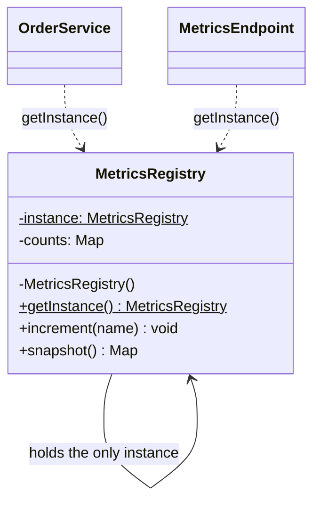
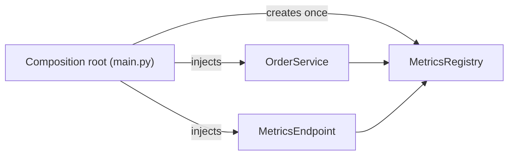

# Singleton Pattern

## Introduction

The **Singleton** pattern makes sure a class has **exactly one instance** and gives the whole program **one global way to reach it**.

Think of the fire alarm panel in an office building. There is one panel. Every smoke detector on every floor reports to that same panel, and it would be a disaster if the third floor quietly installed its own panel that nobody watches. Some things in a program are like that: one configuration object, one metrics registry, one connection pool per database.

Singleton is the best-known design pattern and also the most criticized one. Many experienced developers call it an anti-pattern, because the "global access" half of it brings the problems of global variables. This page shows both sides. You will learn how to build a Singleton correctly, why you usually want a **single instance** without the **Singleton class**, and which alternatives fit better in modern Python and Java.

## The Problem: Accidental Duplicates

An online bookstore collects metrics, such as how many orders were placed. The first version creates the metrics registry wherever it is needed:

```python
from collections import Counter


class MetricsRegistry:
    def __init__(self) -> None:
        self._counts: Counter[str] = Counter()
        print("MetricsRegistry created")

    def increment(self, name: str) -> None:
        self._counts[name] += 1

    def snapshot(self) -> dict[str, int]:
        return dict(self._counts)


def place_order() -> None:
    MetricsRegistry().increment("orders_placed")  # new registry every call!


def metrics_endpoint() -> dict[str, int]:
    return MetricsRegistry().snapshot()  # yet another registry


place_order()
place_order()
print(metrics_endpoint())
```

Output:

```text
MetricsRegistry created
MetricsRegistry created
MetricsRegistry created
{}
```

Two orders were placed, but the metrics endpoint reports nothing. Each call created a fresh registry, counted into it, and threw it away. The bug is not in the counting logic. It is that **identity matters**: all code must share the same object.

Two forces are at work here, and the GoF Singleton addresses both:

1. **Exactly one instance**: the registry's state must not be split across copies.
2. **Easy access**: many unrelated modules need to reach it without threading it through every function call.

## The Classic Singleton (Java)

The GoF version is easiest to see in Java, where the language gives you private constructors and static fields. It has three parts: a private constructor, a private static field holding the instance, and a public static access method.

```java
public final class MetricsRegistry {
    private static MetricsRegistry instance;          // the one instance
    private final java.util.Map<String, Integer> counts = new java.util.HashMap<>();

    private MetricsRegistry() { }                    // nobody else can call new

    public static synchronized MetricsRegistry getInstance() {
        if (instance == null) {
            instance = new MetricsRegistry();          // created lazily, on first use
        }
        return instance;
    }

    public synchronized void increment(String name) {
        counts.merge(name, 1, Integer::sum);
    }

    public synchronized java.util.Map<String, Integer> snapshot() {
        return new java.util.HashMap<>(counts);
    }

    public static void main(String[] args) {
        MetricsRegistry.getInstance().increment("orders_placed");
        MetricsRegistry.getInstance().increment("orders_placed");
        System.out.println(MetricsRegistry.getInstance().snapshot());
        System.out.println(MetricsRegistry.getInstance() == MetricsRegistry.getInstance());
    }
}
```

Output:

```text
{orders_placed=2}
true
```



The `$` marks a static member. Notice the arrows: every client reaches **directly** for the class. That direct reach is the root of the pattern's testing problems, covered below.

### Thread safety in Java

The `synchronized` keyword on `getInstance()` stops two threads from both seeing `null` and creating two instances. Locking on every call is simple and usually fast enough. Two common alternatives avoid the lock:

```java
// 1. Initialization-on-demand holder: lazy and thread-safe, guaranteed by class loading rules.
public final class AppConfig {
    private AppConfig() { }

    private static final class Holder {
        static final AppConfig INSTANCE = new AppConfig();
    }

    public static AppConfig getInstance() {
        return Holder.INSTANCE;
    }
}
```

```java
// 2. Enum singleton: recommended in Joshua Bloch's "Effective Java" (Item 3).
// The JVM guarantees one instance, even with serialization and reflection.
public enum FeatureFlags {
    INSTANCE;

    private final java.util.Set<String> enabled = java.util.concurrent.ConcurrentHashMap.newKeySet();

    public boolean isEnabled(String flag) { return enabled.contains(flag); }
    public void enable(String flag) { enabled.add(flag); }
}
```

You may also see "double-checked locking." It is correct in Java only if the field is declared `volatile`. The holder idiom is easier to get right, so prefer it.

## Singleton in Python

Python has no private constructors, so the GoF shape does not transfer cleanly. You have four options. They are listed from most to least recommended.

### Option 1: A module-level object (the Pythonic default)

A Python module is executed once and then cached in `sys.modules`. Every `import` gets the same module object. So an instance created at module level is shared by everyone who imports it. Brandon Rhodes calls this the **Global Object pattern**, and the official Python FAQ uses a shared `config` module the same way.

```python
# metrics.py
from collections import Counter


class MetricsRegistry:
    def __init__(self) -> None:
        self._counts: Counter[str] = Counter()

    def increment(self, name: str) -> None:
        self._counts[name] += 1

    def snapshot(self) -> dict[str, int]:
        return dict(self._counts)


registry = MetricsRegistry()  # the one shared instance
```

```python
# orders.py and api.py, in different modules
from metrics import registry

registry.increment("orders_placed")
registry.increment("orders_placed")
print(registry.snapshot())

import metrics
print(metrics.registry is registry)
```

Output:

```text
{'orders_placed': 2}
True
```

Notice what this does **not** do: it does not forbid creating another `MetricsRegistry()`. That is a feature. Tests can create a fresh registry whenever they want, and nothing breaks.

### Option 2: A cached accessor function

If creating the object is expensive or depends on configuration that is not ready at import time, delay it with a cached function. FastAPI's settings documentation uses this exact approach with `functools.lru_cache`.

```python
import os
from dataclasses import dataclass
from functools import cache


@dataclass(frozen=True)
class Settings:
    database_url: str
    page_size: int


@cache
def get_settings() -> Settings:
    print("Loading settings...")
    return Settings(
        database_url=os.environ.get("DATABASE_URL", "sqlite:///bookstore.db"),
        page_size=int(os.environ.get("PAGE_SIZE", "20")),
    )


a = get_settings()
b = get_settings()
print(a is b, a.page_size)
get_settings.cache_clear()  # handy in tests
print(get_settings() is a)
```

Output:

```text
Loading settings...
True 20
Loading settings...
False
```

`functools.cache` is the same as `lru_cache(maxsize=None)`. The settings object is `frozen`, so the shared instance cannot be modified by accident. Shared **immutable** state is much safer than shared mutable state.

### Option 3: Overriding `__new__` (classic shape, use sparingly)

This version makes `MetricsRegistry()` always return the same object. It keeps the GoF guarantee, and it also needs a lock, because two threads can race on the first call.

```python
import threading


class MetricsRegistry:
    _instance: "MetricsRegistry | None" = None
    _lock = threading.Lock()

    def __new__(cls) -> "MetricsRegistry":
        if cls._instance is None:
            with cls._lock:
                if cls._instance is None:  # check again inside the lock
                    instance = super().__new__(cls)
                    instance._counts = {}
                    cls._instance = instance
        return cls._instance

    def increment(self, name: str) -> None:
        with self._lock:
            self._counts[name] = self._counts.get(name, 0) + 1


def worker() -> None:
    for _ in range(1000):
        MetricsRegistry().increment("hits")


threads = [threading.Thread(target=worker) for _ in range(8)]
for t in threads:
    t.start()
for t in threads:
    t.join()

print(MetricsRegistry() is MetricsRegistry(), MetricsRegistry()._counts)
```

Output:

```text
True {'hits': 8000}
```

Two details matter:

- The state is set up inside `__new__`, not in `__init__`. Python calls `__init__` on the returned object **every time** you write `MetricsRegistry()`, which would wipe the counts.
- The code reads like "make a new registry," but it does not. Readers have to know the trick. That is the main argument against this option.

:::caution
Do not rely on the GIL for thread safety. Since Python 3.13 there is an optional free-threaded build without the GIL, and PEP 779 moved it from "experimental" to "supported" in Python 3.14. Even with the GIL, a check-then-create sequence can be interrupted between the check and the assignment. Use a lock when lazy creation can happen from several threads.
:::

### Option 4: A metaclass

You will find metaclass-based singletons in blog posts. They work, but they hide the behavior even further and interact badly with inheritance and other metaclasses. Prefer options 1 or 2.

## Where You Have Already Met Singletons

| Where | What it is | Notes |
| --- | --- | --- |
| Python modules | One module object per import name, cached in `sys.modules` | The basis of the Global Object approach |
| `None`, `True`, `False`, `...` | Built-in singleton objects | Compare with `is None` because there is only one `None` |
| `logging.getLogger("orders")` | Returns the same logger for the same name | Strictly a registry of named instances (sometimes called a "multiton") |
| Java `Runtime.getRuntime()` | One runtime object per JVM | A textbook GoF singleton |
| Spring beans | Default scope is `singleton`: one instance **per container** | Single instance, but created and injected by the container, not by a static method |

The Spring row is the important one. Spring gives you "one instance" without "global access." Classes receive the shared bean through their constructor. That is the version of the idea most teams want.

## The Costs: Why Singleton Has a Bad Reputation

### Hidden dependencies

```python
class OrderService:
    def place(self, order_id: int) -> None:
        # Nothing in the signature says this class needs metrics.
        MetricsRegistry().increment("orders_placed")
```

Reading the constructor of `OrderService` tells you nothing about the metrics dependency. Multiply that by twenty singletons and the real dependency graph exists only in people's heads.

### Tests that leak into each other

Because the instance lives for the whole process, one test's state carries over to the next:

```python
def test_first_order() -> None:
    MetricsRegistry().increment("orders_placed")
    assert MetricsRegistry()._counts["orders_placed"] == 1


def test_second_order() -> None:
    MetricsRegistry().increment("orders_placed")
    assert MetricsRegistry()._counts["orders_placed"] == 1  # fails when run after the first test


MetricsRegistry._instance = None  # pretend this is a fresh test session
test_first_order()
try:
    test_second_order()
except AssertionError:
    print("test_second_order failed: state leaked from test_first_order")
```

Output:

```text
test_second_order failed: state leaked from test_first_order
```

Test order now changes results. Fixes usually involve a "reset" hook that exists only for tests, which is a sign the design is fighting you.

### Other costs

- **Two responsibilities in one class.** The class does its real job *and* controls its own lifecycle, which goes against the [Single Responsibility Principle](../1-arch-design-principles/1-arch-single-responsibility.mdx).
- **"One" is per process, not per system.** Run four Gunicorn workers or three Kubernetes pods and you have several "singletons," each with its own state. A singleton cannot coordinate across processes. For that you need shared infrastructure such as a database or [Redis](/docs/middleware/redis).
- **Hard to change later.** Requirements like "one registry per tenant" are painful when the code assumes one per process.

## The Better Default: Single Instance, Injected

Separate the two forces. Keep "exactly one instance" by creating it **once** at startup, in the composition root. Drop "global access" by passing it to the classes that need it.

```python
from collections import Counter


class MetricsRegistry:
    def __init__(self) -> None:
        self._counts: Counter[str] = Counter()

    def increment(self, name: str) -> None:
        self._counts[name] += 1

    def snapshot(self) -> dict[str, int]:
        return dict(self._counts)


class OrderService:
    def __init__(self, metrics: MetricsRegistry) -> None:
        self._metrics = metrics  # dependency is visible

    def place(self, order_id: int) -> None:
        self._metrics.increment("orders_placed")


class MetricsEndpoint:
    def __init__(self, metrics: MetricsRegistry) -> None:
        self._metrics = metrics

    def get(self) -> dict[str, int]:
        return self._metrics.snapshot()


# Composition root: the only place that decides "there is one registry".
metrics = MetricsRegistry()
orders = OrderService(metrics)
endpoint = MetricsEndpoint(metrics)
orders.place(1)
orders.place(2)
print(endpoint.get())

# In a test, each case gets its own fresh registry. No leaks, no reset hooks.
test_metrics = MetricsRegistry()
OrderService(test_metrics).place(99)
print(test_metrics.snapshot())
```

Output:

```text
{'orders_placed': 2}
{'orders_placed': 1}
```



This is [Dependency Injection](../1-arch-design-principles/10-arch-dependency-injection.mdx), and it is what frameworks like Spring, FastAPI's `Depends`, and .NET's `AddSingleton` do for you.

## Real-World Scenario

Your team runs a SaaS helpdesk built with FastAPI. Every request needs settings such as the database URL, the email sender address, and the maximum attachment size. These come from environment variables and a `.env` file. Early code called `Settings()` in every route, which re-read the environment on each request, and tests had to set real environment variables to change anything.

The team wants **one settings object**, loaded **once**, that tests can **replace**. They follow FastAPI's documented approach:

```python
from functools import lru_cache
from pydantic_settings import BaseSettings
from fastapi import Depends, FastAPI
from typing import Annotated


class Settings(BaseSettings):
    database_url: str = "sqlite:///helpdesk.db"
    support_sender: str = "support@helpdesk.example"
    max_attachment_mb: int = 10


@lru_cache
def get_settings() -> Settings:
    return Settings()  # reads environment variables once, then cached


app = FastAPI()


@app.get("/limits")
def limits(settings: Annotated[Settings, Depends(get_settings)]) -> dict[str, int]:
    return {"max_attachment_mb": settings.max_attachment_mb}
```

In tests, they swap the instance without touching the environment:

```python
from fastapi.testclient import TestClient

app.dependency_overrides[get_settings] = lambda: Settings(max_attachment_mb=1)
client = TestClient(app)
print(client.get("/limits").json())
```

Output:

```text
{'max_attachment_mb': 1}
```

### Why this approach

- One instance per process, created lazily, cached by `lru_cache`.
- Routes **declare** they need settings, so dependencies are visible.
- Tests override the provider instead of resetting global state.

### When to use a Singleton / when not to

**Reasonable uses:**

- Truly process-wide, stateless or immutable things: settings, a logger, a registry of plugins built once at startup.
- Objects that wrap a single physical resource in the process, such as a hardware device handle or a connection pool (often created once and injected).

**Avoid it when:**

- The object holds mutable business state, such as a shopping cart or a "current user." That state belongs to a request or session.
- You need different instances per tenant, per test, or per request.
- You expect "one" to mean one across servers. It never does.
- You are only using it to avoid passing a parameter. That is a hidden global.

### Alternatives and trade-offs

| Approach | Pros | Cons | Best for |
| --- | --- | --- | --- |
| GoF Singleton (`getInstance`, `__new__`) | Strong "only one" guarantee | Hidden dependency, hard to test, global state | Rare: legacy code, true one-per-process hardware wrappers |
| Module-level global object | Simple, Pythonic, tests can create more | Created at import time, still global access | Python apps, loggers, stateless helpers |
| Cached accessor (`@cache` function) | Lazy, easy to clear in tests | Still callable from anywhere | Settings and expensive clients |
| Single instance + dependency injection | Visible dependencies, easy to test | Wiring code or a DI container | Application services, most production code |
| External shared store (DB, Redis) | One state across many processes | Network calls, consistency concerns | Counters, locks or state shared across servers |

## Related and Confusable Patterns

- **Monostate (Borg):** many instances that share one `__dict__`. It looks different but has the same global-state drawbacks.
- **Flyweight:** shares many small, immutable objects, such as Python's cached small integers. Singleton has one instance, Flyweight can have many. See [Flyweight Pattern](../3-arch-structural-patterns/5-arch-flyweight.mdx).
- **Facade:** often only one is needed, so it is sometimes made a singleton, but the patterns solve different problems. See [Facade Pattern](../3-arch-structural-patterns/4-arch-facade.mdx).
- **Object Pool:** controls a *fixed set* of instances instead of exactly one. See [Object Pool Pattern](./6-arch-object-pool.mdx).
- **Service Locator:** a global registry you ask for dependencies. It inherits the Singleton's hidden-dependency problem.

## Common Mistakes

1. **Initializing state in `__init__` with a `__new__` singleton.** `__init__` runs on every call and resets the state.
2. **Lazy creation without a lock** in multithreaded code. Two threads can each create an instance.
3. **Storing per-request data in a singleton.** One user's data leaks into another's request.
4. **Assuming one instance across workers or pods.** Each process has its own copy.
5. **Adding `reset()` methods only for tests.** This is a sign you want injection instead.
6. **Making everything a singleton** because "we only need one." Needing one is not the same as needing to *forbid* two.

## Summary

- Singleton guarantees one instance and global access. The first half is often useful. The second half causes most of the problems.
- In Java, prefer the holder idiom or an enum singleton. In Python, prefer a module-level object or a cached accessor function.
- Lazy creation must be thread-safe, especially with free-threaded Python.
- Singletons hide dependencies and leak state between tests. A single instance created at startup and **injected** gives the benefit without the cost.
- "One" means one per process. Use shared infrastructure for state shared across servers.

## Exercises

1. Convert the `__new__`-based `MetricsRegistry` into a plain class plus constructor injection. Write two tests that each start with a fresh registry.
2. Remove the lock from the `__new__` example and add `time.sleep(0.001)` between the `None` check and the assignment. Run it several times with 8 threads. How many distinct instances do you get?
3. Your team says, "The cache client must be a singleton." Write three questions you would ask to decide between a module-level object, a cached accessor and dependency injection.
4. Find a singleton in a codebase you know. Is it holding mutable state? How do the tests deal with it?

**Related pages:** [Dependency Injection](../1-arch-design-principles/10-arch-dependency-injection.mdx), [Designing for Testability](../12-arch-quality-and-operations/5-arch-testability.mdx), [Common Anti-Patterns](../5-arch-modern-patterns/7-arch-anti-patterns.mdx), and next in this section, [Factory Method Pattern](./2-arch-factory-method.mdx).

**Sources:** Refactoring.Guru, [Singleton](https://refactoring.guru/design-patterns/singleton); Brandon Rhodes, [The Singleton Pattern](https://python-patterns.guide/gang-of-four/singleton/); FastAPI, [Settings and Environment Variables](https://fastapi.tiangolo.com/advanced/settings/); Python docs, [How do I share global variables across modules?](https://docs.python.org/3/faq/programming.html#how-do-i-share-global-variables-across-modules)
