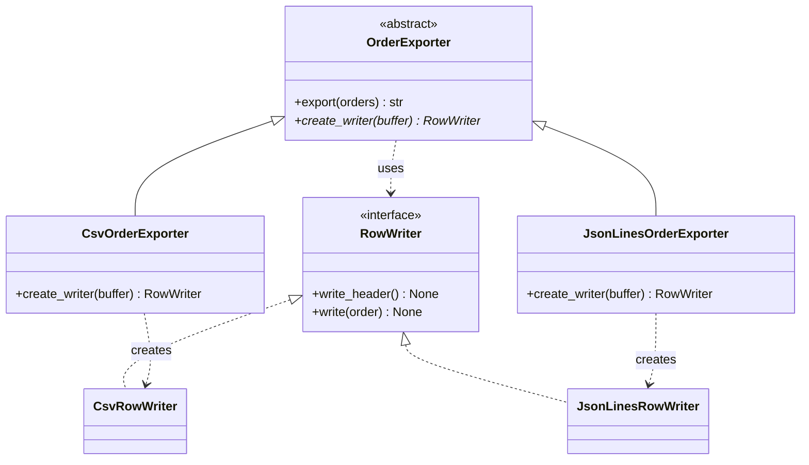
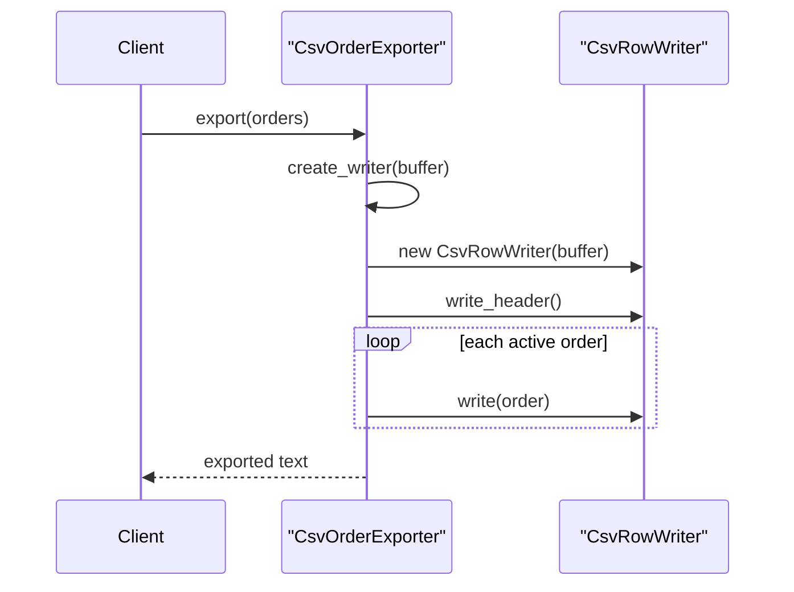

# Factory Method Pattern

## Introduction

The **Factory Method** pattern defines a method for creating an object, and lets **subclasses decide which class to create**. The rest of the base class works with the result through an interface, so it never needs to know the concrete class.

Think of a restaurant franchise. Head office writes the standard process for every order: take the order, prepare the dish, plate it, serve it. Each branch decides what "prepare the local special" means. The Tokyo branch and the Lisbon branch run the same process, but the dish in the middle is different. Head office's process is the base class. "Prepare the local special" is the factory method.

The name causes confusion, because people also call any function that returns an object "a factory." This page separates three related ideas:

| Term | What it is | Example |
| --- | --- | --- |
| **Simple factory** | A function or class that picks a class based on input | `make_notifier("sms")` |
| **Static factory method** (alternate constructor) | A named class-level method that returns an instance | `datetime.fromisoformat("2026-01-31")` |
| **Factory Method (GoF)** | An overridable method in a base class; subclasses choose the product | `Iterable.iterator()` in Java |

All three are useful. Only the last is the GoF pattern.

## The Problem: Creation Mixed Into the Workflow

The online bookstore sends nightly order exports to partners. One accounting partner wants CSV. A warehouse partner wants JSON Lines. The first version handles formats inline:

```python
import csv
import io
import json
from dataclasses import dataclass, asdict


@dataclass
class Order:
    id: int
    sku: str
    quantity: int
    total_cents: int


def export_orders(orders: list[Order], fmt: str) -> str:
    buffer = io.StringIO()
    if fmt == "csv":
        writer = csv.writer(buffer)
        writer.writerow(["id", "sku", "quantity", "total_cents"])
    for order in orders:
        if order.quantity == 0:
            continue  # skip cancelled lines
        if fmt == "csv":
            writer.writerow([order.id, order.sku, order.quantity, order.total_cents])
        elif fmt == "jsonl":
            buffer.write(json.dumps(asdict(order)) + "\n")
        else:
            raise ValueError(f"unknown format {fmt}")
    return buffer.getvalue()


orders = [Order(1, "BOOK-123", 2, 3998), Order(2, "BOOK-456", 0, 0), Order(3, "BOOK-789", 1, 1500)]
print(export_orders(orders, "csv"))
print(export_orders(orders, "jsonl"))
```

Output:

```text
id,sku,quantity,total_cents
1,BOOK-123,2,3998
3,BOOK-789,1,1500

{"id": 1, "sku": "BOOK-123", "quantity": 2, "total_cents": 3998}
{"id": 3, "sku": "BOOK-789", "quantity": 1, "total_cents": 1500}

```

The pain points:

- The format check appears **three times** inside one function. A third format (XML for a new partner) touches all three places.
- The shared workflow (filtering cancelled lines, buffering) is tangled with format details.
- You cannot test "the workflow skips cancelled lines" without also picking a format.

## The Pattern Applied

Split the code into two roles:

- A **Creator** that owns the workflow and declares a factory method `create_writer()`.
- **Concrete Creators** that override the factory method to return a specific **Product** (a row writer).

```python
from abc import ABC, abstractmethod
from typing import Protocol


class RowWriter(Protocol):
    """Product interface: something that can write orders to a buffer."""

    def write_header(self) -> None: ...
    def write(self, order: Order) -> None: ...


class CsvRowWriter:
    def __init__(self, buffer: io.StringIO) -> None:
        self._writer = csv.writer(buffer)

    def write_header(self) -> None:
        self._writer.writerow(["id", "sku", "quantity", "total_cents"])

    def write(self, order: Order) -> None:
        self._writer.writerow([order.id, order.sku, order.quantity, order.total_cents])


class JsonLinesRowWriter:
    def __init__(self, buffer: io.StringIO) -> None:
        self._buffer = buffer

    def write_header(self) -> None:
        pass  # JSON Lines has no header

    def write(self, order: Order) -> None:
        self._buffer.write(json.dumps(asdict(order)) + "\n")


class OrderExporter(ABC):
    """Creator: owns the workflow, defers the choice of writer."""

    def export(self, orders: list[Order]) -> str:
        buffer = io.StringIO()
        writer = self.create_writer(buffer)  # the factory method call
        writer.write_header()
        for order in orders:
            if order.quantity > 0:
                writer.write(order)
        return buffer.getvalue()

    @abstractmethod
    def create_writer(self, buffer: io.StringIO) -> RowWriter:
        """Factory method: subclasses decide which RowWriter to create."""


class CsvOrderExporter(OrderExporter):
    def create_writer(self, buffer: io.StringIO) -> RowWriter:
        return CsvRowWriter(buffer)


class JsonLinesOrderExporter(OrderExporter):
    def create_writer(self, buffer: io.StringIO) -> RowWriter:
        return JsonLinesRowWriter(buffer)


for exporter in (CsvOrderExporter(), JsonLinesOrderExporter()):
    print(type(exporter).__name__)
    print(exporter.export(orders), end="")
```

Output:

```text
CsvOrderExporter
id,sku,quantity,total_cents
1,BOOK-123,2,3998
3,BOOK-789,1,1500
JsonLinesOrderExporter
{"id": 1, "sku": "BOOK-123", "quantity": 2, "total_cents": 3998}
{"id": 3, "sku": "BOOK-789", "quantity": 1, "total_cents": 1500}
```

Adding XML now means adding one writer and one exporter subclass. `OrderExporter.export()` does not change. That is the [Open/Closed Principle](../1-arch-design-principles/2-arch-open-closed.mdx) in action.

### Structure



The `*` marks an abstract method. Notice the **parallel hierarchies**: one exporter subclass per writer class. That is typical of Factory Method, and it is also its main cost.



Factory Method is a special case of the [Template Method](../4-arch-behavioral-patterns/4-arch-template-method.mdx) pattern: `export()` is a template, and `create_writer()` is the one step that subclasses fill in.

## The Java Version

Factory Method was designed for languages where classes are not values you can pass around. In Java the shape is the same, and the compiler enforces the contract through the abstract method. This version is shown because the interface and abstract class make the roles explicit.

```java
import java.util.List;

interface RowWriter {
    void writeHeader(StringBuilder out);
    void write(StringBuilder out, Order order);
}

class Order {
    final int id; final String sku; final int quantity;
    Order(int id, String sku, int quantity) { this.id = id; this.sku = sku; this.quantity = quantity; }
}

class CsvRowWriter implements RowWriter {
    public void writeHeader(StringBuilder out) { out.append("id,sku,quantity\n"); }
    public void write(StringBuilder out, Order o) { out.append(o.id + "," + o.sku + "," + o.quantity + "\n"); }
}

abstract class OrderExporter {
    // The template: shared workflow that never names a concrete writer.
    public final String export(List<Order> orders) {
        StringBuilder out = new StringBuilder();
        RowWriter writer = createWriter();           // factory method
        writer.writeHeader(out);
        for (Order o : orders) {
            if (o.quantity > 0) writer.write(out, o);
        }
        return out.toString();
    }

    protected abstract RowWriter createWriter();     // subclasses decide
}

class CsvOrderExporter extends OrderExporter {
    @Override
    protected RowWriter createWriter() { return new CsvRowWriter(); }
}

public class FactoryMethodDemo {
    public static void main(String[] args) {
        OrderExporter exporter = new CsvOrderExporter();
        System.out.print(exporter.export(List.of(new Order(1, "BOOK-123", 2), new Order(2, "BOOK-456", 0))));
    }
}
```

Output:

```text
id,sku,quantity
1,BOOK-123,2
```

## The Pythonic Shortcut: Pass the Factory In

In Python, classes and functions are values. Instead of creating a subclass to override one method, you can pass the factory to the constructor. This is [composition over inheritance](../1-arch-design-principles/7-arch-composition-over-inheritance.mdx) applied to creation.

```python
from typing import Callable

WriterFactory = Callable[[io.StringIO], RowWriter]


class ComposableExporter:
    def __init__(self, writer_factory: WriterFactory) -> None:
        self._writer_factory = writer_factory

    def export(self, orders: list[Order]) -> str:
        buffer = io.StringIO()
        writer = self._writer_factory(buffer)
        writer.write_header()
        for order in orders:
            if order.quantity > 0:
                writer.write(order)
        return buffer.getvalue()


# A class is already a callable that returns an instance, so it is a valid factory.
csv_exporter = ComposableExporter(CsvRowWriter)
print(csv_exporter.export(orders), end="")

# A registry maps names to factories for configuration-driven choice.
EXPORTERS: dict[str, WriterFactory] = {"csv": CsvRowWriter, "jsonl": JsonLinesRowWriter}
partner_format = "jsonl"
print(ComposableExporter(EXPORTERS[partner_format]).export(orders), end="")
```

Output:

```text
id,sku,quantity,total_cents
1,BOOK-123,2,3998
3,BOOK-789,1,1500
{"id": 1, "sku": "BOOK-123", "quantity": 2, "total_cents": 3998}
{"id": 3, "sku": "BOOK-789", "quantity": 1, "total_cents": 1500}
```

The standard library does exactly this. `json.loads(text, parse_float=Decimal)` passes the `Decimal` class as a factory for numbers, and `collections.defaultdict(list)` takes `list` as the factory for missing values.

**Which one should you use?**

| Use subclassing (GoF Factory Method) when | Use an injected factory when |
| --- | --- |
| You are writing a framework base class that users extend anyway | The only variation is "which class to create" |
| The subclass also overrides other hooks | You want to choose at runtime from config |
| The product choice is tied to the subclass's identity | You want to avoid parallel class hierarchies |

## Static Factory Methods (Alternate Constructors)

A related, very common technique is a **named constructor** on the class itself. Joshua Bloch's *Effective Java* (Item 1) recommends static factory methods over constructors because they have names, can return cached instances, and can return a subtype.

```python
from dataclasses import dataclass
from datetime import date
from typing import Self


@dataclass(frozen=True)
class Isbn:
    digits: str

    @classmethod
    def from_string(cls, raw: str) -> Self:
        digits = raw.replace("-", "").replace(" ", "")
        if len(digits) != 13 or not digits.isdigit():
            raise ValueError(f"not an ISBN-13: {raw!r}")
        return cls(digits)


print(Isbn.from_string("978-0-13-468599-1"))
print(date.fromisoformat("2026-10-11"))  # stdlib alternate constructor
print(dict.fromkeys(["a", "b"], 0))      # another one
```

Output:

```text
Isbn(digits='9780134685991')
2026-10-11
{'a': 0, 'b': 0}
```

Using `classmethod` with `cls(...)` and a `Self` return type means a subclass of `Isbn` gets an instance of the subclass. That is a light echo of the GoF pattern, but these are usually called "alternate constructors," not Factory Method.

## Where You Have Already Met Factory Method

| Where | Creator | Factory method | Products |
| --- | --- | --- | --- |
| Java collections | `Iterable` / `Collection` | `iterator()` | `ArrayList` and `HashSet` each return their own `Iterator` class |
| Django class-based views | `FormMixin` | `get_form_class()` / `get_form()` | Your view subclass decides which form class to build |
| Python `pathlib` | `Path` | `Path(...)` constructor | Returns `PosixPath` or `WindowsPath` depending on the OS (a simple factory hidden in the constructor) |
| Python `json` | `json.loads` | `parse_float`, `object_hook` parameters | Injected factories, the Pythonic form |
| Java `Calendar.getInstance()` | `Calendar` | static method | A locale-appropriate `Calendar` subclass (a static factory method) |

## Real-World Scenario

The bookstore adds a third partner, a library consortium that wants XML. Meanwhile, the export job is growing shared behavior: it signs each file, uploads it, and retries on failure. The team has two options: keep growing the `if/elif` function, or let the workflow stay fixed while formats vary.

They choose an injected-factory design with a small registry, because the only variation between partners is the writer:

```python
from xml.sax.saxutils import escape


class XmlRowWriter:
    def __init__(self, buffer: io.StringIO) -> None:
        self._buffer = buffer

    def write_header(self) -> None:
        self._buffer.write("<orders>\n")

    def write(self, order: Order) -> None:
        self._buffer.write(
            f'  <order id="{order.id}" sku="{escape(order.sku)}" qty="{order.quantity}"/>\n'
        )


EXPORTERS["xml"] = XmlRowWriter

PARTNERS = {"acme-accounting": "csv", "fast-warehouse": "jsonl", "city-libraries": "xml"}


def nightly_export(partner: str, orders: list[Order]) -> str:
    exporter = ComposableExporter(EXPORTERS[PARTNERS[partner]])
    body = exporter.export(orders)
    # shared steps for every format: sign, upload, retry ...
    return body


print(nightly_export("city-libraries", orders), end="")
```

Output:

```text
<orders>
  <order id="1" sku="BOOK-123" qty="2"/>
  <order id="3" sku="BOOK-789" qty="1"/>
```

The XML writer has a small flaw on purpose: the header opens `<orders>` but nothing closes it. Fixing it shows the value of the pattern. Add a `write_footer()` method to the `RowWriter` protocol, call it once in `export()`, and every writer gets a consistent lifecycle. Try it in the exercises.

### Why this approach

- The workflow (filter, sign, upload, retry) is written once and tested once.
- Each format is a small class that is easy to unit test by itself.
- Partners map to formats in configuration, not in code branches.

### When to use it / when not to

**Use Factory Method (or an injected factory) when:**

- A workflow must create an object whose concrete class varies.
- You are building a framework or library and users need a hook to supply their own classes.
- You expect new variants over time, and they share the surrounding steps.

**Skip it when:**

- There is one product and no realistic second one. Call the constructor.
- The variation is a single value or a single function. Pass the value or the function.
- Every subclass would override the factory method *and* most other methods. Then you just have separate classes.

### Alternatives and trade-offs

| Approach | Pros | Cons | Best for |
| --- | --- | --- | --- |
| Direct constructor call | Clearest, no indirection | Locks in one class | One implementation |
| `if/elif` in place | Everything visible in one spot | Duplicated checks, grows badly | Two cases that rarely change |
| Simple factory / registry dict | One decision point, config-driven | Global registry to maintain | Picking a class by name at runtime |
| GoF Factory Method (subclass overrides) | Clear extension point for frameworks | Parallel class hierarchies | Framework base classes, plugin hooks |
| Injected factory (callable parameter) | No subclassing, easy to test | Less discoverable than an abstract method | Most Python application code |
| [Abstract Factory](./3-arch-abstract-factory.mdx) | Creates whole families consistently | More types and wiring | Several related products that must match |

## Related and Confusable Patterns

- **Template Method:** Factory Method is a Template Method whose varying step creates an object. See [Template Method Pattern](../4-arch-behavioral-patterns/4-arch-template-method.mdx).
- **Abstract Factory:** groups several factory methods into one object that creates a family of related products. See [Abstract Factory Pattern](./3-arch-abstract-factory.mdx).
- **Prototype:** creates new objects by cloning an example instead of subclassing a creator. See [Prototype Pattern](./5-arch-prototype.mdx).
- **Strategy:** an injected factory *looks* like Strategy. The difference is intent. Strategy swaps an algorithm. A factory swaps which object gets created. See [Strategy Pattern](../4-arch-behavioral-patterns/0-arch-strategy.mdx).
- **Dependency Injection:** an injected factory is DI where the dependency is "a way to make things." See [Dependency Injection](../1-arch-design-principles/10-arch-dependency-injection.mdx).

## Common Mistakes

1. **Calling every constructor wrapper a "factory method."** A function that only calls `Foo()` adds indirection with no benefit.
2. **Subclass explosion.** Five formats times three compression options gives fifteen subclasses. Compose two factories instead.
3. **Returning concrete types from the factory method.** If `create_writer()` is typed as `CsvRowWriter`, callers start to depend on CSV details. Return the interface.
4. **Hiding expensive work in a factory.** A factory that opens network connections surprises callers. Name it clearly, such as `connect()`, or document it.
5. **Using `type(x) == ...` checks after creation.** If callers inspect the concrete type, the abstraction has leaked.

## Summary

- Factory Method lets a base class define a workflow while subclasses choose which product to create.
- It removes repeated `if/elif` checks on type and keeps the workflow closed for modification.
- Its cost is parallel class hierarchies. In Python, passing a class or function as a factory often gives the same benefit with less code.
- Simple factories and alternate constructors (`from_string`, `fromisoformat`) are related, useful techniques, but they are not the GoF pattern.
- Do not add a factory until a second product, or a real need for a test seam, exists.

## Exercises

1. Add a `write_footer()` method to `RowWriter`, call it at the end of `export()`, and use it to close the `<orders>` element in `XmlRowWriter`.
2. Rewrite the subclass-based `OrderExporter` so that `create_writer` has a default implementation that returns `CsvRowWriter`. Which subclasses can you now delete?
3. Add gzip compression as an option for any format without creating a subclass per combination. Hint: compose a second factory, or wrap the writer with a [Decorator](../3-arch-structural-patterns/3-arch-decorator.mdx).
4. Find a method named `get_*_class()` or `create_*()` in a framework you use. Is it a GoF Factory Method, a simple factory, or something else?

**Next:** [Abstract Factory Pattern](./3-arch-abstract-factory.mdx). **Back:** [Singleton Pattern](./1-arch-singleton.mdx).

**Sources:** Refactoring.Guru, [Factory Method](https://refactoring.guru/design-patterns/factory-method); Brandon Rhodes, [The Factory Method Pattern](https://python-patterns.guide/gang-of-four/factory-method/); Django docs, [Editing mixins (FormMixin)](https://docs.djangoproject.com/en/stable/ref/class-based-views/mixins-editing/).
