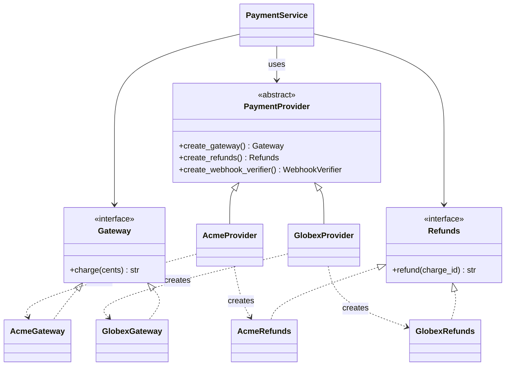
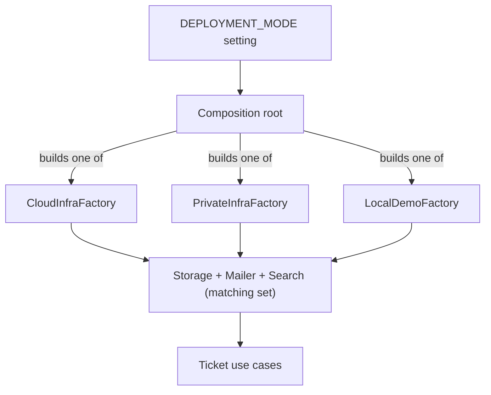

# Abstract Factory Pattern

## Introduction

The **Abstract Factory** pattern gives you one object whose job is to create a **family of related objects**, without the client naming any concrete class. Swap the factory and you swap the whole family at once.

Think of furniture collections in a store. A "Scandinavian" collection has a matching chair, table and lamp. A "Victorian" collection has its own chair, table and lamp. You would not want a Scandinavian chair with a Victorian table in a catalog photo. If you pick the collection once and get every piece from it, mismatches cannot happen.

[Factory Method](./2-arch-factory-method.mdx) answers "which class should this *one* object be?" Abstract Factory answers "which *family* should *all of these* objects come from, so they work together?"

## The Problem: Mixed Families

The online bookstore takes card payments through a payment provider. Each provider needs three objects that must match:

- a **gateway** that charges a card
- a **refund client** that reverses a charge
- a **webhook verifier** that checks notifications the provider sends back

The bookstore is moving from one provider to another, so for a while both exist. The providers here are fictional, "AcmePay" and "GlobexPay," so the example does not imitate a real API. The first version picks classes wherever they are needed:

```python
import os


class AcmeGateway:
    def charge(self, cents: int) -> str:
        return f"acme_ch_{cents}"


class AcmeRefunds:
    def refund(self, charge_id: str) -> str:
        if not charge_id.startswith("acme_"):
            raise ValueError(f"Acme cannot refund {charge_id}")
        return f"acme_re_{charge_id}"


class GlobexGateway:
    def charge(self, cents: int) -> str:
        return f"gx-charge-{cents}"


class GlobexRefunds:
    def refund(self, charge_id: str) -> str:
        if not charge_id.startswith("gx-"):
            raise ValueError(f"Globex cannot refund {charge_id}")
        return f"gx-refund-{charge_id}"


def checkout(cents: int) -> str:
    if os.environ.get("PAYMENT_PROVIDER", "acme") == "acme":
        return AcmeGateway().charge(cents)
    return GlobexGateway().charge(cents)


def cancel_order(charge_id: str) -> str:
    # Someone copied this branch from an older file with a different env var name.
    if os.environ.get("PAYMENTS", "acme") == "acme":
        return AcmeRefunds().refund(charge_id)
    return GlobexRefunds().refund(charge_id)


os.environ["PAYMENT_PROVIDER"] = "globex"
charge_id = checkout(2599)
print("charged:", charge_id)
try:
    print(cancel_order(charge_id))
except ValueError as exc:
    print("refund failed:", exc)
```

Output:

```text
charged: gx-charge-2599
refund failed: Acme cannot refund gx-charge-2599
```

The code charged with GlobexPay and tried to refund with AcmePay. Nothing in the types stopped it. The problems:

- The "which provider?" decision is made **separately** for each product, so the decisions can disagree.
- Adding a third provider means finding every `if` in the codebase.
- Tests must set environment variables to control behavior.

## The Pattern Applied

Abstract Factory has four roles:

| Role | In this example |
| --- | --- |
| **Abstract products** | `Gateway`, `Refunds`, `WebhookVerifier` interfaces |
| **Concrete products** | `AcmeGateway`, `GlobexRefunds`, and so on |
| **Abstract factory** | `PaymentProvider` with one `create_*` method per product |
| **Concrete factories** | `AcmeProvider`, `GlobexProvider`, `FakeProvider` |

```python
import hashlib
import hmac
from abc import ABC, abstractmethod
from typing import Protocol


# --- Abstract products ---
class Gateway(Protocol):
    def charge(self, cents: int) -> str: ...


class Refunds(Protocol):
    def refund(self, charge_id: str) -> str: ...


class WebhookVerifier(Protocol):
    def verify(self, body: bytes, signature: str) -> bool: ...


# --- Shared helper for the HMAC-based verifiers ---
class HmacVerifier:
    def __init__(self, secret: bytes) -> None:
        self._secret = secret

    def verify(self, body: bytes, signature: str) -> bool:
        expected = hmac.new(self._secret, body, hashlib.sha256).hexdigest()
        return hmac.compare_digest(expected, signature)


# --- Abstract factory ---
class PaymentProvider(ABC):
    name: str

    @abstractmethod
    def create_gateway(self) -> Gateway: ...

    @abstractmethod
    def create_refunds(self) -> Refunds: ...

    @abstractmethod
    def create_webhook_verifier(self) -> WebhookVerifier: ...


# --- Concrete factories: each returns one consistent family ---
class AcmeProvider(PaymentProvider):
    name = "acme"

    def __init__(self, webhook_secret: bytes) -> None:
        self._secret = webhook_secret

    def create_gateway(self) -> Gateway:
        return AcmeGateway()

    def create_refunds(self) -> Refunds:
        return AcmeRefunds()

    def create_webhook_verifier(self) -> WebhookVerifier:
        return HmacVerifier(self._secret)


class GlobexProvider(PaymentProvider):
    name = "globex"

    def __init__(self, webhook_secret: bytes) -> None:
        self._secret = webhook_secret

    def create_gateway(self) -> Gateway:
        return GlobexGateway()

    def create_refunds(self) -> Refunds:
        return GlobexRefunds()

    def create_webhook_verifier(self) -> WebhookVerifier:
        return HmacVerifier(self._secret)
```

The client code receives **one** factory and gets every product from it:

```python
class PaymentService:
    def __init__(self, provider: PaymentProvider) -> None:
        self._gateway = provider.create_gateway()
        self._refunds = provider.create_refunds()
        self._verifier = provider.create_webhook_verifier()

    def checkout(self, cents: int) -> str:
        return self._gateway.charge(cents)

    def cancel(self, charge_id: str) -> str:
        return self._refunds.refund(charge_id)

    def handle_webhook(self, body: bytes, signature: str) -> str:
        return "accepted" if self._verifier.verify(body, signature) else "rejected"


def provider_from_config(name: str, secret: bytes) -> PaymentProvider:
    providers: dict[str, type[PaymentProvider]] = {"acme": AcmeProvider, "globex": GlobexProvider}
    return providers[name](secret)


service = PaymentService(provider_from_config("globex", b"whsec_demo"))
cid = service.checkout(2599)
print("charged:", cid)
print("refunded:", service.cancel(cid))

body = b'{"event":"charge.succeeded"}'
good_sig = hmac.new(b"whsec_demo", body, hashlib.sha256).hexdigest()
print("webhook:", service.handle_webhook(body, good_sig))
print("webhook:", service.handle_webhook(body, "forged"))
```

Output:

```text
charged: gx-charge-2599
refunded: gx-refund-gx-charge-2599
webhook: accepted
webhook: rejected
```

The provider is chosen **once**, in `provider_from_config`. A mismatched refund is now impossible unless someone deliberately builds a broken factory.

### Structure



The webhook verifier is left out of the diagram to keep it readable. Read the diagram in two directions:

- **Down a column** (Acme or Globex): the family that belongs together.
- **Across a row** (Gateway or Refunds): the interface that client code depends on.

`PaymentService` only touches the abstract row types. That is [Dependency Inversion](../1-arch-design-principles/5-arch-dependency-inversion.mdx).

## Testing Becomes Easy

A third concrete factory gives you a full fake family for tests, with no environment variables and no network:

```python
class FakeGateway:
    def __init__(self) -> None:
        self.charges: list[int] = []

    def charge(self, cents: int) -> str:
        self.charges.append(cents)
        return f"fake_{len(self.charges)}"


class FakeRefunds:
    def refund(self, charge_id: str) -> str:
        return f"refunded_{charge_id}"


class AlwaysValid:
    def verify(self, body: bytes, signature: str) -> bool:
        return True


class FakeProvider(PaymentProvider):
    name = "fake"

    def __init__(self) -> None:
        self.gateway = FakeGateway()

    def create_gateway(self) -> Gateway:
        return self.gateway

    def create_refunds(self) -> Refunds:
        return FakeRefunds()

    def create_webhook_verifier(self) -> WebhookVerifier:
        return AlwaysValid()


fake = FakeProvider()
svc = PaymentService(fake)
svc.checkout(1000)
svc.checkout(500)
print(fake.gateway.charges, svc.cancel("fake_1"))
```

Output:

```text
[1000, 500] refunded_fake_1
```

## The TypeScript Version

TypeScript is shown here because its interfaces make the "two directions" of the pattern very visible, and because front-end code often uses Abstract Factory for UI themes or platform-specific widgets. This short version uses the same payment idea:

```typescript
interface Gateway { charge(cents: number): string; }
interface Refunds { refund(chargeId: string): string; }

interface PaymentProvider {
  createGateway(): Gateway;
  createRefunds(): Refunds;
}

class GlobexGateway implements Gateway {
  charge(cents: number): string { return `gx-charge-${cents}`; }
}
class GlobexRefunds implements Refunds {
  refund(chargeId: string): string { return `gx-refund-${chargeId}`; }
}

class GlobexProvider implements PaymentProvider {
  createGateway(): Gateway { return new GlobexGateway(); }
  createRefunds(): Refunds { return new GlobexRefunds(); }
}

function runCheckout(provider: PaymentProvider): void {
  const id = provider.createGateway().charge(2599);
  console.log(provider.createRefunds().refund(id));
}

runCheckout(new GlobexProvider());
```

Output:

```text
gx-refund-gx-charge-2599
```

TypeScript uses structural typing, so the `implements` clauses are optional. They are still worth writing, because the compiler then reports a missing method on the class that forgot it, instead of at some distant call site.

## The Pythonic Shortcut

Brandon Rhodes argues in his *Python Design Patterns* guide that Abstract Factory is mostly a workaround for languages without first-class classes. In Python, a "factory" can be a plain object that holds the classes of a family:

```python
from dataclasses import dataclass
from typing import Callable


@dataclass(frozen=True)
class ProviderFamily:
    gateway: Callable[[], Gateway]
    refunds: Callable[[], Refunds]


FAMILIES = {
    "acme": ProviderFamily(gateway=AcmeGateway, refunds=AcmeRefunds),
    "globex": ProviderFamily(gateway=GlobexGateway, refunds=GlobexRefunds),
}

family = FAMILIES["acme"]
cid = family.gateway().charge(1200)
print(family.refunds().refund(cid))
```

Output:

```text
acme_re_acme_ch_1200
```

This keeps the key benefit (one choice picks the whole family) with less code. The class-based version is still a good choice when products need constructor arguments from the factory, such as the webhook secret, or when you want an ABC to force every provider to supply every product.

## Where You Have Already Met Abstract Factory

| Where | Abstract factory | Family it creates |
| --- | --- | --- |
| Python DB-API drivers (PEP 249) | A connection from `sqlite3`, `psycopg` and others | `connection.cursor()` returns that driver's matching cursor class |
| Django database backends | `BaseDatabaseWrapper` | `ops_class`, `features_class`, `introspection_class`, `client_class` and others, one set per database |
| Java JDBC | `java.sql.Connection` | `createStatement()`, `prepareStatement()` objects from the same driver |
| Java XML | `DocumentBuilderFactory.newInstance()` | A parser implementation and its matching document builders |
| UI toolkits and design systems | A theme or platform "kit" | Buttons, inputs and dialogs that share one look and behavior |

The database examples are good to study. Each driver brings a full family of classes that understand its own SQL dialect and wire protocol, and the framework never mixes them.

## Real-World Scenario

Your team builds a SaaS helpdesk that customers can run in **three environments**: your public cloud, a customer's private cloud, and an offline "local demo" mode for sales laptops. Each environment needs a matching set of infrastructure adapters:

| Product | Public cloud | Private cloud | Local demo |
| --- | --- | --- | --- |
| File storage | Object storage service | Customer's S3-compatible store | Local folder |
| Email sender | Transactional email API | Customer's SMTP relay | Prints to console |
| Search index | Managed search service | Self-hosted search | In-memory list |

Mixing them causes subtle bugs. For example, if the demo writes attachments to a local folder but sends emails that link to object-storage URLs, every link in the demo is broken.

The team defines an `InfrastructureFactory` with `create_storage()`, `create_mailer()` and `create_search()`, and writes three concrete factories. The application's composition root reads one setting, `DEPLOYMENT_MODE`, and builds the matching factory. Each use case receives the products it needs.



This is the same idea as the "adapters" in [Hexagonal Architecture](../7-arch-clean-architecture/0-arch-hexagonal.mdx). The abstract factory is one tidy way to build a consistent set of adapters.

### Why this approach

- The deployment mode is decided **once**, so mismatched adapters cannot happen by accident.
- Adding a fourth environment is a new factory class. No use case changes.
- Tests and demos get a full in-memory family for free.

### When to use it / when not to

**Use Abstract Factory when:**

- You have **two or more products** that must come from the same family.
- You have **two or more families** today, or a concrete plan for the second.
- Client code should not know which family it is using.

**Skip it when:**

- There is only one product. A [Factory Method](./2-arch-factory-method.mdx) or an injected callable is enough.
- There is only one family. Construct the objects directly in the composition root.
- Families change often in *which products they contain*. Adding a new product type means changing the abstract factory and **every** concrete factory. That is the pattern's main weakness.

### Alternatives and trade-offs

| Approach | Pros | Cons | Best for |
| --- | --- | --- | --- |
| Separate factories per product | Simple, independent | Products can mismatch | Products that do not depend on each other |
| Abstract Factory (ABC + concrete factories) | Families guaranteed consistent, enforced by the ABC | New product type touches every factory | Stable product sets with several families |
| Family as data (dataclass of classes) | Very little code, Pythonic | Weaker enforcement, harder to pass shared config | Python apps with simple constructors |
| DI container with profiles (e.g. Spring profiles) | Framework handles wiring | Framework coupling, "magic" | Large apps already using a container |
| [Builder](./4-arch-builder.mdx) | Step-by-step control | Creates one complex object, not a family | One object with many parts |

## Related and Confusable Patterns

- **Factory Method:** one overridable creation method. An Abstract Factory is often *implemented* with several factory methods.
- **Builder:** builds one complex object step by step. Abstract Factory returns finished products right away.
- **Prototype:** a factory can create products by cloning registered prototypes instead of calling constructors. See [Prototype Pattern](./5-arch-prototype.mdx).
- **Bridge:** separates an abstraction from its implementation. An Abstract Factory is often used to create the right implementation for a Bridge. See [Bridge Pattern](../3-arch-structural-patterns/1-arch-bridge.mdx).
- **Singleton:** a concrete factory is often created once per process, but it does not have to be a GoF Singleton. Inject it.

## Common Mistakes

1. **One-product abstract factories.** If the factory has a single `create_*` method, it is a Factory Method in disguise.
2. **Leaking the family through concrete types.** If client code checks `isinstance(gateway, AcmeGateway)`, the abstraction has failed.
3. **Factories that do too much.** A factory should create products, not run business logic or call remote APIs at creation time.
4. **Building the factory deep in the call stack.** Choose the family in the composition root, then pass the factory or its products down.
5. **Forgetting the cost of new product types.** Before adopting the pattern, ask how often the *set of products* will change. If often, consider a more flexible registry.

## Summary

- Abstract Factory creates **families of related objects** through one interface, so the family is chosen once and products always match.
- It shines when several products must agree, such as database driver classes, payment provider clients, or environment-specific adapters.
- Swapping the factory swaps the whole family, which makes fake families for tests easy.
- Its main cost is rigidity: adding a new product type changes every factory.
- In Python, a simple object that holds a family's classes is often enough. Use the full ABC version when you need enforcement or shared configuration.

## Exercises

1. Add a `create_webhook_verifier()` implementation to `FakeProvider` that records every body it was asked to verify. Write a test that checks a webhook was processed.
2. Add a third provider, "InitechPay," with charge IDs starting with `ini_`. How many files did you change outside the new provider?
3. Add a fourth product, `create_payout_client()`, to `PaymentProvider`. Count how many classes changed. When would this cost make you choose a different design?
4. Look at the Python DB-API (PEP 249). Which objects form the "family" that a driver must provide?

**Next:** [Builder Pattern](./4-arch-builder.mdx). **Back:** [Factory Method Pattern](./2-arch-factory-method.mdx).

**Sources:** Refactoring.Guru, [Abstract Factory](https://refactoring.guru/design-patterns/abstract-factory); Brandon Rhodes, [The Abstract Factory Pattern](https://python-patterns.guide/gang-of-four/abstract-factory/); [PEP 249 – Python Database API Specification v2.0](https://peps.python.org/pep-0249/); Django source, [django/db/backends/base/base.py](https://github.com/django/django/blob/main/django/db/backends/base/base.py).
