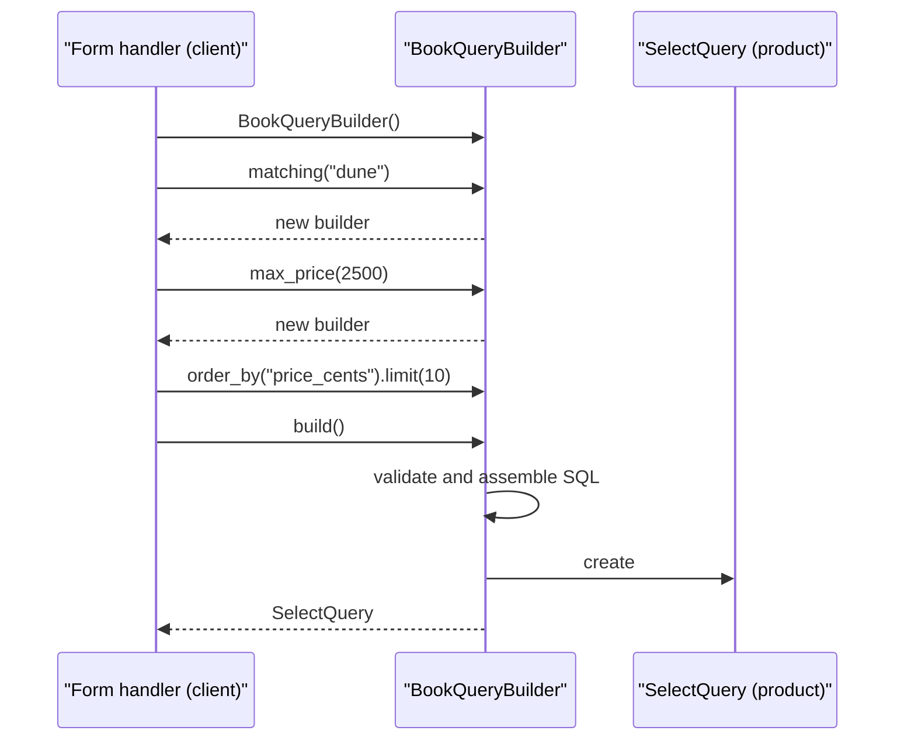
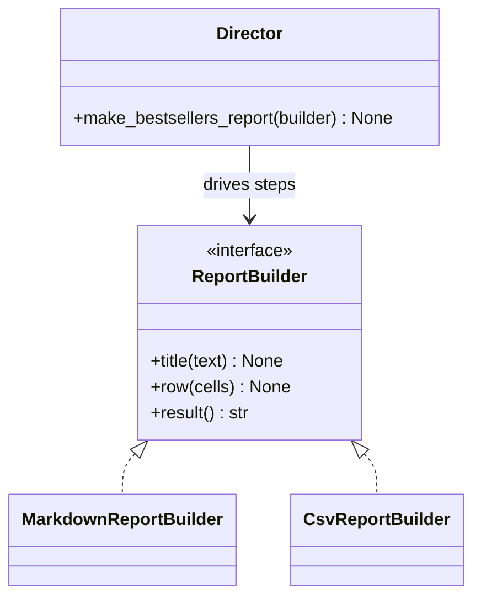

# Builder Pattern

## Introduction

The **Builder** pattern separates **how an object is assembled** from **the object itself**. Instead of one giant constructor call, you configure the object in small, named steps, and then ask for the finished result.

Think of ordering a sandwich at a deli counter. You do not shout one 14-word sentence. You say "wheat bread," then "turkey," then "no onions," then "toasted." The person behind the counter checks each choice ("we are out of rye") and only hands you the sandwich at the end, when it is complete. You never receive half a sandwich.

Builder is the creational pattern that changes the most between languages. In Java it is everywhere, because Java has no keyword arguments. In Python, keyword arguments with defaults remove the most common reason for it. This page shows both, so you can tell when a Builder earns its keep.

## The Problem: Telescoping Constructors

Here is a Java class for a bookstore search request. Most fields are optional:

```java
public class BookSearch {
    private final String text;
    private final String author;
    private final Integer maxPriceCents;
    private final boolean inStockOnly;
    private final String sortBy;
    private final int limit;

    public BookSearch(String text) { this(text, null); }
    public BookSearch(String text, String author) { this(text, author, null); }
    public BookSearch(String text, String author, Integer maxPriceCents) {
        this(text, author, maxPriceCents, false);
    }
    public BookSearch(String text, String author, Integer maxPriceCents, boolean inStockOnly) {
        this(text, author, maxPriceCents, inStockOnly, "relevance", 20);
    }
    public BookSearch(String text, String author, Integer maxPriceCents,
                      boolean inStockOnly, String sortBy, int limit) {
        this.text = text; this.author = author; this.maxPriceCents = maxPriceCents;
        this.inStockOnly = inStockOnly; this.sortBy = sortBy; this.limit = limit;
    }

    public static void main(String[] args) {
        // What do null, 2500, true, "price", 10 mean? You have to count positions.
        BookSearch s = new BookSearch("dune", null, 2500, true, "price", 10);
        System.out.println(s.text + " " + s.maxPriceCents + " " + s.sortBy);
    }
}
```

Output:

```text
dune 2500 price
```

This is the **telescoping constructor** problem. Each constructor adds one parameter and calls the next. The call site `new BookSearch("dune", null, 2500, true, "price", 10)` is unreadable, and swapping two `int` arguments compiles fine but produces a wrong search.

## The Builder Applied (Java)

Joshua Bloch's *Effective Java* (Item 2) recommends a builder "when faced with many constructor parameters." The builder has one method per option, each returning the builder so calls can be chained, and a `build()` method that validates and returns an immutable object.

```java
public final class BookQuery {
    private final String text;
    private final String author;
    private final Integer maxPriceCents;
    private final boolean inStockOnly;
    private final String sortBy;
    private final int limit;

    private BookQuery(Builder b) {
        this.text = b.text; this.author = b.author; this.maxPriceCents = b.maxPriceCents;
        this.inStockOnly = b.inStockOnly; this.sortBy = b.sortBy; this.limit = b.limit;
    }

    public static Builder builder(String text) { return new Builder(text); }

    public static final class Builder {
        private final String text;           // required
        private String author;               // optional fields with defaults
        private Integer maxPriceCents;
        private boolean inStockOnly = false;
        private String sortBy = "relevance";
        private int limit = 20;

        private Builder(String text) { this.text = text; }

        public Builder author(String author) { this.author = author; return this; }
        public Builder maxPriceCents(int cents) { this.maxPriceCents = cents; return this; }
        public Builder inStockOnly() { this.inStockOnly = true; return this; }
        public Builder sortBy(String field) { this.sortBy = field; return this; }
        public Builder limit(int limit) { this.limit = limit; return this; }

        public BookQuery build() {
            if (limit < 1 || limit > 100) throw new IllegalArgumentException("limit must be 1..100");
            if (sortBy.equals("price") && maxPriceCents == null && !inStockOnly) {
                // a cross-field rule: easy to enforce in one place
                System.out.println("hint: price sorting works best with a price filter");
            }
            return new BookQuery(this);
        }
    }

    @Override public String toString() {
        return "BookQuery[text=" + text + ", author=" + author + ", maxPrice=" + maxPriceCents
            + ", inStock=" + inStockOnly + ", sort=" + sortBy + ", limit=" + limit + "]";
    }

    public static void main(String[] args) {
        BookQuery q = BookQuery.builder("dune")
            .maxPriceCents(2500)
            .inStockOnly()
            .sortBy("price")
            .limit(10)
            .build();
        System.out.println(q);
    }
}
```

Output:

```text
BookQuery[text=dune, author=null, maxPrice=2500, inStock=true, sort=price, limit=10]
```

Every argument now has a name at the call site, the finished `BookQuery` is immutable, and validation runs once in `build()`. Java is used for this section because the pattern solves a Java language gap. Tools such as Lombok's `@Builder` annotation generate this boilerplate for you.

## In Python, Start With Keyword Arguments

Python already has named, optional arguments. A frozen dataclass solves the telescoping constructor with no Builder at all:

```python
from dataclasses import dataclass


@dataclass(frozen=True, kw_only=True)
class BookQuery:
    text: str
    author: str | None = None
    max_price_cents: int | None = None
    in_stock_only: bool = False
    sort_by: str = "relevance"
    limit: int = 20

    def __post_init__(self) -> None:
        if not 1 <= self.limit <= 100:
            raise ValueError("limit must be between 1 and 100")
        if self.sort_by not in {"relevance", "price", "title"}:
            raise ValueError(f"cannot sort by {self.sort_by!r}")


q = BookQuery(text="dune", max_price_cents=2500, in_stock_only=True, sort_by="price", limit=10)
print(q)

try:
    BookQuery(text="dune", limit=500)
except ValueError as exc:
    print("rejected:", exc)
```

Output:

```text
BookQuery(text='dune', author=None, max_price_cents=2500, in_stock_only=True, sort_by='price', limit=10)
rejected: limit must be between 1 and 100
```

No Builder class was needed: `kw_only=True` forces every argument to be named, `frozen=True` makes the result immutable, and `__post_init__` validates. For **most** Python value objects, this is the right answer, and a Builder would be over-engineering.

:::tip
A Python Builder is worth it when construction is **a process**, not just a list of values: when the object is assembled over several steps or from several sources, when steps have an order or can repeat, or when you want to produce different representations from the same steps.
:::

## When a Python Builder Earns Its Keep

### Example: a safe SQL query builder

A search screen adds filters one at a time, depending on what the user filled in. Each filter adds SQL text **and** a bound parameter. Building that with string concatenation in a view function invites SQL injection and bugs. A builder keeps the rules in one place.

```python
from dataclasses import dataclass, replace
from typing import Any, Self


@dataclass(frozen=True)
class SelectQuery:
    sql: str
    params: tuple[Any, ...]


@dataclass(frozen=True)
class BookQueryBuilder:
    _where: tuple[str, ...] = ()
    _params: tuple[Any, ...] = ()
    _order_by: str = "title"
    _limit: int = 20

    # Each step returns a NEW builder, so partial builders can be safely reused.
    def matching(self, text: str) -> Self:
        return replace(self, _where=self._where + ("title LIKE ?",), _params=self._params + (f"%{text}%",))

    def by_author(self, author: str) -> Self:
        return replace(self, _where=self._where + ("author = ?",), _params=self._params + (author,))

    def max_price(self, cents: int) -> Self:
        return replace(self, _where=self._where + ("price_cents <= ?",), _params=self._params + (cents,))

    def in_stock(self) -> Self:
        return replace(self, _where=self._where + ("stock > 0",))

    def order_by(self, column: str) -> Self:
        if column not in {"title", "price_cents", "published_on"}:
            raise ValueError(f"cannot order by {column!r}")  # never interpolate user input
        return replace(self, _order_by=column)

    def limit(self, n: int) -> Self:
        if not 1 <= n <= 100:
            raise ValueError("limit must be between 1 and 100")
        return replace(self, _limit=n)

    def build(self) -> SelectQuery:
        sql = "SELECT id, title, price_cents FROM books"
        if self._where:
            sql += " WHERE " + " AND ".join(self._where)
        sql += f" ORDER BY {self._order_by} LIMIT ?"
        return SelectQuery(sql, self._params + (self._limit,))


# The form handler adds steps only for the fields the user filled in.
form = {"text": "dune", "max_price": "2500", "author": "", "in_stock": "on"}

builder = BookQueryBuilder()
if form["text"]:
    builder = builder.matching(form["text"])
if form["author"]:
    builder = builder.by_author(form["author"])
if form["max_price"]:
    builder = builder.max_price(int(form["max_price"]))
if form.get("in_stock"):
    builder = builder.in_stock()

query = builder.order_by("price_cents").limit(10).build()
print(query.sql)
print(query.params)
```

Output:

```text
SELECT id, title, price_cents FROM books WHERE title LIKE ? AND price_cents <= ? AND stock > 0 ORDER BY price_cents LIMIT ?
('%dune%', 2500, 10)
```

Now run the built query against a real (in-memory) SQLite database:

```python
import sqlite3

db = sqlite3.connect(":memory:")
db.execute("CREATE TABLE books (id INTEGER PRIMARY KEY, title TEXT, author TEXT, price_cents INT, stock INT)")
db.executemany(
    "INSERT INTO books (title, author, price_cents, stock) VALUES (?, ?, ?, ?)",
    [("Dune", "Frank Herbert", 1999, 3), ("Dune Messiah", "Frank Herbert", 1599, 0),
     ("Children of Dune", "Frank Herbert", 2799, 5), ("Neuromancer", "William Gibson", 1499, 2)],
)
for row in db.execute(query.sql, query.params):
    print(row)
```

Output:

```text
(1, 'Dune', 1999)
```

"Dune Messiah" is out of stock and "Children of Dune" is over the price limit, so only one row matches.

Three things make this a real Builder rather than a long constructor:

- Construction is **conditional and incremental**: steps depend on which form fields were filled.
- Each step keeps **two things in sync** (SQL fragment and parameter), which is easy to get wrong by hand.
- `build()` produces a **different representation** (SQL text plus parameters) from the steps.

Because each step returns a new frozen builder, you can keep a base query and branch from it without the branches interfering. This "generative" style is exactly how SQLAlchemy's `select(...).where(...).order_by(...)` works.

### Structure





The second diagram shows the optional **Director** role from the GoF book: an object that knows a *recipe* (the order of steps) and can drive any builder that follows the interface. You will build it next.

### The Director: same steps, different representations

```python
from typing import Protocol


class ReportBuilder(Protocol):
    def title(self, text: str) -> None: ...
    def row(self, cells: list[str]) -> None: ...
    def result(self) -> str: ...


class MarkdownReportBuilder:
    def __init__(self) -> None:
        self._lines: list[str] = []

    def title(self, text: str) -> None:
        self._lines += [f"## {text}", "", "| Title | Sold |", "| --- | --- |"]

    def row(self, cells: list[str]) -> None:
        self._lines.append("| " + " | ".join(cells) + " |")

    def result(self) -> str:
        return "\n".join(self._lines)


class CsvReportBuilder:
    def __init__(self) -> None:
        self._lines: list[str] = []

    def title(self, text: str) -> None:
        self._lines.append("title,sold")

    def row(self, cells: list[str]) -> None:
        self._lines.append(",".join(cells))

    def result(self) -> str:
        return "\n".join(self._lines)


def make_bestsellers_report(builder: ReportBuilder, sales: dict[str, int]) -> str:
    """Director: knows the recipe, not the format."""
    builder.title("Bestsellers this week")
    for title, sold in sorted(sales.items(), key=lambda kv: -kv[1]):
        builder.row([title, str(sold)])
    return builder.result()


sales = {"Dune": 120, "Neuromancer": 75, "Snow Crash": 98}
print(make_bestsellers_report(MarkdownReportBuilder(), sales))
print()
print(make_bestsellers_report(CsvReportBuilder(), sales))
```

Output:

```text
## Bestsellers this week

| Title | Sold |
| --- | --- |
| Dune | 120 |
| Snow Crash | 98 |
| Neuromancer | 75 |

title,sold
Dune,120
Snow Crash,98
Neuromancer,75
```

In Python the Director is often just a function, as here. Most modern builders skip the Director and let the client call steps directly.

## Where You Have Already Met Builder

| Where | Builder | Product |
| --- | --- | --- |
| Java `StringBuilder` | `append(...)` steps | `toString()` returns the final `String` |
| Java 11+ `java.net.http` | `HttpRequest.newBuilder().uri(...).header(...).GET()` | `build()` returns an immutable `HttpRequest` |
| SQLAlchemy 2.x | `select(Book).where(...).order_by(...)` | A SQL statement, each step returning a new object |
| Protocol Buffers (Java) | Generated `Message.newBuilder()` | Immutable message objects |
| Lombok `@Builder` | Annotation-generated builder class | Your Java class |
| Python `io.StringIO`, `list.append` + `"".join` | Incremental assembly | A final string |

## Real-World Scenario

The bookstore's test suite has 600 tests that create `Order` objects. An `Order` needs a customer, an address, at least one line item, a payment status and a currency. Every test builds all of that by hand, so when the team adds a required `tax_region` field, 600 tests break, even though only 4 of them care about tax.

The team introduces **test data builders**, a Builder variant described by Nat Pryce and Steve Freeman in *Growing Object-Oriented Software, Guided by Tests*. The builder starts with sensible defaults, and each test overrides only what it cares about.

```python
from dataclasses import dataclass, replace
from typing import Self


@dataclass(frozen=True)
class LineItem:
    sku: str
    quantity: int
    unit_cents: int


@dataclass(frozen=True)
class Order:
    customer_email: str
    country: str
    tax_region: str
    items: tuple[LineItem, ...]
    paid: bool

    @property
    def total_cents(self) -> int:
        return sum(i.quantity * i.unit_cents for i in self.items)


@dataclass(frozen=True)
class AnOrder:
    """Test data builder with safe defaults."""
    _email: str = "reader@example.com"
    _country: str = "US"
    _tax_region: str = "US-CA"
    _items: tuple[LineItem, ...] = (LineItem("BOOK-1", 1, 1000),)
    _paid: bool = True

    def for_customer(self, email: str) -> Self:
        return replace(self, _email=email)

    def shipped_to(self, country: str, tax_region: str) -> Self:
        return replace(self, _country=country, _tax_region=tax_region)

    def with_item(self, sku: str, quantity: int = 1, unit_cents: int = 1000) -> Self:
        return replace(self, _items=self._items + (LineItem(sku, quantity, unit_cents),))

    def unpaid(self) -> Self:
        return replace(self, _paid=False)

    def build(self) -> Order:
        return Order(self._email, self._country, self._tax_region, self._items, self._paid)


def test_unpaid_orders_are_not_shipped() -> None:
    order = AnOrder().unpaid().build()          # only states what matters
    assert order.paid is False


def test_total_includes_all_items() -> None:
    order = AnOrder().with_item("BOOK-2", quantity=2, unit_cents=1500).build()
    assert order.total_cents == 1000 + 3000


test_unpaid_orders_are_not_shipped()
test_total_includes_all_items()
print(AnOrder().shipped_to("DE", "DE-BY").build())
```

Output:

```text
Order(customer_email='reader@example.com', country='DE', tax_region='DE-BY', items=(LineItem(sku='BOOK-1', quantity=1, unit_cents=1000),), paid=True)
```

When the next required field arrives, the team adds one default to `AnOrder`, and the 600 tests keep passing.

### Why this approach

- Each test **reads like its intent**: `AnOrder().unpaid()` says exactly what the test is about.
- Defaults live in **one place**, so schema changes cost one edit.
- The builder is immutable, so a shared base such as `german_order = AnOrder().shipped_to("DE", "DE-BY")` can be reused safely across tests.

### When to use it / when not to

**Use Builder when:**

- An object has many optional parts **and** your language lacks keyword arguments (Java, C#, Go structs with invariants).
- Construction is a multi-step process, conditional, or driven by external input (query builders, document generators, request builders).
- You want an immutable product but need to assemble it gradually.
- The same steps should produce different representations (a Director with several builders).

**Skip it when:**

- In Python or Kotlin, keyword arguments with defaults and a validated dataclass already give named, optional parameters.
- The object has three or four fields. A constructor is clearer.
- The builder simply mirrors every field with a setter and adds no validation or logic. That is boilerplate without benefit.

### Alternatives and trade-offs

| Approach | Pros | Cons | Best for |
| --- | --- | --- | --- |
| Constructor with positional args | Short | Unreadable with many args, easy to swap values | Few required fields |
| Keyword args + frozen dataclass | Named, immutable, validated, no extra class | All values must be known at one moment | Most Python value objects |
| Mutable object + setters | Easy incremental assembly | Half-built objects can escape, not thread-safe | Rarely a good idea |
| Mutable Builder (Java style) | Readable, validates in `build()` | Extra class, builder not safe to share | Java/C# objects with many options |
| Immutable (generative) Builder | Branching and reuse are safe | Creates many small objects | Query builders, test data builders |
| Factory / [Abstract Factory](./3-arch-abstract-factory.mdx) | One call, choice of class | No step-by-step control | Choosing *which* class, not *how* to assemble |

## Related and Confusable Patterns

- **Abstract Factory** returns finished products immediately and focuses on *which family*. Builder focuses on *how* one complex product is assembled. See [Abstract Factory Pattern](./3-arch-abstract-factory.mdx).
- **Fluent interface** is a style of chaining calls that return `self`. Many builders are fluent, but fluent APIs are not always builders. pandas method chains are fluent, for example, but they transform data rather than assemble an object.
- **Composite:** builders are often used to assemble Composite trees, such as a document of nested sections. See [Composite Pattern](../3-arch-structural-patterns/2-arch-composite.mdx).
- **Prototype:** to make many similar objects, you can clone a configured example instead of rerunning builder steps. See [Prototype Pattern](./5-arch-prototype.mdx).

## Common Mistakes

1. **Builders for simple objects.** A builder for a three-field class adds a whole class for no gain.
2. **Forgetting validation in `build()`.** The builder is the one place where cross-field rules can live. Use it.
3. **Returning a mutable product.** If the product can be changed after `build()`, half the benefit is gone.
4. **Sharing a mutable builder.** Reusing one Java-style builder for two products, or across threads, leaks settings between them. Use immutable builders or create a fresh one each time.
5. **Interpolating user input in query builders.** Only fixed, whitelisted fragments belong in SQL text. Values go in parameters.

## Summary

- Builder assembles a complex object step by step and returns it only when it is complete and valid.
- It fixes telescoping constructors in languages without keyword arguments, which is why it is so common in Java.
- In Python, prefer keyword arguments and frozen dataclasses for plain value objects. Use a Builder when construction is a conditional, multi-step process.
- Immutable (generative) builders, as in SQLAlchemy, make partial queries safe to reuse.
- Test data builders keep test suites readable and resilient to schema changes.

## Exercises

1. Add an `.author_in(*names)` step to `BookQueryBuilder` that produces `author IN (?, ?, ...)` with one placeholder per name. Make sure an empty list raises a clear error.
2. Write a test that shows two queries built from the same base builder do not affect each other.
3. Convert the Java `BookQuery.Builder` to make `limit` validation happen in `limit()` instead of `build()`. What are the pros and cons of failing early?
4. Add an `HtmlReportBuilder` to the Director example without changing `make_bestsellers_report`.

**Next:** [Prototype Pattern](./5-arch-prototype.mdx). **Back:** [Abstract Factory Pattern](./3-arch-abstract-factory.mdx). **See also:** [Designing for Testability](../12-arch-quality-and-operations/5-arch-testability.mdx).

**Sources:** Refactoring.Guru, [Builder](https://refactoring.guru/design-patterns/builder); Joshua Bloch, *Effective Java*, Item 2; Java SE docs, [HttpRequest.Builder](https://docs.oracle.com/en/java/javase/21/docs/api/java.net.http/java/net/http/HttpRequest.Builder.html); SQLAlchemy, [Using SELECT Statements](https://docs.sqlalchemy.org/en/20/tutorial/data_select.html); Python docs, [dataclasses](https://docs.python.org/3/library/dataclasses.html).
