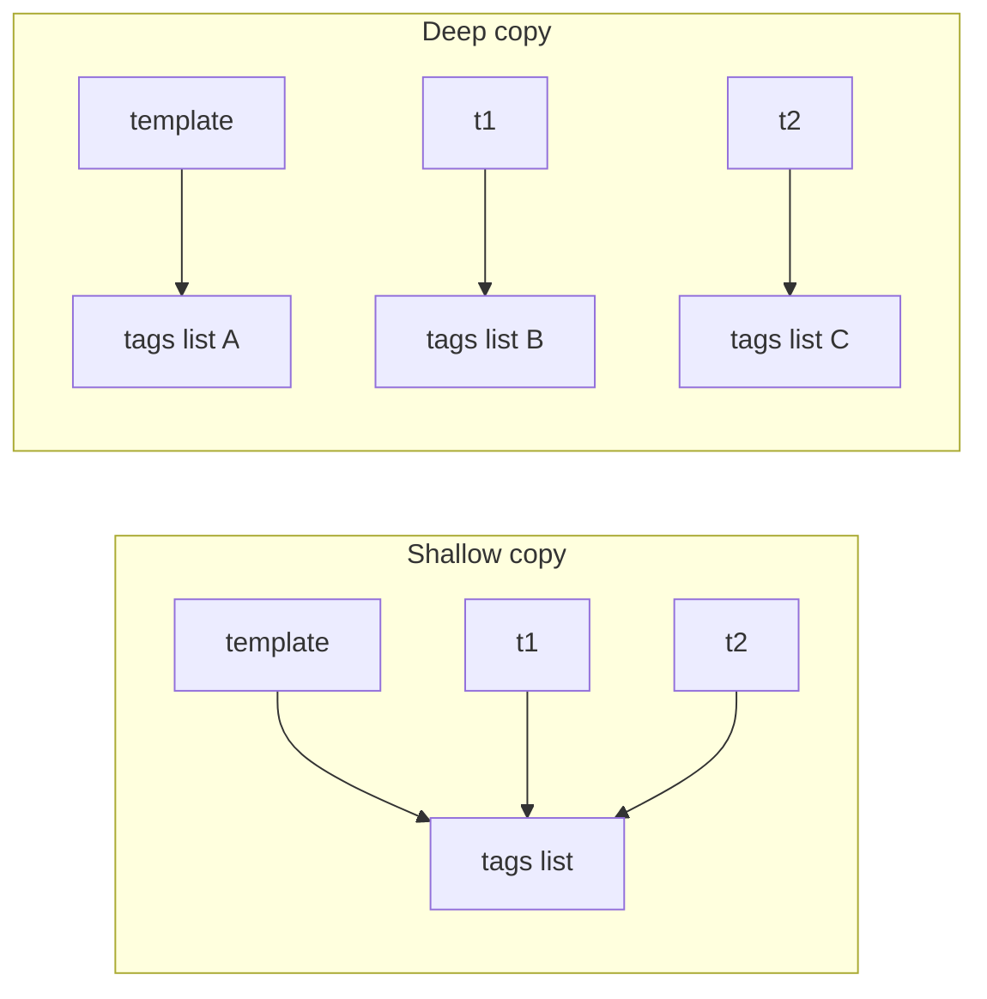
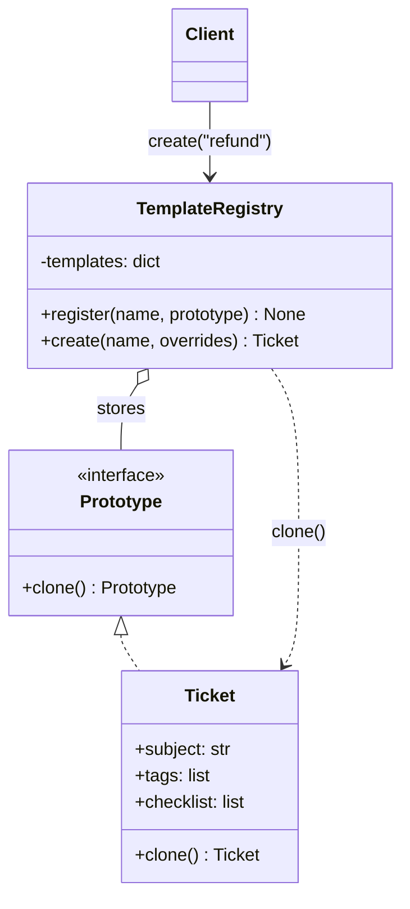
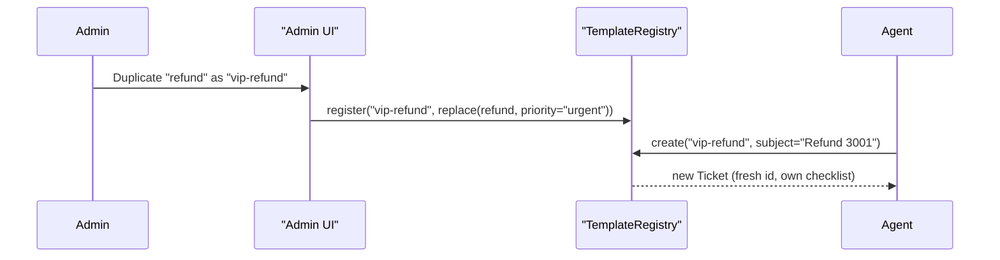

# Prototype Pattern

## Introduction

The **Prototype** pattern creates new objects by **copying an existing, already-configured object** instead of building each one from scratch. The object you copy is the *prototype*.

You use this idea every day outside of code. When you need a new contract, you do not start with a blank page. You open last year's contract, "Save As," and change the names and dates. The old document carries all the structure, clauses and formatting. You only change what is different.

In code, Prototype helps when:

- objects take many steps (or expensive lookups) to configure, and new ones are mostly the same as an existing one;
- the code that needs a copy only knows an object's interface, not its concrete class;
- you want users or configuration to define "kinds" of objects at runtime, without a subclass per kind.

Copying sounds trivial, but it is the part where most bugs hide. Much of this page is about copying correctly in Python, because a wrong copy silently shares data between objects that should be independent.

## The Problem: Rebuilding the Same Object Over and Over

A SaaS helpdesk lets admins define ticket "types." A *refund request* ticket has a priority, an SLA, a set of tags, a checklist the agent must complete, and a routing queue. The first version builds every new ticket by hand:

```python
from dataclasses import dataclass, field
from datetime import timedelta


@dataclass
class ChecklistItem:
    text: str
    done: bool = False


@dataclass
class Ticket:
    subject: str
    queue: str
    priority: str
    sla: timedelta
    tags: list[str] = field(default_factory=list)
    checklist: list[ChecklistItem] = field(default_factory=list)


def new_refund_ticket(subject: str) -> Ticket:
    return Ticket(
        subject=subject,
        queue="billing",
        priority="high",
        sla=timedelta(hours=4),
        tags=["refund", "payments"],
        checklist=[ChecklistItem("Verify order ID"), ChecklistItem("Check refund policy"),
                   ChecklistItem("Issue refund"), ChecklistItem("Email customer")],
    )


def new_outage_ticket(subject: str) -> Ticket:
    return Ticket(
        subject=subject,
        queue="sre",
        priority="urgent",
        sla=timedelta(minutes=30),
        tags=["outage"],
        checklist=[ChecklistItem("Open incident channel"), ChecklistItem("Post status page update")],
    )


print(new_refund_ticket("Refund for order 1042").checklist[0])
```

Output:

```text
ChecklistItem(text='Verify order ID', done=False)
```

The trouble starts when the business asks: "Let admins create new ticket types from the web UI, without a deploy." A function per type cannot do that. The types must become **data**. Admins configure a ticket once, and every new ticket of that type is a **copy** of it.

## The Naive Copy and Its Bug

The first attempt copies the template with `copy.copy`:

```python
import copy

refund_template = new_refund_ticket("(template)")

t1 = copy.copy(refund_template)
t1.subject = "Refund for order 1042"
t1.checklist[0].done = True          # agent ticks the first item on ticket 1
t1.tags.append("vip")                # and tags ticket 1 as VIP

t2 = copy.copy(refund_template)
t2.subject = "Refund for order 2077"

print("t2 first item done?", t2.checklist[0].done)
print("t2 tags:", t2.tags)
print("template tags:", refund_template.tags)
```

Output:

```text
t2 first item done? True
t2 tags: ['refund', 'payments', 'vip']
template tags: ['refund', 'payments', 'vip']
```

Ticket 2 arrives with a checked box and a VIP tag it never earned, and the template itself is now corrupted. `copy.copy` makes a **shallow copy**: a new `Ticket` object whose attributes point at the **same** list objects as the template.



### Shallow vs deep in one table

| Operation | New outer object? | Nested lists, dicts, objects | Typical use |
| --- | --- | --- | --- |
| Assignment `b = a` | No, same object | Shared | Passing references |
| `copy.copy(a)`, `list(a)`, `a.copy()` | Yes | **Shared** | Flat objects, or immutable contents |
| `copy.deepcopy(a)` | Yes | Copied recursively | Objects with mutable nested state |
| `dataclasses.replace(a, x=1)` | Yes, with changes | **Shared** (it is a shallow copy) | Immutable (frozen) dataclasses |

## The Pattern Applied

The GoF Prototype gives each class a `clone()` method, so callers can copy an object **without knowing its concrete class**, and the class itself decides what "copy" means. In Python, the standard hooks for this are `__copy__` and `__deepcopy__`, used by the `copy` module.

```python
import copy
import itertools
from dataclasses import dataclass, field
from datetime import datetime, timedelta, timezone
from typing import Self

_ids = itertools.count(1)


@dataclass
class ChecklistItem:
    text: str
    done: bool = False


@dataclass
class Ticket:
    subject: str
    queue: str
    priority: str
    sla: timedelta
    tags: list[str] = field(default_factory=list)
    checklist: list[ChecklistItem] = field(default_factory=list)
    id: int = field(default_factory=lambda: next(_ids))
    created_at: datetime = field(default_factory=lambda: datetime.now(timezone.utc))

    def clone(self) -> Self:
        """Prototype method: deep copy, then reset identity fields."""
        return copy.deepcopy(self)

    def __deepcopy__(self, memo: dict[int, object]) -> Self:
        cls = type(self)
        new = cls.__new__(cls)
        memo[id(self)] = new  # register first, in case of cycles
        for name, value in vars(self).items():
            setattr(new, name, copy.deepcopy(value, memo))
        # A copy is a NEW ticket, not the same ticket twice.
        new.id = next(_ids)
        new.created_at = datetime.now(timezone.utc)
        return new


template = Ticket("(refund template)", "billing", "high", timedelta(hours=4),
                  tags=["refund", "payments"],
                  checklist=[ChecklistItem("Verify order ID"), ChecklistItem("Issue refund")])

t1 = template.clone()
t1.subject = "Refund for order 1042"
t1.checklist[0].done = True
t1.tags.append("vip")

t2 = template.clone()
t2.subject = "Refund for order 2077"

print(t1.id, t1.subject, t1.tags, t1.checklist[0].done)
print(t2.id, t2.subject, t2.tags, t2.checklist[0].done)
print("template unchanged:", template.tags, template.checklist[0].done)
```

Output:

```text
2 Refund for order 1042 ['refund', 'payments', 'vip'] True
3 Refund for order 2077 ['refund', 'payments'] False
template unchanged: ['refund', 'payments'] False
```

Each clone is independent, gets a fresh `id` and `created_at`, and the template stays clean. The `memo` dictionary is how `deepcopy` handles objects that refer to each other (or to themselves): already-copied objects are looked up instead of copied again, which prevents infinite recursion.

:::caution
Deciding *what* a copy should reset is a domain decision, not a technical one. IDs, timestamps, audit fields and external references (such as a Stripe customer ID) usually must **not** be copied as-is. Put that knowledge in the class's clone method, where it cannot be forgotten.
:::

### Structure



## A Prototype Registry

Refactoring.Guru and the GoF book describe a **prototype registry**: a catalog of named, preconfigured prototypes. Clients ask for a name and get a fresh clone. This is what turns "ticket types" into data that admins can manage.

```python
from typing import Any


class TemplateRegistry:
    def __init__(self) -> None:
        self._templates: dict[str, Ticket] = {}

    def register(self, name: str, prototype: Ticket) -> None:
        self._templates[name] = prototype.clone()  # store a private copy

    def create(self, name: str, **overrides: Any) -> Ticket:
        try:
            ticket = self._templates[name].clone()
        except KeyError:
            raise ValueError(f"no template named {name!r}") from None
        for attr, value in overrides.items():
            setattr(ticket, attr, value)
        return ticket

    def names(self) -> list[str]:
        return sorted(self._templates)


registry = TemplateRegistry()
registry.register("refund", template)
registry.register("outage", Ticket("(outage template)", "sre", "urgent", timedelta(minutes=30),
                                   tags=["outage"],
                                   checklist=[ChecklistItem("Open incident channel")]))

# An admin adds a new type at runtime by cloning and adjusting an existing one.
vip_refund = registry.create("refund", priority="urgent", sla=timedelta(hours=1))
vip_refund.tags.append("vip")
registry.register("vip-refund", vip_refund)

ticket = registry.create("vip-refund", subject="Refund for order 3001")
print(registry.names())
print(ticket.subject, ticket.priority, ticket.sla, ticket.tags)
```

Output:

```text
['outage', 'refund', 'vip-refund']
Refund for order 3001 urgent 1:00:00 ['refund', 'payments', 'vip']
```

The registry stores its own private copy in `register()`. Without that, the admin who keeps editing `vip_refund` after registering it would silently change every future ticket.

## Immutable Objects: Prototype Without the Pain

If your objects are immutable, sharing nested data is safe, and a shallow copy with changes is all you need. Python 3.13 added `copy.replace()`, a general version of `dataclasses.replace()` that works with dataclasses, named tuples and any class that defines `__replace__`.

```python
import copy
from dataclasses import dataclass, replace
from datetime import timedelta


@dataclass(frozen=True)
class TicketSpec:
    queue: str
    priority: str
    sla: timedelta
    tags: frozenset[str]
    checklist: tuple[str, ...]


REFUND = TicketSpec("billing", "high", timedelta(hours=4),
                    frozenset({"refund", "payments"}), ("Verify order ID", "Issue refund"))

vip = replace(REFUND, priority="urgent", tags=REFUND.tags | {"vip"})
print(vip.priority, sorted(vip.tags))
print(REFUND.priority, sorted(REFUND.tags))

# Python 3.13+: copy.replace works on any object that supports __replace__
eu = copy.replace(REFUND, queue="billing-eu")
print(eu.queue, eu.checklist is REFUND.checklist)
```

Output:

```text
urgent ['payments', 'refund', 'vip']
high ['payments', 'refund']
billing-eu True
```

`eu.checklist is REFUND.checklist` is `True`: the tuple is shared, and that is fine because nobody can change it. This style, "copy with changes" on immutable values, is how most modern code applies the Prototype idea. You will see more of it in [Functional Patterns](../5-arch-modern-patterns/5-arch-functional-patterns.mdx).

## Prototype in TypeScript and Java

TypeScript is worth a look because JavaScript is a **prototype-based language**: every object has a prototype that it inherits methods from. But that language feature is not the same as the Prototype *design pattern*. For copying, modern JavaScript runtimes provide `structuredClone()`, which makes a deep copy. It has one surprise worth knowing:

```typescript
class Ticket {
  constructor(public subject: string, public tags: string[]) {}
  describe(): string { return `${this.subject} [${this.tags.join(", ")}]`; }
  clone(): Ticket { return new Ticket(this.subject, [...this.tags]); }
}

const template = new Ticket("(refund)", ["refund"]);

const viaClone = template.clone();
viaClone.tags.push("vip");
console.log(viaClone.describe(), "|", template.describe());

const viaStructured = structuredClone(template);
console.log(viaStructured instanceof Ticket, typeof (viaStructured as any).describe);
```

Output:

```text
(refund) [refund, vip] | (refund) [refund]
false undefined
```

`structuredClone` copied the data but **lost the class**: the result is a plain object with no `describe` method. An explicit `clone()` method keeps the type, which is exactly why the pattern puts cloning inside the class.

In Java, the built-in `Object.clone()` and `Cloneable` interface are widely considered awkward. *Effective Java* (Item 13) recommends a **copy constructor** or **copy factory** instead, such as `new Ticket(otherTicket)`.

## Where You Have Already Met Prototype

| Where | What gets cloned | Notes |
| --- | --- | --- |
| Python `copy` module | Any object, via `__copy__` / `__deepcopy__` / `__replace__` | `copy.replace` added in Python 3.13 |
| `dataclasses.replace` | Dataclass instances | Shallow copy with changes |
| pandas `DataFrame.copy(deep=True)` | A DataFrame and its data | Avoids accidental shared edits |
| JavaScript `Object.create(proto)` and `structuredClone` | Prototype-based objects, deep copies of data | The language itself is prototype-based |
| Java copy constructors, e.g. `new ArrayList<>(other)` | Collections | Preferred over `clone()` |
| Document and project templates | "New from template" in editors, issue trackers, cloud consoles | Product-level Prototype |

:::note
Spring's **"prototype" bean scope** is a naming trap. It means "create a new instance every time the bean is requested." Spring does not clone an existing object for it. It is about lifecycle, not about the Prototype pattern.
:::

## Real-World Scenario

Back to the helpdesk. Product management wants three things:

1. Admins create and edit ticket types in the web UI.
2. A new type can start as a copy of an existing one ("Duplicate type").
3. Creating a ticket from a type must be fast and must never leak data between tickets.

The team stores each type's configuration as an immutable `TicketSpec` (as above) in the database, loaded into a registry at startup and refreshed on change. "Duplicate type" is `replace(spec, ...)`. Creating a ticket builds a new mutable `Ticket` from the spec, with fresh lists, a fresh ID and a fresh timestamp.



### Why this approach

- Ticket types are **data**, so new types need no deploy and no new subclass.
- Immutable specs can be shared freely across threads and requests.
- Mutable tickets are always created fresh, so state cannot leak.
- The "reset identity fields" rule lives in one place.

### When to use it / when not to

**Use Prototype when:**

- You need many objects that differ from a configured example in only a few fields.
- Kinds of objects are defined at runtime (by users, config files or a database), not in code.
- Creating an object from scratch is expensive (parsing, remote lookups, heavy computation), and copying a ready one is cheap.
- Code must copy objects it only knows through an interface.

**Skip it when:**

- Constructing an object is cheap and simple. Just call the constructor or a factory.
- Objects hold resources that cannot be copied: open files, sockets, database connections, locks, threads. `deepcopy` does not copy file or socket objects, and copying a lock is almost always a bug.
- Object identity is the whole point, such as a domain entity tied to a database row. Copying it makes a confusing twin.
- The object graph is large and full of back-references. Deep copies may be slow and surprising. Copy explicitly instead.

### Alternatives and trade-offs

| Approach | Pros | Cons | Best for |
| --- | --- | --- | --- |
| Constructor / [Factory Method](./2-arch-factory-method.mdx) | Explicit, easy to read | One function or subclass per kind | Kinds known at compile time |
| `copy.deepcopy` + custom `__deepcopy__` | Works on any object graph, class controls the copy | Slow on big graphs, easy to over-copy | Mutable objects with nested state |
| Immutable values + `replace` | Safe sharing, cheap copies | Requires designing for immutability | Configs, specs, value objects |
| [Builder](./4-arch-builder.mdx) with defaults | Step-by-step, validated | Does not start from a runtime example | Complex objects with code-defined defaults |
| Serialize/deserialize (JSON round trip) | Language-neutral, deep | Loses types and methods, slow | Copying plain data between systems |

## Related and Confusable Patterns

- **Factory Method** creates through subclasses. Prototype creates through copying and needs no subclass per kind. Designs often start with factories and move to prototypes when kinds become data.
- **Abstract Factory** can store prototypes and clone them instead of calling constructors. See [Abstract Factory Pattern](./3-arch-abstract-factory.mdx).
- **Memento** stores a snapshot of an object's state to restore later. A clone is a simple memento when the object has no external links. See [Memento Pattern](../4-arch-behavioral-patterns/8-arch-memento.mdx).
- **Flyweight** shares one object among many users. Prototype makes many independent copies. They are opposites. See [Flyweight Pattern](../3-arch-structural-patterns/5-arch-flyweight.mdx).
- **Command:** cloning is a common way to store commands in an undo history. See [Command Pattern](../4-arch-behavioral-patterns/2-arch-command.mdx).

## Common Mistakes

1. **Shallow copies of mutable nested data.** The bug at the top of this page. Use `deepcopy`, or make nested data immutable.
2. **Copying identity.** Two tickets with the same ID cause hard-to-debug data corruption. Reset IDs, timestamps and external references in the clone method.
3. **Mutating the registered prototype.** Store a private copy when registering, and never hand out the prototype itself.
4. **Deep-copying resources.** Locks, connections, file handles and clients should be shared deliberately or recreated, not copied.
5. **Mutable default arguments in "templates."** `def __init__(self, tags=[])` shares one list among all instances. Use `field(default_factory=list)` or `None`.

## Summary

- Prototype creates objects by cloning a configured example, which makes "kinds of objects" into runtime data.
- The hard part is copying correctly: shallow copies share nested state, deep copies duplicate it.
- In Python, implement `__deepcopy__` (and `clone()` if you like the explicit name) to control what gets copied and what gets reset.
- A prototype registry maps names to templates and hands out fresh clones.
- Immutable values plus `dataclasses.replace` or `copy.replace` (Python 3.13+) give most of the benefit with none of the aliasing bugs.

## Exercises

1. Add a `watchers: set[str]` field to `Ticket`. Prove with a test that clones do not share watchers, then break it on purpose by switching to `copy.copy`.
2. Give `Ticket` a `parent: Ticket | None` field and create a ticket that is its own parent. Does your `__deepcopy__` still terminate? Why?
3. Add a `lock = threading.Lock()` attribute to `Ticket` and call `clone()`. What happens? How would you change `__deepcopy__` to handle it?
4. Write a JSON loader that reads ticket types from a file into the `TemplateRegistry` as immutable `TicketSpec` objects.

**Next:** [Object Pool Pattern](./6-arch-object-pool.mdx). **Back:** [Builder Pattern](./4-arch-builder.mdx).

**Sources:** Refactoring.Guru, [Prototype](https://refactoring.guru/design-patterns/prototype); Python docs, [copy — Shallow and deep copy operations](https://docs.python.org/3/library/copy.html); MDN, [structuredClone()](https://developer.mozilla.org/en-US/docs/Web/API/Window/structuredClone); Joshua Bloch, *Effective Java*, Item 13.
