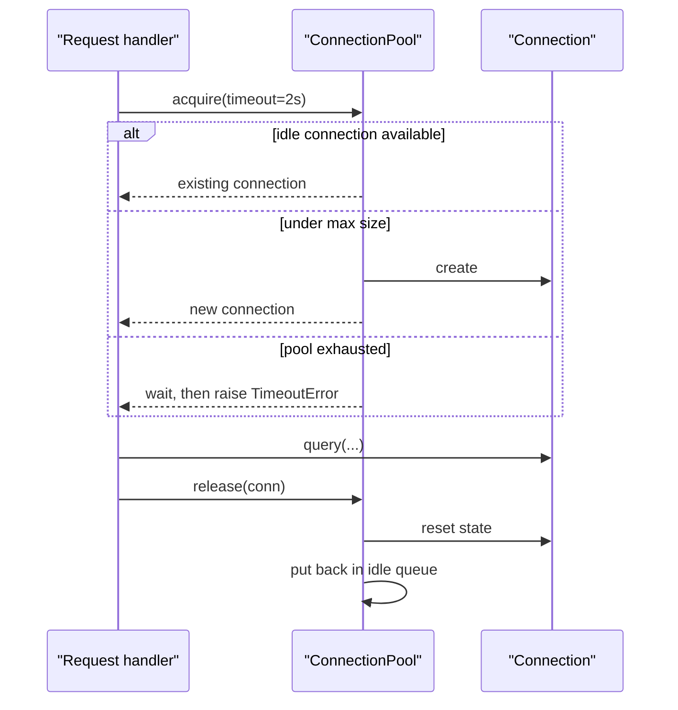
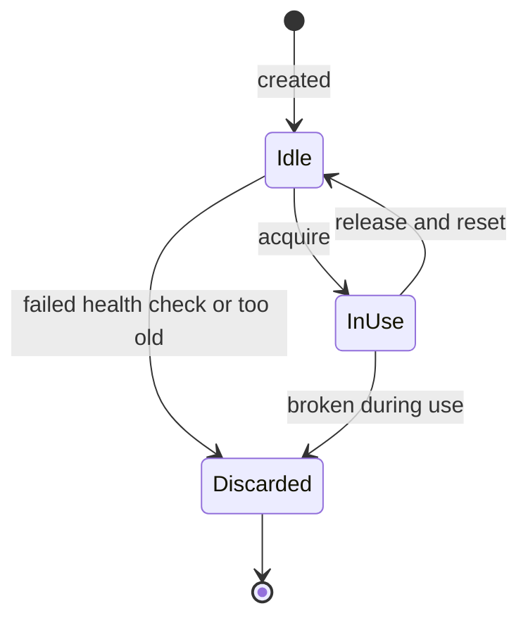
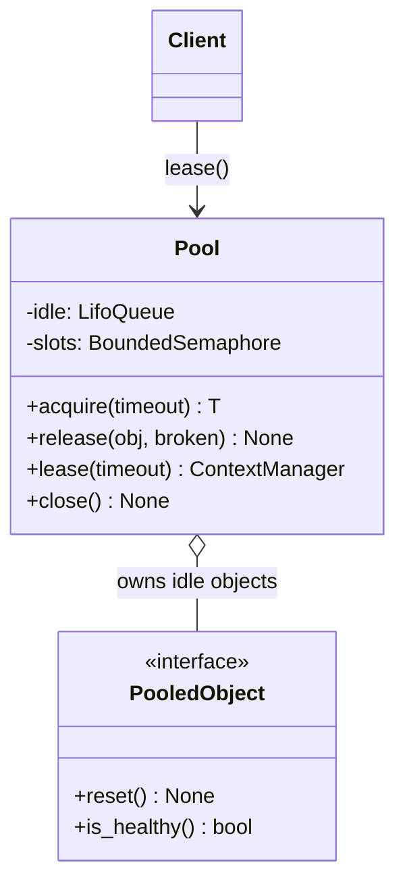
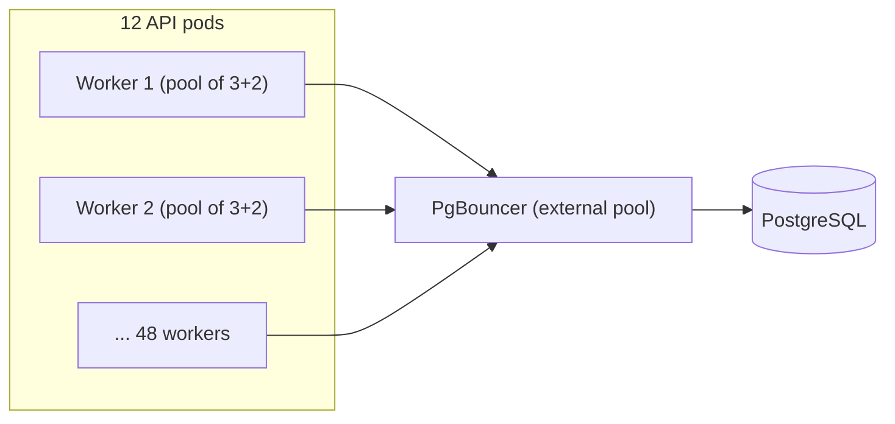

# Object Pool Pattern

## Introduction

The **Object Pool** pattern keeps a set of ready-to-use objects and **lends** them out instead of creating and destroying one for every use. When a caller is done, it **returns** the object to the pool so the next caller can reuse it.

Think of bowling shoes. The bowling alley does not manufacture a new pair for every customer and shred it afterward. It keeps a rack of shoes, hands you a pair, and puts it back on the rack when you return it. If all pairs in your size are out, you wait. Two things make the rack worthwhile: shoes are expensive to make, and the alley only has room for so many.

Object Pool is not one of the 23 Gang of Four patterns, but it is one of the most widely used creational patterns in practice. You almost certainly rely on it already: every serious database library pools connections, and thread pools are pools of threads.

The pattern solves two problems at once:

1. **Creation cost.** Some objects are expensive to create: a database connection needs a TCP handshake, often TLS, and authentication.
2. **Resource limits.** Some resources must be capped: a database accepts only so many connections, and an API may allow only so many concurrent requests.

## The Problem: One Connection Per Request

Here is a simulated bookstore API that opens a fresh database connection for every request. The `connect()` delay stands in for network handshakes and authentication.

```python
import threading
import time
from concurrent.futures import ThreadPoolExecutor


class FakeDbConnection:
    created = 0
    open_now = 0
    peak_open = 0
    _lock = threading.Lock()

    def __init__(self) -> None:
        time.sleep(0.05)  # handshake + TLS + auth
        with FakeDbConnection._lock:
            FakeDbConnection.created += 1
            FakeDbConnection.open_now += 1
            FakeDbConnection.peak_open = max(FakeDbConnection.peak_open, FakeDbConnection.open_now)

    def query(self, sql: str) -> str:
        time.sleep(0.01)  # the actual work is fast
        return f"rows for {sql!r}"

    def close(self) -> None:
        with FakeDbConnection._lock:
            FakeDbConnection.open_now -= 1


def handle_request(i: int) -> str:
    conn = FakeDbConnection()  # new connection every time
    try:
        return conn.query(f"SELECT * FROM books WHERE id = {i}")
    finally:
        conn.close()


start = time.perf_counter()
with ThreadPoolExecutor(max_workers=50) as executor:
    list(executor.map(handle_request, range(200)))
elapsed = time.perf_counter() - start
print(f"connections created: {FakeDbConnection.created}")
print(f"peak open connections: {FakeDbConnection.peak_open}")
print(f"time: {elapsed:.2f}s")
```

Example output (timings vary by machine):

```text
connections created: 200
peak open connections: 50
time: 0.25s
```

Two hundred requests created two hundred connections, and the database saw up to fifty at once. Each request spent most of its time connecting rather than querying. With real traffic, this pattern either wastes most of each request on handshakes, or hits the database's connection limit and starts failing. PostgreSQL, for example, has a `max_connections` setting, and each connection uses a server process and memory.

## The Pattern Applied

A pool has a small, clear interface:

- **acquire** (or check out): get an idle object, create one if under the limit, or wait until one is returned.
- **release** (or check in): give the object back, after resetting it to a clean state.
- **validate**: optionally check the object is still healthy before handing it out.
- **close**: shut down every pooled object when the application stops.



Each pooled object moves through a small lifecycle:



### A thread-safe pool in Python

Python's `queue.Queue` is already thread-safe and supports blocking with a timeout, which makes it a good base. A context manager makes it hard to forget to return the object.

```python
import queue
import threading
import time
from collections.abc import Callable, Iterator
from contextlib import contextmanager
from typing import Generic, TypeVar

T = TypeVar("T")


class Pool(Generic[T]):
    def __init__(
        self,
        create: Callable[[], T],
        max_size: int,
        *,
        validate: Callable[[T], bool] = lambda obj: True,
        reset: Callable[[T], None] = lambda obj: None,
        destroy: Callable[[T], None] = lambda obj: None,
    ) -> None:
        self._create = create
        self._validate = validate
        self._reset = reset
        self._destroy = destroy
        self._idle: queue.LifoQueue[T] = queue.LifoQueue()  # reuse the most recent (warm) object
        self._slots = threading.BoundedSemaphore(max_size)  # caps total objects in use
        self._closed = False

    def acquire(self, timeout: float | None = None) -> T:
        if self._closed:
            raise RuntimeError("pool is closed")
        if not self._slots.acquire(timeout=timeout):
            raise TimeoutError("no pooled object available")
        try:
            while True:
                try:
                    obj = self._idle.get_nowait()
                except queue.Empty:
                    return self._create()  # under the limit: make a new one
                if self._validate(obj):
                    return obj
                self._destroy(obj)  # stale: throw it away and try again
        except BaseException:
            self._slots.release()  # creation failed: give the slot back
            raise

    def release(self, obj: T, *, broken: bool = False) -> None:
        try:
            if broken or self._closed:
                self._destroy(obj)
            else:
                self._reset(obj)
                self._idle.put(obj)
        finally:
            self._slots.release()

    @contextmanager
    def lease(self, timeout: float | None = None) -> Iterator[T]:
        obj = self.acquire(timeout)
        broken = False
        try:
            yield obj
        except Exception:
            broken = True  # do not return an object that may be in a bad state
            raise
        finally:
            self.release(obj, broken=broken)

    def close(self) -> None:
        self._closed = True
        while True:
            try:
                self._destroy(self._idle.get_nowait())
            except queue.Empty:
                break
```

Design notes:

- The `BoundedSemaphore` counts **total** objects in use, so the pool never exceeds `max_size`, even while new objects are being created.
- A **LIFO** queue hands out the most recently used object, which is more likely to still be warm and valid. Some pools use FIFO to spread wear evenly. Both are valid choices.
- If the caller's code raises, the object is treated as broken and destroyed instead of being returned. A connection in the middle of a failed transaction should not go to the next user.

Now the same 200 requests, using a pool of 10:

```python
FakeDbConnection.created = FakeDbConnection.open_now = FakeDbConnection.peak_open = 0

pool: Pool[FakeDbConnection] = Pool(FakeDbConnection, max_size=10, destroy=lambda c: c.close())


def handle_pooled_request(i: int) -> str:
    with pool.lease(timeout=2.0) as conn:
        return conn.query(f"SELECT * FROM books WHERE id = {i}")


start = time.perf_counter()
with ThreadPoolExecutor(max_workers=50) as executor:
    list(executor.map(handle_pooled_request, range(200)))
elapsed = time.perf_counter() - start
pool.close()
print(f"connections created: {FakeDbConnection.created}")
print(f"peak open connections: {FakeDbConnection.peak_open}")
print(f"time: {elapsed:.2f}s")
```

Example output (timings vary by machine):

```text
connections created: 10
peak open connections: 10
time: 0.26s
```

Ten connections served all two hundred requests, and the database never saw more than ten. Total time is about the same here, because the simulated query is tiny and fifty threads waited for ten connections. On a real system, the database itself usually gets **faster** with fewer connections, because it spends less time switching between them. The HikariCP project's pool-sizing guidance makes the same point: more connections is not automatically better.

### Structure



## Use a Battle-Tested Pool in Production

The pool above is for learning. Real pools also handle connection lifetimes, idle timeouts, health checks, overflow, metrics, and process forking. Use the one your library provides:

```python
from sqlalchemy import create_engine, text

# One engine per process, created at startup. The engine owns a QueuePool.
engine = create_engine(
    "sqlite:///bookstore_demo.db",  # use your PostgreSQL/MySQL URL in real code
    pool_size=5,          # connections kept open
    max_overflow=10,      # extra connections allowed under bursts
    pool_timeout=30,      # seconds to wait for a free connection
    pool_recycle=1800,    # replace connections older than 30 minutes
    pool_pre_ping=True,   # test a connection before handing it out
)

print(type(engine.pool).__name__)
with engine.connect() as conn:  # checkout
    print(conn.execute(text("SELECT 1")).scalar())
    print(engine.pool.status())
print(engine.pool.status())     # returned to the pool after the with block
```

Example output (SQLAlchemy 2.x):

```text
QueuePool
1
Pool size: 5  Connections in pool: 0 Current Overflow: -4 Current Checked out connections: 1
Pool size: 5  Connections in pool: 1 Current Overflow: -4 Current Checked out connections: 0
```

Pool defaults at the time of writing (check the linked docs, since defaults can change between versions):

| Library | Pool | Key settings and documented defaults |
| --- | --- | --- |
| SQLAlchemy 2.x | `QueuePool` (default for most engines) | `pool_size=5`, `max_overflow=10`, `pool_timeout=30`, `pool_recycle=-1` (off), `pool_pre_ping` off |
| psycopg 3 (`psycopg_pool`) | `ConnectionPool` | `min_size=4`, `max_size=None` (fixed size), `timeout=30`, `max_idle=600`, `max_lifetime=3600` |
| HikariCP (Java) | `HikariDataSource` | `maximumPoolSize=10`, `connectionTimeout=30000` ms, `maxLifetime=1800000` ms |
| Python `concurrent.futures` | `ThreadPoolExecutor` | `max_workers` defaults to `min(32, (os.process_cpu_count() or 1) + 4)` since Python 3.13 |
| `requests` / `urllib3` | `Session` with `HTTPAdapter` | Keeps HTTP connections alive and reuses them per host |

The psycopg docs also note that the `open=True` constructor default is planned to change, so pass `open` explicitly.

## Where You Have Already Met Object Pool

- **Database drivers and ORMs:** SQLAlchemy, psycopg, Django's built-in PostgreSQL pool (the `"pool"` database option, added in Django 5.1), HikariCP, and others.
- **Thread and process pools:** `concurrent.futures.ThreadPoolExecutor`, `multiprocessing.Pool`, Java's `ExecutorService`.
- **HTTP clients:** `requests.Session`, `httpx.Client`, and Java's `HttpClient` keep connections open for reuse.
- **External poolers:** PgBouncer and cloud database proxies pool connections *outside* your application, shared by many processes.
- **Games:** bullets, particles and enemies are often pooled to avoid garbage-collection pauses during gameplay.

## Real-World Scenario

Your team runs a SaaS helpdesk API on Kubernetes with PostgreSQL. After a marketing launch, the API starts returning errors like "too many connections." Investigation shows:

- 12 pods × 4 Gunicorn workers each = 48 processes.
- Each process creates its own SQLAlchemy engine with `pool_size=10, max_overflow=20`.
- Worst case: 48 × 30 = **1,440** connections, far beyond what the database is configured to accept.

The fix has three parts:

1. **Budget connections explicitly.** Decide the total the database can handle well, then divide by the number of processes. For example, 48 processes × (`pool_size=3`, `max_overflow=2`) caps at 240 connections, and the team sets the database limit with headroom for admin and migration connections.
2. **Add an external pooler.** As pod counts grow with autoscaling, per-process pools do not scale. A pooler such as PgBouncer sits between the pods and PostgreSQL and multiplexes many client connections onto fewer server connections.
3. **Handle forking correctly.** Gunicorn forks workers after loading the app. SQLAlchemy's docs warn that pooled connections must not cross a fork, and recommend calling `engine.dispose(close=False)` in the child process. The team creates the engine after fork, in a worker startup hook.



### Why this approach

- The application-level pool removes per-request connection cost.
- Explicit budgets make the worst case a number you can check, instead of a surprise during a launch.
- The external pooler decouples the number of app processes from the number of database connections.

### When to use it / when not to

**Use a pool when:**

- Objects are **expensive to create** compared with how long they are used (connections, TLS sessions, browser instances, GPU contexts).
- A **shared resource has a hard limit**, and you need back-pressure: callers wait instead of overwhelming it.
- Objects can be **reset cleanly** between users.

**Do not pool when:**

- Objects are cheap. Pooling ordinary Python or Java objects to "save allocations" usually makes code slower and buggier. Modern garbage collectors handle short-lived objects well.
- The "resource" is not scarce. Oracle's Java documentation says virtual threads (Java 21+) should **never be pooled**. Create one per task, and use a `Semaphore` if you need to limit concurrency.
- Objects cannot be reset reliably. A connection with leftover session settings or temporary tables can leak one user's state into another's request.
- Each process lives briefly and handles one request, as in many serverless functions. A per-process pool rarely gets reused. An external proxy pool is the usual answer there.

### Alternatives and trade-offs

| Approach | Pros | Cons | Best for |
| --- | --- | --- | --- |
| Create per use | Simple, no shared state | Slow for expensive objects, no cap | Cheap objects, low traffic |
| In-process pool | Fast reuse, caps load per process | Total grows with process count, fork pitfalls | Long-lived app servers |
| External pooler (PgBouncer, cloud proxy) | Caps total across all processes | Extra hop, some session features restricted | Many processes, autoscaling, serverless |
| [Singleton](./1-arch-singleton.mdx) shared object | One object, no checkout | Only safe if the object is thread-safe | Thread-safe clients (many HTTP clients) |
| Semaphore / rate limiter | Limits concurrency without reusing objects | Does not save creation cost | Cheap objects, such as virtual threads, hitting a limited service |

## Common Mistakes

1. **Leaking objects.** Forgetting to release on an error path drains the pool until everything times out. Always use a context manager or `try/finally`.
2. **Returning dirty objects.** An open transaction, changed session settings or a half-read result set leaks into the next request. Reset on release, and destroy objects that failed.
3. **Oversizing pools.** Bigger pools often make the database slower. Measure, start small, and size from the database's capacity down.
4. **Creating a pool per request.** A pool created inside a request handler is thrown away each time, which defeats the purpose. Create it once per process.
5. **Sharing a pool across `fork()`.** Child processes inherit sockets that the parent also uses. Create pools after forking, or dispose them in the child.
6. **Holding a pooled object while waiting for another.** If every thread holds one connection and waits for a second, the pool deadlocks. Acquire everything you need at once or use one at a time.
7. **No timeout on acquire.** Without a timeout, an exhausted pool hangs requests forever instead of failing fast.

## Summary

- Object Pool lends out reusable objects and takes them back, saving creation cost and capping use of a limited resource.
- A correct pool needs a size limit, a timeout on acquire, reset on release, health checks, and discarding broken objects.
- In production, use your library's pool (SQLAlchemy, psycopg_pool, HikariCP) and configure it, rather than writing your own.
- Size pools from the shared resource's capacity divided across all processes, and add an external pooler when process counts grow.
- Do not pool cheap objects or virtual threads. Use a semaphore when you only need to limit concurrency.

## Exercises

1. Add a `max_lifetime` option to the `Pool` class: objects older than the limit are destroyed on release or acquire instead of reused.
2. Write a test that proves an object used inside a `with pool.lease()` block that raised an exception is not handed out again.
3. Reproduce the deadlock in mistake 6 with a pool of size 2 and three threads that each need two objects. Then fix it.
4. Your app has 6 servers, each running 8 workers, and the database performs best with about 100 active connections. Propose `pool_size` and `max_overflow` values and explain the worst case.

**Next:** [Choosing a Creational Pattern](./7-arch-choosing-creational.mdx). **Back:** [Prototype Pattern](./5-arch-prototype.mdx). **See also:** [Bulkheads, Rate Limiting and Backpressure](../9-arch-distributed-systems/9-arch-bulkhead-and-rate-limiting.mdx), [Designing for Scalability](../12-arch-quality-and-operations/0-arch-scalability.mdx).

**Sources:** SQLAlchemy, [Connection Pooling](https://docs.sqlalchemy.org/en/20/core/pooling.html); psycopg, [psycopg_pool API](https://www.psycopg.org/psycopg3/docs/api/pool.html); HikariCP, [README](https://github.com/brettwooldridge/HikariCP) and [About Pool Sizing](https://github.com/brettwooldridge/HikariCP/wiki/About-Pool-Sizing); Oracle, [Virtual Threads guide](https://docs.oracle.com/en/java/javase/21/core/virtual-threads.html); Python docs, [concurrent.futures](https://docs.python.org/3/library/concurrent.futures.html).
