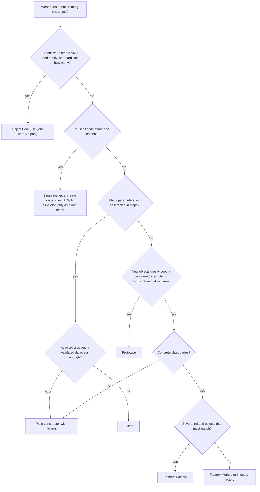
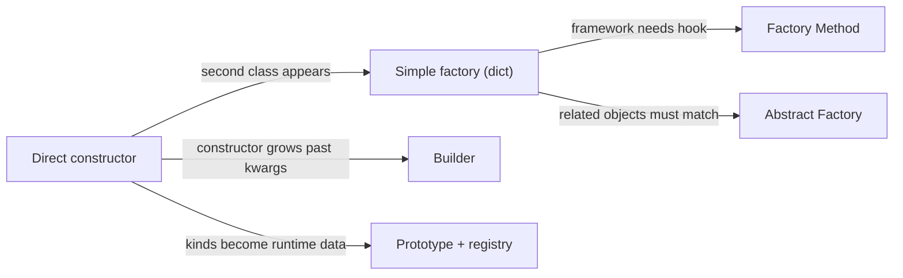
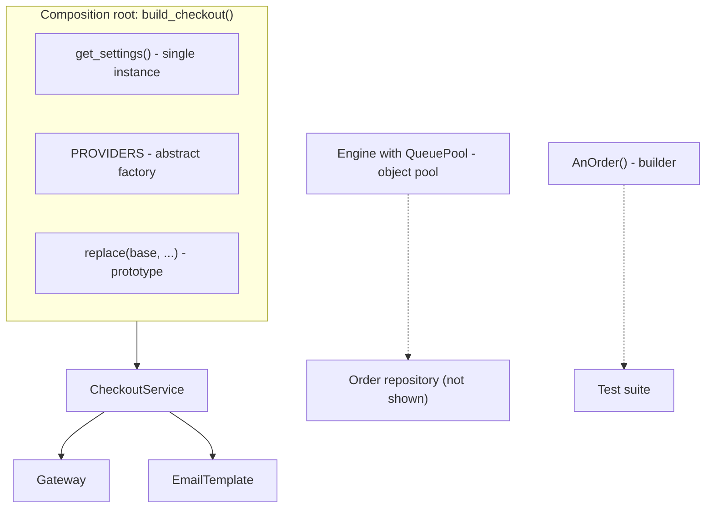

# Choosing a Creational Pattern

## Introduction

You have now seen six creational patterns. Each answers a different question about creating objects:

| Pattern | The question it answers |
| --- | --- |
| [Singleton](./1-arch-singleton.mdx) | How do we make sure there is only **one** of these? |
| [Factory Method](./2-arch-factory-method.mdx) | **Which class** should this one object be, decided by a subclass or a passed-in factory? |
| [Abstract Factory](./3-arch-abstract-factory.mdx) | How do we create a whole **family** of objects that must match? |
| [Builder](./4-arch-builder.mdx) | How do we assemble **one complex object** step by step? |
| [Prototype](./5-arch-prototype.mdx) | How do we make a new object by **copying** a configured one? |
| [Object Pool](./6-arch-object-pool.mdx) | How do we **reuse** expensive objects and cap how many exist? |

Choosing well is mostly about naming your problem precisely. "Object creation is messy" is not specific enough. "Two payment classes got mixed up," "this constructor has eleven parameters," and "we open a database connection per request" each point at a different pattern.

This page gives you a decision flowchart, a side-by-side comparison, the most common combinations, and a worked example where one small system uses several patterns, each for a clear reason. It also covers the most important option of all: **using no pattern**.

## Start With No Pattern

Before reaching for any creational pattern, check whether the plain constructor is enough. In modern Python, these tools cover many cases that once needed a pattern:

| Need | Plain-language tool | Pattern it often replaces |
| --- | --- | --- |
| Named, optional constructor arguments | Keyword arguments, `@dataclass(kw_only=True)` | Builder |
| A named way to construct from other data | `@classmethod` alternate constructor (`from_json`) | Static factory |
| Choose a class at runtime | Dict of name to class | Simple factory, Factory Method |
| Make the caller supply the class | Pass a class or function as a parameter | Factory Method, Abstract Factory |
| One shared instance | Module-level object, `functools.cache` accessor, DI | Singleton |
| Copy with changes | `dataclasses.replace`, `copy.replace` (3.13+) | Prototype |

If one of these solves the problem, stop there. You can always refactor toward a fuller pattern later, when a real force appears. This is the [YAGNI](../1-arch-design-principles/6-arch-dry-kiss-yagni.mdx) principle applied to object creation.

## Decision Flowchart



The order of questions matters. Resource questions (pool, single instance) come first because they are about **lifecycle**. Shape questions (builder, prototype) come next. Class-selection questions (factories) come last.

## Side-by-Side Comparison

| Pattern | Use when | Avoid when | Python-friendly form | Main cost |
| --- | --- | --- | --- | --- |
| Singleton | Truly process-wide, ideally immutable things: settings, logger, plugin registry | Mutable business state, per-tenant or per-request data, "one per cluster" | Module-level object or `@cache` accessor, injected | Hidden dependencies, test leakage |
| Factory Method | A workflow must create an object whose class varies | One implementation, or only a value varies | Pass a class or callable as a parameter | Parallel class hierarchies |
| Abstract Factory | Several products must come from the same family | One product, one family, or product set changes often | Frozen dataclass holding the family's classes | Adding a product type touches every factory |
| Builder | Complex object assembled conditionally or in steps | Few fields, or kwargs suffice | Immutable builder with `dataclasses.replace` | Extra class that mirrors the product |
| Prototype | Many similar objects, kinds defined as data | Cheap constructors, objects holding resources or identity | `copy.deepcopy` with `__deepcopy__`, or `replace` on frozen data | Shallow vs deep copy bugs |
| Object Pool | Expensive objects, hard resource limits | Cheap objects, virtual threads, short-lived processes | SQLAlchemy / psycopg_pool / `ThreadPoolExecutor` | Leaks, dirty state, sizing |

### Easy-to-confuse pairs

| Pair | How to tell them apart |
| --- | --- |
| Factory Method vs Abstract Factory | One product vs a family of products. An Abstract Factory is often a group of factory methods. |
| Abstract Factory vs Builder | Abstract Factory returns finished objects immediately. Builder assembles one object over several calls, then returns it. |
| Builder vs Prototype | Builder starts from defaults in code and adds steps. Prototype starts from an existing configured object and copies it. |
| Singleton vs Object Pool | Exactly one instance shared at the same time vs a bounded set lent out to one user at a time. |
| Singleton vs Flyweight | One instance vs many shared immutable instances, one per intrinsic value. See [Flyweight](../3-arch-structural-patterns/5-arch-flyweight.mdx). |
| Factory vs Dependency Injection | A factory decides *what to create*. DI decides *who provides* dependencies. They often work together. See [Dependency Injection](../1-arch-design-principles/10-arch-dependency-injection.mdx). |

## How Designs Evolve

Refactoring.Guru notes that many designs start with Factory Method, because it is the simplest, and evolve toward Abstract Factory, Prototype or Builder as needs grow. In practice, a healthy evolution looks like this:



Each arrow has a trigger. If you cannot name the trigger, do not take the step. Moving **backward** is also fine: if the second implementation was deleted, collapse the factory back into a constructor.

## Worked Example: One Bookstore, Five Decisions

The online bookstore's checkout module needs several things at startup and per request. Here is how the team chooses for each, and the code that results.

| Need | Force | Decision |
| --- | --- | --- |
| App settings | Read once from environment, used everywhere, must be replaceable in tests | Cached accessor, injected (single instance, not a GoF Singleton) |
| Payment provider clients | Gateway and refunds must come from the same provider | Abstract Factory |
| Order confirmation emails | Several email types share layout, sender and footer, with small differences | Prototype (immutable template + `replace`) |
| Orders in tests | Many fields, tests care about one or two | Builder (test data builder) |
| Database connections | Expensive, database has a connection limit | Object Pool (library-provided) |

Below is a compact, runnable version of the first three decisions, wired together in a composition root. The test data builder and the pool are covered in full on their own pages.

```python
from __future__ import annotations

import os
from abc import ABC, abstractmethod
from dataclasses import dataclass, replace
from functools import cache
from typing import Protocol


# 1. Settings: one instance, cached, injectable.
@dataclass(frozen=True)
class Settings:
    payment_provider: str
    sender: str


@cache
def get_settings() -> Settings:
    return Settings(
        payment_provider=os.environ.get("PAYMENT_PROVIDER", "acme"),
        sender=os.environ.get("MAIL_SENDER", "orders@bookstore.example"),
    )


# 2. Payment family: Abstract Factory.
class Gateway(Protocol):
    def charge(self, cents: int) -> str: ...


class Refunds(Protocol):
    def refund(self, charge_id: str) -> str: ...


class PaymentProvider(ABC):
    @abstractmethod
    def gateway(self) -> Gateway: ...

    @abstractmethod
    def refunds(self) -> Refunds: ...


class AcmeGateway:
    def charge(self, cents: int) -> str:
        return f"acme_ch_{cents}"


class AcmeRefunds:
    def refund(self, charge_id: str) -> str:
        return f"acme_re_{charge_id}"


class AcmeProvider(PaymentProvider):
    def gateway(self) -> Gateway:
        return AcmeGateway()

    def refunds(self) -> Refunds:
        return AcmeRefunds()


PROVIDERS: dict[str, type[PaymentProvider]] = {"acme": AcmeProvider}


# 3. Email templates: Prototype with immutable data.
@dataclass(frozen=True)
class EmailTemplate:
    sender: str
    subject: str
    body: str
    footer: str = "Thanks for shopping with us."

    def render(self, **values: str) -> str:
        return f"From: {self.sender}\nSubject: {self.subject.format(**values)}\n\n" \
               f"{self.body.format(**values)}\n--\n{self.footer}"


# The service depends only on abstractions it receives.
class CheckoutService:
    def __init__(self, provider: PaymentProvider, confirmation: EmailTemplate) -> None:
        self._gateway = provider.gateway()
        self._confirmation = confirmation

    def checkout(self, order_id: str, cents: int) -> str:
        charge_id = self._gateway.charge(cents)
        return self._confirmation.render(order_id=order_id, amount=f"${cents / 100:.2f}") + \
            f"\n[charge {charge_id}]"


# Composition root: every creational decision is visible in one place.
def build_checkout() -> CheckoutService:
    settings = get_settings()
    provider = PROVIDERS[settings.payment_provider]()
    base = EmailTemplate(sender=settings.sender, subject="", body="")
    confirmation = replace(base, subject="Order {order_id} confirmed",
                           body="We received your payment of {amount}.")
    return CheckoutService(provider, confirmation)


print(build_checkout().checkout("A-1042", 2599))
```

Output:

```text
From: orders@bookstore.example
Subject: Order A-1042 confirmed

We received your payment of $25.99.
--
Thanks for shopping with us.
[charge acme_ch_2599]
```

Notice where the patterns live: almost entirely in `build_checkout()`, the **composition root**. `CheckoutService` itself knows nothing about settings files, provider names or how templates are copied. That separation is what makes each decision cheap to change.



## Creational Patterns Inside DI Containers

If your project uses a dependency injection container, many creational decisions become **configuration**. Containers in Spring, ASP.NET Core and Python libraries such as `dependency-injector` let you register how each dependency is created and how long it lives. The lifetime names differ between frameworks, but the ideas map closely to this section:

| Container lifetime (typical names) | What it means | Creational idea it replaces |
| --- | --- | --- |
| Singleton | One instance per container, shared by everyone | Singleton, but injected rather than reached for globally |
| Scoped (per request) | One instance per web request or unit of work | Nothing in GoF: a lifecycle the container manages for you |
| Transient / prototype | A new instance every time it is requested | Plain construction (note: Spring's "prototype" scope does not clone) |
| Factory provider | A registered function that builds the object | Simple factory or Factory Method |
| Profile or environment-specific registrations | A different set of implementations per environment | Abstract Factory |

Two cautions apply when you let a container decide:

- **Lifetime mismatches.** A singleton that holds a reference to a scoped object keeps that object alive across requests. This is the container version of "per-request data in a singleton." Some containers detect and reject this. Check yours.
- **Hidden wiring.** Auto-wiring hides creation decisions just as a GoF Singleton hides dependencies. Keep registrations in one module, and prefer constructor injection so each class still declares what it needs.

You do not need a container to apply these ideas. A hand-written composition root, like `build_checkout()` above, is often clearer for small and medium applications. See [Dependency Injection](../1-arch-design-principles/10-arch-dependency-injection.mdx) for the trade-offs.

## Pattern Checklist for Code Reviews

When a pull request introduces a creational pattern, these questions keep the discussion concrete:

1. **What failure does it prevent?** Ask for a specific bug, test that cannot be written, or change that would be expensive without it.
2. **Is there a second implementation today?** If not, is there a dated plan for one?
3. **Could a language feature do the same job?** Keyword arguments, passing a class, a module-level object or `replace`.
4. **Where is the creation decision made?** Ideally once, in a composition root, not scattered across business code.
5. **How will tests use it?** A good creational design makes fakes easier to plug in, not harder.
6. **What does it cost?** Count the new types and the extra indirection a reader must follow.

## Real-World Scenario

A teammate proposes a design review comment on a new **shipping** module: "Let's make `ShippingCalculator` a Singleton, add an `AbstractCarrierFactory`, and use a Builder for `Parcel`." You are asked to evaluate it.

You check each proposal against its force:

| Proposal | Force present? | Verdict |
| --- | --- | --- |
| `ShippingCalculator` as Singleton | It is stateless and cheap. Nothing breaks if there are two. | Reject. Create it in the composition root and inject it. |
| `AbstractCarrierFactory` | Each carrier needs a rate client **and** a label printer **and** a tracking client, and mixing carriers produces invalid labels. | Accept. This is a real family. |
| Builder for `Parcel` | `Parcel` has 4 fields: weight, dimensions, origin, destination. | Reject. Use a frozen dataclass with keyword arguments. |

### Why this approach

- Each accepted pattern is backed by a concrete failure it prevents.
- Each rejected pattern would add classes and indirection with no failure prevented.
- The review is short and objective, because the conversation is about forces, not taste.

### When to use a creational pattern / when not to

- **Use** one when you can name the specific failure or friction it removes: mismatched families, unreadable construction, leaked state between copies, exhausted resources.
- **Do not** use one to look enterprise-ready, to prepare for imagined requirements, or because another language's framework does it that way.

### Alternatives and trade-offs

| Approach | Pros | Cons | Best for |
| --- | --- | --- | --- |
| No pattern, plain constructors | Simplest, most readable | Hard-coded classes everywhere | Small modules, one implementation |
| Composition root + DI (manual) | All creation decisions in one place, testable | Wiring code to maintain | Most applications |
| DI container (Spring, .NET, `dependency-injector`) | Automatic wiring, lifecycles (singleton, scoped) | Framework magic, startup cost | Large applications with many services |
| GoF creational patterns | Precise, well-known solutions | More types and indirection | Specific forces described on each page |

## Common Mistakes

1. **Choosing by name recognition.** Singleton gets picked because it is the pattern everyone knows. Start from the force, not the pattern.
2. **Stacking patterns.** A Singleton Abstract Factory that returns Builders for Prototypes is rarely justified. Each layer must earn its place.
3. **Scattering creation logic.** Factories called from deep inside business code make wiring hard to see. Keep creation in a composition root where possible.
4. **Ignoring language features.** Porting Java builders and factories into Python one-to-one adds code that keyword arguments and first-class classes make unnecessary.
5. **Never removing patterns.** When the second implementation disappears, the factory should go too.

## Summary

- Each creational pattern answers a specific question: one instance, which class, which family, how to assemble, copy from what, or reuse what.
- Check plain language features first: keyword arguments, classmethods, dicts of classes, passing classes as values, `replace`.
- Resource and lifecycle questions (pool, single instance) come before shape questions (builder, prototype) and class-selection questions (factories).
- Put creation decisions in a composition root, and inject the results into business code.
- Accept a pattern only when you can name the failure it prevents, and be willing to remove it when that failure can no longer happen.

## Exercises

For each situation, choose a pattern (or "none") and give the force that justifies it. Then compare with the suggested answers below.

1. A PDF report has optional cover page, table of contents, watermark, headers, footers and appendices, and different reports enable different parts.
2. Your app supports SQLite for local development and PostgreSQL in production. Each needs a matching repository implementation, migration runner and full-text search adapter.
3. Your web scraper launches a headless browser, which takes about two seconds to start, and you may run at most 4 at once.
4. Game designers define 200 enemy types in a spreadsheet. Each type is a few stats away from a base enemy.
5. A `Money` value object has `amount` and `currency`.
6. The `json` module needs to parse numbers as `Decimal` instead of `float` for one caller.
7. Every module in your app calls `Redis(host=..., port=...)` to get a cache client, and the Redis client library keeps its own internal connection pool per client object.
8. Customer support agents can save a filled-in refund form as a "canned response" and reuse it for similar cases.

**Suggested answers:**

| Situation | Choice | Force |
| --- | --- | --- |
| 1. PDF report | Builder (possibly with a Director per report type) | Conditional, multi-step assembly of one complex product |
| 2. SQLite vs PostgreSQL | Abstract Factory | Several products must match the same database |
| 3. Headless browsers | Object Pool | Expensive creation and a hard concurrency limit |
| 4. Enemy types | Prototype with a registry | Kinds are runtime data and differ slightly from a base |
| 5. `Money` | None: frozen dataclass | Two fields, nothing varies |
| 6. `json` numbers | Pass a factory: `parse_float=Decimal` | Only the created class varies, and Python can pass classes |
| 7. Redis clients | Single instance, created once and injected | Each client object owns a pool, so many clients mean many pools |
| 8. Canned responses | Prototype | Users create new kinds at runtime by copying a configured example |

**What comes next:** the [Structural Design Patterns](../3-arch-structural-patterns/0-arch-adapter.mdx) section, starting with Adapter. When you have finished the pattern sections, [Refactoring to Patterns](../5-arch-modern-patterns/8-arch-refactoring-to-patterns.mdx) and [Common Anti-Patterns](../5-arch-modern-patterns/7-arch-anti-patterns.mdx) show how to move toward, and away from, patterns in existing code.

**Sources:** Refactoring.Guru, [Creational Design Patterns](https://refactoring.guru/design-patterns/creational-patterns); Brandon Rhodes, [Python Design Patterns](https://python-patterns.guide/); Mark Seemann, [Composition Root](https://blog.ploeh.dk/2011/07/28/CompositionRoot/).
