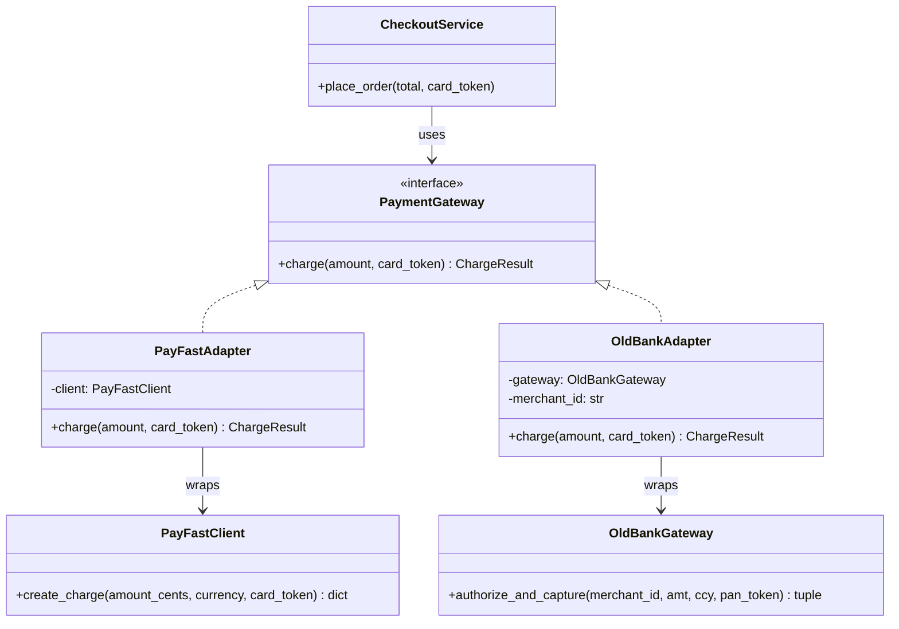
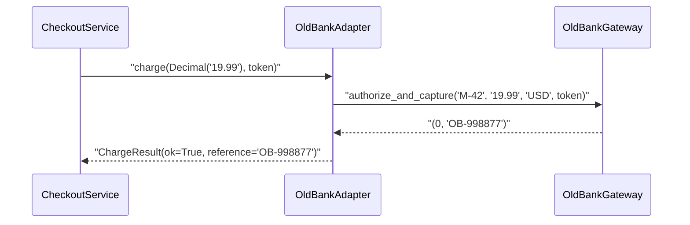
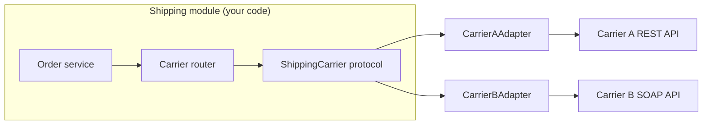

# Adapter Pattern

## Introduction

You fly from New York to London with a laptop charger. The charger works fine; the wall socket works fine. They simply do not fit each other. You do not rewire the hotel, and you do not rebuild the charger. You buy a small **travel adapter** that has a UK plug on one side and a US socket on the other.

The **Adapter pattern** does the same thing for code. It lets a class with one interface work with code that expects a different interface, by putting a thin translating object between them. The Gang of Four book ("Design Patterns", 1994) lists it as the first structural pattern, and it is probably the one you will write most often in real projects, because every project eventually has to talk to a library, vendor SDK or legacy system that was not designed with your code in mind.

In this page you will:

- see the pain that appears when foreign APIs leak into your code
- build an object adapter in Python with `typing.Protocol`
- compare object adapters and class adapters, with a short Java version
- learn what an adapter should and should not translate (names, units, errors, data shapes)
- find adapters you already use in Java, Python and popular frameworks
- learn when an adapter is overkill, and how Adapter differs from Facade, Decorator, Proxy and Bridge

## The Problem: Foreign APIs Leaking Everywhere

Our running example is an online bookstore. Checkout charges a card through a payment provider. The first provider, "PayFast", has a tidy SDK. A year later the business signs a second provider, "OldBank", because it is cheaper for European cards. OldBank's SDK looks nothing like PayFast's.

Here is what the two SDKs look like. You cannot change them; they are third-party code.

```python
# Third-party SDKs (stand-ins). We cannot edit these.
from decimal import Decimal


class PayFastClient:
    """Amounts in integer cents, returns a dict, raises PayFastError."""

    def create_charge(self, amount_cents: int, currency: str, card_token: str) -> dict:
        if card_token == "tok_declined":
            raise PayFastError("card_declined")
        return {"id": "pf_123", "status": "succeeded", "amount": amount_cents}


class PayFastError(Exception):
    pass


class OldBankGateway:
    """Amounts as strings with 2 decimals, returns a status code tuple."""

    def authorize_and_capture(self, merchant_id: str, amt: str, ccy: str, pan_token: str) -> tuple[int, str]:
        if pan_token == "tok_declined":
            return (51, "")          # 51 = insufficient funds in this fake SDK
        return (0, "OB-998877")      # 0 = approved
```

The quickest way to support both is an `if` in checkout:

```python
# "Before": checkout knows every provider's quirks
def checkout(provider: str, total: Decimal, card_token: str) -> str:
    if provider == "payfast":
        client = PayFastClient()
        try:
            result = client.create_charge(int(total * 100), "USD", card_token)
        except PayFastError as exc:
            return f"FAILED: {exc}"
        return f"OK: {result['id']}"
    elif provider == "oldbank":
        gateway = OldBankGateway()
        code, ref = gateway.authorize_and_capture("M-42", f"{total:.2f}", "USD", card_token)
        if code != 0:
            return f"FAILED: code {code}"
        return f"OK: {ref}"
    raise ValueError(provider)


print(checkout("payfast", Decimal("19.99"), "tok_visa"))
print(checkout("oldbank", Decimal("19.99"), "tok_declined"))
```

Output:

```text
OK: pf_123
FAILED: code 51
```

It works, but look at what checkout now has to know:

- PayFast wants cents as an `int`; OldBank wants a two-decimal string.
- PayFast signals failure with an exception; OldBank returns a numeric code.
- The two return different data shapes (a dict vs a tuple).
- Every new provider means editing checkout, and the same `if` tends to be copied into refunds, reports and tests.

This is a [coupling](../0-arch-fundamentals/5-arch-coupling-and-cohesion.mdx) problem: business logic is tied to the details of external code. It also breaks the [Open/Closed Principle](../1-arch-design-principles/2-arch-open-closed.mdx), because adding a provider means modifying working code.

## The Pattern

The fix has three steps:

1. **Define the interface your code wants** (the *target*). Write it in your own domain language.
2. **Write one adapter per foreign class** (the *adaptee*). Each adapter implements the target and translates calls to the adaptee.
3. **Let the client depend only on the target.**



The roles, using the names you will see on [refactoring.guru](https://refactoring.guru/design-patterns/adapter) and in the GoF book:

| Role | In our example | Responsibility |
| --- | --- | --- |
| Client | `CheckoutService` | Business logic; only knows the target |
| Target | `PaymentGateway` | The interface the client wants |
| Adaptee | `PayFastClient`, `OldBankGateway` | Useful code with the "wrong" interface |
| Adapter | `PayFastAdapter`, `OldBankAdapter` | Implements the target by calling the adaptee |

### Step 1: The target interface

We use `typing.Protocol` so adapters do not even need to inherit from anything; any class with a matching `charge` method fits. A small frozen dataclass gives every provider the same result shape.

```python
from dataclasses import dataclass
from decimal import Decimal
from typing import Protocol


@dataclass(frozen=True)
class ChargeResult:
    ok: bool
    reference: str = ""
    reason: str = ""


class PaymentGateway(Protocol):
    def charge(self, amount: Decimal, card_token: str) -> ChargeResult: ...
```

Notice the target speaks the bookstore's language: money is a `Decimal`, the result is a `ChargeResult`, and failures are *values*, not provider-specific exceptions. The target belongs to your code, not to any vendor. This is the [Dependency Inversion Principle](../1-arch-design-principles/5-arch-dependency-inversion.mdx) in action.

### Step 2: One adapter per adaptee

```python
class PayFastAdapter:
    def __init__(self, client: PayFastClient, currency: str = "USD") -> None:
        self._client = client
        self._currency = currency

    def charge(self, amount: Decimal, card_token: str) -> ChargeResult:
        cents = int((amount * 100).to_integral_value())   # unit translation
        try:
            raw = self._client.create_charge(cents, self._currency, card_token)
        except PayFastError as exc:                          # error translation
            return ChargeResult(ok=False, reason=str(exc))
        return ChargeResult(ok=True, reference=raw["id"])    # shape translation


class OldBankAdapter:
    _REASONS = {51: "insufficient_funds", 54: "expired_card"}

    def __init__(self, gateway: OldBankGateway, merchant_id: str, currency: str = "USD") -> None:
        self._gateway = gateway
        self._merchant_id = merchant_id
        self._currency = currency

    def charge(self, amount: Decimal, card_token: str) -> ChargeResult:
        code, ref = self._gateway.authorize_and_capture(
            self._merchant_id, f"{amount:.2f}", self._currency, card_token
        )
        if code != 0:
            return ChargeResult(ok=False, reason=self._REASONS.get(code, f"bank_code_{code}"))
        return ChargeResult(ok=True, reference=ref)
```

Each adapter is small and boring, and that is the goal. All the knowledge about one provider lives in one class.

### Step 3: The client depends only on the target

```python
class CheckoutService:
    def __init__(self, payments: PaymentGateway) -> None:
        self._payments = payments

    def place_order(self, total: Decimal, card_token: str) -> str:
        result = self._payments.charge(total, card_token)
        if not result.ok:
            return f"Payment failed ({result.reason}). Please try another card."
        return f"Order confirmed, payment {result.reference}"


for gateway in (PayFastAdapter(PayFastClient()), OldBankAdapter(OldBankGateway(), "M-42")):
    service = CheckoutService(gateway)
    print(type(gateway).__name__, "->", service.place_order(Decimal("19.99"), "tok_visa"))
    print(type(gateway).__name__, "->", service.place_order(Decimal("19.99"), "tok_declined"))
```

Output:

```text
PayFastAdapter -> Order confirmed, payment pf_123
PayFastAdapter -> Payment failed (card_declined). Please try another card.
OldBankAdapter -> Order confirmed, payment OB-998877
OldBankAdapter -> Payment failed (insufficient_funds). Please try another card.
```

`CheckoutService` no longer mentions cents, status codes or vendor exceptions. Which adapter to use is decided once, at startup, by whatever does your wiring (see [Dependency Injection](../1-arch-design-principles/10-arch-dependency-injection.mdx)).

Here is the runtime flow for a single charge:



## What an Adapter Translates

A good adapter handles every kind of mismatch, not just method names. Use this as a checklist when you write one:

| Mismatch | Example | Adapter's job |
| --- | --- | --- |
| Names | `create_charge` vs `charge` | Rename the call |
| Units | cents vs `Decimal` dollars, ms vs seconds | Convert, carefully |
| Data shapes | dict, tuple, XML, protobuf | Map into your own types |
| Errors | vendor exceptions, status codes | Map to your error model |
| Call style | callbacks vs return values, sync vs async | Bridge the style |
| Missing defaults | merchant ID, API version | Supply them from config |

:::caution
An adapter should **translate**, not **decide**. If you find business rules such as "orders over $500 need extra fraud checks" creeping into an adapter, move them back into the domain. Otherwise every new adapter has to copy the rule.
:::

## Object Adapter vs Class Adapter

The GoF book describes two variants.

- **Object adapter**: the adapter *holds* an adaptee instance and delegates to it (what we built above). It uses composition.
- **Class adapter**: the adapter *inherits* from the adaptee and also implements the target. It uses inheritance, so it needs multiple inheritance or an interface plus a base class.

```python
# fragment: a class adapter, shown for comparison only
class PayFastClassAdapter(PayFastClient):            # IS-A PayFastClient
    def charge(self, amount: Decimal, card_token: str) -> ChargeResult:
        try:
            raw = self.create_charge(int(amount * 100), "USD", card_token)
        except PayFastError as exc:
            return ChargeResult(ok=False, reason=str(exc))
        return ChargeResult(ok=True, reference=raw["id"])
```

The class adapter is shorter, but it also exposes every public method of `PayFastClient` (callers can bypass `charge` and call `create_charge` directly), and it ties the adapter to one concrete class, so you cannot pass in a test double or a subclass. Prefer the object adapter; it follows [Composition over Inheritance](../1-arch-design-principles/7-arch-composition-over-inheritance.mdx).

### The same idea in Java

In Java the target is an explicit `interface`, which makes the roles very visible. That is why Java is a good second language for this pattern.

```java
import java.math.BigDecimal;

interface PaymentGateway {
    ChargeResult charge(BigDecimal amount, String cardToken);
}

record ChargeResult(boolean ok, String reference, String reason) {}

// Third-party class we cannot change: returns "code|reference"
class OldBankGateway {
    String authorizeAndCapture(String merchantId, String amt, String ccy, String token) {
        return token.equals("tok_declined") ? "51|" : "0|OB-998877";
    }
}

class OldBankAdapter implements PaymentGateway {
    private final OldBankGateway gateway;
    private final String merchantId;

    OldBankAdapter(OldBankGateway gateway, String merchantId) {
        this.gateway = gateway;
        this.merchantId = merchantId;
    }

    @Override
    public ChargeResult charge(BigDecimal amount, String cardToken) {
        String raw = gateway.authorizeAndCapture(
            merchantId, amount.setScale(2).toPlainString(), "USD", cardToken);
        String[] parts = raw.split("\\|", -1);           // translate the wire format
        int code = Integer.parseInt(parts[0]);
        return code == 0
            ? new ChargeResult(true, parts[1], "")
            : new ChargeResult(false, "", "bank_code_" + code);
    }
}

public class Main {
    public static void main(String[] args) {
        PaymentGateway payments = new OldBankAdapter(new OldBankGateway(), "M-42");
        System.out.println(payments.charge(new BigDecimal("19.99"), "tok_visa"));
        System.out.println(payments.charge(new BigDecimal("19.99"), "tok_declined"));
    }
}
```

Output:

```text
ChargeResult[ok=true, reference=OB-998877, reason=]
ChargeResult[ok=false, reference=, reason=bank_code_51]
```

### Sometimes a function is enough

In Python, if the target is a single callable, the adapter can be a plain function or a `lambda`. For example, `sorted` expects a `key` function of one argument, and you can adapt a two-argument function with `functools.partial`:

```python
from functools import partial


def price_with_tax(book: dict, rate: float) -> float:
    return round(book["price"] * (1 + rate), 2)


books = [{"title": "DDD", "price": 50.0}, {"title": "SICP", "price": 40.0}]
print(sorted(books, key=partial(price_with_tax, rate=0.2)))
```

Output:

```text
[{'title': 'SICP', 'price': 40.0}, {'title': 'DDD', 'price': 50.0}]
```

The pattern is the idea (translate one interface into another), not the class. Use the smallest construct that does the job.

## Where You Have Already Met Adapters

| Where | What is adapted |
| --- | --- |
| Java `java.io.InputStreamReader` | Turns a byte-oriented `InputStream` into a character-oriented `Reader` |
| Java `java.util.Arrays.asList(...)` | Presents an array through the `List` interface |
| Java `Collections.enumeration(...)` / `Collections.list(...)` | Converts between the old `Enumeration` and modern collections |
| Python DB-API drivers (`sqlite3`, `psycopg`) | Each driver adapts its database's native protocol to the common [PEP 249](https://peps.python.org/pep-0249/) interface |
| ORMs such as SQLAlchemy "dialects" | Adapt SQL differences between database engines behind one API |
| Hexagonal architecture | The "adapters" in [Ports and Adapters](../7-arch-clean-architecture/0-arch-hexagonal.mdx) are this pattern applied at architecture scale |
| DDD anti-corruption layer | A larger adapter that protects your model from a legacy model; see [Bounded Contexts](../8-arch-domain-driven-design/2-arch-bounded-contexts.mdx) and the [Azure Anti-Corruption Layer pattern](https://learn.microsoft.com/azure/architecture/patterns/anti-corruption-layer) |

:::note Names can mislead
Python's `logging.LoggerAdapter` keeps the *same* interface as `Logger` and adds context (such as a request ID) to each message. Structurally that is closer to a [Decorator](./3-arch-decorator.mdx) than an Adapter. Judge a pattern by what it does, not by what it is called.
:::

## Testing Adapters

Adapters are the seam where your code meets someone else's, so test them in two ways:

1. **Unit-test the client with a fake target.** Because `CheckoutService` depends on a `Protocol`, a five-line fake is enough.
2. **Contract-test every adapter with the same test suite.** Each adapter must honor the same promises: success returns a reference, a decline returns `ok=False` with a reason, and nothing raises a vendor exception.

```python
class FakeGateway:
    def __init__(self, ok: bool) -> None:
        self.ok = ok
        self.calls: list[Decimal] = []

    def charge(self, amount: Decimal, card_token: str) -> ChargeResult:
        self.calls.append(amount)
        return ChargeResult(ok=self.ok, reference="fake-1" if self.ok else "", reason="" if self.ok else "test")


def contract_test(gateway: PaymentGateway) -> None:
    good = gateway.charge(Decimal("10.00"), "tok_visa")
    bad = gateway.charge(Decimal("10.00"), "tok_declined")
    assert good.ok and good.reference, "success must return a reference"
    assert not bad.ok and bad.reason, "decline must return a reason"


for adapter in (PayFastAdapter(PayFastClient()), OldBankAdapter(OldBankGateway(), "M-42")):
    contract_test(adapter)
    print(f"{type(adapter).__name__}: contract OK")

fake = FakeGateway(ok=False)
print(CheckoutService(fake).place_order(Decimal("5.00"), "any"), fake.calls)
```

Output:

```text
PayFastAdapter: contract OK
OldBankAdapter: contract OK
Payment failed (test). Please try another card. [Decimal('5.00')]
```

Against real providers, run the contract suite in a sandbox environment in CI, never against live payment endpoints.

## Real-World Scenario

**Situation.** Your bookstore's shipping module calls a carrier's REST API to buy shipping labels. The business wants to add a second carrier for international parcels, and in six months it may replace the first carrier entirely. The current code passes the carrier's JSON responses all the way up to the order page, and three different modules parse the `tracking_no` field.

**Solution.**

1. Define a `ShippingCarrier` protocol in the shipping module's own vocabulary: `buy_label(parcel: Parcel, to: Address) -> Label` and `track(label_id: str) -> TrackingStatus`.
2. Write `CarrierAAdapter` and `CarrierBAdapter`. Each one converts weights (grams vs pounds), address formats, status enums and error codes.
3. Replace the three modules' JSON parsing with calls to the protocol.
4. Choose the carrier per shipment with a small routing function (domestic goes to A, international goes to B). That choice is a [Strategy](../4-arch-behavioral-patterns/0-arch-strategy.mdx), and it is easy precisely because both carriers now look the same.
5. Add a contract test suite that every adapter must pass, running against each carrier's sandbox.



**Why this approach.** The carriers' APIs are outside your control and will keep changing. Adapters confine each change to one class, and replacing carrier A later means writing one new adapter and changing one line of wiring.

**When to use it.** Use an adapter whenever you integrate code you do not own (vendor SDKs, legacy modules, another team's service) and you want your core logic to stay in your own vocabulary. It is especially worth it when there are, or will soon be, several implementations.

**When not to use it.** If you call a stable library in exactly one place and have no plan to swap it, an adapter just adds a file to read. Wrapping `json.loads` or `datetime` "in case we switch" is speculative generality; see [DRY, KISS and YAGNI](../1-arch-design-principles/6-arch-dry-kiss-yagni.mdx). Also avoid adapters that only rename methods without translating anything meaningful.

**Alternatives and trade-offs.**

| Approach | Pros | Cons | Best for |
| --- | --- | --- | --- |
| Call the vendor SDK directly | Least code, full feature access | Vendor details spread through the codebase | One stable dependency in one place |
| Adapter per vendor | Isolates change, easy to test and swap | One extra class per vendor; lowest-common-denominator interface | Several providers, or a likely future swap |
| Facade over one vendor | Simplifies a big API for common tasks | Not meant for swapping implementations | Taming one complex library |
| Anti-corruption layer | Protects a whole domain model, can include translation services | Larger investment | Integrating a legacy system with a very different model |
| Shared vendor-neutral standard (for example OpenTelemetry for telemetry) | Someone else maintains the adapters | Only exists in some domains | Domains with a mature standard |

## Common Mistakes

- **Leaky adapters.** Returning the vendor's dict or raising the vendor's exception defeats the point. Everything that crosses the adapter boundary should be your type.
- **Business logic inside adapters.** Keep them to translation. Rules belong in the domain.
- **Lowest-common-denominator targets.** If one provider supports partial refunds and another does not, do not silently drop the feature. Model it explicitly, for example with a capability flag or a separate interface (see [Interface Segregation](../1-arch-design-principles/4-arch-interface-segregation.mdx)).
- **Lossy unit conversions.** `int(amount * 100)` on a `float` can lose a cent. Use `Decimal` for money and test the edge cases.
- **Adapting the adapter.** Chains such as "adapter for the adapter of the wrapper" mean the target interface was designed badly. Fix the target instead.
- **Too-generic names.** `ExternalServiceAdapter` says nothing. Name adapters after the adaptee and the role: `OldBankPaymentAdapter`.

## Adapter vs Similar Patterns

Several structural patterns all "wrap an object". The difference is the *intent*:

| Pattern | Interface it exposes | Intent |
| --- | --- | --- |
| **Adapter** | A *different* interface from the wrapped object | Make incompatible things fit |
| [Decorator](./3-arch-decorator.mdx) | The *same* interface | Add behavior |
| [Proxy](./6-arch-proxy.mdx) | The *same* interface | Control access (lazy, remote, cached, guarded) |
| [Facade](./4-arch-facade.mdx) | A *new, simpler* interface over *many* objects | Simplify a subsystem |
| [Bridge](./1-arch-bridge.mdx) | Abstraction and implementation designed apart | Let two dimensions vary independently, planned up front |

A useful rule of thumb from refactoring.guru: Adapter is usually applied *after* the fact to make existing classes work together, while Bridge is designed *up front*.

## Summary

- The Adapter pattern converts the interface of a class into another interface that clients expect.
- Define the target interface in your own domain language, then write one small adapter per foreign class.
- Adapters translate names, units, data shapes, errors and call styles, but they should not contain business rules.
- Prefer object adapters (composition) over class adapters (inheritance).
- You already use adapters: `InputStreamReader`, `Arrays.asList`, DB-API drivers and the "adapters" of hexagonal architecture.
- Skip the adapter when one stable library is used in one place; add it when you integrate code you do not control or expect several implementations.

## Exercises

1. Add a `refund(reference: str, amount: Decimal) -> ChargeResult` method to `PaymentGateway`. OldBank does not support partial refunds. Decide how the adapter should report that, and extend the contract test.
2. Write an adapter that lets an old callback-based function `fetch_price(isbn, on_done)` be used through a protocol with `def price(self, isbn: str) -> Decimal`.
3. Find a place in a project you know where a vendor's response object travels far from the call site. Sketch the target interface you would introduce.
4. Explain in two sentences why `logging.LoggerAdapter` is closer to a Decorator than an Adapter.

**Related pages:** [Facade Pattern](./4-arch-facade.mdx), [Decorator Pattern](./3-arch-decorator.mdx), [Choosing a Structural Pattern](./7-arch-choosing-structural.mdx), [Hexagonal Architecture](../7-arch-clean-architecture/0-arch-hexagonal.mdx), and [Design Patterns Introduction](../2-arch-creational-patterns/0-arch-design-patterns-introduction.mdx).
