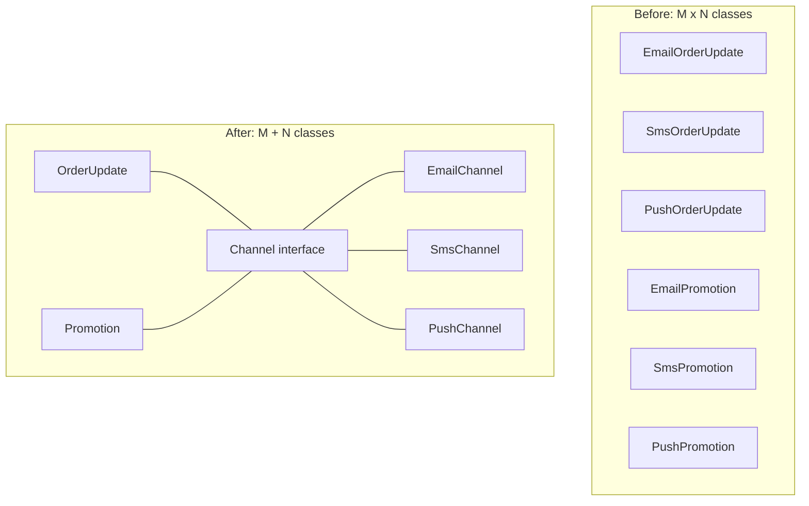
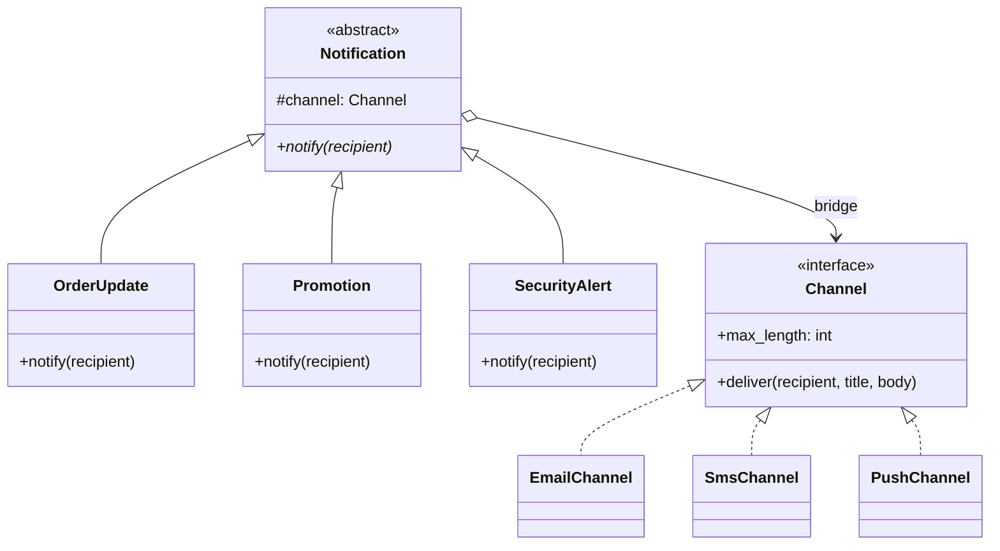

# Bridge Pattern

## Introduction

Think of a TV remote and a TV. Remotes come in several kinds (a basic remote, a remote with a voice button, a phone app). TVs come in several brands. You would never design one remote class per brand per remote kind. Instead, every remote talks to every TV through the same small set of signals: power, volume up, channel up. The remote is the **abstraction** (what the user wants to do), the TV is the **implementation** (how it actually happens), and the shared signal set is the **bridge** between them.

The **Bridge pattern** separates a class that varies in two independent directions into two hierarchies connected by composition. Each hierarchy can grow on its own. The GoF book states the intent as "decouple an abstraction from its implementation so that the two can vary independently."

The word "implementation" here does not mean "the code inside a method". It means a second hierarchy of low-level, platform-specific classes that the high-level classes delegate to.

In this page you will:

- see the "class explosion" that Bridge prevents
- build a bridge in Python between notification types and delivery channels
- learn how to design the implementation interface (the hardest part)
- find bridges in JDBC and Python's `logging` module
- learn when Bridge is overkill, and how it differs from Strategy, Adapter and Abstract Factory

## The Problem: A Class for Every Combination

The bookstore sends customers several kinds of messages: order updates, promotions and security alerts. It sends them through several channels: email, SMS and mobile push. The first version used inheritance for everything:

```python
# "Before": one class per (message kind x channel)
class EmailOrderUpdate:
    def send(self, to: str, order_id: str) -> None:
        print(f"[email to {to}] Subject: Order {order_id} | Your order {order_id} has shipped.")


class SmsOrderUpdate:
    def send(self, to: str, order_id: str) -> None:
        print(f"[sms to {to}] Order {order_id} shipped.")


class EmailPromotion:
    def send(self, to: str, code: str) -> None:
        print(f"[email to {to}] Subject: A gift for you | Use code {code} for 10% off.")


class SmsPromotion:
    def send(self, to: str, code: str) -> None:
        print(f"[sms to {to}] 10% off: {code}. Reply STOP to opt out.")

# ... and PushOrderUpdate, PushPromotion, EmailSecurityAlert, SmsSecurityAlert, PushSecurityAlert


EmailOrderUpdate().send("ana@example.com", "A-1001")
SmsPromotion().send("+15550100", "READ10")
```

Output:

```text
[email to ana@example.com] Subject: Order A-1001 | Your order A-1001 has shipped.
[sms to +15550100] 10% off: READ10. Reply STOP to opt out.
```

With 3 message kinds and 3 channels you need 9 classes. Add WhatsApp and a "back in stock" message and you need 20. Worse, the logic is duplicated in two directions:

- Email formatting (subject line, HTML wrapper) is copied into every `Email*` class.
- Promotion rules (opt-out text, quiet hours) are copied into every `*Promotion` class.

A change to either dimension touches many classes. This is the classic sign that you have **two independent dimensions** squeezed into **one inheritance tree**.



## The Pattern

Bridge splits the tree in two:

- **Abstraction**: the high-level side the client uses (`Notification`). It holds a reference to an implementor and builds its behavior from the implementor's primitive operations.
- **Refined abstractions**: variants of the high-level logic (`OrderUpdate`, `Promotion`, `SecurityAlert`).
- **Implementor**: the low-level interface (`Channel`) with a small set of primitives.
- **Concrete implementors**: platform-specific code (`EmailChannel`, `SmsChannel`, `PushChannel`).



### Step 1: The implementor interface

The implementor exposes **primitives**: small operations that every channel can do. It knows nothing about orders or promotions.

```python
from abc import ABC, abstractmethod
from dataclasses import dataclass
from typing import Protocol


class Channel(Protocol):
    max_length: int

    def deliver(self, recipient: str, title: str, body: str) -> None: ...


@dataclass
class EmailChannel:
    max_length: int = 10_000

    def deliver(self, recipient: str, title: str, body: str) -> None:
        print(f"[email to {recipient}] Subject: {title} | {body}")


@dataclass
class SmsChannel:
    max_length: int = 160

    def deliver(self, recipient: str, title: str, body: str) -> None:
        text = f"{title}: {body}"            # SMS has no subject line
        if len(text) > self.max_length:
            text = text[: self.max_length - 3] + "..."
        print(f"[sms to {recipient}] {text}")


@dataclass
class PushChannel:
    max_length: int = 120

    def deliver(self, recipient: str, title: str, body: str) -> None:
        print(f"[push to {recipient}] {title} / {body[: self.max_length]}")
```

### Step 2: The abstraction and its refinements

The abstraction holds a `Channel` and expresses business intent in terms of the channel's primitives.

```python
class Notification(ABC):
    def __init__(self, channel: Channel) -> None:
        self.channel = channel                      # the bridge

    @abstractmethod
    def notify(self, recipient: str) -> None: ...


class OrderUpdate(Notification):
    def __init__(self, channel: Channel, order_id: str, status: str) -> None:
        super().__init__(channel)
        self.order_id, self.status = order_id, status

    def notify(self, recipient: str) -> None:
        self.channel.deliver(recipient, f"Order {self.order_id}", f"Your order is {self.status}.")


class Promotion(Notification):
    def __init__(self, channel: Channel, code: str, opted_in: bool) -> None:
        super().__init__(channel)
        self.code, self.opted_in = code, opted_in

    def notify(self, recipient: str) -> None:
        if not self.opted_in:                       # rule written once, for every channel
            print(f"[skip] {recipient} has not opted in to marketing")
            return
        body = f"Use code {self.code} for 10% off."
        if self.channel.max_length < 200:           # adapt content, not channel internals
            body = f"10% off: {self.code}."
        self.channel.deliver(recipient, "A gift for you", body + " Reply STOP to opt out.")


class SecurityAlert(Notification):
    def notify(self, recipient: str) -> None:
        self.channel.deliver(recipient, "Security alert", "A new device signed in to your account.")
```

### Step 3: Mix and match at runtime

```python
email, sms, push = EmailChannel(), SmsChannel(), PushChannel()

OrderUpdate(email, "A-1001", "shipped").notify("ana@example.com")
OrderUpdate(sms, "A-1001", "shipped").notify("+15550100")
Promotion(push, "READ10", opted_in=True).notify("device-77")
Promotion(sms, "READ10", opted_in=False).notify("+15550199")
SecurityAlert(sms).notify("+15550100")
```

Output:

```text
[email to ana@example.com] Subject: Order A-1001 | Your order is shipped.
[sms to +15550100] Order A-1001: Your order is shipped.
[push to device-77] A gift for you / 10% off: READ10. Reply STOP to opt out.
[skip] +15550199 has not opted in to marketing
[sms to +15550100] Security alert: A new device signed in to your account.
```

Three message kinds and three channels now take 3 + 3 classes instead of 3 x 3. Adding WhatsApp is one new `Channel` class, and every existing message kind can use it immediately. Adding a "back in stock" message is one new `Notification` subclass, and it works on every channel.

```python
@dataclass
class WhatsAppChannel:
    max_length: int = 1000

    def deliver(self, recipient: str, title: str, body: str) -> None:
        print(f"[whatsapp to {recipient}] *{title}* {body}")


for note in (OrderUpdate(WhatsAppChannel(), "A-1002", "out for delivery"), SecurityAlert(WhatsAppChannel())):
    note.notify("+447700900123")
```

Output:

```text
[whatsapp to +447700900123] *Order A-1002* Your order is out for delivery.
[whatsapp to +447700900123] *Security alert* A new device signed in to your account.
```

## Designing the Implementor Interface

The implementor interface is where Bridge succeeds or fails. Guidelines:

1. **Primitives, not features.** `deliver(recipient, title, body)` is a primitive. `send_order_update(...)` is not, because it drags a business concept into the low-level side and recreates the M x N problem.
2. **Expose capabilities as data.** `max_length` lets the abstraction adapt its content without `isinstance` checks. Other examples: `supports_html`, `supports_attachments`.
3. **Keep it small.** Every method you add must be implemented by every concrete implementor. A large interface makes new implementors expensive.
4. **Abstractions may be richer than implementors.** The abstraction composes primitives into higher-level operations. That asymmetry is normal and is what makes the split useful.

:::tip Two questions to find the two dimensions
Ask "what does the user want to happen?" (the abstraction) and "what mechanism makes it happen?" (the implementor). If both answers have several variants that change for different reasons, you have a Bridge candidate.
:::

## Where You Have Already Met Bridge

| Where | Abstraction side | Implementation side |
| --- | --- | --- |
| Java JDBC | `java.sql` API your code uses (`Connection`, `Statement`) | Vendor drivers (PostgreSQL, MySQL, Oracle) implementing the `Driver` interfaces |
| Python `logging` | `Logger`: what to log, levels, filters | `Handler` subclasses: where records go (`StreamHandler`, `FileHandler`, `SysLogHandler`); attached with `logger.addHandler(...)` |
| Python DB-API code with SQLAlchemy | SQLAlchemy Core and ORM | Dialects and DBAPI drivers per database |
| Older Java AWT | `Component`, `Button` | Platform "peer" classes per operating system |

These examples are often described as Bridge because the two sides are separate hierarchies connected by composition and designed to vary independently. Some authors describe JDBC drivers as Adapters too. The labels overlap; what matters is recognizing the shape.

Here is the `logging` bridge in a few lines. Any logger can be connected to any handler:

```python
import logging
import sys

log = logging.getLogger("bookstore.checkout")
log.setLevel(logging.INFO)
log.propagate = False

handler = logging.StreamHandler(sys.stdout)           # implementor: where
handler.setFormatter(logging.Formatter("%(levelname)s %(name)s: %(message)s"))
log.addHandler(handler)                                # the bridge

log.info("order %s paid", "A-1001")
log.debug("not shown: below INFO")
```

Output:

```text
INFO bookstore.checkout: order A-1001 paid
```

Swap `StreamHandler` for `FileHandler("app.log")` and none of the code that calls `log.info` changes.

## Real-World Scenario

**Situation.** Your bookstore exports reports for the finance and warehouse teams: a sales report, an inventory report and a returns report. Each must be available as CSV for spreadsheets, HTML for the admin dashboard and, soon, as a JSON feed for a BI tool. The current code has `SalesCsvExporter`, `SalesHtmlExporter`, `InventoryCsvExporter` and so on, and a bug fix in CSV escaping had to be made in three places last month.

**Solution.**

1. Define a `ReportRenderer` implementor with primitives: `start(title)`, `header(columns)`, `row(values)`, `finish() -> str`.
2. Write `CsvRenderer`, `HtmlRenderer` and later `JsonRenderer`.
3. Write a `Report` abstraction with refined abstractions `SalesReport`, `InventoryReport` and `ReturnsReport`. Each one queries its data and calls the renderer's primitives.
4. The admin page chooses the renderer from the requested format.

```python
import csv
import io
import json


class CsvRenderer:
    def start(self, title: str) -> None:
        self._buf = io.StringIO()
        self._w = csv.writer(self._buf, lineterminator="\n")

    def header(self, columns: list[str]) -> None:
        self._w.writerow(columns)

    def row(self, values: list[object]) -> None:
        self._w.writerow(values)

    def finish(self) -> str:
        return self._buf.getvalue()


class JsonRenderer:
    def start(self, title: str) -> None:
        self._doc: dict = {"title": title, "rows": []}

    def header(self, columns: list[str]) -> None:
        self._cols = columns

    def row(self, values: list[object]) -> None:
        self._doc["rows"].append(dict(zip(self._cols, values)))

    def finish(self) -> str:
        return json.dumps(self._doc)


class Report(ABC):
    def __init__(self, renderer) -> None:
        self.renderer = renderer

    def render(self) -> str:
        r = self.renderer
        r.start(self.title())
        r.header(self.columns())
        for values in self.rows():
            r.row(values)
        return r.finish()

    @abstractmethod
    def title(self) -> str: ...
    @abstractmethod
    def columns(self) -> list[str]: ...
    @abstractmethod
    def rows(self) -> list[list[object]]: ...


class SalesReport(Report):
    def title(self) -> str:
        return "Sales, week 41"

    def columns(self) -> list[str]:
        return ["isbn", "title", "copies"]

    def rows(self) -> list[list[object]]:
        return [["978-0321125217", "Domain-Driven Design, \"blue book\"", 12],
                ["978-0262510875", "SICP", 7]]


print(SalesReport(CsvRenderer()).render())
print(SalesReport(JsonRenderer()).render())
```

Output:

```text
isbn,title,copies
978-0321125217,"Domain-Driven Design, ""blue book""",12
978-0262510875,SICP,7

{"title": "Sales, week 41", "rows": [{"isbn": "978-0321125217", "title": "Domain-Driven Design, \"blue book\"", "copies": 12}, {"isbn": "978-0262510875", "title": "SICP", "copies": 7}]}
```

CSV escaping now lives in exactly one class, and the BI team's JSON feed took one new class. (Notice that `Report.render` is also a [Template Method](../4-arch-behavioral-patterns/4-arch-template-method.mdx); patterns combine naturally.)

**Why this approach.** Report content changes when the business asks new questions; renderers change when output formats or tools change. Those are different reasons to change, owned by different people, so they belong in different hierarchies.

**When to use it.**

- Two or more dimensions vary independently and you already see (or clearly expect) several variants of each.
- You want to choose or swap the low-level side at runtime or by configuration.
- You are building something cross-platform: drivers, renderers, storage backends, UI toolkits.

**When not to use it.**

- Only one dimension really varies. Then a plain interface with a few implementations (or a [Strategy](../4-arch-behavioral-patterns/0-arch-strategy.mdx)) is simpler.
- You have two variants on each side and no sign of more. Four small classes, or one class with a parameter, may be clearer than two hierarchies.
- The "implementation" cannot be expressed with a small set of primitives. A leaky implementor interface that grows a method per abstraction is worse than no bridge.

**Alternatives and trade-offs.**

| Approach | Pros | Cons | Best for |
| --- | --- | --- | --- |
| Inheritance per combination | Obvious, no indirection | M x N classes, duplicated logic | Very few combinations that will not grow |
| Bridge | M + N classes, each side evolves alone | Upfront design of the implementor interface; more indirection | Two real, independent dimensions |
| Strategy passed per call | Very light, easy to swap | Usually one dimension only; no abstraction hierarchy | Swapping one algorithm |
| Configuration flags inside one class | Fast to write | `if format == ...` spreads, violates Open/Closed | Prototypes and scripts |
| Plugin system | Third parties can add implementors | Loading, versioning and discovery overhead | Platforms with external extensions (see [Microkernel](../6-arch-architectural-styles/7-arch-microkernel.mdx)) |

## Common Mistakes

- **Calling every interface a Bridge.** One interface with several implementations is just polymorphism. Bridge needs a *second* hierarchy on the abstraction side, or at least the clear prospect of one.
- **Business concepts in the implementor.** If `Channel` grows `send_promotion`, you are rebuilding the M x N problem one layer down.
- **`isinstance` checks in the abstraction.** `if isinstance(self.channel, SmsChannel)` defeats the decoupling. Expose a capability instead, as `max_length` does.
- **Designing a Bridge too early.** The pattern pays off when both dimensions vary. If you are guessing about the second dimension, wait; refactoring to Bridge later is straightforward (see [Refactoring to Patterns](../5-arch-modern-patterns/8-arch-refactoring-to-patterns.mdx)).
- **Forgetting construction.** Something must pair abstractions with implementors. Keep it in one place, such as a factory or the composition root; an [Abstract Factory](../2-arch-creational-patterns/3-arch-abstract-factory.mdx) helps when certain abstractions only work with certain implementors.

## Bridge vs Similar Patterns

| Pattern | Looks like | Key difference |
| --- | --- | --- |
| [Strategy](../4-arch-behavioral-patterns/0-arch-strategy.mdx) | An object holding a swappable helper | Strategy swaps one *algorithm*; Bridge separates two *hierarchies* that each grow |
| [Adapter](./0-arch-adapter.mdx) | Delegating to another object | Adapter is retrofitted to make existing incompatible code fit; Bridge is designed up front |
| [Abstract Factory](../2-arch-creational-patterns/3-arch-abstract-factory.mdx) | Families of related classes | Abstract Factory *creates* matching objects; it is often used to build the right bridge pairs |
| [State](../4-arch-behavioral-patterns/3-arch-state.mdx) | Delegating to a swappable object | State objects change themselves as the context's state changes |

Structurally, Bridge, Strategy, State and Adapter all "hold a reference and delegate". Tell them apart by intent: *why* is the delegate there and *what* varies?

## Summary

- Bridge splits one class hierarchy that varies in two directions into an abstraction hierarchy and an implementation hierarchy, joined by composition.
- It turns M x N classes into M + N, and keeps each dimension's logic in one place.
- The implementor interface should contain small primitives and capability data, not business features.
- You already use bridges: JDBC drivers, `logging` loggers and handlers, SQLAlchemy dialects.
- Do not use it when only one dimension varies, or when you are only guessing about the second one.

## Exercises

1. Add a `BackInStock` notification that includes a book title and a link. On SMS, drop the link if the text would exceed `max_length`.
2. Add an `HtmlRenderer` for the reports that escapes cell values with `html.escape`. Did you need to change any `Report` class?
3. Your colleague proposes adding `send_invoice_pdf()` to `Channel`. Explain why that is a problem, and suggest a primitive that would serve the same need.
4. Look at a codebase you know for class names that combine two words from two lists (for example `S3ImageUploader`, `GcsVideoUploader`). Sketch the Bridge.

**Related pages:** [Adapter Pattern](./0-arch-adapter.mdx), [Strategy Pattern](../4-arch-behavioral-patterns/0-arch-strategy.mdx), [Composition over Inheritance](../1-arch-design-principles/7-arch-composition-over-inheritance.mdx), and [Choosing a Structural Pattern](./7-arch-choosing-structural.mdx).
