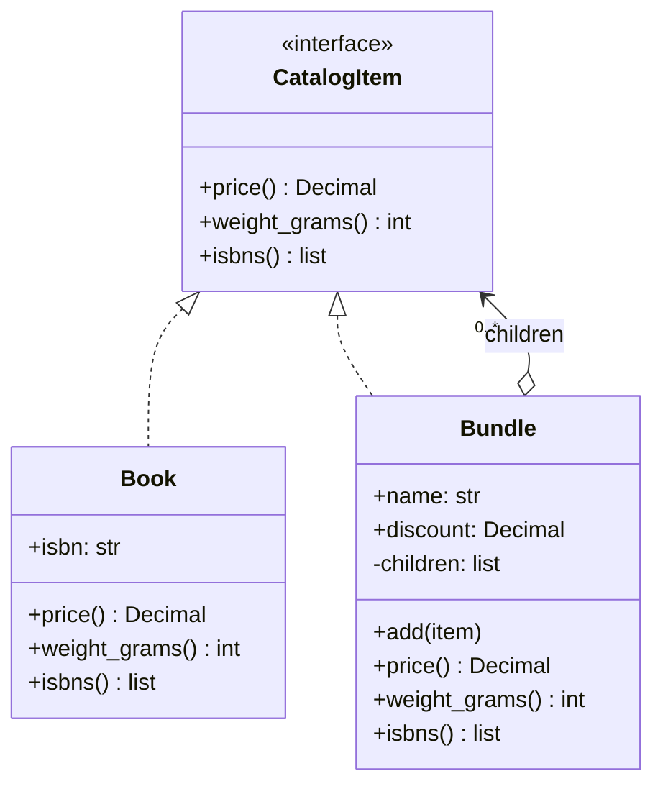
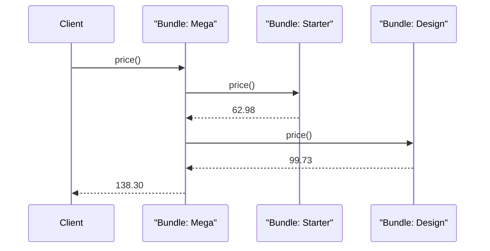

# Composite Pattern

## Introduction

A folder on your computer can contain files and other folders. When you ask "how big is this folder?", you do not care whether each entry is a file or a folder: files report their own size, folders add up the sizes of whatever is inside them. You ask the same question of both, and the answer bubbles up the tree.

The **Composite pattern** lets you build **tree structures** of objects and then treat a single object (a *leaf*) and a group of objects (a *composite*) through the same interface. The GoF intent is to "compose objects into tree structures to represent part-whole hierarchies" so that "clients treat individual objects and compositions of objects uniformly."

You use Composite whenever your data is naturally a tree: product bundles, UI widgets, document sections, org charts, permission groups, nested rules, and file systems.

In this page you will:

- see the `isinstance` mess that appears without Composite
- build a composite product catalog in Python with a shared interface
- choose between the "transparent" and "safe" variants
- handle real tree problems: cycles, deep nesting and caching
- see Composite in the DOM, Java Swing and React
- learn when a plain list or dict is better

## The Problem: Code That Keeps Asking "What Are You?"

The bookstore sells single books and **bundles**: a "Python Starter Pack" contains two books, and a "Developer Mega Bundle" contains the starter pack, another bundle and a single book. Bundles get a discount. The first version of the pricing code looked like this:

```python
# "Before": callers must know the structure
from decimal import Decimal


def bundle_price(item: dict) -> Decimal:
    if item["type"] == "book":
        return item["price"]
    if item["type"] == "bundle":
        total = Decimal("0")
        for child in item["items"]:
            if child["type"] == "book":
                total += child["price"]
            elif child["type"] == "bundle":
                total += bundle_price(child)          # remember to recurse!
        return (total * (1 - item["discount"])).quantize(Decimal("0.01"))
    raise ValueError(item["type"])


starter = {"type": "bundle", "discount": Decimal("0.10"), "items": [
    {"type": "book", "price": Decimal("39.99")},
    {"type": "book", "price": Decimal("29.99")},
]}
print(bundle_price(starter))
```

Output:

```text
62.98
```

It works, but:

- **Every operation repeats the type checks.** Shipping weight, stock availability, "list all ISBNs" and tax all need the same `if type == ...` recursion.
- **Adding a new kind of item** (an e-book, a gift card) means editing every one of those functions.
- **The rules for a bundle live outside the bundle**, scattered across the codebase.

## The Pattern

Composite gives leaves and composites the same interface. A composite implements each operation by delegating to its children and combining the results.



The roles:

| Role | In our example | Responsibility |
| --- | --- | --- |
| Component | `CatalogItem` | The shared interface for everything in the tree |
| Leaf | `Book` | Does the real work; has no children |
| Composite | `Bundle` | Stores children and implements operations by delegating to them |
| Client | Cart, shipping, reports | Works only with `CatalogItem` |

### Building it in Python

```python
from __future__ import annotations

from dataclasses import dataclass, field
from decimal import Decimal
from typing import Protocol

CENT = Decimal("0.01")


class CatalogItem(Protocol):
    def price(self) -> Decimal: ...
    def weight_grams(self) -> int: ...
    def isbns(self) -> list[str]: ...


@dataclass(frozen=True)
class Book:
    isbn: str
    title: str
    list_price: Decimal
    grams: int

    def price(self) -> Decimal:
        return self.list_price

    def weight_grams(self) -> int:
        return self.grams

    def isbns(self) -> list[str]:
        return [self.isbn]


@dataclass
class Bundle:
    name: str
    discount: Decimal = Decimal("0")
    children: list[CatalogItem] = field(default_factory=list)

    def add(self, *items: CatalogItem) -> Bundle:
        self.children.extend(items)
        return self

    def price(self) -> Decimal:
        subtotal = sum((c.price() for c in self.children), Decimal("0"))
        return (subtotal * (1 - self.discount)).quantize(CENT)

    def weight_grams(self) -> int:
        return sum(c.weight_grams() for c in self.children) + 50   # 50 g of packaging

    def isbns(self) -> list[str]:
        return [isbn for c in self.children for isbn in c.isbns()]
```

The client code no longer cares what it holds:

```python
fluent = Book("978-1492056355", "Fluent Python", Decimal("39.99"), 1100)
crash = Book("978-1718502703", "Python Crash Course", Decimal("29.99"), 1000)
ddd = Book("978-0321125217", "Domain-Driven Design", Decimal("54.99"), 1200)
gof = Book("978-0201633610", "Design Patterns", Decimal("49.99"), 900)

starter = Bundle("Python Starter Pack", Decimal("0.10")).add(fluent, crash)
design = Bundle("Design Classics", Decimal("0.05")).add(ddd, gof)
mega = Bundle("Developer Mega Bundle", Decimal("0.15")).add(starter, design)


def describe(item: CatalogItem) -> str:
    return f"{item.price():>7} USD, {item.weight_grams():>5} g, {len(item.isbns())} book(s)"


for item in (fluent, starter, mega):
    print(f"{getattr(item, 'title', getattr(item, 'name', '?')):<22}", describe(item))
```

Output:

```text
Fluent Python            39.99 USD,  1100 g, 1 book(s)
Python Starter Pack      62.98 USD,  2150 g, 2 book(s)
Developer Mega Bundle   138.30 USD,  4350 g, 4 book(s)
```

`describe` has no `if`. The mega bundle's price is computed by asking each child bundle for its price, and each of those asks its books. Here is that recursion at runtime:



Adding an e-book is one new leaf class with `weight_grams()` returning 0, and every existing operation works with it.

### The same idea in Java

Java makes the shared interface explicit. The pattern is identical; the type checker now guarantees that every node supports every operation.

```java
import java.math.BigDecimal;
import java.math.RoundingMode;
import java.util.ArrayList;
import java.util.List;

interface CatalogItem {
    BigDecimal price();
}

record Book(String title, BigDecimal listPrice) implements CatalogItem {
    public BigDecimal price() { return listPrice; }
}

final class Bundle implements CatalogItem {
    private final List<CatalogItem> children = new ArrayList<>();
    private final BigDecimal discount;

    Bundle(String discount) { this.discount = new BigDecimal(discount); }

    Bundle add(CatalogItem item) { children.add(item); return this; }

    public BigDecimal price() {
        BigDecimal subtotal = children.stream()
            .map(CatalogItem::price)
            .reduce(BigDecimal.ZERO, BigDecimal::add);
        return subtotal.multiply(BigDecimal.ONE.subtract(discount)).setScale(2, RoundingMode.HALF_EVEN);
    }
}

public class Main {
    public static void main(String[] args) {
        CatalogItem starter = new Bundle("0.10")
            .add(new Book("Fluent Python", new BigDecimal("39.99")))
            .add(new Book("Python Crash Course", new BigDecimal("29.99")));
        System.out.println(starter.price());
    }
}
```

Output:

```text
62.98
```

## Transparent vs Safe Composites

Where do `add` and `remove` belong? The GoF book discusses two options:

| Variant | `add`/`remove` declared on | Pros | Cons |
| --- | --- | --- | --- |
| **Transparent** | The component interface (so leaves have them too) | Clients never need to know leaf from composite | Leaves must raise an error on `add`; mistakes found at runtime |
| **Safe** | Only the composite class | Type checker prevents adding to a leaf | Clients that build trees must know they have a composite |

The example above uses the **safe** variant: `CatalogItem` only declares read operations, and `add` exists only on `Bundle`. In typed languages this is usually the better choice. Code that *builds* the tree knows it is building bundles; code that *uses* the tree only needs the shared operations.

## Real Trees Have Real Problems

Toy examples skip the hard parts. Production composites need to handle these:

### Cycles

If a bundle ever contains itself, directly or indirectly, every recursive operation loops forever (in Python, until `RecursionError`). Guard against it when adding children:

```python
class SafeBundle(Bundle):
    def contains(self, item: CatalogItem) -> bool:
        return any(c is item or (isinstance(c, SafeBundle) and c.contains(item)) for c in self.children)

    def add(self, *items: CatalogItem) -> "SafeBundle":
        for item in items:
            if item is self or (isinstance(item, SafeBundle) and item.contains(self)):
                raise ValueError(f"adding {getattr(item, 'name', item)!r} would create a cycle")
        return super().add(*items)


a = SafeBundle("A")
b = SafeBundle("B").add(a)
try:
    a.add(b)
except ValueError as exc:
    print(exc)
```

Output:

```text
adding 'B' would create a cycle
```

When trees come from a database or user input, also validate on load, not only on `add`.

### Depth and performance

- Recursive operations cost time proportional to the number of nodes. For a few hundred nodes that is nothing. For large trees that are read often (a category tree with 100,000 nodes rendered on every page), **cache** computed values on the composite and invalidate them when children change.
- Python's default recursion limit is about 1,000 frames (`sys.getrecursionlimit()`). Very deep trees, such as a long comment thread stored as nested replies, may need an iterative traversal with an explicit stack.

### Parent references

Sometimes a child needs its parent (to compute a breadcrumb path, or to bubble an event up as the DOM does). If you add a `parent` field, keep it consistent in exactly one place, usually `add`/`remove` on the composite.

### Operations that do not fit

If you keep adding operations (price, weight, tax, export to XML, export to JSON, validate...), the component interface grows forever. When operations change more often than node types, consider moving them out of the tree with [Visitor](../4-arch-behavioral-patterns/9-arch-visitor.mdx), or simply write functions that walk the tree using an [Iterator](../4-arch-behavioral-patterns/6-arch-iterator.mdx).

## Where You Have Already Met Composite

| Where | Leaf | Composite |
| --- | --- | --- |
| The HTML DOM | Text nodes | Elements, whose `children` can be elements or text; `node.appendChild(...)` |
| Java AWT and Swing | `Button`, `Label` | `java.awt.Container`, which is itself a `Component` and has `add(Component)` |
| React and other UI frameworks | A `button` element | A component that renders other components; the whole UI is a tree |
| File systems | Files | Directories |
| Python's `ast` module | Constants, names | Statements and expressions containing other nodes |
| Access control | Users | Groups that contain users and other groups |

## Real-World Scenario

**Situation.** Your bookstore's back-office uses role groups for permissions. Alice is in "Support Leads". "Support Leads" is inside "Support". The "Refund Approvers" group contains "Support Leads", "Finance" and one named contractor. An auditor asks: "Exactly which people can approve refunds?" The current code answers with a SQL query that only looks one level deep, so it misses people in nested groups.

**Solution.** Model members as a composite. Users are leaves; groups are composites. Expose one operation, `members()`, and guard against cycles at query time because the data is edited by humans through an admin UI.

```python
from __future__ import annotations

from dataclasses import dataclass, field
from typing import Protocol


class Principal(Protocol):
    def members(self, _seen: set[int] | None = None) -> set[str]: ...


@dataclass(frozen=True)
class User:
    email: str

    def members(self, _seen: set[int] | None = None) -> set[str]:
        return {self.email}


@dataclass(eq=False)
class Group:
    name: str
    children: list[Principal] = field(default_factory=list)

    def members(self, _seen: set[int] | None = None) -> set[str]:
        seen = _seen if _seen is not None else set()
        if id(self) in seen:                 # tolerate cycles in stored data
            return set()
        seen.add(id(self))
        result: set[str] = set()
        for child in self.children:
            result |= child.members(seen)
        return result


support = Group("Support", [User("bo@shop.test")])
leads = Group("Support Leads", [User("alice@shop.test")])
support.children.append(leads)
finance = Group("Finance", [User("cy@shop.test"), User("dee@shop.test")])
refunds = Group("Refund Approvers", [leads, finance, User("ext-eve@contractor.test")])
leads.children.append(refunds)              # oops: someone created a cycle in the admin UI

print("Refund approvers:", sorted(refunds.members()))
print("Support:", sorted(support.members()))
```

Output:

```text
Refund approvers: ['alice@shop.test', 'cy@shop.test', 'dee@shop.test', 'ext-eve@contractor.test']
Support: ['alice@shop.test', 'bo@shop.test', 'cy@shop.test', 'dee@shop.test', 'ext-eve@contractor.test']
```

The first line answers the auditor. The second line shows why cycle handling matters: because of the accidental cycle (Refund Approvers inside Support Leads), the Finance staff and the contractor are now reported as members of Support. The composite made that visible in one line of code, and the cycle guard kept it from crashing. The audit report should flag cycles, and the admin UI should reject them on save, as `SafeBundle` did above.

**Why this approach.** Group membership is a genuine part-whole hierarchy of unknown depth. The composite gives one, recursive definition of "members", which is exactly what an auditor needs. The rest of the app, such as "can this person approve a refund?", becomes `email in refunds.members()`.

**When to use it.**

- The data is a tree (or should be), of arbitrary depth.
- Clients should treat single items and groups the same way.
- Several operations need to aggregate over the tree.

**When not to use it.**

- The structure is flat or fixed at two levels (an order with line items). A list plus a loop is clearer.
- Leaves and groups have mostly *different* operations. Forcing a shared interface leads to many methods that raise `NotImplementedError`.
- The data is a general graph with sharing and cycles by design (a social network). Use graph algorithms (see [algorithm tutorials](/docs/fundamental/algorithm)) or a graph database rather than a tree pattern.
- Huge trees stored in a relational database. Loading the whole tree into objects to compute one sum may be far slower than a recursive SQL query (`WITH RECURSIVE`).

**Alternatives and trade-offs.**

| Approach | Pros | Cons | Best for |
| --- | --- | --- | --- |
| Composite objects | Uniform API, logic lives with the nodes | Interface can bloat; recursion costs | In-memory trees with several operations |
| Nested dicts plus helper functions | No classes, easy to serialize | `isinstance`/type checks everywhere | Configuration and small scripts |
| Recursive SQL query | Fast on big stored trees | Logic in SQL, harder to unit-test | Large hierarchies in a relational DB |
| Visitor over a composite | Add operations without touching node classes | Adding node types is harder | Stable node types, many operations |
| Flattened path or closure table | Fast subtree queries | More complex writes | Read-heavy category trees |

## Common Mistakes

- **Leaking type checks back in.** If clients still write `isinstance(item, Bundle)`, the shared interface is missing an operation.
- **No cycle protection** when the tree comes from users or a database.
- **Mutable shared children.** If the same `Bundle` object is placed inside two other bundles, changing it changes both. Sometimes that is intended (a shared component), often it is not. Decide explicitly, and use [Prototype](../2-arch-creational-patterns/5-arch-prototype.mdx)-style copies when you need independence.
- **Recomputing large aggregates on every request.** Cache totals in the composite and invalidate on change, or precompute.
- **One giant component interface.** Keep the shared interface to operations that make sense for *every* node. Apply [Interface Segregation](../1-arch-design-principles/4-arch-interface-segregation.mdx).

## Composite vs Similar Patterns

| Pattern | Relationship to Composite |
| --- | --- |
| [Decorator](./3-arch-decorator.mdx) | Also recursive composition, but a decorator has exactly **one** child and adds behavior; a composite has **many** children and aggregates them |
| [Iterator](../4-arch-behavioral-patterns/6-arch-iterator.mdx) | Commonly used to walk a composite without exposing its structure |
| [Visitor](../4-arch-behavioral-patterns/9-arch-visitor.mdx) | Adds new operations to a composite without changing node classes |
| [Chain of Responsibility](../4-arch-behavioral-patterns/5-arch-chain-of-responsibility.mdx) | Often runs along parent links in a composite, like DOM event bubbling |
| [Flyweight](./5-arch-flyweight.mdx) | Shared leaves in a large composite can be flyweights to save memory |

## Summary

- Composite builds part-whole trees and lets clients treat leaves and groups through one interface.
- Composites implement operations by delegating to children and combining results, so recursion lives in one place.
- Prefer the "safe" variant in typed code: only composites have `add`/`remove`.
- Production trees need cycle protection, depth awareness, caching and clear ownership of shared children.
- You already use it in the DOM, Swing's `Container`, React component trees, file systems and nested permission groups.
- Do not use it for flat or fixed-depth data, or for general graphs.

## Exercises

1. Add an `EBook` leaf to the catalog with zero weight and a `download_url`. Which existing code changed?
2. Add an `in_stock()` operation: a bundle is in stock only if all of its children are. Then add `missing_isbns()` that lists the out-of-stock books.
3. Cache `Bundle.price()` and make sure the cache is invalidated when a child is added anywhere *below* the bundle. (Hint: you will need parent references.)
4. Rewrite `Group.members()` iteratively with an explicit stack so it works for a nesting depth of 10,000.

**Related pages:** [Decorator Pattern](./3-arch-decorator.mdx), [Visitor Pattern](../4-arch-behavioral-patterns/9-arch-visitor.mdx), [Iterator Pattern](../4-arch-behavioral-patterns/6-arch-iterator.mdx), and [Choosing a Structural Pattern](./7-arch-choosing-structural.mdx).
